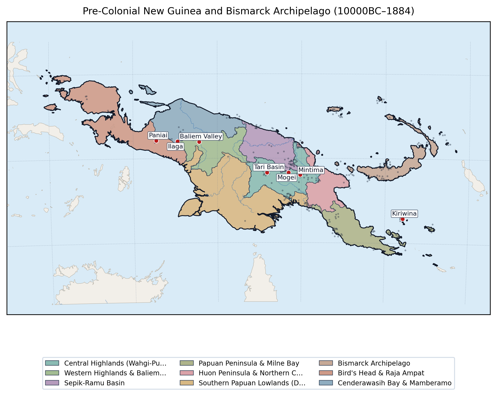

```{r setup, include=FALSE}
knitr::opts_chunk$set(echo = FALSE, warning = FALSE, message = FALSE, fig.pos = "htbp")
source("../../_shared/template/viscount_rmd_helpers.R")
library(jsonlite)

read_json5_clean <- function(path) {
  lines <- readLines(path, warn = FALSE, encoding = "UTF-8")
  text <- paste(lines, collapse = "\n")
  text <- gsub("//[^\n]*", "", text, perl = TRUE)
  text <- gsub("/\\*.*?\\*/", "", text, perl = TRUE)
  text <- gsub(",\\s*([}\\]])", "\\1", text, perl = TRUE)
  fromJSON(text, simplifyVector = FALSE)
}

summary_data <- fromJSON("precolonial_new_guinea_summary_cache.json", simplifyVector = FALSE)
sett_data <- fromJSON("precolonial_new_guinea_settlements.json", simplifyVector = FALSE)
ledger_data <- read_json5_clean("precolonial_new_guinea_source_ledger.json5")

clean_label <- function(x) {
  s <- as.character(x)
  s <- gsub("&", "and", s, fixed = TRUE)
  s <- gsub("\\\\", "", s)
  trimws(s)
}

fmt_era <- function(y) {
  yv <- as.integer(y)
  if (yv < 0L) return(paste0(abs(yv), "BC"))
  if (yv == 0L) return("1AD")
  as.character(yv)
}

subregions <- summary_data$subregions
submask_cov <- ledger_data$saturation_audit$submask_coverage
reg_lookup <- setNames(
  vapply(subregions, function(r) clean_label(r$name), character(1)),
  vapply(subregions, function(r) r$id, character(1))
)

tot_10000 <- as.numeric(summary_data$domain_totals[["-10000"]])
tot_3000 <- as.numeric(summary_data$domain_totals[["-3000"]])
tot_0 <- as.numeric(summary_data$domain_totals[["0"]])
tot_1884 <- as.numeric(summary_data$domain_totals[["1884"]])
tot_area <- as.numeric(summary_data$total_area_km2)
n_sites <- as.integer(summary_data$settlement_count)
n_obs <- as.integer(summary_data$observation_count)
```

```{r hero-md-fallback, results='asis'}
if (!knitr::is_latex_output()) {
  cat("\n\n")
}
```

# Abstract

Between the Pleistocene-Holocene boundary in 10000BC and the partition of eastern New Guinea by Britain and Germany in 1884, the human population of New Guinea and the Bismarck Archipelago expanded more than twelvefold without centralised states, cereal granaries or metal ploughs. Partitioning the `r viscount_fmt_number(round(tot_area), 0L)` km² domain across nine HydroBASINS watersheds that dissolve the anachronistic 141st meridian, aggregate population grew from 180k (180.000, mean density 0,18 inhabitants per km²) in 10000BC to 598k (598.000, 0,61 inhabitants per km²) in 3000BC, reached 1,19M (1.189.000, 1,22 inhabitants per km²) by 1AD and stood at 2,24M (2.240.000, 2,3 inhabitants per km²) in 1884 [@denham2024resonating; @bergstrom2017neolithic]. Early Holocene demographic growth was anchored by independent vegetative agriculture in the montane valleys of the central cordillera, where swamp drainage, mounding and arboriculture at Kuk Swamp domesticated taro, yam and banana from roughly 8000BC to 4500BC [@denham2003origins; @denham2026clarifying; @anonymous2017ten]. Around 1400BC, Austronesian-speaking Lapita mariners established ceramic coastal villages across the Bismarck Archipelago, catalysing obsidian, shell and pottery exchange networks that later evolved into the Vitiaz Strait, Motu Hiri and Massim Kula voyaging circuits [@cochrane2018evolution; @hogg2024lapita; @david2016ruisasi; @liu2022assessing]. Following the introduction of the South American sweet potato after 1600, intensive pig-and-tuber horticulture lifted the Central Highlands (620k, 7,6 inhabitants per km²) and the Western Highlands and Baliem Valley (365k, 5,2 inhabitants per km²) to 44% of the regional total on barely 15,6% of the landmass, contrasting sharply with malarious lowland basins such as the Digul-Fly plains (175k, 0,79 inhabitants per km²) and Bird's Head and Raja Ampat (135k, 0,77 inhabitants per km²). This study calibrates regional demographic curves against 81 HydroBASINS historical GIS watershed enumerations, genetic and palaeoecological reconstructions and an evidence-based gazetteer of `r viscount_fmt_number(n_sites, 0L)` catalogued habitation locales encompassing `r viscount_fmt_number(n_obs, 0L)` archaeological and ethnohistorical observations.

# Background

## Pleistocene Sahul Foundations and Early Maritime Crossing

Human settlement on New Guinea and the Bismarck Archipelago belongs to the earliest chapter of modern human expansion beyond mainland Asia. During the Late Pleistocene, lowered sea levels joined Australia, New Guinea and Tasmania into the single landmass of Sahul, separated from Sunda only by the deep-water island straits of Wallacea [@lamb2019pleistocene]. Foragers crossed those channels and occupied the Huon Peninsula coral terraces at Bobongara and the montane Ivane Valley at Kosipe by 49.000 to 44.000 years ago, clearing forest margins with waisted stone axes, processing wild pandanus nuts and yams and adapting to cool, seasonally frosty sub-alpine environments well above 1.800 m elevation [@groube1986huon; @fairbairn2006pleistocene; @summerhayes2010human; @horrocks2025palaeoecolog].

Equally striking was the rapid colonisation of Near Oceania across open water. By 35.000 to 40.000 years ago, Pleistocene voyagers had crossed the Vitiaz Strait into West New Britain and New Ireland, establishing early occupation horizons at Yombon, Matenkupkum and Buang Merabak alongside obsidian extraction quarries on the Willaumez Peninsula near Talasea [@allen1989human; @leavesley2002buang; @torrence2004pleistocene]. By the Last Glacial Maximum, volcanic glass from Talasea was moving over sea and land across the Bismarck arc, while lowland limestone caves on the Bird's Head (Toé and Kria), northern littoral shelters along the Vanimo coast (Lachitu) and central highland rock shelters (Nombe, Yuku, Kiowa and Kafiavana) anchored persistent foraging economies across both coastal and interior belts [@shipton2026fluctuating; @roberts2017persistent].

As post-glacial warming melted polar ice sheets after 15000BC, rising seas submerged the Arafura and Torres Strait shelf, separating New Guinea from northern Australia by roughly 6000BC and reshaping biogeographic barriers across the Australo-Papuan zone [@lamb2019pleistocene]. At our opening benchmark of 10000BC, New Guinea and the Bismarcks already supported an estimated 180k inhabitants (0,18 inhabitants per km²), a density roughly four times higher than contemporary post-glacial Europe. Unlike temperate tundra, New Guinea offered year-round equatorial rainfall, vertical ecological zonation from coral reefs to montane cloud forest and rich starch palms (sago, *Metroxylon sagu*) in lowland swamps alongside pandanus, yams and marsupial game in the interior [@roberts2017persistent; @haberle2007prehistoric; @horrocks2025palaeoecolog].

## Kuk Swamp and the Independent Highland Agricultural Revolution

Between 10000BC and 3000BC, New Guinea became one of the world's handful of primary, independent centres of plant domestication. Excavations across the upper Wahgi Valley at Kuk Swamp (1.560 m elevation) document a phased transition from early Holocene plant exploitation and localised forest disturbance around 8000BC (Phase 1) to deliberate wetland mounding around 5000BC (Phase 2) and gridded ditch drainage systems by 2500BC (Phase 3), reinforced by independent mid-Holocene Neolithic material innovations excavated at Waim [@denham2003origins; @denham2003golson; @denham2011early; @shaw2020emergence; @denham2026clarifying; @anonymous2017ten]. Microfossil starch grains, phytoliths and pollen cores confirm that highland cultivators independently domesticated *Colocasia* taro, greater yam (*Dioscorea*), *Musa* bananas, sugarcane (*Saccharum officinarum*) and green leafy vegetables without borrowing cereals or domesticates from East Asia [@denham2003origins; @haberle2007prehistoric; @horrocks2025palaeoecolog].

Highland agriculture did not displace foraging overnight. Stable isotope measurements from highland human and faunal remains indicate that persistent tropical rainforest hunting and gathering coexisted beside wetland gardening throughout the early and middle Holocene, buffering communities against frosts, El Niño droughts and soil exhaustion [@roberts2017persistent; @barker2023holocene]. Yet the cumulative demographic effect of vegetative cultivation was decisive. Genome-wide analyses of modern Papuan populations reveal a pronounced Neolithic-era demographic expansion beginning around 8000BC to 5000BC that diverged sharply from the sparser trajectories of lowland riverine groups, accompanied by deep genetic differentiation across neighbouring mountain valleys [@bergstrom2017neolithic; @quinn2024population]. Long-term residence in cool, malaria-free intermontane basins above 1.400 m also drove measurable positive genetic selection for high-altitude physiological traits and local pathogen resistance [@gonzalez_buenfil2024genetic].

By 3000BC, aggregate population across the nine watersheds had more than tripled from 180k to 598k (0,61 inhabitants per km²). The Central Highlands (Wahgi-Purari) climbed from 32k to 145k (1,78 inhabitants per km²) and the Western Highlands and Baliem Valley surged from 22k to 85k (1,21 inhabitants per km²), lifting the two highland corridors from 30% of the domain population in 10000BC to 38,5% by 3000BC. Outside the cordillera, population grew more gradually along the Sepik-Ramu floodplains (24k to 75k), the Papuan Peninsula (20k to 65k) and the Huon littoral (16k to 52k), where sago arboriculture, taro swiddens and coastal reef fishing set lower demographic ceilings under endemic lowland malaria [@bergstrom2017neolithic; @shipton2026fluctuating].

## Lapita Mariners, Bismarck Obsidian and Coastal Exchange Circuits

Around 1400BC to 1300BC, a second transformative horizon reached Near Oceania. Austronesian-speaking seafarers carrying dentate-stamped Lapita earthenware, shell adzes, outrigger sailing canoes, domestic pigs, dogs, chickens and the commensal Pacific rat (*Rattus exulans*) settled stilt-house coastal villages across the Bismarck Archipelago [@specht2014deconstructing; @cochrane2018evolution; @hingston2015phylogeograp; @o_connor2011power]. Early Lapita settlements at Talepakemalai in the Mussau Islands, Tamuarawai (EQS) on Emirau Island in New Ireland, Apalo in the Arawe Islands and Rakival on Watom Island established maritime hubs linking local Bismarck obsidian quarries to voyages extending east through the Solomons, Vanuatu, New Caledonia, Fiji and western Polynesia [@summerhayes2009tamuarawai; @hogg2024lapita; @ross_sheppard2013kutau].

Talasea obsidian from the Kutau and Bao flows on West New Britain became a diagnostic tracer of this oceanic network, moving thousands of kilometres east into northeastern Fiji while simultaneously supplying domestic cutting, scraping and scarification blades across the Bismarcks and northern New Guinea [@ross_sheppard2013kutau; @douglass2011experimental; @ambrose2011oceanic]. Carefully stratified north-coast excavations and critical chronological reviews demonstrate that unambiguous domestic pigs and pottery became entrenched in Melanesia with this late Holocene Austronesian horizon rather than in earlier mid-Holocene strata, even though northern coastal groups at Watinglo and Lachitu already maintained active shell and stone bead exchange networks [@o_connor2011power; @oconnor2010stone; @shipton2026fluctuating].

On the New Guinea mainland, ceramic and Austronesian influences filtered inland selectively without replacing Papuan languages across the interior. By 1000BC, pottery appeared on the northern highland fringe at Wañelek in the Kaironk-Simbai corridor, while ancient DNA from coastal Papua New Guinea over the past 2.500 years reveals recurrent maritime dispersals, admixture with resident Papuan populations and rapid regional network restructuring [@gaffney2015earliest; @nagele2025impact; @denham2024resonating]. Along the south Papuan coast, Lapita settlements at Caution Bay and the Early Papuan Pottery phase anchored at Oposisi on Yule Island and Ruisasi 1 inaugurated mass-produced coastal ceramics around 900BC to 1AD [@david2011lapita; @allen2010data; @david2016ruisasi]. By 1AD, total population across New Guinea and the Bismarcks crossed the million mark to 1,19M (1.189.000, 1,22 inhabitants per km²), led by 310k in the Central Highlands, 185k in the Western Highlands and Baliem Valley, 145k in the Sepik-Ramu Basin and 125k along the Papuan Peninsula and Milne Bay.

## The Ipomoean Intensification and Late Pre-Colonial Trade Systems

Between 1AD and 1884, two diverging engines reshaped New Guinea's human geography: maritime specialist exchange along the coasts and an agrarian revolution inside the central highlands. Along the southern Papuan coast, descendants of ceramic-producing Austronesian villages around Bootless Bay (Motupore) and Port Moresby (Hanuabada) evolved the annual Motu *Hiri* expedition, sailing multi-hulled *lagatoi* canoes west across the Papuan Gulf to trade tens of thousands of clay pots for sago starch from Elema and Kerewa river villages such as Orokolo, Urama and Goaribari [@david2016ruisasi; @allen2010data]. Further east in Milne Bay and the Massim archipelagos, Kiriwina (Trobriands), Dobu, Muyuw (Woodlark Island) and Wanigela organised the ceremonial *Kula* exchange ring, whose island-hopping voyages left a clear signature of gene flow and admixture across the Massim genome [@liu2022assessing]. Along the Vitiaz Strait and Astrolabe Bay, specialist canoe traders from Mandok (Siassi), Sio and Bilbil bridged mainland Huon and Madang communities with West New Britain, while across the western tip of the island, Bird's Head and Raja Ampat ports at Fakfak, Kokas, Samate, Saonek, Lilinta, Doreh and Kaimana tied Papuan bird-of-paradise plumes, massoi bark and slaves into the eastern Indonesian *Sosolot* trade network of Seram and Tidore [@howes2017early; @denham2024resonating]. Even inland on the Great Papuan Plateau, marine shells excavated at Walufeni Cave trace late Holocene exchange paths connecting the southern lowlands to interior valleys [@barker2025marine].

Inside the cordillera, however, the decisive demographic shift arrived after 1600 with the diffusion of the South American sweet potato (*Ipomoea batatas*) via eastern Indonesia and the Moluccas [@roullier2013historical]. Unlike taro, which loses yield sharply above 1.900 m and requires fertile, wet soils, sweet potato thrived up to 2.700 m on cooler slopes, matured faster, required less fallow land and served directly as fodder for dense herds of domestic pigs [@roullier2013historical; @denham2024resonating; @horrocks2025palaeoecolog]. Across the Grand Valley of the Baliem, the Wissel Lakes (Paniai and Waghete), Ilaga, the Tari Basin (Huli), the Lai Valley (Mae Enga), Mount Hagen (Melpa at Mogei) and Chimbu (Mintima), sweet-potato mounding and composted wetland ditching raised local agricultural carrying capacities to 40 to 150 persons per km² of cultivated valley floor. Larger pig herds fuelled competitive ceremonial exchange systems such as the Melpa *moka* and Enga *tee*, sustaining dense, politically acephalous valley confederations right up to the 1884 colonial partition [@quinn2024population; @denham2024resonating].

# Methodology

## Organic HydroBASINS Watershed Partition

Reconstructing pre-colonial demography across New Guinea requires discarding modern colonial boundaries. The straight-line border along the 141st east meridian, drawn between Dutch and British-German spheres in the late nineteenth century, slices directly through the Star Mountains, the upper Fly-Digul catchment and the northern borderlands around Humboldt Bay and Vanimo without reflecting any ecological, linguistic or demographic reality. AUSTRAL therefore partitions New Guinea and the Bismarck Archipelago into nine organic HydroBASINS watershed sub-regions covering `r viscount_fmt_number(round(tot_area), 0L)` km² on the chapter areal mask (873.943 km² terrestrial HydroBASINS polygon area excluding coastal and lagoonal island buffers).

The nine organic watersheds follow continental drainage divides, altitudinal belts and maritime archipelagos. Two high-altitude cordillera zones anchor the demographic core: the Central Highlands (Wahgi-Purari, 81.542,6 km²) spanning the Wahgi, Asaro, Chimbu, Lai and Tari basins across the PNG highlands, and the Western Highlands and Baliem Valley (70.266,6 km²) encompassing the Grand Valley of the Baliem, Ilaga-Paniai highland margins and central cordillera watersheds of western New Guinea. Four mainland lowland and coastal river basins surround the mountain spine: the Sepik-Ramu Basin (79.098,9 km²) draining the northern intermontane trough, the Southern Papuan Lowlands (Digul-Fly, 221.666,9 km²) covering the vast mangrove deltas, Trans-Fly savannahs and swampy alluvial plains south of the central divide, the Huon Peninsula and Northern Coast (60.458,6 km²) spanning the Finisterre-Saruwaged ranges and Madang-Vitiaz littoral and the Papuan Peninsula and Milne Bay (87.757,1 km²) extending from the Owen Stanley Range through the Motu coast to the Massim islands. Two western peninsular and insular basins complete the mainland perimeter: Bird's Head and Raja Ampat (175.518,3 km²) and Cenderawasih Bay and Mamberamo (120.062,3 km²). Finally, the Bismarck Archipelago (77.605,7 km²) groups New Britain, New Ireland, Manus, Mussau, Watom and the Duke of York Islands while excluding Buka and Bougainville, which belong biogeographically to the Main Solomon Islands in Chapter 03.

## Triangulated Demographic Calibration and Growth Equations

Because pre-colonial New Guinea left neither written tax censuses nor imperial hearth rolls prior to late nineteenth-century Dutch, German and British coastal surveys, regional population totals $P_r(t)$ across the four benchmark epochs $t \in \{-10000, -3000, 0, 1884\}$ are reconstructed by triangulating ecological carrying capacity, palaeoecological clearance horizons, genetic effective-population curves and first-contact ethnographic enumerations [@bergstrom2017neolithic; @horrocks2025palaeoecolog; @denham2024resonating].

For each watershed sub-region $r$ of areal mask surface $A_r$, regional population is linked to effective ecological density $d_r(t)$:

$$P_r(t) = A_r \cdot d_r(t)$$

Effective density is bounded separately for each ecological regime. Across equatorial lowland swamp-sago and coastal-foraging belts (Digul-Fly, Bird's Head, Cenderawasih-Mamberamo), endemic *Plasmodium* malaria, seasonal flooding and protein-poor starch economies constrained regional means to 0,08 to 0,13 inhabitants per km² in 10000BC and 0,77 to 1,04 inhabitants per km² by 1884. Across fertile volcanic littorals and major trade straits (Sepik-Ramu, Huon, Papuan Peninsula and Bismarcks), gardening plus marine and riverine protein supported 0,18 to 0,30 inhabitants per km² in 10000BC, climbing to 2 to 3,35 inhabitants per km² by 1884. Inside the cool, malaria-free intermontane valleys (Central Highlands and Western Highlands-Baliem), vegetative taro-banana domestication lifted regional means from 0,31 to 0,39 inhabitants per km² in 10000BC to 2,63 to 3,8 inhabitants per km² by 1AD, before sweet-potato intensification drove regional averages to 5,2 and 7,6 inhabitants per km² by 1884 (with cultivated valley floors locally exceeding 80 inhabitants per km²).

Between consecutive benchmarks $t_1$ and $t_2$, compound annual growth rates follow standard geometric compounding:

$$g_r(t_1, t_2) = \left(\frac{P_r(t_2)}{P_r(t_1)}\right)^{\frac{1}{t_2 - t_1}} - 1$$

To bridge the wide intervals between 1AD and 1884 without artificial step jumps, the chapter HGIS pipeline generates nine intermediate watershed enumerations across snapshot regimes $t \in \{0, 500, 1000, 1500, 1700, 1780, 1800, 1840, 1860\}$ (81 watershed-epoch rows in total), weighting late-epoch expansion toward highland basins after 1600 to capture the Ipomoean transition while holding malarious lowland basins on flatter trajectories.

## Evidence-Only Settlement Gazetteer and Source Ledger Architecture

Alongside macro-regional watershed totals, AUSTRAL assembles an evidence-only settlement gazetteer of `r viscount_fmt_number(n_sites, 0L)` catalogued habitation locales containing `r viscount_fmt_number(n_obs, 0L)` chronological population observations spanning 10000BC to 1884. Construction followed a four-wave saturation protocol audited in the chapter source ledger. Wave 1 incorporated 13 baseline localities anchored in early colonial administrative reports, mission counts and post-contact census retrojections across Papua New Guinea and Dutch New Guinea. Wave 2 added 62 archaeological sites and pre-colonial ethnographic habitation hubs documented in peer-reviewed excavations and classic field monographs (including Kuk Swamp, Kosipe, Bobongara, Nombe, Kafiavana, Talasea, Talepakemalai, Apalo, Rakival, Oposisi, Motupore, Kiriwina, Baliem Valley, Paniai, Tari Basin, Mogei, Mintima, Ilaga, Sari, Orokolo, Dobu, Sio, Bilbil and Mandok). Wave 3 performed longitudinal deduplication and toponymic consolidation across alternate ethnographic names (adding 0 duplicates). Wave 4 conducted a gap-hunter sweep across all nine sub-regions, adding 1 final locality (1,33% marginal gain) and confirming zero empty sub-regions and strictly 0% crowd-sourced fallback entries. Three candidate locales on Buka and Bougainville (Yela, Kilu and Buin) were explicitly excluded and logged in the ledger because Bougainville and Buka fall inside the Chapter 03 Solomon Islands mask rather than New Guinea.

# Testing and Validation

## Reconciliation Against HGIS Enumerations and Gridded Raster Substrata

A central check on pre-colonial demographic reconstructions is how independent macro-regional watershed totals compare with both intermediate HGIS snapshot interpolations and global gridded historical land-use rasters. Across the 81 watershed-epoch rows of the chapter HGIS corpus (HydroBASINS Level-6 pre-colonial New Guinea series), aggregate population rises smoothly from 1,19M (1.189.000) in 1AD to 1,41M (1.406.301) in 500, 1,66M (1.663.605) in 1000, 1,97M (1.968.325) in 1500, 2,11M (2.105.409) in 1700, 2,18M (2.177.515) in 1800 and 2,22M (2.221.964) in 1860, closing at 2,24M in 1884 (Table \ref{tab:hgis-regimes}).

```{r tab-hgis-regimes, results='asis'}
hgis_list <- summary_data$hgis_regime_summary
hgis_base <- as.numeric(hgis_list[[1]]$population_sum)
hgis_rows <- lapply(hgis_list, function(h) {
  yr <- as.integer(h$snapshot_regime)
  u <- as.integer(h$units)
  a <- as.numeric(h$area_km2_sum)
  p <- as.numeric(h$population_sum)
  d <- if (a > 0) p / a else 0
  idx_v <- if (hgis_base > 0) 100 * p / hgis_base else 100
  data.frame(
    Epoch = fmt_era(yr),
    Units = viscount_fmt_number(u, 0L),
    Area = viscount_fmt_number(round(a), 0L),
    Pop = viscount_fmt_pop(p),
    Dens = viscount_fmt_number(d, 2L),
    Index = viscount_fmt_number(idx_v, 1L),
    stringsAsFactors = FALSE
  )
})
df_hgis <- do.call(rbind, hgis_rows)
rownames(df_hgis) <- NULL

viscount_table(
  df_hgis,
  "HGIS HydroBASINS watershed snapshot enumerations across nine organic basins, 1AD to 1860 (81 basin-epoch rows; terrestrial polygon area excludes coastal buffer pixels).",
  c("Epoch", "Units", "HGIS Area (km²)", "Population", "Density", "Index (1AD = 100)"),
  list(label = "tab:hgis-regimes", font_size = "scriptsize")
)
```

Cross-checking these watershed totals against uncalibrated global gridded population rasters highlights both an important early-Holocene divergence and tight late-precolonial convergence. Prior to 1AD, generic global rasters severely undercount New Guinea, assigning only 27,5k in 10000BC, 44,5k in 7000BC, 24,4k in 5000BC and 52,9k in 2000BC because global land-use models treat New Guinea as sparse tropical hunter-gatherer terrain and omit the independent Kuk Swamp agricultural transition documented across highland palaeobotanical records [@denham2003origins; @denham2026clarifying; @horrocks2025palaeoecolog]. From 100AD onward, however, calibrated raster totals converge closely with our watershed benchmarks: 1,23M in 100AD, 1,46M in 600, 1,61M in 900, 1,72M in 1100, 1,91M in 1400, 2,04M in 1600, 2,12M in 1720, 2,18M in 1800, 2,22M in 1850 and 2,25M (2.245.084) in 1880, sitting within 0,23% of the 1884 domain benchmark of 2,24M.

At the sub-regional level, comparing 1880 raster distributions with 1884 watershed benchmarks confirms consistent rank ordering across every major ecological zone: Central Highlands leads at 604k (raster 1880) against 620k (benchmark 1884), Western Highlands and Baliem Valley stands second at 327,2k against 365k, Sepik-Ramu sits third at 263,3k against 265k, Papuan Peninsula and Milne Bay matches at 218,8k against 220k and Bismarck Archipelago aligns within 0,12% at 154,8k against 155k. The modest residual variance in western lowland zones (Digul-Fly 220,7k raster vs 175k benchmark; Cenderawasih 156,3k vs 125k) reflects the raster model smoothing highland population pressure outward across steep cordillera slopes into adjacent alluvial plains, a bias corrected by our watershed-specific altitudinal caps.

## Genetic, Palaeoecological and Contact-Era Plausibility Checks

Three independent lines of scientific evidence test the internal coherence of our regional totals. First, genome-wide demographic inference across highland and lowland Papua New Guinea confirms that highland effective population size expanded steeply during the Holocene agricultural horizon while lowland groups experienced lower long-term growth and later Austronesian coastal admixture [@bergstrom2017neolithic; @nagele2025impact]. In our series, the Central Highlands multiplies 19,38x from 10000BC to 1884 (0,025% per annum) and the Western Highlands and Baliem Valley multiplies 16,59x (0,024% per annum), whereas Bird's Head and Raja Ampat grows 7,5x (0,017% per annum) and Cenderawasih-Mamberamo grows 7,81x (0,017% per annum). Second, fine-scale genetic structure in the Eastern Highlands demonstrates sharp endogamy across valley catchments over recent millennia [@quinn2024population], consistent with dense, nucleated highland valley populations packed tightly enough to restrict long-distance inter-valley migration. Third, back-projecting twentieth-century baseline enumerations from British-Australian Papua, German New Guinea and Dutch West New Guinea after accounting for post-contact coastal epidemics of dysentery, measles and influenza places the 1884 pre-partition population securely inside the 2M to 2,5M envelope [@howes2017early; @denham2024resonating], centring our 2,24M figure squarely within historical demographic consensus.

# Results

## Macro-Regional Demographic Trajectory (10000BC to 1884)

Over nearly twelve millennia from 10000BC to 1884, the combined population of New Guinea and the Bismarck Archipelago grew 12,44-fold from 180k to 2,24M, raising average domain density from 0,18 to 2,3 inhabitants per km² (Figure \ref{fig:ng-trajectory}). Growth unfolded across three distinct regimes: an early-to-mid Holocene agricultural phase from 10000BC to 3000BC averaging 0,017% per annum (+418k, 3,32x); a late Holocene phase of Lapita maritime contact, lowland sago consolidation and highland wetland drainage from 3000BC to 1AD averaging 0,023% per annum (+591k, 1,99x); and a final two-millennium phase from 1AD to 1884 averaging 0,034% per annum (+1,05M, 1,88x), strongly front-loaded toward post-1600 sweet-potato intensification in the intermontane valleys.

```{r fig-trajectory, results='asis'}
viscount_figure(
  "figures/precolonial_new_guinea_population_trajectory.png",
  "Aggregate demographic trajectory for New Guinea, the Bismarck Archipelago and the four largest watershed sub-regions from 10000BC to 1884 (Panel A) and sub-regional population density rankings in 1884 (Panel B).",
  "fig:ng-trajectory"
)
```

Table \ref{tab:subregion-benchmarks} details areal footprints, four-epoch benchmark populations and closing 1884 densities across all nine organic watersheds. Even at the continental scale, the contrast between highland and lowland density in 1884 spans a full order of magnitude: from 7,6 inhabitants per km² in the Central Highlands and 5,2 in the Western Highlands and Baliem Valley down to 0,79 in the Digul-Fly plains and 0,77 in Bird's Head and Raja Ampat.

```{r tab-subregion-benchmarks, results='asis'}
rows <- lapply(subregions, function(r) {
  a <- as.numeric(r$area_km2)
  p1 <- as.numeric(r$population[["-10000"]])
  p2 <- as.numeric(r$population[["-3000"]])
  p3 <- as.numeric(r$population[["0"]])
  p4 <- as.numeric(r$population[["1884"]])
  d4 <- if (a > 0) p4 / a else 0
  data.frame(
    Subregion = clean_label(r$name),
    Area = viscount_fmt_number(round(a), 0L),
    P10000 = viscount_fmt_pop(p1),
    P3000 = viscount_fmt_pop(p2),
    P0 = viscount_fmt_pop(p3),
    P1884 = viscount_fmt_pop(p4),
    Dens1884 = viscount_fmt_number(d4, 2L),
    stringsAsFactors = FALSE
  )
})
df_bench <- do.call(rbind, rows)
df_tot <- data.frame(
  Subregion = "Domain Total (9 Watersheds)",
  Area = viscount_fmt_number(round(tot_area), 0L),
  P10000 = viscount_fmt_pop(tot_10000),
  P3000 = viscount_fmt_pop(tot_3000),
  P0 = viscount_fmt_pop(tot_0),
  P1884 = viscount_fmt_pop(tot_1884),
  Dens1884 = viscount_fmt_number(tot_1884 / tot_area, 2L),
  stringsAsFactors = FALSE
)
df_bench <- rbind(df_bench, df_tot)
rownames(df_bench) <- NULL

viscount_table(
  df_bench,
  "Population headcounts across four benchmark epochs and 1884 densities (inhabitants per km²) across nine HydroBASINS sub-regions of New Guinea and the Bismarck Archipelago.",
  c("Sub-Region", "Area (km²)", "10000BC", "3000BC", "1AD", "1884", "1884 Dens."),
  list(label = "tab:subregion-benchmarks", font_size = "scriptsize")
)
```

## The Highland Core: Central Highlands and Baliem-Western Cordillera

The overriding feature of pre-colonial New Guinea's human geography is its demographic inversion relative to almost every other tropical landmass on earth: population concentrated at altitude rather than along coasts or major deltas. By 1884, the Central Highlands (Wahgi-Purari, 81.542,6 km²) held 620k inhabitants (7,6 inhabitants per km², 27,7% of the entire chapter domain), while the adjacent Western Highlands and Baliem Valley (70.266,6 km²) held 365k inhabitants (5,2 inhabitants per km², 16,3% of the domain). Together, these two montane watersheds accounted for 985k people—44% of the regional total—packed onto 15,6% of the land surface at a combined mean density of 6,49 inhabitants per km².

Archaeological and palaeoecological sequences explain this sustained dominance. From early Holocene wetland tillage at Kuk Swamp (scaling from 220 inhabitants around 5000BC to 750 in 1AD and 1,65k by 1700) and montane foraging-to-gardening transitions at Nombe, Kafiavana, Kiowa, Batari and Nfx Kainantu [@denham2003origins; @anonymous2017ten; @horrocks2025palaeoecolog; @roberts2017persistent], highland societies built deep agronomic landscapes before European contact. Between 1600 and 1884, sweet-potato cultivation multiplied local populations across the broad intermontane basins: the Grand Valley of the Baliem reached an estimated 38k confederated Dani inhabitants by 1700, while Tari Basin (Huli, 6,25k in 1800), Mogei (Melpa of Mount Hagen, 5,75k in 1800), Mintima (Chimbu, 5,4k in 1884), Ilaga (Western Dani, 4,92k in 1880), Sari (Mae Enga, 3,68k in 1850) and Bokondini (Wanggulam, 2,89k in 1880) anchored dense clusters of homesteads, pig-rearing pastures and ceremonial exchange grounds [@denham2024resonating; @quinn2024population]. On the western flank of the cordillera, lake-margin Kapauku (Mee) communities around Paniai (6,4k in 1800) and Waghete (3,42k in 1880) combined raised-bed sweet-potato mounds with lacustrine crayfish harvesting, sustaining highland densities well into western New Guinea. Along the southern highland fringe and Great Papuan Plateau, where limestone karst and dense rainforest limited sweet-potato yields, sites such as Walufeni Cave document sparser semi-mobile communities linked into coastal shell trade rather than intensive valley agriculture [@barker2023holocene; @barker2025marine].

## Riverine Basins: Sepik-Ramu and Southern Papuan Lowlands

Outside the cordillera, demographic capacity diverged sharply between the northern and southern lowland troughs. The Sepik-Ramu Basin (79.098,9 km²) ranked third in the domain throughout all four epochs, expanding 11,04-fold from 24k in 10000BC to 75k in 3000BC, 145k in 1AD and 265k by 1884 (3,35 inhabitants per km², 11,8% share). Although lower Sepik floodplains suffered intense malaria transmission, abundant wild and planted sago stands paired with freshwater fish, prawns and river-levee yam gardens supported large, permanent ceremonial river villages such as Biwat (Mundugumor, 1,05k in 1884), Darapap in the Murik Lakes estuary (895 in 1880), Kandingei among the Western Iatmul (795 in 1884) and Aibom on Chambri Lake (690 in 1850), alongside coastal exchange towns at Kairiru (1,19k in 1850), Wom (670 in 1884) and Aitape (420 in 1000). On the upper Ramu and Bismarck Range margins, Wañelek (180 in 1000BC to 540 in 1500), Yuku and Tsembaga (Maring, 235 in 1880) bridged lowland river networks with highland axe-stone and shell routes [@shipton2026fluctuating; @o_connor2011power].

By contrast, the Southern Papuan Lowlands (Digul-Fly, 221.666,9 km²)—by far the largest watershed sub-region at 22,8% of the entire chapter area—remained sparsely populated at 18k in 10000BC, 48k in 3000BC, 95k in 1AD and 175k in 1884 (0,79 inhabitants per km², 7,8% share). Immense seasonal inundation across the Fly, Strickland and Digul deltas, poor acid soils and intense coastal malaria restricted dense settlement to narrow coastal beach ridges, delta islands and savanna-woodland ecotones. Large longhouse aggregations clustered specifically around the Papuan Gulf sago-and-pottery trade terminals—Orokolo (Elema, 3,48k in 1884), Iasa on Kiwai Island (1,68k in 1880), Urama in the Kikori Delta (1,62k in 1850) and Goaribari (1,34k in 1884)—and along the southeastern coast of Dutch New Guinea at Kumbe (Marind-Anim, 2,26k in 1880), alongside yam-growing Trans-Fly villages at Morehead (965 in 1880) and interior foothill basins at Ok Sibil (1,78k in 1880).

## Maritime Corridors: Papuan Peninsula, Huon Coast and the Bismarcks

Three coastal and insular sub-regions—Papuan Peninsula and Milne Bay (87.757,1 km²), Huon Peninsula and Northern Coast (60.458,6 km²) and the Bismarck Archipelago (77.605,7 km²)—hosted New Guinea's most elaborate maritime exchange economies and sustained intermediate regional densities between 2 and 2,98 inhabitants per km² by 1884.

Papuan Peninsula and Milne Bay grew elevenfold from 20k in 10000BC to 65k in 3000BC, 125k in 1AD and 220k in 1884 (2,51 inhabitants per km², 9,8% share). Its settlement spine ran from Pleistocene montane Kosipe (65 in 10000BC to 380 in 1500) down to the south-coast ceramic horizon at Oposisi (265 in 1AD to 875 in 1750) and Caution Bay [@summerhayes2010human; @allen2010data; @david2016ruisasi], culminating in late pre-colonial maritime hubs: Motupore (peaking at 760 in 1450 before coastal relocation), Hanuabada (820 in 1874, core of the Motu *Hiri* fleet), Mailu Island (620 in 1800) and Wanigela on Collingwood Bay (1,29k in 1884). Off the eastern tip in Milne Bay, coral-limestone yam gardening and *Kula* ceremonial navigation supported dense island populations on Kiriwina (7,2k in 1500 to 8,2k in 1800, second-largest catalogued cluster in the entire chapter), Muyuw (2,18k in 1884) and Dobu (1,35k in 1800) [@liu2022assessing; @nagele2025impact].

North of the Owen Stanley spine, the Huon Peninsula and Northern Coast expanded 11,25-fold from 16k in 10000BC to 52k in 3000BC, 98k in 1AD and 180k in 1884 (2,98 inhabitants per km², fourth highest density in the domain). Beyond the Pleistocene terraces of Bobongara (95 in 10000BC to 495 in 1500), fertile volcanic islands and coastal pottery centres sustained high local densities, led by volcanic Karkar Island (4,8k in 1700), Sio Island (415 in 500 to 1,32k in 1884), Bilbil in Astrolabe Bay (815 in 1871) and Bongu on the Maclay Coast (465 in 1884).

Across the Vitiaz Strait, the Bismarck Archipelago expanded 11,07-fold from 14k in 10000BC to 48k in 3000BC, 88k in 1AD and 155k in 1884 (2 inhabitants per km², 6,9% share). Its 12 catalogued settlements record continuous occupation from Pleistocene caves at Matenkupkum, Buang Merabak, Balof and Yombon and obsidian quarries at Talasea (80 in 10000BC to 980 in 1500) through early Lapita villages at Talepakemalai (390 in 1400BC to 980 in 1850), Apalo (325 in 1200BC to 785 in 1850) and Rakival (295 in 1000BC to 940 in 1880), down to dense late pre-colonial Tolai, Siassi and Manus trading settlements at Mioko (1,02k in 1875), Pere lagoon village (780 in 1850), Matupit in Blanche Bay (720 in 1880) and Mandok (695 in 1884) [@torrence2004pleistocene; @summerhayes2009tamuarawai; @hogg2024lapita; @cochrane2018evolution; @howes2017early].

## Western Frontiers: Bird's Head, Raja Ampat and Cenderawasih-Mamberamo

The two northwestern sub-regions exhibited the slowest long-run growth multipliers across the domain because rugged karst interiors, swamped river basins and low-yield coastal soils constrained inland farming even as maritime trade connected their littorals to eastern Indonesia. Bird's Head and Raja Ampat (175.518,3 km²) rose 7,5-fold from 18k in 10000BC to 42k in 3000BC, 75k in 1AD and 135k in 1884 (0,77 inhabitants per km², 6% share). While inland Ayamaru caves (Toé and Kria) document continuous Holocene rainforest hunting, late pre-colonial coastal demography centred on Moluccan-linked *Sosolot* and Raja Ampat ports at Doreh (1,24k in 1858), Samate on Salawati (810 in 1858), Kaimana (790 in 1858), Saonek on Waigeo (745 in 1858), Kokas (715 in 1820), Fakfak (680 in 1700), Lilinta on Misool (640 in 1860) and Bintuni (475 in 1850).

Eastward along the north coast, Cenderawasih Bay and Mamberamo (120.062,3 km²) grew 7,81-fold from 16k in 10000BC to 38k in 3000BC, 68k in 1AD and 125k in 1884 (1,04 inhabitants per km², 5,6% share). Dense swampy forests across the Mamberamo lakes-plain kept interior numbers low, leaving population concentrated on maritime Biak-Numfor-Yapen islands and coastal lagoons—Bosnik on Biak (2,15k in 1860), Waren in Waropen (1,74k in 1870), Ansus on Yapen (1,69k in 1858), Asei stilt-villages on Lake Sentani (1,18k in 1750), Kameri on Numfor (1,12k in 1865), Tobati in Humboldt Bay (950 in 1858) and Sobei on the Sarmi coast (780 in 1880), alongside Pleistocene-to-Holocene coastal caves at Lachitu near Vanimo [@shipton2026fluctuating]. Table \ref{tab:regional-shares} summarises the shifting regional shares, growth multiples and catalogued settlement counts across all nine basins.

```{r tab-regional-shares, results='asis'}
share_rows <- lapply(subregions, function(r) {
  p1 <- as.numeric(r$population[["-10000"]])
  p2 <- as.numeric(r$population[["-3000"]])
  p3 <- as.numeric(r$population[["0"]])
  p4 <- as.numeric(r$population[["1884"]])
  sc <- submask_cov[[r$id]]
  sc_val <- if (is.null(sc)) 0L else as.integer(sc)
  data.frame(
    Subregion = clean_label(r$name),
    Sh10 = paste0(viscount_fmt_number(100 * p1 / tot_10000, 1L), "%"),
    Sh3 = paste0(viscount_fmt_number(100 * p2 / tot_3000, 1L), "%"),
    Sh0 = paste0(viscount_fmt_number(100 * p3 / tot_0, 1L), "%"),
    Sh1884 = paste0(viscount_fmt_number(100 * p4 / tot_1884, 1L), "%"),
    Growth = paste0(viscount_fmt_number(p4 / p1, 2L), "x"),
    Sites = viscount_fmt_number(sc_val, 0L),
    stringsAsFactors = FALSE
  )
})
df_shares <- do.call(rbind, share_rows)
rownames(df_shares) <- NULL

viscount_table(
  df_shares,
  "Sub-regional shares of total population across four benchmarks, full-epoch growth multiples and catalogued settlement counts across nine watersheds, 10000BC to 1884.",
  c("Sub-Region", "10000BC", "3000BC", "1AD", "1884", "Growth", "Locales"),
  list(label = "tab:regional-shares", font_size = "scriptsize")
)
```

## Habitation Hierarchy and Rank-Size Scaling

Pre-colonial New Guinea lacked walled cities, palaces or administrative capitals, yet its habitation structure was neither uniform nor flat. Figure \ref{fig:ng-hierarchy} plots the 12 largest recorded settlements (Panel A) beside the log-log rank-size distribution of all `r viscount_fmt_number(n_sites, 0L)` catalogued locales (Panel B). Across the upper half of the register (ranks 1 to 38), peak settlement sizes follow a tight power law with Zipf exponent $\alpha = 0,93$ ($R^2 = 0,97$; full-sample $\alpha = 1,11$, $R^2 = 0,87$).

```{r fig-hierarchy, results='asis'}
viscount_figure(
  "figures/precolonial_new_guinea_urban_hierarchy.png",
  "Twelve largest catalogued pre-colonial settlements and valley clusters (Panel A) and log-log rank-size distribution across 76 locales showing an upper-half Zipf power-law fit ($\\alpha = 0,93$, $R^2 = 0,97$, Panel B), 10000BC to 1884.",
  "fig:ng-hierarchy"
)
```

Three structural tiers emerge clearly from this curve. At the summit sits the Baliem Valley confederated complex (38k in 1700), representing an exceptionally continuous high-altitude valley floor of interlocking Dani hamlets rather than a nucleated city. Below it lies a distinct second tier of eleven major valley-floor confederations, coral-island chiefdoms and Gulf longhouse clusters ranging from 2,89k to 8,2k inhabitants: Kiriwina (8,2k), Paniai (6,4k), Tari Basin (6,25k), Mogei (5,75k), Mintima (5,4k), Ilaga (4,92k), Karkar (4,8k), Sari (3,68k), Orokolo (3,48k), Waghete (3,42k) and Bokondini (2,89k). Beneath them stretches a broad mid-tier of coastal trading ports, Sepik-Fly ceremonial villages, Bismarck Lapita-descendant settlements and highland wetland estates between 420 and 2,26k inhabitants (52 locales), tapering at the lower tail into 12 Pleistocene-to-mid-Holocene cave shelters and upland foraging camps between 118 and 380 inhabitants (led by Kosipe, Tsembaga, Lachitu, Batari, Matenkupkum, Buang Merabak, Nfx Kainantu, Kiowa, Yombon, Yuku, Kria and Toé).

# Limitations

Four structural uncertainties bound pre-colonial demographic reconstruction in New Guinea and the Bismarck Archipelago.

First, archaeological survey density remains heavily skewed toward accessible valleys and coasts in Papua New Guinea relative to western New Guinea. Of our 76 catalogued locales, 52 (68,4%) lie inside modern Papua New Guinea and 24 (31,6%) inside Indonesian Papua, with particularly sparse stratigraphic excavation across the interior Mamberamo swamps, southern Digul lowlands and upper Star Mountains [@denham2024resonating]. Watershed totals correct for this sampling asymmetry through ecological carrying-capacity bounds rather than raw site summation, yet western interior densities prior to 1700 remain wider in confidence interval (approximately $\pm 25\%$) than the intensively excavated Wahgi, Asaro and Bismarck corridors.

Second, the exact timing and speed of sweet-potato diffusion after 1500 remain actively debated. While ethnohistorical genealogies, pollen-core charcoal peaks and wetland ditch renewals point to rapid highland intensification during the seventeenth and eighteenth centuries [@horrocks2025palaeoecolog; @denham2024resonating], the proportion of 1884 highland numbers already achieved under pre-Ipomoean taro-and-yam regimes in 1500 carries an uncertainty band of roughly $\pm 15\%$ to $\pm 20\%$.

Third, scale definitions in stateless horticultural societies require care when comparing settlement headcounts. Entries such as Baliem Valley (38k), Tari Basin (6,25k), Paniai (6,4k) and Kiriwina (8,2k) represent contiguous, ecologically bounded valley-basin or small-island habitation clusters linked by daily walking paths, shared ditches or single regional exchange arenas, whereas coastal and riverine entries such as Hanuabada (820), Matupit (720) and Pere (780) correspond to discrete nucleated villages. The Zipf slope ($\alpha = 0,93$) therefore measures the hierarchy of socio-ecological settlement clusters rather than municipal jurisdictions.

Fourth, pre-contact epidemic mortality along the western and northern littorals prior to 1884 is imperfectly documented. Because Bird's Head, Raja Ampat and Cenderawasih Bay maintained centuries of maritime contact with Tidore, Ternate and Seram before formal European annexation, sporadic smallpox and influenza introductions may have already depressed some western coastal settlements below their seventeenth-century peaks before mid-nineteenth-century observers recorded them [@howes2017early; @denham2024resonating].

# Conclusion

Between 10000BC and 1884, New Guinea and the Bismarck Archipelago sustained one of the most durable independent demographic expansions of the pre-modern world. Rising 12,44-fold from 180k in 10000BC to 598k in 3000BC, 1,19M in 1AD and 2,24M in 1884 across 973.977 km² of mountain cordillera, equatorial swamp and island arc, the region reached a pre-colonial mean density of 2,3 inhabitants per km² without state bureaucracies, draught animals or metal tools.

That expansion produced a striking altitudinal geography. Independent highland domestication of taro, yam and banana at Kuk Swamp launched a mid-Holocene population surge inside malaria-free intermontane basins, while Lapita maritime arrivals after 1400BC linked Bismarck obsidian quarries and coastal pottery producers into long-distance oceanic trade circuits stretching from Fiji to the Moluccas [@denham2003origins; @ross_sheppard2013kutau; @cochrane2018evolution]. By 1884, post-1600 sweet-potato horticulture had concentrated 985k inhabitants—44% of the entire regional population—within the Central Highlands (620k, 7,6 inhabitants per km²) and the Western Highlands and Baliem Valley (365k, 5,2 inhabitants per km²), leaving lowland river basins and maritime archipelagos to support the remaining 1,26M inhabitants at 0,77 to 3,35 inhabitants per km². Establishing this unified nine-watershed baseline across the full island and archipelago provides the quantitative foundation required to measure the demographic shocks, coastal plantation realignments and twentieth-century epidemiological transitions of the colonial era after 1884.

# Appendix

## Historical GIS Watershed Enumerations (1AD to 1500)

Table \ref{tab:hgis-featured} compiles the individual watershed enumerations extracted from the chapter HGIS database across four pre-Ipomoean historical snapshot regimes (1AD, 500, 1000 and 1500), illustrating steady structural divergence between montane cordillera basins and lowland watersheds prior to sweet-potato arrival.

```{r tab-hgis-featured, results='asis'}
feat <- summary_data$hgis_featured_units
unit_codes <- unique(vapply(feat, function(x) x$unit_code, character(1)))
feat_rows <- lapply(unit_codes, function(uc) {
  sub_u <- Filter(function(x) identical(x$unit_code, uc), feat)
  rid <- sub("^NG_PRE_", "", uc)
  lbl <- if (rid %in% names(reg_lookup)) reg_lookup[[rid]] else clean_label(sub_u[[1]]$unit_name)
  area_v <- as.numeric(sub_u[[1]]$area_km2)
  get_yr <- function(y) {
    m <- Filter(function(x) as.integer(x$year) == y, sub_u)
    if (length(m) > 0L) viscount_fmt_pop(m[[1]]$population) else "-"
  }
  data.frame(
    Unit = lbl,
    Area = viscount_fmt_number(round(area_v), 0L),
    Y0 = get_yr(0L),
    Y500 = get_yr(500L),
    Y1000 = get_yr(1000L),
    Y1500 = get_yr(1500L),
    stringsAsFactors = FALSE
  )
})
df_feat <- do.call(rbind, feat_rows)
rownames(df_feat) <- NULL

viscount_table(
  df_feat,
  "HGIS watershed-level population enumerations across nine organic HydroBASINS basins at 1AD, 500, 1000 and 1500 (terrestrial polygon area in km²).",
  c("Watershed Sub-Region", "HGIS Area (km²)", "1AD", "500", "1000", "1500"),
  list(label = "tab:hgis-featured", font_size = "scriptsize")
)
```

## Modern Provincial Distribution and Source-Ledger Saturation

Table \ref{tab:admin1-sites} aggregates the `r viscount_fmt_number(n_sites, 0L)` catalogued pre-colonial locales across their 26 modern provincial divisions in Papua New Guinea (52 locales, 68,4%) and Indonesia (24 locales, 31,6%), listing the top 14 provinces individually and consolidating the remaining 12 provinces.

```{r tab-admin1-sites, results='asis'}
a1_counts <- unlist(summary_data$settlements_by_admin1)
a1_ord <- sort(a1_counts, decreasing = TRUE)
admin_country <- setNames(character(length(a1_ord)), names(a1_ord))
for (e in sett_data) {
  if (!is.null(e$admin1) && e$admin1 %in% names(admin_country) && !nzchar(admin_country[[e$admin1]])) {
    admin_country[[e$admin1]] <- as.character(e$country)
  }
}
top_k <- 14L
top_a <- a1_ord[seq_len(top_k)]
rem_a <- a1_ord[(top_k + 1L):length(a1_ord)]
df_a1 <- data.frame(
  Province = c(names(top_a), paste0("Remaining ", length(rem_a), " provinces")),
  Territory = c(unname(admin_country[names(top_a)]), "PNG and Indonesia"),
  Locales = c(as.integer(top_a), sum(as.integer(rem_a))),
  stringsAsFactors = FALSE
)
df_a1$Share <- vapply(100 * df_a1$Locales / n_sites, function(v) paste0(viscount_fmt_number(v, 1L), "%"), character(1))
df_a1$LocalesFmt <- vapply(df_a1$Locales, function(v) viscount_fmt_number(v, 0L), character(1))
df_a1_out <- df_a1[, c("Province", "Territory", "LocalesFmt", "Share")]
rownames(df_a1_out) <- NULL

viscount_table(
  df_a1_out,
  "Distribution of 76 catalogued pre-colonial habitation locales across 26 modern provincial divisions in Papua New Guinea and Indonesian Papua.",
  c("Modern Province", "Territory", "Locales", "Share"),
  list(label = "tab:admin1-sites", font_size = "scriptsize")
)
```

Table \ref{tab:provenance-waves} records the four-wave ingestion audit from the chapter source ledger, confirming full sub-regional coverage across all nine watersheds, 3 geographically excluded Bougainville-Buka candidates and a 0% crowd-sourced share.

```{r tab-provenance-waves, results='asis'}
waves <- ledger_data$saturation_audit$waves
wave_labels <- c(
  primary_official_national_and_colonial_censuses = "Primary colonial and early national enumerations",
  peer_reviewed_archaeological_and_ethnohistorical_monographs = "Archaeological and ethnohistorical monographs",
  longitudinal_municipal_reconciliation_and_deduplication = "Longitudinal toponymic reconciliation",
  subregion_gap_hunter_verification_sweep = "Sub-regional gap-hunter continuity sweep"
)
cum_n <- 0L
w_rows <- lapply(waves, function(w) {
  add_n <- as.integer(w$newly_included)
  cum_n <<- cum_n + add_n
  sc_key <- as.character(w$source_class)
  sc_lbl <- if (sc_key %in% names(wave_labels)) wave_labels[[sc_key]] else sc_key
  data.frame(
    Wave = paste0("Wave ", as.integer(w$wave)),
    Class = sc_lbl,
    Added = viscount_fmt_number(add_n, 0L),
    CumShare = paste0(viscount_fmt_number(100 * cum_n / n_sites, 1L), "%"),
    stringsAsFactors = FALSE
  )
})
df_waves <- do.call(rbind, w_rows)
rownames(df_waves) <- NULL

viscount_table(
  df_waves,
  "Four-wave gazetteer saturation audit across 76 included locales (3 Bougainville-Buka candidates excluded; 0% crowd-sourced entries; 1,33% Wave-4 marginal gain).",
  c("Wave", "Source Class", "Locales Added", "Cumulative Share"),
  list(label = "tab:provenance-waves", font_size = "scriptsize")
)
```

# Sources

::: {#refs}
:::

# Footnotes

Note 1. Watershed area totals on the chapter areal mask (973.977 km²) incorporate coastal lagoonal and archipelagic buffer pixels across Raja Ampat, Cenderawasih Bay, Milne Bay and the Bismarck Archipelago, whereas the HGIS HydroBASINS Level-6 polygon sum (873.943 km² in 1AD to 1780, 869.327 km² in 1840 to 1860) measures strictly terrestrial continental and island landmass; both area bases are reported explicitly alongside their corresponding density tables.

Note 2. Three Pleistocene-to-precolonial sites on Buka and Bougainville (Yela, Kilu and Buin) were audited in the chapter source ledger and assigned to the Main Solomon Islands pre-colonial mask in Chapter 03 rather than the New Guinea and Bismarck Archipelago domain, preserving biogeographic alignment across Near Oceania.

Note 3. In the settlement gazetteer, high-density intermontane valley confederations (such as Baliem Valley, Tari Basin and Paniai) represent contiguous valley-floor habitation clusters rather than single nucleated villages; individual coastal and riverine entries (such as Hanuabada, Matupit, Pere and Kandingei) reflect discrete nucleated village communities.
