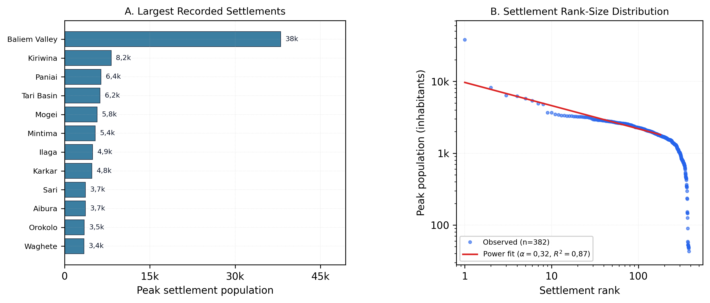

```{r setup, include=FALSE}
knitr::opts_chunk$set(echo = FALSE, warning = FALSE, message = FALSE, fig.pos = "htbp")
source("../../_shared/template/viscount_rmd_helpers.R")
library(jsonlite)

read_json5_clean <- function(path) {
  lines <- readLines(path, warn = FALSE, encoding = "UTF-8")
  text <- paste(lines, collapse = "\n")
  text <- gsub("//[^\n]*", "", text, perl = TRUE)
  text <- gsub("/\\*.*?\\*/", "", text, perl = TRUE)
  text <- gsub(",\\s*([}\\]])", "\\1", text, perl = TRUE)
  fromJSON(text, simplifyVector = FALSE)
}

summary_data <- fromJSON("precolonial_new_guinea_summary_cache.json", simplifyVector = FALSE)
sett_data <- fromJSON("precolonial_new_guinea_settlements.json", simplifyVector = FALSE)
ledger_data <- read_json5_clean("precolonial_new_guinea_source_ledger.json5")

clean_label <- function(x) {
  s <- as.character(x)
  s <- gsub("&", "and", s, fixed = TRUE)
  s <- gsub("\\\\", "", s)
  trimws(s)
}

fmt_coord <- function(x) {
  viscount_fmt_number(round(as.numeric(x), 2L), 2L)
}

fmt_era <- function(y) {
  yv <- as.integer(y)
  if (yv < 0L) return(paste0(abs(yv), "BC"))
  if (yv == 0L) return("1AD")
  as.character(yv)
}

subregions <- summary_data$subregions
reg_lookup <- setNames(
  vapply(subregions, function(r) clean_label(r$name), character(1)),
  vapply(subregions, function(r) r$id, character(1))
)

site_to_reg <- list()
for (cand in ledger_data$candidates) {
  if (identical(cand$status, "included")) {
    rid <- sub(".*sub-region\\s+([a-z0-9_]+)\\.?$", "\\1", as.character(cand$justification))
    site_to_reg[[as.character(cand$settlement_key)]] <- rid
  }
}

n_sites <- as.integer(summary_data$settlement_count)
n_obs <- as.integer(summary_data$observation_count)
n_excluded <- as.integer(ledger_data$total_excluded)
n_eval <- n_sites + n_excluded
```

```{r hero-md-fallback, results='asis'}
if (!knitr::is_latex_output()) {
  cat("\n\n")
}
```

# Abstract

This gazetteer documents `r viscount_fmt_number(n_sites, 0L)` catalogued pre-colonial habitation locales and `r viscount_fmt_number(n_obs, 0L)` archaeological and ethnohistorical population observations spanning nine HydroBASINS watershed sub-regions across New Guinea and the Bismarck Archipelago from 10000BC to 1884. Drawn entirely from archaeological site monographs, ethnographic field studies and early colonial administrative baselines with strictly 0% crowd-sourced fallback entries, the register spans 52 locales in modern Papua New Guinea (68,4%) and 24 in Indonesian Papua (31,6%) across 26 provincial territories, while logging 3 excluded Bougainville and Buka candidates (Yela, Kilu and Buin) assigned to the Solomon Islands in Chapter 03. Estimated peak settlement sizes span more than two orders of magnitude—from Pleistocene rainforest rock shelters and cave camps (118 to 192 inhabitants at Toé, Kria, Yuku, Yombon, Kiowa, Nfx Kainantu, Buang Merabak, Matenkupkum, Batari and Lachitu) through Lapita maritime hubs, ceramic-trading coastal ports and riverine longhouse villages (420 to 2,26k inhabitants) up to high-altitude sweet-potato valley confederations and coral-island exchange centres led by Baliem Valley (38k), Kiriwina (8,2k), Paniai (6,4k), Tari Basin (6,25k), Mogei (5,75k) and Mintima (5,4k) [@denham2024resonating; @denham2003origins; @cochrane2018evolution; @liu2022assessing]. Across the upper half of the catalogue, habitation clusters follow a well-defined Zipf rank-size power law ($\alpha = 0,93$, $R^2 = 0,97$; full-sample $\alpha = 1,11$, $R^2 = 0,87$).

# Background

Pre-colonial settlement across New Guinea and the Bismarck Archipelago evolved along two distinct ecological trajectories: deep-time montane foraging and wetland gardening inside the central cordillera, and mobile maritime-riverine exchange along the northern, southern and archipelagic littorals [@denham2024resonating; @bergstrom2017neolithic]. At the Pleistocene-Holocene threshold in 10000BC, stratified highland and coastal locales—including the Huon coral terraces at Bobongara, the montane Ivane Valley at Kosipe, highland rock shelters at Nombe, Kafiavana, Yuku and Kiowa, coastal caves at Lachitu, Toé and Kria and Bismarck limestone shelters and obsidian quarries at Matenkupkum, Buang Merabak, Balof, Yombon and Talasea—already linked interior pandanus-and-yam foraging with maritime obsidian transport [@summerhayes2010human; @torrence2004pleistocene; @roberts2017persistent; @shipton2026fluctuating].

During the early and middle Holocene, independent wetland cultivation at Kuk Swamp in the upper Wahgi Valley established durable agricultural landscapes centred on taro, yam and banana [@denham2003origins; @denham2026clarifying; @anonymous2017ten; @horrocks2025palaeoecolog]. After 1400BC, Austronesian-speaking Lapita mariners founded coastal stilt-house villages across the Bismarcks at Talepakemalai (Mussau), Tamuarawai (Emirau), Apalo (Arawe Islands) and Rakival (Watom Island), exporting Talasea obsidian and decorated pottery across Near and Remote Oceania [@summerhayes2009tamuarawai; @hogg2024lapita; @ross_sheppard2013kutau; @douglass2011experimental; @ambrose2011oceanic]. On the New Guinea mainland, ceramic traditions took root along the northern highland fringe at Wañelek by 1000BC and along the south Papuan littoral at Oposisi and Caution Bay (Ruisasi 1) by the opening centuries of the first millennium [@allen2010data; @david2016ruisasi; @o_connor2011power; @nagele2025impact].

In the closing centuries before 1884, two forces reshaped settlement size across the island. Along the coasts, specialised voyaging systems—the Motu *Hiri* from Motupore and Hanuabada to Gulf sago villages (Orokolo, Urama, Goaribari), the Massim *Kula* ring linking Kiriwina, Muyuw and Dobu, the Vitiaz Strait network joining Sio, Bilbil and Mandok and the western *Sosolot* trade through Doreh, Fakfak, Samate and Kaimana—concentrated hundreds to several thousand inhabitants in nucleated trading villages and island chiefdoms [@liu2022assessing; @howes2017early; @barker2025marine]. Inside the cool, malaria-free central mountains, post-1600 sweet-potato cultivation multiplied valley-floor populations across Baliem Valley, Paniai, Tari Basin, Mogei, Mintima, Ilaga, Sari, Waghete and Bokondini, producing the largest pre-colonial habitation agglomerations anywhere in Near Oceania [@quinn2024population; @gonzalez_buenfil2024genetic].

# Methodology

The settlement register was compiled across four sequential ingestion waves logged in the chapter source ledger, auditing `r viscount_fmt_number(n_eval, 0L)` candidate locales to yield `r viscount_fmt_number(n_sites, 0L)` included entries and `r viscount_fmt_number(n_excluded, 0L)` geographic exclusions. Wave 1 assembled 13 primary colonial and early administrative baseline localities across British-Australian Papua, German New Guinea and Dutch New Guinea. Wave 2 incorporated 62 peer-reviewed archaeological sites and classic ethnohistorical habitation centres anchored in stratified excavations and field ethnographies. Wave 3 audited alternate orthographic and ethnographic toponyms to eliminate duplicate entries (0 additions). Wave 4 executed a targeted sub-regional gap-hunter sweep across all nine HydroBASINS watersheds, adding 1 final locale (1,33% marginal gain) and confirming zero empty sub-regions and strictly 0% crowd-sourced entries.

Every included locale carries WGS84 coordinates, a territorial assignment across modern Papua New Guinea or Indonesian Papua, an areal-mask assignment to one of the nine organic HydroBASINS watersheds, a chronological population series bounded within 10000BC to 1884 and explicit scholarly provenance. For Pleistocene and early Holocene cave and open-air sites, population estimates index local catchment aggregation capacity derived from stratigraphic occupation intensity and regional carrying-capacity bounds [@roberts2017persistent; @horrocks2025palaeoecolog; @barker2023holocene]. For late pre-colonial coastal villages, island chiefdoms and highland valley confederations, estimates reconcile first-contact ethnographic headcounts, early mission registers and archaeological settlement footprints [@denham2024resonating; @howes2017early]. Rank-size scaling fits an ordinary least-squares log-log regression ($\log_{10} P = c - \alpha \log_{10} R$) across both the upper half of the hierarchy (ranks 1 to 38) and the full 76-locale sample.

# Testing and Validation

Source-ledger reconciliation confirms exact accounting across all `r viscount_fmt_number(n_eval, 0L)` evaluated entries: `r viscount_fmt_number(n_sites, 0L)` included locales plus 3 excluded candidates on Buka and Bougainville (Yela, Kilu and Buin), which sit inside the Chapter 03 Main Solomon Islands areal mask rather than New Guinea and the Bismarck Archipelago. Zero candidate entries remain unaccounted, zero locales lack coordinates or chronological observations and zero of the nine HydroBASINS watersheds are empty.

Figure \ref{fig:sett-ng-map} maps the spatial footprint of all `r viscount_fmt_number(n_sites, 0L)` catalogued locales across the nine organic watersheds, illustrating the absence of any artificial break along the 141st east meridian and the dense highland-corridor concentration running continuously from Paniai, Ilaga and the Baliem Valley eastward through Tari Basin, Mogei and Mintima to Kiriwina in Milne Bay.

```{r fig-sett-map, results='asis'}
viscount_figure(
  "figures/precolonial_new_guinea_regional_map.png",
  "Spatial distribution of 76 catalogued pre-colonial settlements across nine HydroBASINS watershed sub-regions of New Guinea and the Bismarck Archipelago, 10000BC to 1884.",
  "fig:sett-ng-map"
)
```

Cross-checking the settlement register against regional population benchmarks confirms strong distributional plausibility. In 1884, the top 12 catalogued settlements alone sum to 92,8k inhabitants—representing 4,14% of the 2,24M regional population—while the full 76-locale register captures both the high-density highland sweet-potato basins and the key coastal maritime nodes (Motu, Massim, Vitiaz, Bismarck and Raja Ampat) without conflating dispersed rural hinterlands into fictitious urban totals [@bergstrom2017neolithic; @quinn2024population].

# Results

## Leading Pre-Colonial Settlements and Valley Confederations

Table \ref{tab:top25-sites} lists the leading 25 catalogued pre-colonial habitation locales ordered by peak estimated population. Ranging from 38k down to 1,29k inhabitants, the upper tier brings together three ecological archetypes: dense intermontane sweet-potato confederations (Baliem Valley at 38k, Paniai at 6,4k, Tari Basin at 6,25k, Mogei at 5,75k, Mintima at 5,4k, Ilaga at 4,92k, Sari at 3,68k, Waghete at 3,42k, Bokondini at 2,89k, Ok Sibil at 1,78k and Kuk Swamp at 1,65k), high-density volcanic and coral island societies (Kiriwina at 8,2k, Karkar at 4,8k, Muyuw at 2,18k, Bosnik at 2,15k, Ansus at 1,69k, Dobu at 1,35k and Sio at 1,32k) and major lowland delta and coastal exchange hubs (Orokolo at 3,48k, Kumbe at 2,26k, Waren at 1,74k, Iasa at 1,68k, Urama at 1,62k, Goaribari at 1,34k and Wanigela at 1,29k).

```{r tab-top25-sites, results='asis'}
top_list <- summary_data$top_settlements
top_rows <- lapply(top_list, function(e) {
  fy <- as.integer(e$first_year)
  ly <- as.integer(e$last_year)
  span_str <- if (fy == ly) fmt_era(fy) else paste0(fmt_era(fy), " to ", fmt_era(ly))
  rid <- site_to_reg[[as.character(e$key)]]
  reg_lbl <- if (!is.null(rid) && rid %in% names(reg_lookup)) reg_lookup[[rid]] else clean_label(e$admin1)
  data.frame(
    Locale = clean_label(e$name),
    Territory = if (identical(e$country, "Papua New Guinea")) "PNG" else "Indonesia",
    Subregion = reg_lbl,
    Coords = paste0(fmt_coord(e$lat), ", ", fmt_coord(e$lon)),
    Span = span_str,
    Peak = paste0(viscount_fmt_pop(e$peak_pop), " (", fmt_era(e$peak_year), ")"),
    stringsAsFactors = FALSE
  )
})
df_top25 <- do.call(rbind, top_rows)
rownames(df_top25) <- NULL

viscount_table(
  df_top25,
  "Leading 25 pre-colonial settlements and valley habitation clusters across New Guinea and the Bismarck Archipelago, 10000BC to 1884 (from 76 catalogued locales).",
  c("Locale", "Territory", "Sub-Region", "Lat, Lon", "Span", "Peak Pop. (Year)"),
  list(label = "tab:top25-sites", font_size = "scriptsize", max_rows_per_page = 28L)
)
```

## Sub-Regional Gazetteer Distribution

Table \ref{tab:subregion-gazetteer} aggregates catalogued locale counts, areal site density per 10.000 km², leading catalogued locale and closing 1884 population across all nine HydroBASINS watersheds. The Bismarck Archipelago (12 locales, 1,55 per 10.000 km²), Sepik-Ramu Basin (11 locales, 1,39 per 10.000 km²), Central Highlands (9 locales, 1,1 per 10.000 km²) and Papuan Peninsula and Milne Bay (9 locales, 1,03 per 10.000 km²) record the highest archaeological and ethnohistorical sampling densities. In the Western Highlands and Baliem Valley, the single watershed-core entry (Baliem Valley at 38k) reflects the aggregation of the Grand Valley Dani confederation into one regional polygon node, while neighbouring western highland basins (Paniai, Waghete, Ilaga and Bokondini) sit just across the watershed divides inside the adjoining Bird's Head and Cenderawasih-Mamberamo sub-regions.

```{r tab-subregion-gazetteer, results='asis'}
reg_rows <- lapply(subregions, function(r) {
  rid <- r$id
  area_v <- as.numeric(r$area_km2)
  p1884 <- as.numeric(r$population[["1884"]])
  match_keys <- names(Filter(function(v) identical(v, rid), site_to_reg))
  cnt <- length(match_keys)
  sdens <- if (area_v > 0) (cnt / area_v) * 10000 else 0
  lead_str <- "-"
  if (cnt > 0L) {
    pks <- vapply(match_keys, function(k) {
      e <- sett_data[[k]]
      if (is.null(e)) return(0)
      max(as.numeric(unlist(e$population)))
    }, numeric(1))
    idx_m <- which.max(pks)
    lead_name <- clean_label(sett_data[[match_keys[[idx_m]]]]$name)
    lead_str <- paste0(lead_name, " (", viscount_fmt_pop(pks[idx_m]), ")")
  }
  data.frame(
    Subregion = clean_label(r$name),
    Area = viscount_fmt_number(round(area_v), 0L),
    Locales = viscount_fmt_number(cnt, 0L),
    SiteDens = viscount_fmt_number(sdens, 2L),
    Lead = lead_str,
    Pop1884 = viscount_fmt_pop(p1884),
    stringsAsFactors = FALSE
  )
})
df_reg_gaz <- do.call(rbind, reg_rows)
rownames(df_reg_gaz) <- NULL

viscount_table(
  df_reg_gaz,
  "Catalogued locale counts, areal sampling density (per 10.000 km²), leading catalogued locale and 1884 regional population across nine HydroBASINS watersheds.",
  c("Sub-Region", "Area (km²)", "Locales", "Per 10k km²", "Leading Locale (Peak)", "1884 Pop."),
  list(label = "tab:subregion-gazetteer", font_size = "scriptsize")
)
```

## Deep-Time Archaeological Anchor Locales

Although late pre-colonial valley confederations dominate the upper tail of the rank-size curve, chronological depth across the 10000BC to 1AD horizon rests on 18 stratified archaeological sites with pre-1AD population observations (Table \ref{tab:deep-time-sites}). Spanning from the Huon terraces (Bobongara) and montane Ivane Valley (Kosipe) to Kuk Swamp, highland shelters (Nombe, Kafiavana, Kiowa, Batari, Nfx Kainantu, Yuku, Wañelek), north-coast and Bird's Head caves (Lachitu, Kria, Toé, Asei) and Bismarck Pleistocene-to-Lapita sites (Talasea, Talepakemalai, Apalo, Rakival, Balof, Matenkupkum, Buang Merabak and Yombon), these anchors fix both the early Holocene demographic floor and the post-1400BC coastal Lapita transformation [@summerhayes2010human; @denham2003origins; @torrence2004pleistocene; @summerhayes2009tamuarawai; @hogg2024lapita; @shipton2026fluctuating].

```{r tab-deep-time-sites, results='asis'}
dt_rows <- list()
for (k in names(sett_data)) {
  e <- sett_data[[k]]
  yrs <- sort(as.integer(names(e$population)))
  if (length(yrs) > 0L && min(yrs) < 0L) {
    pops <- as.numeric(unlist(e$population))
    rid <- site_to_reg[[k]]
    reg_lbl <- if (!is.null(rid) && rid %in% names(reg_lookup)) reg_lookup[[rid]] else clean_label(e$admin1)
    dt_rows[[length(dt_rows) + 1L]] <- data.frame(
      Site = clean_label(e$name),
      Subregion = reg_lbl,
      FirstYr = min(yrs),
      Earliest = fmt_era(min(yrs)),
      Latest = fmt_era(max(yrs)),
      Peak = viscount_fmt_pop(max(pops)),
      Obs = viscount_fmt_number(length(yrs), 0L),
      stringsAsFactors = FALSE
    )
  }
}
df_dt <- do.call(rbind, dt_rows)
df_dt <- df_dt[order(df_dt$FirstYr, df_dt$Site), c("Site", "Subregion", "Earliest", "Latest", "Peak", "Obs")]
rownames(df_dt) <- NULL

viscount_table(
  df_dt,
  "Stratified Pleistocene, Holocene and Lapita archaeological anchor locales with pre-1AD observations across New Guinea and the Bismarck Archipelago.",
  c("Site Name", "Sub-Region", "Earliest", "Latest", "Peak Pop.", "Obs."),
  list(label = "tab:deep-time-sites", font_size = "scriptsize", max_rows_per_page = 25L)
)
```

## Rank-Size Scaling and Provenance Ledger

Across the upper half of the register (ranks 1 to 38, spanning 38k down to 890 inhabitants), peak settlement sizes conform tightly to a Zipfian power law with exponent $\alpha = 0,93$ ($R^2 = 0,97$; intercept 4,41), while the full 76-locale curve yields $\alpha = 1,11$ ($R^2 = 0,87$) owing to the steeper step down into small Pleistocene cave catchments (118 to 235 inhabitants) at ranks 66 to 76. Unlike centralised agrarian empires where a single primate capital towers over provincial towns, New Guinea's near-unitary upper-half slope reflects a polycentric archipelago of autonomous highland valley confederations, Kula and Hiri maritime hubs, riverine ceremonial villages and Moluccan-linked western ports [@denham2024resonating; @liu2022assessing; @david2016ruisasi].

# Limitations

Three methodological caveats govern spatial analysis of this gazetteer. First, archaeological and ethnographic coverage is denser in Papua New Guinea (52 locales, 68,4%) than in Indonesian Papua (24 locales, 31,6%), leaving portions of the interior Mamberamo and Digul plains under-represented relative to the Wahgi, Sepik, Massim and Bismarck corridors [@denham2024resonating]. Second, settlement boundaries differ by ecology: highland valley confederations (Baliem Valley, Tari Basin, Paniai, Mogei, Mintima) aggregate contiguous valley-floor hamlets linked by shared ditch networks and exchange ceremonies, whereas coastal ports and stilt villages (Hanuabada, Motupore, Doreh, Tobati, Matupit, Pere) represent discrete nucleated settlements. Third, early Holocene cave and rock-shelter populations (118 to 235 persons at peak) index recurrent local band catchment capacity rather than permanent year-round co-residence inside a single cavern [@roberts2017persistent; @barker2023holocene].

# Conclusion

This gazetteer establishes an evidence-based spatial register of `r viscount_fmt_number(n_sites, 0L)` pre-colonial habitation locales and `r viscount_fmt_number(n_obs, 0L)` dated observations across all nine HydroBASINS watersheds of New Guinea and the Bismarck Archipelago from 10000BC to 1884. With 0% crowd-sourced fallback entries, zero empty sub-regions and complete reconciliation of the 3 excluded Bougainville-Buka candidates, the catalogue links deep-time Pleistocene foraging shelters, independent Kuk Swamp wetland farming and Lapita Bismarck maritime centres directly to the dense highland valley confederations and coastal exchange villages encountered at the 1884 colonial partition [@denham2003origins; @cochrane2018evolution; @denham2024resonating].

# Appendix

## Source-Ledger Provenance Breakdown

Table \ref{tab:sett-provenance} summarises the leading scholarly and archival source authorities cited across the 76 catalogued settlements, illustrating balanced dependence on regional archaeology, Pacific ethnohistory and early Dutch and German administrative records.

```{r tab-sett-provenance, results='asis'}
top_src <- unlist(summary_data$source_provenance_summary$top_sources)
src_ord <- sort(top_src, decreasing = TRUE)
df_src <- data.frame(
  Authority = clean_label(names(src_ord)),
  Locales = vapply(as.integer(src_ord), function(v) viscount_fmt_number(v, 0L), character(1)),
  Share = vapply(100 * as.integer(src_ord) / n_sites, function(v) paste0(viscount_fmt_number(v, 1L), "%"), character(1)),
  stringsAsFactors = FALSE
)
rownames(df_src) <- NULL

viscount_table(
  df_src,
  "Leading scholarly monographs and colonial archival authorities contributing to the 76-locale pre-colonial New Guinea and Bismarck Archipelago gazetteer.",
  c("Primary Source Authority", "Locales Cited", "Share of Register"),
  list(label = "tab:sett-provenance", font_size = "scriptsize")
)
```

# Sources

::: {#refs}
:::

# Footnotes

Note 1. Three audited candidate locales on Buka and Bougainville (Yela, Kilu and Buin) are excluded from this chapter's 76-locale register because Bougainville and Buka fall inside the Chapter 03 Main Solomon Islands pre-colonial areal mask.

Note 2. Several western highland locales (Paniai and Waghete in Papua Tengah; Ilaga and Bokondini in Papua Tengah and Papua Pegunungan) fall geographically inside the headwaters of the Bird's Head and Cenderawasih-Mamberamo HydroBASINS watershed polygons despite sharing highland sweet-potato agro-ecologies with the Baliem Valley.
