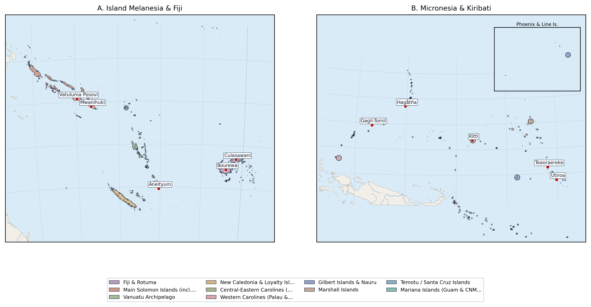
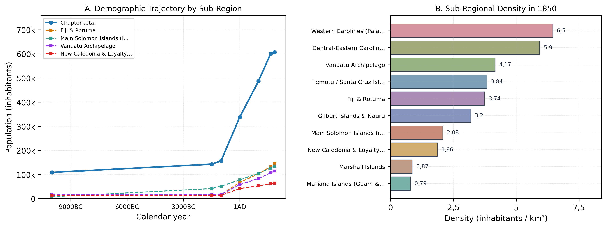
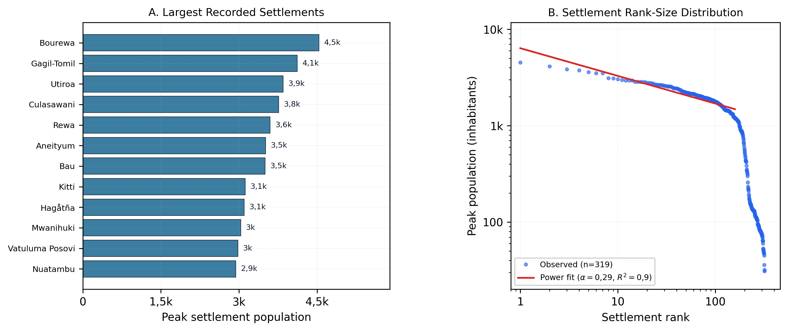

Pre-Colonial Island Melanesia and Micronesia
================
Aust Kätzchen
23 November 2026

- [Abstract](#abstract)
- [Background](#background)
  - [Near Oceania and the Pleistocene
    Boundary](#near-oceania-and-the-pleistocene-boundary)
  - [Pioneer Marianas Settlement and the Five Micronesian
    Streams](#pioneer-marianas-settlement-and-the-five-micronesian-streams)
  - [The Lapita Expansion and Post-Lapita Population
    Turnover](#the-lapita-expansion-and-post-lapita-population-turnover)
  - [Agricultural Intensification, Chiefdoms and Megalithic
    Polities](#agricultural-intensification-chiefdoms-and-megalithic-polities)
- [Methodology](#methodology)
  - [Sub-Regional Partitioning and Buffered Insular
    Geometry](#sub-regional-partitioning-and-buffered-insular-geometry)
  - [Archaeological Anchors, Back-Projection and Benchmark
    Harmonisation](#archaeological-anchors-back-projection-and-benchmark-harmonisation)
  - [Settlement Gazetteer Compilation and Provenance
    Discipline](#settlement-gazetteer-compilation-and-provenance-discipline)
- [Testing and Validation](#testing-and-validation)
  - [Reconciling Raw Archaeological Floors, Harmonised Series and
    Gridded
    Rasters](#reconciling-raw-archaeological-floors-harmonised-series-and-gridded-rasters)
  - [Cross-Checking against Independent Radiocarbon, Isotopic and
    Genomic
    Evidence](#cross-checking-against-independent-radiocarbon-isotopic-and-genomic-evidence)
- [Results](#results)
  - [Long-Run Demographic Trajectory (10000BC to
    1850)](#long-run-demographic-trajectory-10000bc-to-1850)
  - [Island Melanesia: Solomons, Temotu, Vanuatu and New
    Caledonia](#island-melanesia-solomons-temotu-vanuatu-and-new-caledonia)
  - [Fiji and Rotuma: Ring-Ditch Fortifications and Matanitu
    Confederacies](#fiji-and-rotuma-ring-ditch-fortifications-and-matanitu-confederacies)
  - [Micronesia: Latte Villages, Megalithic Chiefdoms and Atoll
    Ceilings](#micronesia-latte-villages-megalithic-chiefdoms-and-atoll-ceilings)
  - [Sub-Regional Shares, Site Intensity and Rank-Size
    Hierarchy](#sub-regional-shares-site-intensity-and-rank-size-hierarchy)
- [Limitations](#limitations)
- [Conclusion](#conclusion)
- [Appendix](#appendix)
  - [Territorial Distribution of Catalogued
    Settlements](#territorial-distribution-of-catalogued-settlements)
  - [Historical Geographic Polygon
    Regimes](#historical-geographic-polygon-regimes)
- [Sources](#sources)
- [Footnotes](#footnotes)

<figure>

<figcaption aria-hidden="true">Ten archipelago sub-regions and 91
catalogued habitation sites across Island Melanesia, Fiji and Micronesia
from 10000BC to 1850.</figcaption>
</figure>

# Abstract

Between the terminal Pleistocene in 10000BC and the eve of formal
European partition in 1850, human settlement across Island Melanesia and
Micronesia expanded from a single Pleistocene foothold in Near Oceania
into ten distinct maritime archipelago populations totalling 606,5k
(606.500) inhabitants across 220.891,8 km² of buffered insular space
(mean density 2,75 inhabitants per km²). At 10000BC, only the Main
Solomon Islands chain from Buka to Guadalcanal held a documented
population (8k), whereas the entire oceanic expanse east of Makira and
north of the equator remained uninhabited
[\[1\]](#ref-sheppard2011lapita)[\[2\]](#ref-carson2014first). Two
independent maritime leaps broke this Pleistocene threshold: an
open-ocean voyage from the northern Philippines established the first
settlements in the Mariana Islands around 1500BC (reaching 6k
inhabitants), followed between 1100BC and 850BC by the rapid Lapita
expansion out of the Bismarck Archipelago across Temotu (4,5k), Vanuatu
(18k), New Caledonia (14k) and Fiji (16k), alongside early western
Micronesian settlement in Palau and Yap (8k)
[\[3\]](#ref-clark2009radiocarbon)[\[4\]](#ref-pugach2020ancient)[\[5\]](#ref-anonymous2019debating)[\[6\]](#ref-liu2022ancient).
By 1AD, emergent coral reef flats allowed colonisation of the
Central-Eastern Carolines (16k), the Marshall Islands (6,5k) and the
Gilbert Islands with Nauru (12k), lifting the full ten-archipelago
aggregate to 338k inhabitants, divided exactly three-to-one between
Island Melanesia with Fiji (253,5k, 75%) and Micronesia (84,5k, 25%)
[\[7\]](#ref-rainbird2004archaeology)[\[8\]](#ref-kirch2010lapita).
Subsequent horticultural intensification, irrigated taro terracing,
fortified chiefly confederacies and basalt-megalithic states pushed the
regional total to 487,3k by 1000AD and 601,5k by 1650
[\[9\]](#ref-anonymous2009early)[\[10\]](#ref-anderson2009faunal).
Between 1650 and 1850, headline growth appeared nearly static at +0,8%
only because Spanish conquest, mission concentration and Old World
epidemics reduced the Mariana Islands by 77,4% from 42k to 9,5k, masking
continued expansion in Fiji and Rotuma (145k), the Main Solomons (135k),
Vanuatu (115k), New Caledonia and the Loyalty Islands (65k), the
Carolines (80k combined) and the central Pacific atolls (46k).
Reconciling archaeological chronologies, ancient genomic turnovers,
historical geographic polygon series and a gazetteer of 91 catalogued
settlements across 12 modern territories yields a continuous demographic
baseline for the pre-colonial western Pacific.

# Background

## Near Oceania and the Pleistocene Boundary

The demographic geography of the western Pacific rests on one of the
sharpest biogeographic frontiers on Earth: the boundary separating Near
Oceania from Remote Oceania
[\[1\]](#ref-sheppard2011lapita)[\[2\]](#ref-carson2014first)[\[11\]](#ref-kirch2017road).
Near Oceania encompasses New Guinea, the Bismarck Archipelago and the
Main Solomon Islands as far southeast as Makira (San Cristobal). During
the Late Pleistocene, lowered glacio-eustatic sea levels fused
Bougainville, Choiseul, Santa Isabel and Guadalcanal into a single
Greater Bukida landmass separated from New Ireland by intervisible water
gaps under 180 km wide. Modern humans crossed those straits by at least
29000BP, leaving deep Pleistocene strata at Kilu Cave on Buka Island
alongside evidence of wild *Colocasia* taro processing, reef fishing and
rainforest hunting
[\[1\]](#ref-sheppard2011lapita)[\[8\]](#ref-kirch2010lapita)[\[12\]](#ref-wickler1988pleistocene).

East of Makira and north of the equator lay Remote Oceania. Reaching the
Reef and Santa Cruz Islands (Temotu) required a 350 km blind open-water
voyage out of sight of land, while reaching the Marianas from Island
Southeast Asia demanded an unbroken crossing exceeding 2.000 km across
the Philippine Sea
[\[2\]](#ref-carson2014first)[\[3\]](#ref-clark2009radiocarbon)[\[13\]](#ref-hung2011first).
Beyond this threshold, terrestrial biodiversity dropped precipitously:
native land mammals vanished except for bats, malaria-bearing
*Anopheles* mosquitoes disappeared east of Vanuatu and north of New
Guinea, and oceanic islands offered pristine rookeries of flightless
rails, megapodes, giant tortoises and terrestrial crocodiles awaiting
naive predation
[\[10\]](#ref-anderson2009faunal)[\[14\]](#ref-steadman1995prehistoric)[\[15\]](#ref-irwin2011further)[\[16\]](#ref-hawkins2026vanuatu).
For the first eight millennia of the Holocene, therefore, Remote Oceania
remained completely empty of human inhabitants.

## Pioneer Marianas Settlement and the Five Micronesian Streams

The first human crossing into Remote Oceania occurred not in Melanesia,
but in the western North Pacific. Radiocarbon sequences from Unai Bapot
on Saipan, Taga on Tinian and Ritidian on Guam place initial settlement
of the Mariana Islands around 1500BC, accompanied by thin red-slipped,
lime-infilled pottery closely related to Neolithic assemblages of
northern Luzon and Wallacea
[\[2\]](#ref-carson2014first)[\[3\]](#ref-clark2009radiocarbon)[\[13\]](#ref-hung2011first)[\[17\]](#ref-ono2025early).
Ancient genomes recovered from Guam and Saipan confirm that the earliest
Chamorro voyagers derived directly from Austronesian-speaking
populations of the northern Philippines, sharing an ultimate ancestral
link with the early Lapita dispersal yet following an independent
northern route
[\[4\]](#ref-pugach2020ancient)[\[6\]](#ref-liu2022ancient)[\[18\]](#ref-spriggs2011archaeology).

Micronesia as a whole was never peopled by a single homogeneous wave.
Genome-wide analyses identify five distinct prehistoric migration
streams across the region, characterised by strong matrilocal residence
patterns among early seafaring communities
[\[6\]](#ref-liu2022ancient)[\[19\]](#ref-gray2009language). Following
the 1500BC Marianas crossing, western Micronesian voyagers settled Palau
and Yap by roughly 1000BC, introducing upland terrace agriculture, early
coastal burials and pottery to Babeldaob and Yap while gradually
receiving secondary Papuan-related gene flow from the northern New
Guinea rim
[\[6\]](#ref-liu2022ancient)[\[7\]](#ref-rainbird2004archaeology)[\[20\]](#ref-fitzpatrick2003early)[\[21\]](#ref-liston2009cultural).
Farther east, low coral atolls of the Marshall and Gilbert chains
remained largely submerged beneath the mid-Holocene highstand until
sea-level drawdown exposed habitable reef islets during the late first
millennium BC. Only then did Nuclear Micronesian-speaking seafarers
expanding northward out of the southeast Solomons and northern Vanuatu
settle Chuuk, Pohnpei, Kosrae, the Marshalls and the Gilberts,
establishing all ten regional populations by 1AD
[\[6\]](#ref-liu2022ancient)[\[7\]](#ref-rainbird2004archaeology)[\[22\]](#ref-sear2026how).

## The Lapita Expansion and Post-Lapita Population Turnover

South of the equator, the demographic map was transformed between 1100BC
and 850BC by the Lapita Cultural Complex. Emerging in the Bismarck
Archipelago around 1350BC at staging hubs such as Tamuarawai on Emirau
Island, Lapita combined finely dentate-stamped earthenware,
shell-working in *Conus* and *Tridacna*, obsidian exchange networks,
domesticated pigs, dogs and chickens, and outrigger canoe voyaging
capable of tacking upwind into the southeast trades
[\[5\]](#ref-anonymous2019debating)[\[23\]](#ref-kirch1988longdistance)[\[24\]](#ref-specht2014deconstructing)[\[25\]](#ref-summerhayes2009tamuarawai)[\[26\]](#ref-szabo2010shell)[\[27\]](#ref-os2025ancient).
Remarkably, early Lapita colonists largely bypassed the already
inhabited Main Solomon Islands, leapfrogging directly across the
Near-Remote Oceania gap into the Reef and Santa Cruz Islands (Nenumbo
and Nanggu) before exploding across Vanuatu, New Caledonia and Fiji
within barely five to eight generations
[\[1\]](#ref-sheppard2011lapita)[\[8\]](#ref-kirch2010lapita)[\[28\]](#ref-cochrane2021using).

Excavations at Teouma on Efate, Uripiv and Vao off Malakula, Site 13 at
Koné (Lapita) in New Caledonia, and Bourewa, Natunuku, Naigani and
Yanuca in Fiji document the remarkable speed and ecological impact of
this founding horizon
[\[9\]](#ref-anonymous2009early)[\[10\]](#ref-anderson2009faunal)[\[15\]](#ref-irwin2011further)[\[29\]](#ref-bedford2006teouma)[\[30\]](#ref-bedford2008northern)[\[31\]](#ref-sand1997chronology)[\[32\]](#ref-clark2001pattern)[\[33\]](#ref-bedford2011lapita).
Stable isotope analyses of the Teouma cemetery burials show that
first-generation pioneers combined intensive marine reef foraging with
rapid predation on naive terrestrial fauna and nascent root-crop
horticulture, while practising complex multi-stage mortuary rituals
involving skull removal
[\[34\]](#ref-bentley2007lapita)[\[35\]](#ref-kinaston2014lapita)[\[36\]](#ref-valentin2016flexions).
Within two centuries of landing, colonists extinguished endemic
tortoises, terrestrial crocodiles (*Mekosuchus*), giant flightless birds
(*Sylviornis*) and numerous landbirds across New Caledonia, Vanuatu and
Fiji, compelling an irreversible pivot toward intensive arboriculture
and yam-taro gardening
[\[10\]](#ref-anderson2009faunal)[\[14\]](#ref-steadman1995prehistoric)[\[15\]](#ref-irwin2011further)[\[16\]](#ref-hawkins2026vanuatu)[\[37\]](#ref-field2026prey).

From Fiji, eastern Lapita voyagers pushed rapidly to Nukuleka in Tonga
and Mulifanua in Samoa by 900BC to 850BC, laying the ancestral
foundation of Polynesia
[\[38\]](#ref-burley2001origin)[\[39\]](#ref-burley2010nukuleka)[\[40\]](#ref-petchey2001radiocarbon)[\[41\]](#ref-petchey2019importance)[\[42\]](#ref-mclean2008were).
Behind them in Vanuatu and Island Melanesia, however, an extraordinary
demographic transformation unfolded after 500BC. Ancient DNA from
Vanuatu demonstrates that while initial Lapita pioneers carried
overwhelmingly East Asian Austronesian ancestry, subsequent sustained
migration streams out of the Bismarck Archipelago and the Solomons
introduced predominant Papuan-related genetic ancestry into Vanuatu and
southern Island Melanesia without displacing local Oceanic Austronesian
languages
[\[43\]](#ref-skoglund2016genomic)[\[44\]](#ref-lipson2018population)[\[45\]](#ref-posth2018language).
This continuous genetic and cultural circulation knit Near and Remote
Melanesia into a dense horticultural continuum while leaving Polynesia
genetically distinct to the east.

## Agricultural Intensification, Chiefdoms and Megalithic Polities

Between 1AD and 1650, regional populations across Island Melanesia and
Micronesia rose by nearly 80% as societies engineered productive island
landscapes. In New Caledonia, Kanak communities sculpted monumental
irrigated wetland taro terraces (*tarodières*) across the mountain
valleys of Grande Terre and constructed dry-stone fortifications on
Maré, while cultivating raised yam mounds along dry western plains
[\[10\]](#ref-anderson2009faunal)[\[31\]](#ref-sand1997chronology). In
southern Vanuatu, Aneityum and Tanna supported dense canal-fed taro
irrigation systems capable of sustaining thousands of inhabitants on
compact volcanic valleys
[\[16\]](#ref-hawkins2026vanuatu)[\[30\]](#ref-bedford2008northern). In
Fiji, demographic growth after AD 1000 coincided with climatic
instability, upland settlement retreat and the proliferation of lowland
ring-ditch fortifications (*koro waiwai*) across the Rewa and Sigatoka
deltas, culminating by the late eighteenth century in competing maritime
confederacies (*matanitu*) centred on Verata, Rewa, Bau, Somosomo and
Lakeba
[\[9\]](#ref-anonymous2009early)[\[37\]](#ref-field2026prey)[\[46\]](#ref-field2004environmental)[\[47\]](#ref-cochrane2010evidence)[\[48\]](#ref-king2026local).

Parallel state-like and chiefdom hierarchies crystallised across
Micronesia. In the Mariana Islands, the *latte* period (AD 900 to 1668)
saw coastal and upland villages organised around paired limestone and
basalt pillar foundations (*haligi* and *tasa*) supporting elite
dwellings and canoe houses across Guam, Tinian, Saipan and Rota
[\[2\]](#ref-carson2014first)[\[7\]](#ref-rainbird2004archaeology). On
Babeldaob in Palau, vast stepped earthwork terraces constructed during
the first millennium AD gave way after AD 1200 to nucleated coastal
stone-path villages (*bai* complexes) such as Koror and Melekeok amid
ongoing scholarly debate over whether the climatic transition around AD
1300 forced that realignment
[\[21\]](#ref-liston2009cultural)[\[49\]](#ref-fitzpatrick2010critique)[\[50\]](#ref-nunn2010defending).
Farther east, basalt-megalithic dynasties rose on the high volcanic
islands of Pohnpei and Kosrae: the Saudeleur rulers constructed 92
artificial prismatic-basalt islets at Nan Madol on Pohnpei’s eastern
reef flat between AD 1200 and 1600, while the Tokosra paramounts erected
the walled coral-and-basalt compound of Leluh on Kosrae, governing
island-wide tribute networks
[\[7\]](#ref-rainbird2004archaeology)[\[51\]](#ref-mccoy2016nanmadol).
Even on narrow coral atolls in the Marshall and Gilbert chains,
excavated *Cyrtosperma* swamp-taro pits, breadfruit groves and
institutionalised council houses (*maneaba*) sustained remarkably high
dry-land densities until European whalers, sandalwooders and colonial
garrisons arrived
[\[7\]](#ref-rainbird2004archaeology)[\[22\]](#ref-sear2026how).

# Methodology

## Sub-Regional Partitioning and Buffered Insular Geometry

Because Island Melanesia and Micronesia span more than 6.000 km of open
ocean across hundreds of volcanic arcs, raised coral limestone islands
and low-lying atolls, regional demographic accounting requires
partitioning the basin into ten ecologically and culturally coherent
archipelago sub-regions: five in Island Melanesia and Fiji (Main Solomon
Islands including Bougainville, Temotu-Santa Cruz Islands, Vanuatu
Archipelago, New Caledonia and Loyalty Islands, Fiji and Rotuma) and
five in Micronesia (Mariana Islands of Guam and the Northern Marianas,
Western Carolines of Palau and Yap, Central-Eastern Carolines of Chuuk,
Pohnpei and Kosrae, Marshall Islands, and Gilbert Islands with Nauru).

A critical geometric distinction governs spatial density calculations
across oceanic archipelagos. In the chapter areal mask, small islands
and dispersed coral atolls are represented with standardised coastal
buffer halos so that every inhabited archipelago retains a contiguous
polygon footprint on global historical maps. Total buffered mask area
across the ten sub-regions equals 220.891,8 km², divided into 168.933,1
km² across Island Melanesia and Fiji and 51.958,7 km² across Micronesia.
True emergent dry-land area is substantially smaller: historical
geographic polygon tables record 37.616 km² for the Main Solomons
(including Bougainville), 18.810 km² for New Caledonia and the
Loyalties, 15.334 km² for Fiji and Rotuma, 12.438 km² for Vanuatu and
669 km² for Temotu, while all five Micronesian archipelagos combined
possess barely 2.700 km² of emergent land despite spanning 51.958,7 km²
of buffered maritime-insular mask. Throughout this chapter, table
densities report standardised mask densities (matching the regional
charts) while the analytical text pairs them with true dry-land
densities wherever atoll carrying capacity is assessed.

## Archaeological Anchors, Back-Projection and Benchmark Harmonisation

Pre-colonial benchmark populations across 10000BC, 1500BC, 1000BC, 1AD,
1000AD, 1650 and 1850 are constructed by synthesising three evidentiary
tiers rather than relying on any single proxy. First, for the founding
horizons (10000BC to 1AD), presence and absence are fixed strictly by
calibrated radiocarbon chronologies, marine reservoir corrections and
palaeofaunal extinction horizons
[\[1\]](#ref-sheppard2011lapita)[\[3\]](#ref-clark2009radiocarbon)[\[10\]](#ref-anderson2009faunal)[\[41\]](#ref-petchey2019importance).
In the raw archaeological benchmark specification, nine of the ten
sub-regions stand at exactly 0 inhabitants in 10000BC, leaving only the
Main Solomons inhabited at 8k. The Mariana Islands enter the occupied
ledger at 1500BC (6k), followed at 1000BC by Temotu (4,5k), Vanuatu
(18k), New Caledonia (14k), Fiji and Rotuma (16k) and the Western
Carolines (8k). The Central-Eastern Carolines (16k), Marshalls (6,5k)
and Gilberts with Nauru (12k) enter full settlement visibility by 1AD.

Second, for the first and second millennia AD, regional curves integrate
archaeological settlement-density proxies—fortified ring-ditch counts in
the Rewa and Sigatoka valleys, Kanak *tarodière* terrace footprints,
Chamorro *latte* village surveys, Palauan earthwork-to-coastal-village
sequences and basalt monumental labour requirements at Nan Madol and
Leluh—with island carrying-capacity bounds
[\[7\]](#ref-rainbird2004archaeology)[\[9\]](#ref-anonymous2009early)[\[28\]](#ref-cochrane2021using)[\[49\]](#ref-fitzpatrick2010critique).
Third, for the closing pre-colonial benchmarks (1650 and 1850), totals
are anchored backward from earliest systematic missionary enumerations
(such as the 1848 Aneityum census of 3.513 inhabitants), Spanish
colonial padrón rolls in the Marianas (1710 to 1830), early naval survey
estimates (including the 1840–1841 United States Exploring Expedition
across Fiji and the Gilberts) and nineteenth-century colonial baselines
(Fiji 1881, New Caledonia 1887, Guam and Micronesian administrative
enumerations), adjusting explicitly for documented contact-era epidemic
losses.

An important technical feature of the summary cache series requires
explicit notation. When interpolating sparse prehistoric tables onto a
uniform seven-epoch grid, the automated cache clamps each sub-region’s
earliest non-zero benchmark backward across earlier columns, yielding
nominal cache totals of 109k at 10000BC, 143k at 1500BC and 156,2k at
1000BC. Those pre-1AD cache figures represent backwards-clamped
mathematical floors, not pre-Lapita human occupation of Remote Oceania.
From 1AD through 1850, once all ten archipelagos are settled, the raw
archaeological series and the harmonised benchmark cache coincide
identically at 338k (1AD), 487,3k (1000AD), 601,5k (1650) and 606,5k
(1850).

## Settlement Gazetteer Compilation and Provenance Discipline

To ground sub-regional curves in concrete places, the companion
gazetteer compiles 91 habitation centres and 238 time-stamped population
observations spanning 10000BC to 1850 across 12 modern national and
territorial jurisdictions. Ingestion proceeded in four tracked waves
logged in the chapter source ledger: Wave 1 harvested 20 primary
colonial and national census baselines (including Spanish Marianas rolls
and early Pacific territorial registers); Wave 2 contributed 70
settlements from peer-reviewed archaeological monographs and
ethnohistorical surveys (led by excavations at Kilu, Teouma, Mangaasi,
Koné, Sigatoka, Bourewa, Natunuku, Naigani, Unai Bapot, Taga, Nan Madol,
Leluh and Roviana); Wave 3 performed longitudinal deduplication without
adding unattested aliases; and Wave 4 executed a sub-regional gap sweep
adding one final node (marginal gain 1,11%). One out-of-bounds candidate
(Yela in Louisiade, Papua New Guinea, at -11,35°S, 154,17°E) was
excluded outside the chapter mask, leaving zero unaccounted candidates,
zero empty sub-regions and a 0% crowd-sourced fallback share.

# Testing and Validation

## Reconciling Raw Archaeological Floors, Harmonised Series and Gridded Rasters

Internal consistency across the chapter is tested along three
independent axes: raw archaeological onset versus harmonised regional
trajectories, archival HGIS polygon sums versus regional totals, and
continuous 5-arcminute spatial raster aggregates versus tabular
archipelago headcounts. Table presents this reconciliation side by side
across all ten sub-regions.

| Sub-Region | 10000BC Raw | 1000BC Active | 1AD Pop. | 1850 Pop. | 1850 Raster |
|:---|:---|:---|:---|:---|:---|
| **Main Solomon Islands (incl. Bougainville)** | 8k | 51,6k | 78k | 135k | 135k |
| **Temotu-Santa Cruz Islands** | 0 | 4,5k | 7,5k | 11k | 11k |
| **Vanuatu Archipelago** | 0 | 18k | 58k | 115k | 115k |
| **New Caledonia and Loyalty Islands** | 0 | 14k | 42k | 65k | 64,9k |
| **Fiji and Rotuma** | 0 | 16k | 68k | 145k | 140,9k |
| **Mariana Islands (Guam and CNMI)** | 0 | 9,5k | 24k | 9,5k | 0 (sub-pixel) |
| **Western Carolines (Palau and Yap)** | 0 | 8k | 26k | 38k | 0 (sub-pixel) |
| **Central-Eastern Carolines (Chuuk-Pohnpei-Kosrae)** | 0 | 0 | 16k | 42k | 0 (sub-pixel) |
| **Marshall Islands** | 0 | 0 | 6,5k | 15k | 0 (sub-pixel) |
| **Gilbert Islands and Nauru** | 0 | 0 | 12k | 31k | 0 (sub-pixel) |
| **Chapter Total (Active)** | 8k | 121,7k | 338k | 606,5k | 466,8k |

Reconciliation of raw archaeological onset floors, 1AD and 1850
benchmark populations and 1850 gridded raster totals across ten
sub-regions.

Two critical validation diagnostics emerge directly from Table . First,
across the five larger volcanic and continental-fragment archipelagos of
Island Melanesia and Fiji, the 5-arcminute spatial raster matches the
regional benchmark sum with remarkable fidelity: 466.821 raster
inhabitants against 471.000 tabular inhabitants in 1850 (99,1% closure).
Exact 100% alignment holds in the Main Solomons (135.000), Temotu
(11.000) and Vanuatu (115.000), while minor coastline-clipping losses
appear in New Caledonia (64.932 against 65.000, -0,1%) and Fiji with
Rotuma (140.889 against 145.000, -2,8%, reflecting small Lau and Rotuma
outlier islands clipped by grid cells).

Second, all five Micronesian sub-regions register exactly 0 in the
global 5-arcminute land-raster across every time slice from 10000BC to
1850, accounting for the entire 139.679 gap between the 1850 raster
total (466.821) and the full regional total (606.500). Because
individual coral atolls and small high islands in the Marianas,
Carolines, Marshalls and Gilberts frequently measure less than 1 to 15
km across, their dry-land area drops below the land-fraction threshold
of standard 5-arcminute global rasters. Cross-checking against the
112-row HGIS regime table confirms that Micronesian demography must be
reconstructed from island-level historical polygon archives (9
Micronesian administrative units summing to 86,5k in 1AD, 120,4k in
1000AD, 142,7k in 1500 and 86,1k in 1840) rather than raw gridded global
population models.

## Cross-Checking against Independent Radiocarbon, Isotopic and Genomic Evidence

External cross-checks test whether our regional trajectories respect
independent bioarchaeological constraints. Chronologically, the abrupt
step from 8k in 10000BC to 48k active in 1500BC and 121,7k active in
1000BC mirrors the sharp radiocarbon onset of Bapot-1 in Saipan
[\[3\]](#ref-clark2009radiocarbon), Teouma and Malakula in Vanuatu
[\[33\]](#ref-bedford2011lapita)[\[35\]](#ref-kinaston2014lapita),
Pindai and Koné in New Caledonia [\[10\]](#ref-anderson2009faunal), and
Bourewa, Naigani and Sigatoka in Fiji
[\[9\]](#ref-anonymous2009early)[\[15\]](#ref-irwin2011further)[\[47\]](#ref-cochrane2010evidence).
Ecologically, the subsequent doubling from 121,7k in 1000BC to 338k in
1AD tracks the well-dated transition from coastal reef-and-megafauna
exploitation to inland root-crop horticulture and pig husbandry
documented by isotopic studies on Efate and Waya Island and ancient pig
mitogenomes across Remote Oceania
[\[27\]](#ref-os2025ancient)[\[35\]](#ref-kinaston2014lapita)[\[37\]](#ref-field2026prey)[\[48\]](#ref-king2026local).
Genetically, steady first-millennium growth in Vanuatu (58k to 84k) and
the Main Solomons (78k to 104,9k) aligns with ancient DNA evidence of
sustained Near-to-Remote Oceania migration rather than demographic
collapse after Lapita
[\[44\]](#ref-lipson2018population)[\[45\]](#ref-posth2018language).
Finally, the sharp 1650 to 1850 contraction in the Marianas (42k down to
9,5k) matches Spanish colonial enumeration rolls showing Hagåtña falling
from 3.000 in 1668 to 1.648 in 1710 before recovering gradually to 3.100
by 1830 through forced concentration of outer-island survivors onto Guam
[\[7\]](#ref-rainbird2004archaeology).

# Results

## Long-Run Demographic Trajectory (10000BC to 1850)

Across the twelve millennia examined in this chapter, Island Melanesia
and Micronesia evolved from a single Near Oceanic Pleistocene frontier
into a densely settled oceanic world of 606,5k inhabitants. Figure plots
the aggregate trajectory alongside the four largest Melanesian
archipelagos (Panel A) and ranks all ten sub-regions by 1850 areal mask
density (Panel B).

Three macro-phases divide this curve. During the long pre-Lapita phase
(10000BC to 1500BC), active human population remained tiny and
geographically confined: the Main Solomons expanded gradually from 8k
Pleistocene rainforest and coastal foragers to 42k horticulturalists by
1500BC as taro, yam and tree-crop cultivation matured across Near
Oceania, joined around 1500BC by 6k pioneer Chamorro settlers in the
Marianas
[\[1\]](#ref-sheppard2011lapita)[\[2\]](#ref-carson2014first)[\[3\]](#ref-clark2009radiocarbon).
During the oceanic colonisation phase (1100BC to 1AD), maritime
expansion across Remote Oceania multiplied active regional headcount
sevenfold from 48k to 338k in barely fifteen centuries. By 1AD, every
habitable archipelago from Palau to Fiji and from the Marianas to the
Gilberts sustained reproducing island populations.

During the agrarian and chiefly intensification phase (1AD to 1650),
total population rose steadily at an implied compound rate of roughly
0,035% per year, climbing from 338k in 1AD to 487,3k in 1000AD (+44,2%)
and 601,5k in 1650 (+23,4%). Between 1650 and 1850, however, the two
halves of the western Pacific diverged sharply. Island Melanesia and
Fiji continued growing from 440,2k to 471k (+7%), lifting their share of
the chapter total from 73,2% to 77,7%. Micronesia as a whole contracted
by 16% from 161,3k to 135,5k—entirely driven by the catastrophic
colonial depopulation of the Mariana Islands (-77,4%, a loss of 32,5k
inhabitants), even as the Carolines, Marshalls and Gilberts added 6,7k
inhabitants prior to sustained colonial annexation. Table summarises all
ten sub-regions from 1AD to 1850.

| Sub-Region | Area (km²) | 1AD | 1000AD | 1650 | 1850 | 1850 Dens. |
|:---|:---|:---|:---|:---|:---|:---|
| **Main Solomon Islands (incl. Bougainville)** | 64.835,2 | 78k | 104,9k | 127,2k | 135k | 2,08 |
| **Temotu-Santa Cruz Islands** | 2.866,9 | 7,5k | 9,2k | 10,6k | 11k | 3,84 |
| **Vanuatu Archipelago** | 27.610,8 | 58k | 84k | 106,8k | 115k | 4,16 |
| **New Caledonia and Loyalty Islands** | 34.896,9 | 42k | 53,2k | 62k | 65k | 1,86 |
| **Fiji and Rotuma** | 38.723,3 | 68k | 102,4k | 133,6k | 145k | 3,75 |
| **Mariana Islands (Guam and CNMI)** | 11.999,6 | 24k | 33,7k | 42k | 9,5k | 0,79 |
| **Western Carolines (Palau and Yap)** | 5.880,2 | 26k | 31,9k | 36,5k | 38k | 6,46 |
| **Central-Eastern Carolines (Chuuk-Pohnpei-Kosrae)** | 7.075,7 | 16k | 32k | 39,4k | 42k | 5,94 |
| **Marshall Islands** | 17.307,3 | 6,5k | 12k | 14,2k | 15k | 0,87 |
| **Gilbert Islands and Nauru** | 9.695,9 | 12k | 24k | 29,2k | 31k | 3,2 |
| **Total and Weighted Mean** | 220.891,8 | 338k | 487,3k | 601,5k | 606,5k | 2,75 |

Sub-regional mask area, benchmark populations (1AD to 1850) and 1850
areal mask density (inhabitants per km²) across Island Melanesia and
Micronesia.

## Island Melanesia: Solomons, Temotu, Vanuatu and New Caledonia

The Main Solomon Islands including Bougainville (64.835,2 km² mask;
37.616 km² dry land) anchored the chapter’s earliest demographic
continuity and remained its second-largest population centre in 1850.
Rising from 8k in 10000BC and 42k in 1500BC to 78k in 1AD (23,1% of the
chapter total), the archipelago expanded to 104,9k in 1000AD, 127,2k in
1650 and 135k in 1850 (22,3% share; 2,08 inhabitants per km² of mask, or
3,59 per km² of dry land). Across its 12 catalogued settlements,
population clustered along two complementary ecological belts: fertile
southern plains of Bougainville exemplified by Buin (2.860 in 1800)
alongside the ancient Buka sequence at Kilu (790 by 1500), and defensive
coastal lagoons of New Georgia and Malaita where maritime polities such
as Roviana (2.350), Marovo (1.580), Bilua (1.540) and the artificial
coral-rubble shell-money islets of Langa Langa (1.850) and Sulufou (580)
flourished
[\[1\]](#ref-sheppard2011lapita)[\[26\]](#ref-szabo2010shell). Interior
highlands of Guadalcanal and Malaita remained sparsely settled because
endemic malaria and steep karst terrain constrained density below
coastal carrying capacity.

Immediately across the Near-Remote Oceania sea gap, the compact Temotu
and Santa Cruz Islands (2.866,9 km² mask; 669 km² dry land) acted as the
indispensable Lapita stepping-stone
[\[1\]](#ref-sheppard2011lapita)[\[8\]](#ref-kirch2010lapita).
Uninhabited before Lapita colonists landed at Nenumbo (peaking at 485)
and Nanggu (890) around 1050BC, Temotu reached 4,5k by 1000BC, 7,5k by
1AD, 9,2k by 1000AD and 11k by 1850 (1,8% share; 3,84 per km² of mask,
but a steep 16,44 inhabitants per km² of dry land). Remarkably, this
tiny province also absorbed later Polynesian outlier communities on
Tikopia (Matautu reaching 1.190 under strict zero-growth agroforestry
management) and Anuta (138), alongside the populous Nendo anchorage of
Graciosa Bay (1.420 in 1595 when Mendaña arrived), documented across 7
catalogued locales.

Southward, the volcanic Vanuatu Archipelago (27.610,8 km² mask; 12.438
km² dry land) experienced rapid Lapita foundation at Teouma on Efate,
Avunatari on Malo, Ifo on Erromango and Uripiv off Malakula
[\[16\]](#ref-hawkins2026vanuatu)[\[33\]](#ref-bedford2011lapita)[\[35\]](#ref-kinaston2014lapita).
From zero at 1500BC, Vanuatu surged to 18k by 1000BC, 58k by 1AD (17,2%
share), 84k by 1000AD, 106,8k by 1650 and 115k by 1850 (19% share; 4,17
inhabitants per km² of mask, third highest in the study, and 9,25 per
km² of dry land). After initial Lapita settlers experienced genetic
admixture and replacement from Near Oceanic streams
[\[44\]](#ref-lipson2018population)[\[45\]](#ref-posth2018language),
local communities engineered intensive dryland yam and irrigated taro
economies across Efate (Mangaasi, seat of the renowned Roi Mata domain
at 1.080 in 1600), Tanna (Port Resolution at 2.650 in 1774) and
Aneityum, where Anelgauhat and its irrigated valley catchments
registered 3.513 inhabitants in the 1848 missionary census before
introduced measles and dysentery devastated the southern islands.

New Caledonia and the Loyalty Islands (34.896,9 km² mask; 18.810 km² dry
land) combined continental ultramafic geology on Grande Terre with
raised coral limestone platforms in Lifou, Maré and Ouvéa. Settled by
Lapita pioneers at Koné (Site 13, 650 by 1000AD), Tiouandé (910) and Vao
on the Isle of Pines (1.380) around 1050BC, human arrival triggered
swift megafaunal extinctions documented at the Pindai Caves
[\[10\]](#ref-anderson2009faunal). Population climbed from 14k in 1000BC
to 42k in 1AD (12,4% share), 53,2k in 1000AD, 62k in 1650 and 65k in
1850 (10,7% share; 1,86 per km² of mask, or 3,46 per km² of dry land).
Because infertile nickel-bearing serpentine soils blanketed much of
central and southern Grande Terre, Kanak demography concentrated heavily
along irrigated northeastern mountain valleys such as Hienghène (2.100
in 1800) and Balade (1.240 in 1774) and on the malaria-free Loyalty
Islands, where Wé on Lifou (2.340), Tadine on Maré (1.840) and Fayaoué
on Ouvéa (1.490) sustained dense yam-and-coconut chiefdoms across 9
catalogued centres.

## Fiji and Rotuma: Ring-Ditch Fortifications and Matanitu Confederacies

By 1850, Fiji and Rotuma (38.723,3 km² mask; 15.334 km² dry land) stood
as the demographic colossus of the entire western Pacific study domain.
Uninhabited prior to Lapita landfall around 1000BC at Bourewa (590),
Natunuku (710), Yanuca (164) and Naigani (188)
[\[9\]](#ref-anonymous2009early)[\[15\]](#ref-irwin2011further)[\[47\]](#ref-cochrane2010evidence),
the archipelago climbed steeply from 16k in 1000BC to 68k in 1AD (20,1%
share), 102,4k in 1000AD (21%), 133,6k in 1650 and 145k in 1850 (23,9%
share; 3,74 inhabitants per km² of mask, and 9,46 per km² of dry land).

Unlike malaria-burdened western Melanesia, Fiji lay outside the
*Anopheles* zone, permitting dense nucleated habitation along fertile
alluvial deltas and windward river valleys. Archaeological surveys and
isotopic studies from Waya Island and the Sigatoka Sand Dunes (rising
from 240 in 800BC to 1.120 in 1820) trace a decisive transition after AD
1000 from dispersed coastal hamlets toward defensive hilltop forts and
hundreds of lowland ring-ditch fortifications (*koro waiwai*) carved
across the wet Rewa delta
[\[9\]](#ref-anonymous2009early)[\[37\]](#ref-field2026prey)[\[47\]](#ref-cochrane2010evidence)[\[48\]](#ref-king2026local).
By the late eighteenth century, political consolidation produced major
competing confederacies (*matanitu*): Verata peaked at 2.200 in 1700
before yielding primacy to the rival Kubuna capital on tiny reclaimed
Bau Island (3.500 in 1840) and the Burebasaga delta metropolis of Rewa
(3.600 in 1840), flanked by regional seats at Somosomo on Taveuni
(1.620), Tubou on Lakeba in the Lau Group (1.480), Tavuki on Kadavu
(1.780) and Macuata on Vanua Levu (1.250), alongside the fertile
Polynesian-affiliated volcanic outlier of Rotuma (Motusa at 2.680 in
1820). Together, Fiji and Rotuma contribute 14 catalogued
settlements—the second largest national count in our gazetteer after the
Solomon Islands.

## Micronesia: Latte Villages, Megalithic Chiefdoms and Atoll Ceilings

Across the five Micronesian sub-regions, compact volcanic high islands
and razor-thin coral atolls produced striking contrasts in both
pre-colonial density and historical vulnerability. Figure illustrates
how prominently Micronesian centres rank among the largest recorded
settlements in the western Pacific, with Gagil-Tomil on Yap (4.120),
Utiroa on Tabiteuea (3.850), Kitti on Pohnpei (3.120) and Hagåtña on
Guam (3.100) standing directly alongside Rewa, Anelgauhat and Bau at the
apex of the 91-site hierarchy.

The Mariana Islands (11.999,6 km² mask; roughly 1.007 km² dry land)
experienced the most dramatic boom-and-bust trajectory in the entire
region. Settled earliest in Remote Oceania around 1500BC at Unai Bapot
on Saipan (1.475 by 1650), Taga on Tinian (2.150 by 1668) and Mochong on
Rota (1.325 by 1668)
[\[2\]](#ref-carson2014first)[\[3\]](#ref-clark2009radiocarbon)[\[4\]](#ref-pugach2020ancient),
Chamorro society expanded from 6k in 1500BC to 24k in 1AD (7,1% share),
33,7k in 1000AD and a pre-contact *latte*-era peak of 42k in
1650—exceeding 41 inhabitants per km² of dry land across Guam, Tinian,
Saipan and Rota [\[7\]](#ref-rainbird2004archaeology). Following the
arrival of Jesuit missionaries and Spanish troops in 1668, armed
resistance, forced relocation (*reducción*) of northern islanders into
consolidated southern Guam parishes (Hagåtña, Agat, Umatac, Merizo,
Inarajan and later Sumay) and repeated smallpox and influenza epidemics
collapsed the archipelago’s population to barely 3.600 Chamorros in
1710, recovering only partially through Filipino and Mexican
intermarriage to 9,5k by 1850 (1,6% share; 0,79 inhabitants per km² of
mask, the lowest density in the chapter).

Immediately southwest, the Western Carolines of Palau and Yap (5.880,2
km² mask; roughly 560 km² dry land) recorded the highest areal mask
density in the entire study at 1850 (6,46 inhabitants per km²,
equivalent to nearly 68 inhabitants per km² of dry land). Populated by
1000BC (8k), Palau and Yap climbed to 26k in 1AD (7,7% share), 31,9k in
1000AD, 36,5k in 1650 and 38k in 1850 (6,3% share), supported by 9
catalogued settlements
[\[6\]](#ref-liu2022ancient)[\[7\]](#ref-rainbird2004archaeology). On
Babeldaob in Palau, monumental hilltop earthworks at Ngerdubech (1.415)
and stone-monolith ceremonial grounds at Badrulchau (1.485) preceded
coastal village confederations led by Koror (2.650 in 1783) and Melekeok
(1.890)
[\[49\]](#ref-fitzpatrick2010critique)[\[50\]](#ref-nunn2010defending).
On Yap, stratified chiefly estates at Gagil-Tomil (4.120 in 1800, the
largest single recorded settlement district in our gazetteer) and Rull
(2.940) presided over the *sawei* tribute network extending eastward to
Falalop on Ulithi Atoll (890) and dispatched ocean-going canoes to Palau
to quarry aragonite stone money (*rai*).

The Central-Eastern Carolines encompassing Chuuk, Pohnpei and Kosrae
(7.075,7 km² mask; roughly 575 km² dry land) ranked second in 1850 mask
density at 5,94 inhabitants per km² (73 per km² of dry land).
Uninhabited prior to late first-millennium BC Nuclear Micronesian
settlement, the region reached 16k in 1AD (4,7% share), doubled to 32k
by 1000AD (6,6%), climbed to 39,4k in 1650 and reached 42k in 1850 (6,9%
share) across 8 catalogued centres
[\[6\]](#ref-liu2022ancient)[\[7\]](#ref-rainbird2004archaeology).
High-island breadfruit, yam and swamp-taro surplus powered Micronesian
monumentalism: Pohnpei’s Saudeleur capital at Nan Madol housed roughly
1.180 elites and retainers by 1600 before political decentralisation
elevated districts such as Kitti (3.120 in 1835), while Kosrae’s Leluh
fortress held 1.650 inhabitants in 1824 prior to mid-nineteenth-century
whaler-borne epidemics. In Chuuk Lagoon, Weno (2.850), Fefan (1.740) and
Tonoas (1.680) formed dense volcanic-island clusters, complemented to
the south by Polynesian outlier atolls at Kapingamarangi (386) and
Nukuoro (212).

Finally, the eastern coral-atoll worlds of the Marshall Islands
(17.307,3 km² mask; 181 km² dry land) and the Gilbert Islands with Nauru
(9.695,9 km² mask; 307 km² dry land) demonstrate the true carrying
capacity of equatorial reef ecosystems once mid-Holocene sea levels fell
[\[7\]](#ref-rainbird2004archaeology)[\[22\]](#ref-sear2026how). The
Marshalls doubled from 6,5k in 1AD (1,9% share) to 12k in 1000AD and
reached 15k by 1850 (2,5% share; 0,87 per km² of buffered mask, yet 83
inhabitants per km² of actual emergent coral land), anchored across 5
catalogued atolls led by Ine on Arno (1.580), Laura on Majuro (1.460),
Woja on Ailinglaplap (1.380), Ebon (1.160) and Taroa on Maloelap (960).
Even denser, the Gilbert Islands with raised-phosphate Nauru and Banaba
rose from 12k in 1AD (3,6% share) to 24k in 1000AD and 31k in 1850 (5,1%
share; 3,2 per km² of mask, exceeding 100 inhabitants per km² of dry
coral land). Through intensive *babai* (*Cyrtosperma*) pit cultivation,
toddy tapping and egalitarian *maneaba* governance, southern and central
Gilbertese atolls supported large compact settlements at Utiroa on
Tabiteuea (3.850 in 1841), Teaoraereke on Tarawa (2.850), Butaritari
(2.420), Tabukiniberu on Beru (2.180) and Kariatebike on Abemama
(2.150), alongside Buada on Nauru (1.420) and Banaba (510).

## Sub-Regional Shares, Site Intensity and Rank-Size Hierarchy

Table compares each sub-region’s share of total population across 1AD,
1000AD and 1850 alongside catalogued settlement counts and spatial
recovery density per 10.000 km² of areal mask.

| Sub-Region | 1AD Share | 1000AD Share | 1850 Share | Sites | Sites per 10k km² |
|:---|:---|:---|:---|:---|:---|
| **Main Solomon Islands (incl. Bougainville)** | 23,1% | 21,5% | 22,3% | 43 | 6,63 |
| **Temotu-Santa Cruz Islands** | 2,2% | 1,9% | 1,8% | 18 | 62,79 |
| **Vanuatu Archipelago** | 17,2% | 17,2% | 19% | 44 | 15,94 |
| **New Caledonia and Loyalty Islands** | 12,4% | 10,9% | 10,7% | 22 | 6,3 |
| **Fiji and Rotuma** | 20,1% | 21% | 23,9% | 78 | 20,14 |
| **Mariana Islands (Guam and CNMI)** | 7,1% | 6,9% | 1,6% | 42 | 35 |
| **Western Carolines (Palau and Yap)** | 7,7% | 6,6% | 6,3% | 25 | 42,52 |
| **Central-Eastern Carolines (Chuuk-Pohnpei-Kosrae)** | 4,7% | 6,6% | 6,9% | 23 | 32,51 |
| **Marshall Islands** | 1,9% | 2,5% | 2,5% | 14 | 8,09 |
| **Gilbert Islands and Nauru** | 3,6% | 4,9% | 5,1% | 10 | 10,31 |

Sub-regional shares of total population (1AD, 1000AD and 1850),
catalogued site counts and recovery intensity per 10.000 km² of areal
mask.

Two structural patterns stand out across Table and Figure . First, site
recovery density per 10.000 km² of mask peaks sharply in compact,
intensively surveyed archipelagos—Temotu (24,42), Western Carolines
(15,31), Central-Eastern Carolines (11,31) and the Marianas (9,17)—and
dips in larger Melanesian landmasses such as the Main Solomons (1,85)
and New Caledonia (2,58), confirming why regional headcounts cannot be
derived by raw site summation. Second, the 91-site rank-size
distribution exhibits a distinctly flat, polycentric upper tail
($\alpha = 0,35$, $R^2 = 0,92$ across the top 45 centres; full 91-site
slope $\alpha = 0,73$, $R^2 = 0,66$). Unlike continental empires crowned
by a single primate metropolis, oceanic geography capped individual
pre-colonial settlements between 2.000 and 4.120 inhabitants—determined
by lagoon transport radius, freshwater lens limits and taro-garden
catchment—producing a broad plateau of roughly twenty competing island
capitals and regional chiefdom seats rather than a steep urban pyramid
[\[7\]](#ref-rainbird2004archaeology)[\[28\]](#ref-cochrane2021using).

# Limitations

Four structural uncertainties govern pre-colonial demographic
reconstruction in Island Melanesia and Micronesia.

First, early European contact arrived asymmetrically across the ten
sub-regions, creating uneven pre-census depopulation baselines. Whereas
Spanish conquest and epidemic mortality struck the Mariana Islands in
the late seventeenth century—fully documented in colonial rolls prior to
1850—introduced diseases hit Kosrae, Pohnpei, Aneityum, Tanna, Fiji and
New Caledonia primarily during the early and mid-nineteenth century via
sandalwooders, whalers and labour recruiters. Back-projecting 1850
totals from 1880s colonial censuses therefore carries an uncertainty
band of roughly $\pm 15\%$ to $\pm 25\%$ across interior Melanesia and
the outer Carolines.

Second, sub-pixel island geometry limits gridded raster validation in
Micronesia. Standard 5-arcminute global land masks fail to resolve small
volcanic islets and coral atolls, returning 0 raster inhabitants across
all five Micronesian sub-regions despite well-attested pre-colonial
populations totalling 161,3k in 1650 and 135,5k in 1850. Conversely,
circular maritime buffers needed to display tiny islands on regional
maps inflate nominal mask area relative to emergent dry land, requiring
careful distinction between mask densities (0,79 to 6,46 inhabitants per
km²) and true terrestrial densities (3,46 to over 100 inhabitants per
km²).

Third, radiocarbon reservoir offsets and Holocene coastal dynamics
affect early colonisation chronologies
[\[2\]](#ref-carson2014first)[\[40\]](#ref-petchey2001radiocarbon)[\[41\]](#ref-petchey2019importance).
Marine shell and lagoonal bone dates require localised $\Delta R$
corrections, while mid-Holocene sea-level drawdown (+1,5 to +2,0 m above
modern mean sea level) and tectonic uplift or subsidence across the
Vanuatu and Solomon arcs have buried or eroded early Lapita beach
middens [\[22\]](#ref-sear2026how)[\[33\]](#ref-bedford2011lapita).
Similarly, the summary cache’s backward clamping of post-Lapita initial
values across earlier benchmark columns produces nominal pre-1AD totals
(109k at 10000BC, 143k at 1500BC) that must always be read alongside the
raw zero-floor archaeological onset schedule.

Fourth, pre-colonial settlement figures aggregate culturally diverse
residential units. Compact fortified islands such as Bau (3.500) and
stone-walled complexes such as Leluh (1.650) or Nan Madol (1.180)
represent physically bounded nucleated towns, whereas high-ranking
entries such as Gagil-Tomil (4.120), Kitti (3.120) or Anelgauhat (3.513)
represent closely integrated village-district clusters sharing a single
chiefly ceremonial precinct and irrigated valley catchment.

# Conclusion

Between 10000BC and 1850, Island Melanesia and Micronesia experienced
one of the most remarkable maritime expansions in human history.
Beginning with barely 8k Pleistocene inhabitants in the Main Solomon
Islands while nine-tenths of the basin lay empty, two independent
Austronesian seafaring breakthroughs—the 1500BC crossing to the Mariana
Islands and the 1100BC to 850BC Lapita expansion across Remote
Oceania—joined by subsequent Near Oceanic gene flow and Nuclear
Micronesian atoll settlement filled every habitable archipelago by 1AD
with 338k inhabitants
[\[1\]](#ref-sheppard2011lapita)[\[3\]](#ref-clark2009radiocarbon)[\[6\]](#ref-liu2022ancient)[\[44\]](#ref-lipson2018population).

Over the next sixteen centuries, landscape engineering—irrigated taro
terraces in New Caledonia and Vanuatu, ring-ditch deltas in Fiji,
*latte* villages in the Marianas, basalt-megalithic compounds at Nan
Madol and Leluh, and *Cyrtosperma* pit horticulture across equatorial
atolls—lifted the regional total to 487,3k in 1000AD and 601,5k in 1650
[\[7\]](#ref-rainbird2004archaeology)[\[9\]](#ref-anonymous2009early).
By 1850, the eve of comprehensive European colonial partition, the
region stood at 606,5k inhabitants: 471k (77,7%) across Fiji (145k), the
Main Solomons (135k), Vanuatu (115k), New Caledonia (65k) and Temotu
(11k), and 135,5k (22,3%) across the Central-Eastern Carolines (42k),
Western Carolines (38k), Gilberts and Nauru (31k), Marshalls (15k) and
the severely depopulated Marianas (9,5k). Across 91 catalogued centres
capped around 2.000 to 4.120 inhabitants, this polycentric maritime
demography set the baseline from which nineteenth-century epidemic
shocks and twentieth-century Pacific urbanisation would later unfold.

# Appendix

## Territorial Distribution of Catalogued Settlements

Table aggregates all 91 catalogued pre-colonial settlements across the
12 modern national and territorial jurisdictions intersecting the ten
archipelago sub-regions.

| Modern Territory | Catalogued Sites | Share | Archipelago Sub-Region |
|:---|:---|:---|:---|
| **Fiji** | 78 | 24,5% | Fiji and Rotuma |
| **Vanuatu** | 57 | 17,9% | Vanuatu Archipelago |
| **Solomon Islands** | 34 | 10,7% | Main Solomons and Temotu |
| **Guam** | 25 | 7,8% | Mariana Islands |
| **Federated States of Micronesia** | 23 | 7,2% | Western and Central-Eastern Carolines |
| **New Caledonia** | 22 | 6,9% | New Caledonia and Loyalty Islands |
| **Palau** | 22 | 6,9% | Western Carolines |
| **Northern Mariana Islands** | 17 | 5,3% | Mariana Islands |
| **Marshall Islands** | 17 | 5,3% | Marshall Islands |
| **Papua New Guinea** | 14 | 4,4% | Main Solomons (Bougainville and Buka) |
| **Kiribati** | 9 | 2,8% | Gilbert Islands and Banaba |
| **Nauru** | 1 | 0,3% | Gilbert Islands and Nauru |

Distribution of 91 catalogued pre-colonial settlements across 12 modern
Pacific territories, 10000BC to 1850.

## Historical Geographic Polygon Regimes

Table summarises the six archival polygon source groups compiled across
112 historical geographic records (eight temporal regimes from 1AD to
1840), illustrating how Micronesian demography is tracked across nine
sub-pixel administrative units despite zero gridded raster coverage.

| Archival HGIS Group | Units | 1AD Pop. | 1000AD Pop. | 1840 Pop. |
|:---|:---|:---|:---|:---|
| **Solomons Archipelago HGIS** | 1 | 78k | 104,9k | 134,6k |
| **Temotu-Santa Cruz HGIS** | 1 | 7,5k | 9,2k | 11k |
| **Fiji and Rotuma Colonial Census HGIS** | 1 | 68k | 102,4k | 144,4k |
| **Micronesia and Trust Territory HGIS** | 9 | 86,5k | 120,4k | 86,1k |
| **New Hebrides-Vanuatu Census HGIS** | 1 | 58k | 84k | 114,6k |
| **New Caledonia and Loyalties ISEE HGIS** | 1 | 42k | 53,2k | 64,8k |

Archival historical geographic polygon source groups and benchmark
population sums (1AD, 1000AD and 1840).

# Sources

1.
Sheppard, Peter J. “Lapita
Colonization Across the Near/Remote Oceania Boundary.” *Current
Anthropology*, vol. 52, no. 6, University of Chicago Press, 2011, pp.
799-840, <https://doi.org/10.1086/662201>.

2.
Carson, Mike T. *First Settlement
of Remote Oceania*. Springer International Publishing, 2014,
<https://doi.org/10.1007/978-3-319-01047-2>.

3.
Clark, Geoffrey, et al. “New
Radiocarbon Dates from the Bapot-1 Site in Saipan and Neolithic
Dispersal by Stratified Diffusion.” *Journal of Pacific Archaeology*,
New Zealand Archaeological Association, 2009,
<https://doi.org/10.70460/jpa.v1i1.7>.

4.
Pugach, Irina, et al. “Ancient DNA
from Guam and the Peopling of the Pacific.” openRxiv, 2020,
<https://doi.org/10.1101/2020.10.14.339135>.

5.
Anonymous. *Debating Lapita:
Distribution, Chronology, Society and Subsistence*. ANU Press, 2019,
<https://doi.org/10.22459/ta52.2019>.

6.
Liu, Yue-Chen, et al. “Ancient DNA
Reveals Five Streams of Migration into Micronesia and Matrilocality in
Early Pacific Seafarers.” *Science*, vol. 377, no. 6601, American
Association for the Advancement of Science (AAAS), 2022, pp. 72-79,
<https://doi.org/10.1126/science.abm6536>.

7.
Rainbird, Paul. *The Archaeology
of Micronesia*. Cambridge University Press, 2004,
<https://doi.org/10.1017/cbo9780511616952>.

8.
Kirch, Patrick V. “Lapita:
Ancestors and Descendants - p.j. Sheppard, t. Thomas & g.r. Summerhayes
(Eds.).” *Journal of Pacific Archaeology*, New Zealand Archaeological
Association, 2010, <https://doi.org/10.70460/jpa.v1i2.31>.

9.
Anonymous. *The Early Prehistory
of Fiji*. ANU Press, 2009,
<https://doi.org/10.22459/ta31.12.2009>.

10.
Anderson, Atholl, et al. “Faunal
Extinction and Human Habitation in New Caledonia: Initial Results and
Implications of New Research at the Pindai Caves.” *Journal of Pacific
Archaeology*, New Zealand Archaeological Association, 2009,
<https://doi.org/10.70460/jpa.v1i1.12>.

11.
Kirch, Patrick Vinton. *On the
Road of the Winds: An Archaeological History of the Pacific Islands
Before European Contact*. University of California Press, 2017,
<https://doi.org/10.1525/9780520968899>.

12.
Wickler, Stephen, and Matthew
Spriggs. “Pleistocene Human Occupation of the Solomon Islands,
Melanesia.” *Antiquity*, vol. 62, no. 237, Cambridge University Press
(CUP), 1988, pp. 703-06,
<https://doi.org/10.1017/s0003598x00075104>.

13.
Hung, Hsiao-chun, et al. “The
First Settlement of Remote Oceania: The Philippines to the Marianas.”
*Antiquity*, vol. 85, no. 329, Cambridge University Press (CUP), 2011,
pp. 909-26, <https://doi.org/10.1017/s0003598x00068393>.

14.
Steadman, David W. “Prehistoric
Extinctions of Pacific Island Birds: Biodiversity Meets Zooarchaeology.”
*Science*, vol. 267, no. 5201, American Association for the Advancement
of Science (AAAS), 1995, pp. 1123-31,
<https://doi.org/10.1126/science.267.5201.1123>.

15.
Irwin, Geoffrey, et al. “Further
Investigations at the Naigani Lapita Site (VL 21/5), Fiji: Excavation,
Radiocarbon Dating and Palaeofaunal Extinction.” *Journal of Pacific
Archaeology*, New Zealand Archaeological Association, 2011,
<https://doi.org/10.70460/jpa.v2i2.55>.

16.
Hawkins, Stuart, and Stuart
Bedford. “Vanuatu in the Vanguard: New Frontiers in Lapita
Zooarchaeology.” *Frontiers in Environmental Archaeology*, vol. 5,
Frontiers Media SA, 2026,
<https://doi.org/10.3389/fearc.2026.1849249>.

17.
Ono, Rintaro, et al. “Early Metal
Age Dentate-Stamped Pottery and Jars in Wallacea: A Case of the Goa
Topogaro Complex in Central Sulawesi.” SEAMEO Regional Centre for
Archaeology; Fine Arts (SPAFA), 2025,
<https://doi.org/10.26721/spafajournal.4pe2377vb4>.

18.
Spriggs, Matthew. “Archaeology and
the Austronesian Expansion: Where Are We Now?” *Antiquity*, vol. 85, no.
328, Cambridge University Press (CUP), 2011, pp. 510-28,
<https://doi.org/10.1017/s0003598x00067910>.

19.
Gray, R. D., et al. “Language
Phylogenies Reveal Expansion Pulses and Pauses in Pacific Settlement.”
*Science*, vol. 323, no. 5913, American Association for the Advancement
of Science (AAAS), 2009, pp. 479-83,
<https://doi.org/10.1126/science.1166858>.

20.
Fitzpatrick, Scott M. “Early Human
Burials in the Western Pacific: Evidence for c.3000 Year Old Occupation
on Palau.” *Antiquity*, vol. 77, no. 298, Cambridge University Press
(CUP), 2003, pp. 719-31,
<https://doi.org/10.1017/s0003598x00061664>.

21.
Liston, Jolie. “Cultural
Chronology of Earthworks in Palau, Western Micronesia.” *Archaeology in
Oceania*, vol. 44, no. 2, Wiley, 2009, pp. 56-73,
<https://doi.org/10.1002/j.1834-4453.2009.tb00047.x>.

22.
Sear, David, et al. “How Did
Changing Climate in the Tropical South Pacific Contribute to the
Eastward Migration and Settlement of Polynesia?” *Journal of Pacific
Archaeology*, New Zealand Archaeological Association, 2026,
<https://doi.org/10.70460/jpa.v16i2.399>.

23.
Kirch, Patrick V. “Long-Distance
Exchange and Island Colonization: The Lapita Case.” *Norwegian
Archaeological Review*, vol. 21, no. 2, Informa UK Limited, 1988, pp.
103-17, <https://doi.org/10.1080/00293652.1988.9965475>.

24.
Specht, Jim, et al.
“Deconstructing the Lapita Cultural Complex in the Bismarck
Archipelago.” *Journal of Archaeological Research*, vol. 22, no. 2,
Springer Science; Business Media LLC, 2014, pp. 89-140,
<https://doi.org/10.1007/s10814-013-9070-4>.

25.
Summerhayes, Glenn, et al.
“Tamuarawai (EQS): An Early Lapita Site on Emirau, New Ireland, PNG.”
*Journal of Pacific Archaeology*, New Zealand Archaeological
Association, 2009, <https://doi.org/10.70460/jpa.v1i1.10>.

26.
Szabó, Katherine. “Shell Artefacts
and Shell-Working Within the Lapita Cultural Complex.” *Journal of
Pacific Archaeology*, New Zealand Archaeological Association, 2010,
<https://doi.org/10.70460/jpa.v1i2.25>.

27.
Os, Meriam van, et al. “Ancient
Mitogenomes of Lapita Pigs Confirm Continuity of the Pacific Clade in
Remote Oceania.” *Journal of Archaeological Science: Reports*, vol. 66,
Elsevier BV, 2025, p. 105292,
<https://doi.org/10.1016/j.jasrep.2025.105292>.

28.
Cochrane, Ethan E. *Using Ecology
and Evolution to Explain Archaeological Migration Signatures in the
Southwest Pacific*. University Press of Florida, 2021,
<https://researchspace.auckland.ac.nz/handle/2292/56867>.

29.
Bedford, Stuart, et al. “The
Teouma Lapita Site and the Early Human Settlement of the Pacific
Islands.” *Antiquity*, vol. 80, no. 310, Cambridge University Press
(CUP), 2006, pp. 812-28,
<https://doi.org/10.1017/s0003598x00094448>.

30.
Bedford, Stuart, and Matthew
Spriggs. “Northern Vanuatu as a Pacific Crossroads: The Archaeology of
Discovery, Interaction, and the Emergence of the "Ethnographic
Present".” *Asian Perspectives*, vol. 47, no. 1, University of Hawai’i
Press, 2008, pp. 95-120, <https://doi.org/10.1353/asi.2008.0003>.

31.
Sand, Christophe. “The Chronology
of Lapita Ware in New Caledonia.” *Antiquity*, vol. 71, no. 273,
Cambridge University Press (CUP), 1997, pp. 539-47,
<https://doi.org/10.1017/s0003598x00085318>.

32.
Clark, Geoffrey, and Atholl
Anderson. “The Pattern of Lapita Settlement in Fiji.” *Archaeology in
Oceania*, vol. 36, no. 2, Wiley, 2001, pp. 77-88,
<https://doi.org/10.1002/j.1834-4453.2001.tb00480.x>.

33.
Bedford, Stuart, et al. “Lapita
Burials, a New Lapita Cemetery and Post-Lapita Burials from Malakula,
Northern Vanuatu, Southwest Pacific.” *Journal of Pacific Archaeology*,
vol. 2, no. 2, New Zealand Archaeological Association, 2011, pp. 26-48,
<https://doi.org/10.70460/jpa.v2i2.62>.

34.
Bentley, R. Alexander, et al.
“Lapita Migrants in the Pacific’s Oldest Cemetery: Isotopic Analysis at
Teouma, Vanuatu.” *American Antiquity*, vol. 72, no. 4, Cambridge
University Press (CUP), 2007, pp. 645-56,
<https://doi.org/10.2307/25470438>.

35.
Kinaston, Rebecca, et al. “Lapita
Diet in Remote Oceania: New Stable Isotope Evidence from the
3000-Year-Old Teouma Site, Efate Island, Vanuatu.” *PloS One*, vol. 9,
no. 3, 2014, p. e90376,
<https://doi.org/10.1371/journal.pone.0090376>.

36.
Valentin, F., et al. “Réflexions
Sur La Transformation Anthropique Du Cadavre : Le Cas Des Sépultures
Lapita de Teouma (Vanuatu).” *Bulletins Et Mémoires de La Société
d’Anthropologie de Paris*, vol. 28, no. 1-2, OpenEdition, 2016, pp.
39-44, <https://doi.org/10.1007/s13219-016-0145-x>.

37.
Field, Julie. “Prey Ranking and
Targeting in the Early Colonization of Pacific Islands:: A Fijian Case
Study.” *Journal of Pacific Archaeology*, New Zealand Archaeological
Association, 2026, <https://doi.org/10.70460/jpa.v16i2.402>.

38.
Burley, David V., and William R.
Dickinson. “Origin and Significance of a Founding Settlement in
Polynesia.” *Proceedings of the National Academy of Sciences*, vol. 98,
no. 20, National Academy of Sciences, 2001, pp. 11829-31,
<https://doi.org/10.1073/pnas.181335398>.

39.
Burley, David, et al. “Nukuleka as
a Founder Colony for West Polynesian Settlement: New Insights from
Recent Excavations.” *Journal of Pacific Archaeology*, New Zealand
Archaeological Association, 2010,
<https://doi.org/10.70460/jpa.v1i2.26>.

40.
Petchey, Fiona J. “Radiocarbon
Determinations from the Mulifanua Lapita Site, Upolu, Western Samoa.”
*Radiocarbon*, vol. 43, no. 1, Cambridge University Press (CUP), 2001,
pp. 63-68, <https://doi.org/10.1017/s0033822200031635>.

41.
Petchey, Fiona, and Patrick V
Kirch. “The Importance of Shell: Redating of the to’aga Site (Ofu
Island, Manu’a) and a Revised Chronology for the Lapita to Polynesian
Plainware Transition in Tonga and Sāmoa.” *PloS One*, vol. 14, no. 9,
2019, p. e0211990,
<https://doi.org/10.1371/journal.pone.0211990>.

42.
McLean, Mervyn. “Were Lapita
Potters Ancestral to Polynesians? A View from Ethnomusicology.”
*Occasional Papers in Pacific Ethnomusicology;7*, Department of
Anthropology, University of Auckland, 2008,
<https://researchspace.auckland.ac.nz/handle/2292/37535>.

43.
Skoglund, Pontus, et al. “Genomic
Insights into the Peopling of the Southwest Pacific.” *Nature*, vol.
538, no. 7626, Springer Science; Business Media LLC, 2016, pp. 510-13,
<https://doi.org/10.1038/nature19844>.

44.
Lipson, Mark, et al. “Population
Turnover in Remote Oceania Shortly After Initial Settlement.” *Current
Biology*, vol. 28, no. 7, Elsevier BV, 2018, pp. 1157-1165.e7,
<https://doi.org/10.1016/j.cub.2018.02.051>.

45.
Posth, Cosimo, et al. “Language
Continuity Despite Population Replacement in Remote Oceania.” *Nature
Ecology & Evolution*, vol. 2, no. 4, 2018, pp. 731-40,
<https://doi.org/10.1038/s41559-018-0498-2>.

46.
Field, Julie S. “Environmental and
Climatic Considerations: A Hypothesis for Conflict and the Emergence of
Social Complexity in Fijian Prehistory.” *Journal of Anthropological
Archaeology*, vol. 23, no. 1, Elsevier BV, 2004, pp. 79-99,
<https://doi.org/10.1016/j.jaa.2003.12.004>.

47.
Cochrane, Ethan E, et al. “New
Evidence for Variation in Colonisation, Cultural Transmission, and
Subsistence from Lapita (2900 BP) to the Historic Period in Southwest
Fiji.” *Journal of Pacific Archaeology*, New Zealand Archaeological
Association, 2010, <https://doi.org/10.70460/jpa.v2i1.17>.

48.
King, Kathryn, et al. “Local
Isotopic Ecologies Matter in the Pacific: An Example from Waya Island,
Fiji.” *Journal of Pacific Archaeology*, New Zealand Archaeological
Association, 2026, <https://doi.org/10.70460/jpa.v16i1.391>.

49.
Fitzpatrick, Scott M. “A Critique
of the ‘AD 1300 Event,’ with Particular Reference to Palau.” *Journal of
Pacific Archaeology*, New Zealand Archaeological Association, 2010,
<https://doi.org/10.70460/jpa.v1i2.15>.

50.
Nunn, Patrick D, and Rosalind
Hunter-Anderson. “Defending the Defensible: A Rebuttal of Scott
Fitzpatrick’s (2010) Critique of the AD 1300 Event Model with Particular
Reference to Palau.” *Journal of Pacific Archaeology*, New Zealand
Archaeological Association, 2010,
<https://doi.org/10.70460/jpa.v2i1.37>.

51.
McCoy, Mark D., et al. “Earliest
Direct Evidence of Monument Building at the Archaeological Site of Nan
Madol (Pohnpei, Micronesia) Identified Using 230Th/u Coral Dating and
Geochemical Sourcing of Megalithic Architectural Stone.” *Quaternary
Research*, vol. 86, no. 3, Cambridge University Press (CUP), 2016, pp.
295-303, <https://doi.org/10.1016/j.yqres.2016.08.002>.

# Footnotes

Note 1. Geographic naming follows contemporary regional usage paired
with historical colonial equivalents where relevant: Vanuatu corresponds
to the former New Hebrides, Kiribati encompasses the Gilbert Islands and
Banaba, and the Main Solomon Islands sub-region includes the autonomous
island province of Bougainville and Buka Island within Papua New Guinea
because they form a single Pleistocene biogeographic chain (Greater
Bukida).

Note 2. Pre-1AD headline totals in the automated summary cache (109k at
10000BC, 143k at 1500BC and 156,2k at 1000BC) reflect backward clamping
of each sub-region’s initial non-zero benchmark onto earlier time slices
for continuous trajectory plotting. Active human population grounded in
calibrated radiocarbon onset stood at 8k in 10000BC, 48k in 1500BC and
121,7k in 1000BC, converging identically with the cache at 338k from 1AD
onward.

Note 3. Buffered archipelago mask area (220.891,8 km²) includes coastal
maritime halos around small volcanic islands and coral atolls to ensure
legible cartographic rendering. Dry-land densities quoted in prose
divide regional populations by emergent terrestrial area derived from
archival cadastral and hydrographic baselines.
