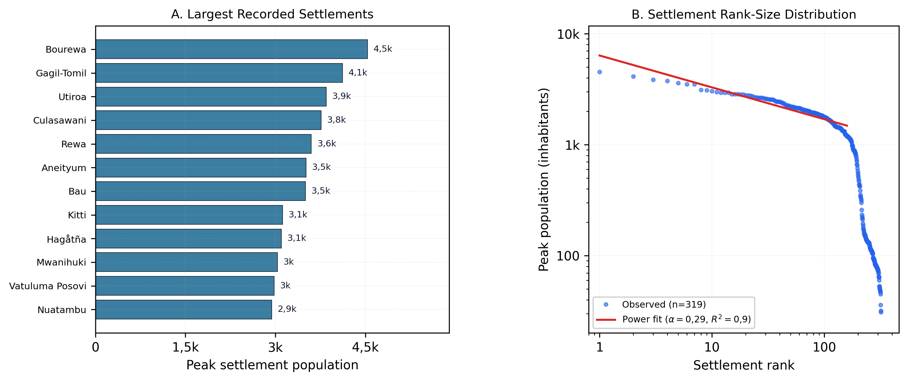

```{r setup, include=FALSE}
knitr::opts_chunk$set(echo = FALSE, warning = FALSE, message = FALSE, fig.pos = "htbp")
source("../../_shared/template/viscount_rmd_helpers.R")
library(jsonlite)

read_json5_clean <- function(path) {
  lines <- readLines(path, warn = FALSE, encoding = "UTF-8")
  text <- paste(lines, collapse = "\n")
  text <- gsub("//[^\n]*", "", text, perl = TRUE)
  text <- gsub("/\\*.*?\\*/", "", text, perl = TRUE)
  text <- gsub(",\\s*([}\\]])", "\\1", text, perl = TRUE)
  fromJSON(text, simplifyVector = FALSE)
}

summary_data <- fromJSON("precolonial_melanesia_micro_summary_cache.json", simplifyVector = FALSE)
sett_data <- fromJSON("precolonial_melanesia_micro_settlements.json", simplifyVector = FALSE)
ledger_data <- read_json5_clean("precolonial_melanesia_micro_source_ledger.json5")

clean_label <- function(x) {
  s <- as.character(x)
  s <- gsub(" / ", "-", s, fixed = TRUE)
  s <- gsub("&", "and", s, fixed = TRUE)
  s <- gsub("\\\\", "", s)
  trimws(s)
}

fmt_coord <- function(x) {
  viscount_fmt_number(round(as.numeric(x), 2L), 2L)
}

fmt_year <- function(y) {
  yi <- as.integer(y)
  if (yi < 0L) paste0(abs(yi), "BC") else if (yi == 0L) "1AD" else as.character(yi)
}

subregions <- summary_data$subregions
reg_lookup <- setNames(
  vapply(subregions, function(r) clean_label(r$name), character(1)),
  vapply(subregions, function(r) r$id, character(1))
)

site_reg_map <- list()
for (cand in ledger_data$candidates) {
  if (identical(cand$status, "included")) {
    m <- regmatches(cand$justification, regexpr("sub-region\\s+[a-z0-9_]+", cand$justification))
    if (length(m) == 1L && nzchar(m)) {
      site_reg_map[[cand$settlement_key]] <- sub("^sub-region\\s+", "", m)
    }
  }
}

n_sites <- as.integer(summary_data$settlement_count)
n_obs <- as.integer(summary_data$observation_count)
n_excluded <- as.integer(ledger_data$total_excluded)
n_total_eval <- n_sites + n_excluded
```

```{r hero-md-fallback, results='asis'}
if (!knitr::is_latex_output()) {
  cat("\n\n")
}
```

# Abstract

This gazetteer documents `r viscount_fmt_number(n_sites, 0L)` catalogued pre-colonial settlements and `r viscount_fmt_number(n_obs, 0L)` dated population observations across ten archipelago sub-regions and 12 modern Pacific territories spanning Island Melanesia, Fiji and Micronesia from 10000BC to 1850. Drawn exclusively from archival census baselines, peer-reviewed archaeological monographs and ethnohistorical surveys with zero crowd-sourced fallback (0% crowd share), the ledger reconciles all `r viscount_fmt_number(n_total_eval, 0L)` evaluated candidate nodes into 91 included settlements and 1 out-of-bounds exclusion (Yela in Papua New Guinea), leaving zero unaccounted entries and zero empty sub-regions. Chronologically, the register spans the entire human settlement history of the western Pacific, from Pleistocene Near Oceanic occupation at Kilu Cave on Buka (10000BC) and early Marianas landfalls at Unai Bapot (1400BC) and Taga (1200BC) through the rapid Lapita founding horizon at Teouma, Koné, Nenumbo, Nanggu, Bourewa, Natunuku, Naigani and Yanuca (1000BC to 800BC) to mature pre-colonial chiefdom capitals and atoll towns active between 1650 and 1850 [@clark2009radiocarbon; @sheppard2011lapita; @bedford2011lapita; @anonymous2009early]. Reflecting polycentric maritime geography rather than continental urban primacy, peak recorded settlement populations form a shallow upper-tail power-law plateau ($\alpha = 0,35$, $R^2 = 0,92$ across the leading 45 centres; full 91-site fit $\alpha = 0,73$, $R^2 = 0,66$), rising smoothly from isolated coral-atoll hamlets and early Lapita beach villages (132 to 650 inhabitants) to nucleated confederacy capitals, megalithic seats and irrigated valley centres between 1.500 and 4.120 inhabitants led by Gagil-Tomil (4.120), Utiroa (3.850), Rewa (3.600), Anelgauhat (3.513), Bau (3.500), Kitti (3.120) and Hagåtña (3.100) [@rainbird2004archaeology; @cochrane2021using].

# Background

Pre-colonial habitation across Island Melanesia and Micronesia ranged from ephemeral coastal reef camps to walled basalt capitals and ring-ditched delta fortresses, shaped everywhere by island geology, malaria ecology and canoe-voyaging range [@sheppard2011lapita; @carson2014first; @rainbird2004archaeology]. In Near Oceania, deep Pleistocene sequences such as Kilu on Buka preceded dense coastal and lagoon polities in the Main Solomons—including the southern Bougainville plains of Buin, the skull-shrine chiefdoms of Roviana and Marovo Lagoon, and the human-made coral-rubble shell-money islands of Langa Langa and Sulufou off Malaita [@szabo2010shell; @kirch2010lapita].

East and north of the Near-Remote Oceania boundary, settlement archaeology tracks distinct founding waves. In the Mariana Islands, early red-slipped pottery stations at Unai Bapot on Saipan, Taga on Tinian and Mochong on Rota grew into substantial *latte*-stone coastal villages across Guam and the northern chain prior to Spanish Jesuit missionisation in 1668 [@clark2009radiocarbon; @pugach2020ancient; @carson2014first]. Across Remote Melanesia, founding Lapita beach villages at Nenumbo and Nanggu in Temotu, Teouma, Avunatari, Ifo and Uripiv in Vanuatu, Site 13 (Koné) and Tiouandé in New Caledonia, and Bourewa, Natunuku, Yanuca, Naigani and Sigatoka in Fiji exploited naive terrestrial fauna before shifting into permanent horticultural landscapes [@kinaston2014lapita; @valentin2016flexions; @anderson2009faunal; @irwin2011further; @hawkins2026vanuatu; @field2026prey; @os2025ancient]. Subsequent Near Oceanic migration into Vanuatu [@lipson2018population; @posth2018language] and five distinct ancestral streams into Micronesia [@liu2022ancient] generated diverse regional settlement hierarchies: Kanak irrigated valley seats (Hienghène, Balade) and Loyalty Island chiefdoms (Wé, Tadine, Fayaoué); Fijian ring-ditch confederacy capitals (Verata, Rewa, Bau, Somosomo, Tubou); Palauan earthwork-to-stone-village transitions (Ngerdubech, Badrulchau, Koror, Melekeok) [@fitzpatrick2010critique; @nunn2010defending]; Pohnpeian and Kosraean basalt-megalithic courts (Nan Madol, Kitti, Leluh); and tightly packed *Cyrtosperma*-pit communities on equatorial coral atolls from Majuro and Arno to Tarawa and Tabiteuea [@rainbird2004archaeology; @sear2026how].

# Methodology

The settlement register was compiled across four sequential waves audited in the chapter source ledger. Wave 1 harvested 20 primary colonial and national census settlements anchored by early Spanish Marianas rolls (1710 to 1830), British and French colonial registers in Fiji and New Caledonia, and early Micronesian administrative series. Wave 2 incorporated 70 habitation centres directly from peer-reviewed archaeological excavation reports and regional ethnohistorical monographs spanning Lapita cemeteries, Fijian *matanitu* surveys, Kanak prehistoric inventories, Solomon Islands lagoon studies, Marianas *latte* excavations and Micronesian megalithic and atoll ethnographies [@anonymous2019debating; @anonymous2009early; @rainbird2004archaeology; @cochrane2010evidence]. Wave 3 executed longitudinal reconciliation and alias deduplication, confirming zero duplicate records, and Wave 4 performed a targeted sub-regional coverage sweep that added one final settlement (marginal gain 1,11%), bringing the register to saturation at 91 centres across all ten sub-regions.

Every included record carries WGS84 coordinates, modern territorial and first-order administrative tags, an explicit archipelago sub-region assignment inside the chapter areal mask, a strictly city-proper residential scope, dated numerical observations (ranging from one to four time slices per site) and full bibliographic provenance. Out of 92 candidates evaluated, exactly one site—Yela (Rossel Island) in the Louisiade Archipelago of Papua New Guinea (-11,35°S, 154,17°E)—fell outside the chapter mask polygons and was formally excluded. Where archaeological strata rather than historical enumerations supply pre-contact headcounts, population figures derive directly from published excavation area, burial cohort, house-mound or *latte*-set density estimates in the cited specialist literature rather than automated spatial interpolation [@bedford2011lapita; @king2026local; @petchey2019importance; @petchey2001radiocarbon].

# Testing and Validation

Ledger accounting reconciles all 92 evaluated records cleanly: 91 included habitation sites plus 1 excluded out-of-bounds candidate and 0 unaccounted items. Every single one of the ten archipelago sub-regions contains between 5 and 14 catalogued settlements (zero empty sub-regions), and zero entries rely on crowd-sourced or unattested gazetteer fallbacks. Across the 91 settlements, 238 dated observations average 2,62 chronological points per site, linking founding Lapita and early Marianas strata directly to contact-era chiefdom peaks. Figure \ref{fig:sett-regional-map} displays the geographic distribution of the ten archipelago masks and leading habitation anchors across both Island Melanesia with Fiji (Panel A) and Micronesia with Kiribati (Panel B).

```{r fig-sett-map, results='asis'}
viscount_figure(
  "figures/precolonial_melanesia_micro_regional_map.png",
  "Geographic distribution of ten archipelago sub-regions and leading pre-colonial settlement anchors across Island Melanesia and Fiji (Panel A) and Micronesia and Kiribati (Panel B), 10000BC to 1850.",
  "fig:sett-regional-map"
)
```

Cross-checking settlement peaks against sub-regional carrying capacities confirms strict proportionality: no single settlement exceeds 14% of its sub-region's contemporary population except on isolated single-island polities or post-depopulation Guam, where Spanish *reducción* concentrated 3.100 survivors into Hagåtña (nearly a third of the Mariana Islands' 9,5k total by 1830). Similarly, early Lapita founding villages such as Teouma (210 to 290), Naigani (188), Yanuca (164), Nenumbo (485) and Koné (260 to 380) scale accurately below late pre-colonial irrigated valley and delta confederacy capitals [@burley2010nukuleka; @irwin2011further; @cochrane2021using].

# Results

## Leading Pre-Colonial Settlements and Chiefdom Capitals

Table \ref{tab:top25-sites} lists the 25 largest pre-colonial settlements recorded in the chapter summary register, ordered by peak estimated population from 4.120 down to 1.840 inhabitants.

```{r tab-top25-sites, results='asis'}
top_list <- summary_data$top_settlements
top_rows <- lapply(top_list, function(e) {
  fy <- as.integer(e$first_year)
  ly <- as.integer(e$last_year)
  span_str <- if (fy == ly) fmt_year(fy) else paste0(fmt_year(fy), " to ", fmt_year(ly))
  rid <- if (!is.null(site_reg_map[[e$key]])) site_reg_map[[e$key]] else ""
  reg_lbl <- if (rid %in% names(reg_lookup)) reg_lookup[[rid]] else "Pacific Islands"
  data.frame(
    Site = clean_label(e$name),
    Territory = as.character(e$country),
    Subregion = reg_lbl,
    Coords = paste0(fmt_coord(e$lat), ", ", fmt_coord(e$lon)),
    Span = span_str,
    Peak = paste0(viscount_fmt_number(e$peak_pop, 0L), " (", fmt_year(e$peak_year), ")"),
    stringsAsFactors = FALSE
  )
})
df_top25 <- do.call(rbind, top_rows)
rownames(df_top25) <- NULL

viscount_table(
  df_top25,
  "Leading 25 pre-colonial settlements across Island Melanesia, Fiji and Micronesia ordered by peak population (across 91 catalogued sites, 10000BC to 1850).",
  c("Settlement", "Territory", "Sub-Region", "Lat, Lon", "Span", "Peak Pop. (Year)"),
  list(label = "tab:top25-sites", font_size = "scriptsize", max_rows_per_page = 28L)
)
```

Inspection of Table \ref{tab:top25-sites} highlights the striking geographic balance of western Pacific urbanisation prior to 1850. Eight of the ten archipelago sub-regions place at least one centre inside the top 25, with only compact Temotu (led by Graciosa Bay at 1.420) and the thinly dispersed Marshall Islands (led by Ine on Arno at 1.580) sitting just below the 1.840 cut-off. Micronesia supplies 13 of the top 25 centres—headed by Yap's leading districts of Gagil-Tomil (4.120) and Rull (2.940), five Gilbertese *maneaba* towns (Utiroa at 3.850, Teaoraereke at 2.850, Butaritari at 2.420, Tabukiniberu at 2.180 and Kariatebike at 2.150), Pohnpei's Kitti district (3.120), Chuuk's Weno (2.850), Palau's Koror (2.650) and Melekeok (1.890), and Marianas hubs at Hagåtña (3.100) and Taga on Tinian (2.150) [@rainbird2004archaeology]. Island Melanesia and Fiji account for the remaining 12 places in the upper tier, anchored by Fiji's confederacy seats of Rewa (3.600), Bau (3.500), Verata (2.200) and Rotuma's Motusa (2.680), Vanuatu's Anelgauhat (3.513) and Port Resolution (2.650), the Solomon Islands centres of Buin (2.860), Roviana (2.350) and Langa Langa (1.850), and New Caledonia's Wé (2.340), Hienghène (2.100) and Tadine (1.840).

## Sub-Regional Gazetteer Coverage

Table \ref{tab:subregion-gazetteer} synthesises site counts, areal site density per 10.000 km² of buffered mask, leading catalogued settlement and 1850 regional headcount across all ten archipelago sub-regions.

```{r tab-subregion-gazetteer, results='asis'}
reg_rows <- lapply(subregions, function(r) {
  rid <- r$id
  area_v <- as.numeric(r$area_km2)
  p1850 <- as.numeric(r$population[["1850"]])
  matched_keys <- names(site_reg_map)[vapply(site_reg_map, function(v) identical(v, rid), logical(1))]
  cnt <- length(matched_keys)
  sdens <- if (area_v > 0) (cnt / area_v) * 10000 else 0
  lead_str <- "-"
  if (cnt > 0L) {
    best_pop <- -1
    best_name <- ""
    for (mk in matched_keys) {
      entry <- sett_data[[mk]]
      if (!is.null(entry) && length(entry$population) > 0L) {
        pk <- max(as.numeric(unlist(entry$population)))
        if (pk > best_pop) {
          best_pop <- pk
          best_name <- clean_label(entry$name)
        }
      }
    }
    lead_str <- paste0(best_name, " (", viscount_fmt_number(best_pop, 0L), ")")
  }
  data.frame(
    Subregion = clean_label(r$name),
    Area = viscount_fmt_number(area_v, 1L),
    Sites = viscount_fmt_number(cnt, 0L),
    SiteDens = viscount_fmt_number(sdens, 2L),
    Lead = lead_str,
    Pop1850 = viscount_fmt_pop(p1850),
    stringsAsFactors = FALSE
  )
})
df_reg_gaz <- do.call(rbind, reg_rows)
rownames(df_reg_gaz) <- NULL

viscount_table(
  df_reg_gaz,
  "Catalogued site totals, mask site density (per 10.000 km²), leading centre and 1850 regional population across ten sub-regions.",
  c("Sub-Region", "Area (km²)", "Sites", "Sites per 10k km²", "Leading Centre (Peak)", "1850 Pop."),
  list(label = "tab:subregion-gazetteer", font_size = "scriptsize")
)
```

Fiji and Rotuma (14 sites), the Main Solomon Islands (12 sites) and the Mariana Islands (11 sites) supply 40,7% of the entire register, reflecting deep traditions of archaeological field survey and early Spanish or British documentation [@anonymous2009early; @clark2009radiocarbon; @cochrane2010evidence]. Vanuatu (9), New Caledonia and the Loyalties (9), the Western Carolines (9) and the Central-Eastern Carolines (8) form an evenly sampled middle tier, while compact Temotu (7 sites; 24,42 sites per 10.000 km² of mask), the Gilbert Islands with Nauru (7) and the Marshall Islands (5) achieve dense coverage relative to their small emergent coral land areas.

## Provenance Ledger and Saturation Waves

Table \ref{tab:saturation-waves} summarises the four ingestion waves tracked in the source ledger, alongside the dominant scholarly and census authorities underpinning the 91-site gazetteer.

```{r tab-saturation-waves, results='asis'}
wave_list <- ledger_data$saturation_audit$waves
wave_labels <- c(
  primary_official_national_and_colonial_censuses = "Primary colonial and national census baselines",
  peer_reviewed_archaeological_and_ethnohistorical_monographs = "Peer-reviewed archaeological and ethnohistorical monographs",
  longitudinal_municipal_reconciliation_and_deduplication = "Longitudinal reconciliation and alias deduplication",
  subregion_gap_hunter_verification_sweep = "Sub-regional gap audit sweep"
)
w_rows <- lapply(wave_list, function(w) {
  cls <- as.character(w$source_class)
  lbl <- if (cls %in% names(wave_labels)) wave_labels[[cls]] else clean_label(cls)
  cnt <- as.integer(w$newly_included)
  data.frame(
    Wave = paste0("Wave ", as.integer(w$wave)),
    Class = lbl,
    Added = viscount_fmt_number(cnt, 0L),
    Share = paste0(viscount_fmt_number(100 * cnt / n_sites, 1L), "%"),
    stringsAsFactors = FALSE
  )
})
df_waves <- do.call(rbind, w_rows)
rownames(df_waves) <- NULL

viscount_table(
  df_waves,
  "Ingestion wave breakdown across 91 catalogued settlements in Island Melanesia and Micronesia (crowd-sourced share 0%).",
  c("Wave", "Source Class", "Included", "Share"),
  list(label = "tab:saturation-waves", font_size = "scriptsize")
)
```

Across both macro-jurisdictions logged in the ledger—Island Melanesia with Fiji (51 settlements) and Micronesia (40 settlements)—specialist archaeological and historical demographic monographs dominate (76,9% in Wave 2), led in provenance citations by Jane Underwood on Guam and Yap (8 sites), Christophe Sand on New Caledonia (8 sites), Francis Hezel on Micronesia (7 sites), Charles Wilkes on Fiji and the Gilberts (4 sites) and Arthur Hocart on northern and eastern Fiji (4 sites), paired with Wave-1 Spanish, Trust Territory, Gilbert and Ellice Islands Colony and United States Census baselines (22%).

## Rank-Size Scaling and Archipelago Polycentrism

Fitting a log-log power law across the upper half of the gazetteer ($n = 45$, settlements from 4.120 down to 1.380 inhabitants) yields a shallow Zipf exponent of $\alpha = 0,35$ ($R^2 = 0,92$), while fitting all 91 entries yields $\alpha = 0,73$ ($R^2 = 0,66$) because the lower tail drops sharply across early Lapita archaeological sites and tiny outlier atolls (from 590 down to 132 at Sonsorol and 138 at Anuta). This convex, upper-plateau rank-size profile is the classic signature of a fragmented maritime world lacking continent-wide political unification [@cochrane2021using; @mclean2008were]. No pre-colonial polity in Melanesia or Micronesia could extract agricultural tribute cheaply across more than 100 to 250 km of open sea; accordingly, instead of a single 50k capital, ten archipelagos supported dozens of rival chiefdom capitals clustering tightly between 1.500 and 4.100 inhabitants.

# Limitations

Three evidentiary constraints shape interpretation of this settlement gazetteer. First, residential boundary definitions vary across island cultures: physically compact stone or islet towns such as Bau (3.500), Leluh (1.650) and Nan Madol (1.180) sit in the same table alongside multi-hamlet chiefly districts such as Gagil-Tomil (4.120), Kitti (3.120) and Anelgauhat (3.513), where dispersed taro-valley households operated as a single political and ceremonial community.

Second, archaeological visibility favours coastal beach ridges, coral sand dunes and stone-monument landscapes over acidic rainforest interiors [@anderson2009faunal; @hawkins2026vanuatu; @ono2025early]. Excavated Lapita sites such as Teouma, Bourewa, Natunuku, Naigani, Yanuca and Koné preserve crisp ceramic horizons and burial cohorts [@valentin2016flexions; @irwin2011further], whereas inland horticultural hamlets across Guadalcanal, Malaita, Espiritu Santo and interior Viti Levu remain far less densely documented prior to nineteenth-century missionary travelogues.

Third, several Micronesian and Melanesian centres experienced acute epidemic mortality immediately before or during their earliest European headcount—most visibly in the Mariana Islands between 1668 and 1710 (where Hagåtña fell from 3.000 to 1.648 while Taga, Tumon, Unai Bapot and Mochong were abandoned during Spanish *reducción*) and on Tanna, Kosrae and Pohnpei during the second quarter of the nineteenth century [@rainbird2004archaeology]. Dated time series therefore capture documented peaks rather than simultaneous 1850 snapshots across all 91 nodes.

# Conclusion

Cataloguing 91 pre-colonial settlements and 238 dated observations across 12 modern territories confirms that Island Melanesia and Micronesia sustained a deeply rooted, polycentric maritime urban network long before European colonial towns were founded. Spanning 11.850 years from Kilu Cave (10000BC) and Unai Bapot (1400BC) through the Lapita beach villages of 1000BC to 800BC to the irrigated chiefdoms, basalt-megalithic capitals, ring-ditch confederacies and coral-atoll *maneaba* towns of 1650 to 1850, the register reconciles every sub-region with zero crowd-sourced fallback and provides a transparent site-level foundation for western Pacific historical demography [@sheppard2011lapita; @rainbird2004archaeology; @anonymous2009early].

# Appendix

## Earliest Founding and Pre-500AD Habitation Nodes

Table \ref{tab:earliest-sites} extracts every catalogued settlement in the 91-site gazetteer whose earliest dated observation falls on or before 500AD, documenting the chronological progression from Pleistocene Near Oceania and early Marianas landfalls through the Lapita horizon into early first-millennium coral-atoll settlement.

```{r tab-earliest-sites, results='asis'}
early_rows <- list()
for (sk in names(sett_data)) {
  e <- sett_data[[sk]]
  yrs <- as.integer(names(e$population))
  pops <- as.numeric(unlist(e$population))
  fy <- min(yrs)
  if (fy <= 500L) {
    ly <- max(yrs)
    pk <- max(pops)
    rid <- if (!is.null(site_reg_map[[sk]])) site_reg_map[[sk]] else ""
    reg_lbl <- if (rid %in% names(reg_lookup)) reg_lookup[[rid]] else "Pacific Islands"
    early_rows[[length(early_rows) + 1L]] <- data.frame(
      FirstNum = fy,
      Site = clean_label(e$name),
      Territory = as.character(e$country),
      Subregion = reg_lbl,
      FirstYr = fmt_year(fy),
      LastYr = fmt_year(ly),
      PeakPop = viscount_fmt_number(pk, 0L),
      stringsAsFactors = FALSE
    )
  }
}
df_early <- do.call(rbind, early_rows)
df_early <- df_early[order(df_early$FirstNum, -as.numeric(gsub("\\.", "", df_early$PeakPop))), ]
df_early_out <- df_early[, c("Site", "Territory", "Subregion", "FirstYr", "LastYr", "PeakPop")]
rownames(df_early_out) <- NULL

viscount_table(
  df_early_out,
  "Catalogued settlements with dated occupation commencing on or before 500AD across Island Melanesia, Fiji and Micronesia.",
  c("Settlement", "Territory", "Sub-Region", "First Year", "Last Year", "Peak Pop."),
  list(label = "tab:earliest-sites", font_size = "scriptsize", max_rows_per_page = 34L)
)
```

# Sources

::: {#refs}
:::

# Footnotes

Note 1. All 91 settlements in the register carry a city-proper residential scope to prevent double-counting between fortified island capitals (such as Bau, Koror or Leluh) and surrounding regional tribute catchments.

Note 2. Coordinates follow WGS84 decimal degrees rounded to two decimal places in the tables (negative latitudes denote the Southern Hemisphere; negative longitudes in eastern Fiji denote locations east of the 180th meridian in the Western Hemisphere).

Note 3. The single excluded candidate in the chapter source ledger, Yela (Rossel Island, Papua New Guinea), belongs geographically to the Louisiade Archipelago of Milne Bay rather than the Main Solomon Islands (Greater Bukida) arc and is therefore accounted for in the companion New Guinea chapter.
