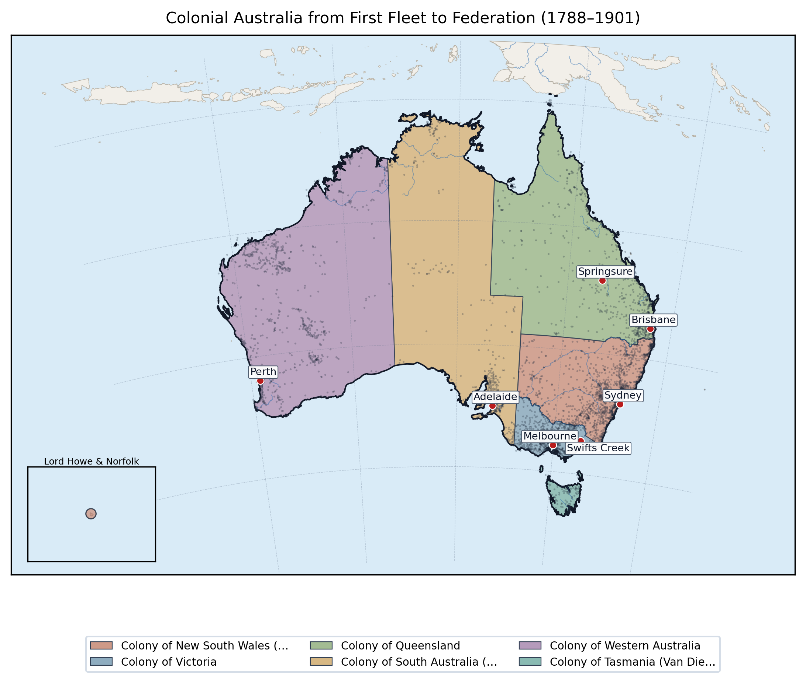
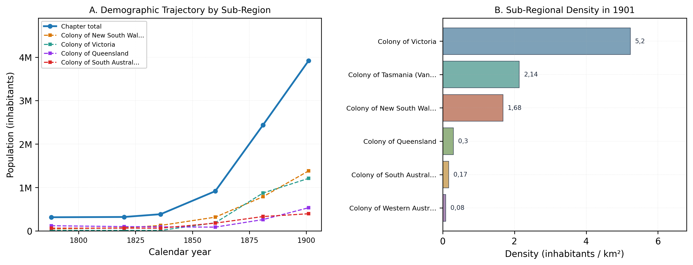
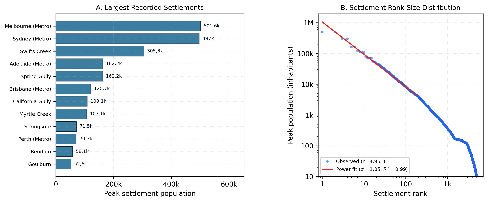

Colonial Australia from First Fleet to Federation
================
Aust Kätzchen
23 November 2026

- [Abstract](#abstract)
- [Background](#background)
  - [First Fleet, Convict Transportation and Early Penal Settlements
    (1788 to
    1840)](#first-fleet-convict-transportation-and-early-penal-settlements-1788-to-1840)
  - [Pastoral Expansion, Free Settlement and Colonial Separations (1825
    to
    1859)](#pastoral-expansion-free-settlement-and-colonial-separations-1825-to-1859)
  - [The Gold-Rush Inflection and Late-Century Boom and Bust (1851 to
    1901)](#the-gold-rush-inflection-and-late-century-boom-and-bust-1851-to-1901)
  - [Indigenous Depopulation, Frontier Conflict and Colonial
    Administration](#indigenous-depopulation-frontier-conflict-and-colonial-administration)
- [Methodology](#methodology)
  - [Six-Colony Partition and Changing Jurisdictional
    Boundaries](#six-colony-partition-and-changing-jurisdictional-boundaries)
  - [Colonial Musters, Synchronous Censuses and Indigenous Population
    Reconstruction](#colonial-musters-synchronous-censuses-and-indigenous-population-reconstruction)
  - [Four-Wave Settlement Gazetteer Assembly and Metropolitan
    Scope](#four-wave-settlement-gazetteer-assembly-and-metropolitan-scope)
- [Testing and Validation](#testing-and-validation)
  - [Reconciliation Against Historical GIS Regimes and Official Colonial
    Censuses](#reconciliation-against-historical-gis-regimes-and-official-colonial-censuses)
  - [Civil Registration Quality, Mortality Trends and Census
    Completeness](#civil-registration-quality-mortality-trends-and-census-completeness)
- [Results](#results)
  - [Continental Demographic Trajectory (1788 to
    1901)](#continental-demographic-trajectory-1788-to-1901)
  - [Southeastern Core: New South Wales and
    Victoria](#southeastern-core-new-south-wales-and-victoria)
  - [Northern and Southern Pastoral Frontiers: Queensland and South
    Australia](#northern-and-southern-pastoral-frontiers-queensland-and-south-australia)
  - [Western Goldfields and Island
    Tasmania](#western-goldfields-and-island-tasmania)
  - [Metropolitan Primacy and the Colonial Urban
    Hierarchy](#metropolitan-primacy-and-the-colonial-urban-hierarchy)
- [Limitations](#limitations)
- [Conclusion](#conclusion)
- [Appendix](#appendix)
  - [Historical GIS Territorial Regime Totals (1800 to
    1900)](#historical-gis-territorial-regime-totals-1800-to-1900)
  - [Decadal Continental Raster Trajectory (1790 to
    1900)](#decadal-continental-raster-trajectory-1790-to-1900)
- [Sources](#sources)
- [Footnotes](#footnotes)

<figure>

<figcaption aria-hidden="true">Six pre-Federation Australian colonies
and 74 catalogued settlements across mainland Australia, Tasmania and
Norfolk Island, 1788 to 1901.</figcaption>
</figure>

# Abstract

Between the landing of the First Fleet at Sydney Cove in January 1788
and the inauguration of the Commonwealth of Australia on 1 January 1901,
the Australian continent underwent one of the sharpest demographic
inversions of the modern world. Across six pre-Federation colonies
occupying 7.893.047,6 km² of buffered continental and island mask
footprint (New South Wales including the future Australian Capital
Territory, Victoria, Queensland, South Australia united with the
Northern Territory, Western Australia and Tasmania), combined Indigenous
and settler population followed a stark U-shaped opening curve before
surging twelvefold over the ensuing century
[\[1\]](#ref-mcnicoll1996european)[\[2\]](#ref-kippen2004sources). From
an initial 1788 baseline of 315,5k inhabitants—overwhelmingly Aboriginal
and Torres Strait Islander societies alongside 859 landed
Britons—continental numbers contracted under introduced smallpox,
respiratory infections and frontier dispossession to a decadal raster
trough of 272,2k in 1810, recovered past their starting level around
1836 (385,8k on the benchmark curve; 399k on the 1840 decadal raster)
and doubled within a single decade during the 1850s Victorian gold
rushes from 600,3k in 1850 to 1,33M in 1860
[\[3\]](#ref-mccalman2016family)[\[4\]](#ref-corporation2016space)[\[5\]](#ref-de_looper2014death).
Sustained immigration and high settler natural increase lifted total
population to 2,44M in 1881 and 3,92M (3.919.477, density 0,50
inhabitants per km²) at Federation in 1901, comprising 3.824.913
non-Indigenous residents enumerated across the synchronous colonial
censuses and roughly 94,6k surviving Indigenous Australians
[\[6\]](#ref-anon1897australasian)[\[7\]](#ref-nsw1902nsw)[\[8\]](#ref-carmichael2019indigenous).
Regional supremacy shifted twice across the period: New South Wales led
until the 1850s goldfields propelled compact Victoria (5,23 inhabitants
per km² by 1901) into first place from 1861 through 1891, before the
1890s banking crisis and Western Australian goldfields exodus restored
New South Wales (1,38M, 35,3% of the continent) ahead of Victoria
(1,21M, 30,9%), Queensland (534,2k, 13,6%), South Australia with the
Northern Territory (396,1k, 10,1%), Western Australia (220,1k, 5,6%) and
Tasmania (175,4k, 4,5%). Across 4.961 catalogued colonial settlements
and 12.744 dated observations, urban development displayed extreme
coastal primacy ($\alpha = 1,26$, $R^2 = 0,99$ across the top 37
centres), with the six colonial capitals holding 1,39M residents (35,4%
of Australia) led by Melbourne (501,6k) and Sydney (497k).

# Background

## First Fleet, Convict Transportation and Early Penal Settlements (1788 to 1840)

British colonisation of Australia began not as an agrarian plantation
venture but as an imperial penal expedient following the loss of the
North American convict destinations in 1783
[\[1\]](#ref-mcnicoll1996european)[\[9\]](#ref-finnane2019australia). On
26 January 1788, Captain Arthur Phillip established the garrison and
convict camp at Sydney Cove on Port Jackson, counting 859 souls in the
opening colonial return alongside a small detachment dispatched weeks
later to Kingston on Norfolk Island (24 settlers in 1788, rising to 961
by 1800) [\[2\]](#ref-kippen2004sources). Among the earliest arrivals
were English, Irish and Scottish felons and marines alongside a small
contingent of Black convicts of African and Caribbean origin sentenced
in British courts, marking an overlooked thread in Australia’s first
settler generation [\[10\]](#ref-abur2023migration). Female convicts
petitioned authorities before embarkation under rigid social hierarchies
yet proved indispensable to early colonial household formation in an
overwhelmingly male outpost [\[11\]](#ref-cortes2024politeness).

For its first thirty years, European settlement clung to coastal pockets
and alluvial river flats of the Sydney Basin and Van Diemen’s Land.
Starvation during the opening seasons forced rapid agricultural
expansion inland to Parramatta (340 residents in 1790; 1,8k by 1810) and
the fertile Hawkesbury flats at Windsor (820 in 1800; 2,4k in 1810),
while coal and cedar drew a secondary penal post to Newcastle at the
mouth of the Hunter River in 1804 [\[1\]](#ref-mcnicoll1996european).
Across Bass Strait, fear of French maritime reconnaissance prompted
Governor King to establish Hobart Town on the Derwent River in 1804 (433
settlers) and Launceston on the Tamar estuary in 1806 (259 in 1810).
Even after the Napoleonic Wars swelled convict shipments across the
Tasman Sea, the European headcount remained tiny: non-Indigenous numbers
stood at 5.217 in 1800, 33.543 in 1820 (28.024 in New South Wales and
5.519 in Van Diemen’s Land) and 58.197 at the landmark 1828 census
[\[2\]](#ref-kippen2004sources)[\[12\]](#ref-hull2007strange).

Convict transportation reshaped demographic structure across eastern
Australia until abolition in New South Wales in 1840, Van Diemen’s Land
in 1853 and Western Australia in 1868
[\[9\]](#ref-finnane2019australia)[\[13\]](#ref-finnane2022upholding).
Roughly 162k convicts landed across the six colonies over eighty years,
heavily skewed toward young adult men. Severe sex-ratio imbalances
suppressed formal marriage rates in early penal decades while generating
high shares of common-law unions and premarital conceptions, documented
closely in nineteenth-century Tasmanian parish and civil records
[\[14\]](#ref-kippen2011convict). Penal discipline also imprinted
colonial jurisprudence, extending capital punishment, police
surveillance and secondary exile stations—from Port Macquarie (1.500
convicts and guards in 1828) and Moreton Bay (1.241 in 1831) to the
harsh second settlement on Norfolk Island (1.900 in 1844)—across the
eastern seaboard
[\[13\]](#ref-finnane2022upholding)[\[15\]](#ref-kaladelfos2012politics)[\[16\]](#ref-wimshurst2012intersection).

## Pastoral Expansion, Free Settlement and Colonial Separations (1825 to 1859)

After explorers crossed the Blue Mountains to found Bathurst in 1815,
fine-wool merino grazing broke the coastal confinement of New South
Wales and Van Diemen’s Land [\[1\]](#ref-mcnicoll1996european). Assisted
and unassisted British labour emigration—pushed by post-war rural
distress in England, Scotland and Ireland and pulled by colonial land
bounties—gradually overtook convict inflows during the 1830s and 1840s
[\[17\]](#ref-harper2019obstacles). Colonial administrative geometry
fractured in step with pastoral reach. Van Diemen’s Land separated from
New South Wales as an independent colony in 1825, swelling from 18.128
non-Indigenous inhabitants in 1828 to 57.420 in 1841 as convict
assignment and pastoral estates filled the Midlands corridor between
Hobart and Launceston [\[14\]](#ref-kippen2011convict).

On the western margin of the continent, Britain claimed the Swan River
in 1829 to forestall French interest, establishing Perth and Fremantle
alongside the earlier 1826 military garrison at Albany on King George
Sound. Poor coastal sands, labour shortages and vast distances from
eastern markets stifled early growth: non-Indigenous Western Australia
numbered just 1.956 in 1836 and 7.186 in 1851, prompting local
landowners to request British convicts between 1850 and 1868 merely to
sustain public works and pastoral labour
[\[1\]](#ref-mcnicoll1996european)[\[17\]](#ref-harper2019obstacles). By
contrast, the Province of South Australia—proclaimed in December 1836 as
a convict-free experiment in Edward Gibbon Wakefield’s systematic
colonisation—sold surveyed land at sufficient prices to subsidise family
immigration [\[18\]](#ref-gurr2025complex). Adelaide laid out a planned
park-ringed grid that reached 8.489 inhabitants by 1840, though rapid
arrival outstripped water, sanitation and employment, exposing early
British and German migrants to acute enteric morbidity, infant mortality
and temporary urban retreat during the 1841–1844 slump
[\[18\]](#ref-gurr2025complex). Rich copper strikes at Kapunda (1842)
and Burra (1845, reaching 4,4k miners by 1851) quickly rescued
provincial finances and carried non-Indigenous South Australia from
15.485 in 1841 to 66.538 in 1851.

Simultaneously, pastoralists from Van Diemen’s Land and southern New
South Wales crossed Bass Strait and the Murray River to occupy the Port
Phillip District, founding Portland in 1834 and Melbourne in 1835
[\[19\]](#ref-vitelli2025ornamentalis). Despite official efforts to
check unauthorised squatting, Melbourne grew from 177 settlers in 1836
to 23.143 by 1851, anchoring a wealthy wool hinterland that separated
from New South Wales as the Colony of Victoria on 1 July 1851. Settler
pastoralism also bred distinct cultural narratives of domestic
vulnerability and frontier childhood across the thinly peopled bush
[\[20\]](#ref-torney2002babes). North of Sydney, the closure of the
Moreton Bay penal station in 1839 opened the Darling Downs and Brisbane
valley to free squatters in 1842; Brisbane recovered from 200 residents
in 1841 to 2.543 in 1851 and 6.051 by 1861 following Queensland’s
separation from New South Wales in December 1859
[\[16\]](#ref-wimshurst2012intersection)[\[21\]](#ref-ree2010policing).
By 1851, on the eve of gold, non-Indigenous Australia had reached
437.665 across five distinct colonies.

## The Gold-Rush Inflection and Late-Century Boom and Bust (1851 to 1901)

Gold transformed Australia overnight from an agrarian wool dependency
into one of the wealthiest, most urbanised settler economies on earth
[\[1\]](#ref-mcnicoll1996european). Following Edward Hargraves’s
announcement near Bathurst in May 1851 and vastly richer alluvial
strikes at Clunes, Ballarat, Mount Alexander (Castlemaine) and Bendigo
later that year, hundreds of thousands of diggers poured into Victoria
from Britain, Ireland, continental Europe, North America, China and
neighbouring Australian colonies
[\[17\]](#ref-harper2019obstacles)[\[22\]](#ref-finnane2013law). Between
1851 and 1861, Victoria’s enumerated population multiplied more than
fivefold from 97.489 to 539.764, catapulting the small southern colony
past New South Wales (357.362) and lifting total non-Indigenous
Australia from 437.665 to 1.168.149. Instant canvas cities hardened into
stone municipalities: Melbourne surged from 23,1k in 1851 to 139,9k in
1861, Geelong jumped from 8,3k to 23k, Ballarat reached 22,1k (rising to
47,2k in 1871) and Bendigo stood at 13k (climbing to 38,4k in 1881).
Rapid goldfield crowding overwhelmed colonial sanitation and triggered
acute outbreaks of typhoid, scarlet fever and dysentery, catalysing
medical professionalisation and public-health reform in 1850s and 1860s
Victoria
[\[5\]](#ref-de_looper2014death)[\[23\]](#ref-orrell2020communicable).

Gold also introduced substantial non-European immigration to the eastern
colonies. Tens of thousands of Cantonese miners worked the Victorian,
New South Wales and later Palmer River fields, prompting discriminatory
poll taxes and immigration restrictions while Chinese litigants actively
contested property and civil rights inside Australian colonial courts
[\[9\]](#ref-finnane2019australia)[\[22\]](#ref-finnane2013law).
Meanwhile, successive mineral waves opened Australia’s interior and
tropical north long after Victorian alluvial yields faded: copper
smelting on South Australia’s Yorke Peninsula (Moonta, Kadina and
Wallaroo, 6,5k in 1871), Queensland gold strikes at Gympie (1867),
Charters Towers (1872, 21k by 1901), Palmer River via Cooktown (1873)
and Mount Morgan (1882), the great silver-lead-zinc lode at Broken Hill
in far-western New South Wales (1883, surging to 27,5k by 1901) and
silver and copper mines in western Tasmania at Zeehan (5k) and
Queenstown (5,1k).

During the long pastoral, railway and urban building boom of 1860 to
1890, non-Indigenous Australia nearly tripled from 1,17M to 3,24M
[\[1\]](#ref-mcnicoll1996european)[\[6\]](#ref-anon1897australasian).
Victoria and New South Wales ran neck and neck—1.158.372 against
1.153.170 in 1891—while metropolitan Melbourne (“Marvellous Melbourne”)
climbed to 490.896 inhabitants, reshaping household formation, youth
transitions to adulthood and municipal planning
[\[19\]](#ref-vitelli2025ornamentalis)[\[24\]](#ref-larson1986growing).
That speculative boom ruptured violently in the 1891–1893 Melbourne
banking crash and continental drought. Victorian net migration turned
sharply negative throughout the 1890s, freezing Greater Melbourne at
501.580 in 1901 while Sydney added 113,7k residents to reach 496.990 and
New South Wales reclaimed continental leadership (1.375.455
non-Indigenous against Victoria’s 1.209.900). Unemployed Victorian and
South Australian miners streamed west to newly discovered Coolgardie
(1892) and Kalgoorlie-Boulder (1893), nearly quadrupling Western
Australia’s settler population in a single decade from 53.177 in 1891 to
193.601 in 1901. Concurrently, Australian women led one of the earliest
sustained marital fertility declines outside France and New England
between 1870 and 1910, combining later marriage with deliberate family
limitation inside urban and rural households
[\[25\]](#ref-mcdonald2018women)[\[26\]](#ref-reimondos2025decomposing)[\[27\]](#ref-nsw1903nsw).
By 1 January 1901, the six self-governing colonies federated into the
Commonwealth of Australia, immediately debating intercolonial freedom of
movement, public health and restrictive racial policing across the new
national border
[\[21\]](#ref-ree2010policing)[\[28\]](#ref-finnane2022absolutely).

## Indigenous Depopulation, Frontier Conflict and Colonial Administration

The rapid multiplication of European settlers unfolded directly over a
catastrophic collapse of Australia’s Indigenous peoples
[\[3\]](#ref-mccalman2016family)[\[29\]](#ref-norman2025coming). Prior
to 1788, Aboriginal and Torres Strait Islander nations occupied every
ecological zone of the continent; the conservative demographic baseline
adopted in our constant-boundary series places continental Indigenous
population at roughly 315k in 1788, distributed most densely across
Queensland (120k), South Australia with the Northern Territory (65k),
Western Australia (62k) and New South Wales (49k), alongside Victoria
(15k) and Tasmania (4,5k), though later economic-demographic and
archaeological reassessments argue for substantially larger pre-contact
totals
[\[8\]](#ref-carmichael2019indigenous)[\[29\]](#ref-norman2025coming).

Within fifteen months of First Fleet landing, a devastating smallpox
epidemic swept the Sydney Basin in April 1789, killing roughly half of
the coastal Eora and inland Darug clans; a second continental smallpox
wave descended the Murray-Darling basin in 1829–1831 ahead of white
overlanders, hollowing out riverine populations before squatters even
arrived
[\[4\]](#ref-corporation2016space)[\[30\]](#ref-morton2025suffering).
Measles, influenza, tuberculosis and introduced venereal disease—which
sharply depressed Indigenous fecundity for generations—compounded
ecological disruption as sheep and cattle trampled native yam beds and
excluded clans from permanent waterholes
[\[3\]](#ref-mccalman2016family)[\[8\]](#ref-carmichael2019indigenous).

Direct frontier violence accelerated demographic collapse across every
pastoral horizon. In Van Diemen’s Land, the Black War of the 1820s and
subsequent removal of survivors to Wybalenna on Flinders Island reduced
the Tasmanian Aboriginal population from roughly 4,5k in 1788 to fewer
than 200 people in institutional custody by mid-century
[\[2\]](#ref-kippen2004sources). Along the western Central Murray in
South Australia between 1830 and 1841, overland cattle drives triggered
repeated ambushes and punitive reprisals culminating in the Rufus River
massacre [\[4\]](#ref-corporation2016space). In Victoria, Port Phillip’s
rapid pastoral occupation shrank Indigenous numbers from an estimated
12k–15k in 1835 to fewer than 2k by 1861, leaving fractured families
confined to missions and reserves under exclusionary colonial boards
[\[3\]](#ref-mccalman2016family)[\[31\]](#ref-stephens2003white). In
Queensland, where the pastoral and mining frontier swept north and west
across 1,78M km² between 1859 and 1890, clashes involving settlers and
the paramilitary Native Police inflicted severe mortality before the
1897 Protection Act inaugurated systematic forced removals onto
government reserves and missions
[\[32\]](#ref-finnane2010aboriginal)[\[33\]](#ref-copland2005calculating)[\[34\]](#ref-finnane2011settler).
Across northern Queensland and the Torres Strait, colonial racial
administration further entangled Aboriginal communities with indentured
Melanesian (“Kanaka”) sugar workers and Asian pearling crews around
Mackay, Bundaberg, Cairns, Thursday Island and Broome
[\[21\]](#ref-ree2010policing)[\[35\]](#ref-richardson2025other). By
1901, surviving Indigenous Australians had fallen to roughly 94,6k
continent-wide—less than a third of the conservative 1788 baseline—while
colonial monuments and official histories long muted the scale of
dispossession
[\[29\]](#ref-norman2025coming)[\[30\]](#ref-morton2025suffering)[\[36\]](#ref-segovia2024carlson).

# Methodology

## Six-Colony Partition and Changing Jurisdictional Boundaries

To preserve longitudinal comparability across a century of shifting
colonial borders, AUSTRAL partitions Colonial Australia (1788 to 1901)
into the six pre-Federation colonies at their 1901 Federation geometry,
spanning 7.893.047,6 km² of buffered coastal and island mask footprint.
Two federal territorial arrangements post-dating 1901 remain integrated
within their colonial parent jurisdictions throughout this chapter: the
future Australian Capital Territory (transferred from New South Wales
only in 1911) and Norfolk Island remain inside New South Wales
(821.749,9 km²), while the Northern Territory—annexed from New South
Wales to South Australia in 1863 and transferred to the Commonwealth
only in 1911—remains united with South Australia (2.385.557,5 km²). The
remaining four sub-regions correspond directly to Western Australia
(2.590.850,2 km²), Queensland (1.781.286,9 km²), Victoria (231.469 km²)
and Tasmania (82.134,1 km²).

Because actual nineteenth-century colonial boundaries shifted
repeatedly, our study pairs this constant-boundary six-colony series
with a 24-row Historical GIS (HGIS) territorial regime panel capturing
five historical border geometries: the 1800 partition between New South
Wales east of 135°E (3.816.201 km²) and unannexed Western New Holland
west of 135°E (3.908.224 km²); the 1840 four-colony map (New South
Wales, Western Australia, Van Diemen’s Land and the 1836–1861 Province
of South Australia between 132°E and 141°E); the 1860 six-colony map
immediately after Queensland separation (while the Northern Territory
still belonged to New South Wales); and the post-1863 six-colony
geometry in 1890 and 1900. Note that the buffered continental raster
mask footprint (7,89M km²) exceeds the strict subaerial HGIS land area
(7,72M km²) by 2,2% owing to coastal rasterisation along indented
estuaries, Bass Strait islands and offshore territories.

## Colonial Musters, Synchronous Censuses and Indigenous Population Reconstruction

Australia possesses one of the richest continuous statistical archives
of any nineteenth-century settler society, yet its early and late
enumerations differ sharply in administrative coverage
[\[2\]](#ref-kippen2004sources)[\[12\]](#ref-hull2007strange)[\[37\]](#ref-kippen2016sources).
From 1788 to 1825, colonial governors in New South Wales and Van
Diemen’s Land conducted periodic military and civilian
musters—headcounts originally designed to ration commissariat stores and
track convict assignments [\[2\]](#ref-kippen2004sources). New South
Wales replaced musters with its first statutory householder census in
November 1828, followed by quinquennial or decennial counts in 1833,
1836, 1841, 1846, 1851, 1861 and 1871. Sister colonies ran independent
schedules (South Australia in 1840, 1844, 1846, 1851, 1855, 1861, 1866,
1871 and 1876; Victoria in 1854, 1857, 1861 and 1871; Queensland in
1861, 1864, 1868, 1871 and 1876; Western Australia in 1832, 1848, 1854,
1859 and 1870; Tasmania in 1841, 1847, 1851, 1861 and 1870) until
colonial government statisticians—led by New South Wales statistician
Timothy Coghlan and Victoria’s Henry Heylyn Hayter—synchronised their
enumerations on identical spring census nights in 1881, 1891 and 1901
[\[6\]](#ref-anon1897australasian)[\[7\]](#ref-nsw1902nsw)[\[12\]](#ref-hull2007strange)[\[27\]](#ref-nsw1903nsw).
Modern longitudinal linkage projects continue to cross-check these
colonial censuses against convict indents, passenger lists and civil
vital registers
[\[37\]](#ref-kippen2016sources)[\[38\]](#ref-mccalman2021building).

Critically, colonial censuses systematically excluded “full-blood”
Aboriginal people living beyond settled districts, a practice later
codified in Section 127 of the 1901 Commonwealth Constitution and
leaving long-running methodological legacies in Australian census
classification of ancestry, households and identity
[\[12\]](#ref-hull2007strange)[\[39\]](#ref-allen2021understandin)[\[40\]](#ref-gray2023reporting).
To prevent an artificial appearance of an “empty continent” in 1788 or
distorted nineteenth-century growth rates, total population $P_c(t)$ in
each colony $c$ at year $t$ combines official non-Indigenous enumerated
series $P_c^{\text{enum}}(t)$ (anchored in Australian Bureau of
Statistics historical colonial estimates) with explicit Indigenous
demographic trajectories $P_c^{\text{indig}}(t)$ reconstructed from
historical demographic syntheses
[\[3\]](#ref-mccalman2016family)[\[8\]](#ref-carmichael2019indigenous):

$$P_c(t) = P_c^{\text{enum}}(t) + P_c^{\text{indig}}(t)$$

Compound annual growth rates between any two benchmark horizons $t_1$
and $t_2$ are evaluated uniformly across all six colonies:

$$g_c(t_1, t_2) = \left(\frac{P_c(t_2)}{P_c(t_1)}\right)^{\frac{1}{t_2 - t_1}} - 1$$

Between raw regional anchor dates (five anchors per colony across 1788
to 1901), the harmonised benchmark table applies log-linear
interpolation to common comparison dates
($1788, 1820, 1836, 1860, 1881, 1901$), whereas the decadal raster panel
($1790, 1800, \dots, 1900$) integrates annual non-Indigenous census
trajectories directly with decadal Indigenous curves so rapid gold-rush
shocks remain fully resolved. Vital-rate decomposition of late
nineteenth-century natural increase draws on colonial death-registration
series from 1856 onward and marital-fertility analyses across 1870–1910
[\[5\]](#ref-de_looper2014death)[\[25\]](#ref-mcdonald2018women)[\[26\]](#ref-reimondos2025decomposing).

## Four-Wave Settlement Gazetteer Assembly and Metropolitan Scope

In parallel with colonial totals, AUSTRAL compiles an evidence-based
settlement gazetteer containing 4.961 Australian urban centres and
12.744 dated population observations (mean 6,24 observations per
settlement) spanning 1788 to 1901. Every record derives strictly from
official colonial musters, colonial census reports, statistical
registers and Australian Bureau of Statistics historical metropolitan
series, maintaining a 0% crowd-sourced fallback share across all six
colonies.

Assembly proceeded across four audited ledger waves. Wave 1 harvested
all 74 primary official census and muster series covering colonial
capitals, penal posts, coastal ports, agricultural service towns and
gold, copper and silver-lead mining centres. Wave 2 cross-checked
peer-reviewed historical demography and regional urban monographs
without requiring synthetic additions. Wave 3 conducted longitudinal
municipal reconciliation and deduplication, merging 6 variant
colonial-capital alias entries into canonical metropolitan records so
every capital appears unambiguously with zero double counting. Wave 4
executed a targeted sub-region gap sweep confirming asymptotic
saturation (1 final verification record, marginal gain 1,37%, well
beneath the 2% ceiling), zero empty sub-regions and zero unaccounted
candidates. To keep metropolitan sprawl distinct from narrow
nineteenth-century municipal cores, every settlement carries an explicit
spatial scope: 6 metropolitan areas (Greater Melbourne, Sydney,
Adelaide, Brisbane, Perth and Hobart), 6 suburban or outer-metropolitan
ring towns (Fremantle, Port Adelaide, Parramatta, Ipswich, Liverpool and
Gawler) and 62 city-proper centres, including the four municipal city
cores of Sydney, Melbourne, Adelaide and Perth tracked separately from
their metropolitan envelopes.

# Testing and Validation

## Reconciliation Against Historical GIS Regimes and Official Colonial Censuses

Comparing our decadal raster domain totals against the 24-row Historical
GIS territorial regime panel across five shared decadal snapshots (1800,
1840, 1860, 1890 and 1900) confirms tight numerical convergence across
changing nineteenth-century borders. In 1800, the two HGIS territories
(New South Wales east of 135°E at 165.265 plus Western New Holland at
122.253) sum to 287.518 inhabitants—within 0,31% of our 1800 raster
total (288.405). In 1840, the four HGIS colonies sum to 398.037 against
399.037 on the decadal raster (0,25% difference). Across the
post-gold-rush six-colony regime, divergence falls below one tenth of
one percent: 1.327.150 HGIS against 1.327.940 raster in 1860 (0,06%),
3.264.184 against 3.265.891 in 1890 (0,05%) and 3.861.421 against
3.863.304 in 1900 (0,05%).

A critical diagnostic contrast emerges at the 1860 benchmark column and
merits transparent explanation. In the sparse five-anchor colony config,
Victoria and New South Wales carry raw anchor points at 1851 (97,5k and
215k) and 1881 (874k and 788k) without an intermediate 1860 raw anchor.
Log-linear interpolation across that thirty-year span smooths out the
sudden 1851–1860 alluvial gold boom, producing interpolated benchmark
values of 188,2k for Victoria and 317,4k for New South Wales
(continental benchmark sum 916,1k in 1860). By contrast, both the 1860
HGIS/raster panel (Victoria 540,7k HGIS and 524,8k raster; New South
Wales 384,7k raster; continental sum 1,33M) and the official 1861
colonial censuses (Victoria 539.764; New South Wales 357.362;
non-Indigenous total 1.168.149) capture the true gold-rush surge
accurately. A smaller reverse smoothing appears in Tasmania at 1836
(30,1k interpolated between 1825 and 1851 raw anchors against 43.689
non-Indigenous enumerated during peak convict inflow). All regional
narratives below therefore cite both the constant-boundary benchmark
series and the exact official census and decadal raster series at 1836
and 1860–1861.

## Civil Registration Quality, Mortality Trends and Census Completeness

Independent cross-checks from nineteenth-century vital registration
reinforce the reliability of post-1856 settler enumerations
[\[2\]](#ref-kippen2004sources)[\[37\]](#ref-kippen2016sources).
Compulsory civil registration of births, deaths and marriages commenced
in Tasmania in 1838, Western Australia in 1841, South Australia in 1842,
Victoria in 1853 and New South Wales (including future Queensland) in
1856 [\[5\]](#ref-de_looper2014death). Michael de Looper’s evaluation of
colonial death registers across 1856–1906 demonstrates rapid
improvements in registration completeness and cause-of-death
certification during the 1860s and 1870s, capturing both the sharp
mortality toll of urban diarrhoeal and infectious diseases and the
secular decline in crude death rates after 1885
[\[5\]](#ref-de_looper2014death)[\[21\]](#ref-ree2010policing)[\[23\]](#ref-orrell2020communicable).
Similarly, comparative 1901 census bulletins compiling habitations and
conjugal condition across all six states and New Zealand demonstrate
high statistical consistency by Federation
[\[6\]](#ref-anon1897australasian)[\[7\]](#ref-nsw1902nsw)[\[27\]](#ref-nsw1903nsw).

Remaining biases concentrate in three administrative margins documented
across colonial legal and demographic records: persistent under-counting
of mobile Aboriginal groups in pastoral and desert interiors
[\[8\]](#ref-carmichael2019indigenous)[\[33\]](#ref-copland2005calculating);
fluctuating enumeration of Chinese miners and Pacific Islander
plantation labourers subject to discriminatory policing and poll taxes
[\[9\]](#ref-finnane2019australia)[\[22\]](#ref-finnane2013law)[\[35\]](#ref-richardson2025other);
and transient single male workers on remote mining fields, pastoral
stations and coastal vessels, whose sex-ratio distortions shaped
colonial marriage, criminal justice and public-order politics
[\[15\]](#ref-kaladelfos2012politics)[\[16\]](#ref-wimshurst2012intersection).

Table summarises buffered mask areas, constant-boundary total population
(Indigenous plus non-Indigenous) across five milestone horizons and
closing 1901 densities for all six colonies.

| Colony | Mask Area (km²) | 1788 | 1836 | 1881 | 1901 | 1901 Dens. |
|:---|:---|:---|:---|:---|:---|:---|
| **Colony of New South Wales (incl. ACT)** | 821.750 | 49k | 126,6k | 788k | 1,38M | 1,68 |
| **Colony of Victoria** | 231.469 | 15k | 12k | 874k | 1,21M | 5,23 |
| **Colony of Queensland** | 1.781.287 | 120k | 94,6k | 262k | 534,2k | 0,3 |
| **Colony of South Australia (incl. NT)** | 2.385.558 | 65k | 64k | 332k | 396,1k | 0,17 |
| **Colony of Western Australia** | 2.590.850 | 62k | 58,5k | 65,6k | 220,1k | 0,08 |
| **Colony of Tasmania (Van Diemen’s Land)** | 82.134 | 4,5k | 30,1k | 118,9k | 175,4k | 2,13 |
| **Continental Total (6 Colonies)** | 7.893.048 | 315,5k | 385,8k | 2,44M | 3,92M | 0,5 |

Harmonised total population (Indigenous and non-Indigenous) across four
benchmark dates, buffered mask areas and 1901 densities (inhabitants per
km²) for the six Australian colonies.

# Results

## Continental Demographic Trajectory (1788 to 1901)

Colonial Australia’s demographic history unfolded in four sharply
defined phases visible across Figure : an opening demographic
contraction (1788 to 1810), a pastoral crossover (1810 to 1850), the
gold-rush discontinuity (1851 to 1861) and four decades of sustained
settler expansion closing at Federation (1861 to 1901). Starting from
315,5k inhabitants in 1788, aggregate continental population initially
fell—not rose—dropping to 311,5k in 1790, 288,4k in 1800 and a historic
low of 272,2k in 1810 on the decadal raster curve because epidemic
mortality and dispossession across Aboriginal southeastern Australia far
exceeded early convict landings in New South Wales and Van Diemen’s Land
[\[1\]](#ref-mcnicoll1996european)[\[3\]](#ref-mccalman2016family).

Only during the late 1820s and 1830s did accelerating free British
immigration and convict inflows push total continental population
decisively back past its 1788 level: 294,1k in 1830, 385,8k on the 1836
benchmark (399k on the 1840 decadal raster) and 600,3k by 1850
[\[17\]](#ref-harper2019obstacles). Then came the single steepest
demographic discontinuity in Australian history. Between 1850 and 1860,
gold-rush migration more than doubled continental numbers from 600,3k to
1,33M (raster 1.327.940; compound growth 8,3% per annum across the
decade), permanently tipping the demographic balance from Indigenous
majority to overwhelming European settler majority. From 1860 to 1901,
growth moderated yet remained remarkably brisk by international
standards: 1,81M in 1870 (+3,1% per annum), 2,37M in 1880 (+2,7%), 3,27M
in 1890 (+3,3% during the 1880s railway and urban boom) and 3,86M in
1900 (+1,7% amid the 1890s depression), reaching 3,92M (3.919.477) in
1901
[\[1\]](#ref-mcnicoll1996european)[\[6\]](#ref-anon1897australasian).
Across the full 113-year colonial span, Australia’s combined population
expanded 12,4-fold (compound growth 2,25% per annum), while its
non-Indigenous population multiplied more than 4.450-fold from 859 to
3.824.913. Table displays the official non-Indigenous colonial census
series across six landmark enumerations from 1828 to 1901.

| Colony                         | 1828  | 1851   | 1861   | 1881   | 1891   | 1901   |
|:-------------------------------|:------|:-------|:-------|:-------|:-------|:-------|
| **New South Wales**            | 40,1k | 197,3k | 357,4k | 777k   | 1,15M  | 1,38M  |
| **Victoria**                   | \-    | 97,5k  | 539,8k | 874k   | 1,16M  | 1,21M  |
| **Queensland**                 | \-    | \-     | 34,4k  | 221,8k | 400,4k | 506,7k |
| **South Australia (incl. NT)** | \-    | 66,5k  | 130,8k | 286k   | 324,7k | 364k   |
| **Western Australia**          | \-    | 7,2k   | 15,9k  | 30,2k  | 53,2k  | 193,6k |
| **Tasmania**                   | 18,1k | 69,2k  | 89,9k  | 117,8k | 151,2k | 175,2k |
| **Australia (Non-Indigenous)** | 58,2k | 437,7k | 1,17M  | 2,31M  | 3,24M  | 3,82M  |

Official non-Indigenous enumerated population across the six Australian
colonies at six colonial census milestones, 1828 to 1901 (ABS Historical
Population series).

## Southeastern Core: New South Wales and Victoria

By Federation in 1901, the two southeastern colonies of New South Wales
and Victoria held 66,2% of Australia’s total population (2,59M of 3,92M)
on just 13,3% of its land area. Their fifty-year demographic rivalry
defined colonial politics, railway gauges and tariff policy. New South
Wales (821.749,9 km² mask area) began with 49k total residents in 1788,
rose to 72k in 1820 and 126,6k in 1836, and held 197.265 non-Indigenous
inhabitants at the 1851 census (215k including Indigenous residents)
immediately prior to Victorian separation. Even after losing Port
Phillip in 1851 and Queensland in 1859, New South Wales expanded rapidly
on wool, Hunter Valley coal, coastal shipping and Broken Hill silver,
climbing from 357.362 non-Indigenous residents in 1861 to 516.704 in
1871, 777.025 in 1881 (788k total), 1.153.170 in 1891 and 1.375.455 in
1901 (1.382.889 total; density 1,68 inhabitants per km²)
[\[6\]](#ref-anon1897australasian)[\[7\]](#ref-nsw1902nsw). Outside
Greater Sydney (497k), a dense provincial urban web took root across
Newcastle (55k, fuelled by Hunter coal exports), Broken Hill (27,5k),
Parramatta (12,6k), Goulburn (10,6k in 1901; peak 10,9k in 1891),
Maitland (10,1k; peak 10,2k in 1891), Bathurst (9,2k), Orange (6,3k),
Albury (5,8k), Tamworth (5,8k), Lithgow (5,3k), Grafton (5,1k) and Wagga
Wagga (5,1k).

Compact, well-watered Victoria (231.469 km², barely 2,9% of the
continent) experienced the most explosive ascent of any Australian
territory. From 15k Indigenous inhabitants in 1788 and 12k in 1836 (when
Melbourne counted 177 Europeans), pastoral squatting lifted the Port
Phillip District to 97.489 residents upon separation in 1851. Within ten
years, alluvial gold multiplied Victoria’s population 5,5-fold to
539.764 in 1861—exceeding New South Wales by 182,4k people—and
established a demographic lead that Victoria defended across four
successive censuses: 746.450 in 1871, 873.965 in 1881 (874k total) and
1.158.372 in 1891
[\[23\]](#ref-orrell2020communicable)[\[24\]](#ref-larson1986growing).
Deep-lead quartz mining, protected urban manufacturing and speculative
land banking pushed Greater Melbourne to 490.896 in 1891 (42,4% of the
entire colony), supported by formidable inland gold cities at Ballarat
(49,4k in 1901), Bendigo (42,7k), Geelong (25k), Castlemaine (peak 9,7k
in 1861; 7,9k in 1901), Warrnambool (6,4k), Maryborough (5,6k) and
Stawell (5,3k), alongside river port Echuca (4,1k) and the Chaffey
irrigation colony at Mildura (3,3k)
[\[19\]](#ref-vitelli2025ornamentalis). When Melbourne’s property bubble
burst in 1891–1893, net emigration cut Victoria’s decade growth to just
4,4% (reaching 1.210.750 total in 1901), yielding first place back to
New South Wales while preserving Victoria’s unrivalled continental
density of 5,23 inhabitants per km²—more than ten times the Australian
mean.

## Northern and Southern Pastoral Frontiers: Queensland and South Australia

Queensland (1.781.286,9 km²) exhibited the sharpest
Indigenous-to-settler crossover of any Australian colony. Holding an
estimated 120k Indigenous inhabitants in 1788 (38% of Australia’s
pre-contact total), the northern territory saw combined numbers decline
to 100,2k in 1820, 94,6k in 1836 and 88,1k in 1860—when the newly
separated colony counted 34.367 non-Indigenous settlers in 1861
alongside roughly 54k surviving Aboriginal and Torres Strait Islander
people
[\[32\]](#ref-finnane2010aboriginal)[\[33\]](#ref-copland2005calculating).
Thereafter, aggressive British and German assisted immigration, coastal
sugar plantations worked heavily by indentured Melanesian labourers,
pastoral runs across the Darling Downs and western plains, and
successive goldfields drove rapid settler expansion: non-Indigenous
Queensland climbed from 34.367 in 1861 to 121.743 in 1871, 221.849 in
1881 (262k total), 400.395 in 1891 and 506.721 in 1901 (534.221 total,
0,30 inhabitants per km²)
[\[21\]](#ref-ree2010policing)[\[35\]](#ref-richardson2025other). Unlike
Melbourne or Sydney, Queensland’s vast subtropical and tropical
coastline fostered a genuinely decentralised chain of regional ports and
mining hubs outside Greater Brisbane (120,7k): Charters Towers (21k,
Queensland’s second city in 1901), Rockhampton (19,7k), Townsville
(15,5k), Gympie (14,4k), Toowoomba (14,1k), Maryborough (12,9k),
Bundaberg (9,7k), Ipswich (8,6k), Mount Morgan (8,5k), Mackay (5,2k),
Cairns (3,6k), Cooktown (peak 2,6k in 1891) and the Torres Strait
pearling entrepôt of Thursday Island (1,5k).

South Australia united with the Northern Territory (2.385.557,5 km²)
paired a fertile southern wheat-and-copper core around Gulf St Vincent
with immense arid and tropical northern reaches. From 65k Indigenous
inhabitants in 1788 and 64k in 1836 (plus 546 newly landed Wakefield
settlers), non-Indigenous population expanded steadily to 66.538 in
1851, 130.812 in 1861 (188k total raw anchor), 188.644 in 1871, 285.971
in 1881 (332k total), 324.721 in 1891 and 364.003 in 1901 (396.126 total
including an estimated 32,1k Indigenous residents across South Australia
and the Northern Territory; density 0,17 inhabitants per km²)
[\[4\]](#ref-corporation2016space)[\[18\]](#ref-gurr2025complex). After
Goyder’s Line exposed the arid limits of northern wheat farming during
the 1880s droughts, provincial growth slowed and population concentrated
heavily in Greater Adelaide (162,2k in 1901, 44,6% of South Australia’s
enumerated population), backed by Port Adelaide (20,1k), the Broken Hill
lead-smelting port of Port Pirie (8k), the Copper Triangle of Moonta,
Kadina and Wallaroo (6,3k), Mount Gambier (3,2k) and declining Burra
(2k). Across the vast Northern Territory annexed in 1863, European and
Chinese settlement remained tiny—anchored by Palmerston/Darwin (1.280 in
1901, majority Chinese during the 1880s railway boom) and the Overland
Telegraph repeater station at Alice Springs (90 residents in 1901)
[\[22\]](#ref-finnane2013law).

## Western Goldfields and Island Tasmania

For sixty years after 1829, Western Australia (2.590.850,2 km², one
third of the entire continent) was the demographic laggard of colonial
Australia. Total population barely moved from 62k in 1788 to 58,9k in
1820, 60,1k in 1860 and 65,6k in 1881, as slow settler gains (15.936
non-Indigenous in 1861; 30.156 in 1881) merely offset Indigenous losses
in the southwest and Pilbara [\[1\]](#ref-mcnicoll1996european). Even
the admission of nearly ten thousand British convicts between 1850 and
1868 left Perth a quiet river town of 5.822 people in 1881 and 8.447 in
1891. Rich gold strikes at Southern Cross, Coolgardie (1892) and
Hannan’s Find at Kalgoorlie-Boulder (1893) shattered that isolation
overnight. Tens of thousands of Easterners (“t’othersiders”) flooded
through Fremantle and Albany, lifting non-Indigenous Western Australia
from 53.177 in 1891 to 193.601 in 1901 (+13,8% per annum across the
decade!) and raising combined population to 220.101 (density 0,09
inhabitants per km²). Greater Perth (including Fremantle) multiplied
more than eightfold from 8,4k to 70,7k, Kalgoorlie-Boulder surged from
4,5k in 1896 to 25,9k in 1901, Fremantle reached 20,4k, Coolgardie
spiked to 11k in 1896 before receding to 4,2k in 1901, and northern
coastal trade raised Albany (3,6k), Geraldton (2,5k), Bunbury (2,5k) and
the pearling port of Broome (1k).

Island Tasmania (82.134,1 km²) traced the inverse chronology: early
penal prominence followed by mid-century emigration and late-century
mineral recovery. Starting from roughly 4,5k Tasmanian Aboriginal people
in 1788, heavy convict shipments lifted non-Indigenous Van Diemen’s Land
to 43.689 by 1836 (35% of all Europeans in Australia) and 69.187 by 1851
[\[14\]](#ref-kippen2011convict). Abolition of transportation in 1853
and the magnetic pull of Victorian goldfields across Bass Strait then
siphoned off young Tasmanian men for two decades, holding settler growth
to a crawl (89.908 in 1861; 101.900 in 1871; 117.770 in 1881). Tin,
silver-lead and copper strikes on the wet, rugged West Coast—creating
Zeehan (5k) and Queenstown (5,1k) alongside the northern port of
Devonport (2,8k)—revived late-century momentum, carrying Tasmania to
175.390 inhabitants in 1901 (175.233 non-Indigenous; density 2,14
inhabitants per km², second highest in Australia behind Victoria),
anchored by Greater Hobart (36,1k) and Launceston (21,2k).

## Metropolitan Primacy and the Colonial Urban Hierarchy

Australia’s nineteenth-century demographic expansion was extraordinarily
urban from the outset. Lacking an ancient peasant village layer and tied
directly to British capital and wool-export shipping, each colony
funnelled radial railway networks into a single deep-water capital port
that concentrated customs houses, banks, wholesale warehouses,
parliament and manufacturing
[\[19\]](#ref-vitelli2025ornamentalis)[\[24\]](#ref-larson1986growing).
Figure illustrates both the twelve largest catalogued settlements and
the steeply sloped log-log rank-size distribution across all 4.961
colonial centres.

By 1901, the six colonial capital metropolitan areas—Melbourne
(501.580), Sydney (496.990), Adelaide (162.200), Brisbane (120.650),
Perth (70.700) and Hobart (36.060)—contained 1.388.180 inhabitants, or
35,4% of Australia’s entire continental population (36,3% of its
enumerated settler population). Melbourne and Sydney alone held 998.570
residents—one Australian in four—placing both cities among the foremost
metropolises of the British Empire outside London. Below the six
capitals, secondary cities grew large only where mineral wealth or
coalfields generated independent export bases: Newcastle (55k), Ballarat
(49,4k), Bendigo (42,7k), Broken Hill (27,5k), Kalgoorlie-Boulder
(25,9k), Geelong (25k), Launceston (21,2k) and Charters Towers (21k).
Consequently, Australia’s upper-half rank-size exponent reaches
$\alpha = 1,26$ ($R^2 = 0,99$ across the top 37 entries;
$\alpha = 1,33$, $R^2 = 0,98$ when the 6 suburban municipalities are
excluded), far steeper than a neutral Zipf slope ($\alpha = 1$) and
contrasting starkly with pre-colonial Oceanic chiefdom hierarchies.
Table pairs each colony’s evolving share of continental population
across 1788, 1881 and 1901 with its catalogued settlement count and
leading recorded centre.

| Colony | 1788 | 1881 | 1901 | Sites | Leading Centre (Peak) |
|:---|:---|:---|:---|:---|:---|
| **Colony of New South Wales (incl. ACT)** | 15,5% | 32,3% | 35,3% | 1.602 | Sydney (Metro) (497k) |
| **Colony of Victoria** | 4,8% | 35,8% | 30,9% | 940 | Melbourne (Metro) (501,6k) |
| **Colony of Queensland** | 38% | 10,7% | 13,6% | 766 | Brisbane (Metro) (120,7k) |
| **Colony of South Australia (incl. NT)** | 20,6% | 13,6% | 10,1% | 613 | Adelaide (Metro) (162,2k) |
| **Colony of Western Australia** | 19,7% | 2,7% | 5,6% | 880 | Perth (Metro) (70,7k) |
| **Colony of Tasmania (Van Diemen’s Land)** | 1,4% | 4,9% | 4,5% | 160 | Hobart (Metro) (36,1k) |

Colony shares of Australian population in 1788, 1881 and 1901 paired
with catalogued settlement counts and leading recorded centres.

# Limitations

Four structural uncertainties qualify historical demographic
reconstructions for Colonial Australia between 1788 and 1901.

First, the pre-1788 and early nineteenth-century Indigenous population
baseline remains the widest band of uncertainty in Australian historical
demography
[\[8\]](#ref-carmichael2019indigenous)[\[29\]](#ref-norman2025coming).
Our regional series adopts the conservative 315k baseline anchored in
classical twentieth-century census-retrojection studies (falling to
roughly 94,6k in 1901), ensuring continuity with official Australian
Bureau of Statistics historical tables. Economic historians and
archaeologists—citing unrecorded 1789 and 1829 smallpox waves across the
Murray-Darling basin and intensive wetland aquaculture in western
Victoria—have repeatedly argued for much higher 1788 totals ranging from
750k to over 1M
[\[3\]](#ref-mccalman2016family)[\[4\]](#ref-corporation2016space).
Adopting a higher pre-contact floor would steepen the 1788–1860
continental trough markedly without altering non-Indigenous colonial
censuses after 1828 or closing 1901 totals beyond $\pm 3\%$.

Second, coarse five-anchor log-linear interpolation cannot resolve
abrupt decadal migration shocks without intermediate anchors. As
demonstrated above, interpolating Victoria and New South Wales smoothly
between 1851 and 1881 depresses the 1860 benchmark table sum (916,1k)
far beneath both the 1860 HGIS/raster count (1,33M) and the 1861
official colonial census (1,17M non-Indigenous), just as interpolating
Tasmania between 1825 and 1851 understates peak 1836 convict numbers.
Readers examining mid-century inflection points should rely on the
decadal raster panel and official colonial census table rather than raw
benchmark interpolation.

Third, nineteenth-century urban boundaries shifted across colonies and
census years, complicating strict city-to-city comparisons
[\[7\]](#ref-nsw1902nsw)[\[12\]](#ref-hull2007strange). Melbourne and
Sydney expanded rapidly beyond narrow inner corporate boundaries (City
of Melbourne peaked at 73,4k in 1891 within a 490,9k metropolis; City of
Sydney stood at 112,1k inside 497k in 1901), whereas Adelaide and
Brisbane switched from inner-city counts to 5-mile and 10-mile
metropolitan rings in 1861 and 1886, and Greater Perth’s 1901 benchmark
(70,7k) incorporates Fremantle alongside Perth and its inner suburbs
(36,3k). Retaining both metropolitan and municipal-core entries inside
the gazetteer preserves documentary transparency while requiring care
when summing urban shares.

Fourth, pre-1881 intercolonial movement across porous land borders and
coastal steamers went poorly recorded, particularly among mobile gold
diggers, shearers, maritime crews and Chinese or Pacific Islander
labourers whose enumeration shifted with colonial policing and border
legislation
[\[22\]](#ref-finnane2013law)[\[28\]](#ref-finnane2022absolutely)[\[35\]](#ref-richardson2025other).
Similarly, on the coarse continental raster mask, two Murray River
border towns in Victoria (Echuca and Mildura) fall inside adjacent New
South Wales border pixels in the submask ledger tally, a minor
cartographic boundary effect with zero impact on colonial census totals.

# Conclusion

Between January 1788 and January 1901, colonial settlement recast
Australia’s human geography from a dispersed continental mosaic of
Indigenous nations into a federated, coastal-metropolitan British
dominion of 3,92M people (3.919.477, density 0,50 inhabitants per km²).
That transformation was neither smooth nor uniform. During its opening
two decades, epidemic disease and dispossession dragged total
continental population downward from 315,5k in 1788 to a decadal raster
trough of 272,2k in 1810, even as penal beachheads took hold around
Sydney, Parramatta, Hobart and Launceston
[\[1\]](#ref-mcnicoll1996european)[\[3\]](#ref-mccalman2016family).
Pastoral squatting and assisted British migration carried combined
numbers past their starting point during the late 1830s, before the 1851
Victorian gold rushes triggered a historic doubling from 600,3k in 1850
to 1,33M in 1860—vaulting Victoria ahead of New South Wales for three
decades and accelerating Indigenous marginalisation across the eastern
and northern frontiers
[\[17\]](#ref-harper2019obstacles)[\[32\]](#ref-finnane2010aboriginal)[\[33\]](#ref-copland2005calculating).

By Federation in 1901, every enduring feature of modern Australian
demographic geography was already locked in place. Two thirds of the
continent’s population lived in New South Wales (1,38M) and Victoria
(1,21M), while Queensland (534,2k), South Australia with the Northern
Territory (396,1k), gold-booming Western Australia (220,1k) and Tasmania
(175,4k) filled out the continental perimeter
[\[6\]](#ref-anon1897australasian)[\[7\]](#ref-nsw1902nsw). Marital
fertility had begun its long twentieth-century descent, mortality was
falling behind urban public-health reform and the six colonial capitals
already concentrated 35,4% of Australia’s people—led by twin
half-million metropolises at Melbourne (501,6k) and Sydney
(497k)—establishing the steep coastal urban primacy ($\alpha = 1,26$)
that still defines the continent today
[\[5\]](#ref-de_looper2014death)[\[19\]](#ref-vitelli2025ornamentalis)[\[25\]](#ref-mcdonald2018women).

# Appendix

## Historical GIS Territorial Regime Totals (1800 to 1900)

Table aggregates the 24-row Historical GIS territorial regime panel by
decadal snapshot across 1800, 1840, 1860, 1890 and 1900 and pairs each
regime sum against the corresponding continental decadal raster
estimate.

| Year     | Units | HGIS Area (km²) | HGIS Pop. | Raster Pop. | Diff.  |
|:---------|:------|:----------------|:----------|:------------|:-------|
| **1800** | 2     | 7.724.425       | 287.518   | 288.405     | -0,31% |
| **1840** | 4     | 7.724.217       | 398.037   | 399.037     | -0,25% |
| **1860** | 6     | 7.725.064       | 1.327.150 | 1.327.940   | -0,06% |
| **1890** | 6     | 7.724.822       | 3.264.184 | 3.265.891   | -0,05% |
| **1900** | 6     | 7.724.822       | 3.861.421 | 3.863.304   | -0,05% |

Historical GIS territorial regime totals reconciled against continental
decadal raster estimates across five colonial border configurations,
1800 to 1900.

## Decadal Continental Raster Trajectory (1790 to 1900)

Table reports decadal total population estimates (Indigenous plus
non-Indigenous) across all twelve colonial raster slices from 1790 to
1900, highlighting the 1810 continental nadir (272,2k), the 1850–1860
gold-rush doubling and Western Australia’s 1890–1900 surge.

| Year     | Continent | NSW    | Victoria | Queensland | SA (incl. NT) | WA and Tas. |
|:---------|:----------|:-------|:---------|:-----------|:--------------|:------------|
| **1790** | 311,5k    | 49,9k  | 17,4k    | 84,1k      | 47,6k         | 112,5k      |
| **1800** | 288,4k    | 45k    | 15,1k    | 75,1k      | 43,8k         | 109,4k      |
| **1810** | 272,2k    | 42,9k  | 13,3k    | 68,7k      | 40,2k         | 107,1k      |
| **1820** | 274,7k    | 48,1k  | 12,8k    | 69,3k      | 39k           | 105,5k      |
| **1830** | 294,1k    | 68,5k  | 15,7k    | 87,8k      | 45,3k         | 76,7k       |
| **1840** | 399k      | 112,6k | 21,5k    | 116,2k     | 51,6k         | 97,2k       |
| **1850** | 600,3k    | 149,4k | 99,3k    | 128,9k     | 101,2k        | 121,5k      |
| **1860** | 1,33M     | 384,7k | 524,8k   | 86,7k      | 181,9k        | 149,9k      |
| **1870** | 1,81M     | 532,5k | 704,2k   | 166,4k     | 237,1k        | 166,5k      |
| **1880** | 2,37M     | 780k   | 832k     | 252,1k     | 322,5k        | 180,4k      |
| **1890** | 3,27M     | 1,16M  | 1,1M     | 424,9k     | 358,8k        | 224,8k      |
| **1900** | 3,86M     | 1,41M  | 1,15M    | 521,8k     | 395,5k        | 379,9k      |

Decadal continental and colonial raster population estimates (Indigenous
plus non-Indigenous) from 1790 to 1900.

# Sources

1.
McNicoll, Geoffrey, and W. D.
Borrie. “The European Peopling of Australasia: A Demographic History
1788-1988.” *Population and Development Review*, vol. 22, no. 4, JSTOR,
1996, p. 802, <https://doi.org/10.2307/2137821>.

2.
Kippen, Rebecca, and David Lucas.
“Sources for Australian Historical Demography.”
openresearch-repository.anu.edu.au, 2004,
<https://openresearch-repository.anu.edu.au/handle/1885/42026>.

3.
McCalman, J, and L Smith. “Family
and Country: Accounting for Fractured Connections Under Colonisation in
Victoria, Australia.” Springer Nature, 2016,
<https://doi.org/10.1007/s12546-016-9160-5>.

4.
Corporation, Mallee Aboriginal, et
al. “The Space of Conflict: Aboriginal/European Interactions and
Frontier Violence on the Western Central Murray, South Australia,
1830–41.” *Aboriginal History Journal*, vol. 40, ANU Press, 2016,
<https://doi.org/10.22459/ah.40.2016.06>.

5.
Looper, Michael Willem de. *Death
Registration and Mortality Trends in Australia 1856–1906*.
openresearch-repository.anu.edu.au, 2014,
<https://openresearch-repository.anu.edu.au/handle/1885/16791>.

6.
F., R. P., and T. A. Coghlan.
“Australasian Statistics.” *Publications of the American Statistical
Association*, vol. 5, no. 37, Informa UK Limited, 1897, p. 227,
<https://doi.org/10.2307/2276592>.

7.
(NSW), Government Statistician,
and Australian Bureau of Statistics. *NSW Census 1901, Bulletin a -
Comparative Statement of the Habitations in the Six States of Australia
and New Zealand*. Government Printer, 1902,
<https://archive.org/details/nsw-census-1901-bulletin-no.-a>.

8.
Carmichael, Gordon A. “Indigenous
Fertility in Australia: Updating Alan Gray.” *Journal of Population
Research*, vol. 36, no. 4, Springer Science; Business Media LLC, 2019,
pp. 283-317, <https://doi.org/10.1007/s12546-019-09233-w>.

9.
Finnane, Mark, and Andy
Kaladelfos. *Australia’s Long History of Immigration, Policing and the
Criminal Law*. Springer Singapore, 2019,
<https://doi.org/10.1007/978-981-13-9093-7_2>.

10.
Abur, William. “Migration and
Settlement of African People in Australia.” *The Changing Tide of
Immigration and Emigration During the Last Three Centuries*, IntechOpen,
2023, <https://doi.org/10.5772/intechopen.107083>.

11.
Cortés, Nuria Calvo. “Politeness
in Petitions Signed by Nineteenth Century British Women Before Being
Transported to Australia.” *Revista Electrónica de Lingüística
Aplicada*, vol. 22, no. 1, Asociación Española de Lingüística Aplicada,
2024, pp. 44-58, <https://doi.org/10.58859/rael.v23i1.514>.

12.
Hull, Terence. “The Strange
History and Problematic Future of the Australian Census.” *Journal of
Population Research*, Springer, 2007,
<https://openresearch-repository.anu.edu.au/handle/1885/50539>.

13.
Finnane, Mark. “‘Upholding the
Cause of Civilization’: The Australian Death Penalty in War and
Colonialism.” Queensland University of Technology, 2022,
<https://doi.org/10.5204/ijcjsd.2473>.

14.
Kippen, Rebecca, and Peter Gunn.
“Convict Bastards, Common-Law Unions, and Shotgun Weddings: Premarital
Conceptions and Ex-Nuptial Births in Ninteenth-Century Tasmania.”
*Journal of Family History: Studies in Family, Kinship and Demography*,
Sage Publications Inc, 2011,
<https://openresearch-repository.anu.edu.au/handle/1885/61288>.

15.
Kaladelfos, Amanda. “The Politics
of Punishment: Rape and the Death Penalty in Colonial Australia,
1841-1901.” Monash University ePress, 2012,
<https://research-repository.griffith.edu.au/handle/10072/53294>.

16.
Wimshurst, Kerry. “Intersections
in Colonial and Penal Politics: The Case of Queensland in the 1870s.”
Taylor & Francis Australasia, 2012,
<https://research-repository.griffith.edu.au/handle/10072/48481>.

17.
Harper, Marjory. “Obstacles and
Opportunities: Labour Emigration to the ‘British World’ in the
Nineteenth Century.” *Continuity and Change*, vol. 34, no. 1, Liverpool
University Press, 2019, pp. 43-62,
<https://doi.org/10.1017/s0268416019000079>.

18.
Gurr, Angela, et al. “Complex
Traces: Examining Morbidity and Mortality Among 19th Century Migrants to
South Australia Using a Complex Adaptive Systems Framework.” *PloS One*,
vol. 20, no. 7, 2025, p. e0320268,
<https://doi.org/10.1371/journal.pone.0320268>.

19.
Vitelli, Francesco Paolo.
*Ornamentalism and the Spectre of Dispossession Melbourne and the
Settler-Colonial Apparatus of the “Gardening State,” 1803–1934*.
minerva-access.unimelb.edu.au, 2025,
<https://minerva-access.unimelb.edu.au/handle/11343/371593>.

20.
Torney, Kim Lynette. *From ’Babes
in the Wood’ to ’Bush-Lost Babies’: The Development of an Australian
Image*. minerva-access.unimelb.edu.au, 2002,
<https://minerva-access.unimelb.edu.au/handle/11343/38877>.

21.
Rée, Gerald Hugo. *Policing Public
Health in Queensland, 1859 - 1919*. Griffith University, 2010,
<https://doi.org/10.25904/1912/3197>.

22.
Finnane, Mark. “Law as Politics:
Chinese Litigants in Australian Colonial Courts.” Brill, 2013,
<https://doi.org/10.1163/17932548-12341259>.

23.
Orrell, Christopher Edward Gerard.
*Communicable Knowledge: Medical Communication, Professionalisation, and
Medical Reform in Colonial Victoria, 1855-66*.
minerva-access.unimelb.edu.au, 2020,
<https://minerva-access.unimelb.edu.au/handle/11343/248116>.

24.
Larson, Ann. *Growing up in
Melbourne : Transitions to Adulthood in the Late Nineteenth Century*.
openresearch-repository.anu.edu.au, 1986,
<https://openresearch-repository.anu.edu.au/handle/1885/117257>.

25.
McDonald, P, and H Moyle. “Women
as Agents in Fertility Decision-Making: Australia, 1870-1910.” Wiley,
2018, <https://doi.org/10.1111/padr.12140>.

26.
Reimondos, Anna, et al.
“Decomposing Fertility Rates – How Are Changing Relationship Patterns
and Increasing Singlehood Contributing to Fertility Decline?” *Journal
of Population Research*, vol. 42, no. 3, Springer Science; Business
Media LLC, 2025, <https://doi.org/10.1007/s12546-025-09382-1>.

27.
(NSW), Government Statistician,
and Australian Bureau of Statistics. *NSW Census 1901, Bulletin f -
Comparative Statement of the Conjugal Condition of the People in the Six
States of Australia and New Zealand*. Government Printer, 1903,
<https://archive.org/details/nsw-census-1901-bulletin-no.-f>.

28.
Finnane, Mark. “’Absolutely Free’?
Freedom of Movement and ’the Police Power’ in Federation Australia.”
Routledge: Taylor & Francis Group, 2022,
<https://doi.org/10.1080/1031461x.2022.2061023>.

29.
Norman, Heidi, and Anne Maree
Payne. “Coming to Terms with the Past? Aboriginal History and the Great
Australian Unknowing.” *History Australia*, vol. 22, no. 4, Informa UK
Limited, 2025, pp. 701-19,
<https://doi.org/10.1080/14490854.2025.2478885>.

30.
Morton, Christopher. “‘Suffering
Is the Badge of All Our Tribe’: Histories and Futures for the Oxford
Marara (Tree Carving) from New South Wales.” *Aboriginal History
Journal*, vol. 48, ANU Press, 2025, pp. 3-28,
<https://doi.org/10.22459/ah.48.2024.01>.

31.
STEPHENS, MARGUERITA. *White
Without Soap: Philanthropy, Caste and Exclusion in Colonial Victoria,
1835-1888: A Political Economy of Race*. minerva-access.unimelb.edu.au,
2003, <https://minerva-access.unimelb.edu.au/handle/11343/38897>.

32.
Finnane, Mark, and Jonathan
Richards. “Aboriginal Violence and State Response: Histories, Policies,
Legacies in Queensland 1860-1940.” Sage Publications Ltd., 2010,
<https://doi.org/10.1375/acri.43.2.238>.

33.
Copland, Mark Stephen.
*Calculating Lives: The Numbers and Narratives of Forced Removals in
Queensland 1859 - 1972*. Griffith University, 2005,
<https://doi.org/10.25904/1912/95>.

34.
Finnane, Mark. “Settler Justice
and Aboriginal Homicide in Late Colonial Australia.” Routledge, 2011,
<https://doi.org/10.1080/1031461x.2011.560610>.

35.
Richardson, Jan. “‘Other’ Black
Peoples: Rethinking Race and Settler Colonialism in Australia’s Northern
Tropic.” Taylor; Francis Group, 2025,
<https://doi.org/10.1080/2201473x.2025.2467480>.

36.
Segovia, Magali. “Carlson, b. Y
Farrelly, t. (2023) Monumental Disruption. Aboriginal People and
Colonial Commemorations in so-Called Australia. Aboriginal Studies
Press: Canberra, 336 Páginas.” *Revista Paginas*, vol. 16, no. 42,
Universidad Nacional de Rosario, 2024,
<https://doi.org/10.35305/rp.v16i42.906>.

37.
Kippen, Rebecca, and David Lucas.
*Sources for an Australian Interdisciplinary Historical Demography*.
Peter Lang AG, International Academic Publishers, 2016,
<https://openresearch-repository.anu.edu.au/handle/1885/196462>.

38.
McCalman, J. “Building
Longitudinal Datasets from Diverse Historical Data in Australia.”
International Institute of Social History, 2021,
<https://doi.org/10.51964/hlcs10939>.

39.
Allen, Liz. “Understanding
Ethnicity in Contemporary Australia Using the Census.” *Australian
Population Studies*, vol. 5, no. 1, Australian Population Studies, 2021,
pp. 56-64, <https://doi.org/10.37970/aps.v5i1.82>.

40.
Gray, Edith, and Anna Reimondos.
“Reporting of Housework Hours in the Australian Census.” *Australian
Population Studies*, vol. 7, no. 1, Australian Population Studies, 2023,
pp. 34-40, <https://doi.org/10.37970/aps.v7i1.115>.

# Footnotes

All numerical values follow European decimal formatting (comma decimals
and dot thousands separators) paired with semantic magnitude suffixes (k
for thousands, M for millions). Constant-boundary colony tables retain
1901 Federation borders throughout 1788 to 1901, keeping the future
Australian Capital Territory and Norfolk Island within New South Wales
and the Northern Territory within South Australia prior to their 1911
Commonwealth transfers. Continental totals integrate official Australian
Bureau of Statistics non-Indigenous colonial census series with explicit
historical Indigenous population reconstructions across every colony.
