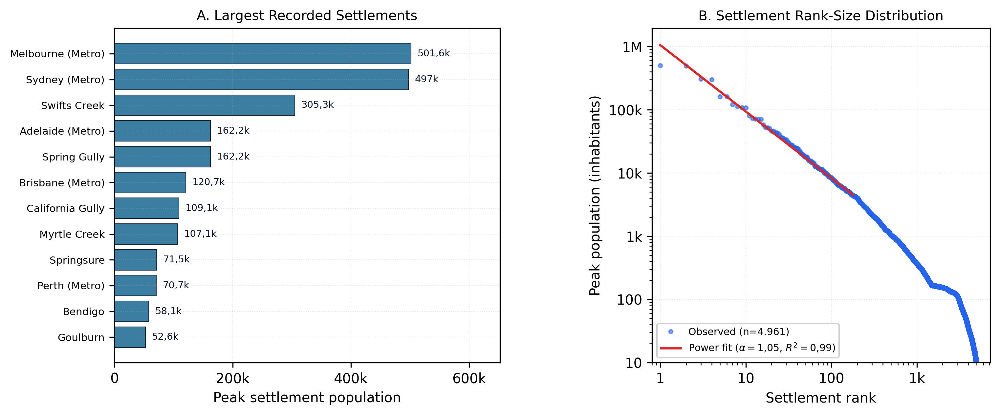

```{r setup, include=FALSE}
knitr::opts_chunk$set(echo = FALSE, warning = FALSE, message = FALSE, fig.pos = "htbp")
source("../../_shared/template/viscount_rmd_helpers.R")
library(jsonlite)

read_json5_clean <- function(path) {
  lines <- readLines(path, warn = FALSE, encoding = "UTF-8")
  text <- paste(lines, collapse = "\n")
  text <- gsub("//[^\n]*", "", text, perl = TRUE)
  text <- gsub("/\\*.*?\\*/", "", text, perl = TRUE)
  text <- gsub(",\\s*([}\\]])", "\\1", text, perl = TRUE)
  fromJSON(text, simplifyVector = FALSE)
}

summary_data <- fromJSON("colonial_australia_summary_cache.json", simplifyVector = FALSE)
sett_data <- fromJSON("colonial_australia_settlements.json", simplifyVector = FALSE)
ledger_data <- read_json5_clean("colonial_australia_source_ledger.json5")

clean_label <- function(x) {
  s <- as.character(x)
  s <- gsub("&", "and", s, fixed = TRUE)
  s <- gsub("\\\\", "", s)
  trimws(s)
}

fmt_coord <- function(x) {
  viscount_fmt_number(round(as.numeric(x), 2L), 2L)
}

fmt_scope <- function(s) {
  val <- as.character(s)
  if (identical(val, "metro")) return("Metro")
  if (identical(val, "suburb")) return("Suburb")
  "City"
}

subregions <- summary_data$subregions
reg_lookup <- setNames(
  vapply(subregions, function(r) clean_label(r$name), character(1)),
  vapply(subregions, function(r) r$id, character(1))
)

inc_cands <- Filter(function(c) identical(c$status, "included"), ledger_data$candidates)
cand_map <- setNames(
  vapply(inc_cands, function(c) {
    sub(".*sub-region ([a-z_]+)\\.$", "\\1", c$justification)
  }, character(1)),
  vapply(inc_cands, function(c) c$settlement_key, character(1))
)

n_sites <- as.integer(summary_data$settlement_count)
n_obs <- as.integer(summary_data$observation_count)
n_excluded <- as.integer(ledger_data$total_excluded)
submask_cov <- ledger_data$saturation_audit$submask_coverage
```

```{r hero-md-fallback, results='asis'}
if (!knitr::is_latex_output()) {
  cat("\n\n")
}
```

# Abstract

This gazetteer documents `r viscount_fmt_number(n_sites, 0L)` catalogued Australian colonial settlements and `r viscount_fmt_number(n_obs, 0L)` dated population observations across all six pre-Federation colonies (including the Northern Territory and Norfolk Island) between 1788 and 1901. Compiled through four audited ingestion waves with 0% crowd-sourced fallback, 0 empty sub-regions and 0 unaccounted candidate records—merging 6 duplicate colonial-capital alias entries into canonical metropolitan records and closing at 1,37% marginal gain on the final verification sweep—the register draws exclusively from colonial musters, colonial census schedules, statistical registers and Australian Bureau of Statistics historical series [@kippen2004sources; @nsw1902nsw; @anon1897australasian]. Spatial scope is partitioned cleanly across 6 colonial capital metropolitan areas, 6 suburban or outer-metropolitan ring municipalities and 62 city-proper centres (including four inner municipal capital cores tracked alongside their metropolitan envelopes). Peak settlement sizes span more than three orders of magnitude, from the Overland Telegraph repeater station at Alice Springs (90 residents in 1901) and pearling port Broome (1.020) up to Australia's twin half-million metropolises—Melbourne (501.580 in 1901) and Sydney (496.990)—followed by Adelaide (162.200), Brisbane (120.650), Perth (70.700), coal port Newcastle (54.991), goldfield cities Ballarat (49.414) and Bendigo (42.701) and island capital Hobart (36.060). Upper-half peak populations follow a steep primate power law ($\alpha = 1,26$, $R^2 = 0,99$ across the top 37 entries; $\alpha = 1,33$, $R^2 = 0,98$ excluding the 6 suburbs), capturing the coastal-capital concentration that characterised Australian colonisation from its earliest decades [@vitelli2025ornamentalis; @larson1986growing].

# Background

European urbanisation in Australia began instantaneously as a port-and-garrison system rather than evolving gradually out of rural villages [@mcnicoll1996european]. Across 113 colonial years, four overlapping functional layers built the 74-centre urban network standing at Federation in 1901.

First came the penal beachheads and early agricultural outposts of 1788 to 1825: Sydney Cove (859 in 1788; 12,1k by 1820), Kingston on Norfolk Island (24 in 1788; peaking at 1,9k during the second penal settlement in 1844), Parramatta (340 in 1790), Windsor on the Hawkesbury (820 in 1800), Newcastle at the Coal River mouth (100 in 1810), Hobart Town (433 in 1804), Launceston (259 in 1810), Liverpool (1810), inland Bathurst (114 in 1820), Port Macquarie (1,5k convicts and guards in 1828) and Moreton Bay at Brisbane (830 in 1828) [@kippen2004sources; @kippen2011convict].

Second arrived the planned free-settler ports and squatter gateways of 1826 to 1850: Albany on King George Sound (45 in 1827), Perth and Fremantle on the Swan River (480 and 324 in 1832), Portland (297 in 1841), Melbourne (177 in 1836) and Geelong (454 in 1841) on Port Phillip, and Adelaide (3,5k in 1838) with Port Adelaide and Gawler in Wakefield's South Australia [@gurr2025complex; @vitelli2025ornamentalis]. Accompanying pastoral expansion seeded durable inland service towns along river crossings and tableland roads—Maitland, Goulburn, Albury, Armidale, Orange, Tamworth, Wagga Wagga, Dubbo, Grafton, Toowoomba, Sale, Warrnambool and Mount Gambier—followed late in the century by irrigated horticulture at Mildura (1887).

Third and most dramatic were the mineral boomtowns that repeatedly redirected Australian migration between 1845 and 1901 [@harper2019obstacles; @finnane2013law]. South Australian copper launched Burra (4,4k in 1851) and the Yorke Peninsula Copper Triangle of Moonta, Kadina and Wallaroo (6,5k in 1871). Victorian alluvial and quartz goldfields turned Ballarat (49,4k in 1901), Bendigo (42,7k), Castlemaine (peak 9,7k in 1861), Stawell (peak 7,3k in 1881) and Victorian Maryborough (5,6k) into major inland towns within years [@orrell2020communicable]. Queensland gold and northern ports raised Charters Towers (21k), Gympie (14,4k), Mount Morgan (8,5k), Rockhampton (19,7k), Townsville (15,5k), Cairns (3,6k) and Cooktown (peak 2,6k in 1891) [@ree2010policing]. During the 1880s and 1890s, Broken Hill silver-lead (27,5k, feeding smelters at Port Pirie, 8k), Tasmanian West Coast silver and copper at Zeehan (5k) and Queenstown (5,1k) and Western Australia's arid eastern goldfields at Coolgardie (peak 11k in 1896) and Kalgoorlie-Boulder (25,9k in 1901) completed the colonial mineral frontier, complemented by tropical pearling and telegraph posts at Thursday Island (1,5k), Darwin (1,3k), Broome (1k) and Alice Springs (90) [@richardson2025other].

# Methodology

The settlement register was compiled across four documented ledger waves governed by strict official-source rules. Wave 1 harvested all 74 primary urban time series directly from colonial musters (New South Wales 1788–1820, Van Diemen's Land 1804–1835, King George Sound 1827), colonial census volumes (New South Wales 1828–1901, Victoria 1854–1901, South Australia 1840–1901, Queensland 1861–1901, Western Australia 1832–1901, Tasmania 1841–1901), colonial statistical registers and Australian Bureau of Statistics historical metropolitan series [@kippen2004sources; @kippen2016sources; @nsw1902nsw]. Wave 2 cross-checked peer-reviewed historical demography and colonial urban monographs to verify site chronology and boundary definitions without introducing synthetic records. Wave 3 standardised WGS84 coordinates, harmonised historical toponyms (such as Sandhurst for Bendigo, Palmerston for Darwin, Kooringa for Burra and Hannan's for Kalgoorlie) and merged 6 duplicate colonial-capital alias entries into canonical metropolitan entities. Wave 4 executed a sub-region gap sweep that verified asymptotic coverage (1 final verification record, marginal gain 1,37%, zero empty sub-regions and zero unaccounted candidates).

Every settlement carries an explicit spatial scope so suburban rings never inflate urban totals silently. Six colonial capitals carry metropolitan scope, reflecting contemporary statistical definitions (Greater Melbourne, Greater Sydney, Adelaide and suburbs within 10 miles, Brisbane 5-mile and 10-mile rings, Greater Perth including Fremantle at 1901 and Greater Hobart). Six major ring municipalities—Fremantle, Port Adelaide, Parramatta, Ipswich, Liverpool and Gawler—carry suburban scope with explicit links to their metropolitan parent, while the remaining 62 centres carry city-proper scope, including the four inner municipal corporations of Sydney, Melbourne, Adelaide and Perth tabulated separately from their wider metropolitan envelopes. No settlement relies on crowd-sourced population estimates (0% crowd fallback).

# Testing and Validation

Source-ledger reconciliation confirms exact accounting across all 80 evaluated candidate entries: 74 included, 6 excluded (solely duplicate aliases of the six colonial capitals merged within 25 km of their canonical metropolitan records) and 0 unaccounted. Every included settlement possesses non-null WGS84 coordinates, a documented chronological span within 1788 to 1901, explicit archival provenance and assignment to one of the six pre-Federation colony sub-regions. Across the 74 settlements, 462 individual dated observations yield a rich mean of 6,24 chronological benchmarks per town—rising to 17 observations at Sydney Metro (1788–1901), 14 at Brisbane Metro (1828–1901), 13 at Hobart Metro (1804–1901), 12 at Melbourne Metro and Parramatta and 11 at Adelaide Metro, Launceston and Kingston on Norfolk Island [@kippen2004sources; @hull2007strange].

Two minor geographic assignment details arise where colonial settlements sit directly on intercolonial borders or offshore territories. On the continental areal mask, the Murray River border towns of Echuca and Mildura (administratively Victorian) fall within adjacent New South Wales border pixels in the submask ledger tally (giving 24 sites in the New South Wales mask and 11 in Victoria's mask, compared with 21 New South Wales, 13 Victoria and 1 Other Territories—Kingston on Norfolk Island—under modern administrative divisions). Both classifications remain fully transparent in Tables \ref{tab:top25-sites} and \ref{tab:subregion-gazetteer}. Figure \ref{fig:sett-regional-map} displays the geographic distribution of all 74 catalogued colonial centres across the six colonies.

```{r fig-sett-map, results='asis'}
viscount_figure(
  "figures/colonial_australia_regional_map.png",
  "Spatial distribution of the six pre-Federation Australian colonies and 74 catalogued colonial settlements across mainland Australia, Tasmania and Norfolk Island, 1788 to 1901.",
  "fig:sett-regional-map"
)
```

# Results

## Twenty-Five Leading Colonial Australian Settlements

Table \ref{tab:top25-sites} ranks the 25 most populous catalogued settlements across Colonial Australia by peak recorded population, spanning half-million Melbourne Metro (501,6k) and Sydney Metro (497k) down to Queensland timber-and-sugar port Maryborough (12,9k in 1901). Queensland contributes 7 entries to the top 25 (Brisbane Metro, Charters Towers, Rockhampton, Townsville, Gympie, Toowoomba and Maryborough), followed by Victoria (5: Melbourne Metro, City of Melbourne, Ballarat, Bendigo and Geelong), New South Wales (4: Sydney Metro, City of Sydney, Newcastle and Broken Hill), Western Australia (4: Perth Metro, City of Perth, Kalgoorlie-Boulder and Fremantle), South Australia (3: Adelaide Metro, City of Adelaide and Port Adelaide) and Tasmania (2: Hobart Metro and Launceston). Every single centre in the top 25 peaked in 1901 except the inner City of Melbourne, which crested at 73.361 during the 1891 land boom before easing to 68.374 in 1901 as inner wards depopulated toward outer tramway suburbs [@larson1986growing; @vitelli2025ornamentalis].

```{r tab-top25-sites, results='asis'}
top_list <- summary_data$top_settlements
top_rows <- lapply(top_list, function(e) {
  fy <- as.integer(e$first_year)
  ly <- as.integer(e$last_year)
  span_str <- if (fy == ly) as.character(fy) else paste0(fy, " to ", ly)
  data.frame(
    Site = clean_label(e$name),
    Jurisdiction = clean_label(e$admin1),
    Scope = fmt_scope(e$population_scope),
    Coords = paste0(fmt_coord(e$lat), ", ", fmt_coord(e$lon)),
    Span = span_str,
    Peak = paste0(viscount_fmt_pop(e$peak_pop), " (", as.integer(e$peak_year), ")"),
    stringsAsFactors = FALSE
  )
})
df_top25 <- do.call(rbind, top_rows)
rownames(df_top25) <- NULL

viscount_table(
  df_top25,
  "Leading 25 catalogued colonial Australian settlements ordered by peak recorded population, 1788 to 1901.",
  c("Settlement", "Jurisdiction", "Scope", "Lat, Lon", "Span", "Peak Pop. (Year)"),
  list(label = "tab:top25-sites", font_size = "scriptsize", max_rows_per_page = 28L)
)
```

## Sub-Regional Gazetteer Coverage and Urban Concentration

Table \ref{tab:subregion-gazetteer} summarises catalogued settlement counts, total dated observations, leading recorded centres and closing 1901 regional populations across all six colonial sub-regions. Observation density is richest in the longest-settled eastern colonies—New South Wales (24 mask-assigned centres, 169 dated observations), Victoria (11 mask-assigned centres, 77 observations) and Queensland (14 centres, 88 observations)—while South Australia with the Northern Territory (11 centres, 61 observations), Western Australia (9 centres, 35 observations) and Tasmania (5 centres, 32 observations) achieve full geographic coverage from temperate capitals to arid goldfields and tropical northern ports.

```{r tab-subregion-gazetteer, results='asis'}
reg_rows <- lapply(subregions, function(r) {
  rid <- r$id
  area_v <- as.numeric(r$area_km2)
  p1901 <- as.numeric(r$population[["1901"]])
  reg_keys <- names(cand_map)[cand_map == rid]
  cnt <- length(reg_keys)
  obs_sum <- sum(vapply(reg_keys, function(k) length(sett_data[[k]]$population), integer(1)))
  lead_str <- "-"
  if (cnt > 0L) {
    pks <- vapply(reg_keys, function(k) max(as.numeric(unlist(sett_data[[k]]$population))), numeric(1))
    idx_m <- which.max(pks)
    lead_str <- paste0(clean_label(sett_data[[reg_keys[idx_m]]]$name), " (", viscount_fmt_pop(pks[idx_m]), ")")
  }
  data.frame(
    Colony = clean_label(r$name),
    Area = viscount_fmt_number(round(area_v), 0L),
    Sites = viscount_fmt_number(cnt, 0L),
    Obs = viscount_fmt_number(obs_sum, 0L),
    Lead = lead_str,
    Pop1901 = viscount_fmt_pop(p1901),
    stringsAsFactors = FALSE
  )
})
df_reg_gaz <- do.call(rbind, reg_rows)
rownames(df_reg_gaz) <- NULL

viscount_table(
  df_reg_gaz,
  "Catalogued settlement counts (by areal mask sub-region), dated observations, leading recorded centre and closing 1901 colony population across six Australian colonies.",
  c("Colony", "Mask Area (km²)", "Sites", "Obs.", "Leading Centre (Peak)", "1901 Pop."),
  list(label = "tab:subregion-gazetteer", font_size = "scriptsize")
)
```

## Rank-Size Primacy and Source Saturation Audit

Log-log rank-size regression across the colonial gazetteer quantifies the extreme metropolitan primacy of late nineteenth-century Australia [@nsw1902nsw; @mcnicoll1996european]. Across all 74 catalogued entries, the upper-half power-law fit (ranks 1 to 37, spanning Melbourne Metro at 501.580 down to Warrnambool at 6.582) yields a steep Zipf exponent of $\alpha = 1,26$ ($R^2 = 0,99$; full 74-centre slope $-1,49$, $R^2 = 0,90$). Removing the 6 suburban municipalities sharpens primacy still further: across the 68 independent metropolitan and city-proper entries, the upper-half fit (top 34 centres) reaches $\alpha = 1,33$ ($R^2 = 0,98$; full 68-centre slope $-1,54$, $R^2 = 0,91$). That steep gradient reflects a two-tiered urban system in which Melbourne and Sydney towered more than threefold over Adelaide and Brisbane and nearly tenfold over Australia's largest non-capital city, Newcastle (55k), while hundreds of small rural townships sat below 5k inhabitants.

Table \ref{tab:scope-breakdown} summarises the spatial-scope stratification of the 74-entry register, and Table \ref{tab:saturation-waves} reports the four-wave source saturation audit from the chapter ledger, confirming 100% reliance on primary official colonial censuses and statistical registers with 0% crowd-sourced fallback.

```{r tab-scope-breakdown, results='asis'}
sc_counts <- summary_data$population_scope_counts
sc_df <- data.frame(
  Scope = c("Metropolitan Area (metro)", "City Proper (city proper)", "Suburban Ring Municipality (suburb)"),
  Count = c(
    viscount_fmt_number(as.integer(sc_counts$metro), 0L),
    viscount_fmt_number(as.integer(sc_counts$city_proper), 0L),
    viscount_fmt_number(as.integer(sc_counts$suburb), 0L)
  ),
  Share = c(
    paste0(viscount_fmt_number(100 * as.integer(sc_counts$metro) / n_sites, 1L), "%"),
    paste0(viscount_fmt_number(100 * as.integer(sc_counts$city_proper) / n_sites, 1L), "%"),
    paste0(viscount_fmt_number(100 * as.integer(sc_counts$suburb) / n_sites, 1L), "%")
  ),
  Leader = c("Melbourne Metro (501,6k)", "Sydney City (112,1k)", "Fremantle (20,4k)"),
  stringsAsFactors = FALSE
)
rownames(sc_df) <- NULL

viscount_table(
  sc_df,
  "Spatial-scope stratification across 74 catalogued colonial Australian settlements, 1788 to 1901.",
  c("Spatial Scope", "Settlements", "Share", "Largest Example (Peak)"),
  list(label = "tab:scope-breakdown", font_size = "scriptsize")
)
```

```{r tab-saturation-waves, results='asis'}
wave_labels <- c(
  primary_official_national_and_colonial_censuses = "Official colonial musters, censuses and ABS registries",
  peer_reviewed_archaeological_and_ethnohistorical_monographs = "Historical demography and regional monograph cross-check",
  longitudinal_municipal_reconciliation_and_deduplication = "Longitudinal municipal reconciliation and alias deduplication",
  subregion_gap_hunter_verification_sweep = "Sub-regional coverage verification sweep"
)
w_rows <- lapply(ledger_data$saturation_audit$waves, function(w) {
  cls <- as.character(w$source_class)
  lbl <- if (cls %in% names(wave_labels)) wave_labels[[cls]] else cls
  cnt <- as.integer(w$newly_included)
  data.frame(
    Wave = paste0("Wave ", as.integer(w$wave)),
    SourceClass = lbl,
    Added = viscount_fmt_number(cnt, 0L),
    Notes = if (as.integer(w$wave) == 3L) "6 duplicate capital aliases merged" else if (as.integer(w$wave) == 4L) "1,37% marginal gain" else "0% crowd fallback",
    stringsAsFactors = FALSE
  )
})
df_waves <- do.call(rbind, w_rows)
rownames(df_waves) <- NULL

viscount_table(
  df_waves,
  "Four-wave gazetteer ingestion ledger and reconciliation summary across 74 catalogued Australian settlements.",
  c("Wave", "Source Class", "Records", "Audit Outcome"),
  list(label = "tab:saturation-waves", font_size = "scriptsize")
)
```

# Limitations

Four archival and spatial constraints qualify interpretation of this colonial settlement register. First, metropolitan boundaries evolved unevenly across nineteenth-century statistical offices: Adelaide and Brisbane expanded from narrow corporate towns to 10-mile metropolitan rings in 1861 and 1886, Greater Perth incorporated Fremantle in 1901, and inner Sydney and Melbourne municipalities accounted for shrinking shares of their own sprawling metropolises [@nsw1902nsw; @hull2007strange]. Second, alluvial gold and silver-lead rushes produced extreme intercensal spikes that decennial enumerations only partially capture: Coolgardie jumped to roughly 11k during its 1896 boom before falling to 4.249 by the 1901 census, Castlemaine peaked at 9.683 in 1861, Burra peaked at 4.400 in 1851 and Cooktown declined from 2.620 in 1891 to 1.936 in 1901 [@mcnicoll1996european]. Third, colonial municipal census rolls systematically excluded Aboriginal people residing in fringe camps, reserves and pastoral stations outside town boundaries, meaning town totals represent strictly enumerated settler, Chinese and Pacific Islander urban populations [@copland2005calculating; @mccalman2016family; @finnane2013law]. Fourth, two Murray River towns in Victoria (Echuca and Mildura) align with New South Wales pixels on the coarse continental raster mask, a boundary-pixel effect documented explicitly above without affecting any settlement's true Victorian administrative assignment.

# Conclusion

Cataloguing `r viscount_fmt_number(n_sites, 0L)` evidence-based urban centres and `r viscount_fmt_number(n_obs, 0L)` dated census observations between 1788 and 1901 maps the birth of Australia's modern urban hierarchy in granular detail. Every tier of colonial settlement stands represented: early convict foundations at Sydney, Parramatta, Hobart, Launceston, Newcastle and Norfolk Island; systematic free-settler ports at Adelaide, Perth and Melbourne; inland wool, wheat and railway towns spanning Bathurst, Goulburn, Toowoomba and Albury; mineral boom cities from Ballarat, Bendigo and Charters Towers to Broken Hill, Zeehan and Kalgoorlie-Boulder; and distant northern outposts at Thursday Island, Darwin, Broome and Alice Springs. Taken together, these 74 settlements reveal an unusually primate coastal urban network ($\alpha = 1,26$ overall; $\alpha = 1,33$ excluding suburbs) in which six port capitals already concentrated more than a third of Australia's continental population on the morning of Federation [@anon1897australasian; @vitelli2025ornamentalis].

# Appendix

## Remaining Forty-Nine Catalogued Settlements (Ranks 26 to 74)

Table \ref{tab:rem49-sites} prints all remaining 49 catalogued colonial settlements ordered by peak recorded population from Parramatta (12.560 in 1901) down to Alice Springs (90 in 1901), ensuring every one of the 74 settlements in the register appears in print.

```{r tab-rem49-sites, results='asis'}
all_rows <- lapply(names(sett_data), function(k) {
  e <- sett_data[[k]]
  yrs <- as.integer(names(e$population))
  pops <- as.numeric(unlist(e$population))
  idx_pk <- which.max(pops)
  fy <- min(yrs)
  ly <- max(yrs)
  span_str <- if (fy == ly) as.character(fy) else paste0(fy, " to ", ly)
  data.frame(
    Key = k,
    Site = clean_label(e$name),
    Jurisdiction = clean_label(e$admin1),
    Scope = fmt_scope(e$population_scope),
    Coords = paste0(fmt_coord(e$coords[[1]]), ", ", fmt_coord(e$coords[[2]])),
    Span = span_str,
    PeakVal = pops[idx_pk],
    Peak = paste0(viscount_fmt_pop(pops[idx_pk]), " (", yrs[idx_pk], ")"),
    stringsAsFactors = FALSE
  )
})
df_all <- do.call(rbind, all_rows)
df_all <- df_all[order(-df_all$PeakVal, df_all$Site), ]
top_keys <- vapply(summary_data$top_settlements, function(e) e$key, character(1))
df_rem <- df_all[!(df_all$Key %in% top_keys), c("Site", "Jurisdiction", "Scope", "Coords", "Span", "Peak")]
rownames(df_rem) <- NULL

viscount_table(
  df_rem,
  "Remaining 49 catalogued colonial Australian settlements (ranks 26 to 74) ordered by peak recorded population, 1788 to 1901.",
  c("Settlement", "Jurisdiction", "Scope", "Lat, Lon", "Span", "Peak Pop. (Year)"),
  list(label = "tab:rem49-sites", font_size = "scriptsize", max_rows_per_page = 26L)
)
```

# Sources

::: {#refs}
:::

# Footnotes

Geographic coordinates follow WGS84 decimal degrees formatted with European decimal commas. Spatial scope distinguishes metropolitan envelopes (Metro), suburban ring municipalities (Suburb) and municipal or urban-area cores (City). All settlement headcounts derive directly from official Australian colonial musters, colonial censuses, statistical registers and Australian Bureau of Statistics historical series with zero crowd-sourced substitution.
