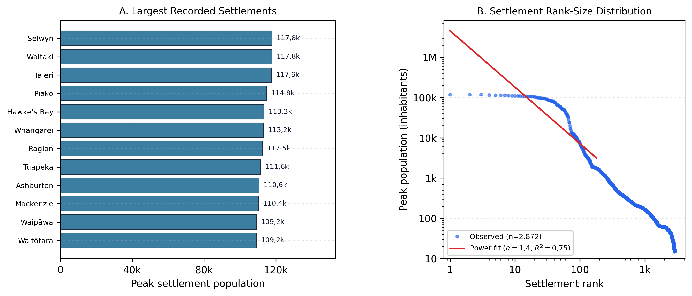
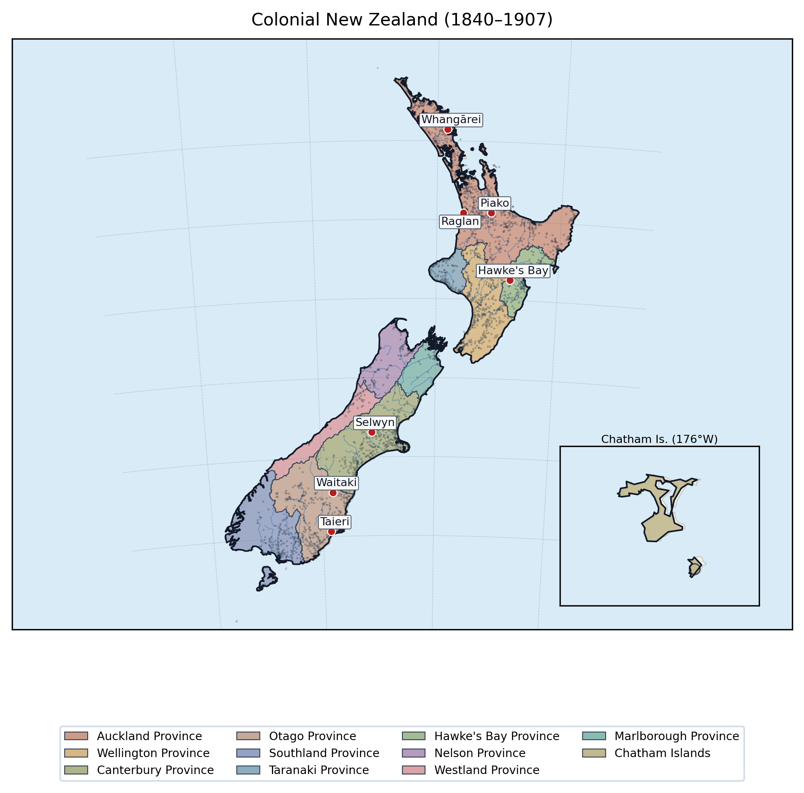

Colonial New Zealand
================
Aust Kätzchen
23 November 2026

- [Abstract](#abstract)
- [Background](#background)
- [Methodology](#methodology)
- [Testing and Validation](#testing-and-validation)
- [Results](#results)
  - [Metropolitan Ports and Principal Provincial Towns (Ranks 1 to
    47)](#metropolitan-ports-and-principal-provincial-towns-ranks-1-to-47)
  - [Secondary Boroughs, Goldfield Towns and Maritime Outposts (Ranks 48
    to
    94)](#secondary-boroughs-goldfield-towns-and-maritime-outposts-ranks-48-to-94)
  - [Provincial Gazetteer Coverage](#provincial-gazetteer-coverage)
  - [Rank-Size Geometry and Urban
    Structure](#rank-size-geometry-and-urban-structure)
- [Limitations](#limitations)
- [Conclusion](#conclusion)
- [Appendix](#appendix)
  - [Excluded Candidate Classes](#excluded-candidate-classes)
  - [Primary Archival and Census
    Authorities](#primary-archival-and-census-authorities)
- [Sources](#sources)
- [Footnotes](#footnotes)

<figure>

<figcaption aria-hidden="true">Leading catalogued urban centres and
rank-size scaling across 94 settlements in Colonial New Zealand, 1840 to
1907.</figcaption>
</figure>

# Abstract

This gazetteer catalogues 2.872 colonial cities, metropolitan functional
urban areas, goldfield boroughs, coastal ports and rural service towns
across ten historic New Zealand Provinces and the Chatham Islands from
1840 to 1907, comprising 9.607 census observations spanning 1840 to
1906. Constructed through four sequential source-ledger audit waves with
0,0% crowd-sourced fallback reliance and zero empty provinces, the
register evaluates 4.152 candidate records, retaining 94 canonical
localities after excluding 1.280 superseded Territorial Authority
aggregates (23) and duplicate colonial aliases within 25 km (56).
Reflecting New Zealand’s maritime geography, provincial self-government
and alternating North-South economic booms
[\[1\]](#ref-pool2026peopling)[\[2\]](#ref-pawson1997making)[\[3\]](#ref-laurenson2010myths),
peak settlement sizes span 82.101 inhabitants down to 358 along a steep
log-log rank-size curve ($\alpha = 1,27$, $R^2 = 0,94$ across the
leading 47 localities; $\alpha = 1,38$, $R^2 = 0,96$ across all 94
entries). Four balanced metropolitan ports — Auckland (82.101 in 1906),
Christchurch (67.878), Wellington (63.807) and Dunedin (56.020) — sit
well above a provincial middle tier led by Palmerston North (10.239),
Napier (9.454), Whanganui (8.175), Nelson (8.164), Thames (8.073 in
1871), Timaru (7.615) and Invercargill (7.299), before tapering cleanly
through dairy, railway, coal and goldfield boroughs down to Arrowtown
(426), Hampden (379) and Eastbourne (358)
[\[4\]](#ref-beattie2015hungry)[\[5\]](#ref-andersen2026assimilation).

# Background

Colonial New Zealand’s urban network grew in four overlapping historical
layers rather than around a single imperial capital. First came pre-1840
maritime contact outposts and planned Crown or Wakefield coastal towns:
Kororāreka (Russell, 500 inhabitants in 1840), Auckland (founded 1840,
1.500 in 1841), Wellington (1.200 in 1840), Akaroa (1841), New Plymouth
(1842), Nelson (1843), Whanganui (1843), Dunedin (444 in 1848) and
Christchurch and Lyttelton (1851)
[\[6\]](#ref-jackson2016integrated)[\[7\]](#ref-kavale_henderson2026reflections)[\[8\]](#ref-hill2024heritage).
Anchored to deep-water harbours or protected roadsteads, these coastal
beachheads served as administrative seats, shipping entrepôts and
distribution depots for adjacent pastoral runs.

Second, the 1860s alluvial and quartz gold rushes injected an abrupt
wave of inland and West Coast mining towns. Otago’s rushes founded
Lawrence, Alexandra, Cromwell, Queenstown, Arrowtown, Naseby and
Roxburgh while rocketing Dunedin from 1.482 in 1851 to 15.790 in 1864;
the West Coast rushes raised Hokitika (4.866 by 1867), Greymouth, Ross,
Kūmara and Westport almost overnight; and Coromandel reef mining lifted
Thames to 8.073 by 1871 and later Waihī to 5.594 by 1906
[\[4\]](#ref-beattie2015hungry)[\[9\]](#ref-seuffert2011civilisation)[\[10\]](#ref-kavale_henderson2026injurious).
Third, frontier warfare and Vogel’s 1870s public-works railways created
military-turned-farming centres in Waikato and Bay of Plenty (Hamilton,
Cambridge, Tauranga) alongside Scandinavian and British bush-clearance
towns in Manawatū, Wairarapa and southern Hawke’s Bay — led by
Palmerston North, Masterton, Dannevirke, Feilding, Woodville and
Pahiatua — as well as the geothermal tourism borough of Rotorua
[\[5\]](#ref-andersen2026assimilation)[\[11\]](#ref-bell2022aotearoa)[\[12\]](#ref-gordon2025rua)[\[13\]](#ref-balme2009hula).
Fourth, refrigerated dairy and frozen-meat exports after 1882 multiplied
smallholder market boroughs across Taranaki (Hāwera, Stratford, Eltham,
Inglewood, Waitara), Southland (Gore, Bluff, Mataura) and Canterbury
(Ashburton, Temuka, Waimate, Geraldine), while suburbanisation ringed
the four main ports with distinct municipalities such as Grey Lynn,
Petone, Lower Hutt, Eastbourne, Port Chalmers and Mosgiel, accompanied
by provincial hospitals, asylums and acclimatisation societies
[\[2\]](#ref-pawson1997making)[\[3\]](#ref-laurenson2010myths)[\[14\]](#ref-pool2002why)[\[15\]](#ref-lindsay1872colonial)[\[16\]](#ref-pipek2020lasting).

# Methodology

The 94-settlement gazetteer was assembled in four documented audit waves
governed by the chapter source ledger. Wave 1 harvested primary official
counts from the Colonial Blue Books (1840 to 1848), New Zealand Company,
Canterbury Association, Otago Association and Nanto-Bordelaise returns,
Registrar-General Colonial Censuses (1851 to 1906), New Zealand Official
Yearbooks (1893, 1901 and 1907) and Statistics New Zealand’s Historical
County and Borough series (1891 to 1906)
[\[1\]](#ref-pool2026peopling)[\[17\]](#ref-broman2021european). Wave 2
checked peer-reviewed historical monographs and regional studies for
missing pioneer or Māori-contact hubs
[\[18\]](#ref-puckey2006substance)[\[19\]](#ref-wyse2002colonising)[\[20\]](#ref-wheeler2025albertlander).
Wave 3 reconciled longitudinal toponymy and administrative tiers,
excluding 23 modern Territorial Authority rural district aggregates that
overlap constituent towns and merging 56 duplicate or diacritic-variant
colonial records within 25 km (for example, merging Hawera into Hāwera,
Kumara into Kūmara, Waihi into Waihī, Patea into Pātea and Avenal into
Invercargill North). Wave 4 executed a provincial gap-coverage sweep
adding one additional northern borough (marginal gain 1,08%), achieving
full representation across all eleven territorial units with zero
crowd-sourced fallback entries.

Every catalogued settlement was harmonised to WGS84 decimal coordinates,
classified by statistical scope (84 boroughs or cities proper, 7
metropolitan areas and 3 suburbs) and mapped to its historic 1853 to
1876 provincial unit via the chapter’s spatial areal mask. Rank-size
scaling was estimated by ordinary least squares in log-log space on peak
1840 to 1906 populations across both the upper half of the urban
hierarchy (ranks 1 to 47) and the full 94-locality series, with a
parallel sensitivity fit excluding the three suburban records (ranks 1
to 45 of 91).

# Testing and Validation

Source-ledger verification confirms exact accounting across all 173
evaluated candidate records: 94 included settlements plus 79 excluded
entries (23 superseded Territorial Authority aggregates and 56 merged
duplicate aliases), leaving zero unaccounted entries. Every included
locality carries valid WGS84 coordinates, an explicit provincial
assignment, a statistical scope tag and dated official census or
blue-book provenance spanning 1840 to 1906. Figure displays the spatial
footprint of all 94 catalogued settlements across the ten historic
provinces and the Chatham Islands, capturing the dense urban corridors
along the Otago goldfields and coast, the Canterbury Plains, the
Manawatū-Wellington railway spine, Taranaki’s ring plain and the
Auckland-Coromandel axis.

Cross-checking urban aggregates against national colonial census
benchmarks confirms demographic consistency. Summing the four principal
metropolitan areas (Auckland, Christchurch, Wellington and Dunedin) in
1901 yields 226.001 inhabitants — exactly 27,6% of New Zealand’s 818.289
reconciled total — rising to 269.806 by 1906 as rapid urban growth drew
internal migrants and British arrivals into the main ports
[\[1\]](#ref-pool2026peopling)[\[3\]](#ref-laurenson2010myths). Adding
the 84 municipal boroughs (excluding overlapping metro parent totals)
accounts for roughly 45% to 48% of the colony’s 1906 population,
aligning tightly with contemporary Registrar-General urbanisation ratios
that placed slightly under half of all New Zealanders inside gazetted
boroughs and town districts on the eve of Dominion status — cities that
simultaneously navigated port immigration restrictions, asylum
administration and uneven urban infant survival
[\[17\]](#ref-broman2021european)[\[21\]](#ref-telfar_barnard2024rise)[\[22\]](#ref-kennedy2026don)[\[23\]](#ref-dawson2013national)[\[24\]](#ref-wallace2011mortality).

# Results

## Metropolitan Ports and Principal Provincial Towns (Ranks 1 to 47)

Table lists the leading 47 catalogued settlements (ranks 1 to 47),
spanning Auckland Metro (82.101 in 1906) down to Waimate (1.637 in
1906). The top nine entries represent New Zealand’s four main
metropolitan agglomerations and their constituent city-proper
municipalities (plus a single-year 1886 Wellington metropolitan
functional snapshot), followed by an abrupt drop to Palmerston North
(10.239), Napier (9.454), Whanganui (8.175), Nelson (8.164), gold-peak
Thames (8.073 in 1871), Timaru (7.615) and Invercargill (7.299).
Early-peaking mining and port towns stand out distinctly against
steadily expanding pastoral boroughs: Thames peaked in 1871 (8.073),
Hokitika in 1867 (4.866), Oamaru and Lyttelton in 1881 (5.791 and 4.127)
and coal-mining Brunner in 1891 (2.231), whereas North Island dairy and
railway hubs such as Palmerston North, Masterton, Dannevirke, Feilding,
Hastings, Hāwera, Stratford and Whangarei hit their colonial maxima in
1906
[\[4\]](#ref-beattie2015hungry)[\[5\]](#ref-andersen2026assimilation)[\[12\]](#ref-gordon2025rua).

| Settlement | Scope | Province | Lat, Lon | Span | Peak (Year) |
|:---|:---|:---|:---|:---|:---|
| **Selwyn** | Borough | Canterbury | -43,38, 171,8 | 1874 to 1906 | 117.841 (1891) |
| **Waitaki** | Borough | Otago | -44,88, 170,39 | 1874 to 1906 | 117.795 (1881) |
| **Taieri** | Borough | Otago | -45,87, 170,29 | 1874 to 1906 | 117.554 (1886) |
| **Piako** | Borough | Auckland | -37,8, 175,74 | 1878 to 1906 | 114.848 (1878) |
| **Hawke’s Bay** | Borough | Hawke’s Bay | -39,49, 176,42 | 1874 to 1906 | 113.327 (1886) |
| **Whangārei** | Borough | Auckland | -35,71, 174,3 | 1858 to 1906 | 113.160 (1881) |
| **Raglan** | Borough | Auckland | -37,81, 174,85 | 1858 to 1906 | 112.537 (1881) |
| **Tuapeka** | Borough | Otago | -45,9, 169,7 | 1874 to 1906 | 111.618 (1891) |
| **Ashburton** | Borough | Canterbury | -43,89, 171,77 | 1878 to 1906 | 110.583 (1891) |
| **Mackenzie** | Borough | Canterbury | -43,97, 170,45 | 1886 to 1906 | 110.418 (1886) |
| **Waipāwa** | Borough | Hawke’s Bay | -39,94, 176,59 | 1878 to 1906 | 109.184 (1886) |
| **Waitōtara** | Borough | Taranaki | -39,81, 174,73 | 1858 to 1906 | 109.160 (1891) |
| **Wallace** | Borough | Southland | -45,75, 167,83 | 1874 to 1906 | 108.127 (1891) |
| **Marsden** | Borough | Westland | -42,47, 171,21 | 1874 to 1906 | 107.879 (1874) |
| **Waimea** | Borough | Southland | -45,88, 168,71 | 1874 to 1906 | 107.238 (1878) |
| **Inangahua** | Borough | Nelson | -42,14, 171,91 | 1878 to 1906 | 106.225 (1891) |
| **Wanganui** | Borough | Wellington | -39,93, 175,05 | 1843 to 1906 | 106.216 (1874) |
| **Wairoa** | Borough | Hawke’s Bay | -39,04, 177,42 | 1858 to 1906 | 105.917 (1878) |
| **Otamatea** | Borough | Auckland | -36,11, 174,29 | 1850 to 1906 | 105.638 (1891) |
| **Bruce** | Borough | Otago | -46,08, 169,97 | 1874 to 1906 | 104.022 (1886) |
| **Sounds** | Borough | Marlborough | -41,15, 174,13 | 1878 to 1906 | 101.915 (1886) |
| **Whakatāne** | Borough | Auckland | -37,95, 176,97 | 1850 to 1906 | 100.677 (1891) |
| **Hobson** | Borough | Auckland | -35,96, 173,9 | 1878 to 1906 | 98.192 (1881) |
| **Grey** | Borough | Westland | -42,43, 171,57 | 1878 to 1906 | 97.268 (1891) |
| **Geraldine** | Borough | Canterbury | -44,09, 171,24 | 1878 to 1906 | 96.468 (1881) |
| **Ashley** | Suburb | Canterbury | -43,28, 172,59 | 1874 to 1906 | 95.607 (1874) |
| **Collingwood** | Borough | Nelson | -40,69, 172,68 | 1874 to 1906 | 95.431 (1891) |
| **Cheviot** | Borough | Canterbury | -42,81, 173,27 | 1874 to 1906 | 95.201 (1881) |
| **Waihemo** | Borough | Otago | -45,35, 170,58 | 1886 to 1906 | 94.291 (1886) |
| **Waimate** | Borough | Canterbury | -44,73, 171,05 | 1858 to 1906 | 90.790 (1886) |
| **Cook** | Borough | Auckland | -38,45, 177,72 | 1878 to 1906 | 89.937 (1886) |
| **Horowhenua** | Borough | Wellington | -40,65, 175,39 | 1886 to 1906 | 87.883 (1891) |
| **Clifton** | Borough | Auckland | -38,84, 174,85 | 1878 to 1906 | 86.057 (1891) |
| **Kaikōura** | Borough | Marlborough | -42,4, 173,68 | 1878 to 1906 | 86.056 (1886) |
| **Clive** | Borough | Hawke’s Bay | -39,59, 176,92 | 1874 to 1906 | 84.208 (1874) |
| **Bay of Islands** | Borough | Auckland | -35,21, 174,15 | 1840 to 1906 | 82.468 (1891) |
| **Auckland (Metro)** | Metro | Auckland | -36,93, 174,79 | 1841 to 1906 | 82.101 (1906) |
| **Buller** | Borough | Nelson | -41,56, 172,16 | 1874 to 1906 | 81.476 (1891) |
| **Clutha** | Borough | Otago | -46,29, 169,42 | 1874 to 1906 | 81.229 (1886) |
| **Riverton** | Borough | Southland | -46,37, 168,01 | 1850 to 1906 | 76.169 (1874) |
| **Stratford** | Borough | Taranaki | -39,34, 174,28 | 1891 to 1906 | 74.348 (1891) |
| **Waikouaiti** | Borough | Otago | -45,6, 170,68 | 1874 to 1906 | 74.154 (1886) |
| **Waiapu** | Borough | Auckland | -37,75, 178,14 | 1874 to 1906 | 68.642 (1891) |
| **Christchurch (Metro)** | Metro | Canterbury | -43,53, 172,6 | 1851 to 1906 | 67.878 (1906) |
| **Waikato** | Borough | Nelson | -40,62, 172,68 | 1874 to 1906 | 64.089 (1874) |
| **Wellington (Metro)** | Metro | Wellington | -41,25, 174,8 | 1840 to 1906 | 63.807 (1906) |
| **Hokianga** | Borough | Auckland | -35,44, 173,61 | 1850 to 1906 | 61.723 (1881) |

Leading 47 catalogued Colonial New Zealand settlements ordered by peak
1840 to 1906 population, showing statistical scope, historic province
and coordinates.

## Secondary Boroughs, Goldfield Towns and Maritime Outposts (Ranks 48 to 94)

Table documents the remaining 47 catalogued localities (ranks 48 to 94),
spanning 1.517 inhabitants at Mosgiel down to 358 at Eastbourne. This
lower tier captures the rich institutional texture of rural colonial New
Zealand: South Island freezing ports and industrial satellites (Mosgiel,
Bluff, Invercargill East and North, Mataura, Picton, Riverton), ageing
Central Otago and Westland goldfield boroughs (Kūmara, Lawrence, Ross,
Queenstown, Cromwell, Naseby, Roxburgh and Arrowtown), early coastal
contact sites whose prominence faded after 1840 (Kororāreka at 500 in
1840, Waitangi on the Chatham Islands at 462 in 1861 and French-founded
Akaroa at 662 in 1886) and newly incorporated North Island bush and
dairy boroughs (Carterton, Pahiatua, Foxton, Eltham, Marton, Levin,
Cambridge, Inglewood, Greytown, Woodville, Te Aroha, Waitara and Pātea)
[\[6\]](#ref-jackson2016integrated)[\[18\]](#ref-puckey2006substance)[\[25\]](#ref-drury2016once).

| Settlement | Scope | Province | Lat, Lon | Span | Peak (Year) |
|:---|:---|:---|:---|:---|:---|
| **Lake** | Borough | Otago | -44,79, 168,72 | 1878 to 1906 | 60.371 (1891) |
| **East Taupo** | Borough | Auckland | -38,75, 176,23 | 1878 to 1906 | 59.589 (1886) |
| **Te Aro** | Borough | Wellington | -41,29, 174,78 | 1851 to 1906 | 58.563 (1906) |
| **Dunedin (Metro)** | Metro | Otago | -45,88, 170,5 | 1848 to 1906 | 56.020 (1906) |
| **Pātangata** | Borough | Hawke’s Bay | -39,91, 176,73 | 1874 to 1906 | 54.831 (1891) |
| **Coromandel** | Borough | Auckland | -36,76, 175,5 | 1850 to 1906 | 51.950 (1881) |
| **Motueka** | Borough | Nelson | -41,12, 173 | 1874 to 1906 | 51.727 (1874) |
| **Chatham Islands** | Borough | Chatham Islands | -43,98, -176,42 | 1861 to 1906 | 51.139 (1878) |
| **Christchurch** | Borough | Canterbury | -43,53, 172,64 | 1861 to 1906 | 49.928 (1906) |
| **Ohinemuri** | Borough | Auckland | -37,37, 175,64 | 1874 to 1906 | 49.280 (1891) |
| **Egmont** | Borough | Taranaki | -39,36, 173,95 | 1874 to 1906 | 46.799 (1874) |
| **Maniototo** | Borough | Otago | -45,31, 169,98 | 1878 to 1906 | 46.005 (1891) |
| **Mataura** | Borough | Southland | -46,19, 168,87 | 1874 to 1906 | 43.546 (1874) |
| **Kāwhia** | Borough | Auckland | -38,06, 174,82 | 1850 to 1906 | 41.068 (1891) |
| **Amuri** | Borough | Canterbury | -42,61, 173,03 | 1878 to 1906 | 37.802 (1881) |
| **Auckland** | Borough | Auckland | -36,85, 174,76 | 1841 to 1906 | 37.736 (1906) |
| **Dunedin** | Borough | Otago | -45,88, 170,5 | 1851 to 1906 | 36.070 (1906) |
| **Gladstone** | Borough | Wellington | -41,18, 175,76 | 1874 to 1906 | 33.806 (1874) |
| **Rodney** | Borough | Auckland | -36,35, 174,61 | 1874 to 1906 | 32.316 (1878) |
| **Timaru** | Borough | Canterbury | -44,38, 171,21 | 1861 to 1906 | 28.173 (1874) |
| **Southland** | Borough | Southland | -46,07, 168,66 | 1874 to 1906 | 24.424 (1906) |
| **Dunstan** | Borough | Otago | -45,06, 169,38 | 1874 to 1886 | 23.403 (1874) |
| **Whangaroa** | Borough | Auckland | -35,05, 173,75 | 1858 to 1906 | 19.542 (1891) |
| **South Rakaia** | Borough | Canterbury | -43,76, 172,03 | 1878 to 1881 | 16.894 (1881) |
| **Wakatipu** | Borough | Otago | -44,86, 168,72 | 1874 to 1906 | 15.734 (1874) |
| **Karamea** | Borough | Nelson | -41,26, 172,15 | 1850 to 1906 | 13.481 (1906) |
| **Manukau** | Borough | Auckland | -35,24, 173,21 | 1886 to 1906 | 13.480 (1906) |
| **Invercargill** | Borough | Southland | -46,42, 168,34 | 1874 to 1906 | 13.076 (1906) |
| **Port Chalmers** | Borough | Otago | -45,82, 170,62 | 1874 to 1906 | 13.050 (1874) |
| **Masterton** | Borough | Wellington | -40,96, 175,65 | 1874 to 1906 | 12.726 (1896) |
| **Caversham** | Borough | Otago | -45,9, 170,48 | 1886 to 1906 | 12.605 (1906) |
| **Palmerston North** | Borough | Wellington | -40,36, 175,62 | 1874 to 1906 | 12.408 (1896) |
| **Waitomo** | Borough | Auckland | -38,12, 175,21 | 1906 | 12.261 (1906) |
| **Napier** | Borough | Hawke’s Bay | -39,5, 176,87 | 1858 to 1906 | 11.876 (1906) |
| **Wairau** | Borough | Marlborough | -41,66, 173,49 | 1874 to 1906 | 11.714 (1906) |
| **Sydenham** | Borough | Canterbury | -43,55, 172,64 | 1891 to 1905 | 11.404 (1901) |
| **New Plymouth** | Borough | Taranaki | -39,06, 174,09 | 1842 to 1906 | 10.938 (1896) |
| **Ōtaki** | Borough | Wellington | -40,76, 175,15 | 1858 to 1906 | 10.937 (1906) |
| **Lyttelton** | Suburb | Canterbury | -43,6, 172,71 | 1851 to 1906 | 10.789 (1898) |
| **Oroua** | Borough | Wellington | -40,18, 175,72 | 1886 to 1906 | 10.619 (1906) |
| **Awarua** | Borough | Auckland | -35,58, 173,84 | 1886 to 1906 | 10.320 (1906) |
| **Oamaru** | Borough | Otago | -45,08, 170,97 | 1864 to 1906 | 10.292 (1898) |
| **Ellesmere** | Borough | Canterbury | -43,66, 172,36 | 1878 to 1906 | 9.579 (1898) |
| **Hurunui** | Borough | Canterbury | -42,88, 172,76 | 1878 to 1906 | 9.291 (1906) |
| **Pareora** | Borough | Canterbury | -44,49, 171,21 | 1878 to 1906 | 9.087 (1896) |
| **Hokonui** | Borough | Southland | -46,13, 168,49 | 1878 to 1906 | 8.331 (1886) |
| **Nelson** | Borough | Nelson | -41,3, 173,26 | 1843 to 1906 | 8.164 (1906) |
| **Thames** | Borough | Auckland | -37,16, 175,56 | 1858 to 1906 | 8.073 (1871) |
| **Thorndon** | Borough | Wellington | -41,27, 174,77 | 1886 | 8.006 (1886) |
| **Stewart Island** | Borough | Southland | -46,99, 167,88 | 1878 to 1906 | 7.898 (1891) |
| **Wairarapa North** | Borough | Wellington | -40,83, 175,78 | 1886 to 1896 | 7.772 (1886) |
| **Levels** | Borough | Canterbury | -44,31, 171,26 | 1878 to 1906 | 7.723 (1896) |
| **Hokitika** | Borough | Westland | -42,72, 170,99 | 1867 to 1906 | 7.342 (1874) |
| **Linwood** | Borough | Canterbury | -43,54, 172,66 | 1896 to 1905 | 6.737 (1901) |
| **St Albans** | Borough | Canterbury | -43,51, 172,64 | 1886 to 1905 | 6.607 (1901) |
| **Ngāpuhi** | Borough | Auckland | -35,46, 173,81 | 1874 to 1901 | 6.359 (1901) |
| **Greymouth** | Borough | Westland | -42,5, 171,18 | 1867 to 1906 | 6.183 (1886) |
| **Waikaia** | Borough | Southland | -45,72, 168,85 | 1874 to 1906 | 6.002 (1881) |
| **Petone** | Borough | Wellington | -41,23, 174,89 | 1878 to 1906 | 5.893 (1906) |
| **Gisborne** | Borough | Auckland | -38,67, 178,05 | 1874 to 1906 | 5.664 (1906) |
| **Waihī** | Borough | Auckland | -37,39, 175,84 | 1878 to 1906 | 5.594 (1906) |
| **Roslyn** | Borough | Otago | -45,87, 170,49 | 1886 to 1906 | 5.438 (1906) |
| **Totara** | Borough | Otago | -45,14, 170,88 | 1874 to 1906 | 5.303 (1874) |
| **Lincoln** | Suburb | Canterbury | -43,64, 172,48 | 1878 to 1906 | 5.265 (1886) |
| **Riccarton** | Borough | Canterbury | -43,53, 172,6 | 1896 to 1906 | 4.981 (1906) |
| **Wakanui** | Borough | Canterbury | -43,97, 171,82 | 1881 to 1896 | 4.980 (1886) |
| **Inangahua** | Borough | Nelson | -41,93, 172,4 | 1891 to 1906 | 4.648 (1891) |
| **Moeraki** | Borough | Otago | -45,37, 170,85 | 1850 to 1906 | 4.622 (1886) |
| **North East Valley** | Borough | Otago | -45,85, 170,53 | 1886 to 1906 | 4.378 (1906) |
| **Waitotara** | Borough | Auckland | -38,51, 178,28 | 1891 to 1906 | 4.164 (1906) |
| **Mornington** | Borough | Wellington | -41,32, 174,77 | 1886 to 1906 | 4.154 (1906) |
| **Invercargill South** | Borough | Southland | -46,43, 168,36 | 1878 to 1906 | 4.000 (1886) |
| **Makarewa** | Borough | Southland | -46,33, 168,35 | 1878 to 1901 | 3.827 (1881) |
| **Hāwera** | Borough | Taranaki | -39,59, 174,28 | 1874 to 1906 | 3.706 (1886) |
| **Hastings** | Borough | Hawke’s Bay | -39,63, 176,85 | 1878 to 1906 | 3.650 (1901) |
| **Westport** | Borough | Nelson | -41,75, 171,62 | 1867 to 1906 | 3.642 (1906) |
| **Pahiatua** | Borough | Wellington | -40,45, 175,84 | 1850 to 1906 | 3.600 (1904) |
| **Dannevirke** | Borough | Wellington | -40,21, 176,1 | 1896 to 1906 | 3.509 (1906) |
| **Feilding** | Borough | Wellington | -40,22, 175,56 | 1874 to 1906 | 3.500 (1886) |
| **Lower Hutt** | Suburb | Wellington | -41,21, 174,94 | 1858 to 1906 | 3.407 (1906) |
| **Blenheim** | Borough | Marlborough | -41,52, 173,95 | 1858 to 1906 | 3.351 (1906) |
| **Paroa** | Borough | Westland | -42,51, 171,17 | 1878 to 1906 | 3.336 (1878) |
| **Courtenay** | Borough | Canterbury | -43,46, 172,23 | 1878 to 1901 | 3.295 (1881) |
| **Puhipuhi** | Borough | Auckland | -35,48, 174,27 | 1896 to 1906 | 3.283 (1906) |
| **Arahura** | Borough | Westland | -42,67, 171,03 | 1850 to 1901 | 3.177 (1878) |
| **Kiwitea** | Borough | Wellington | -39,98, 175,74 | 1881 to 1906 | 3.034 (1906) |
| **Gore** | Borough | Southland | -46,11, 168,93 | 1878 to 1906 | 3.033 (1906) |
| **Oreti** | Borough | Southland | -46,43, 168,23 | 1878 to 1881 | 3.029 (1881) |
| **Melrose** | Borough | Wellington | -41,33, 174,79 | 1891 to 1905 | 2.995 (1901) |
| **Woolston** | Borough | Canterbury | -43,55, 172,67 | 1896 to 1906 | 2.900 (1906) |
| **Temuka** | Borough | Canterbury | -44,24, 171,29 | 1878 to 1906 | 2.859 (1881) |
| **Mangōnui** | Borough | Auckland | -35, 173,53 | 1850 to 1906 | 2.801 (1906) |
| **Waimarino** | Borough | Wellington | -39,32, 175,37 | 1906 | 2.787 (1906) |
| **Rotorua** | Borough | Auckland | -38,14, 176,23 | 1858 to 1906 | 2.780 (1891) |
| **Saint Kilda** | Borough | Otago | -45,9, 170,5 | 1886 to 1906 | 2.579 (1906) |
| **Avenal** | Borough | Southland | -46,4, 168,35 | 1861 to 1906 | 2.479 (1874) |
| **Aparima** | Borough | Southland | -46,06, 168,05 | 1878 to 1896 | 2.473 (1881) |
| **Eketāhuna** | Borough | Wellington | -40,65, 175,7 | 1878 to 1906 | 2.332 (1901) |
| **Spreydon** | Borough | Canterbury | -43,56, 172,61 | 1896 to 1906 | 2.332 (1906) |
| **Maniatoto** | Borough | Otago | -45,15, 170,04 | 1878 | 2.255 (1878) |
| **Brunner** | Borough | Westland | -42,43, 171,32 | 1881 to 1906 | 2.231 (1891) |
| **Oxford** | Borough | Canterbury | -43,3, 172,19 | 1878 to 1906 | 2.200 (1881) |
| **Karori** | Borough | Wellington | -41,28, 174,74 | 1896 to 1906 | 2.194 (1906) |
| **Hamilton** | Borough | Auckland | -37,79, 175,28 | 1871 to 1906 | 2.150 (1906) |
| **Nokomai** | Borough | Southland | -45,5, 168,67 | 1874 to 1906 | 2.064 (1874) |
| **Taupō** | Borough | Auckland | -38,7, 176,02 | 1858 to 1906 | 2.000 (1858) |
| **Kawakawa Bay** | Borough | Auckland | -36,9, 175,06 | 1850 to 1880 | 1.897 (1850) |
| **Kaiapoi** | Suburb | Canterbury | -43,38, 172,66 | 1858 to 1906 | 1.880 (1899) |
| **Ruahihi Pa** | Borough | Auckland | -37,78, 176,06 | 1850 to 1880 | 1.876 (1850) |
| **Tapapakanga Firth of Thames** | Borough | Auckland | -36,97, 175,25 | 1850 to 1880 | 1.876 (1850) |
| **Bulk sample** | Borough | Auckland | -37,9, 175,48 | 1850 to 1880 | 1.875 (1850) |
| **Rangiora** | Suburb | Canterbury | -43,31, 172,59 | 1867 to 1906 | 1.871 (1899) |
| **Kotuku Dam** | Borough | Auckland | -35,74, 174,29 | 1850 to 1880 | 1.866 (1850) |
| **Rangihoua Pa Gisborne** | Borough | Auckland | -38,76, 177,95 | 1850 to 1906 | 1.861 (1850) |
| **Manutuke Gisborne** | Borough | Auckland | -38,68, 177,91 | 1850 to 1880 | 1.859 (1850) |
| **Otamarakau Bay of Plenty** | Borough | Auckland | -37,84, 176,62 | 1850 to 1880 | 1.853 (1850) |
| **Omokoroa** | Borough | Auckland | -37,64, 176,03 | 1850 to 1880 | 1.851 (1850) |
| **Taupiri** | Borough | Auckland | -37,62, 175,19 | 1850 to 1906 | 1.848 (1850) |
| **Rowesdale Tauranga** | Borough | Auckland | -37,75, 176,15 | 1850 to 1880 | 1.846 (1850) |
| **Arran Hill Orewa** | Borough | Auckland | -36,59, 174,67 | 1850 to 1880 | 1.843 (1850) |
| **Waikite** | Borough | Auckland | -37,73, 176,2 | 1850 to 1880 | 1.841 (1850) |
| **Marsden Point Beach** | Borough | Auckland | -35,85, 174,49 | 1850 to 1880 | 1.838 (1850) |
| **Waikato** | Borough | Auckland | -37,94, 175,72 | 1850 to 1880 | 1.832 (1850) |
| **Maketū** | Borough | Auckland | -37,76, 176,46 | 1850 to 1906 | 1.816 (1850) |
| **Wairakei Bay of Plenty** | Borough | Auckland | -37,73, 176,34 | 1850 to 1906 | 1.815 (1850) |
| **Pig Bay Midden Motutapu Island** | Borough | Auckland | -36,75, 174,91 | 1850 to 1880 | 1.811 (1850) |
| **Clevedon** | Borough | Auckland | -36,95, 175,09 | 1850 to 1906 | 1.806 (1850) |
| **Heipipi Pa** | Borough | Hawke’s Bay | -39,41, 176,86 | 1850 | 1.806 (1850) |
| **Pohangina** | Borough | Wellington | -40,16, 175,81 | 1896 to 1906 | 1.797 (1906) |
| **Coromandel** | Borough | Auckland | -37,44, 175,93 | 1850 to 1880 | 1.791 (1850) |
| **Hikutaia** | Borough | Auckland | -37,29, 175,65 | 1850 to 1906 | 1.791 (1850) |
| **Waller ridge South Kaipara Head** | Borough | Auckland | -36,44, 174,22 | 1850 to 1880 | 1.767 (1850) |
| **Opouriao** | Borough | Auckland | -38,18, 177,06 | 1850 to 1906 | 1.746 (1850) |
| **Whitianga** | Borough | Auckland | -36,85, 175,65 | 1850 to 1906 | 1.742 (1850) |
| **Kawerau V** | Borough | Auckland | -38,1, 176,69 | 1850 to 1880 | 1.739 (1850) |
| **Pauanui Coromandel Peninsula** | Borough | Auckland | -37,03, 175,86 | 1850 to 1880 | 1.729 (1850) |
| **Reefton** | Borough | Nelson | -42,11, 171,86 | 1874 to 1906 | 1.723 (1891) |
| **Opouriao Whakatane** | Borough | Auckland | -38,12, 176,98 | 1850 to 1880 | 1.722 (1850) |
| **Hinges Bay, Huia, Waitakere** | Borough | Auckland | -37,01, 174,56 | 1850 to 1880 | 1.721 (1850) |
| **Kouturoa** | Borough | Hawke’s Bay | -39,47, 176,83 | 1850 | 1.719 (1850) |
| **Hunters Creek Matakana Island** | Borough | Auckland | -37,62, 176,13 | 1850 to 1880 | 1.702 (1850) |
| **Kaitangata** | Borough | Otago | -46,28, 169,85 | 1878 to 1906 | 1.682 (1906) |
| **Sixtus South Kaipara Head** | Borough | Auckland | -36,51, 174,26 | 1850 to 1880 | 1.681 (1850) |
| **Ōpōtiki** | Borough | Auckland | -38,01, 177,29 | 1874 to 1906 | 1.679 (1906) |
| **Featherston** | Borough | Wellington | -41,12, 175,33 | 1878 to 1906 | 1.677 (1878) |
| **Oponae Forest** | Borough | Auckland | -38,26, 177,3 | 1850 to 1880 | 1.672 (1850) |
| **Whangamata Coromandel** | Borough | Auckland | -37,17, 175,84 | 1850 to 1880 | 1.664 (1850) |
| **Kanieri** | Borough | Westland | -42,75, 171 | 1874 to 1886 | 1.663 (1878) |
| **Eyreton** | Borough | Canterbury | -43,42, 172,54 | 1878 to 1906 | 1.640 (1881) |
| **Tākaka** | Borough | Nelson | -40,86, 172,82 | 1874 to 1906 | 1.547 (1906) |
| **Waipapa Motonui Taranaki** | Borough | Taranaki | -38,99, 174,29 | 1850 to 1880 | 1.543 (1850) |
| **Ponui Is** | Borough | Auckland | -36,89, 175,19 | 1850 to 1880 | 1.530 (1850) |
| **Houhora** | Borough | Auckland | -34,78, 173,01 | 1850 to 1906 | 1.528 (1850) |
| **Mosgiel** | Borough | Otago | -45,87, 170,37 | 1886 to 1906 | 1.517 (1906) |
| **Te Tumu Kaituna River mouth** | Borough | Auckland | -37,75, 176,41 | 1850 to 1880 | 1.512 (1850) |
| **Paeroa** | Borough | Auckland | -37,38, 175,67 | 1878 to 1901 | 1.504 (1901) |
| **Grant Place Stormwater Pipeline Foredune Route** | Borough | Auckland | -37,7, 176,31 | 1850 to 1880 | 1.501 (1850) |
| **Addisons Flat** | Borough | Nelson | -41,82, 171,54 | 1867 to 1906 | 1.500 (1867) |
| **Milton** | Borough | Otago | -46,12, 169,97 | 1871 to 1906 | 1.500 (1900) |
| **Bluff** | Borough | Southland | -46,61, 168,33 | 1891 to 1906 | 1.472 (1906) |
| **Maioro** | Borough | Auckland | -37,33, 174,69 | 1850 to 1906 | 1.459 (1850) |
| **Roto o Kiwa** | Borough | Hawke’s Bay | -39,82, 176,66 | 1850 to 1906 | 1.457 (1850) |
| **Urewera** | Borough | Auckland | -38,28, 177,02 | 1874 to 1901 | 1.421 (1896) |
| **Carterton** | Borough | Wellington | -41,03, 175,52 | 1874 to 1906 | 1.402 (1906) |
| **Horotiu** | Borough | Auckland | -37,69, 175,2 | 1850 to 1896 | 1.399 (1858) |
| **West Taupo** | Borough | Auckland | -38,57, 175,61 | 1886 to 1906 | 1.397 (1906) |
| **Ākitio** | Borough | Wellington | -40,6, 176,42 | 1878 to 1906 | 1.394 (1906) |
| **Longbeach** | Borough | Canterbury | -44,09, 171,69 | 1881 to 1906 | 1.394 (1881) |
| **Te Awa Iti southeast Wairarapa coast** | Borough | Wellington | -41,46, 175,61 | 1850 | 1.392 (1850) |
| **Charleston** | Borough | Nelson | -41,99, 171,55 | 1871 to 1906 | 1.354 (1871) |
| **Campbelltown** | Borough | Wellington | -40,29, 175,42 | 1886 to 1906 | 1.350 (1901) |
| **Foxton** | Borough | Wellington | -40,47, 175,29 | 1874 to 1906 | 1.330 (1906) |
| **Eltham** | Borough | Taranaki | -39,43, 174,3 | 1886 to 1906 | 1.329 (1906) |
| **Hampstead** | Suburb | Canterbury | -43,91, 171,76 | 1881 to 1906 | 1.286 (1906) |
| **Kūmara** | Borough | Westland | -42,63, 171,18 | 1878 to 1906 | 1.275 (1878) |
| **Taihape** | Borough | Wellington | -39,68, 175,8 | 1906 | 1.273 (1906) |
| **Marton** | Borough | Wellington | -40,07, 175,38 | 1874 to 1906 | 1.268 (1906) |
| **Levin** | Borough | Wellington | -40,63, 175,29 | 1896 to 1906 | 1.265 (1906) |
| **Waimotu** | Borough | Hawke’s Bay | -39,72, 176,69 | 1850 | 1.260 (1850) |
| **Kahotea** | Borough | Hawke’s Bay | -39,86, 176,66 | 1850 | 1.258 (1850) |
| **Ngataki** | Borough | Auckland | -34,75, 172,96 | 1850 to 1906 | 1.258 (1850) |
| **Castlepoint Wairarapa coast** | Borough | Wellington | -40,9, 176,22 | 1850 | 1.249 (1850) |
| **Cambridge** | Borough | Auckland | -37,89, 175,46 | 1874 to 1906 | 1.244 (1906) |
| **Knapdale** | Borough | Southland | -46,01, 168,92 | 1881 to 1906 | 1.226 (1881) |
| **Te Aroha** | Borough | Auckland | -37,54, 175,7 | 1881 to 1906 | 1.221 (1886) |
| **Okoropunga southeast Wairarapa coast** | Borough | Wellington | -41,44, 175,65 | 1850 | 1.209 (1850) |
| **Hamilton (Metro)** | Metro | Auckland | -37,77, 175,27 | 1886 | 1.200 (1886) |
| **Sumner** | Borough | Canterbury | -43,59, 172,77 | 1878 to 1906 | 1.181 (1906) |
| **Palmerston** | Borough | Otago | -45,48, 170,71 | 1874 to 1906 | 1.162 (1878) |
| **Balclutha** | Borough | Otago | -46,24, 169,74 | 1874 to 1906 | 1.161 (1906) |
| **Lawrence** | Borough | Otago | -45,92, 169,69 | 1871 to 1906 | 1.159 (1901) |
| **Waitahuna** | Borough | Otago | -45,99, 169,76 | 1878 to 1906 | 1.157 (1881) |
| **Inglewood** | Borough | Taranaki | -39,16, 174,2 | 1878 to 1906 | 1.152 (1906) |
| **Woodville** | Borough | Wellington | -40,34, 175,87 | 1881 to 1906 | 1.150 (1899) |
| **Tauranga (Metro)** | Metro | Auckland | -37,71, 176,19 | 1886 | 1.149 (1886) |
| **Nine Mile Beach** | Borough | Nelson | -41,83, 171,46 | 1878 to 1906 | 1.145 (1891) |
| **Greytown** | Borough | Wellington | -41,08, 175,45 | 1874 to 1906 | 1.141 (1891) |
| **Ross** | Borough | Westland | -42,89, 170,8 | 1871 to 1906 | 1.139 (1881) |
| **New Brighton** | Borough | Canterbury | -43,51, 172,73 | 1899 to 1906 | 1.132 (1906) |
| **Mauriceville** | Borough | Wellington | -40,78, 175,7 | 1878 to 1906 | 1.127 (1901) |
| **Lyndhurst** | Borough | Canterbury | -43,69, 171,72 | 1878 to 1896 | 1.107 (1881) |
| **Malvern** | Borough | Canterbury | -43,16, 171,71 | 1878 to 1881 | 1.094 (1881) |
| **Portobello** | Borough | Otago | -45,84, 170,65 | 1878 to 1881 | 1.088 (1881) |
| **Kakanui** | Borough | Otago | -45,18, 170,9 | 1881 to 1896 | 1.084 (1881) |
| **Clinton** | Borough | Otago | -46,2, 169,38 | 1878 to 1906 | 1.052 (1891) |
| **Lower Wairau** | Borough | Marlborough | -41,5, 174,01 | 1874 to 1906 | 1.049 (1874) |
| **Norsewood** | Borough | Hawke’s Bay | -40,07, 176,22 | 1874 to 1906 | 1.046 (1881) |
| **Aramoho** | Borough | Wellington | -39,9, 175,06 | 1881 to 1906 | 1.018 (1906) |
| **Te Puna** | Borough | Auckland | -37,71, 176,08 | 1850 to 1906 | 1.018 (1896) |
| **North Taieri** | Borough | Otago | -45,84, 170,34 | 1878 to 1896 | 1.010 (1878) |
| **Oteramika** | Borough | Southland | -46,42, 168,63 | 1878 to 1901 | 1.007 (1881) |
| **Hakatere** | Borough | Canterbury | -43,61, 171,17 | 1886 | 1.003 (1886) |
| **Brighton** | Borough | Otago | -45,94, 170,36 | 1867 to 1906 | 1.000 (1867) |
| **Mount Somers** | Borough | Canterbury | -43,7, 171,4 | 1878 to 1896 | 996 (1881) |
| **Picton** | Borough | Marlborough | -41,28, 174,02 | 1871 to 1906 | 995 (1906) |
| **Rangiaohia** | Borough | Auckland | -38,02, 175,38 | 1858 to 1901 | 963 (1858) |
| **Waitara** | Borough | Taranaki | -39, 174,23 | 1878 to 1906 | 958 (1906) |
| **Miramar** | Borough | Wellington | -41,31, 174,82 | 1901 to 1906 | 952 (1906) |
| **Little River** | Suburb | Canterbury | -43,76, 172,8 | 1878 to 1906 | 938 (1881) |
| **Alexandra** | Borough | Otago | -45,25, 169,38 | 1874 to 1906 | 936 (1906) |
| **Outram** | Borough | Otago | -45,86, 170,23 | 1858 to 1906 | 934 (1881) |
| **Templeton** | Borough | Canterbury | -43,55, 172,47 | 1878 to 1881 | 930 (1881) |
| **Pukekohe** | Borough | Auckland | -37,2, 174,91 | 1878 to 1906 | 920 (1886) |
| **Waikino** | Borough | Auckland | -37,41, 175,77 | 1906 | 917 (1906) |
| **Mount Stuart** | Borough | Otago | -46,08, 169,85 | 1878 to 1906 | 915 (1878) |
| **Mount Cook** | Borough | Westland | -43,74, 170,1 | 1878 to 1881 | 913 (1878) |
| **Leeston** | Borough | Canterbury | -43,76, 172,3 | 1878 to 1906 | 901 (1891) |
| **Waipori** | Borough | Otago | -45,83, 169,89 | 1874 to 1906 | 890 (1878) |
| **Waipukurau** | Borough | Hawke’s Bay | -40, 176,54 | 1850 to 1906 | 890 (1878) |
| **Pātea** | Borough | Taranaki | -39,75, 174,47 | 1874 to 1906 | 869 (1906) |
| **Heretaunga** | Suburb | Wellington | -41,13, 175,03 | 1878 to 1906 | 858 (1881) |
| **Huntly** | Borough | Auckland | -37,55, 175,16 | 1878 to 1906 | 850 (1906) |
| **Otaraia** | Borough | Southland | -46,2, 169,08 | 1878 to 1901 | 833 (1878) |
| **Cust** | Suburb | Canterbury | -43,31, 172,38 | 1878 to 1906 | 823 (1881) |
| **Wendon** | Borough | Southland | -45,88, 168,82 | 1886 to 1906 | 812 (1896) |
| **Spring Grove** | Borough | Nelson | -41,39, 173,08 | 1878 to 1906 | 807 (1878) |
| **Taradale** | Borough | Hawke’s Bay | -39,54, 176,85 | 1878 to 1906 | 807 (1896) |
| **Omaka** | Borough | Marlborough | -41,52, 173,91 | 1850 to 1881 | 805 (1881) |
| **Denniston** | Borough | Nelson | -41,74, 171,8 | 1886 to 1906 | 802 (1891) |
| **Rākaia** | Borough | Canterbury | -43,75, 172,01 | 1878 to 1906 | 802 (1881) |
| **Waireka** | Borough | Auckland | -38,27, 176,16 | 1878 | 794 (1878) |
| **Okarito** | Borough | Westland | -43,22, 170,16 | 1878 to 1906 | 790 (1878) |
| **Arowhenua** | Borough | Canterbury | -44,27, 171,26 | 1850 to 1906 | 789 (1896) |
| **Invercargill East** | Borough | Southland | -46,41, 168,38 | 1878 to 1906 | 785 (1886) |
| **Queenstown** | Borough | Otago | -45,03, 168,7 | 1867 to 1906 | 781 (1896) |
| **Tuturau** | Borough | Southland | -46,25, 168,86 | 1874 to 1881 | 778 (1881) |
| **Pukekohe East** | Borough | Auckland | -37,2, 174,95 | 1878 to 1906 | 765 (1881) |
| **Hawksbury** | Borough | Otago | -45,72, 170,57 | 1871 to 1906 | 760 (1896) |
| **Matau** | Borough | Otago | -46,31, 169,82 | 1878 to 1906 | 746 (1878) |
| **Helensville** | Suburb | Auckland | -36,68, 174,46 | 1874 to 1906 | 742 (1891) |
| **Waipipi** | Borough | Auckland | -37,21, 174,68 | 1878 to 1906 | 736 (1881) |
| **Johnsonville** | Borough | Wellington | -41,22, 174,8 | 1896 to 1906 | 731 (1906) |
| **Somes Island** | Borough | Wellington | -41,26, 174,87 | 1881 | 723 (1881) |
| **East Taieri** | Suburb | Otago | -45,89, 170,35 | 1878 to 1881 | 721 (1878) |
| **Okains Bay** | Borough | Canterbury | -43,71, 173,04 | 1881 to 1901 | 721 (1881) |
| **Glenomaru** | Borough | Otago | -46,39, 169,67 | 1878 to 1906 | 720 (1891) |
| **Waihola** | Borough | Otago | -46,02, 170,1 | 1878 to 1906 | 713 (1881) |
| **Paekakariki** | Borough | Wellington | -41, 174,94 | 1850 to 1906 | 712 (1850) |
| **Waipara** | Borough | Canterbury | -43,06, 172,76 | 1878 to 1906 | 712 (1881) |
| **Clyde** | Borough | Otago | -45,19, 169,32 | 1874 to 1906 | 707 (1906) |
| **Green Island** | Borough | Auckland | -36,64, 175,85 | 1878 to 1906 | 703 (1906) |
| **Wakefield** | Borough | Nelson | -41,41, 173,04 | 1878 to 1906 | 694 (1896) |
| **Pleasant Point** | Borough | Canterbury | -44,26, 171,14 | 1886 to 1906 | 691 (1906) |
| **Rīwaka** | Borough | Nelson | -41,08, 173 | 1881 to 1906 | 687 (1901) |
| **Mount Hutt** | Borough | Canterbury | -43,52, 171,62 | 1878 to 1896 | 685 (1881) |
| **Upper Hutt** | Suburb | Wellington | -41,12, 175,07 | 1858 to 1906 | 685 (1891) |
| **Ararimu** | Borough | Auckland | -37,15, 175,08 | 1874 to 1906 | 676 (1886) |
| **Springston** | Suburb | Canterbury | -43,64, 172,42 | 1878 to 1906 | 676 (1906) |
| **Chatton** | Borough | Southland | -45,99, 168,92 | 1878 to 1901 | 674 (1886) |
| **Waikiwi** | Suburb | Southland | -46,37, 168,36 | 1878 to 1906 | 673 (1906) |
| **Cromwell** | Borough | Otago | -45,05, 169,18 | 1874 to 1906 | 671 (1906) |
| **Waikakahi** | Borough | Canterbury | -44,86, 170,98 | 1906 | 667 (1906) |
| **Spring Creek** | Borough | Marlborough | -41,46, 173,96 | 1878 to 1906 | 666 (1881) |
| **Ahipara** | Borough | Auckland | -35,17, 173,15 | 1858 to 1906 | 662 (1858) |
| **Akaroa** | Borough | Canterbury | -43,81, 172,97 | 1841 to 1906 | 662 (1886) |
| **False Island Catlins** | Borough | Otago | -46,48, 169,76 | 1850 | 657 (1850) |
| **Ohoka** | Borough | Canterbury | -43,37, 172,57 | 1886 to 1906 | 654 (1896) |
| **Richmond** | Borough | Nelson | -41,34, 173,18 | 1878 to 1906 | 651 (1906) |
| **Bulls** | Borough | Wellington | -40,18, 175,38 | 1874 to 1906 | 647 (1891) |
| **Mauku** | Borough | Auckland | -37,2, 174,82 | 1874 to 1906 | 646 (1886) |
| **Hunterville** | Borough | Wellington | -39,93, 175,57 | 1886 to 1906 | 645 (1906) |
| **Owaka** | Borough | Otago | -46,45, 169,66 | 1896 to 1906 | 635 (1901) |
| **Akaroa** | Borough | Wellington | -40,55, 176,26 | 1886 to 1899 | 630 (1899) |
| **Dargaville** | Borough | Auckland | -35,94, 173,87 | 1878 to 1906 | 613 (1906) |
| **Mangaweka** | Borough | Wellington | -39,81, 175,79 | 1896 to 1906 | 609 (1906) |
| **Stoke** | Borough | Nelson | -41,32, 173,23 | 1874 to 1906 | 603 (1906) |
| **Tikorangi Taranaki** | Borough | Taranaki | -39,04, 174,27 | 1850 to 1901 | 603 (1858) |
| **Weber** | Borough | Wellington | -40,4, 176,31 | 1891 to 1906 | 593 (1906) |
| **Tapanui** | Borough | Otago | -45,94, 169,26 | 1874 to 1906 | 592 (1881) |
| **Kaitāia** | Borough | Auckland | -35,11, 173,26 | 1858 to 1906 | 584 (1858) |
| **Cobden** | Borough | Westland | -42,43, 171,21 | 1874 to 1906 | 582 (1906) |
| **Kamo** | Borough | Auckland | -35,68, 174,3 | 1850 to 1906 | 569 (1891) |
| **Maungatua** | Borough | Otago | -45,9, 170,16 | 1878 to 1906 | 562 (1878) |
| **Castlepoint** | Borough | Wellington | -40,9, 176,22 | 1878 to 1906 | 561 (1906) |
| **Tinwald** | Borough | Canterbury | -43,92, 171,72 | 1881 to 1906 | 561 (1901) |
| **Naseby** | Borough | Otago | -45,03, 170,14 | 1871 to 1906 | 560 (1881) |
| **Aratapu** | Borough | Auckland | -36,01, 173,9 | 1878 to 1906 | 556 (1901) |
| **Ōtautau** | Borough | Southland | -46,14, 167,99 | 1878 to 1906 | 554 (1906) |
| **Southbridge** | Borough | Canterbury | -43,81, 172,25 | 1881 to 1905 | 547 (1881) |
| **Woodend** | Suburb | Canterbury | -43,32, 172,67 | 1881 to 1901 | 547 (1881) |
| **Kaikora North** | Borough | Hawke’s Bay | -39,9, 176,63 | 1886 to 1906 | 544 (1886) |
| **Kaukapakapa** | Suburb | Auckland | -36,62, 174,49 | 1874 to 1906 | 543 (1901) |
| **Hampden** | Borough | Otago | -45,33, 170,82 | 1874 to 1906 | 538 (1881) |
| **Amberley** | Borough | Canterbury | -43,15, 172,73 | 1878 to 1906 | 537 (1878) |
| **Loburn** | Borough | Canterbury | -43,22, 172,51 | 1878 to 1906 | 537 (1901) |
| **Halcombe** | Borough | Wellington | -40,14, 175,49 | 1878 to 1906 | 532 (1878) |
| **Wyndham** | Borough | Southland | -46,33, 168,84 | 1878 to 1906 | 532 (1906) |
| **Wallingford** | Borough | Hawke’s Bay | -40,2, 176,59 | 1878 to 1906 | 531 (1881) |
| **Northcote** | Borough | Canterbury | -43,48, 172,61 | 1886 to 1900 | 530 (1896) |
| **Hope** | Borough | Nelson | -41,37, 173,14 | 1886 to 1906 | 527 (1886) |
| **Puni** | Borough | Auckland | -37,22, 174,84 | 1891 to 1906 | 524 (1906) |
| **Saddle Hill** | Borough | Otago | -45,92, 170,39 | 1878 to 1906 | 523 (1901) |
| **Granity** | Borough | Nelson | -41,63, 171,86 | 1901 to 1906 | 522 (1906) |
| **Chatham Islands** | Borough | Chatham Islands | -44,29, -176,22 | 1858 to 1906 | 510 (1858) |
| **Shannon** | Borough | Wellington | -40,55, 175,41 | 1886 to 1906 | 506 (1906) |
| **Katikati** | Borough | Auckland | -37,55, 175,93 | 1878 to 1906 | 503 (1881) |
| **Te Puke** | Borough | Auckland | -37,79, 176,31 | 1878 to 1906 | 503 (1906) |
| **Rutherglen** | Borough | Westland | -42,53, 171,17 | 1874 to 1906 | 501 (1906) |
| **Roxburgh** | Borough | Otago | -45,54, 169,31 | 1874 to 1906 | 500 (1900) |
| **Hikurangi** | Borough | Auckland | -35,6, 174,29 | 1874 to 1901 | 495 (1901) |
| **Turakina** | Borough | Wellington | -40,02, 175,22 | 1874 to 1901 | 493 (1874) |
| **Blue Spur** | Borough | Otago | -45,88, 169,68 | 1874 to 1906 | 490 (1878) |
| **Mangapiko** | Borough | Auckland | -37,98, 175,27 | 1878 to 1906 | 484 (1881) |
| **Merton** | Borough | Otago | -45,64, 170,6 | 1878 to 1906 | 483 (1886) |
| **Ormond** | Borough | Auckland | -38,56, 177,92 | 1874 to 1906 | 482 (1901) |
| **Springfield** | Borough | Canterbury | -43,34, 171,93 | 1878 to 1906 | 480 (1881) |
| **Taitā** | Borough | Wellington | -41,18, 174,96 | 1874 to 1906 | 474 (1874) |
| **Winton** | Borough | Southland | -46,14, 168,32 | 1874 to 1906 | 474 (1901) |
| **Glenkenich** | Borough | Otago | -45,97, 169,23 | 1878 to 1906 | 472 (1896) |
| **Mercury Bay** | Borough | Auckland | -36,84, 175,7 | 1850 to 1896 | 472 (1896) |
| **Manaia** | Borough | Taranaki | -39,55, 174,12 | 1881 to 1906 | 471 (1896) |
| **Waverley** | Borough | Taranaki | -39,76, 174,63 | 1878 to 1906 | 471 (1906) |
| **Pōkeno** | Borough | Auckland | -37,25, 175,02 | 1878 to 1906 | 469 (1881) |
| **Waiuku** | Borough | Auckland | -37,25, 174,74 | 1874 to 1906 | 467 (1886) |
| **Ōpunake** | Borough | Taranaki | -39,45, 173,86 | 1874 to 1906 | 466 (1901) |
| **Tuakau** | Borough | Auckland | -37,26, 174,95 | 1874 to 1906 | 464 (1891) |
| **Hunua** | Borough | Auckland | -37,08, 175,07 | 1878 to 1906 | 461 (1878) |
| **Waikaka** | Borough | Southland | -45,96, 168,95 | 1874 to 1906 | 461 (1881) |
| **Whākau** | Borough | Auckland | -36,62, 175,93 | 1901 to 1906 | 460 (1901) |
| **Ormondville** | Borough | Wellington | -40,11, 176,26 | 1878 to 1906 | 459 (1901) |
| **Raurimu** | Borough | Wellington | -39,12, 175,4 | 1906 | 459 (1906) |
| **Waitoa** | Borough | Auckland | -37,6, 175,63 | 1878 to 1906 | 458 (1881) |
| **Makaretu** | Borough | Hawke’s Bay | -39,95, 176,36 | 1878 to 1906 | 452 (1881) |
| **Kāeo** | Borough | Auckland | -35,1, 173,78 | 1886 to 1906 | 450 (1886) |
| **Macraes** | Borough | Otago | -45,38, 170,43 | 1874 to 1906 | 450 (1891) |
| **Pangatōtara** | Borough | Nelson | -41,17, 172,92 | 1878 to 1906 | 447 (1886) |
| **Papatowai Tahakopa River Catlins** | Borough | Otago | -46,56, 169,48 | 1850 | 445 (1850) |
| **Opaki** | Borough | Wellington | -40,9, 175,66 | 1874 to 1906 | 443 (1886) |
| **Arrowtown** | Borough | Otago | -44,95, 168,84 | 1874 to 1906 | 440 (1886) |
| **Havelock North** | Borough | Hawke’s Bay | -39,68, 176,89 | 1906 | 439 (1906) |
| **Kihikihi** | Borough | Auckland | -38,04, 175,34 | 1874 to 1906 | 438 (1886) |
| **Ōpaheke** | Borough | Auckland | -37,09, 174,96 | 1878 to 1881 | 438 (1881) |
| **Te Kōpuru** | Borough | Auckland | -36,03, 173,92 | 1886 to 1906 | 437 (1906) |
| **Matawhero** | Borough | Auckland | -38,66, 177,95 | 1878 to 1906 | 435 (1901) |
| **Waitohi** | Borough | Canterbury | -44,19, 171,26 | 1878 to 1906 | 435 (1878) |
| **Balmoral** | Borough | Canterbury | -42,82, 172,73 | 1878 to 1891 | 434 (1878) |
| **Kawakawa** | Borough | Auckland | -35,38, 174,07 | 1878 to 1906 | 434 (1878) |
| **Kuri Bush** | Borough | Otago | -46,02, 170,23 | 1878 to 1881 | 429 (1881) |
| **Waikoikoi** | Borough | Otago | -46,01, 169,15 | 1886 to 1906 | 429 (1891) |
| **Waitepeka** | Borough | Otago | -46,29, 169,67 | 1878 to 1906 | 429 (1891) |
| **Kuaotunu** | Borough | Auckland | -36,73, 175,73 | 1891 to 1906 | 424 (1896) |
| **Otaio** | Borough | Canterbury | -44,58, 171,16 | 1878 to 1906 | 420 (1878) |
| **Pukapuka** | Borough | Auckland | -36,48, 174,68 | 1874 to 1906 | 420 (1906) |
| **Brightwater** | Borough | Nelson | -41,38, 173,11 | 1881 to 1906 | 418 (1906) |
| **Upper Moutere** | Borough | Nelson | -41,26, 172,78 | 1878 to 1906 | 417 (1881) |
| **Waikari** | Borough | Canterbury | -42,97, 172,7 | 1878 to 1906 | 417 (1901) |
| **Āwhitu** | Borough | Auckland | -37,16, 174,64 | 1878 to 1906 | 416 (1906) |
| **Puhoi** | Borough | Auckland | -36,51, 174,65 | 1878 to 1906 | 416 (1906) |
| **Southport Chalky Inlet** | Borough | Southland | -46,03, 166,6 | 1850 | 415 (1850) |
| **Methven** | Borough | Canterbury | -43,63, 171,64 | 1878 to 1906 | 413 (1891) |
| **Waimea West** | Borough | Nelson | -41,33, 173,07 | 1878 to 1906 | 413 (1886) |
| **Castlecliff** | Borough | Wellington | -39,94, 174,98 | 1886 to 1906 | 412 (1901) |
| **Inch Clutha** | Borough | Otago | -46,29, 169,79 | 1878 to 1906 | 412 (1896) |
| **Bannockburn** | Borough | Otago | -45,08, 169,17 | 1881 to 1896 | 410 (1896) |
| **Ōhingaiti** | Borough | Wellington | -39,86, 175,71 | 1896 to 1906 | 410 (1896) |
| **Paparātā** | Borough | Auckland | -37,17, 175,05 | 1850 to 1906 | 407 (1896) |
| **Sawyers Bay** | Borough | Otago | -45,82, 170,6 | 1878 | 403 (1878) |
| **Herbert** | Borough | Otago | -45,22, 170,78 | 1874 to 1906 | 401 (1896) |
| **Takapau** | Borough | Hawke’s Bay | -40,03, 176,35 | 1874 to 1906 | 400 (1906) |
| **Port Hardy D’Urville Island** | Borough | Marlborough | -40,77, 173,89 | 1850 | 399 (1850) |
| **Waimangaroa** | Borough | Nelson | -41,71, 171,76 | 1874 to 1901 | 399 (1896) |
| **Hoteo** | Borough | Auckland | -36,39, 174,52 | 1886 to 1906 | 398 (1891) |
| **Ōhura** | Borough | Auckland | -38,84, 174,98 | 1896 to 1906 | 397 (1906) |
| **Normanby** | Borough | Taranaki | -39,54, 174,27 | 1878 to 1906 | 396 (1896) |
| **Sanson** | Borough | Wellington | -40,22, 175,42 | 1874 to 1906 | 396 (1878) |
| **Drury** | Borough | Auckland | -37,09, 174,99 | 1874 to 1886 | 395 (1886) |
| **Tatarariki** | Borough | Auckland | -36,06, 173,94 | 1881 to 1906 | 394 (1906) |
| **Omimi** | Borough | Otago | -45,69, 170,62 | 1850 to 1906 | 393 (1850) |
| **Fernside** | Borough | Canterbury | -43,31, 172,54 | 1878 to 1896 | 390 (1896) |
| **Sefton** | Suburb | Canterbury | -43,25, 172,67 | 1886 to 1906 | 390 (1891) |
| **Awakino** | Borough | Auckland | -38,65, 174,63 | 1881 to 1906 | 389 (1906) |
| **Waitahuna Gully** | Borough | Otago | -45,99, 169,79 | 1874 to 1881 | 388 (1874) |
| **Stafford** | Borough | Westland | -42,67, 171,09 | 1874 to 1906 | 386 (1874) |
| **Havelock** | Borough | Marlborough | -41,28, 173,76 | 1858 to 1906 | 384 (1881) |
| **Ruataniwha** | Borough | Hawke’s Bay | -39,93, 176,51 | 1874 to 1906 | 384 (1886) |
| **Golden Cross** | Borough | Auckland | -37,34, 175,77 | 1901 | 383 (1901) |
| **Ngāruawāhia** | Borough | Auckland | -37,67, 175,15 | 1881 to 1906 | 383 (1906) |
| **Tokomaru** | Borough | Wellington | -40,47, 175,51 | 1878 to 1906 | 383 (1906) |
| **Blackball** | Borough | Westland | -42,37, 171,41 | 1881 to 1906 | 382 (1901) |
| **Cardrona** | Borough | Otago | -44,71, 168,96 | 1874 to 1906 | 382 (1874) |
| **Southbrook** | Borough | Canterbury | -43,32, 172,59 | 1881 to 1906 | 380 (1906) |
| **Awatere** | Borough | Marlborough | -41,99, 173,38 | 1874 to 1881 | 379 (1881) |
| **Paparoa** | Borough | Auckland | -36,1, 174,23 | 1874 to 1906 | 379 (1886) |
| **Te Awamutu** | Borough | Auckland | -38,01, 175,33 | 1874 to 1906 | 379 (1906) |
| **Appleby** | Borough | Nelson | -41,34, 173,14 | 1874 to 1906 | 378 (1891) |
| **Kaihu** | Borough | Auckland | -35,77, 173,7 | 1886 to 1906 | 378 (1906) |
| **Pukekura** | Borough | Auckland | -37,93, 175,49 | 1878 to 1906 | 378 (1891) |
| **Lee Island Te Anau** | Borough | Southland | -45,03, 167,87 | 1850 | 377 (1850) |
| **Ōhau** | Borough | Wellington | -40,66, 175,24 | 1878 to 1906 | 377 (1906) |
| **Crookston** | Borough | Otago | -45,85, 169,34 | 1878 to 1906 | 376 (1881) |
| **Tai Tapu** | Suburb | Canterbury | -43,66, 172,55 | 1874 to 1901 | 376 (1896) |
| **Te Karaka** | Borough | Auckland | -38,47, 177,87 | 1881 to 1906 | 375 (1906) |
| **East Tākaka** | Borough | Nelson | -40,92, 172,83 | 1881 to 1906 | 372 (1886) |
| **West Eyreton** | Borough | Canterbury | -43,35, 172,4 | 1881 to 1891 | 371 (1886) |
| **Greendale** | Borough | Canterbury | -43,59, 172,09 | 1878 to 1906 | 370 (1896) |
| **Fairlie** | Borough | Canterbury | -44,1, 170,83 | 1896 to 1906 | 369 (1896) |
| **Fairfax** | Borough | Southland | -46,21, 168,05 | 1874 to 1906 | 364 (1881) |
| **Bombay** | Borough | Auckland | -37,19, 174,99 | 1878 to 1906 | 363 (1901) |
| **Matakohe** | Borough | Auckland | -36,13, 174,18 | 1878 to 1906 | 363 (1891) |
| **Kairanga** | Borough | Wellington | -40,35, 175,53 | 1881 to 1896 | 362 (1886) |
| **Ashhurst** | Borough | Wellington | -40,29, 175,76 | 1881 to 1906 | 361 (1896) |
| **Cape Foulwind** | Borough | Nelson | -41,75, 171,48 | 1886 to 1906 | 361 (1891) |
| **Tairua** | Borough | Auckland | -37, 175,85 | 1850 to 1906 | 360 (1901) |
| **Warkworth** | Borough | Auckland | -36,39, 174,66 | 1878 to 1906 | 360 (1906) |
| **Papakura** | Borough | Auckland | -37,06, 174,94 | 1896 to 1906 | 359 (1906) |
| **Wainui** | Borough | Auckland | -38,01, 177,03 | 1878 to 1881 | 359 (1878) |
| **Wainui** | Borough | Auckland | -36,6, 174,59 | 1878 to 1906 | 359 (1878) |
| **Eastbourne** | Borough | Wellington | -41,29, 174,9 | 1906 | 358 (1906) |
| **Strath Taieri** | Borough | Otago | -45,58, 170,11 | 1874 to 1896 | 357 (1896) |
| **Greenpark** | Borough | Canterbury | -43,68, 172,51 | 1881 to 1906 | 355 (1906) |
| **Orepuki** | Borough | Southland | -46,28, 167,74 | 1878 to 1896 | 354 (1896) |
| **Wakapuaka** | Borough | Nelson | -41,2, 173,36 | 1896 to 1901 | 353 (1896) |
| **Otama** | Borough | Southland | -45,96, 168,87 | 1878 to 1906 | 352 (1881) |
| **Pigeon Bay** | Borough | Canterbury | -43,69, 172,9 | 1878 to 1906 | 352 (1896) |
| **Maunu** | Suburb | Auckland | -35,74, 174,28 | 1874 to 1906 | 351 (1881) |
| **West Plains** | Borough | Southland | -46,37, 168,31 | 1891 to 1906 | 351 (1896) |
| **Lumsden** | Borough | Southland | -45,74, 168,44 | 1878 to 1906 | 350 (1886) |
| **Nightcaps** | Borough | Southland | -45,97, 168,03 | 1886 to 1906 | 349 (1906) |
| **Hororata** | Borough | Canterbury | -43,54, 171,95 | 1881 to 1906 | 348 (1886) |
| **Kaituna Valley** | Borough | Canterbury | -43,73, 172,69 | 1881 to 1901 | 348 (1881) |
| **Kurow** | Borough | Canterbury | -44,74, 170,47 | 1874 to 1906 | 347 (1906) |
| **Grovetown** | Borough | Marlborough | -41,48, 173,97 | 1878 to 1906 | 345 (1906) |
| **Leithfield** | Borough | Canterbury | -43,19, 172,74 | 1881 to 1906 | 345 (1896) |
| **Mana Island Wellington** | Borough | Wellington | -41,09, 174,78 | 1850 | 344 (1850) |
| **Highcliff** | Borough | Otago | -45,89, 170,57 | 1886 to 1891 | 342 (1891) |
| **Kauwaiorangi Pa** | Borough | Auckland | -35,02, 173,85 | 1850 to 1881 | 341 (1881) |
| **Komata** | Borough | Auckland | -37,34, 175,68 | 1901 to 1906 | 341 (1906) |
| **Carleton** | Borough | Canterbury | -43,3, 172,28 | 1878 to 1896 | 340 (1881) |
| **Bunnythorpe** | Borough | Wellington | -40,28, 175,63 | 1878 to 1906 | 339 (1906) |
| **Warepa** | Borough | Otago | -46,27, 169,62 | 1878 to 1906 | 339 (1881) |
| **Porirua** | Suburb | Wellington | -41,11, 174,85 | 1858 to 1906 | 338 (1858) |
| **Omaha sandspit** | Borough | Auckland | -36,35, 174,78 | 1850 to 1906 | 337 (1896) |
| **Alford Forest** | Borough | Canterbury | -43,61, 171,51 | 1878 to 1881 | 335 (1881) |
| **Matamau** | Borough | Wellington | -40,14, 176,16 | 1886 to 1906 | 335 (1906) |
| **Kakahu** | Borough | Canterbury | -44,16, 171,06 | 1878 to 1906 | 333 (1881) |
| **Māhinapua** | Borough | Auckland | -36,71, 175,8 | 1878 | 333 (1878) |
| **Pukeatua** | Borough | Auckland | -38,06, 175,56 | 1874 to 1881 | 333 (1878) |
| **Belgrove** | Borough | Nelson | -41,45, 172,96 | 1886 to 1906 | 332 (1896) |
| **Prebbleton** | Suburb | Canterbury | -43,58, 172,51 | 1878 to 1906 | 331 (1878) |
| **Midhirst** | Borough | Taranaki | -39,29, 174,27 | 1891 to 1906 | 330 (1901) |
| **Ahuriri** | Suburb | Hawke’s Bay | -39,48, 176,9 | 1878 to 1906 | 328 (1906) |
| **Makauri** | Borough | Auckland | -38,62, 177,96 | 1881 to 1906 | 328 (1901) |
| **Maropiu** | Borough | Auckland | -35,81, 173,73 | 1891 to 1906 | 327 (1891) |
| **Tuapeka Flat** | Borough | Otago | -45,95, 169,62 | 1874 to 1906 | 326 (1874) |
| **Balcairn** | Borough | Canterbury | -43,15, 172,77 | 1886 to 1906 | 325 (1896) |
| **Renwick** | Borough | Marlborough | -41,51, 173,83 | 1874 to 1901 | 324 (1896) |
| **Whakapirau** | Borough | Auckland | -36,16, 174,24 | 1881 to 1906 | 324 (1906) |
| **South Hillend** | Borough | Southland | -46,04, 168,22 | 1891 to 1906 | 322 (1906) |
| **Wendonside** | Borough | Southland | -45,76, 168,74 | 1886 to 1906 | 322 (1906) |
| **Ongaonga** | Borough | Hawke’s Bay | -39,91, 176,42 | 1881 to 1906 | 319 (1906) |
| **Tokanui** | Borough | Southland | -46,62, 168,83 | 1850 to 1906 | 318 (1850) |
| **Tuamarina** | Borough | Marlborough | -41,43, 173,96 | 1878 to 1906 | 318 (1891) |
| **Tuapeka West** | Borough | Otago | -45,94, 169,55 | 1881 to 1906 | 318 (1891) |
| **Woodbury** | Borough | Canterbury | -44,03, 171,21 | 1878 to 1901 | 318 (1896) |
| **Onewhero** | Borough | Auckland | -37,42, 174,89 | 1874 to 1901 | 317 (1901) |
| **Newcastle** | Borough | Otago | -44,68, 169,19 | 1874 to 1901 | 316 (1878) |
| **Crushington** | Borough | Nelson | -42,14, 171,89 | 1878 to 1906 | 315 (1901) |
| **Hukanui** | Borough | Wellington | -40,56, 175,69 | 1878 to 1906 | 314 (1906) |
| **Kirwee** | Suburb | Canterbury | -43,49, 172,22 | 1878 to 1906 | 314 (1886) |
| **Pelorus Sound** | Borough | Marlborough | -41,09, 173,91 | 1878 to 1881 | 313 (1878) |
| **Seddonville** | Borough | Nelson | -41,55, 171,98 | 1896 to 1906 | 313 (1906) |
| **Riversdale** | Borough | Southland | -45,9, 168,74 | 1878 to 1906 | 312 (1901) |
| **Sandymount** | Borough | Otago | -45,87, 170,64 | 1878 to 1906 | 312 (1891) |
| **Ngātīmoti** | Borough | Nelson | -41,2, 172,89 | 1878 to 1906 | 310 (1896) |
| **Long Beach** | Borough | Otago | -45,76, 170,64 | 1874 to 1878 | 309 (1878) |
| **Ahaura** | Borough | Westland | -42,35, 171,54 | 1874 to 1906 | 307 (1891) |
| **Edendale** | Borough | Southland | -46,31, 168,79 | 1878 to 1906 | 307 (1886) |
| **Petāne** | Borough | Hawke’s Bay | -39,39, 176,88 | 1850 to 1906 | 306 (1881) |
| **Pomahaka** | Borough | Otago | -46,01, 169,24 | 1874 to 1896 | 305 (1878) |
| **Colyton** | Borough | Wellington | -40,23, 175,65 | 1906 | 304 (1906) |
| **Matakana** | Borough | Auckland | -36,35, 174,71 | 1878 to 1906 | 303 (1896) |
| **Ashburton Forks** | Borough | Canterbury | -43,78, 171,44 | 1881 to 1901 | 302 (1896) |
| **Doyleston** | Suburb | Canterbury | -43,75, 172,33 | 1878 to 1906 | 302 (1886) |
| **Darfield** | Borough | Canterbury | -43,49, 172,09 | 1881 to 1906 | 301 (1906) |
| **Morrinsville** | Borough | Auckland | -37,65, 175,53 | 1886 to 1901 | 300 (1901) |
| **Nireaha** | Borough | Wellington | -40,61, 175,64 | 1906 | 300 (1906) |
| **Crichton** | Borough | Otago | -46,15, 169,86 | 1878 to 1906 | 299 (1881) |
| **Fortrose** | Borough | Southland | -46,57, 168,8 | 1881 to 1906 | 299 (1891) |
| **Mamaku** | Borough | Auckland | -38,09, 176,08 | 1901 to 1906 | 299 (1906) |
| **Papakaio** | Borough | Otago | -44,99, 170,98 | 1878 to 1906 | 298 (1891) |
| **Ratanui** | Borough | Otago | -46,49, 169,62 | 1896 to 1906 | 297 (1901) |
| **Kohukohu** | Borough | Auckland | -35,36, 173,54 | 1878 to 1906 | 296 (1906) |
| **Ngapara** | Borough | Otago | -45,07, 170,67 | 1881 to 1906 | 296 (1881) |
| **Pōrangahau** | Borough | Hawke’s Bay | -40,3, 176,61 | 1878 to 1906 | 296 (1881) |
| **Tauhoa** | Borough | Auckland | -36,38, 174,45 | 1878 to 1906 | 295 (1906) |
| **Waikaka Valley** | Borough | Otago | -46,03, 169,06 | 1891 to 1906 | 295 (1896) |
| **Karamu** | Borough | Hawke’s Bay | -39,63, 176,88 | 1874 to 1906 | 294 (1891) |
| **Round Hill** | Borough | Southland | -46,34, 167,84 | 1878 to 1906 | 294 (1881) |
| **West Melton** | Suburb | Canterbury | -43,52, 172,37 | 1878 to 1906 | 294 (1881) |
| **Pleasant Valley** | Borough | Canterbury | -44,08, 171,17 | 1874 to 1906 | 293 (1891) |
| **Maruwhenua** | Borough | Otago | -44,91, 170,61 | 1874 to 1906 | 292 (1874) |
| **Ohariu Valley** | Borough | Wellington | -41,2, 174,78 | 1874 to 1906 | 289 (1881) |
| **Pukekawa** | Borough | Auckland | -37,34, 174,98 | 1850 to 1906 | 289 (1906) |
| **Stirling** | Borough | Otago | -46,25, 169,78 | 1878 to 1906 | 289 (1906) |
| **Maungakaramea** | Borough | Auckland | -35,84, 174,2 | 1878 to 1906 | 288 (1901) |
| **Hook** | Borough | Canterbury | -44,68, 171,14 | 1878 to 1906 | 286 (1891) |
| **Lakeside** | Borough | Canterbury | -43,82, 172,34 | 1886 to 1906 | 285 (1891) |
| **Marangai** | Borough | Wellington | -39,43, 175,28 | 1850 to 1906 | 285 (1906) |
| **Waituna** | Borough | Canterbury | -44,7, 171,01 | 1886 to 1906 | 285 (1891) |
| **Waiorongomai** | Borough | Auckland | -37,56, 175,75 | 1886 to 1906 | 284 (1886) |
| **Hatuma** | Borough | Hawke’s Bay | -40,04, 176,49 | 1901 to 1906 | 283 (1906) |
| **Eskdale** | Borough | Hawke’s Bay | -39,39, 176,83 | 1896 to 1906 | 282 (1906) |
| **Makotuku** | Borough | Wellington | -40,12, 176,24 | 1891 to 1906 | 281 (1906) |
| **Brookside** | Borough | Canterbury | -43,7, 172,3 | 1878 to 1906 | 280 (1906) |
| **Dalefield** | Borough | Wellington | -41,03, 175,49 | 1891 to 1906 | 280 (1906) |
| **Earnscleugh** | Borough | Otago | -45,27, 169,26 | 1901 to 1906 | 280 (1901) |
| **Lake Hayes** | Borough | Otago | -44,98, 168,81 | 1874 to 1896 | 280 (1891) |
| **Kaponga** | Borough | Taranaki | -39,43, 174,15 | 1901 to 1906 | 278 (1906) |
| **Oreti Plains** | Borough | Southland | -46,13, 168,24 | 1896 to 1906 | 278 (1901) |
| **Waerenga-a-Hika** | Borough | Auckland | -38,6, 177,93 | 1850 to 1906 | 278 (1906) |
| **Waihao** | Borough | Canterbury | -44,61, 170,76 | 1878 to 1881 | 278 (1881) |
| **Waiwetu** | Borough | Wellington | -41,22, 174,91 | 1874 to 1901 | 278 (1886) |
| **Taupaki** | Borough | Auckland | -36,82, 174,55 | 1886 to 1906 | 276 (1896) |
| **Allanton** | Borough | Otago | -45,92, 170,27 | 1881 to 1906 | 274 (1896) |
| **Mōkai** | Borough | Auckland | -38,53, 175,9 | 1850 to 1906 | 274 (1906) |
| **Fitzroy** | Borough | Taranaki | -39,05, 174,1 | 1881 to 1906 | 273 (1906) |
| **Ōkaihau** | Borough | Auckland | -35,33, 173,75 | 1850 to 1906 | 273 (1901) |
| **Pūerua** | Borough | Otago | -46,32, 169,68 | 1878 to 1906 | 273 (1878) |
| **Frasertown** | Borough | Hawke’s Bay | -38,97, 177,41 | 1878 to 1896 | 272 (1886) |
| **Mangawhai** | Borough | Auckland | -36,11, 174,59 | 1850 to 1906 | 272 (1896) |
| **Whenuakura** | Borough | Taranaki | -39,74, 174,52 | 1850 to 1896 | 272 (1891) |
| **Kyeburn Diggings** | Borough | Otago | -44,99, 170,29 | 1878 to 1881 | 271 (1878) |
| **Le Bons Bay** | Borough | Canterbury | -43,76, 173,06 | 1881 to 1896 | 271 (1896) |
| **Okahu** | Borough | Auckland | -35,99, 174,04 | 1878 to 1901 | 270 (1881) |
| **Pukeuri** | Borough | Otago | -45,03, 171,03 | 1886 to 1906 | 269 (1901) |
| **Waterton** | Borough | Canterbury | -44,06, 171,74 | 1878 to 1891 | 269 (1891) |
| **Omahu** | Borough | Auckland | -37,26, 175,66 | 1896 to 1906 | 268 (1901) |
| **Wade** | Borough | Auckland | -36,62, 174,68 | 1874 to 1906 | 268 (1891) |
| **Ōakura (New Plymouth District)** | Borough | Taranaki | -39,12, 173,95 | 1850 to 1906 | 267 (1891) |
| **Goodwood** | Borough | Otago | -45,54, 170,7 | 1881 to 1906 | 264 (1891) |
| **Hautapu** | Suburb | Auckland | -37,87, 175,45 | 1878 to 1906 | 264 (1906) |
| **Dunrobin** | Borough | Otago | -45,78, 169,32 | 1878 to 1906 | 263 (1896) |
| **Pahautanui** | Borough | Wellington | -41,1, 174,92 | 1874 to 1906 | 263 (1886) |
| **Ida Valley** | Borough | Otago | -45,04, 169,83 | 1874 to 1901 | 262 (1896) |
| **Thornbury** | Borough | Southland | -46,29, 168,09 | 1881 to 1906 | 262 (1901) |
| **Dillmanstown** | Borough | Westland | -42,65, 171,2 | 1891 to 1906 | 261 (1891) |
| **Kokiri** | Borough | Westland | -42,5, 171,39 | 1891 to 1906 | 261 (1906) |
| **Ōruru** | Borough | Auckland | -35,06, 173,5 | 1878 to 1906 | 260 (1881) |
| **Tuhikaramea** | Borough | Auckland | -37,87, 175,2 | 1878 to 1906 | 260 (1886) |
| **Bush Road** | Suburb | Otago | -45,87, 170,34 | 1881 | 259 (1881) |
| **Little Akaloa** | Borough | Canterbury | -43,67, 172,99 | 1881 to 1901 | 259 (1896) |
| **Mangaone** | Borough | Wellington | -40,53, 175,87 | 1891 to 1896 | 259 (1896) |
| **Motukaraka** | Borough | Auckland | -35,37, 173,51 | 1891 to 1906 | 259 (1901) |
| **Waimatā** | Borough | Auckland | -38,51, 178,05 | 1878 to 1906 | 259 (1896) |
| **Kaipara Flats** | Borough | Auckland | -36,41, 174,55 | 1878 to 1906 | 258 (1906) |
| **Buckland** | Borough | Auckland | -37,22, 174,93 | 1901 to 1906 | 257 (1906) |
| **Halkett** | Borough | Canterbury | -43,5, 172,35 | 1878 to 1906 | 257 (1891) |
| **Russell** | Borough | Auckland | -35,26, 174,12 | 1850 to 1906 | 257 (1896) |
| **Ashley Clinton** | Borough | Hawke’s Bay | -39,95, 176,26 | 1881 to 1906 | 256 (1891) |
| **Kaihiku** | Borough | Otago | -46,22, 169,57 | 1878 to 1906 | 256 (1878) |
| **Dunback** | Borough | Otago | -45,38, 170,63 | 1878 to 1901 | 255 (1878) |
| **Dovedale** | Borough | Nelson | -41,29, 172,9 | 1878 to 1906 | 254 (1891) |
| **Enfield** | Borough | Otago | -45,04, 170,87 | 1886 to 1901 | 254 (1896) |
| **Saint Bathans** | Borough | Otago | -44,87, 169,81 | 1874 to 1906 | 254 (1896) |
| **Duntroon** | Borough | Canterbury | -44,85, 170,68 | 1881 to 1906 | 253 (1906) |
| **Kaikohe** | Borough | Auckland | -35,45, 173,77 | 1850 to 1906 | 253 (1858) |
| **Rangitāne** | Borough | Auckland | -35,19, 173,99 | 1878 to 1896 | 252 (1896) |
| **Upper Plain** | Borough | Wellington | -40,91, 175,59 | 1874 to 1906 | 252 (1906) |
| **Burnham** | Borough | Canterbury | -43,62, 172,31 | 1878 to 1881 | 251 (1881) |
| **Otatara** | Borough | Southland | -46,43, 168,29 | 1858 to 1906 | 251 (1901) |
| **Washdyke** | Suburb | Canterbury | -44,35, 171,25 | 1878 to 1891 | 251 (1878) |
| **Maraekakaho** | Borough | Hawke’s Bay | -39,64, 176,4 | 1878 to 1901 | 250 (1891) |
| **Ōhaupō** | Borough | Auckland | -37,92, 175,31 | 1878 to 1906 | 250 (1901) |
| **Fitzherbert** | Suburb | Wellington | -40,4, 175,65 | 1881 to 1891 | 249 (1891) |
| **Maungatūroto** | Borough | Auckland | -36,11, 174,36 | 1886 | 249 (1886) |
| **Shag River Mouth** | Borough | Otago | -45,48, 170,82 | 1850 to 1906 | 249 (1896) |
| **Awanui** | Borough | Auckland | -35,04, 173,26 | 1878 to 1906 | 248 (1896) |
| **Drummond** | Borough | Southland | -46,15, 168,15 | 1886 to 1906 | 248 (1901) |
| **Karere** | Borough | Wellington | -40,39, 175,52 | 1881 to 1906 | 247 (1906) |
| **Turua** | Borough | Auckland | -37,24, 175,57 | 1850 to 1906 | 247 (1896) |
| **Matakanui** | Borough | Otago | -45,02, 169,57 | 1874 to 1906 | 246 (1906) |
| **Tangowahine** | Borough | Auckland | -35,87, 173,93 | 1906 | 246 (1906) |
| **Waimea Plains** | Borough | Southland | -45,85, 168,56 | 1881 to 1901 | 246 (1886) |
| **Wendon Valley** | Borough | Southland | -45,88, 168,97 | 1891 | 246 (1891) |
| **Mercer** | Borough | Auckland | -37,28, 175,05 | 1874 to 1906 | 245 (1906) |
| **Seacliff** | Borough | Otago | -45,68, 170,62 | 1881 | 245 (1881) |
| **Nukumaru** | Borough | Taranaki | -39,81, 174,8 | 1878 to 1906 | 244 (1906) |
| **Dipton** | Borough | Southland | -45,9, 168,37 | 1878 to 1906 | 243 (1886) |
| **Henley** | Borough | Otago | -45,98, 170,17 | 1878 to 1906 | 243 (1896) |
| **Awahou** | Borough | Auckland | -38,05, 176,21 | 1878 | 242 (1878) |
| **Flaxton** | Borough | Canterbury | -43,35, 172,63 | 1878 to 1906 | 241 (1878) |
| **Lake Coleridge** | Borough | Canterbury | -43,37, 171,53 | 1878 to 1906 | 241 (1881) |
| **Port Albert** | Borough | Auckland | -36,28, 174,43 | 1878 to 1906 | 241 (1901) |
| **Warrington** | Borough | Otago | -45,7, 170,59 | 1850 to 1906 | 241 (1906) |
| **Toko** | Borough | Taranaki | -39,31, 174,34 | 1896 to 1901 | 240 (1901) |
| **Kaituna** | Borough | Marlborough | -41,46, 173,8 | 1878 to 1881 | 239 (1878) |
| **Capleston** | Borough | Nelson | -42,07, 171,92 | 1886 to 1906 | 238 (1891) |
| **Winchester** | Borough | Canterbury | -44,19, 171,28 | 1881 to 1886 | 238 (1881) |
| **Alma** | Borough | Otago | -45,11, 170,92 | 1881 to 1906 | 237 (1901) |
| **Tokatoka** | Borough | Auckland | -36,06, 173,97 | 1878 to 1906 | 237 (1891) |
| **Waitati** | Borough | Otago | -45,75, 170,57 | 1878 | 237 (1878) |
| **Skippers** | Borough | Otago | -44,84, 168,68 | 1891 to 1896 | 236 (1891) |
| **Hindon** | Borough | Otago | -45,73, 170,3 | 1878 to 1906 | 235 (1886) |
| **Porootarao** | Borough | Auckland | -38,55, 175,31 | 1901 to 1906 | 235 (1901) |
| **Whakapara** | Borough | Auckland | -35,54, 174,27 | 1850 to 1906 | 235 (1906) |
| **Parkville** | Borough | Wellington | -40,66, 175,68 | 1891 to 1906 | 233 (1896) |
| **Arapohue** | Borough | Auckland | -35,98, 173,96 | 1881 to 1901 | 232 (1896) |
| **Mangapapa** | Borough | Auckland | -38,64, 178,01 | 1891 to 1906 | 232 (1906) |
| **Barrytown** | Borough | Nelson | -42,26, 171,48 | 1881 to 1906 | 231 (1906) |
| **Foxhill** | Borough | Nelson | -41,43, 172,98 | 1881 to 1906 | 231 (1881) |
| **Mill Road** | Borough | Southland | -46,4, 168,42 | 1878 to 1881 | 231 (1878) |
| **Fairfield** | Borough | Canterbury | -43,87, 171,82 | 1878 to 1906 | 230 (1881) |
| **Livingstone** | Borough | Otago | -44,96, 170,58 | 1881 to 1906 | 230 (1881) |
| **Russells Flat** | Borough | Canterbury | -43,38, 171,93 | 1896 to 1906 | 230 (1896) |
| **Waiwera** | Suburb | Auckland | -36,54, 174,7 | 1850 to 1901 | 230 (1881) |
| **Fordell** | Borough | Wellington | -39,96, 175,2 | 1891 to 1906 | 229 (1906) |
| **Pārua Bay** | Borough | Auckland | -35,77, 174,48 | 1878 to 1906 | 229 (1906) |
| **Pātūtahi** | Borough | Auckland | -38,63, 177,9 | 1878 to 1901 | 228 (1901) |
| **Wainuiomata** | Borough | Wellington | -41,26, 174,95 | 1874 to 1906 | 228 (1881) |
| **Hāwea Flat** | Borough | Otago | -44,65, 169,28 | 1878 to 1906 | 227 (1901) |
| **Newman** | Borough | Wellington | -40,62, 175,71 | 1891 to 1896 | 227 (1896) |
| **Tutaenui** | Borough | Wellington | -40,01, 175,42 | 1896 to 1906 | 227 (1896) |
| **Kaiwaka** | Borough | Auckland | -36,16, 174,45 | 1886 to 1906 | 226 (1886) |
| **Kowai Bush** | Borough | Canterbury | -43,29, 171,93 | 1878 to 1906 | 226 (1891) |
| **Maheno** | Borough | Otago | -45,17, 170,83 | 1886 to 1901 | 226 (1901) |
| **Mātakitaki** | Borough | Nelson | -41,97, 172,34 | 1874 to 1896 | 226 (1891) |
| **Middlemarch** | Borough | Otago | -45,51, 170,12 | 1886 to 1901 | 226 (1901) |
| **Pirongia** | Borough | Auckland | -37,99, 175,2 | 1878 to 1906 | 226 (1886) |
| **Pūriri** | Borough | Auckland | -37,23, 175,64 | 1874 to 1906 | 226 (1906) |
| **Te Aute** | Borough | Hawke’s Bay | -39,79, 176,68 | 1874 to 1906 | 226 (1906) |
| **Waikuku** | Suburb | Canterbury | -43,29, 172,68 | 1878 to 1906 | 226 (1886) |
| **Waimatuku** | Borough | Southland | -46,3, 168,16 | 1878 to 1906 | 225 (1896) |
| **Halswell** | Borough | Canterbury | -43,59, 172,57 | 1896 to 1906 | 224 (1896) |
| **Parkhurst** | Borough | Auckland | -36,64, 174,4 | 1891 to 1906 | 223 (1891) |
| **View Hill** | Borough | Canterbury | -43,3, 172,07 | 1878 to 1906 | 223 (1878) |
| **Hyde** | Borough | Otago | -45,3, 170,26 | 1874 to 1906 | 222 (1896) |
| **Omata** | Borough | Taranaki | -39,1, 173,99 | 1878 to 1906 | 222 (1906) |
| **Turanga** | Borough | Auckland | -36,96, 174,98 | 1874 to 1881 | 222 (1881) |
| **Woodside** | Borough | Otago | -45,86, 170,18 | 1874 to 1906 | 222 (1901) |
| **Tīnui** | Borough | Wellington | -40,88, 176,07 | 1878 to 1896 | 221 (1896) |
| **Hastwell** | Borough | Wellington | -40,72, 175,7 | 1891 to 1906 | 220 (1901) |
| **Hillend** | Borough | Otago | -46,12, 169,74 | 1881 to 1906 | 220 (1896) |
| **Ngapaeruru** | Borough | Wellington | -40,26, 176,23 | 1901 to 1906 | 220 (1906) |
| **Rātā** | Borough | Wellington | -40, 175,52 | 1850 to 1906 | 220 (1906) |
| **Te Houka** | Borough | Otago | -46,23, 169,66 | 1878 to 1906 | 220 (1878) |
| **Mōhaka** | Borough | Hawke’s Bay | -39,12, 177,19 | 1874 to 1906 | 219 (1906) |
| **Oware** | Borough | Southland | -46,32, 168,92 | 1881 to 1896 | 219 (1896) |
| **Spar Bush** | Borough | Southland | -46,25, 168,26 | 1878 to 1881 | 219 (1881) |
| **Balfour** | Borough | Southland | -45,84, 168,59 | 1886 to 1906 | 216 (1891) |
| **Harrisville** | Borough | Auckland | -37,24, 174,95 | 1874 to 1906 | 216 (1874) |
| **Kingsdown** | Borough | Canterbury | -44,47, 171,22 | 1878 to 1906 | 216 (1906) |
| **Domett** | Borough | Canterbury | -42,86, 173,22 | 1901 to 1906 | 214 (1906) |
| **Kumeroa** | Borough | Wellington | -40,34, 176 | 1881 to 1906 | 214 (1886) |
| **Flagstaff Reach Waipu** | Borough | Auckland | -35,98, 174,46 | 1850 to 1896 | 213 (1850) |
| **Waimumu** | Borough | Southland | -46,13, 168,82 | 1886 to 1906 | 213 (1906) |
| **Longbush** | Borough | Southland | -46,37, 168,51 | 1878 to 1881 | 212 (1878) |
| **Mākara** | Borough | Wellington | -41,27, 174,71 | 1874 to 1896 | 212 (1881) |
| **Ophir** | Borough | Otago | -45,11, 169,61 | 1874 to 1886 | 212 (1886) |
| **Te Ahua pa** | Borough | Auckland | -36,98, 174,47 | 1850 to 1880 | 212 (1850) |
| **Killinchy** | Borough | Canterbury | -43,73, 172,24 | 1878 to 1906 | 211 (1881) |
| **Okoroire** | Borough | Auckland | -37,95, 175,81 | 1891 to 1901 | 211 (1901) |
| **Ruakaka Sth WW** | Borough | Auckland | -35,9, 174,45 | 1850 to 1880 | 211 (1850) |
| **Burnt layer signalling end of life of Borrow Pit** | Borough | Auckland | -37,82, 175,34 | 1850 to 1880 | 210 (1850) |
| **Glenledi** | Borough | Otago | -46,17, 170,08 | 1878 to 1906 | 210 (1878) |
| **Heriot** | Borough | Otago | -45,84, 169,27 | 1886 to 1906 | 210 (1906) |
| **Hilton** | Borough | Canterbury | -44,14, 171,17 | 1886 to 1906 | 210 (1906) |
| **Maniatutu** | Borough | Auckland | -37,87, 176,43 | 1850 to 1906 | 210 (1850) |
| **Tōwai** | Borough | Auckland | -35,5, 174,13 | 1896 to 1906 | 210 (1906) |
| **Dinnings Rd** | Borough | Auckland | -36,76, 174,6 | 1850 to 1880 | 209 (1850) |
| **Kelso** | Borough | Otago | -45,91, 169,23 | 1881 to 1906 | 209 (1906) |
| **One Tree Point** | Borough | Auckland | -35,82, 174,46 | 1850 to 1881 | 209 (1850) |
| **at Smugglers Bay Whangarei Heads** | Borough | Auckland | -35,86, 174,53 | 1850 to 1880 | 208 (1850) |
| **Hilliams Road** | Borough | Auckland | -35,99, 173,85 | 1850 to 1880 | 208 (1850) |
| **Long Bay Auckland** | Borough | Auckland | -36,69, 174,75 | 1850 to 1901 | 208 (1850) |
| **McGregors Bay Whangarei Heads Road Whangarei Heads** | Borough | Auckland | -35,82, 174,52 | 1850 to 1880 | 208 (1850) |
| **Motupipi** | Borough | Nelson | -40,86, 172,85 | 1878 to 1906 | 208 (1878) |
| **Onerahi** | Borough | Auckland | -35,77, 174,35 | 1850 to 1896 | 208 (1850) |
| **Paengaroa Bay of Plenty** | Borough | Auckland | -37,8, 176,4 | 1850 to 1880 | 208 (1850) |
| **Pikowai: Saga Orchard** | Borough | Auckland | -37,87, 176,66 | 1850 to 1880 | 208 (1850) |
| **Waipū** | Borough | Auckland | -35,99, 174,45 | 1878 to 1906 | 208 (1906) |
| **Fergusson Park Tauranga. Location recorded as** | Borough | Auckland | -37,66, 176,12 | 1850 to 1880 | 207 (1850) |
| **Mangemangeroa Creek** | Borough | Auckland | -36,92, 174,94 | 1850 to 1880 | 207 (1850) |
| **Maxwell** | Borough | Taranaki | -39,82, 174,86 | 1874 to 1901 | 207 (1901) |
| **Old Coach Road Pongakawa Bay of Plenty** | Borough | Auckland | -37,85, 176,5 | 1850 to 1880 | 207 (1850) |
| **Te Mata** | Borough | Auckland | -37,88, 174,86 | 1878 to 1906 | 207 (1906) |
| **Whangerei** | Borough | Auckland | -35,72, 174,52 | 1850 to 1880 | 207 (1850) |
| **Adair** | Borough | Canterbury | -44,43, 171,18 | 1891 to 1906 | 206 (1901) |
| **East Tamaki Auckland** | Borough | Auckland | -36,96, 174,91 | 1850 to 1880 | 206 (1850) |
| **Mellons Bay Auckland** | Borough | Auckland | -36,88, 174,93 | 1850 to 1880 | 206 (1850) |
| **Paengaroa Lower pit 2** | Borough | Auckland | -37,84, 176,43 | 1850 to 1906 | 206 (1850) |
| **Porterfield Trail Whitford** | Borough | Auckland | -36,92, 174,99 | 1850 to 1906 | 206 (1850) |
| **Tikorangi** | Borough | Taranaki | -39,05, 174,34 | 1878 to 1906 | 206 (1878) |
| **1F Tayden Court Tamaterau Whangarei** | Borough | Auckland | -35,77, 174,4 | 1850 to 1880 | 205 (1850) |
| **Hereford Road Pongakawa Bay of Plenty** | Borough | Auckland | -37,88, 176,54 | 1850 to 1880 | 205 (1850) |
| **Kokohuia** | Borough | Auckland | -35,52, 173,39 | 1850 | 205 (1850) |
| **Leef’s Pa Te Puna Tauranga** | Borough | Auckland | -37,66, 176,07 | 1850 to 1880 | 205 (1850) |
| **Otamarakau Valley Road Otamarakau Bay of Plenty** | Borough | Auckland | -37,85, 176,56 | 1850 to 1880 | 205 (1850) |
| **Ōtorohanga** | Borough | Auckland | -38,19, 175,21 | 1878 to 1906 | 205 (1906) |
| **Te Hemara’s Settlement Wenderholm** | Borough | Auckland | -36,53, 174,7 | 1850 to 1880 | 205 (1850) |
| **Waianakarua** | Borough | Otago | -45,27, 170,8 | 1891 to 1906 | 205 (1901) |
| **Waikiekie** | Borough | Auckland | -35,95, 174,23 | 1878 to 1906 | 205 (1901) |
| **Woodlands** | Borough | Southland | -46,36, 168,55 | 1878 to 1906 | 205 (1891) |
| **Cliff Rd Tauranga** | Borough | Auckland | -37,68, 176,17 | 1850 to 1880 | 204 (1850) |
| **Holzang Block** | Borough | Auckland | -36,77, 175,63 | 1850 to 1880 | 204 (1850) |
| **Lake Hakanoa** | Borough | Auckland | -37,55, 175,17 | 1850 to 1880 | 204 (1850) |
| **Matapihi** | Borough | Auckland | -37,7, 176,19 | 1850 to 1880 | 204 (1850) |
| **Mokoreta** | Borough | Southland | -46,42, 169,07 | 1886 to 1906 | 204 (1906) |
| **Ramarama** | Borough | Auckland | -37,16, 174,94 | 1891 to 1901 | 204 (1901) |
| **Site Whakatane** | Borough | Auckland | -37,99, 177,23 | 1850 to 1880 | 204 (1850) |
| **Te Mata Coromandel** | Borough | Auckland | -36,97, 175,5 | 1850 to 1886 | 204 (1850) |
| **Glenavy** | Borough | Canterbury | -44,92, 171,1 | 1891 to 1906 | 203 (1906) |
| **Leinster Ave Mt Maunganui** | Borough | Auckland | -37,64, 176,18 | 1850 to 1880 | 203 (1850) |
| **Shelly Beach Reserve Beachlands Auckland** | Borough | Auckland | -36,88, 175,01 | 1850 to 1880 | 203 (1850) |
| **Tanners Point** | Borough | Auckland | -37,48, 175,94 | 1850 to 1880 | 203 (1850) |
| **Te Raeotepapa** | Borough | Auckland | -37,44, 175,65 | 1850 to 1880 | 203 (1850) |
| **Tirohanga** | Borough | Auckland | -37,99, 177,37 | 1850 to 1906 | 203 (1850) |
| **Waipoua Forest** | Borough | Auckland | -35,64, 173,52 | 1850 to 1880 | 203 (1850) |
| **Hikurangi** | Borough | Auckland | -37,38, 175,42 | 1850 to 1880 | 202 (1850) |
| **Marua** | Borough | Auckland | -35,57, 174,36 | 1906 | 202 (1906) |
| **Matawhero Gisborne** | Borough | Auckland | -38,65, 177,93 | 1850 to 1880 | 202 (1850) |
| **Ngaroto** | Borough | Auckland | -37,98, 175,31 | 1878 to 1906 | 202 (1881) |
| **Oakura Bay Northland** | Borough | Auckland | -35,39, 174,34 | 1850 to 1880 | 202 (1850) |
| **Repongaere Gisborne** | Borough | Auckland | -38,59, 177,87 | 1850 to 1880 | 202 (1850) |
| **Waianiwa** | Borough | Southland | -46,25, 168,33 | 1881 to 1906 | 202 (1881) |
| **FyFe Rd** | Borough | Auckland | -37,4, 175,93 | 1850 to 1880 | 201 (1850) |
| **Glentunnel** | Borough | Canterbury | -43,48, 171,93 | 1881 to 1906 | 201 (1906) |
| **Martins Bay** | Borough | Auckland | -36,45, 174,77 | 1850 to 1880 | 201 (1850) |
| **Oakura** | Borough | Auckland | -35,35, 174,32 | 1850 to 1880 | 201 (1850) |
| **Pokaewhenua** | Borough | Auckland | -37,34, 175,3 | 1850 to 1880 | 201 (1850) |
| **St Andrews** | Borough | Canterbury | -44,53, 171,19 | 1886 to 1906 | 201 (1896) |
| **Summerset Retirement Vilage** | Borough | Auckland | -37,54, 175,93 | 1850 to 1880 | 201 (1850) |
| **Torehapa** | Borough | Auckland | -37,33, 175,41 | 1850 to 1880 | 201 (1850) |
| **West Coast Road midden** | Borough | Auckland | -35,36, 173,47 | 1850 | 201 (1850) |
| **Whangapoua** | Borough | Auckland | -36,72, 175,62 | 1850 to 1906 | 201 (1874) |
| **Amorino Park Whangaparoa** | Borough | Auckland | -36,6, 174,7 | 1850 to 1880 | 200 (1850) |
| **Ardmore** | Borough | Auckland | -37,05, 174,99 | 1881 to 1906 | 200 (1901) |
| **Location between and** | Borough | Auckland | -37,89, 176,47 | 1850 to 1880 | 200 (1850) |
| **Moureeses Bay** | Borough | Auckland | -35,48, 174,45 | 1850 to 1906 | 200 (1850) |
| **Ngunguru** | Borough | Auckland | -35,63, 174,51 | 1850 to 1906 | 200 (1858) |
| **Otumaika** | Borough | Auckland | -37,28, 175,39 | 1850 to 1880 | 200 (1850) |
| **Paroa Pa** | Borough | Auckland | -35,27, 174,18 | 1850 to 1880 | 200 (1850) |
| **Port Molyneux** | Borough | Otago | -46,36, 169,78 | 1878 to 1906 | 200 (1881) |
| **Te Haruhi Bay Shakespear Regional Park Whangaparoa** | Borough | Auckland | -36,61, 174,83 | 1850 to 1880 | 200 (1850) |
| **Te Heaomanoki Pa** | Borough | Auckland | -37,33, 175,64 | 1850 to 1880 | 200 (1850) |
| **Te Karaka Oven Gisborne** | Borough | Auckland | -38,48, 177,89 | 1850 to 1880 | 200 (1850) |
| **Te Whau Esplanade Reserve Snells Beach Auckland** | Borough | Auckland | -36,43, 174,72 | 1850 to 1880 | 200 (1850) |
| **Karaka** | Borough | Auckland | -37,1, 174,88 | 1858 to 1901 | 199 (1896) |
| **Oropi Bay of Plenty** | Borough | Auckland | -37,78, 176,13 | 1850 to 1880 | 199 (1850) |
| **Ridge Forest** | Borough | Auckland | -37,92, 176,41 | 1850 to 1880 | 199 (1850) |
| **SIte Te Mata Coromandel** | Borough | Auckland | -37,24, 175,5 | 1850 to 1880 | 199 (1850) |
| **Taranga** | Borough | Auckland | -35,96, 174,7 | 1850 to 1880 | 199 (1850) |
| **Whakatautoroa** | Borough | Auckland | -37,22, 175,33 | 1850 to 1880 | 199 (1850) |
| **Windsor** | Borough | Otago | -45, 170,8 | 1886 to 1906 | 199 (1906) |
| **Opunake Taranaki** | Borough | Taranaki | -39,48, 173,88 | 1850 | 198 (1850) |
| **Rangitoto/Windsor Landing** | Borough | Auckland | -35,21, 174,03 | 1850 to 1880 | 198 (1850) |
| **Waiheke Is** | Borough | Auckland | -36,81, 175,08 | 1850 to 1880 | 198 (1850) |
| **Waikato** | Borough | Auckland | -37,33, 174,78 | 1850 to 1880 | 198 (1850) |
| **Wairoa Bay Purerua Peninsula** | Borough | Auckland | -35,18, 174,08 | 1850 to 1880 | 198 (1850) |
| **Awhitu Peninsula Franklin Auckland** | Borough | Auckland | -37,16, 174,61 | 1850 to 1880 | 197 (1850) |
| **Hinamoki/Rotokiekie Project** | Borough | Auckland | -36,19, 174,38 | 1850 to 1880 | 197 (1850) |
| **Kaiaua Firth of Thames** | Borough | Auckland | -37,13, 175,29 | 1850 to 1880 | 197 (1850) |
| **Maketu** | Borough | Auckland | -37,14, 174,99 | 1850 to 1880 | 197 (1850) |
| **Manawaru** | Borough | Auckland | -37,63, 175,77 | 1896 to 1906 | 197 (1901) |
| **Mangamahu** | Borough | Wellington | -39,82, 175,37 | 1906 | 197 (1906) |
| **Matahi Forest Waimana Sensitive Area 1** | Borough | Auckland | -38,12, 177,19 | 1850 to 1880 | 197 (1850) |
| **Moturua Island** | Borough | Auckland | -35,22, 174,18 | 1850 to 1880 | 197 (1850) |
| **Pihangi** | Borough | Auckland | -37,14, 175,2 | 1850 to 1880 | 197 (1850) |
| **Te Arai** | Borough | Auckland | -38,64, 177,91 | 1878 to 1906 | 197 (1891) |
| **Te Maunu a Tumatauenga pa** | Borough | Auckland | -37,16, 174,91 | 1850 to 1880 | 197 (1850) |
| **Foxley’s Midden Muriwai Gisborne** | Borough | Auckland | -38,73, 177,92 | 1850 to 1880 | 196 (1850) |
| **Herekino Forest Herekino Far North** | Borough | Auckland | -35,27, 173,18 | 1850 | 196 (1850) |
| **Mayhead Road Waiuku** | Borough | Auckland | -37,21, 174,71 | 1850 to 1880 | 196 (1850) |
| **North Kaipara** | Borough | Auckland | -36,15, 174,23 | 1850 to 1880 | 196 (1850) |
| **Ryal Bush** | Borough | Southland | -46,28, 168,33 | 1878 to 1881 | 196 (1881) |
| **Werewere** | Borough | Auckland | -35,11, 173,49 | 1850 | 196 (1850) |
| **Whangateau Domain** | Borough | Auckland | -36,31, 174,77 | 1850 to 1906 | 196 (1850) |
| **Whiritoa Beach** | Borough | Auckland | -37,29, 175,9 | 1850 to 1880 | 196 (1850) |
| **Addison’s Pa Waimana** | Borough | Auckland | -38,13, 177,06 | 1850 to 1880 | 195 (1850) |
| **Hikurangi** | Borough | Auckland | -35,04, 173,46 | 1850 | 195 (1850) |
| **Horseshoe Bay** | Borough | Auckland | -36,4, 174,73 | 1850 to 1880 | 195 (1850) |
| **Te Kura a Maia Tauranga** | Borough | Auckland | -37,47, 175,99 | 1850 to 1880 | 195 (1850) |
| **Akatarawa** | Borough | Wellington | -41,04, 175,12 | 1891 to 1906 | 194 (1906) |
| **Cabana Lodge** | Borough | Auckland | -37,2, 175,88 | 1850 to 1896 | 194 (1850) |
| **Kimberley** | Borough | Wellington | -40,72, 175,31 | 1878 to 1881 | 194 (1878) |
| **Rahotu** | Borough | Taranaki | -39,33, 173,8 | 1901 to 1906 | 194 (1906) |
| **Wānaka** | Borough | Otago | -44,69, 169,15 | 1881 to 1906 | 194 (1891) |
| **Waimahia Inlet Auckland** | Borough | Auckland | -37,04, 174,87 | 1850 to 1880 | 193 (1850) |
| **Awapuni** | Borough | Wellington | -40,38, 175,58 | 1878 to 1906 | 192 (1896) |
| **Claremont** | Borough | Canterbury | -44,39, 171,12 | 1886 to 1906 | 192 (1906) |
| **Clareville** | Borough | Wellington | -41,01, 175,55 | 1881 to 1906 | 192 (1906) |
| **Longridge North** | Borough | Southland | -45,78, 168,56 | 1886 to 1906 | 192 (1901) |
| **Ohui Block Coromandel** | Borough | Auckland | -37,12, 175,86 | 1850 to 1880 | 192 (1850) |
| **Pohutukawa Point Kahawai Glenbrook Auckland** | Borough | Auckland | -37,16, 174,71 | 1850 to 1880 | 192 (1850) |
| **Rangitane Kerikeri** | Borough | Auckland | -35,19, 173,99 | 1850 to 1880 | 192 (1850) |
| **Ahuriri Lagoon** | Borough | Hawke’s Bay | -39,49, 176,84 | 1850 | 191 (1850) |
| **Annat** | Borough | Canterbury | -43,37, 171,99 | 1886 to 1906 | 191 (1906) |
| **Awakeri E BoP** | Borough | Auckland | -38,01, 176,92 | 1850 to 1880 | 191 (1850) |
| **Pa Werawera Puha** | Borough | Auckland | -38,46, 177,74 | 1850 to 1880 | 191 (1850) |
| **Park Estate Rd Auckland** | Borough | Auckland | -37,09, 174,93 | 1850 to 1880 | 191 (1850) |
| **Taieri Beach** | Borough | Otago | -46,09, 170,19 | 1878 to 1906 | 191 (1886) |
| **Tolaga Bay** | Borough | Auckland | -38,31, 178,24 | 1850 to 1901 | 191 (1850) |
| **Waiharara** | Borough | Auckland | -34,95, 173,19 | 1901 to 1906 | 191 (1906) |
| **Waiōuru** | Borough | Wellington | -39,47, 175,68 | 1906 | 191 (1906) |
| **Kimihia** | Borough | Auckland | -37,55, 175,18 | 1896 to 1906 | 190 (1906) |
| **MangahewaD to McKee pipe Waitara valley** | Borough | Taranaki | -39,1, 174,32 | 1850 to 1880 | 190 (1850) |
| **Mangakaware 2** | Borough | Auckland | -37,93, 175,22 | 1850 to 1906 | 190 (1901) |
| **Merrivale** | Borough | Southland | -46,07, 167,85 | 1901 | 190 (1901) |
| **Motuhuru, Waipoua Forest** | Borough | Auckland | -35,61, 173,43 | 1850 | 190 (1850) |
| **Rangiriri** | Borough | Auckland | -37,43, 175,13 | 1850 to 1906 | 190 (1874) |
| **Mangawai** | Borough | Auckland | -36,13, 174,58 | 1881 | 189 (1881) |
| **Port Levy** | Borough | Canterbury | -43,65, 172,82 | 1850 to 1906 | 189 (1881) |
| **Rimu** | Borough | Westland | -42,77, 171 | 1886 to 1906 | 189 (1901) |
| **Te Arai North** | Borough | Auckland | -36,14, 174,63 | 1850 to 1880 | 189 (1850) |
| **Tinwaldburn** | Borough | Otago | -44,92, 169,3 | 1850 | 189 (1850) |
| **Waiteruataku** | Borough | Auckland | -36,27, 175,51 | 1850 to 1880 | 189 (1850) |
| **Otonga** | Borough | Auckland | -35,56, 174,29 | 1886 to 1906 | 188 (1891) |
| **Puatai Beach** | Borough | Auckland | -38,48, 178,28 | 1850 to 1880 | 188 (1850) |
| **Totara Flat** | Borough | Westland | -42,3, 171,62 | 1878 to 1906 | 188 (1901) |
| **Waharoa** | Borough | Auckland | -37,76, 175,75 | 1891 to 1906 | 188 (1906) |
| **Winchmore** | Borough | Canterbury | -43,83, 171,72 | 1896 to 1901 | 188 (1901) |
| **Donald’s Pa Tolaga Bay** | Borough | Auckland | -38,36, 178,23 | 1850 to 1880 | 187 (1850) |
| **Herekino** | Borough | Auckland | -35,26, 173,21 | 1891 to 1906 | 187 (1906) |
| **Kumeū** | Borough | Auckland | -36,78, 174,56 | 1874 to 1906 | 187 (1891) |
| **Tamahere** | Borough | Auckland | -37,83, 175,36 | 1878 to 1906 | 187 (1901) |
| **Waipu Cove Northland** | Borough | Auckland | -36,03, 174,5 | 1850 to 1880 | 187 (1850) |
| **Waitahuna West** | Borough | Otago | -46,01, 169,61 | 1881 to 1906 | 187 (1906) |
| **Whitecliffs** | Borough | Canterbury | -43,46, 171,89 | 1881 to 1906 | 187 (1881) |
| **Silverhope** | Borough | Wellington | -39,97, 175,53 | 1901 to 1906 | 186 (1906) |
| **Tauranga Bay Northland** | Borough | Auckland | -35, 173,79 | 1850 to 1880 | 186 (1850) |
| **Wairamarama** | Borough | Auckland | -37,41, 174,86 | 1901 to 1906 | 186 (1906) |
| **Whangapoua Beach Great Barrier Island** | Borough | Auckland | -36,12, 175,42 | 1850 to 1880 | 186 (1850) |
| **Whitipirorua** | Borough | Auckland | -37,15, 175,88 | 1850 to 1880 | 186 (1850) |
| **Elgin** | Borough | Canterbury | -43,95, 171,81 | 1886 to 1896 | 185 (1896) |
| **Kiripaka** | Borough | Auckland | -35,65, 174,39 | 1901 to 1906 | 185 (1901) |
| **Ngahere** | Borough | Westland | -42,39, 171,45 | 1896 to 1906 | 185 (1906) |
| **Ohui Holdings Ltd** | Borough | Auckland | -37,07, 175,87 | 1850 to 1880 | 185 (1850) |
| **Oraka** | Borough | Southland | -46,36, 167,88 | 1858 to 1906 | 185 (1901) |
| **Waipahi** | Borough | Otago | -46,11, 169,24 | 1874 to 1906 | 185 (1878) |
| **Awamoko** | Borough | Canterbury | -44,92, 170,87 | 1850 to 1906 | 184 (1906) |
| **Governors Bay** | Borough | Canterbury | -43,63, 172,65 | 1881 to 1906 | 184 (1881) |
| **Mangorei** | Borough | Taranaki | -39,19, 174,07 | 1878 to 1881 | 184 (1878) |
| **Reidston** | Borough | Otago | -45,15, 170,85 | 1886 to 1906 | 184 (1896) |
| **Taranaki Bay Whatipu Waitakere** | Borough | Auckland | -37,03, 174,5 | 1850 to 1881 | 184 (1850) |
| **Allport Road Paengaroa Bay of Plenty** | Borough | Auckland | -38,06, 176,33 | 1850 to 1880 | 183 (1850) |
| **Lower Moutere** | Borough | Nelson | -41,16, 172,97 | 1881 to 1906 | 183 (1881) |
| **Taharoa** | Borough | Auckland | -38,15, 174,71 | 1850 to 1880 | 183 (1850) |
| **Tahatika** | Borough | Otago | -46,4, 169,52 | 1896 to 1906 | 183 (1901) |
| **Waiau** | Borough | Canterbury | -42,66, 173,04 | 1878 to 1906 | 183 (1896) |
| **Waiotemarama** | Borough | Auckland | -35,56, 173,44 | 1896 to 1906 | 183 (1901) |
| **Merino Downs** | Borough | Otago | -45,97, 169,08 | 1891 to 1906 | 182 (1896) |
| **Moutoa** | Borough | Wellington | -40,51, 175,39 | 1874 to 1906 | 182 (1906) |
| **Ōkato** | Borough | Taranaki | -39,19, 173,88 | 1878 to 1906 | 182 (1881) |
| **Ōrarī** | Borough | Canterbury | -44,14, 171,29 | 1878 to 1906 | 182 (1878) |
| **Patumāhoe** | Borough | Auckland | -37,19, 174,83 | 1874 | 182 (1874) |
| **Waioeka** | Borough | Auckland | -38,05, 177,29 | 1891 to 1906 | 182 (1896) |
| **Wairuna** | Borough | Otago | -46,17, 169,31 | 1878 to 1881 | 182 (1881) |
| **Beaumont** | Borough | Otago | -45,82, 169,53 | 1874 to 1906 | 181 (1874) |
| **Te Whakamaharatanga** | Borough | Auckland | -35,56, 173,42 | 1850 to 1896 | 181 (1891) |
| **Tiratu** | Borough | Wellington | -40,22, 176,19 | 1901 to 1906 | 181 (1906) |
| **Woodstock** | Borough | Nelson | -41,26, 172,82 | 1874 to 1906 | 181 (1874) |
| **Green Valley** | Borough | Otago | -45,28, 170,52 | 1881 to 1906 | 180 (1891) |
| **Ohumumu** | Borough | Auckland | -34,99, 173,5 | 1850 | 180 (1850) |
| **Taipa, Doubtless Bay** | Borough | Auckland | -35, 173,45 | 1850 | 180 (1850) |
| **Waioma Forest Wairoa** | Borough | Hawke’s Bay | -39,01, 177,29 | 1850 to 1880 | 180 (1850) |
| **Pukerimu** | Borough | Auckland | -37,94, 175,46 | 1881 to 1906 | 179 (1881) |
| **Waiomu West Coast Coromandel Peninsula** | Borough | Auckland | -37,03, 175,52 | 1850 to 1880 | 179 (1850) |
| **Gimmerburn** | Borough | Otago | -45,16, 170 | 1891 to 1906 | 178 (1896) |
| **Kerrytown** | Borough | Canterbury | -44,27, 171,2 | 1886 to 1906 | 178 (1896) |
| **Martinborough** | Borough | Wellington | -41,22, 175,46 | 1881 to 1886 | 178 (1886) |
| **Pukerau** | Borough | Otago | -46,1, 169,1 | 1881 to 1906 | 178 (1906) |
| **Queen Elizabeth Park Mackays Crossing Kapiti Coast** | Borough | Wellington | -40,97, 174,98 | 1850 | 178 (1850) |
| **Waitekauri** | Borough | Auckland | -37,37, 175,77 | 1878 to 1886 | 178 (1878) |
| **Mangatāwhiri** | Borough | Auckland | -37,22, 175,12 | 1878 | 177 (1878) |
| **Portobello Bay** | Borough | Otago | -45,83, 170,66 | 1906 | 177 (1906) |
| **Puketapu** | Borough | Hawke’s Bay | -39,51, 176,79 | 1874 to 1906 | 177 (1901) |
| **Salisbury** | Borough | Canterbury | -44,43, 171,22 | 1881 to 1906 | 177 (1881) |
| **Tokerau Beach** | Borough | Auckland | -34,92, 173,38 | 1850 | 177 (1850) |
| **Waerenga** | Borough | Auckland | -37,42, 175,31 | 1886 to 1901 | 177 (1901) |
| **Hanmer Springs** | Borough | Canterbury | -42,52, 172,82 | 1886 to 1906 | 176 (1906) |
| **Houipapa** | Borough | Otago | -46,48, 169,56 | 1896 to 1906 | 176 (1906) |
| **Makarau** | Borough | Auckland | -36,55, 174,49 | 1891 to 1906 | 176 (1891) |
| **Mossburn** | Borough | Southland | -45,67, 168,24 | 1886 to 1906 | 176 (1901) |
| **Otiake** | Borough | Otago | -44,79, 170,51 | 1891 to 1906 | 176 (1896) |
| **Romahapa** | Borough | Otago | -46,35, 169,72 | 1896 to 1906 | 176 (1896) |
| **Vogeltown** | Borough | Taranaki | -39,08, 174,08 | 1878 to 1906 | 176 (1901) |
| **Incholme** | Borough | Otago | -45,12, 170,77 | 1878 to 1906 | 175 (1901) |
| **Koromiko** | Borough | Marlborough | -41,34, 173,96 | 1878 to 1906 | 175 (1878) |
| **Manutahi** | Borough | Taranaki | -39,66, 174,4 | 1850 to 1901 | 175 (1896) |
| **Benmore** | Borough | Southland | -45,99, 168,33 | 1874 to 1906 | 174 (1878) |
| **Mākikihi** | Borough | Canterbury | -44,63, 171,14 | 1850 to 1906 | 174 (1878) |
| **Totara Valley** | Borough | Canterbury | -44,24, 171 | 1881 to 1901 | 174 (1891) |
| **Waitawheta** | Borough | Auckland | -37,44, 175,78 | 1901 to 1906 | 174 (1901) |
| **Wharepoa** | Borough | Auckland | -37,27, 175,63 | 1906 | 174 (1906) |
| **Whiriwhiri** | Borough | Auckland | -37,29, 174,71 | 1881 to 1906 | 174 (1901) |
| **Wingatui** | Suburb | Otago | -45,86, 170,39 | 1881 to 1896 | 174 (1896) |
| **Lyell** | Borough | Nelson | -41,8, 172,05 | 1874 to 1906 | 173 (1886) |
| **Whangamarino** | Borough | Auckland | -37,4, 175,19 | 1881 to 1906 | 173 (1891) |
| **Awapuni** | Borough | Auckland | -38,67, 178 | 1891 to 1906 | 172 (1906) |
| **Moa Flat** | Borough | Otago | -45,72, 169,31 | 1874 to 1906 | 172 (1896) |
| **Parewanui** | Borough | Wellington | -40,22, 175,32 | 1850 to 1891 | 172 (1891) |
| **Waikana** | Borough | Southland | -46,23, 168,95 | 1881 to 1886 | 172 (1881) |
| **Waitapu** | Borough | Nelson | -40,84, 172,8 | 1878 to 1906 | 172 (1901) |
| **French Pass** | Borough | Auckland | -37,89, 175,53 | 1906 | 171 (1906) |
| **Lovells Flat** | Borough | Otago | -46,18, 169,84 | 1881 to 1906 | 171 (1896) |
| **Otatara Pa Tarandale** | Borough | Hawke’s Bay | -39,55, 176,83 | 1850 | 171 (1850) |
| **Rangitūmau** | Borough | Wellington | -40,85, 175,71 | 1878 to 1906 | 171 (1901) |
| **Rāwene** | Borough | Auckland | -35,41, 173,51 | 1891 to 1906 | 171 (1906) |
| **Stanley Brook** | Borough | Nelson | -41,32, 172,82 | 1878 to 1906 | 171 (1896) |
| **Wellsford** | Borough | Auckland | -36,29, 174,52 | 1881 to 1906 | 171 (1906) |
| **Geraldine Flat** | Borough | Canterbury | -44,15, 171,26 | 1878 to 1901 | 170 (1891) |
| **Te Mingi** | Borough | Hawke’s Bay | -39,53, 176,79 | 1850 to 1906 | 170 (1850) |
| **Waiheke Island** | Borough | Auckland | -36,84, 175,12 | 1850 to 1880 | 170 (1850) |
| **Greenvale** | Borough | Otago | -45,89, 169,06 | 1878 to 1906 | 169 (1891) |
| **Longwood** | Borough | Southland | -46,34, 167,95 | 1878 to 1901 | 169 (1891) |
| **Macetown** | Borough | Otago | -44,86, 168,82 | 1874 to 1906 | 169 (1881) |
| **Mahinepua site 3** | Borough | Auckland | -34,99, 173,86 | 1850 | 169 (1850) |
| **Omaio eastern Bay of Plenty** | Borough | Auckland | -37,81, 177,63 | 1850 to 1880 | 169 (1850) |
| **Poolburn** | Borough | Otago | -45,14, 169,69 | 1906 | 169 (1906) |
| **Putiki** | Suburb | Wellington | -39,95, 175,05 | 1850 to 1881 | 169 (1850) |
| **Taumatawhana Pa Onepu Aupouri Peninsula** | Borough | Auckland | -34,72, 173,02 | 1850 | 169 (1850) |
| **Whareana Beach** | Borough | Auckland | -34,46, 173 | 1850 | 169 (1850) |
| **Morton Mains** | Borough | Southland | -46,34, 168,65 | 1878 to 1906 | 168 (1906) |
| **Otanguru Block Whangapoua Harbour** | Borough | Auckland | -36,77, 175,69 | 1850 to 1880 | 168 (1850) |
| **Otata Noises Group Hauraki Gulf** | Borough | Auckland | -36,7, 174,97 | 1850 to 1880 | 168 (1850) |
| **Brier Block Whitianga** | Borough | Auckland | -36,83, 175,5 | 1850 to 1880 | 167 (1850) |
| **Karioi** | Borough | Wellington | -39,45, 175,51 | 1874 to 1906 | 167 (1878) |
| **Limehills** | Borough | Southland | -46,06, 168,33 | 1881 to 1906 | 167 (1906) |
| **Matai Beach** | Borough | Auckland | -34,83, 173,41 | 1850 | 167 (1850) |
| **Pukekaroro** | Borough | Auckland | -36,12, 174,44 | 1878 to 1901 | 167 (1891) |
| **Springburn** | Borough | Canterbury | -43,66, 171,47 | 1886 to 1906 | 167 (1891) |
| **Willowby** | Borough | Canterbury | -43,98, 171,68 | 1901 to 1906 | 167 (1901) |
| **Cory Rd Waiheke Is** | Borough | Auckland | -36,78, 175,04 | 1850 to 1880 | 166 (1850) |
| **Henderson Bay** | Borough | Auckland | -34,74, 173,12 | 1850 | 166 (1850) |
| **Hūkerenui** | Borough | Auckland | -35,52, 174,2 | 1881 to 1906 | 166 (1906) |
| **Kopu** | Borough | Auckland | -37,18, 175,57 | 1886 to 1906 | 166 (1901) |
| **Kopuaranga** | Borough | Wellington | -40,81, 175,63 | 1891 to 1906 | 166 (1906) |
| **Mangaonoho** | Borough | Wellington | -39,88, 175,66 | 1896 | 166 (1896) |
| **Matiatia Bay Waiheke Island** | Borough | Auckland | -36,78, 174,99 | 1850 to 1880 | 166 (1850) |
| **Menzies Ferry** | Borough | Southland | -46,35, 168,81 | 1878 to 1906 | 166 (1886) |
| **Parker’s midden** | Borough | Auckland | -36,72, 175,81 | 1850 to 1880 | 166 (1850) |
| **Poranui** | Borough | Canterbury | -43,82, 172,71 | 1850 | 166 (1850) |
| **Tom Bowling Bay North Cape** | Borough | Auckland | -34,42, 172,98 | 1850 | 166 (1850) |
| **Turangarere** | Borough | Wellington | -39,59, 175,74 | 1906 | 166 (1906) |
| **Glenburn Pa** | Borough | Wellington | -41,33, 175,84 | 1850 | 165 (1850) |
| **Kaipikari** | Borough | Taranaki | -39,02, 174,4 | 1850 to 1906 | 165 (1901) |
| **Maramarua** | Borough | Auckland | -37,28, 175,24 | 1886 to 1906 | 165 (1906) |
| **Pembroke** | Borough | Taranaki | -39,33, 174,17 | 1878 to 1886 | 165 (1886) |
| **Seddon** | Borough | Marlborough | -41,67, 174,07 | 1906 | 165 (1906) |
| **Tirimoana Place Subdivision Otamatea Whanganui** | Borough | Wellington | -39,91, 175,01 | 1850 | 165 (1850) |
| **Tongapōrutu** | Borough | Auckland | -38,82, 174,6 | 1906 | 165 (1906) |
| **Uruti** | Borough | Taranaki | -38,94, 174,53 | 1906 | 165 (1906) |
| **Waihau Bay** | Borough | Auckland | -38,45, 178,3 | 1850 to 1880 | 165 (1850) |
| **Waimārama** | Borough | Hawke’s Bay | -39,82, 176,99 | 1850 to 1906 | 165 (1850) |
| **Waiomio** | Borough | Auckland | -35,41, 174,07 | 1886 to 1906 | 165 (1886) |
| **Bainham** | Borough | Nelson | -40,76, 172,57 | 1896 to 1906 | 164 (1906) |
| **Otokia** | Borough | Otago | -45,95, 170,19 | 1878 to 1891 | 164 (1878) |
| **Tiritiri Matangi** | Borough | Auckland | -36,61, 174,89 | 1850 to 1880 | 164 (1850) |
| **Twilight Beach Midden North Cape** | Borough | Auckland | -34,49, 172,69 | 1850 | 164 (1850) |
| **Waikorea Beach** | Borough | Auckland | -37,61, 174,79 | 1850 to 1880 | 164 (1850) |
| **Blackwater** | Borough | Nelson | -42,25, 171,77 | 1874 to 1901 | 163 (1896) |
| **Deborah Bay** | Borough | Otago | -45,8, 170,63 | 1886 to 1906 | 163 (1901) |
| **Georgetown** | Borough | Canterbury | -44,91, 170,84 | 1881 to 1906 | 163 (1906) |
| **Mouth of Waingongoro River Hawera Taranaki** | Borough | Taranaki | -39,59, 174,2 | 1850 | 163 (1850) |
| **Takamatua Canterbury** | Borough | Canterbury | -43,78, 172,96 | 1850 | 163 (1850) |
| **Waikanae** | Borough | Wellington | -40,86, 175,05 | 1878 to 1906 | 163 (1906) |
| **Westshore Wildlife Refuge Napier** | Borough | Hawke’s Bay | -39,48, 176,88 | 1850 | 163 (1850) |
| **Blackburn** | Borough | Hawke’s Bay | -39,86, 176,28 | 1891 to 1906 | 162 (1891) |
| **Charlton** | Borough | Southland | -46,15, 168,91 | 1886 to 1906 | 162 (1891) |
| **Kenepuru Sound** | Borough | Marlborough | -41,2, 173,98 | 1881 to 1906 | 162 (1901) |
| **Kimberley** | Borough | Canterbury | -43,45, 172,12 | 1886 to 1906 | 162 (1896) |
| **Mangapai** | Borough | Auckland | -35,85, 174,29 | 1878 to 1906 | 162 (1901) |
| **Matahuru** | Borough | Auckland | -37,44, 175,3 | 1901 to 1906 | 162 (1906) |
| **Te Kao** | Borough | Auckland | -34,58, 172,82 | 1850 to 1891 | 162 (1850) |
| **Whangārei Heads** | Borough | Auckland | -35,82, 174,51 | 1878 to 1906 | 162 (1881) |
| **Masons Flat** | Borough | Canterbury | -42,91, 172,58 | 1881 to 1906 | 161 (1906) |
| **Te Tua** | Borough | Southland | -46,17, 167,68 | 1901 to 1906 | 161 (1901) |
| **Waitori swamp site, Patea** | Borough | Taranaki | -39,78, 174,5 | 1850 | 161 (1850) |
| **Port Jackson** | Borough | Auckland | -36,47, 175,35 | 1850 to 1880 | 160 (1850) |
| **Site Hawkes Bay** | Borough | Hawke’s Bay | -39,69, 176,91 | 1850 | 160 (1850) |
| **Tataraimaka** | Borough | Taranaki | -39,15, 173,92 | 1878 to 1891 | 160 (1891) |
| **Wallacetown** | Borough | Southland | -46,33, 168,29 | 1881 to 1901 | 160 (1901) |
| **Flemington** | Borough | Canterbury | -44,02, 171,73 | 1878 to 1901 | 159 (1901) |
| **Karamu** | Borough | Auckland | -37,89, 175,14 | 1891 to 1906 | 159 (1906) |
| **Mount Egmont** | Borough | Taranaki | -39,31, 174,1 | 1850 | 159 (1850) |
| **Muriwai** | Suburb | Auckland | -36,83, 174,43 | 1878 to 1881 | 159 (1878) |
| **Myross Bush** | Borough | Southland | -46,37, 168,42 | 1878 to 1881 | 159 (1878) |
| **Rongomai** | Borough | Wellington | -40,6, 175,79 | 1901 to 1906 | 159 (1906) |
| **Greenhills** | Borough | Southland | -46,54, 168,3 | 1886 to 1906 | 158 (1906) |
| **Hāmua** | Borough | Wellington | -40,56, 175,74 | 1896 to 1906 | 158 (1906) |
| **Kerikeri** | Borough | Auckland | -35,22, 173,96 | 1874 to 1906 | 158 (1896) |
| **Midden D Rennie St Tararu Thames** | Borough | Auckland | -37,11, 175,52 | 1850 to 1880 | 158 (1850) |
| **Opoutama Mahia** | Borough | Hawke’s Bay | -39,06, 177,84 | 1850 to 1880 | 158 (1850) |
| **Studholme** | Borough | Canterbury | -44,73, 171,13 | 1886 to 1906 | 158 (1896) |
| **Tarras** | Borough | Otago | -44,84, 169,41 | 1886 to 1906 | 158 (1901) |
| **Ngarimu Heights Thames** | Borough | Auckland | -37,07, 175,52 | 1850 to 1880 | 157 (1850) |
| **Pukehangi Rotorua** | Borough | Auckland | -38,14, 176,2 | 1850 to 1880 | 157 (1850) |
| **Te Hoe** | Borough | Hawke’s Bay | -39,11, 177,86 | 1850 to 1880 | 157 (1850) |
| **Waihao Forks** | Borough | Canterbury | -44,79, 170,94 | 1878 to 1906 | 157 (1906) |
| **Waiotahi** | Borough | Auckland | -38,02, 177,19 | 1886 to 1906 | 157 (1906) |
| **Wangaloa** | Borough | Otago | -46,28, 169,93 | 1878 to 1906 | 157 (1881) |
| **Frankton** | Suburb | Otago | -45,02, 168,75 | 1874 to 1896 | 156 (1896) |
| **Mareretu** | Borough | Auckland | -36,04, 174,28 | 1891 to 1906 | 156 (1901) |
| **Gibbston** | Borough | Otago | -45,02, 168,96 | 1878 to 1906 | 155 (1896) |
| **Hihitahi/Kaikawaka Forest** | Borough | Auckland | -38,63, 175,71 | 1850 to 1880 | 155 (1850) |
| **Mandeville** | Borough | Southland | -45,99, 168,8 | 1891 to 1906 | 155 (1906) |
| **Mangatoro** | Borough | Wellington | -40,27, 176,22 | 1891 to 1906 | 155 (1906) |
| **Netherton** | Borough | Auckland | -37,34, 175,61 | 1891 to 1906 | 155 (1901) |
| **Rangiwahia** | Borough | Wellington | -39,9, 175,9 | 1906 | 155 (1906) |
| **Tawhiti Rahi** | Borough | Auckland | -35,46, 174,74 | 1850 to 1880 | 155 (1850) |
| **Mabel Bush** | Borough | Southland | -46,28, 168,53 | 1878 to 1881 | 154 (1881) |
| **Rai Valley** | Borough | Nelson | -41,22, 173,55 | 1896 to 1906 | 154 (1906) |
| **Kauaeranga** | Borough | Auckland | -37,11, 175,62 | 1874 to 1906 | 153 (1901) |
| **Manuherikia Valley** | Borough | Otago | -45,04, 169,61 | 1906 | 153 (1906) |
| **Pahi** | Borough | Auckland | -36,13, 174,23 | 1891 to 1906 | 153 (1891) |
| **Whitemans Valley** | Borough | Wellington | -41,17, 175,08 | 1881 to 1906 | 153 (1891) |
| **Gap Road** | Borough | Southland | -46,16, 168,33 | 1881 | 152 (1881) |
| **Kingston** | Borough | Otago | -45,33, 168,72 | 1874 to 1906 | 152 (1878) |
| **Tisbury** | Borough | Southland | -46,44, 168,4 | 1906 | 152 (1906) |
| **Waitetuna** | Borough | Auckland | -37,85, 175,03 | 1878 to 1896 | 152 (1881) |
| **Chaslands** | Borough | Otago | -46,59, 169,32 | 1896 to 1906 | 151 (1901) |
| **Pauatahanui** | Borough | Wellington | -41,09, 174,89 | 1850 | 151 (1850) |
| **Levels Valley** | Borough | Canterbury | -44,27, 171,04 | 1881 to 1906 | 150 (1906) |
| **Pongaroa** | Borough | Wellington | -40,54, 176,19 | 1906 | 150 (1906) |
| **Tuapeka Mouth** | Borough | Otago | -46,02, 169,51 | 1874 to 1906 | 150 (1881) |
| **Garston** | Borough | Southland | -45,47, 168,68 | 1886 to 1906 | 149 (1896) |
| **Manakau** | Borough | Wellington | -40,72, 175,21 | 1878 to 1906 | 149 (1896) |
| **Matarawa** | Borough | Wellington | -41,05, 175,45 | 1881 to 1906 | 149 (1906) |
| **Tawapata Stream** | Borough | Hawke’s Bay | -39,2, 177,92 | 1850 | 149 (1850) |
| **Whangarata** | Borough | Auckland | -37,26, 174,98 | 1891 to 1906 | 149 (1906) |
| **Crofton** | Borough | Wellington | -40,1, 175,38 | 1878 to 1906 | 148 (1901) |
| **Greatford** | Borough | Wellington | -40,13, 175,42 | 1881 to 1896 | 148 (1881) |
| **Mangapehi** | Borough | Auckland | -38,51, 175,3 | 1906 | 148 (1906) |
| **Taotaoroa** | Borough | Auckland | -37,92, 175,63 | 1878 to 1901 | 148 (1878) |
| **Tokoroa** | Borough | Auckland | -38,22, 175,87 | 1881 | 148 (1881) |
| **Arthurs Point** | Borough | Otago | -44,99, 168,68 | 1874 to 1896 | 147 (1874) |
| **Dome Valley** | Borough | Auckland | -36,37, 174,63 | 1878 to 1901 | 147 (1901) |
| **Pukepito** | Borough | Otago | -46,16, 169,66 | 1901 to 1906 | 147 (1901) |
| **Rissington** | Borough | Hawke’s Bay | -39,43, 176,71 | 1891 to 1906 | 147 (1901) |
| **Swanson** | Borough | Auckland | -36,86, 174,58 | 1886 to 1906 | 147 (1901) |
| **Taonui** | Borough | Wellington | -40,23, 175,68 | 1878 to 1906 | 147 (1906) |
| **Ashton** | Borough | Canterbury | -44,03, 171,77 | 1878 to 1901 | 146 (1878) |
| **Pukeokahu** | Borough | Wellington | -39,62, 176 | 1901 | 146 (1901) |
| **Rangitata** | Borough | Canterbury | -44,11, 171,29 | 1878 to 1891 | 146 (1891) |
| **Waddington** | Borough | Canterbury | -43,4, 172,03 | 1881 | 146 (1881) |
| **Southburn** | Borough | Canterbury | -44,45, 171,1 | 1906 | 145 (1906) |
| **Adams Flat** | Borough | Otago | -46,11, 169,83 | 1878 to 1906 | 144 (1881) |
| **Ashley Downs** | Borough | Otago | -46,17, 169,5 | 1878 to 1906 | 144 (1901) |
| **Dunsandel** | Borough | Canterbury | -43,66, 172,19 | 1878 to 1906 | 144 (1886) |
| **Quartz Reef Point** | Borough | Otago | -45,01, 169,23 | 1874 to 1906 | 144 (1906) |
| **Tahakopa** | Borough | Otago | -46,51, 169,39 | 1896 to 1906 | 144 (1901) |
| **Burkes Pass** | Borough | Canterbury | -44,09, 170,65 | 1881 to 1906 | 143 (1901) |
| **Carnarvon** | Borough | Wellington | -40,29, 175,36 | 1874 to 1881 | 143 (1874) |
| **Dairy Flat** | Borough | Auckland | -36,67, 174,64 | 1878 to 1906 | 143 (1896) |
| **Elephant Hill** | Borough | Canterbury | -44,81, 170,83 | 1891 | 143 (1891) |
| **Kākāhi** | Borough | Wellington | -38,93, 175,38 | 1850 to 1906 | 143 (1906) |
| **Kapiti Coast** | Borough | Wellington | -40,84, 175,07 | 1850 | 143 (1850) |
| **Naumai** | Borough | Auckland | -36,09, 173,98 | 1850 to 1906 | 143 (1906) |
| **Pungarehu** | Borough | Taranaki | -39,28, 173,81 | 1896 to 1906 | 143 (1901) |
| **Te Ārai** | Borough | Auckland | -36,2, 174,58 | 1878 to 1906 | 143 (1906) |
| **Culverden** | Borough | Canterbury | -42,77, 172,85 | 1886 to 1906 | 142 (1886) |
| **Glen Gynk rock shelter North Canterbury** | Borough | Canterbury | -42,98, 173 | 1850 | 142 (1850) |
| **Hedgehope** | Borough | Southland | -46,12, 168,55 | 1881 to 1906 | 142 (1896) |
| **Maraetai** | Suburb | Auckland | -36,89, 175,04 | 1881 to 1906 | 142 (1906) |
| **Mt Donald oven North Canterbury** | Borough | Canterbury | -42,98, 172,76 | 1850 | 142 (1850) |
| **Wainui** | Borough | Canterbury | -43,82, 172,9 | 1886 to 1906 | 142 (1906) |
| **Arthurton** | Borough | Otago | -46,12, 169,15 | 1891 to 1906 | 141 (1896) |
| **Hukatere** | Borough | Auckland | -36,18, 174,17 | 1896 to 1906 | 141 (1901) |
| **Hurunui River mouth North Canterbury** | Borough | Canterbury | -42,91, 173,28 | 1850 | 141 (1850) |
| **Glenham** | Borough | Southland | -46,4, 168,85 | 1891 to 1906 | 140 (1901) |
| **Kaipaki** | Borough | Auckland | -37,9, 175,34 | 1906 | 140 (1906) |
| **Knights Avenue Paraparaumu Beach** | Borough | Wellington | -40,89, 174,98 | 1850 | 140 (1850) |
| **Ruakākā** | Borough | Auckland | -35,88, 174,46 | 1874 to 1906 | 140 (1896) |
| **Aylesbury** | Borough | Canterbury | -43,53, 172,27 | 1881 to 1906 | 139 (1906) |
| **Mataroa** | Borough | Wellington | -39,65, 175,72 | 1906 | 139 (1906) |
| **Mayfield** | Borough | Canterbury | -43,82, 171,42 | 1881 to 1906 | 139 (1896) |
| **Riverhead** | Suburb | Auckland | -36,76, 174,59 | 1874 to 1906 | 139 (1901) |
| **Te Rore** | Borough | Auckland | -37,94, 175,19 | 1878 to 1906 | 139 (1891) |
| **Wheatstone** | Borough | Canterbury | -44,01, 171,76 | 1878 to 1901 | 139 (1878) |
| **Castlerock** | Borough | Southland | -45,72, 168,39 | 1878 to 1906 | 138 (1878) |
| **Milnethorpe Esplanade Reserve** | Borough | Nelson | -40,71, 172,69 | 1850 | 138 (1850) |
| **Mokotua** | Borough | Southland | -46,45, 168,58 | 1901 to 1906 | 138 (1906) |
| **Tokaiti Point** | Borough | Wellington | -40,82, 174,94 | 1850 | 138 (1850) |
| **Cambrians** | Borough | Otago | -44,91, 169,75 | 1881 to 1906 | 137 (1891) |
| **Cloudy Bay** | Borough | Marlborough | -41,45, 174,12 | 1881 to 1906 | 137 (1906) |
| **Halkett site group 6 Mid Canterbury** | Borough | Canterbury | -43,49, 172,37 | 1850 | 137 (1850) |
| **Kartigi** | Borough | Otago | -45,4, 170,84 | 1878 to 1901 | 137 (1878) |
| **Motukarara** | Borough | Canterbury | -43,72, 172,53 | 1901 to 1906 | 137 (1906) |
| **Newstead** | Borough | Auckland | -37,78, 175,35 | 1896 to 1906 | 137 (1906) |
| **Rangitata Island** | Borough | Canterbury | -44,12, 171,45 | 1878 to 1906 | 137 (1878) |
| **Wairau Bar** | Borough | Marlborough | -41,51, 174,06 | 1850 | 137 (1850) |
| **Kai Iwi** | Borough | Wellington | -39,88, 174,9 | 1850 to 1906 | 136 (1906) |
| **Manuka Creek** | Borough | Otago | -46,06, 169,8 | 1874 to 1881 | 136 (1881) |
| **Moikau Whangaimoana Eastern Palliser Bay** | Borough | Wellington | -41,42, 175,22 | 1850 | 136 (1850) |
| **Oturoa Road** | Borough | Wellington | -40,52, 175,27 | 1850 | 136 (1850) |
| **Rolleston** | Suburb | Canterbury | -43,6, 172,39 | 1878 to 1906 | 136 (1896) |
| **Blue Spur** | Borough | Westland | -42,71, 171,02 | 1886 to 1906 | 135 (1901) |
| **Lagoon Flat, Conway River** | Borough | Canterbury | -42,6, 173,47 | 1850 | 135 (1850) |
| **Matatoki** | Borough | Auckland | -37,21, 175,61 | 1896 to 1906 | 135 (1906) |
| **Otaika** | Borough | Auckland | -35,79, 174,3 | 1886 to 1906 | 135 (1886) |
| **Waiau** | Borough | Auckland | -36,82, 175,54 | 1886 to 1906 | 135 (1886) |
| **Athol** | Borough | Southland | -45,51, 168,57 | 1881 to 1906 | 134 (1906) |
| **Birchfield** | Borough | Nelson | -41,68, 171,8 | 1901 to 1906 | 134 (1906) |
| **Happy Valley** | Borough | Marlborough | -41,86, 173,76 | 1878 to 1906 | 134 (1886) |
| **Kohekohe** | Borough | Auckland | -37,19, 174,65 | 1881 to 1906 | 134 (1886) |
| **Longridge** | Borough | Southland | -45,87, 168,64 | 1878 to 1906 | 134 (1891) |
| **Maungatāpere** | Borough | Auckland | -35,76, 174,2 | 1874 to 1906 | 134 (1906) |
| **Pukeroro** | Borough | Auckland | -37,88, 175,42 | 1906 | 134 (1906) |
| **Saies** | Borough | Auckland | -35,04, 173,71 | 1906 | 134 (1906) |
| **Shaftesbury** | Borough | Auckland | -37,62, 175,79 | 1886 to 1906 | 134 (1886) |
| **Wai-Iti** | Borough | Nelson | -41,44, 173,04 | 1881 | 134 (1881) |
| **Cabbage Bay** | Borough | Auckland | -36,63, 175,48 | 1874 to 1906 | 133 (1896) |
| **Cape Turakirae** | Borough | Wellington | -41,43, 174,93 | 1850 | 133 (1850) |
| **Kariotahi** | Borough | Auckland | -37,27, 174,69 | 1886 to 1906 | 133 (1891) |
| **North End N Canterbury** | Borough | Canterbury | -43,35, 172,67 | 1850 | 133 (1850) |
| **Ocean Beach** | Borough | Southland | -46,59, 168,31 | 1881 to 1906 | 133 (1896) |
| **Pararaki South Eastern Palliser Bay** | Borough | Wellington | -41,53, 175,21 | 1850 | 133 (1850) |
| **Site (Parimahu) Hawkes Bay** | Borough | Hawke’s Bay | -40,21, 176,76 | 1850 | 133 (1850) |
| **Glenore** | Borough | Otago | -46,1, 169,87 | 1878 to 1906 | 132 (1886) |
| **Naenae** | Borough | Wellington | -41,2, 174,95 | 1881 | 132 (1881) |
| **Rotherham** | Borough | Canterbury | -42,7, 172,95 | 1881 to 1906 | 132 (1896) |
| **Tuaiwi Pa/Urupa** | Borough | Canterbury | -43,33, 172,65 | 1850 | 132 (1850) |
| **Waihao River mouth South Canterbury** | Borough | Canterbury | -44,77, 171,17 | 1850 | 132 (1850) |
| **Wainui South Canterbury** | Borough | Canterbury | -44,79, 170,61 | 1850 | 132 (1850) |
| **Woodend** | Borough | Southland | -46,48, 168,39 | 1881 to 1906 | 132 (1906) |
| **Ararua** | Borough | Auckland | -36,06, 174,17 | 1906 | 131 (1906) |
| **Kapiti** | Borough | Otago | -46,07, 170,02 | 1881 to 1906 | 131 (1891) |
| **Porewa** | Borough | Wellington | -40,03, 175,47 | 1886 to 1906 | 131 (1906) |
| **Saltwater Creek** | Borough | Canterbury | -43,27, 172,71 | 1878 to 1881 | 131 (1878) |
| **Whare Flat** | Borough | Otago | -45,81, 170,43 | 1881 to 1901 | 131 (1881) |
| **Ashwick Flat** | Borough | Canterbury | -44, 170,84 | 1881 to 1906 | 130 (1901) |
| **Elsthorpe** | Borough | Hawke’s Bay | -39,92, 176,81 | 1886 to 1906 | 130 (1906) |
| **Maymorn Ridge** | Borough | Wellington | -41,02, 175,19 | 1850 | 130 (1850) |
| **Normanby** | Borough | Canterbury | -44,45, 171,24 | 1891 to 1901 | 130 (1901) |
| **Pūkahu** | Borough | Hawke’s Bay | -39,68, 176,84 | 1874 to 1906 | 130 (1896) |
| **Swamp midden Parewanui Rangitiki River Wanganui** | Borough | Wellington | -40,26, 175,24 | 1850 | 130 (1850) |
| **Drybread** | Borough | Otago | -45, 169,61 | 1878 to 1906 | 129 (1901) |
| **Grossis Point Nelson** | Borough | Nelson | -41,26, 173,1 | 1850 | 129 (1850) |
| **Lower Nevis** | Borough | Otago | -45,24, 168,95 | 1881 to 1896 | 129 (1881) |
| **Motupiko** | Borough | Nelson | -41,46, 172,81 | 1878 to 1881 | 129 (1878) |
| **Teviotdale Cave Canterbury** | Borough | Canterbury | -43,13, 172,82 | 1850 | 129 (1850) |
| **Āpiti** | Borough | Wellington | -39,97, 175,87 | 1896 to 1906 | 128 (1901) |
| **Judgeford** | Borough | Wellington | -41,12, 174,95 | 1901 to 1906 | 128 (1906) |
| **Kaiwaiwai** | Borough | Wellington | -41,17, 175,39 | 1878 to 1906 | 128 (1878) |
| **Motunau Island Canterbury** | Borough | Canterbury | -43,06, 173,08 | 1850 | 128 (1850) |
| **Mount Nessing** | Borough | Canterbury | -44,27, 170,78 | 1881 to 1906 | 128 (1901) |
| **Whakarewa Street Motueka** | Borough | Nelson | -41,11, 172,98 | 1850 | 128 (1850) |
| **Aponga** | Borough | Auckland | -35,63, 174,08 | 1906 | 126 (1906) |
| **Atea** | Borough | Wellington | -40,62, 175,59 | 1906 | 126 (1906) |
| **Croydon** | Borough | Southland | -46,05, 168,91 | 1878 to 1896 | 126 (1878) |
| **Escarpment above Moawhango River** | Borough | Wellington | -39,5, 175,85 | 1850 | 126 (1850) |
| **Kopua** | Borough | Hawke’s Bay | -40,08, 176,29 | 1878 to 1901 | 126 (1901) |
| **Ohinemutu** | Borough | Auckland | -38,13, 176,24 | 1874 to 1881 | 126 (1881) |
| **Pākiri** | Borough | Auckland | -36,26, 174,73 | 1886 to 1906 | 126 (1901) |
| **Tīrau** | Borough | Auckland | -37,98, 175,76 | 1886 to 1906 | 126 (1906) |
| **Warea** | Borough | Taranaki | -39,24, 173,78 | 1850 to 1901 | 126 (1858) |
| **Weston** | Suburb | Otago | -45,09, 170,93 | 1886 | 126 (1886) |
| **Dunganville** | Borough | Westland | -42,55, 171,31 | 1878 to 1906 | 125 (1896) |
| **Kennington** | Borough | Southland | -46,39, 168,45 | 1886 to 1906 | 125 (1906) |
| **Ōmārama** | Borough | Otago | -44,49, 169,98 | 1874 to 1906 | 125 (1896) |
| **Ruapekapeka** | Borough | Auckland | -35,46, 174,14 | 1850 to 1906 | 125 (1891) |
| **Ruapuna** | Borough | Canterbury | -43,86, 171,34 | 1891 to 1906 | 125 (1896) |
| **Ōpārau** | Borough | Auckland | -38,05, 174,93 | 1906 | 124 (1906) |
| **Opihi** | Borough | Canterbury | -44,21, 171,06 | 1878 to 1891 | 124 (1891) |
| **Island Stream** | Borough | Otago | -45,17, 170,79 | 1881 to 1906 | 123 (1881) |
| **Mangateretere** | Borough | Hawke’s Bay | -39,63, 176,93 | 1901 | 123 (1901) |
| **Para** | Borough | Marlborough | -41,37, 173,94 | 1878 to 1906 | 123 (1901) |
| **Pokororo** | Borough | Nelson | -41,22, 172,84 | 1891 to 1906 | 123 (1901) |
| **Te Ore Ore** | Borough | Wellington | -40,95, 175,7 | 1850 to 1906 | 123 (1891) |
| **Tiniroto** | Borough | Auckland | -38,77, 177,57 | 1891 to 1906 | 123 (1906) |
| **Fairburn** | Borough | Auckland | -35,11, 173,4 | 1881 to 1906 | 122 (1906) |
| **Kuriwao** | Borough | Otago | -46,21, 169,44 | 1886 to 1906 | 122 (1896) |
| **Lady Barkly** | Borough | Southland | -46,1, 168,34 | 1891 to 1906 | 122 (1891) |
| **Whareora** | Borough | Auckland | -35,69, 174,4 | 1878 to 1906 | 122 (1881) |
| **Whatatutu** | Borough | Auckland | -38,38, 177,83 | 1901 to 1906 | 122 (1906) |
| **Komokoriki** | Borough | Auckland | -36,49, 174,53 | 1878 to 1906 | 121 (1886) |
| **Silverstream** | Suburb | Wellington | -41,15, 175,01 | 1878 to 1906 | 121 (1906) |
| **Summerhill** | Borough | Canterbury | -43,27, 172,33 | 1896 to 1906 | 121 (1896) |
| **Aorangi** | Borough | Wellington | -40,25, 175,59 | 1850 to 1906 | 120 (1906) |
| **Fairview** | Borough | Canterbury | -44,45, 171,19 | 1891 to 1901 | 120 (1891) |
| **Kakaramea** | Borough | Taranaki | -39,71, 174,45 | 1878 to 1906 | 120 (1891) |
| **Kokoamo** | Borough | Canterbury | -44,88, 170,74 | 1906 | 120 (1906) |
| **Ranfurly** | Borough | Otago | -45,13, 170,11 | 1906 | 120 (1906) |
| **Coalgate** | Borough | Canterbury | -43,48, 171,96 | 1881 to 1906 | 119 (1891) |
| **German Bay** | Borough | Canterbury | -43,78, 172,97 | 1878 | 119 (1878) |
| **Happy Valley** | Borough | Auckland | -37,16, 175,12 | 1878 to 1906 | 119 (1878) |
| **Kaitoke** | Borough | Wellington | -40,24, 176,12 | 1881 to 1906 | 119 (1906) |
| **Moawhango** | Borough | Wellington | -39,58, 175,86 | 1850 to 1906 | 119 (1901) |
| **Poroti** | Borough | Auckland | -35,73, 174,13 | 1886 to 1906 | 119 (1891) |
| **Murchison** | Borough | Nelson | -41,8, 172,33 | 1881 to 1906 | 118 (1906) |
| **Okaramio** | Borough | Marlborough | -41,42, 173,76 | 1886 | 118 (1886) |
| **Tadmor** | Borough | Nelson | -41,44, 172,75 | 1878 to 1881 | 118 (1878) |
| **Te Kōwhai** | Borough | Auckland | -37,74, 175,15 | 1901 to 1906 | 118 (1906) |
| **Tokomaru Bay** | Borough | Auckland | -38,12, 178,32 | 1906 | 118 (1906) |
| **Weedons** | Borough | Canterbury | -43,57, 172,43 | 1891 to 1906 | 118 (1891) |
| **Cable Bay Road Nelson** | Borough | Nelson | -41,18, 173,42 | 1850 | 117 (1850) |
| **Kaiwera** | Borough | Southland | -46,17, 169,1 | 1881 to 1906 | 117 (1906) |
| **Ōpua** | Borough | Auckland | -35,31, 174,1 | 1886 to 1906 | 117 (1886) |
| **Purapura** | Borough | Auckland | -37,28, 174,74 | 1891 to 1901 | 117 (1891) |
| **Ruarangi** | Borough | Auckland | -35,94, 174,29 | 1878 to 1901 | 117 (1896) |
| **Wakanui Ashburton Canterbury** | Borough | Canterbury | -44,03, 171,86 | 1850 | 117 (1850) |
| **Wayby** | Borough | Auckland | -36,33, 174,54 | 1896 to 1906 | 117 (1901) |
| **Whakatū** | Borough | Hawke’s Bay | -39,61, 176,89 | 1891 to 1906 | 117 (1901) |
| **Wharehine** | Borough | Auckland | -36,33, 174,41 | 1878 to 1906 | 117 (1881) |
| **Whatawhata** | Borough | Auckland | -37,79, 175,16 | 1878 to 1906 | 117 (1881) |
| **Ashburton Gorge** | Borough | Canterbury | -43,63, 171,2 | 1881 to 1906 | 116 (1906) |
| **Five Mile Beach** | Borough | Westland | -43,28, 170,08 | 1874 | 116 (1874) |
| **Glen Murray** | Borough | Auckland | -37,45, 174,96 | 1896 to 1906 | 116 (1901) |
| **Manunui** | Borough | Wellington | -38,9, 175,32 | 1906 | 116 (1906) |
| **Moonlight** | Borough | Otago | -45,41, 170,33 | 1881 to 1906 | 116 (1896) |
| **Opuawhanga** | Borough | Auckland | -35,51, 174,34 | 1881 to 1906 | 116 (1896) |
| **Tauherenikau** | Borough | Wellington | -41,06, 175,33 | 1874 to 1906 | 116 (1906) |
| **Waihenga** | Borough | Wellington | -41,36, 175,8 | 1878 to 1901 | 116 (1881) |
| **Carrington** | Borough | Wellington | -40,96, 175,52 | 1878 to 1881 | 115 (1881) |
| **Kaitawa** | Borough | Wellington | -40,48, 175,98 | 1891 to 1901 | 115 (1896) |
| **Kowhai** | Borough | Auckland | -38,28, 177,53 | 1878 | 115 (1878) |
| **Owaka Valley** | Borough | Otago | -46,43, 169,58 | 1906 | 115 (1906) |
| **Staveley** | Borough | Canterbury | -43,65, 171,45 | 1896 to 1906 | 115 (1896) |
| **Swannanoa** | Borough | Canterbury | -43,38, 172,48 | 1906 | 115 (1906) |
| **Te Tikanga** | Borough | Wellington | -40,09, 175,49 | 1850 to 1906 | 115 (1906) |
| **Head of the Bay** | Borough | Canterbury | -43,65, 172,66 | 1881 to 1886 | 114 (1886) |
| **Himatangi Beach Manawatu** | Borough | Wellington | -40,38, 175,23 | 1850 | 114 (1850) |
| **Lauriston** | Borough | Canterbury | -43,73, 171,78 | 1881 to 1906 | 114 (1891) |
| **Rimu** | Borough | Southland | -46,4, 168,53 | 1886 to 1906 | 114 (1891) |
| **Tahoraiti** | Borough | Wellington | -40,23, 176,06 | 1891 to 1896 | 114 (1896) |
| **The Peaks** | Borough | Canterbury | -42,83, 172,58 | 1901 | 114 (1901) |
| **Herbertville** | Borough | Hawke’s Bay | -40,49, 176,56 | 1886 to 1906 | 113 (1896) |
| **Island Cliff** | Borough | Otago | -44,94, 170,68 | 1891 to 1906 | 113 (1906) |
| **Rangiuru** | Borough | Auckland | -37,85, 176,34 | 1896 to 1906 | 113 (1906) |
| **Woodlands** | Borough | Auckland | -37,53, 175,92 | 1878 to 1886 | 113 (1878) |
| **Emma Dr Waikawa Beach** | Borough | Wellington | -40,7, 175,16 | 1850 | 112 (1850) |
| **Kokatahi** | Borough | Westland | -42,84, 171,04 | 1878 to 1901 | 112 (1878) |
| **Mount Allan** | Borough | Otago | -45,75, 170,35 | 1881 | 112 (1881) |
| **Pākuratahi** | Borough | Wellington | -41,08, 175,21 | 1878 to 1906 | 112 (1896) |
| **Ponatahi** | Borough | Wellington | -41,1, 175,57 | 1891 to 1901 | 112 (1896) |
| **Strathmore** | Borough | Taranaki | -39,27, 174,57 | 1878 to 1906 | 112 (1906) |
| **Purekireki** | Borough | Otago | -46,35, 169,48 | 1906 | 111 (1906) |
| **Redhill** | Borough | Auckland | -36,07, 173,88 | 1901 to 1906 | 111 (1906) |
| **Rockville** | Borough | Nelson | -40,73, 172,62 | 1881 to 1906 | 111 (1906) |
| **Awatuna** | Borough | Taranaki | -39,44, 174,05 | 1906 | 110 (1906) |
| **Little Rakaia** | Borough | Canterbury | -43,85, 172,22 | 1881 to 1906 | 110 (1886) |
| **Niagara** | Borough | Southland | -46,59, 169,13 | 1881 to 1906 | 110 (1896) |
| **Orinoco** | Borough | Nelson | -41,23, 172,89 | 1878 to 1906 | 110 (1906) |
| **Robinsons Bay** | Borough | Canterbury | -43,76, 172,96 | 1881 to 1906 | 110 (1886) |
| **Aranga** | Borough | Auckland | -35,74, 173,61 | 1906 | 109 (1906) |
| **Clydevale** | Borough | Otago | -46,1, 169,53 | 1878 to 1906 | 109 (1891) |
| **Gordonton** | Borough | Auckland | -37,67, 175,3 | 1906 | 109 (1906) |
| **Irwell** | Borough | Canterbury | -43,74, 172,35 | 1878 to 1881 | 109 (1881) |
| **Leggitts Road** | Borough | Canterbury | -43,28, 172,7 | 1850 | 109 (1850) |
| **Maungatautari** | Borough | Auckland | -37,99, 175,58 | 1850 to 1906 | 109 (1906) |
| **Mount Cargill** | Borough | Otago | -45,79, 170,57 | 1886 to 1906 | 109 (1906) |
| **Ōnuku** | Borough | Canterbury | -43,84, 172,95 | 1850 to 1906 | 109 (1886) |
| **Orakau** | Borough | Auckland | -38,05, 175,39 | 1850 to 1906 | 109 (1906) |
| **Pakipaki** | Borough | Hawke’s Bay | -39,69, 176,79 | 1878 to 1906 | 109 (1906) |
| **Waiwera South** | Borough | Otago | -46,22, 169,49 | 1901 to 1906 | 109 (1901) |
| **Mōkau** | Borough | Auckland | -38,7, 174,62 | 1878 to 1906 | 108 (1896) |
| **Otairi** | Borough | Wellington | -39,89, 175,49 | 1891 | 108 (1891) |
| **Pūponga** | Borough | Nelson | -40,52, 172,72 | 1906 | 108 (1906) |
| **Rock and Pillar** | Borough | Otago | -45,4, 170,19 | 1874 to 1906 | 108 (1906) |
| **Roslyn Bush** | Borough | Southland | -46,36, 168,45 | 1878 to 1881 | 108 (1881) |
| **Tikinui** | Borough | Auckland | -36,12, 173,98 | 1891 to 1906 | 108 (1901) |
| **Waitaki River Mouth** | Borough | Canterbury | -44,96, 171,13 | 1850 | 108 (1850) |
| **Evans Flat** | Borough | Otago | -45,9, 169,63 | 1874 to 1901 | 107 (1901) |
| **Gumtown** | Borough | Auckland | -36,92, 175,7 | 1878 to 1906 | 107 (1901) |
| **Hinds** | Borough | Canterbury | -44, 171,57 | 1878 to 1901 | 107 (1896) |
| **North River** | Borough | Auckland | -35,96, 174,39 | 1906 | 107 (1906) |
| **Okaiawa** | Borough | Taranaki | -39,54, 174,22 | 1886 to 1896 | 107 (1896) |
| **Ongarue** | Borough | Wellington | -38,71, 175,29 | 1906 | 107 (1906) |
| **Waipiro Bay** | Borough | Auckland | -38,02, 178,33 | 1886 to 1906 | 107 (1906) |
| **Waiwhero North Eastern Palliser Bay** | Borough | Wellington | -41,58, 175,23 | 1850 | 107 (1850) |
| **Wedderburn** | Borough | Otago | -45,03, 170,01 | 1886 to 1906 | 107 (1906) |
| **Alfredton** | Borough | Wellington | -40,68, 175,86 | 1874 to 1896 | 106 (1886) |
| **Moana** | Borough | Westland | -42,58, 171,47 | 1896 to 1906 | 106 (1901) |
| **Whangapē** | Borough | Auckland | -35,34, 173,22 | 1874 to 1906 | 106 (1906) |
| **Epworth** | Borough | Canterbury | -44,24, 171,25 | 1878 to 1906 | 105 (1901) |
| **Kawarau Gorge** | Borough | Otago | -45,06, 169,13 | 1874 to 1901 | 105 (1878) |
| **Poerua** | Borough | Westland | -42,7, 171,51 | 1906 | 105 (1906) |
| **Pounawea Catlins** | Borough | Otago | -46,47, 169,7 | 1850 | 105 (1850) |
| **Puketitiri** | Borough | Hawke’s Bay | -39,28, 176,54 | 1878 to 1906 | 105 (1906) |
| **Te Rahu** | Borough | Auckland | -37,95, 175,34 | 1878 to 1906 | 105 (1878) |
| **Winslow** | Borough | Canterbury | -43,95, 171,66 | 1878 to 1906 | 105 (1896) |
| **Awatoto** | Borough | Hawke’s Bay | -39,55, 176,92 | 1881 to 1906 | 104 (1901) |
| **Beaconsfield** | Borough | Wellington | -40,1, 175,65 | 1878 to 1906 | 104 (1881) |
| **Blind River** | Borough | Marlborough | -41,69, 174,13 | 1896 to 1906 | 104 (1901) |
| **Kapuka** | Borough | Southland | -46,46, 168,62 | 1901 to 1906 | 104 (1906) |
| **Rangiatea** | Borough | Auckland | -38,21, 175,33 | 1906 | 104 (1906) |
| **Table Cape** | Borough | Hawke’s Bay | -39,13, 177,98 | 1850 to 1880 | 104 (1850) |
| **Tokarahi** | Borough | Otago | -44,96, 170,64 | 1896 to 1906 | 104 (1906) |
| **Wakapatu Riverton** | Borough | Southland | -46,37, 167,84 | 1850 | 104 (1850) |
| **Charteris Bay** | Borough | Canterbury | -43,65, 172,71 | 1878 to 1906 | 103 (1896) |
| **Isla Bank** | Borough | Southland | -46,21, 168,13 | 1901 to 1906 | 103 (1901) |
| **Walton** | Borough | Auckland | -37,73, 175,7 | 1901 to 1906 | 103 (1906) |
| **Arahiwi** | Borough | Auckland | -38,11, 176,04 | 1906 | 102 (1906) |
| **Pleckville** | Borough | Wellington | -40,67, 175,77 | 1896 to 1906 | 102 (1896) |
| **Rehia** | Borough | Auckland | -36,06, 174,03 | 1906 | 102 (1906) |
| **Seafield** | Borough | Canterbury | -43,92, 171,9 | 1881 to 1906 | 102 (1886) |
| **Waipiata** | Borough | Otago | -45,18, 170,16 | 1906 | 102 (1906) |
| **Burnside** | Borough | Canterbury | -43,5, 172,57 | 1886 | 101 (1886) |
| **Camside** | Borough | Canterbury | -43,37, 172,68 | 1881 | 101 (1881) |
| **Gebbies Valley** | Borough | Canterbury | -43,7, 172,62 | 1881 to 1906 | 101 (1881) |
| **Mahoenui** | Borough | Auckland | -38,58, 174,83 | 1901 to 1906 | 101 (1906) |
| **Peel Forest** | Borough | Canterbury | -43,91, 171,26 | 1878 to 1891 | 101 (1878) |
| **Waingaro** | Borough | Auckland | -37,74, 174,97 | 1850 to 1906 | 101 (1906) |
| **Westerfield** | Borough | Canterbury | -43,84, 171,61 | 1878 to 1906 | 101 (1896) |
| **Becks** | Borough | Otago | -45, 169,75 | 1881 to 1906 | 100 (1891) |
| **Clarendon** | Borough | Otago | -46,05, 170,03 | 1881 to 1906 | 100 (1881) |
| **Dick Subdivision Golden Bay** | Borough | Nelson | -40,83, 172,88 | 1850 | 100 (1850) |
| **Kakariki** | Borough | Wellington | -40,12, 175,45 | 1878 to 1896 | 100 (1896) |
| **Mokihinui** | Borough | Nelson | -41,53, 171,94 | 1878 to 1906 | 100 (1906) |
| **Victoria Valley** | Borough | Auckland | -35,15, 173,4 | 1891 to 1901 | 100 (1901) |
| **Waihou** | Borough | Auckland | -37,57, 175,67 | 1881 to 1906 | 100 (1906) |
| **Chertsey** | Borough | Canterbury | -43,82, 171,96 | 1878 to 1901 | 99 (1901) |
| **Eureka** | Borough | Auckland | -37,74, 175,43 | 1896 to 1906 | 99 (1906) |
| **Hawkins** | Borough | Canterbury | -43,48, 172,05 | 1878 to 1906 | 99 (1901) |
| **Coal Creek** | Borough | Westland | -42,4, 171,34 | 1874 to 1881 | 98 (1878) |
| **Glasnevin** | Borough | Canterbury | -43,1, 172,74 | 1886 to 1896 | 98 (1896) |
| **Inangahua Junction** | Borough | Nelson | -41,86, 171,94 | 1886 to 1906 | 98 (1901) |
| **Kaiata** | Borough | Westland | -42,47, 171,26 | 1886 to 1906 | 98 (1891) |
| **Maruia** | Borough | Nelson | -42,19, 172,22 | 1874 to 1906 | 98 (1906) |
| **Te Horo** | Borough | Wellington | -40,79, 175,11 | 1891 to 1901 | 98 (1901) |
| **Waotu** | Borough | Auckland | -38,14, 175,69 | 1886 to 1906 | 98 (1886) |
| **Awahuri** | Borough | Wellington | -40,24, 175,47 | 1878 to 1906 | 97 (1886) |
| **Hilderthorpe** | Borough | Canterbury | -44,99, 171,06 | 1886 to 1906 | 97 (1901) |
| **Kimbell** | Borough | Canterbury | -44,04, 170,76 | 1906 | 97 (1906) |
| **Nenthorn** | Borough | Otago | -45,47, 170,37 | 1891 to 1901 | 97 (1891) |
| **Ngākawau** | Borough | Nelson | -41,61, 171,88 | 1886 to 1906 | 97 (1886) |
| **Albury** | Borough | Canterbury | -44,23, 170,88 | 1878 to 1896 | 96 (1896) |
| **Cheltenham** | Borough | Wellington | -40,14, 175,65 | 1896 to 1906 | 96 (1906) |
| **Coal Creek Flat** | Borough | Otago | -45,49, 169,3 | 1874 to 1881 | 96 (1874) |
| **Evans Flat** | Borough | Canterbury | -43,9, 171,23 | 1874 | 96 (1874) |
| **Gillespies Beach** | Borough | Westland | -43,42, 169,82 | 1881 to 1896 | 96 (1891) |
| **Ohinewai** | Borough | Auckland | -37,49, 175,16 | 1886 to 1906 | 96 (1906) |
| **White Sow Valley** | Borough | Otago | -45,05, 169,96 | 1886 to 1906 | 96 (1896) |
| **Cave** | Borough | Canterbury | -44,31, 170,95 | 1878 to 1906 | 95 (1906) |
| **Clarksville** | Borough | Otago | -46,13, 169,92 | 1881 to 1906 | 95 (1891) |
| **Gladfield** | Borough | Southland | -46,13, 168,1 | 1878 to 1906 | 95 (1896) |
| **Limestone Island** | Borough | Auckland | -35,78, 174,36 | 1906 | 95 (1906) |
| **Peebles** | Borough | Otago | -44,97, 170,94 | 1881 to 1906 | 95 (1901) |
| **Pourerere** | Borough | Hawke’s Bay | -40,09, 176,86 | 1850 to 1906 | 95 (1906) |
| **Pukearuhe Pa Taranaki** | Borough | Taranaki | -38,89, 174,51 | 1850 to 1906 | 95 (1881) |
| **Slope Point** | Borough | Southland | -46,66, 169,01 | 1906 | 95 (1906) |
| **Te Iti a Hauā** | Borough | Auckland | -37,79, 175,42 | 1850 to 1906 | 95 (1906) |
| **Waipaoa** | Borough | Auckland | -38,3, 177,73 | 1886 to 1906 | 95 (1906) |
| **Wimbledon** | Borough | Wellington | -40,44, 176,51 | 1891 to 1906 | 95 (1891) |
| **Bideford** | Borough | Wellington | -40,87, 175,87 | 1881 to 1906 | 94 (1906) |
| **Canvastown** | Borough | Marlborough | -41,29, 173,67 | 1886 to 1906 | 94 (1906) |
| **Caroline** | Borough | Southland | -45,84, 168,39 | 1878 to 1906 | 94 (1901) |
| **Kaiuma Bay** | Borough | Marlborough | -41,24, 173,8 | 1886 | 94 (1886) |
| **Ness Valley** | Borough | Auckland | -37, 175,13 | 1881 to 1901 | 94 (1901) |
| **Owhiwa** | Borough | Auckland | -35,75, 174,43 | 1881 to 1896 | 94 (1896) |
| **Tumai** | Borough | Otago | -45,57, 170,7 | 1881 to 1891 | 94 (1891) |
| **Ballance** | Borough | Wellington | -40,4, 175,8 | 1891 to 1906 | 93 (1896) |
| **Birchwood** | Borough | Southland | -45,94, 167,86 | 1881 to 1901 | 93 (1901) |
| **Clifden** | Borough | Southland | -46,04, 167,72 | 1901 to 1906 | 93 (1901) |
| **Hillgrove** | Borough | Otago | -45,36, 170,83 | 1891 to 1906 | 93 (1896) |
| **Koru** | Borough | Taranaki | -39,13, 174 | 1901 to 1906 | 93 (1901) |
| **Little Huia** | Borough | Auckland | -37,02, 174,55 | 1878 to 1906 | 93 (1891) |
| **Makuri** | Borough | Wellington | -40,54, 176,02 | 1896 to 1901 | 93 (1896) |
| **Nūhaka** | Borough | Hawke’s Bay | -39,04, 177,75 | 1881 to 1906 | 93 (1906) |
| **Waihi Gorge** | Borough | Canterbury | -44, 171,14 | 1901 | 93 (1901) |
| **Waiotapu** | Borough | Auckland | -38,34, 176,36 | 1901 to 1906 | 93 (1906) |
| **Wanstead** | Borough | Hawke’s Bay | -40,14, 176,54 | 1881 to 1906 | 93 (1906) |
| **Weka Pass** | Borough | Canterbury | -43,01, 172,7 | 1881 to 1896 | 93 (1891) |
| **Berwick** | Borough | Otago | -45,95, 170,1 | 1878 to 1906 | 92 (1906) |
| **Inch Valley** | Borough | Otago | -45,41, 170,64 | 1896 to 1901 | 92 (1901) |
| **Kyeburn** | Borough | Otago | -45,15, 170,26 | 1891 to 1906 | 92 (1906) |
| **Mahakipawa Arm** | Borough | Marlborough | -41,29, 173,82 | 1906 | 92 (1906) |
| **Ohaeawai** | Borough | Auckland | -35,38, 173,85 | 1850 to 1906 | 92 (1896) |
| **Pahia** | Borough | Southland | -46,33, 167,75 | 1881 to 1906 | 92 (1906) |
| **Plimmerton** | Borough | Wellington | -41,07, 174,86 | 1896 to 1906 | 92 (1901) |
| **Upper Tākaka** | Borough | Nelson | -41,03, 172,82 | 1878 to 1906 | 92 (1906) |
| **Waikawa Valley** | Borough | Southland | -46,53, 169,12 | 1891 to 1906 | 92 (1896) |
| **Charing Cross** | Borough | Canterbury | -43,57, 172,13 | 1886 to 1906 | 91 (1896) |
| **Five Rivers** | Borough | Southland | -45,62, 168,45 | 1878 to 1896 | 91 (1891) |
| **French Farm** | Borough | Canterbury | -43,78, 172,91 | 1878 | 91 (1878) |
| **Glenroy** | Borough | Canterbury | -43,52, 171,83 | 1881 to 1906 | 91 (1901) |
| **Oruaiti** | Borough | Auckland | -35, 173,59 | 1878 to 1906 | 91 (1896) |
| **Windsor** | Suburb | Southland | -46,4, 168,37 | 1881 to 1886 | 91 (1881) |
| **Ahuriri Flat** | Borough | Otago | -46,4, 169,7 | 1906 | 90 (1906) |
| **Black Point** | Borough | Canterbury | -44,89, 170,79 | 1878 to 1906 | 90 (1901) |
| **Colac Bay** | Borough | Southland | -46,37, 167,91 | 1886 to 1906 | 90 (1886) |
| **Glencoe** | Borough | Southland | -46,19, 168,65 | 1906 | 90 (1906) |
| **Mangapakeha** | Borough | Wellington | -40,9, 176,01 | 1891 to 1906 | 90 (1901) |
| **Mataura Island** | Borough | Southland | -46,43, 168,78 | 1886 to 1906 | 90 (1906) |
| **Purua** | Borough | Auckland | -35,63, 174,11 | 1891 to 1896 | 90 (1891) |
| **Riverside** | Suburb | Auckland | -35,73, 174,34 | 1881 | 90 (1881) |
| **Wainuioru** | Borough | Wellington | -41,04, 175,81 | 1878 to 1901 | 90 (1878) |
| **Awarua Plains** | Borough | Southland | -46,49, 168,6 | 1906 | 89 (1906) |
| **Hōteo North** | Borough | Auckland | -36,32, 174,48 | 1896 | 89 (1896) |
| **Okuru** | Borough | Westland | -43,91, 168,9 | 1878 | 89 (1878) |
| **Otapiri** | Borough | Southland | -46,05, 168,41 | 1878 to 1881 | 89 (1881) |
| **Wakarara** | Borough | Hawke’s Bay | -39,78, 176,26 | 1886 to 1896 | 89 (1896) |
| **Greenstone** | Borough | Otago | -44,93, 168,36 | 1874 to 1881 | 88 (1874) |
| **Hakataramea** | Borough | Canterbury | -44,59, 170,51 | 1906 | 88 (1906) |
| **Manuka Flat** | Borough | Nelson | -41,81, 172,08 | 1874 to 1886 | 88 (1881) |
| **Mōtū** | Borough | Auckland | -38,26, 177,55 | 1881 to 1906 | 88 (1906) |
| **Rankleburn** | Borough | Otago | -46,04, 169,35 | 1886 to 1906 | 88 (1886) |
| **Belfield** | Borough | Canterbury | -44,1, 171,3 | 1886 to 1906 | 87 (1886) |
| **Coutts Island** | Borough | Canterbury | -43,43, 172,62 | 1891 to 1901 | 87 (1896) |
| **Ferntown** | Borough | Nelson | -40,67, 172,65 | 1881 to 1906 | 87 (1886) |
| **Gapes Valley** | Borough | Canterbury | -44,11, 171,13 | 1878 to 1906 | 87 (1891) |
| **Horahora** | Borough | Auckland | -35,73, 174,3 | 1874 | 87 (1874) |
| **Makarora** | Borough | Otago | -44,23, 169,23 | 1878 to 1906 | 87 (1901) |
| **Makirikiri** | Borough | Wellington | -40,22, 176,09 | 1850 to 1881 | 87 (1878) |
| **Nikau** | Borough | Wellington | -40,49, 175,72 | 1906 | 87 (1906) |
| **Notown** | Borough | Westland | -42,45, 171,45 | 1881 to 1906 | 87 (1881) |
| **Arawata** | Borough | Westland | -44,01, 168,67 | 1881 to 1886 | 86 (1886) |
| **Brookby** | Borough | Auckland | -36,99, 174,99 | 1878 to 1891 | 86 (1891) |
| **Mangamaire** | Borough | Wellington | -40,52, 175,75 | 1891 to 1906 | 86 (1906) |
| **Marima** | Borough | Wellington | -40,51, 175,71 | 1901 to 1906 | 86 (1906) |
| **Ngamatea plateau** | Borough | Wellington | -39,49, 176,17 | 1850 | 86 (1850) |
| **Sedgemere** | Borough | Canterbury | -43,84, 172,31 | 1886 to 1906 | 86 (1906) |
| **Tauraroa** | Borough | Auckland | -35,87, 174,23 | 1906 | 86 (1906) |
| **Te Wharau** | Borough | Wellington | -41,18, 175,83 | 1906 | 86 (1906) |
| **Cattle Flat** | Borough | Southland | -45,66, 168,63 | 1886 to 1906 | 85 (1896) |
| **NZAA Patons Rock Golden Bay** | Borough | Nelson | -40,79, 172,76 | 1850 | 85 (1850) |
| **Oringi** | Borough | Wellington | -40,26, 176,02 | 1881 to 1901 | 85 (1901) |
| **Pakowhai** | Borough | Hawke’s Bay | -39,58, 176,86 | 1881 to 1901 | 85 (1881) |
| **Paremata** | Borough | Wellington | -41,1, 174,87 | 1891 to 1906 | 85 (1901) |
| **Pouawa** | Borough | Auckland | -38,61, 178,18 | 1891 to 1906 | 85 (1901) |
| **West Lawn Bush, Waiouru** | Borough | Wellington | -39,35, 175,69 | 1850 | 85 (1850) |
| **Clutha Valley** | Borough | Otago | -46,17, 169,65 | 1878 | 84 (1878) |
| **Kotuku** | Borough | Westland | -42,55, 171,47 | 1906 | 84 (1906) |
| **Lismore** | Borough | Canterbury | -43,9, 171,48 | 1886 to 1906 | 84 (1901) |
| **Marshlands** | Borough | Marlborough | -41,45, 174,01 | 1891 to 1906 | 84 (1891) |
| **Millbrook** | Borough | Otago | -44,95, 168,8 | 1878 | 84 (1878) |
| **Pakawau Camp** | Borough | Nelson | -40,6, 172,69 | 1850 | 84 (1850) |
| **Putāruru** | Borough | Auckland | -38,05, 175,78 | 1906 | 84 (1906) |
| **Rukuhia** | Borough | Auckland | -37,85, 175,3 | 1906 | 84 (1906) |
| **Waimauku** | Borough | Auckland | -36,77, 174,49 | 1891 to 1906 | 84 (1906) |
| **Whakamara** | Borough | Taranaki | -39,62, 174,43 | 1881 to 1886 | 84 (1881) |
| **Whitstone** | Borough | Otago | -45,06, 170,88 | 1886 to 1901 | 84 (1896) |
| **Barrhill** | Borough | Canterbury | -43,67, 171,85 | 1881 to 1906 | 83 (1881) |
| **Fern Flat** | Borough | Nelson | -42,06, 171,82 | 1878 to 1906 | 83 (1896) |
| **Ngātapa** | Borough | Auckland | -38,58, 177,79 | 1850 to 1906 | 83 (1896) |
| **Oban** | Borough | Southland | -46,9, 168,14 | 1881 to 1906 | 83 (1881) |
| **All Day Bay** | Borough | Otago | -45,21, 170,89 | 1891 | 82 (1891) |
| **Caverhill** | Borough | Canterbury | -42,79, 173,3 | 1896 | 82 (1896) |
| **Galatea** | Borough | Auckland | -38,48, 176,65 | 1891 to 1906 | 82 (1896) |
| **Landsborough Road South Canterbury** | Borough | Canterbury | -44,4, 171,2 | 1850 | 82 (1850) |
| **Matamata** | Borough | Auckland | -37,81, 175,77 | 1878 to 1901 | 82 (1901) |
| **Braigh** | Borough | Auckland | -36, 174,41 | 1878 to 1906 | 81 (1878) |
| **Buller Mouth Westport** | Borough | Nelson | -41,75, 171,57 | 1850 | 81 (1850) |
| **Ettrick** | Borough | Otago | -45,63, 169,36 | 1874 to 1906 | 81 (1906) |
| **Gorge Road** | Borough | Southland | -46,47, 168,7 | 1881 | 81 (1881) |
| **Hangaroa** | Borough | Auckland | -38,72, 177,7 | 1891 to 1906 | 81 (1906) |
| **Lower Shotover** | Borough | Otago | -45, 168,75 | 1881 to 1906 | 81 (1881) |
| **Merrijigs** | Borough | Nelson | -42,19, 171,89 | 1896 to 1901 | 81 (1896) |
| **Ngaire** | Borough | Taranaki | -39,39, 174,3 | 1901 | 81 (1901) |
| **Round Hill** | Borough | Otago | -46,03, 169,81 | 1886 to 1901 | 81 (1901) |
| **Taikoria** | Borough | Wellington | -40,37, 175,4 | 1881 to 1896 | 81 (1891) |
| **Wairio** | Borough | Southland | -46, 168,03 | 1886 to 1906 | 81 (1896) |
| **Whakapaku** | Borough | Auckland | -35,06, 173,68 | 1878 | 81 (1878) |
| **Aniseed Valley** | Borough | Nelson | -41,38, 173,2 | 1891 to 1906 | 80 (1906) |
| **Mangatoki** | Borough | Taranaki | -39,42, 174,23 | 1906 | 80 (1906) |
| **Maniatoto Plains** | Borough | Otago | -45,15, 170,04 | 1874 | 80 (1874) |
| **Otaitai Bush** | Borough | Southland | -46,33, 168,05 | 1878 to 1881 | 80 (1878) |
| **Port Charles** | Borough | Auckland | -36,53, 175,47 | 1878 to 1906 | 80 (1881) |
| **Port Underwood** | Borough | Marlborough | -41,34, 174,12 | 1874 to 1901 | 80 (1901) |
| **Tapuihikitea** | Borough | Auckland | -38,44, 177,84 | 1906 | 80 (1906) |
| **Tara** | Borough | Auckland | -36,11, 174,51 | 1891 to 1906 | 80 (1891) |
| **Waikawa** | Borough | Southland | -46,63, 169,14 | 1896 to 1906 | 80 (1896) |
| **Callaghans** | Borough | Westland | -42,67, 171,15 | 1881 to 1906 | 79 (1901) |
| **Karetu Pa** | Borough | Auckland | -35,37, 174,16 | 1850 to 1906 | 79 (1906) |
| **Otama** | Borough | Auckland | -36,71, 175,77 | 1878 | 79 (1878) |
| **Pākawau** | Borough | Nelson | -40,6, 172,69 | 1874 to 1906 | 79 (1878) |
| **Pukenamu subdivision Puruahu Rd Te Horo Kapiti Coast** | Borough | Wellington | -40,8, 175,08 | 1850 | 79 (1850) |
| **Springbrook** | Borough | Canterbury | -44,5, 171,17 | 1906 | 79 (1906) |
| **at Kaka Point Catlins** | Borough | Otago | -46,37, 169,78 | 1850 | 78 (1850) |
| **Cairnbrae** | Borough | Canterbury | -43,62, 171,73 | 1881 to 1896 | 78 (1891) |
| **Dromore** | Borough | Canterbury | -43,85, 171,85 | 1881 to 1906 | 78 (1901) |
| **Elstow** | Borough | Auckland | -37,52, 175,63 | 1906 | 78 (1906) |
| **Kahautara** | Borough | Wellington | -41,23, 175,34 | 1891 | 78 (1891) |
| **Luggate** | Borough | Otago | -44,75, 169,27 | 1886 to 1906 | 78 (1891) |
| **Maungaru** | Borough | Auckland | -35,88, 174 | 1886 to 1901 | 78 (1891) |
| **Benhar** | Borough | Otago | -46,22, 169,79 | 1886 to 1906 | 77 (1906) |
| **Dashwood** | Borough | Marlborough | -41,65, 174,07 | 1886 | 77 (1886) |
| **Motukumara** | Borough | Hawke’s Bay | -39,56, 176,75 | 1850 to 1906 | 77 (1906) |
| **Pepepe** | Borough | Auckland | -37,59, 174,94 | 1901 to 1906 | 77 (1901) |
| **Rokeby** | Borough | Canterbury | -43,73, 171,92 | 1906 | 77 (1906) |
| **Te Ngawai South Canterbury** | Borough | Canterbury | -44,21, 170,7 | 1850 | 77 (1850) |
| **Waimahaka** | Borough | Southland | -46,52, 168,81 | 1881 to 1906 | 77 (1901) |
| **Wharekuri** | Borough | Canterbury | -44,67, 170,35 | 1881 to 1906 | 77 (1886) |
| **Whenuakite** | Borough | Auckland | -36,91, 175,77 | 1878 to 1891 | 77 (1886) |
| **Zalatown** | Borough | Nelson | -41,78, 172,07 | 1881 to 1886 | 77 (1881) |
| **Jacobs River** | Borough | Westland | -43,57, 169,68 | 1858 | 76 (1858) |
| **Poukiore** | Borough | Wellington | -39,87, 175,63 | 1901 | 76 (1901) |
| **Purau** | Borough | Canterbury | -43,64, 172,75 | 1878 to 1906 | 76 (1896) |
| **Smithfield** | Borough | Canterbury | -44,37, 171,25 | 1878 to 1906 | 76 (1886) |
| **Vinegar Hill** | Borough | Wellington | -39,92, 175,63 | 1881 to 1901 | 76 (1881) |
| **Waihoaka** | Borough | Southland | -46,24, 167,69 | 1906 | 76 (1906) |
| **Westbrook** | Suburb | Wellington | -40,35, 175,58 | 1878 to 1881 | 76 (1881) |
| **Whitestone** | Borough | Southland | -45,43, 167,76 | 1881 | 76 (1881) |
| **Moneymore** | Borough | Otago | -46,16, 169,9 | 1906 | 75 (1906) |
| **Mount Parker 2 South Canterbury** | Borough | Canterbury | -44,8, 170,67 | 1850 | 75 (1850) |
| **Otakeho** | Borough | Taranaki | -39,55, 174,04 | 1891 to 1906 | 75 (1906) |
| **Tuhua** | Borough | Wellington | -38,76, 175,16 | 1901 | 75 (1901) |
| **Brooklyn** | Borough | Nelson | -41,1, 172,97 | 1878 to 1906 | 74 (1891) |
| **Glentui** | Borough | Canterbury | -43,22, 172,28 | 1878 to 1906 | 74 (1878) |
| **Maharahara** | Borough | Wellington | -40,26, 175,96 | 1906 | 74 (1906) |
| **Peria** | Borough | Auckland | -35,11, 173,47 | 1901 to 1906 | 74 (1901) |
| **Redan** | Borough | Southland | -46,37, 168,98 | 1881 to 1906 | 74 (1901) |
| **Ruapuke** | Borough | Auckland | -37,92, 174,79 | 1878 | 74 (1878) |
| **Te Uku** | Borough | Auckland | -37,89, 174,91 | 1896 to 1906 | 74 (1906) |
| **Ikamatua** | Borough | Nelson | -42,27, 171,69 | 1896 to 1906 | 73 (1896) |
| **Katea** | Borough | Otago | -46,4, 169,62 | 1896 to 1901 | 73 (1901) |
| **Peria** | Borough | Auckland | -37,81, 175,71 | 1906 | 73 (1906) |
| **Pleasant Valley** | Borough | Otago | -45,04, 170,78 | 1881 to 1901 | 73 (1881) |
| **Rakaia Gorge** | Borough | Canterbury | -43,5, 171,62 | 1881 to 1906 | 73 (1906) |
| **Shelly Bay** | Borough | Wellington | -41,3, 174,82 | 1896 | 73 (1896) |
| **Taumārere** | Borough | Auckland | -35,36, 174,1 | 1881 to 1901 | 73 (1881) |
| **Waikawa** | Borough | Wellington | -40,65, 175,2 | 1878 to 1906 | 73 (1891) |
| **Alton** | Borough | Taranaki | -39,67, 174,45 | 1896 to 1906 | 72 (1896) |
| **Hercules Flat** | Borough | Otago | -45,56, 169,32 | 1881 to 1906 | 72 (1891) |
| **Kennedy Bay** | Borough | Auckland | -36,68, 175,55 | 1878 to 1906 | 72 (1896) |
| **Selwyn** | Borough | Canterbury | -43,65, 172,23 | 1886 to 1906 | 72 (1886) |
| **Tiroa** | Borough | Wellington | -38,53, 175,52 | 1906 | 72 (1906) |
| **Cannington** | Borough | Canterbury | -44,36, 170,93 | 1886 to 1906 | 71 (1891) |
| **Little Wanganui** | Borough | Nelson | -41,38, 172,08 | 1891 to 1906 | 71 (1906) |
| **Te Henui** | Borough | Taranaki | -39,15, 174,08 | 1881 to 1906 | 71 (1906) |
| **Whakataki** | Borough | Wellington | -40,87, 176,22 | 1878 to 1906 | 71 (1896) |
| **Ardgowan** | Borough | Otago | -45,07, 170,96 | 1886 | 70 (1886) |
| **Coldstream** | Borough | Canterbury | -44,15, 171,53 | 1878 to 1901 | 70 (1891) |
| **Hawea** | Borough | Otago | -44,34, 169,34 | 1874 to 1881 | 70 (1881) |
| **Lauder** | Borough | Otago | -45,05, 169,67 | 1891 to 1906 | 70 (1891) |
| **Maharahara West** | Borough | Wellington | -40,26, 175,92 | 1901 | 70 (1901) |
| **Matahiwi** | Borough | Wellington | -40,88, 175,59 | 1896 to 1906 | 70 (1906) |
| **Matatā** | Borough | Auckland | -37,89, 176,76 | 1874 to 1906 | 70 (1896) |
| **Mikimiki** | Borough | Wellington | -40,85, 175,61 | 1881 to 1906 | 70 (1906) |
| **Piripiri** | Borough | Wellington | -40,18, 176,14 | 1896 to 1901 | 70 (1901) |
| **Rewiti** | Borough | Auckland | -36,76, 174,45 | 1881 to 1906 | 70 (1906) |
| **Ākura** | Borough | Wellington | -40,93, 175,64 | 1850 to 1901 | 69 (1886) |
| **Clifton** | Borough | Otago | -46,19, 169,57 | 1886 to 1906 | 69 (1896) |
| **Crail Bay** | Borough | Marlborough | -41,15, 173,97 | 1906 | 69 (1906) |
| **Fern Flat** | Borough | Wellington | -40,04, 175,34 | 1896 to 1906 | 69 (1906) |
| **Kekerangu** | Borough | Marlborough | -42, 174 | 1878 to 1906 | 69 (1896) |
| **Miranda** | Borough | Auckland | -37,19, 175,31 | 1881 to 1896 | 69 (1881) |
| **Papawai** | Borough | Wellington | -41,1, 175,48 | 1850 to 1896 | 69 (1878) |
| **Sandy Bay** | Borough | Auckland | -35,53, 174,48 | 1878 to 1906 | 69 (1881) |
| **Stokes Valley** | Borough | Wellington | -41,18, 174,98 | 1878 to 1906 | 69 (1881) |
| **Valetta** | Borough | Canterbury | -43,77, 171,48 | 1878 to 1901 | 69 (1896) |
| **Horseshoe Bay** | Borough | Southland | -46,87, 168,15 | 1878 to 1906 | 68 (1878) |
| **Kapua** | Borough | Canterbury | -44,78, 170,97 | 1896 to 1906 | 68 (1896) |
| **Kyle** | Borough | Canterbury | -43,93, 172,06 | 1896 | 68 (1896) |
| **Pukenui** | Borough | Auckland | -35,75, 174,25 | 1896 to 1901 | 68 (1901) |
| **Sandy Bay** | Borough | Auckland | -36,74, 175,79 | 1878 | 68 (1878) |
| **Sentry Hill** | Borough | Taranaki | -39,04, 174,2 | 1881 to 1906 | 68 (1881) |
| **Takapu** | Borough | Chatham Islands | -43,74, -176,63 | 1878 to 1881 | 68 (1878) |
| **Whangaparāoa** | Borough | Auckland | -36,63, 174,75 | 1891 to 1906 | 68 (1906) |
| **Wharekawa** | Borough | Auckland | -37,14, 175,84 | 1896 to 1901 | 68 (1896) |
| **Aotea** | Borough | Auckland | -37,98, 174,79 | 1850 to 1906 | 67 (1906) |
| **Bark Bay** | Borough | Nelson | -40,92, 173,05 | 1850 | 67 (1850) |
| **Hinuwera** | Borough | Auckland | -37,91, 175,66 | 1886 to 1906 | 67 (1906) |
| **Kaitoke** | Borough | Wellington | -41,09, 175,16 | 1886 to 1906 | 67 (1901) |
| **Karapiro** | Borough | Auckland | -37,86, 175,57 | 1906 | 67 (1906) |
| **Lichfield** | Borough | Auckland | -38,11, 175,82 | 1886 to 1906 | 67 (1891) |
| **Lochiel** | Borough | Southland | -46,2, 168,33 | 1891 to 1906 | 67 (1906) |
| **Mangatoetoe** | Borough | Auckland | -35,13, 173,41 | 1906 | 67 (1906) |
| **Ohope Slips Ohope Beach** | Borough | Auckland | -37,96, 177,03 | 1850 to 1880 | 67 (1850) |
| **Puawairua** | Borough | Auckland | -37,95, 176,94 | 1850 to 1880 | 67 (1850) |
| **Pukaki Creek** | Borough | Auckland | -36,98, 174,8 | 1850 to 1880 | 67 (1850) |
| **Rangiatea** | Borough | Auckland | -37,98, 175,32 | 1850 to 1880 | 67 (1850) |
| **Roto-o-Rangi** | Borough | Auckland | -37,98, 175,45 | 1850 to 1880 | 67 (1850) |
| **Topia Whanau** | Borough | Auckland | -36, 173,92 | 1850 to 1880 | 67 (1850) |
| **Upper Whanganui** | Borough | Wellington | -39,58, 175,09 | 1874 to 1878 | 67 (1878) |
| **Victoria** | Suburb | Auckland | -38,14, 176,25 | 1878 to 1881 | 67 (1881) |
| **Waiari** | Borough | Auckland | -37,97, 175,23 | 1850 to 1880 | 67 (1850) |
| **Waipatiki** | Borough | Wellington | -40,37, 176,28 | 1896 to 1906 | 67 (1906) |
| **Wakapatu** | Borough | Southland | -46,36, 167,81 | 1901 to 1906 | 67 (1906) |
| **Whāngae** | Borough | Auckland | -35,34, 174,02 | 1874 to 1901 | 67 (1886) |
| **Aohanga** | Borough | Wellington | -40,68, 176,33 | 1886 to 1896 | 66 (1886) |
| **Aranui** | Borough | Hawke’s Bay | -38,98, 177,41 | 1850 to 1880 | 66 (1850) |
| **Arimawha** | Borough | Hawke’s Bay | -38,96, 177,36 | 1850 to 1880 | 66 (1850) |
| **Arrow Junction** | Borough | Otago | -44,98, 168,85 | 1878 to 1886 | 66 (1886) |
| **Avoca** | Borough | Auckland | -35,82, 173,9 | 1901 | 66 (1901) |
| **Bendigo** | Borough | Otago | -44,93, 169,34 | 1891 to 1901 | 66 (1891) |
| **Blairlogie** | Borough | Wellington | -40,96, 175,99 | 1881 to 1906 | 66 (1901) |
| **Hillersden** | Borough | Marlborough | -41,6, 173,44 | 1886 to 1906 | 66 (1906) |
| **Hinerangi Tawhaki** | Borough | Auckland | -37,8, 175,86 | 1850 to 1880 | 66 (1850) |
| **Hiruhārama** | Borough | Auckland | -37,93, 178,26 | 1850 to 1880 | 66 (1850) |
| **Iramoko** | Borough | Auckland | -37,95, 176,73 | 1850 to 1880 | 66 (1850) |
| **Kohika Swamp pa** | Borough | Auckland | -37,91, 176,79 | 1850 to 1880 | 66 (1850) |
| **Lee Stream** | Borough | Otago | -45,8, 170,12 | 1886 to 1901 | 66 (1891) |
| **Makahae** | Borough | Auckland | -37,79, 176,34 | 1850 to 1880 | 66 (1850) |
| **Paparāmu** | Borough | Auckland | -37,98, 175,72 | 1850 to 1880 | 66 (1850) |
| **Pukeatua Pa** | Borough | Auckland | -35,77, 174,2 | 1850 to 1880 | 66 (1850) |
| **Pukerimu Marae** | Borough | Auckland | -37,9, 175,43 | 1850 to 1880 | 66 (1850) |
| **Rengarenga** | Borough | Auckland | -37,9, 175,86 | 1850 to 1880 | 66 (1850) |
| **Rongohaere** | Borough | Auckland | -37,95, 178,24 | 1850 to 1880 | 66 (1850) |
| **Ruataupare** | Borough | Auckland | -37,92, 178,39 | 1850 to 1880 | 66 (1850) |
| **Taita** | Borough | Auckland | -35,84, 173,76 | 1850 to 1880 | 66 (1850) |
| **Takahiwai** | Borough | Auckland | -35,84, 174,42 | 1850 to 1880 | 66 (1850) |
| **Taken from archaeological site in Karapiro** | Borough | Auckland | -37,92, 175,54 | 1850 to 1880 | 66 (1850) |
| **Tangiterōria** | Borough | Auckland | -35,83, 174,05 | 1850 to 1896 | 66 (1850) |
| **Te Houhanga** | Borough | Auckland | -35,94, 173,85 | 1850 to 1880 | 66 (1850) |
| **Te Omeka** | Borough | Auckland | -37,87, 175,88 | 1850 to 1880 | 66 (1850) |
| **Te Papa o Rotu** | Borough | Auckland | -37,79, 175,15 | 1850 to 1880 | 66 (1850) |
| **Te Rauamoa** | Borough | Auckland | -38,09, 175,05 | 1896 to 1901 | 66 (1901) |
| **Utiku** | Borough | Wellington | -39,73, 175,84 | 1896 | 66 (1896) |
| **Waimakariri** | Borough | Auckland | -37,81, 175,45 | 1850 to 1880 | 66 (1850) |
| **Wainamu** | Borough | Auckland | -36,89, 174,47 | 1850 to 1880 | 66 (1850) |
| **Waoku** | Borough | Auckland | -37,84, 176,18 | 1850 to 1880 | 66 (1850) |
| **Ahikiwi** | Borough | Auckland | -35,79, 173,73 | 1850 to 1880 | 65 (1850) |
| **Awahoa Pa** | Borough | Auckland | -35,74, 174,56 | 1850 to 1880 | 65 (1850) |
| **Brunswick** | Borough | Taranaki | -39,84, 175,03 | 1881 | 65 (1881) |
| **Chadwick Road Tauranga** | Borough | Auckland | -37,72, 176,13 | 1850 to 1880 | 65 (1850) |
| **Haraki** | Borough | Auckland | -37,78, 176,3 | 1850 to 1880 | 65 (1850) |
| **Herangi** | Borough | Auckland | -37,94, 174,83 | 1850 to 1880 | 65 (1850) |
| **Hinepare** | Borough | Auckland | -37,77, 178,46 | 1850 to 1880 | 65 (1850) |
| **Hukanui** | Borough | Auckland | -37,69, 175,32 | 1850 to 1880 | 65 (1850) |
| **Kai a Te Mata** | Borough | Auckland | -37,67, 175,54 | 1850 to 1880 | 65 (1850) |
| **Kaiwaka** | Borough | Auckland | -37,79, 178,39 | 1850 to 1880 | 65 (1850) |
| **Kariaka** | Borough | Auckland | -37,9, 178,3 | 1850 to 1880 | 65 (1850) |
| **Kererū** | Borough | Hawke’s Bay | -39,64, 176,42 | 1878 to 1901 | 65 (1878) |
| **Kimihia** | Borough | Wellington | -38,88, 175,26 | 1850 to 1880 | 65 (1850) |
| **Korokota** | Borough | Auckland | -35,76, 174,05 | 1850 to 1880 | 65 (1850) |
| **Mai Uenuku ki te Whenua** | Borough | Auckland | -37,8, 174,98 | 1850 to 1880 | 65 (1850) |
| **Minzionburn** | Borough | Otago | -45,63, 169,49 | 1850 | 65 (1850) |
| **Moerangi** | Borough | Auckland | -37,86, 176,07 | 1850 to 1880 | 65 (1850) |
| **Nga Hapu** | Borough | Auckland | -38,84, 174,98 | 1850 to 1880 | 65 (1850) |
| **Ngāraratunua** | Borough | Auckland | -35,67, 174,26 | 1850 to 1880 | 65 (1850) |
| **Ngaruawahia Maori defences** | Borough | Auckland | -37,67, 175,15 | 1850 to 1880 | 65 (1850) |
| **Ohapi** | Borough | Canterbury | -44,16, 171,31 | 1878 to 1896 | 65 (1896) |
| **Okoihu Pa** | Borough | Auckland | -35,76, 174,12 | 1850 to 1880 | 65 (1850) |
| **Otakanini Pa** | Borough | Auckland | -36,63, 174,4 | 1850 to 1880 | 65 (1850) |
| **Oturoa** | Borough | Auckland | -38,03, 176,16 | 1901 to 1906 | 65 (1906) |
| **Parahaki** | Borough | Auckland | -35,64, 173,86 | 1850 to 1880 | 65 (1850) |
| **Pehiaweri** | Borough | Auckland | -35,68, 174,34 | 1850 to 1880 | 65 (1850) |
| **Pine Bush** | Borough | Southland | -46,47, 168,8 | 1881 | 65 (1881) |
| **Puetou** | Borough | Auckland | -37,99, 176,33 | 1850 to 1880 | 65 (1850) |
| **Pyes Pa** | Borough | Auckland | -37,75, 176,11 | 1850 to 1880 | 65 (1850) |
| **Rangitaiki** | Borough | Auckland | -37,92, 176,87 | 1850 to 1880 | 65 (1850) |
| **Raungaiti** | Borough | Auckland | -37,74, 175,74 | 1850 to 1880 | 65 (1850) |
| **Rukumoana** | Borough | Auckland | -37,7, 175,56 | 1850 to 1880 | 65 (1850) |
| **Slater South South Kaipara Head** | Borough | Auckland | -36,63, 174,33 | 1850 to 1880 | 65 (1850) |
| **Stillwater** | Suburb | Auckland | -36,64, 174,72 | 1878 | 65 (1878) |
| **Tama te Uaua** | Borough | Auckland | -35,77, 173,7 | 1850 to 1880 | 65 (1850) |
| **Tāneatua** | Borough | Auckland | -38,06, 177,01 | 1906 | 65 (1906) |
| **Tau Henare** | Borough | Auckland | -35,62, 174,02 | 1850 to 1880 | 65 (1850) |
| **Tauwhare** | Borough | Auckland | -36,75, 174,46 | 1850 to 1880 | 65 (1850) |
| **Tawhiti Nui** | Borough | Auckland | -37,69, 176,02 | 1850 to 1880 | 65 (1850) |
| **Te Aroha** | Borough | Auckland | -35,71, 173,94 | 1850 to 1880 | 65 (1850) |
| **Te Horo** | Borough | Auckland | -37,81, 178,42 | 1850 to 1880 | 65 (1850) |
| **Te Kaharoa** | Borough | Auckland | -37,9, 175,03 | 1850 to 1880 | 65 (1850) |
| **Te Oruoru** | Borough | Auckland | -35,68, 173,9 | 1850 to 1880 | 65 (1850) |
| **Te Reinga** | Borough | Auckland | -38,83, 177,52 | 1850 to 1880 | 65 (1850) |
| **Toetoe** | Borough | Auckland | -35,76, 174,32 | 1850 to 1880 | 65 (1850) |
| **Tupari** | Borough | Taranaki | -38,99, 174,45 | 1850 to 1880 | 65 (1850) |
| **Waimako Pa** | Borough | Hawke’s Bay | -38,82, 177,14 | 1850 to 1880 | 65 (1850) |
| **Waimarie** | Borough | Auckland | -35,72, 174,12 | 1850 to 1880 | 65 (1850) |
| **Whangamoa Nelson** | Borough | Nelson | -41,1, 173,53 | 1850 | 65 (1850) |
| **Akerama** | Borough | Auckland | -35,49, 174,17 | 1850 to 1880 | 64 (1850) |
| **Antonios Flat** | Borough | Nelson | -42,18, 171,77 | 1881 to 1901 | 64 (1881) |
| **Araparera** | Borough | Auckland | -36,51, 174,46 | 1850 to 1880 | 64 (1850) |
| **Area B Bay of Plenty** | Borough | Auckland | -37,71, 176,27 | 1850 to 1880 | 64 (1850) |
| **Coastal south Otago** | Borough | Otago | -46,16, 170,15 | 1850 | 64 (1850) |
| **Edievale** | Borough | Otago | -45,8, 169,36 | 1906 | 64 (1906) |
| **Erepēti** | Borough | Auckland | -38,77, 177,4 | 1850 to 1880 | 64 (1850) |
| **Flaxmere** | Borough | Hawke’s Bay | -39,62, 176,79 | 1901 to 1906 | 64 (1906) |
| **Green Hills** | Borough | Canterbury | -44,81, 171,04 | 1878 to 1881 | 64 (1878) |
| **Hairini** | Borough | Auckland | -37,72, 176,16 | 1850 to 1880 | 64 (1850) |
| **Hangunui Pa** | Borough | Auckland | -35,49, 173,84 | 1850 to 1880 | 64 (1850) |
| **Hinemoki** | Borough | Auckland | -38,63, 176,65 | 1850 to 1880 | 64 (1850) |
| **Hurford** | Borough | Taranaki | -39,12, 174,01 | 1878 to 1891 | 64 (1891) |
| **Kaikou** | Borough | Auckland | -35,58, 173,96 | 1850 to 1891 | 64 (1850) |
| **Kaingahoa** | Borough | Auckland | -35,5, 173,77 | 1850 to 1880 | 64 (1850) |
| **Karuwai** | Borough | Auckland | -37,76, 178,42 | 1850 to 1880 | 64 (1850) |
| **Kauri Point Pa** | Borough | Auckland | -37,52, 175,97 | 1850 to 1880 | 64 (1850) |
| **Kauriki** | Borough | Wellington | -38,89, 175,41 | 1850 to 1880 | 64 (1850) |
| **Kie Kie** | Borough | Auckland | -37,99, 178,32 | 1850 to 1880 | 64 (1850) |
| **Lake Ngaroto** | Borough | Auckland | -37,95, 175,28 | 1850 to 1880 | 64 (1850) |
| **Māhuri** | Borough | Auckland | -35,47, 173,65 | 1850 to 1906 | 64 (1850) |
| **Mangahanea** | Borough | Auckland | -37,89, 178,34 | 1850 to 1880 | 64 (1850) |
| **Matahuru Papakāinga** | Borough | Auckland | -37,48, 175,24 | 1850 to 1880 | 64 (1850) |
| **Mātai Aranui** | Borough | Auckland | -35,47, 173,47 | 1850 | 64 (1850) |
| **Matatina** | Borough | Auckland | -35,66, 173,49 | 1850 | 64 (1850) |
| **Matawaia** | Borough | Auckland | -35,5, 173,96 | 1850 to 1880 | 64 (1850) |
| **Momona** | Borough | Otago | -45,93, 170,18 | 1901 | 64 (1901) |
| **Mōtatau** | Borough | Auckland | -35,49, 174,04 | 1850 to 1880 | 64 (1850) |
| **Motutoa South Hokianga** | Borough | Auckland | -35,49, 173,44 | 1850 to 1896 | 64 (1850) |
| **Ngararatahi Pa** | Borough | Auckland | -35,45, 173,32 | 1850 | 64 (1850) |
| **Paripari** | Borough | Auckland | -35,53, 173,76 | 1850 to 1880 | 64 (1850) |
| **Pukehina** | Borough | Auckland | -37,82, 176,52 | 1850 to 1880 | 64 (1850) |
| **Pukerātā** | Borough | Auckland | -35,5, 173,7 | 1850 to 1880 | 64 (1850) |
| **Puketutu Pa** | Borough | Auckland | -37,5, 175,36 | 1850 to 1880 | 64 (1850) |
| **Purangi Resaerve** | Borough | Auckland | -36,84, 175,76 | 1850 to 1880 | 64 (1850) |
| **Rangiāhua** | Borough | Hawke’s Bay | -38,94, 177,31 | 1850 to 1880 | 64 (1850) |
| **Raukura** | Borough | Auckland | -35,49, 173,59 | 1850 to 1880 | 64 (1850) |
| **Reporua** | Borough | Auckland | -37,88, 178,4 | 1850 to 1880 | 64 (1850) |
| **South Kaipara Head** | Borough | Auckland | -36,48, 174,26 | 1850 to 1880 | 64 (1850) |
| **Tauhei** | Borough | Auckland | -37,59, 175,39 | 1850 to 1880 | 64 (1850) |
| **Te Akatea** | Borough | Auckland | -37,65, 175,06 | 1896 to 1906 | 64 (1906) |
| **Te Harema** | Borough | Auckland | -38,58, 176,78 | 1850 to 1880 | 64 (1850) |
| **Te Hoe o Tainui** | Borough | Auckland | -37,51, 175,43 | 1850 to 1896 | 64 (1850) |
| **Te Hūruhi** | Borough | Auckland | -35,58, 173,83 | 1850 to 1880 | 64 (1850) |
| **Te Irihanga** | Borough | Auckland | -37,74, 176,03 | 1850 to 1880 | 64 (1850) |
| **Te Papatapu** | Borough | Auckland | -37,95, 174,87 | 1850 to 1880 | 64 (1850) |
| **Te Piiti** | Borough | Auckland | -35,45, 173,52 | 1850 to 1901 | 64 (1850) |
| **Tumutumu** | Borough | Auckland | -37,52, 175,7 | 1850 to 1880 | 64 (1850) |
| **Waikeri** | Borough | Auckland | -37,71, 175,15 | 1850 to 1880 | 64 (1850) |
| **Whareponga** | Borough | Auckland | -37,96, 178,37 | 1850 to 1880 | 64 (1850) |
| **Ahuriri Pa** | Borough | Auckland | -35,35, 173,23 | 1850 | 63 (1850) |
| **Awatere** | Borough | Auckland | -37,68, 178,35 | 1850 to 1880 | 63 (1850) |
| **Bailey lookout South Kaipara Head** | Borough | Auckland | -36,58, 174,34 | 1850 to 1880 | 63 (1850) |
| **Big Ōmaha** | Borough | Auckland | -36,32, 174,73 | 1901 to 1906 | 63 (1901) |
| **Brownhill Auckland. Site** | Borough | Auckland | -36,96, 174,97 | 1850 to 1880 | 63 (1850) |
| **Cooks Cove** | Borough | Auckland | -38,38, 178,34 | 1850 to 1880 | 63 (1850) |
| **Cumming’s Pa Ormond Gisborne** | Borough | Auckland | -38,57, 177,93 | 1850 to 1880 | 63 (1850) |
| **Glorit** | Borough | Auckland | -36,46, 174,45 | 1896 | 63 (1896) |
| **Goughs Bay** | Borough | Canterbury | -43,81, 173,1 | 1891 to 1901 | 63 (1891) |
| **Hamilton Airport** | Borough | Auckland | -37,86, 175,34 | 1850 to 1880 | 63 (1850) |
| **Harataunga** | Borough | Auckland | -36,68, 175,55 | 1850 to 1880 | 63 (1850) |
| **Haratua’s Pa Pouerua** | Borough | Auckland | -35,37, 173,96 | 1850 to 1880 | 63 (1850) |
| **Hauwhenua Pa** | Borough | Auckland | -35,33, 174,3 | 1850 to 1880 | 63 (1850) |
| **Horomanga** | Borough | Auckland | -35,44, 173,99 | 1850 to 1880 | 63 (1850) |
| **Hukahuka Pa** | Borough | Auckland | -35,36, 174,08 | 1850 to 1880 | 63 (1850) |
| **Iwinui Orchard Pa Tolaga Bay** | Borough | Auckland | -38,36, 178,27 | 1850 to 1880 | 63 (1850) |
| **Kākāriki** | Borough | Auckland | -37,83, 178,37 | 1850 to 1880 | 63 (1850) |
| **Karewakirunga Pa or Muriwai’s Pa** | Borough | Auckland | -35,37, 173,6 | 1850 to 1880 | 63 (1850) |
| **Kerepehi** | Borough | Auckland | -37,29, 175,54 | 1850 to 1906 | 63 (1850) |
| **Ko Otama Pa** | Borough | Auckland | -35,43, 174,36 | 1850 to 1880 | 63 (1850) |
| **Kohewhata** | Borough | Auckland | -35,43, 173,81 | 1850 to 1880 | 63 (1850) |
| **Koko Tahi** | Borough | Auckland | -38,48, 176,75 | 1850 to 1880 | 63 (1850) |
| **Kōkōariki** | Borough | Auckland | -38,47, 177,82 | 1850 to 1880 | 63 (1850) |
| **Mahipatua Pa** | Borough | Auckland | -36,31, 174,1 | 1850 to 1880 | 63 (1850) |
| **Mana Ariki** | Borough | Wellington | -38,82, 175,23 | 1850 to 1880 | 63 (1850) |
| **Manaia** | Borough | Auckland | -36,85, 175,47 | 1850 to 1901 | 63 (1901) |
| **Māngatu** | Borough | Auckland | -38,38, 177,83 | 1850 to 1880 | 63 (1850) |
| **Matahuru Waikato** | Borough | Auckland | -37,43, 175,3 | 1850 to 1880 | 63 (1850) |
| **Matapōuri** | Borough | Auckland | -35,57, 174,51 | 1850 to 1906 | 63 (1850) |
| **Mawe Pa** | Borough | Auckland | -35,34, 173,81 | 1850 to 1880 | 63 (1850) |
| **Meremere** | Borough | Auckland | -37,32, 175,07 | 1850 to 1880 | 63 (1850) |
| **Milford Sound** | Borough | Southland | -44,67, 167,93 | 1891 to 1896 | 63 (1891) |
| **Mitcham** | Borough | Canterbury | -43,75, 171,86 | 1881 to 1906 | 63 (1906) |
| **Moehau** | Borough | Auckland | -35,44, 173,61 | 1850 to 1880 | 63 (1850) |
| **Mokau Pa** | Borough | Auckland | -38,74, 177,08 | 1850 to 1880 | 63 (1850) |
| **Mōrehu** | Borough | Auckland | -35,34, 173,29 | 1850 | 63 (1850) |
| **Mōtītī** | Borough | Auckland | -38,33, 175,12 | 1850 to 1880 | 63 (1850) |
| **Motukauri Pa** | Borough | Auckland | -35,41, 173,42 | 1850 | 63 (1850) |
| **Motukiore** | Borough | Auckland | -35,38, 173,57 | 1850 to 1880 | 63 (1850) |
| **Muriwai Rock Shelter Waitakere** | Borough | Auckland | -36,85, 174,43 | 1850 to 1880 | 63 (1850) |
| **Nga Pukepango Pa** | Borough | Auckland | -35,34, 173,89 | 1850 to 1880 | 63 (1850) |
| **Ohau Pa** | Borough | Auckland | -35,31, 173,22 | 1850 | 63 (1850) |
| **Okete** | Borough | Auckland | -37,81, 174,92 | 1878 to 1906 | 63 (1896) |
| **Okuratope Pa** | Borough | Auckland | -35,32, 173,86 | 1850 to 1880 | 63 (1850) |
| **Opuatia** | Borough | Auckland | -37,4, 174,99 | 1850 to 1880 | 63 (1850) |
| **Opureora** | Borough | Auckland | -37,62, 176,07 | 1850 to 1880 | 63 (1850) |
| **Oromāhoe** | Borough | Auckland | -35,32, 173,97 | 1850 to 1880 | 63 (1850) |
| **Otapiri Gorge** | Borough | Southland | -46,05, 168,46 | 1896 to 1906 | 63 (1906) |
| **Otuihu** | Borough | Auckland | -35,32, 174,13 | 1850 to 1880 | 63 (1850) |
| **Pākaru-ki te Rangi** | Borough | Auckland | -35,4, 174,13 | 1850 to 1880 | 63 (1850) |
| **Paratui** | Borough | Auckland | -38,28, 175,15 | 1850 to 1880 | 63 (1850) |
| **Paremata or Nene’s Pa** | Borough | Auckland | -35,33, 173,62 | 1850 to 1880 | 63 (1850) |
| **Pateoro** | Borough | Auckland | -35,3, 173,5 | 1850 to 1880 | 63 (1850) |
| **Piki te Aroha** | Borough | Auckland | -35,29, 173,65 | 1850 to 1880 | 63 (1850) |
| **Pikiparia** | Borough | Auckland | -35,35, 173,54 | 1850 to 1880 | 63 (1850) |
| **Port Robinson** | Borough | Canterbury | -42,88, 173,31 | 1901 to 1906 | 63 (1901) |
| **Puatahi** | Borough | Auckland | -36,44, 174,43 | 1850 to 1880 | 63 (1850) |
| **Pukeamionga** | Borough | Auckland | -38,64, 177,89 | 1850 to 1880 | 63 (1850) |
| **Pukehinau** | Borough | Taranaki | -39,48, 175,04 | 1850 | 63 (1850) |
| **Puketawa** | Borough | Auckland | -35,34, 173,66 | 1850 to 1880 | 63 (1850) |
| **Puketona Pa** | Borough | Auckland | -35,29, 173,99 | 1850 to 1880 | 63 (1850) |
| **Purere Pa** | Borough | Auckland | -35,4, 173,38 | 1850 | 63 (1850) |
| **Raupa Pa** | Borough | Auckland | -37,37, 175,65 | 1850 to 1880 | 63 (1850) |
| **Riverview** | Borough | Auckland | -35,21, 173,95 | 1881 | 63 (1881) |
| **Ruataki Pa** | Borough | Taranaki | -38,93, 174,47 | 1850 to 1880 | 63 (1850) |
| **Scroggs Hill** | Borough | Otago | -45,92, 170,31 | 1878 to 1906 | 63 (1906) |
| **Stoneburn** | Borough | Otago | -45,43, 170,56 | 1896 to 1906 | 63 (1901) |
| **Takapuna Pa** | Borough | Auckland | -35,42, 173,52 | 1850 to 1880 | 63 (1850) |
| **Tapaehina** | Borough | Auckland | -37,43, 175,08 | 1850 to 1880 | 63 (1850) |
| **Tauaroa** | Borough | Auckland | -38,42, 176,81 | 1850 to 1880 | 63 (1850) |
| **Te Ākau** | Borough | Auckland | -37,66, 174,91 | 1850 to 1880 | 63 (1850) |
| **Te Aranga Hou** | Borough | Auckland | -35,36, 173,77 | 1850 to 1880 | 63 (1850) |
| **Te Heapera** | Borough | Auckland | -37,87, 178,27 | 1850 to 1880 | 63 (1850) |
| **Te Kinga** | Borough | Westland | -42,6, 171,51 | 1896 | 63 (1896) |
| **Te Kotahitanga** | Borough | Auckland | -37,32, 174,84 | 1850 to 1880 | 63 (1850) |
| **Te Kurī a Tuatai** | Borough | Auckland | -38,67, 177,99 | 1850 to 1880 | 63 (1850) |
| **Te Mako South Canterbury** | Borough | Canterbury | -44,76, 171,03 | 1850 | 63 (1850) |
| **Te Paemate** | Borough | Auckland | -38,56, 174,99 | 1850 to 1880 | 63 (1850) |
| **Te Poho o Tanikena** | Borough | Auckland | -37,45, 174,96 | 1850 to 1880 | 63 (1850) |
| **Te Pūtere** | Borough | Hawke’s Bay | -38,95, 177,04 | 1850 to 1880 | 63 (1850) |
| **Te Raupo Marae** | Borough | Auckland | -37,74, 178,37 | 1850 to 1880 | 63 (1850) |
| **Te Rearea Pa** | Borough | Auckland | -35,45, 174,43 | 1850 to 1880 | 63 (1850) |
| **Te Rere a Tukahia** | Borough | Auckland | -37,58, 175,92 | 1850 to 1880 | 63 (1850) |
| **Te Rito** | Borough | Auckland | -35,4, 173,98 | 1850 to 1880 | 63 (1850) |
| **Te Rongoroa** | Borough | Wellington | -38,72, 175,29 | 1850 to 1880 | 63 (1850) |
| **Te Teoteo** | Borough | Auckland | -37,29, 175,06 | 1850 to 1880 | 63 (1850) |
| **Te Tokanganui a Noho** | Borough | Auckland | -38,34, 175,17 | 1850 to 1880 | 63 (1850) |
| **Tinatoka** | Borough | Auckland | -37,84, 178,32 | 1850 to 1880 | 63 (1850) |
| **Toukohe Pa** | Borough | Auckland | -35,41, 174,09 | 1850 to 1880 | 63 (1850) |
| **Tower Hill Pa** | Borough | Auckland | -36,58, 175,43 | 1850 to 1880 | 63 (1850) |
| **Tuhi Ariki** | Borough | Wellington | -38,84, 175,11 | 1850 to 1880 | 63 (1850) |
| **Waihāhā** | Borough | Auckland | -35,34, 174,21 | 1850 to 1891 | 63 (1850) |
| **Waikarā** | Borough | Auckland | -35,72, 173,54 | 1850 to 1880 | 63 (1850) |
| **Waikare** | Borough | Auckland | -37,4, 175,18 | 1850 to 1880 | 63 (1850) |
| **Whakataha Pa** | Borough | Auckland | -35,29, 173,87 | 1850 to 1880 | 63 (1850) |
| **Whāngārā** | Borough | Auckland | -38,57, 178,23 | 1850 to 1906 | 63 (1850) |
| **Aotea** | Suburb | Wellington | -41,13, 174,86 | 1878 | 62 (1878) |
| **Apungi Pa** | Borough | Auckland | -35,22, 173,12 | 1850 | 62 (1850) |
| **Araukuku Pa** | Borough | Taranaki | -39,49, 174,3 | 1850 | 62 (1850) |
| **Browns** | Borough | Southland | -46,15, 168,42 | 1901 to 1906 | 62 (1906) |
| **Brunswick Downs South Canterbury** | Borough | Canterbury | -44,84, 170,72 | 1850 | 62 (1850) |
| **Glenorchy** | Borough | Otago | -44,86, 168,39 | 1874 to 1906 | 62 (1874) |
| **Hia Kaitupeka** | Borough | Wellington | -38,83, 175,32 | 1850 to 1880 | 62 (1850) |
| **Hot Water Beach Coromandel Peninsula** | Borough | Auckland | -36,89, 175,82 | 1850 to 1880 | 62 (1850) |
| **Hurirapa** | Borough | Taranaki | -38,99, 174,23 | 1850 to 1880 | 62 (1850) |
| **Kahotea** | Borough | Auckland | -38,15, 175,2 | 1850 to 1880 | 62 (1850) |
| **Kaitaka Pa** | Borough | Auckland | -35,13, 173,27 | 1850 | 62 (1850) |
| **Katikatiaka Pa** | Borough | Taranaki | -38,86, 174,56 | 1850 to 1880 | 62 (1850) |
| **Kekeua** | Borough | Taranaki | -39,27, 173,84 | 1850 | 62 (1850) |
| **Korere** | Borough | Nelson | -41,53, 172,8 | 1906 | 62 (1906) |
| **Kukutai’s pā** | Borough | Auckland | -37,26, 174,88 | 1850 to 1880 | 62 (1850) |
| **Longlands** | Borough | Hawke’s Bay | -39,66, 176,81 | 1901 to 1906 | 62 (1906) |
| **Makeronia** | Borough | Auckland | -37,57, 178,3 | 1850 to 1880 | 62 (1850) |
| **Mangamuka** | Borough | Auckland | -35,21, 173,54 | 1850 to 1881 | 62 (1850) |
| **Mangapeehi** | Borough | Auckland | -38,52, 175,31 | 1850 to 1880 | 62 (1850) |
| **Mangarama** | Borough | Auckland | -38,38, 175,13 | 1850 to 1880 | 62 (1850) |
| **Mangaroa Pa** | Borough | Auckland | -35,27, 174,26 | 1850 to 1880 | 62 (1850) |
| **Maraetaha No 3 Gisborne** | Borough | Auckland | -38,79, 177,92 | 1850 to 1880 | 62 (1850) |
| **Matahī** | Borough | Auckland | -38,25, 177,11 | 1850 to 1880 | 62 (1850) |
| **Matangi** | Borough | Auckland | -37,8, 175,39 | 1906 | 62 (1906) |
| **Mātoa** | Borough | Auckland | -35,17, 174 | 1850 to 1880 | 62 (1850) |
| **Matua Kore** | Borough | Wellington | -38,92, 175,34 | 1850 to 1880 | 62 (1850) |
| **Maungaperehere Pa** | Borough | Auckland | -35,18, 173,12 | 1850 | 62 (1850) |
| **Mōkau Kohunui** | Borough | Auckland | -38,46, 175,02 | 1850 to 1880 | 62 (1850) |
| **Napinapi** | Borough | Auckland | -38,45, 175,06 | 1850 to 1880 | 62 (1850) |
| **Ngā Hau e Whā** | Borough | Auckland | -37,19, 174,89 | 1850 to 1880 | 62 (1850) |
| **Ngā Tai e Rua** | Borough | Auckland | -37,26, 174,95 | 1850 to 1880 | 62 (1850) |
| **Ngahutoitoi** | Borough | Auckland | -37,4, 175,69 | 1850 to 1880 | 62 (1850) |
| **Ngaoko Pa** | Borough | Auckland | -35,14, 173,39 | 1850 | 62 (1850) |
| **Nukuhau** | Borough | Auckland | -38,68, 176,06 | 1850 to 1880 | 62 (1850) |
| **Ohaupo** | Borough | Auckland | -38,12, 175,46 | 1850 to 1880 | 62 (1850) |
| **Okaihau Pa** | Borough | Auckland | -35,4, 173,25 | 1850 | 62 (1850) |
| **Omuriwaka** | Borough | Auckland | -38,22, 177,1 | 1850 to 1880 | 62 (1850) |
| **Ongarahu Pa** | Borough | Auckland | -38,22, 175,27 | 1850 to 1880 | 62 (1850) |
| **Onoke Pa** | Borough | Auckland | -37,26, 175,29 | 1850 to 1880 | 62 (1850) |
| **Opape** | Borough | Auckland | -37,98, 177,42 | 1850 to 1880 | 62 (1850) |
| **Ōruawharo** | Borough | Auckland | -36,27, 174,41 | 1850 to 1906 | 62 (1850) |
| **Orurukumatua Pa** | Borough | Auckland | -37,2, 175,57 | 1850 to 1880 | 62 (1850) |
| **Otuhianga Marae** | Borough | Auckland | -36,13, 174,18 | 1850 to 1880 | 62 (1850) |
| **Pahaturoa** | Borough | Auckland | -38,4, 176,01 | 1850 to 1880 | 62 (1850) |
| **Paitahi Pa** | Borough | Auckland | -38,25, 175,21 | 1850 to 1880 | 62 (1850) |
| **Paneteure** | Borough | Auckland | -38,15, 176,98 | 1850 to 1880 | 62 (1850) |
| **Paoneone Pa** | Borough | Auckland | -35,12, 174 | 1850 to 1880 | 62 (1850) |
| **Parengaroa Marae** | Borough | Auckland | -35,23, 173,95 | 1850 to 1880 | 62 (1850) |
| **Parinui** | Borough | Wellington | -39,32, 175 | 1850 | 62 (1850) |
| **Parirau** | Borough | Auckland | -36,12, 174,12 | 1850 to 1880 | 62 (1850) |
| **Patokatoka Pa** | Borough | Auckland | -38,2, 175,39 | 1850 to 1880 | 62 (1850) |
| **Patuwahine Pa** | Borough | Auckland | -35,18, 173,16 | 1850 | 62 (1850) |
| **Petania** | Borough | Wellington | -38,84, 175,38 | 1850 to 1880 | 62 (1850) |
| **Pohatuiri Pa** | Borough | Auckland | -38,24, 175,09 | 1850 to 1880 | 62 (1850) |
| **Pouākani** | Borough | Auckland | -38,37, 175,78 | 1850 to 1880 | 62 (1850) |
| **Pouerua** | Borough | Auckland | -35,41, 173,94 | 1850 to 1880 | 62 (1850) |
| **Pukepapa** | Borough | Auckland | -38,12, 178,29 | 1850 to 1880 | 62 (1850) |
| **Puketotara Pa** | Borough | Auckland | -38,15, 175,66 | 1850 to 1880 | 62 (1850) |
| **Puketutu Pa** | Borough | Auckland | -38,27, 174,88 | 1850 to 1880 | 62 (1850) |
| **Rangiheke Pa** | Borough | Auckland | -35,22, 173,2 | 1850 | 62 (1850) |
| **Rangiriri Pa** | Borough | Auckland | -37,14, 174,66 | 1850 to 1880 | 62 (1850) |
| **Rangitahi** | Borough | Auckland | -38,46, 176,72 | 1850 to 1880 | 62 (1850) |
| **Rangiwaho** | Borough | Auckland | -38,84, 177,9 | 1850 to 1880 | 62 (1850) |
| **Reretēwhioi** | Borough | Auckland | -37,24, 174,7 | 1850 to 1880 | 62 (1850) |
| **Rosewill** | Borough | Canterbury | -44,33, 171,16 | 1906 | 62 (1906) |
| **Rurumaiakatea Marae** | Borough | Auckland | -37,33, 174,92 | 1850 to 1880 | 62 (1850) |
| **Takahue** | Borough | Auckland | -35,2, 173,34 | 1850 to 1906 | 62 (1850) |
| **Tapuihikitia** | Borough | Auckland | -38,44, 177,84 | 1850 to 1880 | 62 (1850) |
| **Te Ahoroa** | Borough | Auckland | -38,36, 175,24 | 1850 to 1880 | 62 (1850) |
| **Te Awamārahi** | Borough | Auckland | -37,3, 174,89 | 1850 to 1880 | 62 (1850) |
| **Te Hape** | Borough | Auckland | -38,5, 175,47 | 1850 to 1880 | 62 (1850) |
| **Te Kara Pa** | Borough | Auckland | -35,25, 173,21 | 1850 | 62 (1850) |
| **Te Karetu** | Borough | Auckland | -38,53, 177,61 | 1850 to 1880 | 62 (1850) |
| **Te Kōura** | Borough | Wellington | -38,76, 175,25 | 1850 to 1880 | 62 (1850) |
| **Te Maru o Hinemaka** | Borough | Auckland | -37,63, 177,89 | 1850 to 1880 | 62 (1850) |
| **Te Poho o Rāwiri** | Borough | Auckland | -38,68, 178,04 | 1850 to 1880 | 62 (1850) |
| **Te Rarawa** | Borough | Auckland | -35,16, 173,23 | 1850 | 62 (1850) |
| **Te Rauotehuia Pa** | Borough | Taranaki | -39, 174,35 | 1850 to 1880 | 62 (1850) |
| **Te Toke** | Borough | Auckland | -38,59, 176,27 | 1850 to 1880 | 62 (1850) |
| **Te Wheoro’s pa** | Borough | Auckland | -37,26, 175,02 | 1850 to 1880 | 62 (1850) |
| **Torere** | Borough | Auckland | -37,95, 177,49 | 1850 to 1880 | 62 (1850) |
| **Tū Whenua** | Borough | Wellington | -38,84, 175,26 | 1850 to 1880 | 62 (1850) |
| **Tutukākā** | Borough | Auckland | -35,62, 174,53 | 1906 | 62 (1906) |
| **Waikainga** | Borough | Auckland | -35,12, 173,53 | 1850 to 1880 | 62 (1850) |
| **Waimiha** | Borough | Auckland | -38,62, 175,31 | 1850 to 1880 | 62 (1850) |
| **Waiōhau** | Borough | Auckland | -38,23, 176,84 | 1850 to 1880 | 62 (1850) |
| **Waioneke** | Borough | Auckland | -36,54, 174,29 | 1850 to 1880 | 62 (1850) |
| **Waipapakauri** | Borough | Auckland | -35,03, 173,23 | 1901 to 1906 | 62 (1901) |
| **Waipuna** | Borough | Auckland | -35,38, 173,38 | 1850 | 62 (1850) |
| **Waitangi treaty grounds** | Borough | Auckland | -35,27, 174,08 | 1850 to 1901 | 62 (1850) |
| **Weraroa** | Borough | Auckland | -37,54, 174,85 | 1850 to 1880 | 62 (1850) |
| **Whakaahurangi** | Borough | Taranaki | -39,34, 174,29 | 1850 | 62 (1850) |
| **Wharekaka** | Borough | Auckland | -38,4, 178,19 | 1878 to 1886 | 62 (1886) |
| **Whatarua Pa** | Borough | Auckland | -37,21, 175,23 | 1850 to 1880 | 62 (1850) |
| **Anaura** | Borough | Auckland | -38,25, 178,32 | 1850 to 1880 | 61 (1850) |
| **Aotearoa** | Borough | Auckland | -38,19, 175,58 | 1850 to 1880 | 61 (1850) |
| **Awakino Tunnel** | Borough | Auckland | -38,62, 174,75 | 1850 to 1880 | 61 (1850) |
| **Awamoa** | Borough | Otago | -45,14, 170,93 | 1850 | 61 (1850) |
| **Chaneys** | Borough | Canterbury | -43,43, 172,65 | 1891 to 1906 | 61 (1891) |
| **Haimama Pa** | Borough | Auckland | -35,09, 173,94 | 1850 to 1880 | 61 (1850) |
| **Hauiti** | Borough | Auckland | -38,38, 178,3 | 1850 to 1880 | 61 (1850) |
| **Hicks Bay** | Borough | Auckland | -37,59, 178,29 | 1878 | 61 (1878) |
| **Hiruharama** | Borough | Hawke’s Bay | -39,12, 177,19 | 1850 to 1880 | 61 (1850) |
| **Hungahungatoroa** | Borough | Auckland | -37,65, 178,29 | 1850 to 1880 | 61 (1850) |
| **Hurimoana Pa** | Borough | Auckland | -38,15, 175,36 | 1850 to 1880 | 61 (1850) |
| **Hurst’s Pa Whakatane** | Borough | Auckland | -38,02, 176,99 | 1850 to 1880 | 61 (1850) |
| **Junction Point** | Borough | Otago | -44,55, 170,18 | 1850 | 61 (1850) |
| **Kaharoa** | Borough | Auckland | -38,31, 177,17 | 1850 to 1880 | 61 (1850) |
| **Kahuwera** | Borough | Auckland | -38,08, 175,48 | 1850 to 1880 | 61 (1850) |
| **Kaiwhakauka Pa** | Borough | Taranaki | -39,11, 175,06 | 1850 to 1880 | 61 (1850) |
| **Kākānui** | Borough | Auckland | -38,62, 176,95 | 1850 to 1880 | 61 (1850) |
| **Kakepuku Papakāinga** | Borough | Auckland | -38,05, 175,31 | 1850 to 1880 | 61 (1850) |
| **Kāpehu** | Borough | Auckland | -36,02, 173,96 | 1850 to 1880 | 61 (1850) |
| **Kēnana** | Borough | Auckland | -35,05, 173,57 | 1850 to 1880 | 61 (1850) |
| **Kirikiriroa Pa** | Borough | Taranaki | -39,11, 174,99 | 1850 to 1880 | 61 (1850) |
| **Ko Te Ahua** | Borough | Auckland | -35,06, 173,43 | 1850 | 61 (1850) |
| **Kokinga Pa** | Borough | Auckland | -35,24, 174,24 | 1850 to 1880 | 61 (1850) |
| **Koutu** | Borough | Auckland | -38,12, 176,24 | 1850 to 1880 | 61 (1850) |
| **Kuwhatahi State highway 3 North Taranaki** | Borough | Auckland | -38,77, 174,6 | 1850 to 1880 | 61 (1850) |
| **Linton** | Borough | Wellington | -40,43, 175,55 | 1891 to 1901 | 61 (1901) |
| **Mangahau Pa** | Borough | Taranaki | -39,16, 174,53 | 1850 to 1880 | 61 (1850) |
| **Mangatangi** | Borough | Auckland | -37,21, 175,18 | 1850 to 1880 | 61 (1850) |
| **Matekerepu Historic Reserve Ruatoki** | Borough | Auckland | -38,05, 177,12 | 1850 to 1906 | 61 (1850) |
| **Maungatautari Waikato** | Borough | Auckland | -38,01, 175,64 | 1850 to 1880 | 61 (1850) |
| **Midden from site - Totara Palms** | Borough | Auckland | -37,17, 175,56 | 1850 to 1880 | 61 (1850) |
| **Moewhare** | Borough | Auckland | -38,41, 176,71 | 1850 to 1880 | 61 (1850) |
| **Mourea Pa** | Borough | Auckland | -35,11, 173,35 | 1850 | 61 (1850) |
| **Ngā Tai Whakarongorua** | Borough | Auckland | -36,24, 174,23 | 1850 to 1880 | 61 (1850) |
| **Ngātira** | Borough | Auckland | -38,1, 175,9 | 1850 to 1880 | 61 (1850) |
| **Ngutuoha Pa** | Borough | Auckland | -38,35, 177,13 | 1850 to 1880 | 61 (1850) |
| **Ohaaki** | Borough | Auckland | -38,52, 176,31 | 1850 to 1880 | 61 (1850) |
| **Ōhāua** | Borough | Auckland | -38,53, 176,99 | 1850 to 1880 | 61 (1850) |
| **Ōngāroto** | Borough | Auckland | -38,41, 175,96 | 1850 to 1880 | 61 (1850) |
| **Opepe Pa** | Borough | Auckland | -35,02, 173,89 | 1850 to 1880 | 61 (1850) |
| **Opito Coromandel Peninsula** | Borough | Auckland | -36,7, 175,79 | 1850 to 1880 | 61 (1850) |
| **Ōraeroa** | Borough | Auckland | -37,39, 174,73 | 1850 to 1880 | 61 (1850) |
| **Oruru Valley** | Borough | Auckland | -35,03, 173,51 | 1850 to 1880 | 61 (1850) |
| **Otahuta Pa** | Borough | Auckland | -35,09, 173,3 | 1850 | 61 (1850) |
| **Ōtangaroa** | Borough | Auckland | -35,09, 173,65 | 1850 to 1896 | 61 (1850) |
| **Otautahanga** | Borough | Auckland | -38,07, 175,42 | 1850 to 1880 | 61 (1850) |
| **Otekaike** | Borough | Canterbury | -44,82, 170,56 | 1896 to 1906 | 61 (1906) |
| **Ōwhakatoro** | Borough | Auckland | -38,14, 176,94 | 1850 to 1880 | 61 (1850) |
| **Pa-harakeke** | Borough | Auckland | -38,04, 176,8 | 1850 to 1906 | 61 (1850) |
| **Paparoa Pa** | Borough | Auckland | -38, 177,09 | 1850 to 1880 | 61 (1850) |
| **Parapara** | Borough | Auckland | -35,02, 173,43 | 1850 to 1906 | 61 (1850) |
| **Paremata** | Borough | Auckland | -38,39, 178,26 | 1891 to 1906 | 61 (1906) |
| **Pikitū** | Borough | Auckland | -38,16, 175,71 | 1850 to 1880 | 61 (1850) |
| **Pohue Pa** | Borough | Auckland | -35,1, 173,78 | 1850 to 1880 | 61 (1850) |
| **Pōtaka** | Borough | Auckland | -37,58, 178,14 | 1850 to 1880 | 61 (1850) |
| **Pouto Kaipara** | Borough | Auckland | -36,32, 174,17 | 1850 to 1880 | 61 (1850) |
| **Puke Kiwiriki Pa** | Borough | Auckland | -37,07, 174,98 | 1850 to 1880 | 61 (1850) |
| **Pungaungau Pa** | Borough | Auckland | -35,05, 173,28 | 1850 | 61 (1850) |
| **Pupuke** | Borough | Auckland | -35,11, 173,73 | 1850 to 1886 | 61 (1850) |
| **Rangitahi Raglan** | Borough | Auckland | -37,82, 174,87 | 1850 to 1880 | 61 (1850) |
| **Rongopopoia** | Borough | Auckland | -38,15, 177,18 | 1850 to 1880 | 61 (1850) |
| **Ruapeka** | Borough | Auckland | -38, 175,88 | 1850 to 1891 | 61 (1850) |
| **Tātaiāhape** | Borough | Auckland | -38,17, 177,11 | 1850 to 1880 | 61 (1850) |
| **Tāwhana** | Borough | Auckland | -38,44, 177,11 | 1850 to 1880 | 61 (1850) |
| **Te Hue** | Borough | Auckland | -38,11, 175,41 | 1850 to 1880 | 61 (1850) |
| **Te Huinga Waka** | Borough | Auckland | -38,41, 176,56 | 1850 to 1880 | 61 (1850) |
| **Te Keeti** | Borough | Auckland | -38,19, 175,22 | 1850 to 1880 | 61 (1850) |
| **Te Kōpua** | Borough | Auckland | -37,67, 174,86 | 1850 to 1880 | 61 (1850) |
| **Te Kōwhai** | Borough | Auckland | -36,15, 174,12 | 1850 to 1880 | 61 (1850) |
| **Te Ngutu o te Manu** | Borough | Taranaki | -39,49, 174,18 | 1850 | 61 (1850) |
| **Te Pūtere** | Borough | Auckland | -38,35, 177,01 | 1850 to 1880 | 61 (1850) |
| **Te Rena** | Borough | Wellington | -38,95, 175,42 | 1850 to 1880 | 61 (1850) |
| **Te Tarata** | Borough | Auckland | -38,06, 177,28 | 1850 to 1880 | 61 (1850) |
| **Te Whakaaro Kotahi** | Borough | Auckland | -38,1, 175,28 | 1850 to 1880 | 61 (1850) |
| **Tokanui** | Borough | Auckland | -38,11, 175,34 | 1850 to 1906 | 61 (1850) |
| **Tokitāreke** | Borough | Auckland | -38,1, 176,82 | 1850 to 1880 | 61 (1850) |
| **Tokorangi Pa** | Borough | Auckland | -38,16, 176,3 | 1850 to 1880 | 61 (1850) |
| **Tutetawhā** | Borough | Auckland | -38,78, 176,08 | 1850 to 1880 | 61 (1850) |
| **Upper Mātakitaki** | Borough | Nelson | -42,02, 172,36 | 1896 to 1906 | 61 (1896) |
| **Waihapa** | Borough | Auckland | -35,07, 173,69 | 1850 to 1901 | 61 (1850) |
| **Waihaua** | Borough | Auckland | -36,19, 174,23 | 1850 to 1881 | 61 (1850) |
| **Waimanoni** | Borough | Auckland | -35,03, 173,25 | 1850 | 61 (1850) |
| **Waiotea** | Borough | Auckland | -36,23, 174,27 | 1850 to 1880 | 61 (1850) |
| **Whakaari Pukehuia** | Borough | Auckland | -35,07, 173,82 | 1850 to 1880 | 61 (1850) |
| **Wharekawa** | Borough | Auckland | -37,09, 175,3 | 1850 to 1880 | 61 (1850) |
| **Whatapaka Pā** | Borough | Auckland | -37,1, 174,8 | 1850 to 1880 | 61 (1850) |
| **Whites Drain B Kawerau** | Borough | Auckland | -38,01, 176,74 | 1850 to 1880 | 61 (1850) |
| **Winscombe** | Borough | Canterbury | -44,13, 170,84 | 1896 to 1906 | 61 (1906) |
| **Aropaoanui** | Borough | Hawke’s Bay | -39,27, 176,99 | 1850 | 60 (1850) |
| **Bream Tail Lot 7** | Borough | Auckland | -36,07, 174,59 | 1850 to 1880 | 60 (1850) |
| **Hinemihi** | Borough | Hawke’s Bay | -39,03, 177,38 | 1850 to 1880 | 60 (1850) |
| **Hinerupe** | Borough | Auckland | -37,63, 178,37 | 1850 to 1880 | 60 (1850) |
| **Hīona** | Borough | Auckland | -38,08, 175,15 | 1850 to 1880 | 60 (1850) |
| **Ihumatao Mangere New Zealand** | Borough | Auckland | -37, 174,76 | 1850 to 1880 | 60 (1850) |
| **Iritekura** | Borough | Auckland | -38,02, 178,33 | 1850 to 1880 | 60 (1850) |
| **Kaiteriria** | Borough | Auckland | -38,23, 176,31 | 1850 to 1880 | 60 (1850) |
| **Kaiwaka Point Pa** | Borough | Auckland | -38,08, 174,88 | 1850 to 1880 | 60 (1850) |
| **Kihitu** | Borough | Hawke’s Bay | -39,05, 177,44 | 1850 to 1880 | 60 (1850) |
| **Kōkōhinau** | Borough | Auckland | -38,01, 176,81 | 1850 to 1880 | 60 (1850) |
| **Mangakāretu** | Borough | Auckland | -38,06, 175,73 | 1850 to 1880 | 60 (1850) |
| **Mangapapapa** | Borough | Taranaki | -39,23, 174,89 | 1850 | 60 (1850) |
| **Manutahi** | Borough | Taranaki | -39,06, 174,21 | 1850 to 1880 | 60 (1850) |
| **Maroanui** | Borough | Auckland | -38,51, 176,04 | 1850 to 1880 | 60 (1850) |
| **Maromahue** | Borough | Auckland | -38,04, 177,18 | 1850 to 1880 | 60 (1850) |
| **Mataarae** | Borough | Auckland | -38,43, 176,32 | 1850 to 1880 | 60 (1850) |
| **Matahī o Te Tau** | Borough | Auckland | -37,64, 178,47 | 1850 to 1880 | 60 (1850) |
| **Matangirau** | Borough | Auckland | -35,04, 173,79 | 1850 to 1880 | 60 (1850) |
| **Mātauri** | Borough | Auckland | -35,04, 173,91 | 1850 to 1880 | 60 (1850) |
| **Mātāwai** | Borough | Auckland | -38,36, 177,53 | 1850 to 1880 | 60 (1850) |
| **Matihetihe** | Borough | Auckland | -35,44, 173,29 | 1850 | 60 (1850) |
| **Maungaroa** | Borough | Auckland | -37,72, 177,71 | 1850 to 1880 | 60 (1850) |
| **Ōkurī** | Borough | Auckland | -38,3, 178,27 | 1850 to 1880 | 60 (1850) |
| **Omokoroa** | Borough | Auckland | -38,08, 174,91 | 1850 to 1880 | 60 (1850) |
| **Ongaru** | Borough | Auckland | -38,05, 175,25 | 1850 to 1880 | 60 (1850) |
| **Orongo** | Borough | Auckland | -38,08, 175,38 | 1850 to 1880 | 60 (1850) |
| **Orore Pa** | Borough | Auckland | -38,22, 174,72 | 1850 to 1880 | 60 (1850) |
| **Ōtūrei** | Borough | Auckland | -36,01, 173,89 | 1850 to 1880 | 60 (1850) |
| **Paerauta** | Borough | Auckland | -37,64, 178,33 | 1850 to 1880 | 60 (1850) |
| **Papatupu** | Borough | Wellington | -39,41, 175,05 | 1850 | 60 (1850) |
| **Parawai** | Borough | Auckland | -38,08, 176,21 | 1850 to 1880 | 60 (1850) |
| **Pikirangi** | Borough | Auckland | -38,1, 176,32 | 1850 to 1880 | 60 (1850) |
| **Pleistocene Terrace Pa Whakatane** | Borough | Auckland | -38,19, 176,99 | 1850 to 1880 | 60 (1850) |
| **Pōhara** | Borough | Auckland | -38,06, 175,63 | 1850 to 1880 | 60 (1850) |
| **Puhinui Matukurua** | Borough | Auckland | -37,02, 174,85 | 1850 to 1880 | 60 (1850) |
| **Puketawai** | Borough | Auckland | -38,35, 178,3 | 1850 to 1880 | 60 (1850) |
| **Punawhakareia** | Borough | Auckland | -38,06, 176,45 | 1850 to 1880 | 60 (1850) |
| **Rakahouka** | Borough | Southland | -46,33, 168,48 | 1878 to 1906 | 60 (1901) |
| **Raumai** | Borough | Wellington | -40,21, 175,78 | 1881 | 60 (1881) |
| **Sutton** | Borough | Otago | -45,56, 170,12 | 1891 to 1906 | 60 (1906) |
| **Te Ariuru** | Borough | Auckland | -38,11, 178,34 | 1850 to 1880 | 60 (1850) |
| **Te Hihitaua** | Borough | Auckland | -37,62, 176,42 | 1850 to 1880 | 60 (1850) |
| **Te Kapa o te Rangiita ki Ōruanui** | Borough | Auckland | -38,58, 176,02 | 1850 to 1880 | 60 (1850) |
| **Te Kōpua** | Borough | Auckland | -38,06, 175,21 | 1850 to 1881 | 60 (1850) |
| **Te Upoko o te Whenua** | Borough | Taranaki | -39,16, 174,37 | 1850 to 1880 | 60 (1850) |
| **Tohia o te Rangi** | Borough | Auckland | -38,07, 176,71 | 1850 to 1880 | 60 (1850) |
| **Tokitoki** | Borough | Hawke’s Bay | -39,04, 177,53 | 1850 to 1880 | 60 (1850) |
| **Tūariki** | Borough | Auckland | -38,07, 176,81 | 1850 to 1880 | 60 (1850) |
| **Tupurupuru Pa** | Borough | Hawke’s Bay | -39,1, 176,6 | 1850 to 1880 | 60 (1850) |
| **Turitea** | Borough | Auckland | -38,13, 175,15 | 1850 to 1880 | 60 (1850) |
| **Waimahana** | Borough | Auckland | -38,49, 176,29 | 1850 to 1880 | 60 (1850) |
| **Wataroa** | Borough | Westland | -43,26, 170,36 | 1881 to 1906 | 60 (1906) |
| **Whakaaratamaiti** | Borough | Auckland | -38,05, 175,8 | 1850 to 1880 | 60 (1850) |
| **Whakamārama** | Borough | Auckland | -38,14, 175,4 | 1850 to 1880 | 60 (1850) |
| **Whakarae** | Borough | Auckland | -38,28, 177,11 | 1850 to 1880 | 60 (1850) |
| **Whareriki Pa** | Borough | Taranaki | -39,04, 175,07 | 1850 to 1880 | 60 (1850) |
| **Forsyth** | Borough | Otago | -45,94, 169,73 | 1901 to 1906 | 59 (1906) |
| **Hahuru** | Borough | Auckland | -38,04, 176,74 | 1850 to 1880 | 59 (1850) |
| **Hekepo Pa** | Borough | Auckland | -38,15, 174,8 | 1850 to 1880 | 59 (1850) |
| **Inangahua Valley** | Borough | Nelson | -42,1, 171,95 | 1878 | 59 (1878) |
| **Kahungunu** | Borough | Hawke’s Bay | -39,03, 177,1 | 1850 to 1880 | 59 (1850) |
| **Kurahikakawa** | Borough | Hawke’s Bay | -39,08, 177,28 | 1850 to 1880 | 59 (1850) |
| **Mahoetahi** | Borough | Taranaki | -39,02, 174,19 | 1850 to 1880 | 59 (1850) |
| **Maraua Pa** | Borough | Auckland | -38,02, 176,52 | 1850 to 1880 | 59 (1850) |
| **Ngā Mōkai** | Borough | Wellington | -39,49, 175,48 | 1850 | 59 (1850) |
| **Okato Taranaki** | Borough | Taranaki | -39,16, 173,87 | 1850 to 1880 | 59 (1850) |
| **Pounamunui** | Borough | Auckland | -38,02, 176,37 | 1850 to 1880 | 59 (1850) |
| **Pukehoe Pa** | Borough | Taranaki | -39,19, 173,83 | 1850 to 1880 | 59 (1850) |
| **Pukerewa** | Borough | Auckland | -37,58, 174,79 | 1850 to 1880 | 59 (1850) |
| **Punaruku** | Borough | Auckland | -37,61, 178,31 | 1850 to 1880 | 59 (1850) |
| **Pūrekireki** | Borough | Auckland | -38,02, 175,2 | 1850 to 1880 | 59 (1850) |
| **Raupunga** | Borough | Hawke’s Bay | -39,07, 177,15 | 1850 to 1880 | 59 (1850) |
| **Rongomaipapa** | Borough | Auckland | -38,27, 176,16 | 1850 to 1880 | 59 (1850) |
| **Tangoio** | Borough | Hawke’s Bay | -39,33, 176,9 | 1850 to 1881 | 59 (1850) |
| **Taoitekura** | Borough | Auckland | -38,16, 176,25 | 1850 to 1880 | 59 (1850) |
| **Tapuaekura a Hatupatu** | Borough | Auckland | -38,04, 176,41 | 1850 to 1880 | 59 (1850) |
| **Te Koutu Pa** | Borough | Auckland | -38,11, 176,43 | 1850 to 1880 | 59 (1850) |
| **Te Mahau** | Borough | Auckland | -38,95, 175,74 | 1850 to 1906 | 59 (1896) |
| **Te Māhoe** | Borough | Auckland | -38,16, 174,86 | 1850 to 1880 | 59 (1850) |
| **Te Rere** | Borough | Auckland | -38,02, 177,3 | 1850 to 1880 | 59 (1850) |
| **Waitahupārae** | Borough | Wellington | -39,28, 175,19 | 1850 | 59 (1850) |
| **Whakarurunga** | Borough | Auckland | -38,04, 174,9 | 1850 to 1880 | 59 (1850) |
| **Wilsons Siding** | Borough | Canterbury | -43,38, 172,62 | 1901 to 1906 | 59 (1901) |
| **Apotu** | Borough | Auckland | -35,63, 174,28 | 1878 to 1881 | 58 (1881) |
| **Harataonga Bay Pa Great Barrier Island** | Borough | Auckland | -36,17, 175,49 | 1850 to 1880 | 58 (1850) |
| **Kahungunu** | Borough | Hawke’s Bay | -39,05, 177,74 | 1850 to 1880 | 58 (1850) |
| **Kawa** | Borough | Auckland | -36,13, 175,37 | 1850 to 1880 | 58 (1850) |
| **Kearoa** | Borough | Auckland | -38,24, 176,18 | 1850 to 1880 | 58 (1850) |
| **Maketū** | Borough | Auckland | -38,07, 174,81 | 1850 to 1880 | 58 (1850) |
| **Mangamingi** | Borough | Wellington | -39,43, 175,32 | 1850 | 58 (1850) |
| **Manutūkē** | Borough | Auckland | -38,67, 177,91 | 1906 | 58 (1906) |
| **Marokopa** | Borough | Auckland | -38,3, 174,72 | 1850 to 1880 | 58 (1850) |
| **Mōkai Kainga** | Borough | Auckland | -38,04, 174,84 | 1850 to 1880 | 58 (1850) |
| **Ngaweka Pa** | Borough | Taranaki | -39,2, 173,87 | 1850 to 1880 | 58 (1850) |
| **Puketoa Pa** | Borough | Auckland | -38, 174,85 | 1850 to 1880 | 58 (1850) |
| **Rākaunui** | Borough | Auckland | -38,11, 174,88 | 1850 to 1880 | 58 (1850) |
| **Tamakahu** | Borough | Hawke’s Bay | -39,02, 177,76 | 1850 to 1880 | 58 (1850) |
| **Tapuaeharuru** | Borough | Auckland | -38,04, 176,49 | 1850 to 1880 | 58 (1850) |
| **Te Pōtaka** | Borough | Taranaki | -39,37, 173,81 | 1850 | 58 (1850) |
| **Waipuna** | Borough | Nelson | -42,32, 171,72 | 1881 to 1901 | 58 (1891) |
| **Whaakirangi** | Borough | Hawke’s Bay | -39,01, 177,41 | 1850 to 1880 | 58 (1850) |
| **Whakakī** | Borough | Hawke’s Bay | -39,04, 177,59 | 1850 to 1880 | 58 (1850) |
| **Ahuroa** | Borough | Auckland | -36,48, 174,56 | 1891 to 1906 | 57 (1906) |
| **Anama** | Borough | Canterbury | -43,78, 171,39 | 1878 to 1886 | 57 (1886) |
| **Brown’s Pa Opotiki** | Borough | Auckland | -38,06, 177,35 | 1850 to 1880 | 57 (1850) |
| **Hamurana, Lake Rotorua** | Borough | Auckland | -38,04, 176,28 | 1850 to 1880 | 57 (1850) |
| **Hunter** | Borough | Canterbury | -44,62, 171,03 | 1881 to 1906 | 57 (1906) |
| **Kaiaka** | Borough | Auckland | -35,11, 173,44 | 1886 | 57 (1886) |
| **Komako** | Borough | Wellington | -40,09, 175,9 | 1901 to 1906 | 57 (1901) |
| **Lintley** | Borough | Southland | -45,78, 168,47 | 1886 to 1906 | 57 (1886) |
| **Ōwhata** | Borough | Auckland | -38,12, 176,29 | 1850 to 1880 | 57 (1850) |
| **Parawa** | Borough | Southland | -45,54, 168,54 | 1906 | 57 (1906) |
| **Patuha Pa** | Borough | Taranaki | -39,16, 173,96 | 1850 to 1880 | 57 (1850) |
| **Silverstream South Canterbury** | Borough | Canterbury | -44,51, 170,95 | 1850 | 57 (1850) |
| **Tarimano** | Borough | Auckland | -38,05, 176,22 | 1850 to 1880 | 57 (1850) |
| **Tārukenga** | Borough | Auckland | -38,08, 176,15 | 1850 to 1880 | 57 (1850) |
| **Te Manutai** | Borough | Hawke’s Bay | -39,04, 177,68 | 1850 to 1880 | 57 (1850) |
| **Te Porere** | Borough | Wellington | -39,05, 175,59 | 1850 to 1880 | 57 (1850) |
| **Upokongaro** | Borough | Wellington | -39,87, 175,12 | 1881 to 1891 | 57 (1891) |
| **Awatuna** | Borough | Westland | -42,64, 171,07 | 1896 to 1906 | 56 (1901) |
| **Brynavon** | Borough | Auckland | -35,67, 174,46 | 1906 | 56 (1906) |
| **Hampden Beach site number** | Borough | Otago | -45,33, 170,82 | 1850 | 56 (1850) |
| **Houhou** | Borough | Westland | -42,69, 170,99 | 1874 | 56 (1874) |
| **Kairau** | Borough | Taranaki | -39,03, 174,24 | 1850 to 1880 | 56 (1850) |
| **Kiwitahi** | Borough | Auckland | -37,74, 175,58 | 1906 | 56 (1906) |
| **Māhanga** | Borough | Auckland | -39,01, 177,89 | 1850 to 1880 | 56 (1850) |
| **Mairetahi** | Borough | Auckland | -36,55, 174,34 | 1896 to 1906 | 56 (1896) |
| **Mangatōwai** | Borough | Auckland | -34,99, 173,65 | 1850 | 56 (1850) |
| **Maronan** | Borough | Canterbury | -43,92, 171,53 | 1886 to 1896 | 56 (1896) |
| **Matiere** | Borough | Auckland | -38,76, 175,1 | 1906 | 56 (1906) |
| **Okiore Pa** | Borough | Auckland | -34,99, 173,71 | 1850 | 56 (1850) |
| **Ōmāpere** | Borough | Auckland | -35,54, 173,39 | 1891 to 1906 | 56 (1906) |
| **Pohokura** | Borough | Taranaki | -39,17, 174,68 | 1896 | 56 (1896) |
| **Riponui** | Borough | Auckland | -35,57, 174,17 | 1906 | 56 (1906) |
| **Te Kiri** | Borough | Taranaki | -39,44, 173,98 | 1906 | 56 (1906) |
| **Waimatua** | Borough | Southland | -46,45, 168,46 | 1896 to 1906 | 56 (1906) |
| **Werowero** | Borough | Auckland | -34,98, 173,36 | 1850 | 56 (1850) |
| **Whangaripo** | Borough | Auckland | -36,29, 174,63 | 1906 | 56 (1906) |
| **Wharemaru Pa** | Borough | Auckland | -34,96, 173,21 | 1850 | 56 (1850) |
| **Bruce Bay South Westland** | Borough | Westland | -43,6, 169,57 | 1850 | 55 (1850) |
| **Kaimaumau** | Borough | Auckland | -34,92, 173,27 | 1850 to 1901 | 55 (1850) |
| **Māhia** | Borough | Hawke’s Bay | -39,09, 177,92 | 1878 to 1881 | 55 (1881) |
| **Mataweka** | Borough | Hawke’s Bay | -39,96, 176,61 | 1850 | 55 (1850) |
| **Maungatua Range** | Borough | Otago | -45,86, 170,14 | 1850 | 55 (1850) |
| **Motutonga Houhora** | Borough | Auckland | -34,87, 173,14 | 1850 | 55 (1850) |
| **Mt Camel** | Borough | Auckland | -34,82, 173,16 | 1850 | 55 (1850) |
| **Paerata** | Borough | Auckland | -37,15, 174,89 | 1891 | 55 (1891) |
| **Parikino Pa** | Borough | Wellington | -39,79, 175,15 | 1850 | 55 (1850) |
| **Rangiawhia Pa** | Borough | Auckland | -34,86, 173,44 | 1850 | 55 (1850) |
| **Scargill** | Borough | Canterbury | -42,93, 172,95 | 1906 | 55 (1906) |
| **Tamaterau** | Borough | Auckland | -35,77, 174,4 | 1886 to 1896 | 55 (1896) |
| **Tangihua** | Borough | Auckland | -35,84, 174,14 | 1891 to 1906 | 55 (1891) |
| **Taumata** | Borough | Otago | -46,16, 169,47 | 1906 | 55 (1906) |
| **Te Pā a Parore** | Borough | Auckland | -35, 173,22 | 1850 | 55 (1850) |
| **Te Roti** | Borough | Taranaki | -39,49, 174,28 | 1896 | 55 (1896) |
| **Waimahana** | Borough | Auckland | -34,95, 173,62 | 1850 | 55 (1850) |
| **Waitetoki** | Borough | Auckland | -34,97, 173,54 | 1850 | 55 (1850) |
| **Whareroa** | Borough | Taranaki | -39,61, 174,3 | 1906 | 55 (1906) |
| **Whatawhata West** | Borough | Auckland | -37,78, 175,09 | 1896 | 55 (1896) |
| **Bonny Glen** | Borough | Wellington | -40,06, 175,3 | 1878 to 1906 | 54 (1906) |
| **Clifton** | Borough | Southland | -46,45, 168,37 | 1906 | 54 (1906) |
| **Haiti-tai-marangai** | Borough | Auckland | -34,88, 173,4 | 1850 | 54 (1850) |
| **Houngarea** | Borough | Hawke’s Bay | -39,69, 176,79 | 1850 | 54 (1850) |
| **Kaiwhāiki** | Borough | Wellington | -39,83, 175,08 | 1850 | 54 (1850) |
| **Kauangāroa** | Borough | Wellington | -39,93, 175,28 | 1850 to 1906 | 54 (1850) |
| **Kowhatu South Canterbury** | Borough | Canterbury | -44,73, 170,89 | 1850 | 54 (1850) |
| **Maraeroa** | Borough | Taranaki | -39,56, 174,56 | 1850 | 54 (1850) |
| **Marahau** | Borough | Nelson | -41,01, 173,01 | 1850 to 1901 | 54 (1850) |
| **Moturoa** | Borough | Taranaki | -39,72, 174,65 | 1850 | 54 (1850) |
| **Patea River pa** | Borough | Taranaki | -39,7, 174,49 | 1850 | 54 (1850) |
| **Taemāro** | Borough | Auckland | -34,95, 173,58 | 1850 | 54 (1850) |
| **Taumutu** | Borough | Canterbury | -43,85, 172,36 | 1891 to 1906 | 54 (1891) |
| **Tauranga Ika** | Borough | Taranaki | -39,81, 174,79 | 1850 | 54 (1850) |
| **Te Wehengaiti** | Borough | Auckland | -38,99, 175,61 | 1850 to 1880 | 54 (1850) |
| **Tikokino** | Borough | Hawke’s Bay | -39,82, 176,45 | 1881 to 1896 | 54 (1881) |
| **Tunapahore** | Borough | Auckland | -37,92, 177,53 | 1850 to 1880 | 54 (1850) |
| **Vinegar Flat** | Borough | Otago | -44,88, 169,75 | 1896 to 1906 | 54 (1896) |
| **Waikaraka** | Borough | Auckland | -35,76, 174,38 | 1906 | 54 (1906) |
| **Weraroa** | Borough | Taranaki | -39,8, 174,75 | 1850 | 54 (1850) |
| **Aotearoa** | Borough | Taranaki | -39,52, 174,22 | 1850 | 53 (1850) |
| **Elderslie** | Borough | Otago | -45,02, 170,84 | 1881 to 1896 | 53 (1881) |
| **Geraldine Downs** | Borough | Canterbury | -44,08, 171,22 | 1878 | 53 (1878) |
| **Hīrangi** | Borough | Auckland | -38,98, 175,8 | 1850 to 1880 | 53 (1850) |
| **Inchbonnie** | Borough | Westland | -42,72, 171,47 | 1906 | 53 (1906) |
| **Kaiwhetu Pa** | Borough | Auckland | -34,46, 172,95 | 1850 | 53 (1850) |
| **Ketemarae** | Borough | Taranaki | -39,56, 174,29 | 1850 | 53 (1850) |
| **Konini** | Borough | Wellington | -40,51, 175,79 | 1906 | 53 (1906) |
| **Korohe** | Borough | Auckland | -38,96, 175,87 | 1850 to 1880 | 53 (1850) |
| **Korongatā** | Borough | Hawke’s Bay | -39,65, 176,76 | 1850 | 53 (1850) |
| **Maraenui** | Borough | Auckland | -37,87, 177,58 | 1850 to 1880 | 53 (1850) |
| **Nga Mokamokai** | Borough | Wellington | -39,66, 175,16 | 1850 | 53 (1850) |
| **Ngamangu Pa** | Borough | Auckland | -34,52, 172,89 | 1850 | 53 (1850) |
| **Ohangai Pa** | Borough | Taranaki | -39,6, 174,34 | 1850 | 53 (1850) |
| **Oropi** | Borough | Auckland | -37,84, 176,16 | 1881 to 1906 | 53 (1901) |
| **Otapawa** | Borough | Taranaki | -39,57, 174,35 | 1850 | 53 (1850) |
| **Pāpueru** | Borough | Auckland | -38,64, 176,89 | 1850 to 1880 | 53 (1850) |
| **Pārengarenga Pā** | Borough | Auckland | -34,52, 172,97 | 1850 | 53 (1850) |
| **Pōtahi** | Borough | Auckland | -34,65, 172,97 | 1850 | 53 (1850) |
| **Poukura** | Borough | Auckland | -38,85, 175,79 | 1850 to 1880 | 53 (1850) |
| **Puketutu** | Borough | Auckland | -38,43, 175,23 | 1906 | 53 (1906) |
| **Rongomai** | Borough | Auckland | -38,98, 175,84 | 1850 to 1880 | 53 (1850) |
| **Ruahāpia** | Borough | Hawke’s Bay | -39,62, 176,88 | 1850 | 53 (1850) |
| **Somerton** | Borough | Canterbury | -43,75, 171,92 | 1878 to 1896 | 53 (1878) |
| **Takirau** | Borough | Taranaki | -39,67, 174,86 | 1850 | 53 (1850) |
| **Taupatatea Pa** | Borough | Taranaki | -39,59, 174,29 | 1850 | 53 (1850) |
| **Te Hora Pa** | Borough | Hawke’s Bay | -39,55, 176,72 | 1850 | 53 (1850) |
| **Te Kapua Marae** | Borough | Wellington | -39,97, 175,23 | 1850 | 53 (1850) |
| **Te Makatu** | Borough | Auckland | -36,6, 175,79 | 1850 to 1880 | 53 (1850) |
| **Te Putahi** | Borough | Taranaki | -39,74, 174,57 | 1850 | 53 (1850) |
| **Te Wai-a-Kura** | Borough | Hawke’s Bay | -39,77, 177 | 1850 | 53 (1850) |
| **Te Wharau** | Borough | Auckland | -35,9, 173,89 | 1878 | 53 (1878) |
| **Waiau River** | Borough | Canterbury | -42,78, 173,26 | 1850 | 53 (1850) |
| **Waiora** | Borough | Auckland | -34,74, 173,05 | 1850 | 53 (1850) |
| **Waiōrore** | Borough | Auckland | -37,77, 177,68 | 1850 to 1880 | 53 (1850) |
| **Whanganui** | Borough | Auckland | -38,79, 175,73 | 1850 to 1880 | 53 (1850) |
| **Windermere** | Borough | Canterbury | -43,98, 171,61 | 1878 to 1906 | 53 (1906) |
| **Ararātā** | Borough | Taranaki | -39,51, 174,38 | 1850 | 52 (1850) |
| **Cable Bay** | Borough | Nelson | -41,15, 173,41 | 1886 to 1906 | 52 (1896) |
| **Coonoor** | Borough | Wellington | -40,43, 176,11 | 1896 | 52 (1896) |
| **Hakikino** | Borough | Hawke’s Bay | -39,85, 176,96 | 1850 | 52 (1850) |
| **Island Block** | Borough | Auckland | -37,31, 175,13 | 1874 | 52 (1874) |
| **Johnston Site Waverly** | Borough | Taranaki | -39,79, 174,62 | 1850 | 52 (1850) |
| **Kairakau Beach Hawkes Bay NZAA** | Borough | Hawke’s Bay | -39,95, 176,93 | 1850 | 52 (1850) |
| **Kākata** | Borough | Wellington | -39,72, 175,15 | 1850 | 52 (1850) |
| **Kohupātiki** | Borough | Hawke’s Bay | -39,6, 176,9 | 1850 | 52 (1850) |
| **Kongahu** | Borough | Nelson | -41,29, 172,1 | 1896 | 52 (1896) |
| **Koromatua** | Borough | Auckland | -37,83, 175,21 | 1906 | 52 (1906) |
| **Kuaotunu Marae** | Borough | Auckland | -36,72, 175,73 | 1850 to 1880 | 52 (1850) |
| **Mangarimu** | Borough | Wellington | -39,94, 175,86 | 1906 | 52 (1906) |
| **Maniaroa** | Borough | Auckland | -38,67, 174,62 | 1850 to 1880 | 52 (1850) |
| **Mātaatua** | Borough | Auckland | -38,59, 176,97 | 1850 to 1880 | 52 (1850) |
| **Maungapōhatu** | Borough | Auckland | -38,57, 177,1 | 1850 to 1880 | 52 (1850) |
| **Mere Te Aroha** | Borough | Wellington | -39,86, 175,11 | 1850 | 52 (1850) |
| **Meremere** | Borough | Taranaki | -39,59, 174,39 | 1850 | 52 (1850) |
| **Ngaiwituararoa Pa** | Borough | Auckland | -34,5, 172,85 | 1850 | 52 (1850) |
| **Ohiti Pa** | Borough | Hawke’s Bay | -39,61, 176,69 | 1850 | 52 (1850) |
| **Orangi Tuapeka** | Borough | Taranaki | -39,58, 174,15 | 1850 | 52 (1850) |
| **Ōtoko** | Borough | Wellington | -39,73, 175,33 | 1850 | 52 (1850) |
| **Pākaraka** | Borough | Taranaki | -39,82, 174,85 | 1850 | 52 (1850) |
| **Pipiriki** | Borough | Wellington | -40,6, 175,25 | 1850 | 52 (1850) |
| **Poukawa** | Borough | Hawke’s Bay | -39,77, 176,71 | 1850 to 1878 | 52 (1850) |
| **Pūkawa** | Borough | Auckland | -38,92, 175,75 | 1850 to 1880 | 52 (1850) |
| **Raes Junction** | Borough | Otago | -45,79, 169,47 | 1886 to 1901 | 52 (1891) |
| **Redwood Valley** | Borough | Nelson | -41,3, 173,08 | 1901 | 52 (1901) |
| **Ruakā** | Borough | Wellington | -39,58, 175,11 | 1850 | 52 (1850) |
| **Sandstone** | Borough | Southland | -45,89, 168,6 | 1901 | 52 (1901) |
| **Te Ao Hou** | Borough | Wellington | -39,89, 175,08 | 1850 | 52 (1850) |
| **Te Araroa** | Borough | Auckland | -37,63, 178,36 | 1901 to 1906 | 52 (1906) |
| **Te Ihupuku** | Borough | Taranaki | -39,83, 174,72 | 1850 | 52 (1850) |
| **Te Namu Pa** | Borough | Taranaki | -39,45, 173,84 | 1850 | 52 (1850) |
| **Te Pokere Pa** | Borough | Auckland | -34,49, 172,93 | 1850 | 52 (1850) |
| **Te Puru** | Borough | Auckland | -37,04, 175,53 | 1901 | 52 (1901) |
| **Te Wai-iti** | Borough | Auckland | -38,62, 176,99 | 1850 to 1880 | 52 (1850) |
| **Te Whatuiāpiti** | Borough | Hawke’s Bay | -39,86, 176,7 | 1850 | 52 (1850) |
| **Waihāhā** | Borough | Auckland | -38,72, 175,75 | 1850 to 1880 | 52 (1850) |
| **Waipahīhī** | Borough | Auckland | -38,71, 176,09 | 1850 to 1880 | 52 (1850) |
| **Waipapa** | Borough | Taranaki | -39,77, 174,74 | 1850 | 52 (1850) |
| **Waitetoko** | Borough | Auckland | -38,91, 175,92 | 1850 to 1880 | 52 (1850) |
| **Whangaparāōa** | Borough | Auckland | -37,58, 178 | 1850 to 1880 | 52 (1850) |
| **Whitianga** | Borough | Auckland | -37,84, 177,59 | 1850 to 1880 | 52 (1850) |
| **Auahitotara** | Borough | Wellington | -39,47, 175,77 | 1850 | 51 (1850) |
| **Blue Cliffs** | Borough | Canterbury | -44,51, 170,98 | 1878 to 1906 | 51 (1891) |
| **Hau Ariki** | Borough | Wellington | -41,22, 175,47 | 1850 | 51 (1850) |
| **Joseph Te Rongomau Whanau Marae** | Borough | Hawke’s Bay | -39,67, 176,85 | 1850 | 51 (1850) |
| **Kererū** | Borough | Wellington | -40,57, 175,34 | 1850 | 51 (1850) |
| **Kikopiri** | Borough | Wellington | -40,66, 175,22 | 1850 | 51 (1850) |
| **Kohunui** | Borough | Wellington | -41,33, 175,22 | 1850 | 51 (1850) |
| **Manawapou Pa** | Borough | Taranaki | -39,66, 174,35 | 1850 | 51 (1850) |
| **Mangahao** | Borough | Wellington | -40,44, 175,79 | 1906 | 51 (1906) |
| **Mangatera** | Borough | Wellington | -40,19, 176,11 | 1896 | 51 (1896) |
| **Nga Haere** | Borough | Wellington | -40,57, 175,26 | 1850 | 51 (1850) |
| **Ngahura Marae** | Borough | Wellington | -39,63, 175,41 | 1850 | 51 (1850) |
| **Oeo** | Borough | Taranaki | -39,54, 173,98 | 1850 to 1881 | 51 (1850) |
| **Okoia** | Borough | Wellington | -39,92, 175,13 | 1881 to 1901 | 51 (1896) |
| **Ōmakere** | Borough | Hawke’s Bay | -40,05, 176,75 | 1901 to 1906 | 51 (1906) |
| **Paetotara Pa** | Borough | Auckland | -34,5, 172,76 | 1850 | 51 (1850) |
| **Pāpāuma** | Borough | Wellington | -40,67, 176,34 | 1850 | 51 (1850) |
| **Pariroa** | Borough | Taranaki | -39,72, 174,47 | 1850 | 51 (1850) |
| **Patiarero** | Borough | Wellington | -39,55, 175,08 | 1850 | 51 (1850) |
| **Pēhiakura** | Borough | Auckland | -37,18, 174,62 | 1891 | 51 (1891) |
| **Pirinoa** | Borough | Wellington | -41,35, 175,21 | 1881 to 1906 | 51 (1906) |
| **Pukemokimoki** | Borough | Hawke’s Bay | -39,52, 176,9 | 1850 | 51 (1850) |
| **Puketoa Pa** | Borough | Auckland | -34,43, 172,87 | 1850 | 51 (1850) |
| **Rangitane Pa** | Borough | Auckland | -34,47, 172,82 | 1850 | 51 (1850) |
| **Raymonds Gap** | Borough | Southland | -46,09, 167,89 | 1901 | 51 (1901) |
| **Rockfall I Cromwell** | Borough | Otago | -45,08, 169,24 | 1850 | 51 (1850) |
| **Te Aroha o Tītokowaru** | Borough | Taranaki | -39,52, 174,17 | 1850 | 51 (1850) |
| **Te Kawau Papakāinga** | Borough | Auckland | -38,7, 174,62 | 1850 to 1880 | 51 (1850) |
| **Te Motu o Poutoa** | Borough | Wellington | -40,38, 175,63 | 1850 | 51 (1850) |
| **Te Rangimarie** | Borough | Wellington | -40,42, 175,44 | 1850 | 51 (1850) |
| **Waimataitai** | Borough | Otago | -45,39, 170,86 | 1850 | 51 (1850) |
| **Waiokura** | Borough | Taranaki | -39,55, 174,14 | 1850 | 51 (1850) |
| **Whakawehi** | Borough | Wellington | -40,52, 175,4 | 1850 | 51 (1850) |
| **Wharepuni** | Borough | Taranaki | -39,53, 174,31 | 1850 | 51 (1850) |
| **Whitikau** | Borough | Taranaki | -39,75, 174,44 | 1850 | 51 (1850) |
| **Clova Bay** | Borough | Marlborough | -41,11, 174,04 | 1886 to 1906 | 50 (1896) |
| **Donnelly’s Fort** | Borough | Wellington | -39,47, 176,13 | 1850 | 50 (1850) |
| **Gumtown** | Borough | Auckland | -35,69, 174,2 | 1878 | 50 (1878) |
| **Henderson Valley** | Borough | Auckland | -36,9, 174,57 | 1896 | 50 (1896) |
| **Irwell River, Waiwhio** | Borough | Canterbury | -43,69, 172,29 | 1850 | 50 (1850) |
| **Kauwhata** | Borough | Wellington | -40,27, 175,54 | 1850 | 50 (1850) |
| **Mangatiti** | Borough | Wellington | -40,55, 176,12 | 1906 | 50 (1906) |
| **Matahiwi** | Borough | Wellington | -39,61, 175,16 | 1850 to 1881 | 50 (1850) |
| **Maungārongo** | Borough | Wellington | -39,41, 175,39 | 1850 | 50 (1850) |
| **Papatotara** | Borough | Southland | -46,16, 167,64 | 1901 | 50 (1901) |
| **Parerarua** | Borough | Marlborough | -41,47, 173,99 | 1850 | 50 (1850) |
| **Parihakoakoa Pa** | Borough | Auckland | -36,21, 175,05 | 1850 to 1880 | 50 (1850) |
| **Ruatōria** | Borough | Auckland | -37,9, 178,32 | 1906 | 50 (1906) |
| **Tauroa Point Ahipara** | Borough | Auckland | -35,2, 173,06 | 1850 | 50 (1850) |
| **Tawataia** | Borough | Wellington | -40,63, 175,8 | 1896 to 1906 | 50 (1906) |
| **Te Ahu a Turanga i Mua** | Borough | Wellington | -40,34, 175,87 | 1850 | 50 (1850) |
| **Te Āpiti** | Borough | Wellington | -40,32, 175,8 | 1886 to 1906 | 50 (1891) |
| **Te Arawi** | Borough | Auckland | -38,12, 174,72 | 1850 to 1880 | 50 (1850) |
| **Te Hotu Manawa** | Borough | Wellington | -40,38, 175,58 | 1850 | 50 (1850) |
| **Te Rākatō** | Borough | Hawke’s Bay | -39,05, 177,87 | 1850 to 1880 | 50 (1850) |
| **Te Tutu** | Borough | Taranaki | -39,18, 173,91 | 1850 to 1880 | 50 (1850) |
| **Ti-tree Point** | Borough | Wellington | -40,44, 176,4 | 1891 to 1896 | 50 (1891) |
| **Tirohia** | Borough | Wellington | -39,45, 175,51 | 1850 | 50 (1850) |
| **Tohu ki Te Rangi Marae** | Borough | Wellington | -39,17, 175,39 | 1850 to 1880 | 50 (1850) |
| **Waiotahi Valley** | Borough | Auckland | -38,09, 177,18 | 1906 | 50 (1906) |
| **Waiwera** | Borough | Wellington | -40,56, 175,67 | 1906 | 50 (1906) |
| **Waukina** | Borough | Taranaki | -39,63, 174,3 | 1850 | 50 (1850) |
| **Whetukura** | Borough | Hawke’s Bay | -40,14, 176,3 | 1901 | 50 (1901) |
| **Ahipara Sandhills** | Borough | Auckland | -35,12, 173,17 | 1850 | 49 (1850) |
| **Avoca Old Pier Point Kaikoura** | Borough | Marlborough | -42,42, 173,71 | 1850 | 49 (1850) |
| **Big River** | Borough | Nelson | -42,24, 171,89 | 1896 to 1906 | 49 (1896) |
| **Hakaru** | Borough | Auckland | -36,14, 174,51 | 1896 to 1906 | 49 (1906) |
| **Hurunui o Rangi** | Borough | Wellington | -41,07, 175,62 | 1850 | 49 (1850) |
| **Kaimamaku** | Borough | Auckland | -35,51, 174,3 | 1886 to 1901 | 49 (1901) |
| **Kaiuku** | Borough | Hawke’s Bay | -39,08, 177,91 | 1850 to 1880 | 49 (1850) |
| **Kotuku Marae** | Borough | Wellington | -40,06, 175,51 | 1850 | 49 (1850) |
| **Lanes Flat Porirua** | Borough | Wellington | -41,11, 174,92 | 1850 | 49 (1850) |
| **Motuwhetero Island Lake Okataina** | Borough | Auckland | -38,14, 176,38 | 1850 to 1880 | 49 (1850) |
| **Mount Pisa** | Borough | Otago | -44,93, 169,27 | 1891 to 1896 | 49 (1896) |
| **Onepoto** | Borough | Taranaki | -39,51, 175,03 | 1850 | 49 (1850) |
| **Oroua Downs** | Borough | Wellington | -40,33, 175,29 | 1881 to 1906 | 49 (1881) |
| **Otuhi** | Borough | Auckland | -35,8, 174,16 | 1906 | 49 (1906) |
| **Parewahawaha** | Borough | Wellington | -40,18, 175,39 | 1850 | 49 (1850) |
| **Porangahau pa** | Borough | Hawke’s Bay | -40,3, 176,66 | 1850 | 49 (1850) |
| **Queen St. Thames** | Borough | Auckland | -37,14, 175,54 | 1850 to 1880 | 49 (1850) |
| **Rongomaraeroa** | Borough | Hawke’s Bay | -40,31, 176,61 | 1850 | 49 (1850) |
| **Tataraimaka Pa** | Borough | Taranaki | -39,13, 173,89 | 1850 to 1880 | 49 (1850) |
| **Tawari Marae** | Borough | Hawke’s Bay | -40,03, 176,35 | 1850 | 49 (1850) |
| **Te Hiiri o Mahuta** | Borough | Wellington | -40,12, 175,46 | 1850 | 49 (1850) |
| **Tīraumea** | Borough | Wellington | -40,63, 176,05 | 1878 to 1881 | 49 (1881) |
| **Urupukapuka** | Borough | Auckland | -35,22, 174,23 | 1850 to 1880 | 49 (1850) |
| **Carew** | Borough | Canterbury | -43,96, 171,36 | 1906 | 48 (1906) |
| **Dumbarton** | Borough | Otago | -45,59, 169,32 | 1906 | 48 (1906) |
| **Josephville** | Borough | Southland | -45,8, 168,41 | 1878 to 1886 | 48 (1878) |
| **Kahukura** | Borough | Southland | -46,63, 169,26 | 1850 | 48 (1850) |
| **Kaitoki** | Borough | Wellington | -40,24, 176,12 | 1850 | 48 (1850) |
| **Manapōuri** | Borough | Southland | -45,57, 167,62 | 1896 to 1906 | 48 (1896) |
| **Mōtūwairaka** | Borough | Wellington | -41,08, 176,07 | 1850 | 48 (1850) |
| **Nga Hau e Wha** | Borough | Wellington | -40,08, 175,39 | 1850 | 48 (1850) |
| **Ngāi Tumapūhia a Rangi ki Okautete** | Borough | Wellington | -41,16, 175,98 | 1850 | 48 (1850) |
| **Paemako** | Borough | Auckland | -38,5, 174,97 | 1906 | 48 (1906) |
| **Parihaka** | Borough | Taranaki | -39,31, 173,9 | 1896 | 48 (1896) |
| **Pendarves** | Borough | Canterbury | -43,89, 171,98 | 1896 to 1906 | 48 (1906) |
| **Rabbit Island** | Borough | Canterbury | -43,28, 171,28 | 1896 | 48 (1896) |
| **Rangiahua** | Borough | Auckland | -35,31, 173,64 | 1878 to 1901 | 48 (1896) |
| **Taumata o Te Rā** | Borough | Wellington | -40,14, 175,49 | 1850 | 48 (1850) |
| **Taurangaruru** | Borough | Auckland | -37,25, 174,66 | 1881 to 1886 | 48 (1886) |
| **Te Ahuahu** | Borough | Auckland | -35,34, 173,84 | 1896 | 48 (1896) |
| **Te Karaka** | Borough | Auckland | -35,43, 173,41 | 1896 | 48 (1896) |
| **Three Channel Flat** | Borough | Nelson | -41,85, 171,98 | 1901 to 1906 | 48 (1901) |
| **Underwood** | Borough | Southland | -46,34, 168,32 | 1906 | 48 (1906) |
| **Ealing** | Borough | Canterbury | -44,04, 171,42 | 1891 to 1901 | 47 (1896) |
| **Morrisons** | Borough | Otago | -45,26, 170,48 | 1901 | 47 (1901) |
| **Opio** | Borough | Southland | -45,94, 168,09 | 1901 to 1906 | 47 (1901) |
| **Otūkou** | Borough | Auckland | -39,04, 175,65 | 1850 to 1880 | 47 (1850) |
| **Oturehua** | Borough | Otago | -45,01, 169,92 | 1850 | 47 (1850) |
| **Pakaraka** | Borough | Auckland | -35,36, 173,97 | 1874 to 1906 | 47 (1874) |
| **Racecourse Hill** | Borough | Canterbury | -43,44, 172,07 | 1878 to 1881 | 47 (1881) |
| **Rakautātahi** | Borough | Hawke’s Bay | -40,02, 176,27 | 1850 | 47 (1850) |
| **Rongahere** | Borough | Otago | -45,99, 169,48 | 1896 to 1906 | 47 (1896) |
| **Springvale** | Borough | Otago | -45,2, 169,43 | 1891 to 1906 | 47 (1906) |
| **Taieri Mouth** | Borough | Otago | -46,06, 170,19 | 1886 to 1896 | 47 (1891) |
| **Tapui** | Borough | Otago | -45,01, 170,71 | 1901 to 1906 | 47 (1906) |
| **Tini Waitara** | Borough | Wellington | -40,06, 175,18 | 1850 | 47 (1850) |
| **Tiwai Point** | Borough | Southland | -46,59, 168,37 | 1850 | 47 (1850) |
| **Tucker Beach** | Borough | Otago | -44,98, 168,74 | 1878 to 1906 | 47 (1906) |
| **Whangaehu** | Borough | Wellington | -40,01, 175,16 | 1850 | 47 (1850) |
| **Fern Flat** | Borough | Auckland | -35,12, 173,54 | 1891 to 1901 | 46 (1891) |
| **Kahutara** | Borough | Wellington | -41,25, 175,27 | 1886 | 46 (1886) |
| **Pūngaere** | Borough | Auckland | -35,19, 173,86 | 1906 | 46 (1906) |
| **Queensberry** | Borough | Otago | -44,84, 169,33 | 1891 to 1896 | 46 (1891) |
| **Rakaunui** | Borough | Wellington | -40,59, 176,14 | 1901 to 1906 | 46 (1901) |
| **Ruatahuna** | Borough | Auckland | -38,61, 176,96 | 1874 | 46 (1874) |
| **Te Kaha** | Borough | Auckland | -37,74, 177,68 | 1850 to 1880 | 46 (1850) |
| **West Wanganui** | Borough | Nelson | -40,61, 172,54 | 1874 to 1901 | 46 (1874) |
| **Whakamoenga Cave Lake Taupo** | Borough | Auckland | -38,74, 176,01 | 1850 to 1880 | 46 (1850) |
| **Anaweka Waka** | Borough | Nelson | -40,75, 172,29 | 1850 | 45 (1850) |
| **Clarence** | Borough | Marlborough | -42,16, 173,93 | 1878 to 1886 | 45 (1886) |
| **Cornishtown** | Borough | Nelson | -42,17, 171,9 | 1881 | 45 (1881) |
| **Mākaraka** | Borough | Auckland | -38,65, 177,96 | 1878 to 1881 | 45 (1878) |
| **Ōpoutama** | Borough | Hawke’s Bay | -39,06, 177,83 | 1906 | 45 (1906) |
| **Otaika Valley** | Borough | Auckland | -35,77, 174,25 | 1878 | 45 (1878) |
| **Paihia** | Borough | Auckland | -35,28, 174,09 | 1878 to 1881 | 45 (1881) |
| **Pātoka** | Borough | Hawke’s Bay | -39,35, 176,6 | 1881 to 1906 | 45 (1896) |
| **Pipiwai** | Borough | Auckland | -35,62, 174,02 | 1891 | 45 (1891) |
| **Pukepoto** | Borough | Auckland | -35,16, 173,22 | 1878 to 1906 | 45 (1906) |
| **Scott’s Turnip Paddock** | Borough | Otago | -46,51, 169,35 | 1850 | 45 (1850) |
| **Tarawera** | Borough | Auckland | -39,03, 176,57 | 1874 to 1881 | 45 (1874) |
| **Tūhara** | Borough | Hawke’s Bay | -39,03, 177,51 | 1891 to 1906 | 45 (1906) |
| **Waitangi** | Borough | Westland | -43,14, 170,24 | 1881 to 1901 | 45 (1901) |
| **Whangaruru** | Borough | Auckland | -35,46, 174,34 | 1878 to 1906 | 45 (1901) |
| **White Hills** | Borough | Auckland | -36,63, 174,63 | 1878 | 45 (1878) |
| **Fairdown** | Borough | Nelson | -41,74, 171,71 | 1886 to 1906 | 44 (1896) |
| **Heaphy River Karamea Nelson** | Borough | Nelson | -40,99, 172,11 | 1850 | 44 (1850) |
| **Kātiki Beach** | Borough | Otago | -45,43, 170,82 | 1901 to 1906 | 44 (1901) |
| **Kinloch** | Borough | Otago | -44,84, 168,35 | 1891 to 1901 | 44 (1901) |
| **Kirimana Headland Pa** | Borough | Wellington | -39,64, 175,9 | 1850 | 44 (1850) |
| **Mahangaiti Pa** | Borough | Wellington | -39,68, 175,97 | 1850 | 44 (1850) |
| **Ngāti Moki** | Borough | Canterbury | -43,85, 172,36 | 1850 | 44 (1850) |
| **Pipiriki** | Borough | Wellington | -39,48, 175,05 | 1896 | 44 (1896) |
| **Ruanui** | Borough | Wellington | -39,61, 175,65 | 1901 to 1906 | 44 (1906) |
| **Taraoneone Bay, Wairarapa coast** | Borough | Wellington | -40,8, 176,26 | 1850 | 44 (1850) |
| **Te Hika a Pāpāuma ki Whakataki** | Borough | Wellington | -40,86, 176,22 | 1850 | 44 (1850) |
| **Te One** | Borough | Chatham Islands | -43,92, -176,52 | 1906 | 44 (1906) |
| **Tiromoana Pa Te Awanga** | Borough | Hawke’s Bay | -39,65, 176,99 | 1850 | 44 (1850) |
| **Tututawa** | Borough | Taranaki | -39,32, 174,53 | 1906 | 44 (1906) |
| **Umutoi** | Borough | Wellington | -40, 175,96 | 1896 | 44 (1896) |
| **Waikerikeri** | Borough | Otago | -45,14, 169,37 | 1906 | 44 (1906) |
| **Waingake** | Borough | Auckland | -38,79, 177,8 | 1906 | 44 (1906) |
| **Waipuku** | Borough | Taranaki | -39,27, 174,26 | 1881 to 1906 | 44 (1906) |
| **Wehi Wehi** | Borough | Wellington | -40,7, 175,22 | 1850 | 44 (1850) |
| **Whakapirau** | Borough | Hawke’s Bay | -39,7, 176,62 | 1850 | 44 (1850) |
| **Whakarongotai** | Borough | Wellington | -40,88, 175,06 | 1850 | 44 (1850) |
| **Wharekōpae** | Borough | Auckland | -38,54, 177,49 | 1906 | 44 (1906) |
| **Winiata** | Borough | Wellington | -39,69, 175,81 | 1850 | 44 (1850) |
| **Wood Creek** | Borough | Canterbury | -43,71, 172,37 | 1850 | 44 (1850) |
| **Woodlaw** | Borough | Southland | -46,04, 168,01 | 1901 | 44 (1901) |
| **Woodleigh** | Borough | Auckland | -37,53, 174,9 | 1901 to 1906 | 44 (1906) |
| **Yarrs Lagoon** | Borough | Canterbury | -43,68, 172,46 | 1850 | 44 (1850) |
| **Awanui** | Borough | Auckland | -37,79, 177,65 | 1896 | 43 (1896) |
| **Beautiful Valley** | Borough | Canterbury | -44,12, 171,01 | 1881 to 1906 | 43 (1886) |
| **Boltons Gully Lake Pukaki** | Borough | Canterbury | -44,03, 170,2 | 1850 | 43 (1850) |
| **Claverley Creek** | Borough | Marlborough | -42,55, 173,46 | 1850 | 43 (1850) |
| **Ellangowan Stream** | Borough | Canterbury | -43,78, 173,08 | 1850 | 43 (1850) |
| **Kaiewe** | Borough | Wellington | -39,65, 175,82 | 1850 | 43 (1850) |
| **Kaituna River and Tributaries** | Borough | Canterbury | -43,78, 172,65 | 1850 | 43 (1850) |
| **Katihiku** | Borough | Wellington | -40,77, 175,11 | 1850 | 43 (1850) |
| **Kuratahi** | Borough | Wellington | -39,65, 175,72 | 1850 | 43 (1850) |
| **Mangawhata** | Borough | Wellington | -40,39, 175,43 | 1906 | 43 (1906) |
| **Matuku Ridge Pa** | Borough | Wellington | -39,66, 175,94 | 1850 | 43 (1850) |
| **Maungawera** | Borough | Otago | -44,65, 169,22 | 1906 | 43 (1906) |
| **Mōkai** | Borough | Wellington | -39,7, 175,94 | 1850 | 43 (1850) |
| **Northern Catchment of Te Roto o Wairewa** | Borough | Canterbury | -43,77, 172,79 | 1850 | 43 (1850) |
| **Ōkare ki Uta** | Borough | Taranaki | -39,52, 174,02 | 1850 | 43 (1850) |
| **Ōpaea** | Borough | Wellington | -39,62, 175,8 | 1850 | 43 (1850) |
| **Owhetoro Stream** | Borough | Canterbury | -43,68, 172,82 | 1850 | 43 (1850) |
| **Piriaka** | Borough | Wellington | -38,92, 175,34 | 1906 | 43 (1906) |
| **Prices Stream** | Borough | Canterbury | -43,76, 172,73 | 1850 | 43 (1850) |
| **Raketapauma** | Borough | Wellington | -39,55, 175,66 | 1850 | 43 (1850) |
| **Redcliffs Main Road Access Hole \#1** | Borough | Canterbury | -43,72, 172,59 | 1850 | 43 (1850) |
| **Te Pou o Tainui** | Borough | Wellington | -40,74, 175,14 | 1850 | 43 (1850) |
| **Utakura** | Borough | Auckland | -35,35, 173,68 | 1906 | 43 (1906) |
| **Waiake Stream** | Borough | Canterbury | -43,69, 172,68 | 1850 | 43 (1850) |
| **Waihao** | Borough | Canterbury | -44,81, 171,13 | 1850 | 43 (1850) |
| **Waimā** | Borough | Auckland | -35,49, 173,59 | 1901 to 1906 | 43 (1901) |
| **Waiu** | Borough | Wellington | -39,5, 175,8 | 1850 | 43 (1850) |
| **Washpool Midden Eastern Palliser Bay** | Borough | Wellington | -41,49, 175,21 | 1850 | 43 (1850) |
| **Heatherlea** | Borough | Wellington | -40,59, 175,29 | 1901 to 1906 | 42 (1906) |
| **Horeke** | Borough | Auckland | -35,36, 173,59 | 1896 to 1906 | 42 (1896) |
| **Kakaho Sq2** | Borough | Auckland | -38,57, 175,72 | 1850 to 1880 | 42 (1850) |
| **Kaupokonui Stream mouth Hawera Taranaki** | Borough | Taranaki | -39,56, 174,06 | 1850 | 42 (1850) |
| **Lake Rotoiti** | Borough | Marlborough | -42,4, 173,59 | 1850 | 42 (1850) |
| **Lee Flat** | Borough | Otago | -45,78, 170,03 | 1906 | 42 (1906) |
| **Motuiti** | Borough | Wellington | -40,44, 175,3 | 1850 | 42 (1850) |
| **Northern Mangohane Plateau** | Borough | Wellington | -39,56, 176,15 | 1850 | 42 (1850) |
| **Otaihanga** | Borough | Wellington | -40,88, 175,03 | 1896 to 1906 | 42 (1901) |
| **Otauira Pā** | Borough | Marlborough | -41,36, 174,07 | 1850 | 42 (1850) |
| **Paranui** | Borough | Wellington | -40,41, 175,31 | 1850 | 42 (1850) |
| **Popotunoa** | Borough | Otago | -46,09, 169,38 | 1886 | 42 (1886) |
| **Quail Island** | Borough | Canterbury | -43,63, 172,69 | 1886 | 42 (1886) |
| **Tablelands** | Borough | Wellington | -41,24, 175,53 | 1906 | 42 (1906) |
| **Tāwhitinui** | Borough | Taranaki | -39,55, 174 | 1850 | 42 (1850) |
| **Te Hora** | Borough | Marlborough | -41,29, 173,67 | 1850 | 42 (1850) |
| **Waikawa** | Borough | Marlborough | -41,28, 174,03 | 1850 | 42 (1850) |
| **Whakaipo Bay** | Borough | Auckland | -38,68, 175,96 | 1850 to 1880 | 42 (1850) |
| **Whiti te Rā** | Borough | Wellington | -40,24, 176,03 | 1850 | 42 (1850) |
| **Airedale** | Borough | Otago | -45, 170,93 | 1891 | 41 (1891) |
| **Clifton** | Borough | Hawke’s Bay | -39,64, 177 | 1891 to 1906 | 41 (1896) |
| **Flat Point** | Borough | Wellington | -41,24, 175,96 | 1850 | 41 (1850) |
| **Harapepe** | Borough | Auckland | -37,93, 175,15 | 1906 | 41 (1906) |
| **Horokiri** | Borough | Wellington | -41,05, 174,94 | 1850 | 41 (1850) |
| **Kapunatiki Creek** | Borough | Canterbury | -44,17, 171,43 | 1850 | 41 (1850) |
| **Karekare** | Borough | Auckland | -36,99, 174,49 | 1896 to 1906 | 41 (1896) |
| **Kōhatu** | Borough | Nelson | -41,45, 172,84 | 1906 | 41 (1906) |
| **Korokoro** | Borough | Wellington | -41,21, 174,87 | 1881 | 41 (1881) |
| **Mōrere** | Borough | Auckland | -38,98, 177,79 | 1906 | 41 (1906) |
| **Motumaoho** | Borough | Auckland | -37,69, 175,47 | 1891 | 41 (1891) |
| **Nevis Crossing** | Borough | Otago | -45,18, 168,99 | 1881 | 41 (1881) |
| **O Te Ika Rama** | Borough | Southland | -46,08, 168,98 | 1850 | 41 (1850) |
| **Otikerama** | Borough | Otago | -46,09, 169,05 | 1901 | 41 (1901) |
| **Tatana Whanau** | Borough | Wellington | -40,39, 175,28 | 1850 | 41 (1850) |
| **Tautuku Catlins** | Borough | Otago | -46,6, 169,42 | 1850 | 41 (1850) |
| **Te Puninga** | Borough | Auckland | -37,57, 175,55 | 1891 | 41 (1891) |
| **Wickliffe Bay** | Borough | Otago | -45,83, 170,74 | 1896 | 41 (1896) |
| **Windsor Park** | Borough | Otago | -45,01, 170,88 | 1881 to 1901 | 41 (1881) |
| **Bruce Bay** | Borough | Westland | -43,61, 169,59 | 1901 to 1906 | 40 (1901) |
| **Cass** | Borough | Canterbury | -43,04, 171,76 | 1878 to 1881 | 40 (1878) |
| **Kahuranaki** | Borough | Hawke’s Bay | -39,76, 176,92 | 1896 to 1901 | 40 (1901) |
| **Kokonga** | Borough | Otago | -45,21, 170,25 | 1906 | 40 (1906) |
| **Neavesville** | Borough | Auckland | -37,17, 175,7 | 1901 to 1906 | 40 (1906) |
| **Ngāhinapōuri** | Borough | Auckland | -37,87, 175,22 | 1878 to 1886 | 40 (1878) |
| **Ōhakune** | Borough | Wellington | -39,41, 175,41 | 1896 | 40 (1896) |
| **Opihi River** | Borough | Canterbury | -44,15, 171,26 | 1850 | 40 (1850) |
| **Puketotara** | Borough | Auckland | -35,25, 173,91 | 1881 | 40 (1881) |
| **Punakitere** | Borough | Auckland | -35,48, 173,7 | 1901 | 40 (1901) |
| **Takapuwahia** | Borough | Wellington | -41,12, 174,84 | 1850 | 40 (1850) |
| **Te Moana** | Borough | Canterbury | -44,06, 171,12 | 1906 | 40 (1906) |
| **Whangawehi Stream whare** | Borough | Hawke’s Bay | -39,1, 177,94 | 1850 to 1880 | 40 (1850) |
| **Whitireia Peninsula Porirua** | Borough | Wellington | -41,09, 174,85 | 1850 | 40 (1850) |
| **Admiralty Bay** | Borough | Marlborough | -40,94, 173,87 | 1881 to 1906 | 39 (1906) |
| **Big Bay** | Borough | Canterbury | -43,62, 172,88 | 1874 to 1906 | 39 (1906) |
| **Hamner River** | Borough | Canterbury | -42,54, 172,93 | 1850 | 39 (1850) |
| **Jerusalem** | Borough | Wellington | -39,55, 175,08 | 1896 to 1906 | 39 (1896) |
| **Kairara** | Borough | Auckland | -35,8, 173,82 | 1906 | 39 (1906) |
| **Kaniwhaniwha** | Borough | Auckland | -37,91, 175,08 | 1881 to 1896 | 39 (1881) |
| **Kikowhakarere** | Borough | Auckland | -36,75, 175,47 | 1878 to 1891 | 39 (1878) |
| **Moengawahine** | Borough | Auckland | -35,65, 174,04 | 1881 | 39 (1881) |
| **Mount Barker** | Borough | Otago | -44,74, 169,19 | 1881 to 1906 | 39 (1891) |
| **Ōpārara** | Borough | Nelson | -41,21, 172,13 | 1891 to 1896 | 39 (1891) |
| **Rakaia River mouth Canterbury** | Borough | Canterbury | -43,89, 172,24 | 1850 | 39 (1850) |
| **Springhill** | Borough | Hawke’s Bay | -39,86, 176,38 | 1896 | 39 (1896) |
| **Tautuku** | Borough | Otago | -46,58, 169,42 | 1891 | 39 (1891) |
| **Washdyke Lagoon** | Borough | Canterbury | -44,33, 171,19 | 1850 | 39 (1850) |
| **Camerons** | Borough | Westland | -42,55, 171,14 | 1906 | 38 (1906) |
| **Glenbervie** | Borough | Auckland | -35,68, 174,35 | 1886 | 38 (1886) |
| **Gooseneck Bend Rock** | Borough | Canterbury | -44,49, 170,21 | 1850 | 38 (1850) |
| **Grove Bush** | Borough | Southland | -46,3, 168,48 | 1878 to 1881 | 38 (1881) |
| **Lavericks Bay** | Borough | Canterbury | -43,72, 173,11 | 1886 | 38 (1886) |
| **Maratoto** | Borough | Auckland | -37,31, 175,76 | 1901 to 1906 | 38 (1901) |
| **Owhiro** | Borough | Otago | -45,9, 170,31 | 1896 | 38 (1896) |
| **Stony Creek** | Borough | Otago | -46,19, 169,76 | 1881 | 38 (1881) |
| **Te Kūiti** | Borough | Auckland | -38,33, 175,17 | 1891 | 38 (1891) |
| **Waimana** | Borough | Auckland | -38,14, 177,07 | 1896 to 1906 | 38 (1906) |
| **Waiwaka** | Borough | Wellington | -40,67, 175,7 | 1901 | 38 (1901) |
| **Waynes** | Borough | Otago | -45,37, 170,62 | 1896 to 1906 | 38 (1896) |
| **Awaroa** | Borough | Auckland | -35,27, 173,29 | 1874 to 1881 | 37 (1881) |
| **Craigieburn** | Borough | Canterbury | -43,07, 171,63 | 1881 to 1901 | 37 (1886) |
| **Kinloch** | Borough | Auckland | -38,66, 175,92 | 1874 to 1881 | 37 (1874) |
| **Okuku** | Borough | Canterbury | -43,11, 172,22 | 1881 to 1901 | 37 (1901) |
| **Orton** | Borough | Canterbury | -44,15, 171,42 | 1896 | 37 (1896) |
| **Owen River** | Borough | Nelson | -41,69, 172,46 | 1886 | 37 (1886) |
| **Pihama** | Borough | Taranaki | -39,5, 173,93 | 1896 to 1906 | 37 (1896) |
| **Ringway** | Borough | Southland | -46,17, 168,02 | 1906 | 37 (1906) |
| **Te Oneroa** | Borough | Southland | -46,12, 166,68 | 1901 | 37 (1901) |
| **Waitakaruru** | Borough | Auckland | -37,24, 175,39 | 1906 | 37 (1906) |
| **Whirinaki** | Borough | Auckland | -35,47, 173,46 | 1906 | 37 (1906) |
| **Awaroa Inlet** | Borough | Nelson | -40,86, 173,02 | 1850 | 36 (1850) |
| **Fortification** | Borough | Southland | -46,51, 169 | 1906 | 36 (1906) |
| **McCarthny Hill Portobello Otago Peninsular** | Borough | Otago | -45,84, 170,69 | 1850 | 36 (1850) |
| **Orewa** | Borough | Auckland | -36,59, 174,69 | 1901 | 36 (1901) |
| **Saltwater Beach** | Borough | Westland | -43,45, 169,77 | 1874 | 36 (1874) |
| **Totaranui Abel Tasman National Park** | Borough | Nelson | -40,82, 173,01 | 1850 | 36 (1850) |
| **Wainihinihi** | Borough | Westland | -42,76, 171,32 | 1896 | 36 (1896) |
| **Waitahu** | Borough | Nelson | -42,07, 171,84 | 1901 | 36 (1901) |
| **Waitakerei** | Borough | Auckland | -36,85, 174,54 | 1886 | 36 (1886) |
| **Birdlings Flat** | Borough | Canterbury | -43,82, 172,71 | 1901 | 35 (1901) |
| **Bungtown** | Borough | Otago | -45,89, 169,78 | 1886 | 35 (1886) |
| **Longford** | Borough | Nelson | -41,79, 172,37 | 1896 to 1906 | 35 (1906) |
| **Oruanui** | Borough | Auckland | -38,58, 176,03 | 1906 | 35 (1906) |
| **Puramāhoi** | Borough | Nelson | -40,8, 172,75 | 1878 to 1906 | 35 (1878) |
| **Rangitatau** | Borough | Taranaki | -39,77, 174,8 | 1901 | 35 (1901) |
| **Taipā** | Borough | Auckland | -34,99, 173,46 | 1881 to 1906 | 35 (1901) |
| **Te Wharau Stream** | Borough | Canterbury | -43,67, 172,71 | 1850 | 35 (1850) |
| **Titri** | Borough | Otago | -46, 170,13 | 1891 to 1901 | 35 (1896) |
| **Wairere** | Borough | Wellington | -41,12, 174,8 | 1906 | 35 (1906) |
| **Woolshed Flat Te Akatarewa South Canterbury** | Borough | Canterbury | -44,61, 170,27 | 1850 | 35 (1850) |
| **Ardlussa** | Borough | Southland | -45,8, 168,63 | 1878 to 1906 | 34 (1878) |
| **Barn Bay** | Borough | Westland | -44,07, 168,33 | 1850 | 34 (1850) |
| **Barrytown Middens** | Borough | Nelson | -42,16, 171,32 | 1850 | 34 (1850) |
| **Beatrix Bay** | Borough | Marlborough | -41,04, 174,02 | 1896 to 1906 | 34 (1906) |
| **Blackhead** | Borough | Hawke’s Bay | -40,17, 176,82 | 1881 to 1901 | 34 (1896) |
| **Elevation** | Borough | Marlborough | -41,31, 173,99 | 1878 to 1906 | 34 (1906) |
| **Halfway Bay** | Borough | Otago | -45,19, 168,7 | 1874 to 1891 | 34 (1874) |
| **Kiokio** | Borough | Auckland | -38,16, 175,27 | 1901 | 34 (1901) |
| **Mahau Sound** | Borough | Marlborough | -41,23, 173,89 | 1891 to 1906 | 34 (1891) |
| **Poututu** | Borough | Auckland | -38,43, 177,73 | 1886 to 1906 | 34 (1906) |
| **Purau Stream** | Borough | Canterbury | -43,66, 172,76 | 1850 | 34 (1850) |
| **Ruahine** | Borough | Southland | -46,35, 167,78 | 1901 to 1906 | 34 (1906) |
| **Thorpe** | Borough | Nelson | -41,28, 172,88 | 1881 | 34 (1881) |
| **Waingarara** | Borough | Auckland | -38,05, 177,08 | 1906 | 34 (1906) |
| **Koukourarata** | Borough | Canterbury | -43,65, 172,84 | 1850 | 33 (1850) |
| **Koutu** | Borough | Auckland | -35,48, 173,41 | 1906 | 33 (1906) |
| **Lake Hāwea** | Borough | Otago | -44,62, 169,26 | 1881 | 33 (1881) |
| **Rotomā** | Borough | Auckland | -38,06, 176,58 | 1896 | 33 (1896) |
| **Rukuwai** | Borough | Auckland | -35,75, 174,48 | 1878 to 1886 | 33 (1886) |
| **Upper Junction** | Borough | Otago | -45,83, 170,56 | 1906 | 33 (1906) |
| **Wairakau** | Borough | Auckland | -37,59, 175,77 | 1896 to 1906 | 33 (1906) |
| **Wharerātā** | Borough | Auckland | -38,88, 177,88 | 1906 | 33 (1906) |
| **Whitehall** | Borough | Auckland | -37,88, 175,58 | 1906 | 33 (1906) |
| **Allandale** | Borough | Canterbury | -44,07, 170,87 | 1881 to 1891 | 32 (1881) |
| **Clarence River moa hunter site Marlborough** | Borough | Marlborough | -42,17, 173,93 | 1850 | 32 (1850) |
| **Hilltop** | Borough | Canterbury | -43,75, 172,87 | 1901 | 32 (1901) |
| **Mangawara** | Borough | Auckland | -37,52, 175,25 | 1878 | 32 (1878) |
| **Murihiku** | Borough | Southland | -46,43, 168,39 | 1850 | 32 (1850) |
| **Nydia Bay** | Borough | Marlborough | -41,16, 173,8 | 1881 to 1906 | 32 (1906) |
| **Parapara** | Borough | Nelson | -40,73, 172,69 | 1878 to 1901 | 32 (1901) |
| **Pigeon Bay Stream** | Borough | Canterbury | -43,7, 172,9 | 1850 | 32 (1850) |
| **Purerua** | Borough | Auckland | -35,15, 174,04 | 1874 to 1901 | 32 (1874) |
| **Rangitoto** | Borough | Auckland | -38,35, 175,26 | 1886 | 32 (1886) |
| **Seaford** | Borough | Nelson | -40,58, 172,69 | 1874 to 1881 | 32 (1881) |
| **Tamewhera Settlement Great Mercury Island** | Borough | Auckland | -36,59, 175,76 | 1850 to 1880 | 32 (1850) |
| **Waiharakeke** | Borough | Auckland | -38,13, 174,86 | 1906 | 32 (1906) |
| **Wekaweka** | Borough | Auckland | -35,57, 173,53 | 1906 | 32 (1906) |
| **Western Spit** | Borough | Hawke’s Bay | -39,47, 176,88 | 1878 to 1881 | 32 (1881) |
| **Ardgour** | Borough | Otago | -44,88, 169,42 | 1891 | 31 (1891) |
| **Awaroa Sawpit Point** | Borough | Nelson | -41,08, 173,01 | 1850 | 31 (1850) |
| **Flea Bay** | Borough | Canterbury | -43,85, 173,01 | 1850 | 31 (1850) |
| **Killermont No.2** | Borough | Otago | -44,51, 169,85 | 1850 | 31 (1850) |
| **Kohumaru** | Borough | Auckland | -35,09, 173,55 | 1906 | 31 (1906) |
| **Langdale** | Borough | Wellington | -40,93, 176,05 | 1881 to 1906 | 31 (1881) |
| **Leigh** | Borough | Auckland | -36,29, 174,8 | 1901 | 31 (1901) |
| **Mahitahi** | Borough | Westland | -43,65, 169,6 | 1906 | 31 (1906) |
| **Mititai** | Borough | Auckland | -36,01, 173,93 | 1906 | 31 (1906) |
| **Ohariu Bay** | Borough | Wellington | -41,22, 174,71 | 1896 | 31 (1896) |
| **Port Waikato** | Borough | Auckland | -37,39, 174,72 | 1874 to 1878 | 31 (1874) |
| **Pounawea** | Borough | Otago | -46,47, 169,69 | 1906 | 31 (1906) |
| **Timpendean rock shelter Weka Pass North Canterbury** | Borough | Canterbury | -42,98, 172,69 | 1850 | 31 (1850) |
| **Tumbledown Bay Banks Peninsula** | Borough | Canterbury | -43,85, 172,77 | 1850 | 31 (1850) |
| **Waipapa** | Borough | Auckland | -35,21, 173,92 | 1878 to 1906 | 31 (1878) |
| **Aorere** | Borough | Nelson | -40,72, 172,6 | 1906 | 30 (1906) |
| **Chesterfield** | Borough | Westland | -42,61, 171,09 | 1874 to 1878 | 30 (1878) |
| **Kuranui** | Borough | Auckland | -37,66, 175,51 | 1896 | 30 (1896) |
| **Marumaru** | Borough | Hawke’s Bay | -38,9, 177,45 | 1881 to 1906 | 30 (1906) |
| **McQueens Valley** | Borough | Canterbury | -43,72, 172,63 | 1901 | 30 (1901) |
| **Otematata** | Borough | Otago | -44,61, 170,2 | 1886 | 30 (1886) |
| **Putara** | Borough | Wellington | -40,66, 175,57 | 1901 to 1906 | 30 (1906) |
| **Tapuwae** | Borough | Auckland | -35,37, 173,43 | 1896 | 30 (1896) |
| **Tauwharepārae** | Borough | Auckland | -38,27, 178,11 | 1896 | 30 (1896) |
| **Te Ānau** | Borough | Southland | -45,41, 167,72 | 1906 | 30 (1906) |
| **Te Oka Stream** | Borough | Canterbury | -43,83, 172,81 | 1850 | 30 (1850) |
| **The Peninsula** | Borough | Canterbury | -42,39, 172,62 | 1874 | 30 (1874) |
| **Waingawa** | Borough | Wellington | -40,97, 175,59 | 1906 | 30 (1906) |
| **Wharepapa** | Borough | Auckland | -36,72, 174,44 | 1906 | 30 (1906) |
| **Craig Flat** | Borough | Otago | -45,74, 169,5 | 1896 | 29 (1896) |
| **Feldwick** | Borough | Southland | -46,01, 167,83 | 1886 to 1906 | 29 (1906) |
| **Hundalee** | Borough | Marlborough | -42,6, 173,42 | 1906 | 29 (1906) |
| **Kaimata** | Borough | Westland | -42,52, 171,41 | 1906 | 29 (1906) |
| **Kinohaku** | Borough | Auckland | -38,16, 174,82 | 1906 | 29 (1906) |
| **Knight Stream** | Borough | Canterbury | -43,73, 173,07 | 1850 | 29 (1850) |
| **Kopinga** | Borough | Chatham Islands | -43,97, -176,52 | 1850 | 29 (1850) |
| **Location may not be accurate** | Borough | Hawke’s Bay | -39,24, 177,89 | 1850 | 29 (1850) |
| **Mararoa** | Borough | Southland | -45,24, 168,05 | 1906 | 29 (1906) |
| **Motukaika** | Borough | Canterbury | -44,4, 170,99 | 1906 | 29 (1906) |
| **Ōkākā** | Borough | Auckland | -35,33, 173,67 | 1896 | 29 (1896) |
| **Omanawa** | Borough | Auckland | -37,8, 176,07 | 1886 | 29 (1886) |
| **Owen Junction** | Borough | Nelson | -41,7, 172,5 | 1901 to 1906 | 29 (1906) |
| **Peka Peka** | Borough | Wellington | -40,84, 175,08 | 1874 | 29 (1874) |
| **Pig Island Lake Wakatipu** | Borough | Otago | -44,93, 168,4 | 1850 | 29 (1850) |
| **Rangitaiki** | Borough | Auckland | -38,88, 176,37 | 1906 | 29 (1906) |
| **Sandhill site Titirangi Beach Marlborough Sounds** | Borough | Marlborough | -41,02, 174,14 | 1850 | 29 (1850) |
| **Titoki** | Borough | Auckland | -35,73, 174,06 | 1906 | 29 (1906) |
| **Waiarikiki** | Borough | Southland | -46,27, 168,99 | 1896 | 29 (1896) |
| **Waipapa** | Borough | Marlborough | -42,18, 173,91 | 1881 | 29 (1881) |
| **Whiterock** | Borough | Canterbury | -43,17, 172,45 | 1906 | 29 (1906) |
| **Bankside** | Borough | Canterbury | -43,66, 172,06 | 1896 | 28 (1896) |
| **Castle Hill** | Borough | Canterbury | -43,21, 171,71 | 1878 to 1901 | 28 (1901) |
| **Cornwallis** | Borough | Auckland | -37,01, 174,6 | 1881 to 1896 | 28 (1896) |
| **Cricklewood** | Borough | Canterbury | -44,17, 170,85 | 1891 | 28 (1891) |
| **Cromarty** | Borough | Southland | -46,11, 166,72 | 1901 | 28 (1901) |
| **Kiritehere** | Borough | Auckland | -38,33, 174,72 | 1906 | 28 (1906) |
| **Lowther** | Borough | Southland | -45,66, 168,43 | 1881 to 1896 | 28 (1896) |
| **Maraetaha** | Borough | Auckland | -38,83, 177,89 | 1878 | 28 (1878) |
| **Ngaturi** | Borough | Wellington | -40,47, 175,92 | 1906 | 28 (1906) |
| **Okuti Stream** | Borough | Canterbury | -43,79, 172,83 | 1850 | 28 (1850) |
| **Pāhaoa** | Borough | Wellington | -41,39, 175,72 | 1881 | 28 (1881) |
| **Peketa Pa Kaikoura** | Borough | Marlborough | -42,43, 173,59 | 1850 | 28 (1850) |
| **Ruakiwi** | Borough | Auckland | -37,7, 174,92 | 1901 | 28 (1901) |
| **Springbank** | Borough | Canterbury | -43,31, 172,44 | 1906 | 28 (1906) |
| **Summit** | Borough | Wellington | -41,14, 175,2 | 1906 | 28 (1906) |
| **Tōtaranui** | Borough | Nelson | -40,82, 173 | 1891 | 28 (1891) |
| **Urrall** | Borough | Canterbury | -43,71, 171,75 | 1886 | 28 (1886) |
| **Waimakariri River** | Borough | Canterbury | -43,32, 171,86 | 1850 | 28 (1850) |
| **Waitaki Bridge** | Borough | Canterbury | -44,94, 171,1 | 1878 | 28 (1878) |
| **Birch Hill** | Borough | Canterbury | -43,8, 170,11 | 1881 | 27 (1881) |
| **Chain Hills** | Borough | Otago | -45,89, 170,37 | 1878 | 27 (1878) |
| **Clarence North Archaeological Complex** | Borough | Marlborough | -42,13, 173,92 | 1850 | 27 (1850) |
| **Coal Creek** | Borough | Otago | -45,48, 169,31 | 1850 | 27 (1850) |
| **Duncan Stream** | Borough | Canterbury | -43,67, 172,97 | 1850 | 27 (1850) |
| **Glenure** | Borough | Southland | -45,88, 168,51 | 1886 | 27 (1886) |
| **Himatangi** | Borough | Wellington | -40,39, 175,31 | 1891 | 27 (1891) |
| **Hongoeka** | Borough | Wellington | -41,07, 174,85 | 1850 | 27 (1850) |
| **Kauroa** | Borough | Auckland | -37,85, 174,91 | 1906 | 27 (1906) |
| **Mangatu** | Borough | Auckland | -35,69, 173,64 | 1906 | 27 (1906) |
| **Mount Curl** | Borough | Wellington | -39,96, 175,49 | 1906 | 27 (1906) |
| **Otaio Gorge South Canterbury** | Borough | Canterbury | -44,52, 170,9 | 1850 | 27 (1850) |
| **Owens Ferry** | Borough | Otago | -45,01, 168,86 | 1850 | 27 (1850) |
| **Parahaki** | Borough | Auckland | -35,73, 174,34 | 1878 | 27 (1878) |
| **Poroutawhao** | Borough | Wellington | -40,55, 175,27 | 1906 | 27 (1906) |
| **Redcastle** | Borough | Otago | -45,07, 170,99 | 1886 | 27 (1886) |
| **Riverlands** | Borough | Marlborough | -41,53, 173,98 | 1886 to 1906 | 27 (1886) |
| **Rocky Point** | Borough | Otago | -44,94, 169,3 | 1891 | 27 (1891) |
| **Shannon** | Borough | Otago | -45,65, 170,08 | 1896 | 27 (1896) |
| **Tane** | Borough | Wellington | -40,58, 175,85 | 1906 | 27 (1906) |
| **Te Whau** | Borough | Auckland | -35,16, 173,89 | 1901 | 27 (1901) |
| **Tongoio** | Borough | Hawke’s Bay | -39,33, 176,91 | 1881 | 27 (1881) |
| **Waerengaokurī** | Borough | Auckland | -38,69, 177,77 | 1901 | 27 (1901) |
| **Waimata** | Borough | Auckland | -37,43, 175,87 | 1906 | 27 (1906) |
| **Cannibal Gorge** | Borough | Nelson | -42,35, 172,42 | 1886 | 26 (1886) |
| **Coal Island** | Borough | Southland | -46,11, 166,63 | 1891 | 26 (1891) |
| **East Gore** | Borough | Southland | -46,09, 168,96 | 1878 to 1881 | 26 (1878) |
| **Foxton moahunter site Manawatu** | Borough | Wellington | -40,45, 175,25 | 1850 | 26 (1850) |
| **Glendhu** | Borough | Wellington | -41,37, 175,73 | 1896 | 26 (1896) |
| **Gracefield** | Borough | Wellington | -41,24, 174,91 | 1881 to 1901 | 26 (1896) |
| **Heddon Bush** | Borough | Southland | -46,08, 168,15 | 1878 to 1881 | 26 (1878) |
| **Maitland** | Borough | Southland | -45,99, 169,03 | 1906 | 26 (1906) |
| **Matau** | Borough | Taranaki | -39,16, 174,56 | 1896 | 26 (1896) |
| **Mihiwaka** | Borough | Otago | -45,78, 170,62 | 1891 | 26 (1891) |
| **Redcliffe Hill** | Borough | Canterbury | -43,39, 171,47 | 1850 | 26 (1850) |
| **Shingle Creek** | Borough | Otago | -45,42, 169,29 | 1874 to 1881 | 26 (1881) |
| **Upper Waitati** | Borough | Otago | -45,77, 170,55 | 1901 | 26 (1901) |
| **Waihaorunga** | Borough | Canterbury | -44,73, 170,82 | 1881 | 26 (1881) |
| **Waikaremoana** | Borough | Hawke’s Bay | -38,75, 177,16 | 1874 | 26 (1874) |
| **Whataupoko** | Borough | Auckland | -38,65, 178,03 | 1881 | 26 (1881) |
| **Bainesse** | Borough | Wellington | -40,41, 175,38 | 1891 to 1906 | 25 (1891) |
| **Douglas** | Borough | Taranaki | -39,16, 174,61 | 1906 | 25 (1906) |
| **Hāhei** | Borough | Auckland | -36,84, 175,8 | 1901 | 25 (1901) |
| **Hohoupounamu North Canterbury** | Borough | Canterbury | -43,31, 172,69 | 1850 | 25 (1850) |
| **Lee Bay Stewart Island** | Borough | Southland | -46,86, 168,12 | 1850 | 25 (1850) |
| **Logantown** | Borough | Otago | -44,94, 169,36 | 1881 | 25 (1881) |
| **Makaka** | Borough | Taranaki | -39,41, 174,06 | 1906 | 25 (1906) |
| **Mandeville** | Borough | Canterbury | -43,38, 172,53 | 1901 | 25 (1901) |
| **Mawheraiti** | Borough | Nelson | -42,19, 171,72 | 1901 | 25 (1901) |
| **Ohinepaka** | Borough | Hawke’s Bay | -39,01, 177,33 | 1896 | 25 (1896) |
| **Pahau** | Borough | Canterbury | -42,8, 172,8 | 1881 to 1891 | 25 (1891) |
| **Puketoi** | Borough | Wellington | -40,51, 176,13 | 1896 | 25 (1896) |
| **Queens Flat** | Borough | Otago | -44,96, 170,77 | 1901 | 25 (1901) |
| **Te Ranga** | Borough | Auckland | -37,9, 176,27 | 1881 | 25 (1881) |
| **Waiwhero** | Borough | Auckland | -38,14, 176,16 | 1878 | 25 (1878) |
| **Eyrewell** | Borough | Canterbury | -43,39, 172,3 | 1881 | 24 (1881) |
| **Kowhitirangi** | Borough | Westland | -42,86, 171,01 | 1850 | 24 (1850) |
| **Mahurangi** | Borough | Auckland | -36,47, 174,73 | 1878 | 24 (1878) |
| **Parkburn** | Borough | Otago | -44,96, 169,27 | 1850 | 24 (1850) |
| **Speargrass Flat** | Borough | Nelson | -42,38, 172,28 | 1874 to 1881 | 24 (1874) |
| **Whirinaki** | Borough | Hawke’s Bay | -39,39, 176,89 | 1878 | 24 (1878) |
| **Aongatete** | Borough | Auckland | -37,63, 175,9 | 1881 | 23 (1881) |
| **Black Rocks Eastern Palliser Bay** | Borough | Wellington | -41,6, 175,24 | 1850 | 23 (1850) |
| **Gore Bay** | Borough | Canterbury | -42,86, 173,31 | 1878 | 23 (1878) |
| **Little Papanui** | Borough | Otago | -45,87, 170,74 | 1850 | 23 (1850) |
| **Mangatarata** | Borough | Auckland | -37,29, 175,37 | 1881 | 23 (1881) |
| **Narbey Stream** | Borough | Canterbury | -43,83, 173,04 | 1850 | 23 (1850) |
| **Totara River** | Borough | Westland | -42,95, 170,91 | 1874 | 23 (1874) |
| **Big Bush** | Borough | Chatham Islands | -43,88, -176,54 | 1881 | 22 (1881) |
| **Flock Hill Canterbury** | Borough | Canterbury | -43,2, 171,75 | 1850 | 22 (1850) |
| **Great Barrier Island** | Borough | Auckland | -36,2, 175,42 | 1906 | 22 (1906) |
| **Lake Coleridge, Whakamatau** | Borough | Canterbury | -43,24, 171,52 | 1850 | 22 (1850) |
| **Long Island Dusky Sound** | Borough | Southland | -45,75, 166,75 | 1850 | 22 (1850) |
| **Opara Stream** | Borough | Canterbury | -43,69, 173,06 | 1850 | 22 (1850) |
| **Tangahoe** | Borough | Taranaki | -39,32, 174,95 | 1878 | 22 (1878) |
| **Waikawau** | Borough | Auckland | -38,47, 174,68 | 1878 | 22 (1878) |
| **Waimakariri River** | Borough | Canterbury | -42,97, 172,09 | 1850 | 22 (1850) |
| **Cable Bay** | Borough | Auckland | -35, 173,49 | 1878 to 1881 | 21 (1878) |
| **Middle Creek** | Borough | Marlborough | -42,36, 173,63 | 1850 | 21 (1850) |
| **Motiti Island** | Borough | Auckland | -37,63, 176,42 | 1881 | 21 (1881) |
| **Waitawa** | Borough | Canterbury | -44,28, 171,18 | 1878 | 21 (1878) |
| **Huirapa** | Borough | Otago | -45,65, 170,65 | 1850 | 20 (1850) |
| **Karakariki** | Borough | Auckland | -37,77, 175,1 | 1881 | 20 (1881) |
| **Lake Alexandrina** | Borough | Canterbury | -43,93, 170,45 | 1850 | 20 (1850) |
| **Limestone Hills South Canterbury** | Borough | Canterbury | -44,76, 170,98 | 1850 | 20 (1850) |
| **Lindis Valley** | Borough | Otago | -44,75, 169,51 | 1878 | 20 (1878) |
| **Mount Stoker** | Borough | Otago | -45,6, 170,27 | 1881 | 20 (1881) |
| **Batley** | Borough | Auckland | -36,22, 174,32 | 1881 | 19 (1881) |
| **Buccleugh** | Borough | Canterbury | -43,69, 171,45 | 1878 to 1881 | 19 (1878) |
| **Diamond Harbour** | Suburb | Canterbury | -43,63, 172,73 | 1881 | 19 (1881) |
| **Lake Waitaki** | Borough | Canterbury | -44,66, 170,36 | 1850 | 19 (1850) |
| **Mataikona** | Borough | Wellington | -40,79, 176,27 | 1878 | 19 (1878) |
| **Ohau River** | Borough | Canterbury | -44,26, 170 | 1850 | 19 (1850) |
| **Scientific Reserve Kaitorete Spit** | Borough | Canterbury | -43,83, 172,58 | 1850 | 19 (1850) |
| **Te Wairoa** | Borough | Auckland | -38,21, 176,36 | 1878 to 1881 | 19 (1881) |
| **The Gutter Mason Bay Stewart Island** | Borough | Southland | -47,13, 167,77 | 1850 | 19 (1850) |
| **The Warren** | Borough | Canterbury | -43,34, 172,21 | 1878 | 19 (1878) |
| **Triangle Flat** | Borough | Nelson | -40,52, 172,75 | 1850 | 19 (1850) |
| **Whakamaharatanga** | Borough | Chatham Islands | -43,93, -176,53 | 1850 | 19 (1850) |
| **Ashburton River, Hakatere** | Borough | Canterbury | -43,54, 171,52 | 1850 | 18 (1850) |
| **Broddick Pass** | Borough | Westland | -43,96, 169,72 | 1850 | 18 (1850) |
| **Cascade Cove Dusky Sound** | Borough | Southland | -45,81, 166,59 | 1850 | 18 (1850) |
| **Cooper Island** | Borough | Southland | -45,73, 166,79 | 1850 | 18 (1850) |
| **Holmeview South Canterbury** | Borough | Canterbury | -44,76, 170,92 | 1850 | 18 (1850) |
| **Hopkins River** | Borough | Westland | -43,94, 169,87 | 1850 | 18 (1850) |
| **Hurunui River** | Borough | Canterbury | -42,77, 172,24 | 1850 | 18 (1850) |
| **Kaikai’s Beach** | Borough | Otago | -45,76, 170,68 | 1850 | 18 (1850) |
| **Kurow River** | Borough | Otago | -44,81, 170,4 | 1850 | 18 (1850) |
| **Lake Brunner** | Borough | Westland | -42,63, 171,73 | 1878 | 18 (1878) |
| **Mason Bay Rakuira** | Borough | Southland | -46,97, 167,68 | 1850 | 18 (1850) |
| **Old Neck Stewart Island** | Borough | Southland | -46,95, 168,17 | 1850 | 18 (1850) |
| **Ōtākou** | Borough | Otago | -45,8, 170,71 | 1850 | 18 (1850) |
| **Otamatapaiao River** | Borough | Otago | -44,61, 170,05 | 1850 | 18 (1850) |
| **Otemata - Parsons Rock Creek** | Borough | Canterbury | -44,64, 170,24 | 1850 | 18 (1850) |
| **Panau, Canterbury** | Borough | Canterbury | -43,65, 173,03 | 1850 | 18 (1850) |
| **Purangi** | Borough | Taranaki | -39,15, 174,52 | 1881 | 18 (1881) |
| **Rockford** | Borough | Canterbury | -43,33, 172,03 | 1878 | 18 (1878) |
| **Scafies Lagoon** | Borough | Otago | -44,66, 169,05 | 1850 | 18 (1850) |
| **Sherwood** | Borough | Canterbury | -43,75, 171,82 | 1878 | 18 (1878) |
| **Taiaroa Head Otago Peninsula** | Borough | Otago | -45,77, 170,73 | 1850 | 18 (1850) |
| **Te Tauraka Waka a Māui** | Borough | Westland | -43,59, 169,6 | 1850 | 18 (1850) |
| **Waiau River** | Borough | Canterbury | -42,6, 172,36 | 1850 | 18 (1850) |
| **Waihao River** | Borough | Canterbury | -44,5, 170,78 | 1850 | 18 (1850) |
| **Windwhistle** | Borough | Canterbury | -43,51, 171,71 | 1881 | 18 (1881) |
| **Wyuna Koch Glenorchy** | Borough | Otago | -44,83, 168,4 | 1850 | 18 (1850) |
| **Blueduck** | Borough | Marlborough | -42,26, 173,77 | 1850 | 17 (1850) |
| **Clarence River, Waiau Toa** | Borough | Marlborough | -42,2, 172,73 | 1850 | 17 (1850) |
| **Dobson River** | Borough | Canterbury | -44,03, 169,92 | 1850 | 17 (1850) |
| **Doughboy** | Borough | Southland | -47,04, 167,71 | 1850 | 17 (1850) |
| **Haast Beach** | Borough | Westland | -43,86, 169 | 1881 | 17 (1881) |
| **Hakataramea Rive** | Borough | Canterbury | -44,35, 170,64 | 1850 | 17 (1850) |
| **Harnetts Creek** | Borough | Marlborough | -42,32, 173,68 | 1850 | 17 (1850) |
| **Hawksburn** | Borough | Otago | -45,21, 169,18 | 1850 | 17 (1850) |
| **Italian Creek Cromwell** | Borough | Otago | -45,12, 169,31 | 1850 | 17 (1850) |
| **Lake Lyndon** | Borough | Canterbury | -43,3, 171,7 | 1850 | 17 (1850) |
| **Ototara Glen** | Borough | Otago | -45,15, 170,89 | 1850 | 17 (1850) |
| **Port Craig** | Borough | Southland | -46,21, 167,36 | 1850 | 17 (1850) |
| **Rakaia River** | Borough | Canterbury | -43,19, 171,38 | 1850 | 17 (1850) |
| **Rangitata River** | Borough | Canterbury | -43,46, 170,83 | 1850 | 17 (1850) |
| **Redcliff** | Borough | Canterbury | -44,87, 170,86 | 1881 | 17 (1881) |
| **Sandhill Point** | Borough | Southland | -46,25, 167,32 | 1850 | 17 (1850) |
| **Tai Rua** | Borough | Otago | -45,22, 170,88 | 1850 | 17 (1850) |
| **Takahe Valley** | Borough | Southland | -45,3, 167,69 | 1850 | 17 (1850) |
| **Tamihana** | Borough | Auckland | -37,74, 175,74 | 1858 | 17 (1858) |
| **Whakauae** | Borough | Marlborough | -42,47, 173,53 | 1850 | 17 (1850) |
| **Castlehill** | Borough | Wellington | -40,72, 175,95 | 1881 | 16 (1881) |
| **Chatto Creek** | Borough | Otago | -45,14, 169,51 | 1878 | 16 (1878) |
| **Lowcliffe** | Borough | Canterbury | -44,11, 171,58 | 1878 | 16 (1878) |
| **Omaio** | Suburb | Nelson | -41,32, 173,24 | 1878 | 16 (1878) |
| **Pyramid Valley** | Borough | Canterbury | -42,97, 172,6 | 1881 | 16 (1881) |
| **Slaty Creek** | Borough | Westland | -42,32, 171,53 | 1874 | 16 (1874) |
| **Tapuika** | Borough | Chatham Islands | -43,73, -176,52 | 1874 to 1878 | 16 (1878) |
| **Three Mile Bush** | Borough | Auckland | -35,69, 174,28 | 1881 | 16 (1881) |
| **Tuhitarata** | Borough | Wellington | -41,31, 175,27 | 1878 to 1881 | 16 (1878) |
| **Arapawa Island** | Borough | Marlborough | -41,19, 174,33 | 1881 | 15 (1881) |
| **Bell Hill** | Borough | Westland | -42,56, 171,55 | 1878 | 15 (1878) |
| **Tikitiki** | Borough | Auckland | -37,79, 178,41 | 1881 | 15 (1881) |
| **Waiari** | Borough | Auckland | -37,83, 176,32 | 1881 | 15 (1881) |

Catalogued Colonial New Zealand settlements ranked 48 to 94 ordered by
peak 1840 to 1906 population, showing statistical scope, historic
province and coordinates.

## Provincial Gazetteer Coverage

Table aggregates catalogued site counts, spatial settlement density per
10.000 km², leading urban centres and 1901 provincial totals across all
eleven territories. Otago (19 sites), Wellington (18), Auckland (15) and
Canterbury (11) together account for 67,0% of the gazetteer (63 of 94
localities), reflecting Otago’s proliferation of small interior
goldfield boroughs and Wellington’s dense network of Wairarapa and
Manawatū rail townships. Adjusted for land area, compact dairying
Taranaki (7,37 sites per 10.000 km²) and administrative Wellington
(6,03) exhibit the highest urban cataloguing density in the colony,
ahead of Otago (5,10), the Chatham Islands (3,85, single centre
Waitangi), Westland (3,13) and Canterbury (2,81), whereas sprawling
pastoral Marlborough (1,28) and Hawke’s Bay (1,44, strongly dual-centred
on Napier and Hastings) record fewer distinct incorporated boroughs
[\[1\]](#ref-pool2026peopling)[\[12\]](#ref-gordon2025rua).

| Provincial Unit | Area (km²) | Sites | Sites per 10k km² | Leading Centre (Peak) | 1901 Pop. |
|:---|:---|:---|:---|:---|:---|
| **Auckland Province** | 79.374 | 1.141 | 143,75 | Piako (114,8k) | 203,9k |
| **Taranaki Province** | 9.497 | 128 | 134,78 | Waitōtara (109,2k) | 41,1k |
| **Hawke’s Bay Province** | 13.847 | 127 | 91,72 | Hawke’s Bay (113,3k) | 39,6k |
| **Wellington Province** | 29.870 | 358 | 119,85 | Wanganui (106,2k) | 148,2k |
| **Nelson Province** | 21.840 | 120 | 54,95 | Inangahua (106,2k) | 38,4k |
| **Marlborough Province** | 15.571 | 61 | 39,18 | Sounds (101,9k) | 13,7k |
| **Westland Province** | 19.152 | 61 | 31,85 | Marsden (107,9k) | 14,7k |
| **Canterbury Province** | 39.158 | 372 | 95 | Selwyn (117,8k) | 144,2k |
| **Otago Province** | 37.229 | 320 | 85,95 | Waitaki (117,8k) | 126k |
| **Southland Province** | 35.419 | 176 | 49,69 | Wallace (108,1k) | 48,1k |
| **Chatham Islands** | 2.596 | 8 | 30,82 | Chatham Islands (51,1k) | 420 |

Catalogued settlement counts, site density (per 10.000 km²), leading
urban centre and 1901 combined population across ten historic New
Zealand Provinces and the Chatham Islands.

## Rank-Size Geometry and Urban Structure

Ordinary least squares regression on log peak population against log
rank confirms a steep, highly regular colonial urban hierarchy (Figure
). Across the leading 47 settlements (82.101 down to 1.637 inhabitants),
the rank-size exponent stands at $\alpha = 1,27$ ($R^2 = 0,94$),
steepening to $\alpha = 1,38$ ($R^2 = 0,96$) across all 94 localities.
Removing the three suburban localities (Lyttelton, Rangiora and Kaiapoi)
shifts the fit minimally to $\alpha = 1,29$ ($R^2 = 0,93$) across the
top 45 entries and $\alpha = 1,41$ ($R^2 = 0,96$) overall. Visually, the
rank-size curve displays a distinctive two-step shoulder: ranks 1
through 8 form an elevated plateau combining the four metropolitan ports
and their municipal cores (36,1k to 82,1k), followed by a sharp
discontinuity down to Palmerston North (10,2k) and an extraordinarily
linear Zipfian cascade across the remaining 84 provincial boroughs
[\[3\]](#ref-laurenson2010myths)[\[8\]](#ref-hill2024heritage).

# Limitations

Three structural caveats govern quantitative use of this gazetteer.
First, to preserve comparability between colonial municipal returns and
modern functional urban series, the 94-entry register intentionally
retains both metropolitan and city-proper entries for the four principal
centres (Auckland, Christchurch, Wellington and Dunedin) as well as
single-snapshot 1886 metropolitan records for Wellington (25.944,
positioned slightly north at the regional centroid), Hamilton (1.200)
and Tauranga (1.149). Users computing aggregate urban headcounts must
therefore avoid double-counting metropolitan entries alongside their
constituent city-proper boroughs and suburbs (Grey Lynn, Lyttelton,
Petone, Port Chalmers and the Invercargill suburban boroughs).

Second, historical municipal boundary changes create abrupt jumps in
city-proper trajectories — most visibly Christchurch’s leap from 17.538
in 1901 to 49.928 in 1906 following the 1903 amalgamation of Sydenham,
Linwood and St Albans, and Wellington’s jump from 43.638 to 58.563 after
annexing Melrose in 1903. Metropolitan series smooth out these
administrative redrawings and should be preferred for long-run urban
growth comparisons
[\[3\]](#ref-laurenson2010myths)[\[17\]](#ref-broman2021european).

Third, colonial borough enumerations primarily captured
European-incorporated towns and generally under-represented rural Māori
kāinga and unincorporated pastoral stations, meaning smaller provinces
with few gazetted boroughs (such as Hawke’s Bay and Marlborough) appear
less densely sampled than Otago, where tiny goldfield municipalities
like Arrowtown (426) and Hampden (379) retained separate borough status
long after their alluvial rushes faded
[\[18\]](#ref-puckey2006substance)[\[26\]](#ref-kukutai2013tracking)[\[27\]](#ref-j_l1980pool)[\[28\]](#ref-rarere2023indigenous).

# Conclusion

Cataloguing 94 settlements and 541 census observations across ten
historic provinces and the Chatham Islands maps the urban skeleton of
Colonial New Zealand from 1840 to 1907. Anchored by four evenly matched
metropolitan ports — Auckland (82.101), Christchurch (67.878),
Wellington (63.807) and Dunedin (56.020) — and descending steeply
($\alpha = 1,27$, $R^2 = 0,94$) through ninety provincial ports,
goldfield boroughs and dairy-belt rail towns, the register captures both
the South Island gold boom of the 1860s and the North Island pastoral
resurgence of the 1880s to 1900s
[\[1\]](#ref-pool2026peopling)[\[2\]](#ref-pawson1997making)[\[4\]](#ref-beattie2015hungry)[\[5\]](#ref-andersen2026assimilation).
With 0,0% crowd-sourced fallback reliance, zero empty provinces and
exact reconciliation of all 173 evaluated candidates, this gazetteer
provides the settlement backbone for New Zealand’s tenfold colonial
demographic expansion.

# Appendix

## Excluded Candidate Classes

Table summarises all 79 candidate records excluded during Wave-3
municipal reconciliation and spatial deduplication, preventing
double-counting between rural Territorial Authority districts and
municipal boroughs while consolidating spelling and diacritic variants
within 25 km.

| Exclusion Class | Records | Share | Reconciliation Rule |
|:---|:---|:---|:---|
| **Superseded rural district aggregates** | 23 | 1,8% | Replaced by constituent municipal boroughs and urban centres |
| **Duplicate or spelling-variant colonial aliases** | 1.257 | 98,2% | Merged into canonical settlement within 25 km (e.g. Hawera, Kumara, Waihi) |
| **Total excluded candidates** | 1.280 | 100% | Exact reconciliation with 94 included (173 evaluated, 0 unaccounted) |

Classification of 79 excluded candidate records in the Colonial New
Zealand source ledger during Wave-3 reconciliation.

## Primary Archival and Census Authorities

Table lists the leading official statistical authorities cited across
the 94-settlement register, documenting exclusive reliance on Colonial
Blue Books, Registrar-General Censuses, New Zealand Official Yearbooks
and Statistics New Zealand historical borough series.

| Primary Source Authority          | Source Citations |
|:----------------------------------|:-----------------|
| **New Zealand Official Yearbook** | 1.690            |
| **New Zealand Census 1906**       | 1.252            |
| **New Zealand Census 1911**       | 1.202            |
| **Fenton**                        | 1.171            |
| **New Zealand Census 1901**       | 996              |
| **New Zealand Census 1896**       | 990              |
| **New Zealand Census 1891**       | 881              |
| **New Zealand Census 1916**       | 803              |
| **New Zealand Census 1886**       | 741              |
| **New Zealand Census 1881**       | 717              |

Leading official statistical and archival source series cited across the
94 catalogued Colonial New Zealand settlements.

# Sources

1.
Pool, Ian, and Janet E. Sceats.
*The Peopling and Development of Aotearoa New Zealand: A Demographic
History, 1769-2020*. Portal Peopling, 2026,
<https://doi.org/10.15663/ienft.74995>.

2.
Pawson, Eric. “Making Peoples. A
History of the New Zealanders from Polynesian Settlement to the End of
the Nineteenth Century by James Belich. Allen Lane.” *New Zealand
Geographer*, vol. 53, no. 2, Wiley, 1997, pp. 65-66,
<https://doi.org/10.1111/j.1745-7939.1997.tb00507.x>.

3.
Laurenson, Helen. *Myths and the
City : A Social and Cultural History of Auckland, 1890-1990*.
ResearchSpace@Auckland, 2010,
<https://researchspace.auckland.ac.nz/handle/2292/47619>.

4.
Beattie, James. “‘Hungry Dragons’:
Expanding the Horizons of Chinese Environmental History—Cantonese
Gold-Miners in Colonial New Zealand, 1860s–1920s.” *International Review
of Environmental History*, vol. 1, ANU Press, 2015,
<https://doi.org/10.22459/ireh.01.2015.05>.

5.
Andersen, Chris. *The Assimilation
of Vogel’s Scandinavian Migrants into Colonial New Zealand : A Thesis
Presented in Partial Fulfilment of the Requirements for the Degree of
Master of Arts in History, Massey University, New Zealand*. Massey
University, 2026, <https://doi.org/10.82921/mro-44>.

6.
Jackson, Jennifer A, et al. “An
Integrated Approach to Historical Population Assessment of the Great
Whales: Case of the New Zealand Southern Right Whale.” *Royal Society
Open Science*, vol. 3, no. 3, 2016, p. 150669,
<https://doi.org/10.1098/rsos.150669>.

7.
Kavale-Henderson, Lucy A, et al.
“Reflections of Their Homelands-Early Life Enamel Formation Disruption
in Nineteenth Century Settlers of Otago, New Zealand.” *Journal of the
Royal Society of New Zealand*, vol. 56, no. 1, 2026, p. e70022,
<https://doi.org/10.1002/snz2.70022>.

8.
Hill, Carolyn Joy.
*Heritage-Making in Aotearoa Planning: Unsettling Norms in Contested
Urban Space*. The University of Waikato, 2024,
<https://researchcommons.waikato.ac.nz/handle/10289/17098>.

9.
Seuffert, Nan. “Civilisation,
Settlers and Wanderers: Law, Politics and Mobility in Nineteenth Century
New Zealand and Australia.” *Law Text Culture*, vol. 15, no. 1,
University of Wollongong Library, 2011,
<https://doi.org/10.14453/ltc.644>.

10.
Kavale-Henderson, Lucy A, et al.
“"An Injurious and Utterly Unfit Environment": A Case Study Comparing
Dental Evidence of Childhood Stress in Nineteenth Century Working-Class
Peoples from British and Colonial New Zealand Contexts.” *American
Journal of Biological Anthropology*, vol. 190, no. 3, 2026, p. e70315,
<https://doi.org/10.1002/ajpa.70315>.

11.
Bell, Avril, and Elizabeth
Russell. “Aotearoa New Zealand’s New National History Curriculum and
Histories of Mourning.” *New Zealand Journal of Educational Studies*,
Springer Nature, 2022,
<https://doi.org/10.1007/s40841-021-00231-2>.

12.
Gordon, Laurence James. *’Te Rua o
Te Taniwha’ : Pākehā Settlement of the Ruataniwha Plains : A Thesis
Submitted in Partial Fulfilment of the Requirements for the Degree of
Master of Arts in History at Massey University, New Zealand*. Massey
University, 2025, <https://mro.massey.ac.nz/handle/10179/73460>.

13.
Balme, Christopher B. “Hula and
Haka: Performance, Metonymy and Identity Formation in Colonial Hawaii
and New Zealand.” *Humanities Research*, vol. 3, ANU Press, 2009,
<https://doi.org/10.22459/hr.03.1998.03>.

14.
Pool, Ian, and Jit Cheung. “Why
Were New Zealand Levels of Life-Expectation so High at the Dawn of the
Twentieth Century?” *Population Studies Centre (PSC) Discussion Papers*,
University of Waikato, Population Studies Centre, 2002,
<https://researchcommons.waikato.ac.nz/handle/10289/830>.

15.
Lindsay, W Lauder. “Colonial
Lunacy Boards; with Special Reference to New Zealand.” *Edinburgh
Medical Journal*, vol. 17, no. 10, 1872, pp. 909-28,
<https://europepmc.org/article/PMC/PMC5323569>.

16.
Pipek, Pavel, et al. “Lasting the
Distance: The Survival of Alien Birds Shipped to New Zealand in the 19th
Century.” *Ecology and Evolution*, vol. 10, no. 9, 2020, pp. 3944-53,
<https://doi.org/10.1002/ece3.6143>.

17.
Broman, Patrick David. *European
Identity in the Aotearoa New Zealand Census*. The University of Waikato,
2021, <https://researchcommons.waikato.ac.nz/handle/10289/14545>.

18.
Puckey, 1946, Adrienne. *The
Substance of the Shadow: Māori and Pākehā Political Economic
Relationships, 1860-1940: A Far Northern Case Study*.
ResearchSpace@Auckland, 2006,
<https://researchspace.auckland.ac.nz/handle/2292/3387>.

19.
Wyse, Stephanie. *Colonising Her
Cultural Identity : Geographies of a Hybrid Identity in Colonial Turanga
: A Thesis Presented to Massey University, Palmerston North, New Zealand
in Fulfilment of the Requirements for the Degree of Master of Arts in
Geography*. Massey University, 2002,
<https://mro.massey.ac.nz/handle/10179/6387>.

20.
Wheeler, Read. “The Albertlanders
: The Making and Remaking of a New Zealand Provincial Immigration Scheme
: A Thesis Presented in Partial Fulfilment of the Requirements for the
Degree of Doctor of Philosophy in History at Massey University, New
Zealand.” Massey University, 2025,
<https://mro.massey.ac.nz/handle/10179/73615>.

21.
Telfar-Barnard, Lucy, et al. “The
Rise and Fall of Excess Winter Mortality in New Zealand from 1876 to
2020.” *International Journal of Biometeorology*, vol. 68, no. 1, 2024,
pp. 89-100, <https://doi.org/10.1007/s00484-023-02573-6>.

22.
Kennedy, Katia. *“I Don’t Want to
Be a Goa Goa All My Life”: Pacific Mobility in a “White New Zealand,”
1900-1930*. ResearchSpace@Auckland, 2026,
<https://researchspace.auckland.ac.nz/handle/2292/75679>.

23.
Dawson, Maree Elizabeth. *National
Fitness or Failure? Heredity, Vice and Racial Decline in New Zealand
Psychiatry: A Case Study of the Auckland Mental Hospital, 1868-99*.
University of Waikato, 2013,
<https://researchcommons.waikato.ac.nz/handle/10289/7521>.

24.
Wallace, Shirley. *The Mortality
of Orphaned, Illegitimate and Abandoned Children from Colonial New
Zealand Times*. ResearchSpace@Auckland, 2011,
<https://researchspace.auckland.ac.nz/handle/2292/6506>.

25.
Drury, Abdullah Martin. *Once Were
Mahometans: Muslims in the South Island of New Zealand, Mid-19th to Late
20th Century, with Special Reference to Canterbury*. University of
Waikato, 2016,
<https://researchcommons.waikato.ac.nz/handle/10289/10630>.

26.
Kukutai, Tahu, and Moana Rarere.
“Tracking Patterns of Tribal Identification in the New Zealand Census,
1991 to 2006.” Population Association of New Zealand (PANZ), 2013,
<https://researchcommons.waikato.ac.nz/handle/10289/17451>.

27.
R., J.-L. “Pool d. Ian — the Maori
Population of New Zealand 1769-1971.” *Population*, vol. Vol. 35, no. 4,
CAIRN, 1980, pp. 987-88,
<https://doi.org/10.3917/popu.p1980.35n4-5.0988>.

28.
Rarere, Moana, et al. “Indigenous
Fertility in Aotearoa New Zealand: How Does Ethnic Identity Affect Birth
Spacing and Timing?” *Journal of Population Research*, vol. 40, no. 4,
Springer Science; Business Media LLC, 2023,
<https://doi.org/10.1007/s12546-023-09321-y>.

# Footnotes

Note 1 (Coordinate Datum). All coordinates in Tables and use WGS84
decimal degrees rounded to two decimal places with European decimal
commas; southern latitudes and Chatham Islands western longitudes carry
minus signs.

Note 2 (Māori Orthography). Settlement names retain modern macronised
orthography where established in official New Zealand geographic usage
(Hāwera, Kororāreka, Kūmara, Pātea, Waihī) while consolidating
unmacronised colonial census variants in the source ledger.
