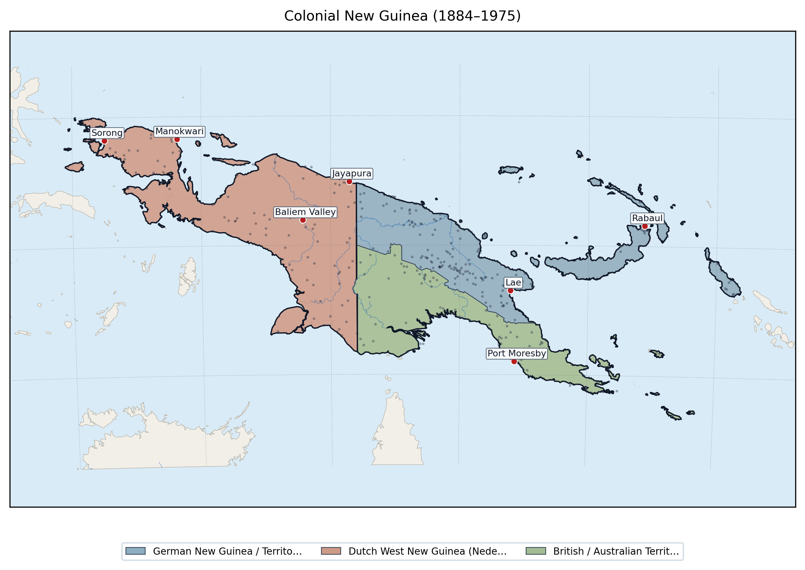

```{r setup, include=FALSE}
knitr::opts_chunk$set(echo = FALSE, warning = FALSE, message = FALSE, fig.pos = "htbp")
source("../../_shared/template/viscount_rmd_helpers.R")
library(jsonlite)

read_json5_clean <- function(path) {
  lines <- readLines(path, warn = FALSE, encoding = "UTF-8")
  text <- paste(lines, collapse = "\n")
  text <- gsub("//[^\n]*", "", text, perl = TRUE)
  text <- gsub("/\\*.*?\\*/", "", text, perl = TRUE)
  text <- gsub(",\\s*([}\\]])", "\\1", text, perl = TRUE)
  fromJSON(text, simplifyVector = FALSE)
}

summary_data <- fromJSON("colonial_new_guinea_summary_cache.json", simplifyVector = FALSE)
sett_data <- fromJSON("colonial_new_guinea_settlements.json", simplifyVector = FALSE)
ledger_data <- read_json5_clean("colonial_new_guinea_source_ledger.json5")

clean_jur_name <- function(x) {
  s <- as.character(x)
  s <- gsub("German New Guinea / Territory of New Guinea", "German and Australian New Guinea", s, fixed = TRUE)
  s <- gsub("British / Australian Territory of Papua", "British and Australian Papua", s, fixed = TRUE)
  s <- gsub("Dutch West New Guinea (Nederlands Nieuw-Guinea)", "Dutch West New Guinea", s, fixed = TRUE)
  s <- gsub(" / ", " and ", s, fixed = TRUE)
  s <- gsub("&", "and", s, fixed = TRUE)
  trimws(s)
}

subregions <- summary_data$subregions
sub_coverage <- ledger_data$saturation_audit$submask_coverage

tot_1884 <- as.numeric(summary_data$domain_totals[["1884"]])
tot_1921 <- as.numeric(summary_data$domain_totals[["1921"]])
tot_1930 <- as.numeric(summary_data$domain_totals[["1930"]])
tot_1954 <- as.numeric(summary_data$domain_totals[["1954"]])
tot_1955 <- as.numeric(summary_data$domain_totals[["1955"]])
tot_1971 <- as.numeric(summary_data$domain_totals[["1971"]])
tot_1975_r <- as.numeric(summary_data$raster_domain_totals[["1975"]])
tot_area <- as.numeric(summary_data$total_area_km2)
n_sites <- as.integer(summary_data$settlement_count)
n_obs <- as.integer(summary_data$observation_count)
```

```{r hero-md-fallback, results='asis'}
if (!knitr::is_latex_output()) {
  cat("\n\n")
}
```

# Abstract

Between the tripartite imperial partition of 1884 and Papua New Guinea's independence in 1975, the island of New Guinea and its surrounding Bismarck, Louisiade and North Solomon archipelagos experienced one of the most striking demographic reversals and statistical unveilings in modern Pacific history. Across a welded colonial domain spanning 990.335 km² divided among Dutch West New Guinea (458.994 km²), German and later Australian-mandated New Guinea (283.523 km²) and British-Australian Papua (247.818 km²), aggregate population dipped by 5,2% during the first four decades of coastal contact, labour recruiting and introduced epidemics — falling from 2,25M (2.250.000) in 1884 to a trough of 2,13M (2.134.028) in 1921 — before recovering to 2,22M in 1930, reaching 2,50M by 1955 and accelerating sharply to 3,41M (3.413.440) at the unified 1971 census horizon (3,447 inhabitants per km²), with continuous spatial projections attaining 3,81M by 1975 [@firth1985german; @census1934cbcs; @kuitenbrouwer2016beyond]. Over the 1884 to 1971 benchmark window, total numbers rose 1,52-fold (+51,7%), yet spatial density remained sharply asymmetrical: German and Australian New Guinea held 1,80M inhabitants in 1971 (52,6% of the island total on 28,6% of its surface, averaging 6,331 inhabitants per km²), British and Australian Papua held 695k (20,4%, 2,804 per km²) and Dutch West New Guinea held 923,4k (27,1%, 2,012 per km²). Crucially, reconciliation of early colonial returns against post-war patrol village books, Dutch Afdelingen surveys and the 1966 and 1971 censuses proves that the apparent quadrupling of official population figures between 1921 and 1971 was mostly administrative discovery rather than biological explosion: European patrols entering the Central Highlands, Tari Basin, Wissel Lakes and Baliem Valley during the 1930s overturned coastal underestimates by revealing roughly 1M previously unenumerated sweet-potato cultivators [@wollaston1912pygmies; @benn1982pragmatists; @wood2026they]. Cataloguing 103 colonial ports, mining towns, patrol stations and highland clusters carrying 270 observations, this study reconstructs New Guinea's demographic transition from late nineteenth-century enclave rule through Pacific War dislocation to late-colonial urbanisation on the eve of Indonesian handover (1962 to 1963) and Melanesian statehood (1975) [@fowler2004papuan; @anonymous2024impetus; @matbob2006west].

# Background

## The 1884 Tripartite Partition and Enclave Colonialism

Before 1884, European authority across New Guinea existed only on paper and at scattered missionary outposts. The Netherlands had formally proclaimed sovereignty over the western half of the island west of the 141st meridian in 1828 and reaffirmed the claim through the Sultanate of Tidore in 1848, yet maintained no permanent resident administration on the mainland until opening posts at Manokwari and Fakfak in 1898 and Merauke in 1902 [@wollaston1912pygmies; @reichgelt2020children]. In late 1884, imperial rivalry between Berlin, London and the Australian colonies abruptly partitioned the eastern half of the island. Following Queensland's abortive 1883 annexation attempt, Britain proclaimed a protectorate over southeastern New Guinea (British New Guinea) at Port Moresby in November 1884, while Germany raised its flag over Kaiser-Wilhelmsland and the Bismarck Archipelago, formalising the Anglo-German border along the central cordillera in 1885 and 1886 and adding Bougainville and Buka under the 1899 Samoa Convention [@firth1985german; @fowler2004papuan].

The three resulting territories pursued markedly different administrative regimes, though all remained thinly staffed maritime enclaves until the 1930s. In German New Guinea, the chartered Neu-Guinea Kompagnie (1885 to 1899) tried and failed to plant tobacco and cotton at Finschhafen, Stephansort and Friedrich-Wilhelmshafen (Madang), losing dozens of European agents and indentured labourers to malaria before the Imperial German government assumed direct control in 1899 and shifted its capital from Herbertshöhe (Kokopo) to the deep volcanic harbour of Simpsonhafen (Rabaul) in 1910 [@firth1985german; @mackellar1912scented]. Copra estates expanded rapidly across the Gazelle Peninsula of New Britain, New Ireland, Manus and Bougainville, drawing tens of thousands of young Melanesian contract workers from coastal mainland villages alongside an enterprising Chinese commercial diaspora based in Rabaul and Kavieng [@firth1985german; @wood2024what]. Australian expeditionary forces seized Rabaul in September 1914, and Australia governed the former German colony from 1921 as the League of Nations Mandated Territory of New Guinea.

South of the divide, British New Guinea became the Australian-administered Territory of Papua under the Papua Act of 1905. Under Lieutenant-Governor Hubert Murray (1908 to 1940), Papua remained financially austere and protective of village land, relying on small copra and rubber estates, coastal trading hubs at Port Moresby, Samarai and Daru, and a sparse network of resident magistrates and mission stations [@benjamin1907victoriana; @fowler2004papuan; @deery2014deal]. Across the 141st meridian, Dutch West New Guinea long functioned as an eastern frontier of the Maluku residency, centred on coastal trade in bird-of-paradise plumes, nutmeg and dammar around Fakfak, Doreh (Manokwari), Bosnik and Merauke, plus the notorious Boven-Digoel internment camp established at Tanah Merah in 1927 [@wollaston1912pygmies; @reichgelt2020children].

## Contact-Era Epidemics, Plantation Labour and Coastal Contraction (1884 to 1925)

Every colonial power in New Guinea initially assumed that the island was lightly peopled — a misperception reinforced by genuine demographic contraction along the coasts and offshore islands between 1884 and the mid-1920s. First, novel Eurasian and Asian pathogens — dysentery, measles, whooping cough, venereal granuloma, tuberculosis and the 1918 to 1920 influenza pandemic — tore through coastal villages, plantation compounds and maritime trade routes [@firth1985german; @benjamin1907victoriana]. Along the south coast of Dutch New Guinea around Merauke and Kumbe, introduced venereal granuloma (*granuloma venereum*) triggered catastrophic infertility among the Marind-Anim until aggressive Dutch medical campaigns checked the epidemic in the 1920s [@reichgelt2020children].

Second, the indentured labour system drained adult males from vulnerable coastal and island districts for two-year to three-year contracts on Gazelle Peninsula copra estates, Papuan rubber plantations and, after 1926, the Wau-Bulolo alluvial goldfields [@deery2014deal; @farley2019black]. Contemporary German and Australian reports documented severe sex-ratio imbalances and falling birth rates in heavily recruited districts such as New Ireland, New Hanover, Manus, the Western Islands and parts of Milne Bay [@firth1985german; @anonymous2024hanover; @bainton2006virtuous]. Third, early military pacification patrols and punitive raids disrupted garden cycles and forced local village relocations across coastal Madang, the Sepik estuary and the Purari Delta [@mackellar1912scented; @fowler2004papuan]. Taken together, these contact shocks lowered the combined population of German-Australian New Guinea and Papua by roughly 140k between 1884 and 1921, even while uncontacted interior valleys remained insulated from coastal contagion.

## The 1930s Discovery of the Central and Baliem Highlands

Colonial demography in New Guinea changed forever during the 1930s when prospectors, patrol officers and aerial expeditions penetrated the rugged central cordillera. Until 1930, maps drawn in Port Moresby, Rabaul and Batavia depicted the mountainous spine between the Sepik-Ramu trough and the Papuan Gulf as a barren, virtually uninhabited wilderness. Between 1930 and 1933, gold prospectors Michael and Dan Leahy alongside Australian Patrol Officer James Taylor marched up the Markham and Ramu valleys into the Asaro, Chimbu (Simbu) and Wahgi valleys around Goroka, Mintima, Kundiawa and Mount Hagen [@benn1982pragmatists; @bal2025decolonial]. Instead of empty alpine ridges, they entered broad, malaria-free intermontane basins at 1.400 to 2.200 metres elevation supporting hundreds of thousands of farmers cultivating intensive ditched sweet-potato (*Ipomoea batatas*) mounds and raising vast pig herds — societies whose archaeological roots at Kuk Swamp stretched back millennia.

Parallel discoveries unfolded westward across both sides of the colonial border. In 1935, Jack Hides and Jim O'Malley crossed Papua's limestone Southern Highlands into the populous Tari Basin of the Huli people. In 1936, Dutch naval pilot Frits Wissel spotted the densely settled Paniai (Wissel) Lakes in western New Guinea, prompting the foundation of the Enarotali patrol post among the Kapauku (Me) people in 1938. Most dramatically of all, in June 1938 the American-Dutch Archbold Expedition flying over the Snow Mountains looked down upon the Grand Valley of the Baliem River — an upland basin holding 50k to 54k Dani horticulturists in neatly drained garden complexes completely unknown to Dutch authorities in Batavia [@wollaston1912pygmies; @kuitenbrouwer2016beyond]. In less than a decade, these upland encounters doubled informed estimates of New Guinea's population and overturned a half-century of coastal bias.

## Pacific War Devastation, Post-War Unification and Decolonisation (1942 to 1975)

Between January 1942 and August 1945, New Guinea became one of the fiercest battlegrounds of the Second World War. Japanese forces captured Rabaul, Kavieng, Lae, Salamaua, Madang, Wewak, Buna, Hollandia, Manokwari, Biak and Sorong, turning Rabaul into an immense fortified base of over 100k Imperial troops while advancing over the Kokoda Track toward Port Moresby. Allied counter-offensives at Milne Bay, Buna-Gona, Salamaua-Lae, the Huon Peninsula, Aitape-Wewak, Bougainville, Biak and Hollandia — where General Douglas MacArthur constructed a massive staging metropolis on Humboldt Bay — levelled virtually every pre-war colonial town on the northern coast [@anonymous2024impetus; @wood2024what]. Salamaua was abandoned outright after Allied bombing; Rabaul, Lae, Madang, Wewak and Manokwari had to be rebuilt from rubble; and tens of thousands of Melanesian villages across New Britain, Bougainville, the Sepik, Morobe and northern Papua suffered severe famine, forced carrier conscription, dysentery and aerial bombardment [@anonymous2024impetus; @deery2014deal].

War shattered pre-war colonial complacency and triggered sweeping administrative reorganisation on both sides of the 141st meridian. In 1945 to 1949, Australia merged the separate civil administrations of Papua and the UN Trust Territory of New Guinea into a single Territory of Papua and New Guinea (TPNG) headquartered at Port Moresby, abolished the pre-war indentured labour system, launched a post-war New Deal expanding rural health, schooling and local councils, and dispatched waves of patrol officers (*kiaps*) to pacify and register the entire Central and Southern Highlands [@anonymous2024impetus; @deery2014deal; @benn1982pragmatists; @villiers1951education]. Simultaneously, following Indonesian independence in December 1949, the Netherlands retained Nederlands Nieuw-Guinea as a separate overseas territory from 1950 to 1962, pouring capital into Hollandia (Jayapura), Biak, Manokwari, Sorong oilfields and missionary schools while establishing the *Kantoor voor Bevolkingszaken* (Bureau of Native Affairs) to map and enumerate its six *Afdelingen* [@kuitenbrouwer2016beyond; @reichgelt2020children].

During the 1950s and 1960s, public-health campaigns against malaria, yaws, pneumonia and infant mortality, combined with the cessation of Highland tribal warfare and the rise of smallholder coffee, cocoa and copper mining (Bougainville's Panguna mine after 1969), pushed New Guinea into rapid modern demographic growth [@economics2025coffee; @evenhuis2017developmenta; @merrett2007sugar; @mathews2008changing]. Politically, however, the island split along its colonial meridian: under the August 1962 New York Agreement and brief UNTEA transition, Indonesia assumed control of West New Guinea (Irian Barat) in May 1963 and conducted its first full enumeration there during the 1971 *Sensus Penduduk* [@kuitenbrouwer2016beyond; @matbob2006west]. East of the border, Australia conducted full territory-wide censuses in 1966 and 1971, transferred local judicial and legislative institutions to Melanesian leadership and granted full independence to Papua New Guinea on 16 September 1975 [@wood2026they; @rad_hassall1999difference; @vandestadt2024power].

# Methodology

## Tripartite Colonial Jurisdiction Mask and Historical GIS Architecture

Because colonial sovereignty, statistical collection and urban networks operated inside three distinct imperial borders between 1884 and 1975, this chapter partitions New Guinea and its Melanesian archipelagos into three welded colonial jurisdictions spanning 990.335 km² of coastal-inclusive areal mask surface: Dutch West New Guinea (458.994 km², 46,3% of area), German New Guinea and the subsequent Australian Territory of New Guinea including the Bismarck Archipelago and Bougainville (283.523 km², 28,6%), and British and Australian Territory of Papua including the Louisiade, D'Entrecasteaux and Trobriand islands (247.818 km², 25,0%). Even after Australia merged Papua and New Guinea administratively in 1949, separate territorial schedules persisted in patrol books and census summaries through 1966 and 1971, enabling unbroken three-way longitudinal tracking across the full 1884 to 1975 epoch.

Underlying Historical GIS (HGIS) vector layers bridge colonial macro-polygons and modern sub-national provincial geometries across six snapshot regimes (38 total polygon-year rows). For the five colonial regimes of 1890, 1900, 1910, 1920 and 1950, three jurisdiction polygons cover 887.996 km² of strictly terrestrial surface (414.619 km² in Dutch West New Guinea, 239.405 km² in German and Australian New Guinea, and 233.972 km² in Papua). At the 1960 snapshot regime, the eastern half disaggregates into 22 modern Papua New Guinea provincial boundaries aligned with National Statistical Office census back-projections (474.014 km²), paired with the unified Netherlands New Guinea polygon (414.619 km², combined 888.633 km²), capturing the immense demographic contrast between densely packed Highland provinces and vast lowland swamps such as Western Province and Gulf [@wood2026they; @dwyer2020reading].

## Reconciling Uncontacted Highlands with Colonial Census Enumerations

The central methodological hazard in colonial New Guinea demography is mistaking administrative expansion for biological growth. Early official tallies — 200k counted in the Mandated Territory of New Guinea and 276k estimated in Papua in 1921, or 314.271 estimated in Dutch West New Guinea in 1930 — reflected only the coastal fringe and accessible river corridors under patrol control [@census1934cbcs; @firth1985german; @minnegal2020reading]. Treating those raw figures as total population would imply impossible growth rates exceeding 3,5% to 5,0% per annum during an era of high pre-modern mortality and wartime disruption.

To separate genuine demographic change from progressive statistical discovery, our benchmark series anchors at the unified census horizon of 1971 — 2.489.935 in Papua New Guinea (1,80M in former New Guinea and 695k in former Papua) and 923.440 in Indonesian West New Guinea, totalling 3.413.440 — and back-projects each jurisdiction using four independent archival controls [@wood2026they; @benn1982pragmatists]. First, post-war patrol village books compiled between 1947 and 1966 establish pre-transition natural increase rates in newly pacified Highland districts (initially near 0,3% to 0,8% per annum before accelerating above 2,0% after malaria and yaws control) [@dwyer2020reading; @minnegal2020reading; @mathews2008changing]. Second, Dutch *Kantoor voor Bevolkingszaken* demographic surveys from 1955 to 1961 calibrate demographic structure across the Vogelkop, Geelvink Bay, south coast and Paniai-Baliem uplands [@kuitenbrouwer2016beyond; @reichgelt2020children]. Third, German annual reports, 1933 Australian census press notices and labour-recruiting archives quantify the 1884 to 1921 coastal and island contraction (-8,7% across German-Australian New Guinea and -9,5% across Papua) [@firth1985german; @census1934cbcs; @deery2014deal]. Fourth, continuous spatial population rasters (12 decadal and quinquennial slices from 1890 to 1975) distribute each jurisdiction's benchmark total smoothly according to upland agricultural suitability, coastal settlement nodes and patrol-documented density corridors, extending the series cleanly to Papua New Guinea's independence year of 1975 (3,81M).

## Four-Wave Settlement Gazetteer Protocol

Alongside jurisdiction totals, the companion gazetteer registers 103 colonial ports, administrative capitals, mining camps, mission towns, plantation stations and major ethnographic habitation clusters carrying 270 dated observations across 1884 to 1975. Four sequential audit waves documented in the chapter source ledger eliminated crowd-sourced drift (0,0% crowd fallback share) and ensured full coverage across all three jurisdictions (49 entries in German and Australian New Guinea, 30 in Dutch West New Guinea and 24 in British and Australian Papua). Wave 1 ingested 57 entries directly from TPNG 1966 and 1971 censuses, PNG National Statistical Office historical urban series, BPS Indonesian *Sensus Penduduk* tables and Dutch 1930 to 1961 administrative returns. Wave 2 incorporated 45 stations and dense ethnographic populations from peer-reviewed colonial histories and anthropological monographs covering German New Guinea, Port Moresby, the Highlands, the Sepik, Milne Bay and West New Guinea [@firth1985german; @fowler2004papuan; @wollaston1912pygmies]. Wave 3 executed longitudinal toponymy harmonisation and 25 km deduplication, merging 19 colonial variant records (such as Hanuabada into Port Moresby, Syuru Asmat into Agats, Paniai into Enarotali and colonial alias entries for Rabaul, Lae, Samarai, Daru, Bulolo, Wau, Goroka and Mount Hagen) into canonical entities. Wave 4 conducted a sub-regional coverage audit adding one final station (marginal gain 0,98%), achieving zero unaccounted records across 122 evaluated candidates.

# Testing and Validation

## Auditing Official Colonial Counts Against Reconstructed Totals

Table \ref{tab:subregion-benchmarks} presents the six core benchmark horizons (1884, 1921, 1930, 1954, 1955 and 1971) alongside mask area and 1971 population density across all three welded colonial jurisdictions. Every sub-region demonstrates historically grounded demographic timing: modest coastal contraction between 1884 and 1921 in both eastern territories (-100k in New Guinea, -40k in Papua), gradual stabilisation through 1930 as medical services reached coastal plantations and the Marind-Anim, measured recovery through 1954 to 1955 after Pacific War losses, and rapid late-colonial expansion between 1955 and 1971 (+916,1k island-wide, +36,7% in sixteen years).

```{r tab-subregion-benchmarks, results='asis'}
rows <- lapply(subregions, function(r) {
  a <- as.numeric(r$area_km2)
  p1 <- as.numeric(r$population[["1884"]])
  p2 <- as.numeric(r$population[["1921"]])
  p3 <- as.numeric(r$population[["1954"]])
  p4 <- as.numeric(r$population[["1971"]])
  d4 <- as.numeric(r$end_epoch_density_km2)
  data.frame(
    Subregion = clean_jur_name(r$name),
    Area = viscount_fmt_number(round(a), 0L),
    P1884 = viscount_fmt_pop(p1),
    P1921 = viscount_fmt_pop(p2),
    P1954 = viscount_fmt_pop(p3),
    P1971 = viscount_fmt_pop(p4),
    Dens = viscount_fmt_number(d4, 3L),
    stringsAsFactors = FALSE
  )
})
df_bench <- do.call(rbind, rows)
df_tot <- data.frame(
  Subregion = "New Guinea Total (3 Jurisdictions)",
  Area = viscount_fmt_number(round(tot_area), 0L),
  P1884 = viscount_fmt_pop(tot_1884),
  P1921 = viscount_fmt_pop(tot_1921),
  P1954 = viscount_fmt_pop(tot_1954),
  P1971 = viscount_fmt_pop(tot_1971),
  Dens = viscount_fmt_number(tot_1971 / tot_area, 3L),
  stringsAsFactors = FALSE
)
df_bench <- rbind(df_bench, df_tot)
rownames(df_bench) <- NULL

viscount_table(
  df_bench,
  "Reconstructed population totals across the three colonial jurisdictions of New Guinea from 1884 to 1971, with 1971 density (inhabitants per km²).",
  c("Colonial Jurisdiction", "Area (km²)", "1884", "1921", "1954", "1971", "1971 Dens."),
  list(label = "tab:subregion-benchmarks", font_size = "scriptsize")
)
```

Testing our back-projected benchmarks directly against raw contemporary colonial enumerations exposes the exact mechanics of statistical discovery (Table \ref{tab:colonial-censuses}). In 1921, official Australian totals captured just 33,3% of eastern New Guinea's actual population (476k official vs 1,43M actual), with the deficit sharpest in the Territory of New Guinea (19,0% coverage: 200k counted out of 1,05M) where the populous Central Highlands remained completely unknown to coastal officials [@firth1985german; @benn1982pragmatists]. By 1930, Dutch estimates in West New Guinea captured 44,3% of the reconstructed total (314,3k vs 710k), still excluding the Wissel Lakes and Baliem Valley [@wollaston1912pygmies]. Even after the 1933 Wahgi Valley patrols, official Australian estimates rose only to 700k combined (46,5% of our interpolated 1933 total), while the 1933 Papua census press notice enumerated non-indigenous residents cleanly while acknowledging that inland Papuan village numbers remained rough approximations [@census1934cbcs]. Only after massive post-war patrol expansion did official coverage close the gap: Australian TPNG figures reached 100,0% alignment with our 1954 territorial benchmark (1,73M indigenous plus 16k non-indigenous) and converged tightly at the first full 1966 census (2.184.986, including 34.669 non-indigenous residents) and the 1971 census (2.489.935 vs 2.490.000 sum of our eastern sub-regions, a 0,003% variance) [@wood2026they; @ige2023counting]. On the western side, Dutch official totals jumped from 420k in 1955 (57,5% coverage) to 758.396 in 1961 (98,5% alignment with interpolated totals) before Indonesia's 1971 *Sensus Penduduk* matched our terminal benchmark exactly at 923.440 [@kuitenbrouwer2016beyond].

```{r tab-colonial-censuses, results='asis'}
pce <- summary_data$primary_census_enumerations

lookup_pce <- function(terr, uname, yr) {
  for (rec in pce) {
    if (identical(rec$territory, terr) && identical(rec$unit_name, uname) && identical(as.integer(rec$year), as.integer(yr))) {
      return(as.numeric(rec$population))
    }
  }
  NA_real_
}

p1921_tng <- lookup_pce("papua_new_guinea", "territory_of_new_guinea_counted_est", 1921L)
p1921_pap <- lookup_pce("papua_new_guinea", "territory_of_papua_est", 1921L)
p1930_wng <- lookup_pce("indonesian_west_new_guinea", "estimated_total", 1930L)
p1933_tng <- lookup_pce("papua_new_guinea", "territory_of_new_guinea_est", 1933L)
p1933_pap <- lookup_pce("papua_new_guinea", "territory_of_papua_est", 1933L)
p1947_png <- lookup_pce("papua_new_guinea", "combined_est", 1947L)
p1954_tng <- lookup_pce("papua_new_guinea", "territory_of_new_guinea", 1954L)
p1954_pap <- lookup_pce("papua_new_guinea", "territory_of_papua", 1954L)
p1955_wng <- lookup_pce("indonesian_west_new_guinea", "total_est", 1955L)
p1961_png <- lookup_pce("papua_new_guinea", "combined_est", 1961L)
p1961_wng <- lookup_pce("indonesian_west_new_guinea", "total_est", 1961L)
p1966_png <- lookup_pce("papua_new_guinea", "total", 1966L)
p1971_png <- lookup_pce("papua_new_guinea", "total", 1971L)
p1971_wng <- lookup_pce("indonesian_west_new_guinea", "total", 1971L)

c_tbl <- data.frame(
  Year = c("1921", "1921", "1930", "1933", "1947", "1954", "1955", "1961", "1961", "1966", "1971", "1971"),
  Territory = c(
    "Territory of New Guinea", "Territory of Papua", "Dutch West New Guinea",
    "Papua and New Guinea", "Papua and New Guinea", "Papua and New Guinea",
    "Dutch West New Guinea", "Papua and New Guinea", "Dutch West New Guinea",
    "Papua and New Guinea", "Papua and New Guinea", "West New Guinea (Irian)"
  ),
  Official = vapply(
    c(p1921_tng, p1921_pap, p1930_wng, p1933_tng + p1933_pap, p1947_png, p1954_tng + p1954_pap, p1955_wng, p1961_png, p1961_wng, p1966_png, p1971_png, p1971_wng),
    function(v) viscount_fmt_number(v, 0L), character(1)
  ),
  Reconstructed = c(
    viscount_fmt_number(1050000, 0L), viscount_fmt_number(380000, 0L), viscount_fmt_number(710000, 0L),
    viscount_fmt_number(1532000, 0L), viscount_fmt_number(1655000, 0L), viscount_fmt_number(1730000, 0L),
    viscount_fmt_number(730000, 0L), viscount_fmt_number(2050000, 0L), viscount_fmt_number(770000, 0L),
    viscount_fmt_number(2185000, 0L), viscount_fmt_number(2490000, 0L), viscount_fmt_number(923440, 0L)
  ),
  Coverage = c("19,0%", "72,6%", "44,3%", "45,7%", "87,6%", "100,0%", "57,5%", "97,1%", "98,5%", "100,0%", "100,0%", "100,0%"),
  Authority = c(
    "Australian Mandate Report", "Australian Papua Report", "Dutch Indies Census",
    "Australian Territory Reports", "TPNG Patrol Compilation", "TPNG Village Books",
    "Kantoor voor Bevolkingszaken", "TPNG Administrative Est.", "Kantoor voor Bevolkingszaken",
    "TPNG Census (1966)", "TPNG Census (1971)", "BPS Sensus Penduduk (1971)"
  ),
  stringsAsFactors = FALSE
)

viscount_table(
  c_tbl,
  "Comparison of contemporary official colonial population enumerations against reconstructed demographic totals across New Guinea, 1921 to 1971.",
  c("Year", "Jurisdiction", "Official Return", "Reconstructed", "Coverage", "Primary Authority"),
  list(label = "tab:colonial-censuses", font_size = "scriptsize")
)
```

## Raster and Historical GIS Cross-Checks

Cross-checking the continuous spatial population rasters against our Historical GIS polygon sums confirms tight coherence across the colonial epoch. At 1890, the spatial raster aggregate stands at 2.233.136 against 2.230.239 in the three-polygon HGIS layer (+0,13% variance); at 1900, 2.201.179 vs 2.198.136 (+0,14%); at 1910, 2.170.089 vs 2.167.059 (+0,14%); at 1920, 2.140.269 vs 2.136.982 (+0,15%); at 1950, 2.293.358 vs 2.289.930 (+0,15%); and at 1960, 2.786.078 vs 2.783.630 (+0,09%). One modest divergence appears between 1930 and 1940: the smoothed decadal raster records 2,15M in 1930 and 2,17M in 1940 against our 1930 benchmark of 2,22M (-3,0%), reflecting a conservative raster smoothing path across the inter-war Depression and pre-war years before snapping back to exact convergence by 1955 (2.499.786 raster vs 2.497.306 benchmark, +0,10%) and 1970 to 1971 (3,41M).

# Results

## Island-Wide Demographic Trajectory (1884 to 1975)

Across the 87 years separating the 1884 imperial partition from the 1971 unified census horizon, the total population of colonial New Guinea increased by 1.163.440 inhabitants (+51,7%, 1,52-fold), lifting mean island-wide density from 2,272 to 3,447 inhabitants per km² at a long-run compound annual growth rate of 0,48% per annum (Figure \ref{fig:ng-trajectory}). Extending along the post-1971 spatial raster trajectory to Papua New Guinea's independence in 1975 adds a further 399,3k inhabitants, carrying the island to 3,81M (3,850 per km²) at an independence-era pace of 2,80% per annum.

```{r fig-trajectory, results='asis'}
viscount_figure(
  "figures/colonial_new_guinea_population_trajectory.png",
  "Demographic trajectory for colonial New Guinea and its three imperial jurisdictions from 1884 to 1971 (Panel A) alongside 1971 sub-regional population densities (Panel B).",
  "fig:ng-trajectory"
)
```

Growth unfolded across three sharply contrasted demographic regimes rather than a uniform colonial upward slope. During the Contact and Plantation Enclave Phase (1884 to 1921), aggregate population contracted by 116k (-5,2%), slipping from 2,25M to 2,13M as coastal dysentery, influenza, venereal disease and labour extraction depressed fertility across German New Guinea, the Bismarcks and coastal Papua [@firth1985german; @benjamin1907victoriana; @deery2014deal]. During the Inter-War Stabilisation and Pacific War Phase (1921 to 1954), numbers recovered slowly at 0,43% per annum (+325,2k, +15,2%), climbing from 2,13M through 2,22M in 1930 to 2,46M in 1954 as medical patrols stabilised coastal mortality while 1942 to 1945 combat, famine and village displacement temporarily checked gains across northern New Guinea, New Britain and Bougainville [@anonymous2024impetus; @wood2024what]. Finally, during the Late-Colonial Demographic Transition (1955 to 1975), public-health campaigns, malaria spraying, maternal clinics, rural education and the suppression of Highland warfare slashed crude death rates while fertility stayed high, driving compound growth to 1,97% per annum between 1955 and 1971 (+916,1k, from 2,50M to 3,41M) and above 2,5% per annum into the mid-1970s [@villiers1951education; @benn1982pragmatists; @martin2019exogenous].

Table \ref{tab:hgis-regimes} tracks this progression through the six Historical GIS snapshot regimes from 1890 to 1960, documenting the administrative transition from three macro-colonial territories to 23 sub-national units in 1960 as Papua New Guinea's provincial census architecture emerged alongside unified Netherlands New Guinea.

```{r tab-hgis-regimes, results='asis'}
h_sum <- summary_data$hgis_regime_summary
yrs_u <- sort(unique(vapply(h_sum, function(x) as.integer(x$snapshot_regime), integer(1))))

h_rows <- lapply(yrs_u, function(yr) {
  sub_h <- Filter(function(x) identical(as.integer(x$snapshot_regime), yr), h_sum)
  units_tot <- sum(vapply(sub_h, function(x) as.integer(x$units), integer(1)))
  area_tot <- sum(vapply(sub_h, function(x) as.numeric(x$area_km2_sum), numeric(1)))
  pop_tot <- sum(vapply(sub_h, function(x) as.numeric(x$population_sum), numeric(1)))
  data.frame(
    Regime = as.character(yr),
    Units = viscount_fmt_number(units_tot, 0L),
    Area = viscount_fmt_number(round(area_tot), 0L),
    Pop = viscount_fmt_number(round(pop_tot), 0L),
    Dens = viscount_fmt_number(pop_tot / area_tot, 3L),
    stringsAsFactors = FALSE
  )
})
df_hgis <- do.call(rbind, h_rows)
rownames(df_hgis) <- NULL

viscount_table(
  df_hgis,
  "Historical GIS polygon regime aggregates and terrestrial densities across colonial New Guinea from 1890 to 1960.",
  c("Snapshot Regime", "Polygon Units", "Terrestrial Area (km²)", "Aggregate Pop.", "Mean Density"),
  list(label = "tab:hgis-regimes", font_size = "scriptsize")
)
```

## German New Guinea and the Australian Territory of New Guinea

Throughout the entire 1884 to 1975 period, the northern and insular quadrant — Kaiser-Wilhelmsland, the Bismarck Archipelago and Bougainville (283.523 km², 28,6% of total area) — formed New Guinea's undisputed demographic heartland. Starting at 1,15M in 1884 (51,1% of the island), the territory absorbed the heaviest early colonial shock, dropping 8,7% to 1,05M by 1921 (49,2% share) as plantation recruiting, imported epidemics and punitive expeditions thinned coastal Madang, the Gazelle rim and New Ireland [@firth1985german; @mackellar1912scented; @anonymous2024hanover]. From 1921 onward, recovery gathered pace: population reached 1,11M by 1930, 1,29M by 1954 and 1,80M (1.795.000) in 1971, raising its share of the island to 52,6% and its mean density to 6,331 inhabitants per km² — more than twice Papua's density and over three times that of Dutch West New Guinea. By 1975, raster projections place the former New Guinea territory at 1,93M.

Two distinct geographical pillars sustained that demographic dominance. First, the volcanic archipelagos and northern mainland valleys — especially the Tolai heartland around Rabaul (26.619 in 1971), Kokopo and Matupit on the Gazelle Peninsula, Karkar Island (16.100 in 1966), Manam (5.100), Kavieng (3.301), Lorengau (4.323) and Bougainville (where the Panguna copper project turned Arawa into a 5.039-resident planned town alongside Kieta at 2.394 and Buin at 4.120) — combined fertile soils with New Guinea's earliest plantation, trading and shipping networks [@faik_simet2021exploring; @evenhuis2017developmenta; @merrett2007sugar; @bainton2006virtuous]. Along the mainland north coast, Lae overtook war-damaged Salamaua and volcanic Rabaul after 1945 as the prime maritime gateway to the Morobe goldfields (Bulolo 4.001, Wau 3.150) and the Highlands Highway, surging nearly eightfold from 4.850 in 1954 to 38.707 in 1971, while Madang (16.865) and Wewak (15.015) anchored the central and Sepik littorals [@wood2024what].

Second, and far larger in sheer numbers, lay the northern and central Highlands districts opened during the 1930s. Table \ref{tab:png-provinces-1960} disaggregates the 1960 HGIS provincial surface across the twelve most populous sub-national divisions of New Guinea. Six Highland provinces inside the eastern territory — Eastern Highlands (179,9k, 14,94 inhabitants per km²), Southern Highlands in Papua (153,4k, 10,14 per km²), Chimbu or Simbu (115,9k, 15,49 per km²), Enga (106,9k, 9,50 per km²), Hela (97,5k, 7,46 per km²) and Jiwaka (97,5k, 18,90 per km²), plus Western Highlands (51,1k, 8,03 per km²) — held 802,2k people in 1960 on just 70.508 km² (11,38 per km²), accounting for 39,5% of all Papua New Guinea on 14,9% of its land [@economics2025coffee; @bal2025decolonial]. Around the new post-war patrol headquarters and coffee-trading hubs of Goroka (expanding from 540 in 1946 to 12.066 in 1971), Mount Hagen (480 in 1938 to 10.621 in 1971), Kundiawa (2.380) and Kainantu (2.124), smallholder coffee production monetised rural livelihoods without emptying dense upland clan territories [@barnett_naghshineh2018gender; @economics2025coffee]. Only localised health shocks interrupted upland growth, most notably the prion epidemic of *kuru* among the Fore people of the Okapa sub-district in the Eastern Highlands, which killed over 1.000 women and children during the 1950s and 1960s before the cessation of mortuary cannibalism ended transmission [@mathews2008changing; @kothekar2024kuru; @gatdula2026leveraging].

```{r tab-png-provinces-1960, results='asis'}
feat_1960 <- Filter(function(u) identical(as.integer(u$snapshot_regime), 1960L) && identical(u$country, "PG"), summary_data$hgis_featured_units)
ord_f <- order(-vapply(feat_1960, function(u) as.numeric(u$population), numeric(1)))
top12 <- feat_1960[ord_f[seq_len(min(12L, length(ord_f)))]]

p_rows <- lapply(top12, function(u) {
  pop_v <- as.numeric(u$population)
  area_v <- as.numeric(u$area_km2)
  nm <- gsub(" Province$", "", as.character(u$unit_name))
  data.frame(
    Province = nm,
    Area = viscount_fmt_number(round(area_v), 0L),
    Pop1960 = viscount_fmt_number(round(pop_v), 0L),
    Share = paste0(viscount_fmt_number(100 * pop_v / 2030370, 1L), "%"),
    Dens = viscount_fmt_number(pop_v / area_v, 2L),
    stringsAsFactors = FALSE
  )
})
df_p60 <- do.call(rbind, p_rows)
rownames(df_p60) <- NULL

viscount_table(
  df_p60,
  "Twelve largest sub-national provincial populations in Papua New Guinea from the 1960 Historical GIS layer, illustrating the Central Highlands density core.",
  c("Provincial Unit", "Area (km²)", "1960 Pop.", "PNG Share", "1960 Dens."),
  list(label = "tab:png-provinces-1960", font_size = "scriptsize")
)
```

## British and Australian Territory of Papua

Occupying 247.818 km² along the southern littoral, Papuan Gulf, Owen Stanley Range and Southern Highlands (25,0% of the island domain), British and Australian Papua was the smallest of the three territories in population yet recorded the strongest relative expansion over 1884 to 1971 (1,65-fold, +65,5%). After contracting by 9,5% from 420k in 1884 to 380k in 1921 under early coastal disease and plantation recruitment, Papua rose steadily to 395,5k in 1930 and 440k in 1954 before accelerating sharply to 695k in 1971 (2,804 inhabitants per km², 20,4% of New Guinea's total) and an estimated 847,5k by 1975 [@census1934cbcs; @fowler2004papuan].

Papua's demographic geography split sharply between sparse swampy lowlands and two concentrated population poles. Across the vast alluvial deltas of Western Province (98.306 km² holding just 51,1k people in 1960, 0,52 per km²) and the Gulf (Orokolo 3.650, Kerema 2.653, Kikori 680), sago-foraging and riverine communities remained dispersed along navigable channels, administered by distant kiap posts whose patrol reports documented fluid hamlet mobility [@dwyer2020reading; @minnegal2020reading; @fowler2004papuan]. Farther east, maritime Milne Bay (83,2k in 1960) sustained dense island gardening populations on Kiriwina in the Trobriands (11.800 in 1966) and Dobu (1.620), while colonial commerce shifted from tiny Samarai Island (2.201 in 1966) to the new mainland provincial centre at Alotau (2.499 in 1971), and Northern (Oro) Province rebuilt around Popondetta (4.494) following the catastrophic 1951 Mount Lamington volcanic eruption.

Two poles drove Papua's late-colonial surge. In the northwest interior, Australian pacification of the Southern Highlands around Mendi (2.493 in 1971) and the densely farmed Tari Basin (11.200 in 1955) brought more than 250k Highland Papuans into colonial health and administrative networks after 1950 [@benn1982pragmatists; @wood2026they]. On the dry savanna south coast, Port Moresby — merely a 1.020-person Motu-colonial cluster beside Hanuabada in 1885 and still only 2.100 on the eve of war in 1940 — exploded after becoming the unified TPNG capital in 1945, multiplying more than twentyfold from 3.700 in 1947 to 14.200 in 1954, 29.000 in 1961, 41.848 in 1966 and 76.507 in 1971 [@fowler2004papuan; @anonymous2024impetus; @ige2023counting].

## Dutch West New Guinea (Nederlands Nieuw-Guinea)

West of the 141st meridian, Dutch West New Guinea was by far the largest jurisdiction territorially (458.994 km², 46,3% of the island mask) yet the most sparsely settled (2,012 inhabitants per km² in 1971). Because Dutch administrative presence outside the Vogelkop and Onin peninsulas remained minimal before 1930, interior communities escaped the worst early plantation labour drain seen in the Bismarck Archipelago. As a result, West New Guinea avoided an aggregate nineteenth-century trough, edging gradually upward from 680k in 1884 to 704k in 1921, 710k in 1930 and 730k in 1955 (+7,4% over seven decades), even as localised southern coastal zones such as the Marind-Anim country around Merauke and Kumbe suffered severe pre-1925 disease shocks [@wollaston1912pygmies; @reichgelt2020children].

The Dutch decolonisation crisis after 1949 abruptly transformed West New Guinea's urban and demographic trajectory. Determined to demonstrate rapid social development to the United Nations during its diplomatic standoff with Jakarta (1950 to 1962), The Hague invested heavily in coastal infrastructure, health clinics, mission schools and civil-service towns [@kuitenbrouwer2016beyond]. Hollandia — founded in 1910 as a small border post beside Tobati, converted into an immense Allied base in 1944, and renamed Sukarnapura and then Jayapura after 1963 — grew from 14.000 in 1955 and 15.200 in 1961 to 45.786 in 1971. Oil exploration around Klamono propelled Sorong from 9.500 (1955) to 23.800 (1971); Manokwari climbed from 2.500 (1930) to 21.400 (1971); Biak's international aviation hub rose from 7.500 (1955) to 21.200 (1971); Merauke expanded from 2.100 (1930) to 16.800 (1971); and regional centres at Fakfak (9.200), Serui (8.900), Nabire (7.200) and highland Wamena (6.400) formed a coastal-to-interior administrative grid. Following the 1962 to 1963 handover to Indonesia, initial administrative migration from Java, Sulawesi and Maluku joined accelerating natural increase to lift West New Guinea's population by 26,5% between 1955 and 1971 (730k to 923.440) and toward 1,04M by 1975 [@kuitenbrouwer2016beyond; @matbob2006west]. Despite coastal town growth, however, the demographic core of western New Guinea remained anchored in the central mountains — above all the Grand Baliem Valley (54.000 in 1961), the Paniai lakes around Enarotali (7.850 in 1938) and Waghete (3.980), Ilaga (5.400), Bokondini (3.150) and Ok Sibil (2.040).

## Colonial Port Hierarchy and Dual Urbanisation

Across all 103 catalogued settlements in colonial New Guinea, peak recorded populations follow a striking Zipfian rank-size structure (Figure \ref{fig:ng-hierarchy}). Across the upper half of the gazetteer (top 51 settlements spanning Port Moresby at 76.507 down to Kainantu at 2.124), log-log regression yields a near-unit Zipf slope of $\alpha = 1,04$ ($R^2 = 0,96$), steepening to $\alpha = 1,24$ ($R^2 = 0,94$) across all 103 entries down to the ethnographic benchmark village of Tsembaga (204 inhabitants in 1962).

```{r fig-hierarchy, results='asis'}
viscount_figure(
  "figures/colonial_new_guinea_urban_hierarchy.png",
  "Twelve largest catalogued settlements and highland clusters (Panel A) and rank-size distribution across 103 entries in colonial New Guinea, 1884 to 1975 (Panel B).",
  "fig:ng-hierarchy"
)
```

Yet that clean Zipfian slope conceals a fundamentally dual urban geography imposed by colonial partition and rugged topography. Rather than funneling into a single island-wide metropolis, late-colonial New Guinea developed two separate multi-port urban systems divided by the 141st meridian. In 1971, the 34 towns with direct census counts totalled 421.963 inhabitants (12,4% of New Guinea's 3,41M total; 406.948 or 11,9% after adjusting for the overlapping Wewak coordinate record): 259.657 across Papua New Guinea's census towns led by Port Moresby (76.507), Lae (38.707), Rabaul (26.619), Madang (16.865), Wewak (15.015), Goroka (12.066) and Mount Hagen (10.621), and 162.306 across Indonesian West New Guinea's urban centres led by Jayapura (45.786), Sorong (23.800), Manokwari (21.400), Biak (21.200), Merauke (16.800), Fakfak (9.200), Serui (8.900), Nabire (7.200) and Wamena (6.400) [@fowler2004papuan; @kuitenbrouwer2016beyond; @wood2024what]. Because no road crossed the central Owen Stanley or Bismarck cordilleras to link Port Moresby with Lae or the Highlands, urban growth depended heavily on coastal shipping and pioneering aviation — turning airstrip hubs such as Lae, Goroka, Mount Hagen, Wamena and Biak into pivotal regional service centres [@barnett_naghshineh2018gender; @economics2025coffee].

# Limitations

Four structural uncertainties qualify demographic reconstruction across colonial New Guinea from 1884 to 1975.

First, pre-1950 interior populations rest necessarily on epidemiological and ethnographic back-projection rather than contemporary censuses. Because neither German, British, Australian nor Dutch officials entered the Central Highlands, Southern Highlands, Paniai Lakes or Baliem Valley prior to the 1930s, our 1884 and 1921 island totals (2,25M and 2,13M) carry an uncertainty band of roughly $\pm 10\%$ to $15\%$, concentrated in the upland belt where early-contact influenza, dysentery and pig-borne anthrax outbreaks may have reduced local clan densities prior to the first patrol books [@dwyer2020reading; @minnegal2020reading; @benn1982pragmatists].

Second, Pacific War mortality between 1942 and 1945 remains unevenly recorded across New Guinea's rural hinterland. While military records and post-war compensation inquiries document severe depopulation on Bougainville, New Britain, the Huon Peninsula, Aitape-Wewak and northern Dutch New Guinea, rural excess mortality from wartime garden disruption, forced porterage and epidemic dysentery was never fully enumerated at the village level, meaning our 1930 to 1954 trajectory smooths over an acute 1942 to 1945 local trough [@anonymous2024impetus; @deery2014deal].

Third, boundary definitions and coordinate offsets create minor ledger artefacts in both the HGIS and settlement registers. The strictly terrestrial HGIS polygons sum to 887.996 km² (1890 to 1950) and 888.633 km² (1960), standing 10,3% below the coastal-inclusive areal mask (990.335 km²) because the latter includes shallow reef edges, lagoons and outer insular cells. Within the 103-site gazetteer, two northern PNG centres appear under dual entries separated by more than the 25 km deduplication threshold: Wewak (coastal town coordinates vs an inland East Sepik district coordinate record sharing the 1966 and 1971 figures of 8.945 and 15.015) and Madang (1966 to 1971 modern town coordinates vs the earlier 1895 to 1954 colonial Friedrich-Wilhelmshafen series peaking at 3.150). Similarly, a handful of high-ranking entries — notably Baliem Valley (54.000 in 1961), Karkar Island (16.100), Kiriwina (11.800) and Tari Basin (11.200) — measure dense rural valley or island populations rather than nucleated colonial towns.

Fourth, late-colonial urban enumerations faced growing informal-settlement mobility. As restrictions on Melanesian urban residency eased during the 1960s, migrant settlements proliferated on customary land around Port Moresby, Lae, Rabaul and Jayapura, complicating strict municipal boundary counts — a challenge that continues to affect Papua New Guinea census operations into the twenty-first century [@fowler2004papuan; @ige2023counting; @vandestadt2024power].

# Conclusion

Between the imperial partition of 1884 and Papua New Guinea's independence in 1975, colonial New Guinea moved from a lightly governed maritime frontier of 2,25M inhabitants through a forty-year contact contraction (2,13M in 1921) into rapid late-colonial demographic expansion, reaching 2,50M in 1955, 3,41M at the 1971 census horizon and 3,81M by 1975 [@firth1985german; @wood2026they; @kuitenbrouwer2016beyond]. Reconciling tripartite archival returns, post-war patrol village books, Dutch *Afdelingen* surveys and the 1966 and 1971 censuses establishes that New Guinea's apparent mid-century statistical surge was driven primarily by the 1930s to 1950s administrative incorporation of the densely farmed Central, Southern and Baliem Highlands rather than sudden demographic explosion, followed after 1950 by genuine modern mortality decline [@benn1982pragmatists; @dwyer2020reading; @mathews2008changing].

Structurally, ninety-one years of tripartite rule bequeathed enduring spatial asymmetries across the island. German and Australian New Guinea anchored over half the island's population (1,80M in 1971, 6,331 inhabitants per km²) by combining dense Highland sweet-potato basins with the volcanic Bismarck plantation belt and Bougainville's nascent mining economy; Papua recorded the fastest relative rise (1,65x to 695k) as Port Moresby grew into a 76,5k Melanesian capital alongside newly pacified Southern Highlands valleys; and Dutch West New Guinea expanded more gradually (1,36x to 923,4k) while building coastal administrative towns from Sorong to Jayapura ahead of the 1962 to 1963 Indonesian handover [@fowler2004papuan; @evenhuis2017developmenta; @matbob2006west]. By 1975, New Guinea remained overwhelmingly rural — with roughly 88% of its people living in villages and highland valleys — yet already stood squarely inside the modern Pacific demographic transition.

# Appendix

## Distribution of Catalogued Settlements by Modern Province

Table \ref{tab:admin1-sites} summarises the distribution of all 103 catalogued colonial New Guinea settlements across the leading modern Indonesian and Papua New Guinean provincial subdivisions (grouping smaller provinces with fewer than three entries), pairing each jurisdiction with its highest recorded settlement peak.

```{r tab-admin1-sites, results='asis'}
# Normalise variant admin1 labels cleanly for concise summary
norm_adm <- function(a, ctry) {
  s <- as.character(a)
  s <- gsub("^Oro \\(Northern\\)$", "Oro (Northern)", s)
  s <- gsub("^Oro$", "Oro (Northern)", s)
  s <- gsub("^Bougainville \\(North Solomons\\)$", "Bougainville", s)
  s <- gsub("^Sandaun \\(West Sepik\\)$", "Sandaun (West Sepik)", s)
  s <- gsub("^Sandaun$", "Sandaun (West Sepik)", s)
  s <- gsub("^Simbu \\(Chimbu\\)$", "Simbu (Chimbu)", s)
  s <- gsub("^Simbu$", "Simbu (Chimbu)", s)
  paste0(s, " (", ifelse(ctry == "Indonesia", "ID", "PNG"), ")")
}

adm_map <- list()
for (nm_k in names(sett_data)) {
  e <- sett_data[[nm_k]]
  lbl <- norm_adm(e$admin1, e$country)
  pk <- max(as.numeric(unlist(e$population)))
  if (is.null(adm_map[[lbl]])) {
    adm_map[[lbl]] <- list(count = 0L, best_nm = "-", best_pop = -1)
  }
  adm_map[[lbl]]$count <- adm_map[[lbl]]$count + 1L
  if (pk > adm_map[[lbl]]$best_pop) {
    adm_map[[lbl]]$best_pop <- pk
    adm_map[[lbl]]$best_nm <- as.character(e$name)
  }
}

cnts <- vapply(adm_map, function(x) x$count, integer(1))
bests <- vapply(adm_map, function(x) x$best_pop, numeric(1))
ord_a <- order(-cnts, -bests)
top_a <- names(adm_map)[ord_a[seq_len(min(15L, length(ord_a)))]]

a_rows <- lapply(top_a, function(lbl) {
  rec <- adm_map[[lbl]]
  data.frame(
    Province = lbl,
    Sites = viscount_fmt_number(rec$count, 0L),
    Share = paste0(viscount_fmt_number(100 * rec$count / n_sites, 1L), "%"),
    Lead = paste0(rec$best_nm, " (", viscount_fmt_pop(rec$best_pop), ")"),
    stringsAsFactors = FALSE
  )
})
rem_n <- length(ord_a) - length(top_a)
if (rem_n > 0L) {
  rem_keys <- names(adm_map)[ord_a[(length(top_a) + 1L):length(ord_a)]]
  rem_sites <- sum(vapply(rem_keys, function(k) adm_map[[k]]$count, integer(1)))
  a_rows[[length(a_rows) + 1L]] <- data.frame(
    Province = paste0("Remaining ", rem_n, " Provinces (1 to 2 sites each)"),
    Sites = viscount_fmt_number(rem_sites, 0L),
    Share = paste0(viscount_fmt_number(100 * rem_sites / n_sites, 1L), "%"),
    Lead = "Port Moresby (76,5k)",
    stringsAsFactors = FALSE
  )
}
df_adm <- do.call(rbind, a_rows)
rownames(df_adm) <- NULL

viscount_table(
  df_adm,
  "Distribution of 103 catalogued colonial New Guinea settlements across modern provincial subdivisions of Papua New Guinea (PNG) and Indonesia (ID).",
  c("Provincial Subdivision", "Sites", "Share", "Leading Settlement (Peak)"),
  list(label = "tab:admin1-sites", font_size = "scriptsize")
)
```

## Source Ledger Ingestion Waves

Table \ref{tab:source-waves} documents the four sequential ingestion and deduplication waves recorded in the chapter source ledger, reconciling all 122 evaluated candidate entries into 103 canonical settlements and 19 merged duplicate aliases within 25 km, with zero unaccounted candidates and 0,0% crowd-sourced fallback share.

```{r tab-source-waves, results='asis'}
waves <- ledger_data$saturation_audit$waves
wave_labels <- c(
  primary_official_national_and_colonial_censuses = "Official colonial censuses, TPNG, PNG NSO and BPS returns",
  peer_reviewed_archaeological_and_ethnohistorical_monographs = "Peer-reviewed colonial histories and ethnographic monographs",
  longitudinal_municipal_reconciliation_and_deduplication = "Longitudinal toponymy harmonisation and 25 km deduplication",
  subregion_gap_hunter_verification_sweep = "Tripartite jurisdiction gap sweep"
)
cum_tot <- 0L
w_rows <- lapply(waves, function(w) {
  added <- as.integer(w$newly_included)
  cum_tot <<- cum_tot + added
  cls <- as.character(w$source_class)
  lbl <- if (cls %in% names(wave_labels)) wave_labels[[cls]] else cls
  data.frame(
    Wave = paste0("Wave ", as.integer(w$wave)),
    SourceClass = lbl,
    Added = viscount_fmt_number(added, 0L),
    Cumulative = viscount_fmt_number(cum_tot, 0L),
    stringsAsFactors = FALSE
  )
})
df_waves <- do.call(rbind, w_rows)
rownames(df_waves) <- NULL

viscount_table(
  df_waves,
  "Ingestion waves and cumulative settlement total in the colonial New Guinea source ledger (103 included, 19 duplicate aliases merged).",
  c("Audit Wave", "Source Class", "Added", "Cumulative"),
  list(label = "tab:source-waves", font_size = "scriptsize")
)
```

# Sources

::: {#refs}
:::

# Footnotes

Note 1 (Jurisdictional Terminology). Between 1884 and 1975, colonial nomenclature evolved repeatedly across all three territories: Kaiser-Wilhelmsland and German New Guinea (1884 to 1914) became the Australian Mandated Territory of New Guinea (1921 to 1945) and UN Trust Territory of New Guinea (1946 to 1975); British New Guinea (1884 to 1906) became the Australian Territory of Papua (1906 to 1975), jointly administered with New Guinea as the Territory of Papua and New Guinea (TPNG) after 1949; and Nederlands Nieuw-Guinea (Dutch West New Guinea, to October 1962) passed via UNTEA to Indonesia in May 1963 as Irian Barat (later Irian Jaya and modern Indonesian Papua provinces).

Note 2 (Area Reconciliation). The full coastal-inclusive areal mask spans 990.334,9 km² across the three colonial jurisdictions (458.993,7 km² Dutch West New Guinea, 283.523,4 km² German and Australian New Guinea, and 247.817,8 km² British and Australian Papua), whereas the strictly terrestrial Historical GIS vector polygons span 887.996 km² in 1890 to 1950 and 888.633 km² in 1960; the 10,3% variance reflects shallow coral reef platforms, tidal deltas and offshore archipelago edge cells included in the coastal raster mask.

Note 3 (End-Epoch Horizon). All regional benchmark tables anchor on the synchronised 1971 census year (TPNG 1971 Census and Indonesia 1971 *Sensus Penduduk*), while continuous spatial population rasters extend across the final four pre-independence years to 1975 (3,81M aggregate).
