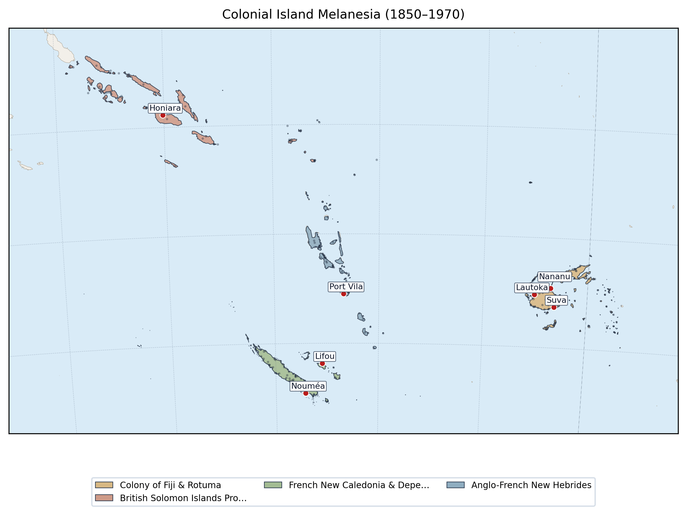

```{r setup, include=FALSE}
knitr::opts_chunk$set(echo = FALSE, warning = FALSE, message = FALSE, fig.pos = "htbp")
source("../../_shared/template/viscount_rmd_helpers.R")
library(jsonlite)

read_json5_clean <- function(path) {
  lines <- readLines(path, warn = FALSE, encoding = "UTF-8")
  text <- paste(lines, collapse = "\n")
  text <- gsub("//[^\n]*", "", text, perl = TRUE)
  text <- gsub("/\\*.*?\\*/", "", text, perl = TRUE)
  text <- gsub(",\\s*([}\\]])", "\\1", text, perl = TRUE)
  fromJSON(text, simplifyVector = FALSE)
}

summary_data <- fromJSON("colonial_island_melanesia_summary_cache.json", simplifyVector = FALSE)
sett_data <- fromJSON("colonial_island_melanesia_settlements.json", simplifyVector = FALSE)
ledger_data <- read_json5_clean("colonial_island_melanesia_source_ledger.json5")

clean_label <- function(x) {
  s <- as.character(x)
  s <- gsub("&", "and", s, fixed = TRUE)
  s <- gsub(" / ", ", ", s, fixed = TRUE)
  s <- gsub("\\\\", "", s)
  trimws(s)
}

subregions <- summary_data$subregions
sub_coverage <- ledger_data$saturation_audit$submask_coverage

tot_1850 <- as.numeric(summary_data$domain_totals[["1850"]])
tot_1887 <- as.numeric(summary_data$domain_totals[["1887"]])
tot_1900 <- as.numeric(summary_data$domain_totals[["1900"]])
tot_1931 <- as.numeric(summary_data$domain_totals[["1931"]])
tot_1946 <- as.numeric(summary_data$domain_totals[["1946"]])
tot_1966 <- as.numeric(summary_data$domain_totals[["1966"]])
tot_1970 <- as.numeric(summary_data$domain_totals[["1970"]])
tot_area <- as.numeric(summary_data$total_area_km2)
n_sites <- as.integer(summary_data$settlement_count)
n_obs <- as.integer(summary_data$observation_count)
```

```{r hero-md-fallback, results='asis'}
if (!knitr::is_latex_output()) {
  cat("\n\n")
}
```

# Abstract

Between 1850 and 1970, the four colonial territories of Island Melanesia — the British Solomon Islands Protectorate, the Anglo-French Condominium of the New Hebrides, French New Caledonia and the British Crown Colony of Fiji and Rotuma — passed through one of the steepest demographic troughs and sharpest structural transformations in the modern Pacific. Across a coastal-inclusive archipelagic mask of 152.706 km² (roughly 75,1k km² of terrestrial land), aggregate population fell 18,6% from 435k in 1850 to a regional nadir of 354,3k in 1900 under the combined assault of virgin-soil measles and dysentery epidemics, Melanesian plantation recruitment and colonial land expropriation [@mcarthur1967island; @shlomowitz1987mortality; @rallu1990populations]. Recovery remained slow through the interwar depression (385,7k in 1931) before accelerating after 1945 as antibiotics, yaws and malaria suppression and sustained natural increase lifted total numbers to 484,8k in 1946, 791,9k in 1966 and 816,3k at Fiji's independence threshold in 1970 (1,88 times the 1850 level, averaging 5,346 inhabitants per km² of mask area). Aggregate growth masked dramatic divergence among the four jurisdictions. Fiji more than tripled from 145k to 476,7k (58,4% of the entire region by 1970) after the arrival of 60.965 Indian indentured labourers between 1879 and 1916 created an Indo-Fijian majority alongside a recovering Indigenous iTaukei population [@lal1983girmitiyas; @zwart1968report]. New Caledonia climbed from 65k to 100,6k (after touching 47,5k in 1921) as French penal settlement, Tonkinese and Javanese mining contracts and a postwar nickel boom reshaped Grande Terre, while the British Solomons rebounded from 94,1k in 1931 to 161,0k in 1970 [@groenewegen1972report; @bradley2023decolonisati]. Only the New Hebrides failed to regain its mid-nineteenth-century size, recovering from an estimated 45k in 1935 to 78,0k in 1967 — still 32,2% below its 1850 baseline of 115k [@mcarthur1968condominium; @mcarthur1981new]. Drawing on primary colonial censuses, Historical GIS polygon regimes and 73 catalogued settlements carrying 233 chronological observations, this study charts how colonial epidemics, indentured labour systems and Pacific War base construction forged Island Melanesia's primate port hierarchy led by Suva (54,2k), Nouméa (41,9k), Lautoka (11,3k), Honiara (11,2k) and Port Vila (7,7k).

# Background

## Pre-Colonial Baseline and Imperial Partition (1850 to 1906)

At the middle of the nineteenth century, Island Melanesia comprised an intricate archipelago of autonomous horticultural chiefdoms, maritime exchange systems and deeply fragmented linguistic communities stretching from the Shortland Islands to the Lau Group. Ancient DNA sequences from Vanuatu and neighbouring archipelagos confirm that this diversity rested on three millennia of Remote Oceanic settlement, in which initial Lapita voyagers were joined by subsequent Papuan-associated migrations without erasing Austronesian linguistic continuity [@posth2018language]. By 1850, roughly 435k people inhabited the four island groups later carved into British and French dependencies: about 145k across Fiji and Rotuma, 115k across the New Hebrides, 110k across the Solomon Islands and 65k across New Caledonia and the Loyalty Islands [@mcarthur1967island; @rallu1990populations; @mcarthur1981new].

European commercial penetration preceded formal annexation by several decades. Sandalwood cutters, bêche-de-mer traders, whalers and Christian missionaries established early beachhead stations at Balade, Aneityum, Tanna, Levuka and Bau during the 1840s and 1850s, introducing iron tools, muskets and unfamiliar respiratory and enteric pathogens along coastal trade routes [@mcarthur1967island; @shineberg1999people]. Imperial partition then unfolded across half a century of Anglo-French rivalry. France proclaimed sovereignty over New Caledonia in September 1853 to secure a Pacific naval station and penal outlet, annexing the Loyalty Islands in 1864 [@rallu1990populations; @okhrimenko2012french]. Britain accepted the Deed of Cession from Ratu Seru Epenisa Cakobau and senior Fijian chiefs in October 1874, adding Polynesian Rotuma as a dependency in 1881 [@mcarthur1967island; @fonmanu1999dispute]. In 1893 Britain declared the British Solomon Islands Protectorate over the southern Solomons, expanding northward in 1898 to 1900 after the Anglo-German Samoa settlement transferred Santa Isabel, Choiseul, the Shortlands and Ontong Java from German New Guinea while leaving Bougainville under German rule [@groenewegen1972report]. Finally, London and Paris resolved competing settler and missionary claims over the New Hebrides by creating the Anglo-French Condominium in 1906, an unwieldy dual administration that delayed territory-wide demographic enumeration for another six decades [@mcarthur1968condominium; @bedford1973new].

## Virgin-Soil Epidemics and the Depopulation Controversy

The first seven decades of colonial contact produced severe Indigenous population decline across every archipelago in Island Melanesia, triggering intense alarm among colonial officials, missionaries and anthropologists. Nowhere was the initial shock sharper than in newly ceded Fiji. In January 1875, HMS *Dido* returned Cakobau and his entourage from a state visit to Sydney carrying measles; because chiefs assembled from across Viti Levu, Vanua Levu and the outer islands at Levuka to greet their high chief, the virus spread simultaneously into almost every coastal and interior province [@mcarthur1967island]. With no prior immunity and simultaneous household illness crippling nursing and garden harvesting, roughly 40k Fijians — between one-quarter and one-third of the Indigenous population — died within four months, reducing Fiji to 127.486 inhabitants by the first formal colonial census of 1881 [@mcarthur1967island; @zwart1968report]. Subsequent waves of dysentery, whooping cough, dengue and the 1918–1919 influenza pandemic kept Indigenous iTaukei numbers falling until a nadir near 84,5k in 1921 [@mcarthur1967island].

Comparable epidemic collapses struck southern and central Melanesia. On Aneityum in the southern New Hebrides, missionary censuses recorded 3.513 residents in 1848 before a catastrophic 1861 measles and dysentery outbreak cut Anelgauhat and surrounding districts to 2.200, launching a long slide to barely 218 survivors by 1930 [@mcarthur1981new; @mcarthur1967island]. Across Erromango, Efate, Malakula, Espiritu Santo and the Banks Islands, successive coastal epidemics combined with endemic malaria to empty fertile lowland valleys [@mcarthur1981new; @gajdusek1985journal]. In New Caledonia, Kanak numbers declined from roughly 60k–65k at annexation to fewer than 28k by 1921, battered by smallpox, measles, tuberculosis, land dispossession and military suppression of the 1878 rebellion led by High Chief Ataï and the 1917 northern uprising [@rallu1990populations; @lindenmann2014blood].

In 1922, the British anthropologist and physician W. H. R. Rivers edited *Essays on the Depopulation of Melanesia*, a landmark survey of the Solomon Islands and New Hebrides that weighed introduced diseases, firearm warfare and labour recruitment against what Rivers termed a collective psychological "loss of interest in life" caused by the destruction of Indigenous custom [@rivers1922essays]. Half a century later, historical demographer Norma McArthur systematically dismantled both the apocalyptic nineteenth-century population guesses and Rivers's purely psychological thesis. Re-auditing missionary headcounts, colonial patrol logs and early censuses across Fiji and the New Hebrides, McArthur demonstrated that pre-contact island totals had often been exaggerated by European observers, while real declines of 30% to 60% stemmed directly from measurable biological shocks: acute virgin-soil epidemics, skewed age-sex pyramids after male labour recruitment and chronic bacterial and malarial morbidity [@mcarthur1967island; @mcarthur1981new; @rallu1990populations].

## Indenture, the Pacific Labour Trade and Asian Contract Migration

Colonial capitalism did not merely witness Melanesian depopulation; it actively redistributed labour across borders through two vast indentured migration systems that remade the ethnic map of the southwest Pacific. Between 1863 and 1904, labour vessels operating from Queensland, Fiji, Samoa and New Caledonia recruited well over 100k Pacific Islanders — predominantly young men from the New Hebrides, the Solomon Islands (especially Malaita) and the Loyalty Islands — to clear and harvest sugar cane, cotton and copra plantations [@shlomowitz1987mortality; @shineberg1999people; @bedford1973new]. While early voyages involved overt kidnapping ("blackbirding"), later decades evolved into regulated circular labour migration whose descendants' mobility pathways still echo in contemporary Pacific seasonal work in rural Australia [@bedford1973new; @dun2018recognising]. Demographic costs were nevertheless heavy. Ralph Shlomowitz showed that immunologically naive Melanesian recruits suffered extraordinary crude death rates during their first year on overseas plantations — frequently exceeding 50 to 80 deaths per thousand annually from bacillary dysentery, pneumonia and tuberculosis — while prolonged male absences depressed fertility in home villages across Malakula, Ambrym, Pentecost and Malaita [@shlomowitz1987mortality; @rivers1922essays]. Dorothy Shineberg likewise documented how French planters and mining firms drew thousands of New Hebridean and Loyalty Islander workers into New Caledonia between 1865 and 1930, exposing them to harsh camp mortality and altering island sex ratios across both territories [@shineberg1999people].

In Fiji, Britain's first substantive governor, Sir Arthur Gordon, deliberately shielded Indigenous iTaukei society from plantation alienation after the 1875 measles catastrophe. Restricting commercial recruitment of Fijian villagers and codifying inalienable customary ownership over roughly 83% of the colony's land under *mataqali* clan estates [@fonmanu1999dispute], Gordon turned instead to British India to supply the Colonial Sugar Refining Company (CSR) and European estates. Between the arrival of the *Leonidas* in May 1879 and the cessation of indentured emigration in 1916 (with all remaining contracts cancelled in January 1920), 60.965 Indian *girmitiyas* sailed to Fiji under five-year agreements [@lal1983girmitiyas; @kataoka2022reconceptual]. Brij V. Lal's quantitative analysis of emigration passes established that roughly three-quarters embarked from Calcutta — drawn overwhelmingly from eastern United Provinces and western Bihar — with the remainder recruited through Madras after 1903, governed by a statutory quota of 40 women per 100 men [@lal1983girmitiyas]. Although around 24k repatriated, the majority remained as free cane-farming tenants around Lautoka, Ba, Nadi, Labasa, Rakiraki, Nausori and Navua, or settled as artisans and merchants in Suva [@lal1983girmitiyas; @khan2011study; @stevens2022supreme]. By 1946, Indo-Fijians outnumbered Indigenous iTaukei inside Fiji for the first time, entrenching a dual society of customary iTaukei villages and commercial Indo-Fijian sugar belts and towns [@zwart1968report; @robie2007paradox].

French New Caledonia followed an equally distinctive settler-and-contract-labour path. Between 1864 and 1897, Paris transported roughly 22k convicts (*bagnards*) alongside 4.000 Paris Commune political deportees to Île Nou, Bourail, La Foa and the Île des Pins, encouraging liberated prisoners and free French colonists to occupy confiscated Kanak river valleys while confining Indigenous tribes to shrinking *cantonnement* reserves [@rallu1990populations; @cassourret2024development; @lindenmann2014blood]. Once Garnier's discovery of garnierite launched industrial nickel mining around Thio and Nouméa under Société Le Nickel (SLN) in the late 1870s, chronic labour shortages prompted authorities to import successive waves of Japanese, Javanese and Tonkinese (northern Vietnamese) indentured miners and plantation hands [@rallu1990populations; @okhrimenko2012french]. Peak interwar Asian contract arrivals temporarily pushed New Caledonia's population up to 57,2k in 1931 before Great Depression repatriations lowered it to 53,2k in 1936, foreshadowing the postwar influx of metropolitan French, Wallisian and French Polynesian migrants who turned Kanaks into a minority inside their own territory [@rallu1990populations; @bradley2023decolonisati; @duffield2019new].

## The Pacific War, Public Health and the Decolonisation Threshold

The Second World War jolted Island Melanesia out of interwar demographic stagnation and redrew its urban geography overnight. Following the Japanese advance into the Solomon Islands in 1942, Allied forces transformed New Caledonia (Nouméa and Tontouta), Efate (Port Vila), Espiritu Santo (Base Buttons at Segond Channel) and Guadalcanal into vast staging bases housing hundreds of thousands of American and Allied personnel [@bedford1973new; @groenewegen1972report]. Heavy fighting destroyed Tulagi, the tiny island capital of the British Solomon Islands since 1896; in 1945 the Protectorate transferred its headquarters across Iron Bottom Sound to Honiara on Guadalcanal, inheriting American wharves, roads, quonset huts and Henderson Airfield [@groenewegen1972report]. Similarly, wartime American airfields, wharves and paved avenues on Espiritu Santo created Luganville, instantaneously giving the northern New Hebrides a second urban centre alongside Port Vila [@mcarthur1968condominium; @bedford1973new].

After 1945, public health interventions finally broke Island Melanesia's colonial mortality ceiling. Mass penicillin campaigns eliminated endemic yaws across rural Solomon Islands and New Hebrides villages during the 1950s; residual DDT spraying and anti-malarial clinics curtailed infant mortality; and hospital networks expanded outward from Suva, Nouméa, Honiara and Port Vila [@gajdusek1985journal; @groenewegen1972report; @mcarthur1968condominium]. Political reforms paralleled demographic rebound. In 1946 France abolished the colonial *indigénat* code, granting Kanaks French citizenship and freedom of movement off reserves — initiating rural-to-urban drift toward Nouméa and educational links to mainland France [@cassourret2024development; @gallo2026kanak]. Between 1946 and 1970, Island Melanesia's aggregate population jumped 68,4% from 484,8k to 816,3k. By October 1970, when Fiji became the first of the four territories to achieve independence (followed by Solomon Islands in 1978 and Vanuatu in 1980, while New Caledonia remained within the French Republic), colonial demography had permanently altered every island group's ethnic composition, urban hierarchy and land-tenure politics [@robie2007paradox; @bradley2023decolonisati; @duffield2019new].

# Methodology

## Four-Jurisdiction Colonial Regionalisation

Colonial Island Melanesia is partitioned into the four distinct imperial jurisdictions governing the region between 1850 and 1970. Unlike continental regions where administrative boundaries bisected continuous river basins, colonial boundaries in Island Melanesia followed archipelagic groupings already separated by deep oceanic channels, even where late-nineteenth-century diplomatic bargains split geographical chains — most notably placing Bougainville inside German New Guinea and later Australian Papua New Guinea rather than the British Solomon Islands Protectorate.

The four areal mask sub-regions encompass 152.706,3 km² of coastal-inclusive archipelagic surface: the British Solomon Islands Protectorate (51.475,3 km², including Santa Cruz and Temotu alongside Polynesian outliers Tikopia, Anuta, Rennell and Bellona), the Colony of Fiji and Rotuma (38.723,3 km²), French New Caledonia and Dependencies (34.896,9 km², covering Grande Terre, Île des Pins and the Loyalty Islands of Lifou, Maré, Ouvéa and Tiga) and the Anglo-French New Hebrides (27.610,8 km², from the Torres and Banks Islands south to Aneityum). Because coastal-inclusive raster masks incorporate reef lagoons, narrow straits and shoreline edge cells across dispersed islands, mask areas exceed strictly terrestrial polygon areas (approximately 75.078 km² across the four territories in 1960) by roughly a factor of two. All regional benchmark tables report mask-based densities to preserve exact parity with spatial raster models while noting terrestrial land densities explicitly in text.

## Benchmark Calibration, Primary Censuses and Historical GIS Layers

Regional population trajectories are anchored on seven cross-territorial benchmark years — 1850, 1887, 1900, 1931, 1946, 1966 and 1970 — reconciling four overlapping streams of archival evidence. First, official decennial and special colonial censuses anchor the late-nineteenth and twentieth-century trajectory directly: Fiji's uninterrupted census sequence from 1881 (127.486) through 1966 (476.727, including Rotuma's dedicated series from 1921 onward) [@mcarthur1967island; @zwart1968report]; New Caledonia's territorial enumerations from 1887 (62.500 to 62.752) through 1969 (100.579) [@rallu1990populations]; the British Solomon Islands Protectorate censuses of 1931 (94.066), 1959 (124.076) and 1970 (160.998) [@groenewegen1972report]; and the New Hebrides Condominium's inaugural 1967 census (77.988) [@mcarthur1968condominium].

Second, for pre-census decades (1850 to 1881 in Fiji, 1850 to 1887 in New Caledonia, 1850 to 1931 in the Solomon Islands and 1850 to 1967 in the New Hebrides), regional estimates triangulate missionary island enumerations, district patrol reports, labour-trade mortality audits and retrospective demographic reconstructions [@mcarthur1967island; @mcarthur1981new; @shlomowitz1987mortality; @rallu1990populations]. Between primary territory anchors, intermediate benchmark years use smooth compound interpolation rather than linear jumps, preserving the asynchronous timing of each archipelago's demographic nadir: 1901 in Fiji, 1921 in New Caledonia, 1931 in the Solomon Islands and 1935 in the New Hebrides.

Third, demographic totals are linked to seven Historical GIS (HGIS) polygon snapshot regimes spanning 1860, 1890, 1900, 1910, 1920, 1950 and 1960 (49 polygon-year records across colonial territory polygons and 24 first-level administrative divisions at 1960). Continuous decadal and quinquennial spatial rasters (15 slices from 1850 to 1970) disaggregate territory populations according to coastal accessibility, agricultural valley productivity and catalogued town coordinates.

## Evidence-Based Settlement Gazetteer Protocol

Urbanisation and colonial port emergence are documented in a companion gazetteer of `r viscount_fmt_number(n_sites, 0L)` catalogued towns, mining settlements, sugar-mill hubs, colonial stations and Indigenous island centres carrying `r viscount_fmt_number(n_obs, 0L)` dated demographic observations between 1850 and 1970. Every candidate record passed through four documented ingestion waves in the chapter source ledger. Wave 1 compiled 29 urban centres directly from primary colonial censuses (Fiji Bureau of Statistics and Colonial Census Office, ISEE/INSEE New Caledonia, British Solomon Islands Protectorate and New Hebrides Condominium). Wave 2 added 43 historically attested mining camps, sugar towns, mission stations and island chiefdom centres from peer-reviewed Pacific history and anthropology monographs. Wave 3 executed longitudinal toponymy harmonisation and 25 km spatial deduplication, consolidating eight variant or colonial-prefixed aliases (Lautoka Colonial, Levuka variant, Labasa Colonial, Nausori Colonial, Vatukoula Colonial, Auki Colonial, Gizo Colonial and Motusa merged into Ahau) into their canonical parent entities. Wave 4 completed a sub-regional coverage sweep adding one final station (marginal gain 1,39%), leaving zero empty colonial jurisdictions, zero unaccounted candidates and 0,0% reliance on crowd-sourced fallback registries.

# Testing and Validation

## Cross-Checks Against Primary Colonial Censuses and Archival Surveys

Benchmark series were audited against primary colonial statistical reports and modern demographic reconstructions across all four territories. In Fiji, our 1850 estimate of 145k sits squarely inside Norma McArthur's pre-measles reconstruction (roughly 135k to 150k), reconciling the catastrophic 1875 death toll of approximately 40k with the verified 1881 census floor of 127.486 [@mcarthur1967island]. Subsequent colonial benchmark figures reproduce official Fijian enumerations directly, rising from 157.266 in 1921 and 259.638 in 1946 to 476.727 in 1966 [@zwart1968report]. In French New Caledonia, our 1850 baseline of 65k aligns with Jean-Louis Rallu's critical audit of early French naval estimates while avoiding inflated mid-nineteenth-century guesses exceeding 100k; from 1887 (62.752) through 1921 (47.505), 1956 (68.480) and 1969 (100.579), the series matches ISEE territorial census returns within rounding tolerances [@rallu1990populations].

In the British Solomon Islands, where full enumeration arrived only in 1931, our 1850 baseline of 110k implies a moderate 14,5% net decline to 94.066 in 1931 — far less catastrophic than the New Hebrides because populous inland Malaita resisted early epidemic penetration and retained a high rural fertility core despite heavy Queensland and Fiji labour recruitment [@shlomowitz1987mortality; @groenewegen1972report]. By contrast, our New Hebrides trajectory — falling 60,9% from 115k in 1850 to 62k in 1900 and a 1935 trough of 45k before rebounding to 77.988 in the 1967 census — reflects McArthur's 1981 re-interpretation and Richard Bedford's mobility archives, which confirm severe multi-decade depopulation across Aneityum, Erromango, Efate, Malakula and the Banks Islands alongside partial stability on Tanna and Ambrym [@mcarthur1981new; @mcarthur1968condominium; @bedford1973new; @gajdusek1985journal].

## Sub-Regional Benchmark Coherence and Raster Diagnostics

Table \ref{tab:subregion-benchmarks} summarises the cross-territorial benchmark ledger across all four colonial jurisdictions from 1850 to 1970 alongside 1970 mask-based densities. Every jurisdiction exhibits the classic Melanesian U-shaped colonial curve — contraction during the nineteenth and early twentieth centuries followed by postwar expansion — yet with sharply different trough depths and recovery multiples.

```{r tab-subregion-benchmarks, results='asis'}
rows <- lapply(subregions, function(r) {
  a <- as.numeric(r$area_km2)
  p1850 <- as.numeric(r$population[["1850"]])
  p1900 <- as.numeric(r$population[["1900"]])
  p1931 <- as.numeric(r$population[["1931"]])
  p1970 <- as.numeric(r$population[["1970"]])
  d1970 <- as.numeric(r$end_epoch_density_km2)
  data.frame(
    Subregion = clean_label(r$name),
    Area = viscount_fmt_number(round(a), 0L),
    P1850 = viscount_fmt_pop(p1850),
    P1900 = viscount_fmt_pop(p1900),
    P1931 = viscount_fmt_pop(p1931),
    P1970 = viscount_fmt_pop(p1970),
    Dens = viscount_fmt_number(d1970, 3L),
    stringsAsFactors = FALSE
  )
})
df_bench <- do.call(rbind, rows)
df_tot <- data.frame(
  Subregion = "Island Melanesia Total (4 Jurisdictions)",
  Area = viscount_fmt_number(round(tot_area), 0L),
  P1850 = viscount_fmt_pop(tot_1850),
  P1900 = viscount_fmt_pop(tot_1900),
  P1931 = viscount_fmt_pop(tot_1931),
  P1970 = viscount_fmt_pop(tot_1970),
  Dens = viscount_fmt_number(tot_1970 / tot_area, 3L),
  stringsAsFactors = FALSE
)
df_bench <- rbind(df_bench, df_tot)
rownames(df_bench) <- NULL

viscount_table(
  df_bench,
  "Population headcounts across four colonial jurisdictions of Island Melanesia from 1850 to 1970, with 1970 mask-based density (inhabitants per km²).",
  c("Colonial Jurisdiction", "Area (km²)", "1850", "1900", "1931", "1970", "1970 Dens."),
  list(label = "tab:subregion-benchmarks", font_size = "scriptsize")
)
```

Auditing the benchmark ledger against the Historical GIS polygon regimes and continuous spatial rasters exposes two instructive technical diagnostics. Between 1850 and 1950, territory-level OpenHistoricalMap polygon sums and continuous rasters track the colonial benchmark series tightly: in 1850 the spatial raster totals 440,1k against the 435k benchmark (+1,2%); in 1900 it stands at 361,0k against 354,3k (+1,9%); in 1930 it records 382,7k against 385,7k in 1931; and in 1950 the HGIS aggregate (527.212) and spatial raster (527.609) agree within 0,08%. At the 1860 snapshot, the HGIS polygon sum (449.326) temporarily exceeds the four-jurisdiction raster (419.564) because the pre-partition Solomon Islands archipelago polygon (37.616 km², 133.510 inhabitants) still encompassed Bougainville before the 1899 Anglo-German border division narrowed the BSIP terrestrial footprint to 28.496 km².

A much larger step discontinuity appears in 1960, when the spatial pipeline switches from four colonial territory polygons to 24 post-independence first-level administrative divisions (five divisions in Fiji, ten provinces in Solomon Islands, six provinces in Vanuatu and three provinces in New Caledonia). While the ten Solomon Islands administrative polygons reproduce the 1970 BSIP census closely (160.183 vs 160.998), the Fiji, Vanuatu and New Caledonia division layers carry late-twentieth-century postcolonial back-projected totals (718.740 for Fiji, 111.251 for Vanuatu and a uniform 40.000 per province totalling 120.000 for New Caledonia), pushing the unadjusted 1960 HGIS sum to 1,11M and the 1960–1970 raster grid to 1,10M. The primary colonial census ledger in Table \ref{tab:subregion-benchmarks} (791,9k in 1966 and 816,3k in 1970) therefore strictly supersedes the unadjusted 1960 ADM1 raster totals for historical population accounting while retaining the ADM1 layers for internal spatial disaggregation.

# Results

## Regional Demographic Trajectory (1850 to 1970)

Across the 120 years from 1850 to 1970, Island Melanesia's population multiplied 1,88-fold from 435k to 816,3k, averaging 0,526% annual growth over the entire colonial span (Figure \ref{fig:melanesia-trajectory}). That modest net rate conceals two opposite demographic eras separated by the turn of the twentieth century. During the half-century of colonial partition and virgin-soil epidemics from 1850 to 1900, regional numbers contracted by 80,7k (-18,6%, or -0,410% per annum), falling to 365,8k by 1887 and hitting a benchmark trough of 354,3k in 1900 (with the continuous raster dipping slightly further to 353,1k in 1920 as the influenza pandemic struck) [@mcarthur1967island; @rivers1922essays; @rallu1990populations].

```{r fig-trajectory, results='asis'}
viscount_figure(
  "figures/colonial_island_melanesia_population_trajectory.png",
  "Aggregate and jurisdictional demographic trajectories across Colonial Island Melanesia from 1850 to 1970 (Panel A) alongside 1970 mask-based densities (Panel B).",
  "fig:melanesia-trajectory"
)
```

Recovery unfolded in two distinct gears. Between 1900 and 1931, aggregate numbers edged up by only 31,4k (+8,9%, or 0,274% per annum) to 385,7k because Indo-Fijian expansion in Fiji barely offset continuing Indigenous contraction in the New Hebrides, New Caledonia and parts of the Solomons [@mcarthur1967island; @lal1983girmitiyas]. Between 1931 and 1946, growth accelerated to 1,536% annually, lifting the region by 99,1k to 484,8k and finally surpassing the 1850 pre-colonial baseline during the early 1940s. After the Second World War, Island Melanesia entered a full demographic boom: between 1946 and 1966, aggregate population surged by 307,1k (+63,3%, or 2,485% per annum) to 791,9k, climbing further to 816,3k in 1970 as 1969 New Caledonian and 1970 Solomon Islands censuses registered accelerating natural increase [@zwart1968report; @groenewegen1972report; @mcarthur1968condominium]. Table \ref{tab:hgis-regimes} tracks the HGIS polygon regimes across 1860 to 1960, showing terrestrial land densities dipping from 5,30 inhabitants per km² in 1860 to 4,79 in 1920 before climbing to 7,16 in 1950 (and reflecting the 1960 ADM1 spatial reclassification noted above).

```{r tab-hgis-regimes, results='asis'}
regimes <- unique(vapply(summary_data$hgis_regime_summary, function(h) as.integer(h$snapshot_regime), integer(1)))
regimes <- sort(regimes)

h_rows <- lapply(regimes, function(yr) {
  sub_h <- Filter(function(x) identical(as.integer(x$snapshot_regime), yr), summary_data$hgis_regime_summary)
  units_sum <- sum(vapply(sub_h, function(x) as.integer(x$units), integer(1)))
  area_sum <- sum(vapply(sub_h, function(x) as.numeric(x$area_km2_sum), numeric(1)))
  pop_sum <- sum(vapply(sub_h, function(x) as.numeric(x$population_sum), numeric(1)))
  data.frame(
    Regime = as.character(yr),
    Units = viscount_fmt_number(units_sum, 0L),
    Area = viscount_fmt_number(round(area_sum), 0L),
    Pop = viscount_fmt_number(round(pop_sum), 0L),
    Dens = viscount_fmt_number(pop_sum / area_sum, 2L),
    stringsAsFactors = FALSE
  )
})
df_hgis <- do.call(rbind, h_rows)
rownames(df_hgis) <- NULL

viscount_table(
  df_hgis,
  "Historical GIS polygon regime totals and terrestrial land densities across Island Melanesia, 1860 to 1960 (1860 includes Bougainville; 1960 reflects 24 modern ADM1 polygons).",
  c("Snapshot Regime", "Polygon Units", "Land Area (km²)", "Aggregate Pop.", "Land Density"),
  list(label = "tab:hgis-regimes", font_size = "scriptsize")
)
```

Because Fiji expanded far faster than the three western Melanesian archipelagos, the regional balance of population tilted decisively eastward across the colonial century (Table \ref{tab:regional-shares}). In 1850, Fiji held exactly one-third (33,3%) of Island Melanesia's inhabitants, closely matched by the New Hebrides (26,4%) and Solomon Islands (25,3%), with New Caledonia trailing at 14,9%. By 1900, Fiji's share had risen to 39,8% as New Hebridean numbers fell sharply to 17,5%. By 1970, Fiji commanded 58,4% of the regional total — more than the Solomon Islands (19,7%), New Caledonia (12,3%) and New Hebrides (9,6%) combined.

```{r tab-regional-shares, results='asis'}
sh_rows <- lapply(subregions, function(r) {
  a <- as.numeric(r$area_km2)
  p1 <- as.numeric(r$population[["1850"]])
  p2 <- as.numeric(r$population[["1900"]])
  p3 <- as.numeric(r$population[["1970"]])
  sc <- as.integer(sub_coverage[[r$id]])
  sdens <- if (a > 0) (sc / a) * 10000 else 0
  data.frame(
    Subregion = clean_label(r$name),
    Sh1850 = paste0(viscount_fmt_number(100 * p1 / tot_1850, 1L), "%"),
    Sh1900 = paste0(viscount_fmt_number(100 * p2 / tot_1900, 1L), "%"),
    Sh1970 = paste0(viscount_fmt_number(100 * p3 / tot_1970, 1L), "%"),
    Growth = paste0(viscount_fmt_number(p3 / p1, 2L), "x"),
    Sites = viscount_fmt_number(sc, 0L),
    SiteDens = viscount_fmt_number(sdens, 2L),
    stringsAsFactors = FALSE
  )
})
df_shares <- do.call(rbind, sh_rows)
rownames(df_shares) <- NULL

viscount_table(
  df_shares,
  "Jurisdictional shares of Island Melanesian population (1850, 1900 and 1970), 1850 to 1970 growth multiples and catalogued settlement density per 10.000 km² of mask area.",
  c("Colonial Jurisdiction", "1850 Share", "1900 Share", "1970 Share", "Multiple", "Sites", "Sites per 10k km²"),
  list(label = "tab:regional-shares", font_size = "scriptsize")
)
```

## The Colony of Fiji and Rotuma: Measles, Girmitiyas and Dual Demography

Fiji's demographic history from 1850 to 1970 was the great structural engine of Colonial Island Melanesia, multiplying 3,29-fold from 145k to 476.727 (12,311 inhabitants per km² across the coastal mask, or roughly 31,1 per km² on its 15.334 km² terrestrial footprint). That expansion passed through a harrowing nineteenth-century crucible. After the 1875 measles epidemic killed roughly 40k Indigenous Fijians, total colony population fell from 127.486 in 1881 to 121.180 in 1891 and hit a census low of 120.124 in 1901 as iTaukei mortality continued to outstrip early Indian immigration [@mcarthur1967island]. Traditional chiefly capitals felt the shock immediately: Bau, seat of the Kubuna Confederacy, fell from 2.600 inhabitants in 1860 to 1.120 in 1881, while Cakobau's commercial port of Levuka on Ovalau peaked at 2.150 in 1871 before stagnating around 1.180 to 1.944 once Governor George Des Voeux moved the colonial capital to Suva's deep harbour on Viti Levu in 1882 [@mcarthur1967island; @stevens2022supreme].

From 1901 onward, Fiji's curve turned decisively upward, powered first by Indian indenture and then by high natural increase among both major communities. Between 1879 and 1916, 60.965 *girmitiyas* entered the colony to work the sugar estates of the Colonial Sugar Refining Company and smaller mills [@lal1983girmitiyas; @kataoka2022reconceptual]. Following the end of indenture in 1920, Indo-Fijian families leased smallholder cane plots across western Viti Levu and northern Vanua Levu under Native Land Trust arrangements that preserved iTaukei communal ownership over 83% of the islands [@fonmanu1999dispute; @khan2011study]. Colonial censuses charted rapid acceleration: 139.541 in 1911, 157.266 in 1921, 198.379 in 1936, 259.638 in 1946, 345.737 in 1956 and 476.727 in 1966 [@zwart1968report; @mcarthur1967island]. By 1966, Indo-Fijians numbered 240.960 (50,5% of the colony) compared with 202.176 Indigenous iTaukei (42,4%), establishing the ethnic and residential bifurcation that defined Fiji at independence in 1970 and left enduring socioeconomic and public-health contrasts between rural/coastal iTaukei villages and urban/cane-belt Indo-Fijian communities [@zwart1968report; @robie2007paradox; @peden2026uncovering; @repository2016income].

Urban growth mirrored this dual geography. Suva ballooned 77-fold from 700 inhabitants in 1881 to 7.788 in 1911, 25.395 in 1946 and 54.157 in 1966, becoming Island Melanesia's undisputed metropolitan capital with cosmopolitan European, Indo-Fijian, iTaukei, Pacific Islander and Chinese neighbourhoods [@stevens2022supreme; @zwart1968report]. Across the dry cane belt of Western and Northern Divisions, sugar-mill and transport towns expanded briskly: Lautoka (founded around the 1903 CSR mill) surged from 980 in 1903 to 11.287 in 1966, Ba reached 3.849, Nadi grew to 2.542 around its international airport and cane plains, Labasa on Vanua Levu (CSR mill 1894) grew from 810 to 2.182, Nausori (Rewa mill 1882) reached 1.944, Rakiraki (Penang mill 1881) reached 1.620 and Navua stood at 1.595. Meanwhile, the Emperor Gold Mine founded in 1933 created Vatukoula, Fiji's premier mining town, which climbed rapidly from 1.480 in 1936 to a peak of 5.045 in 1956 (4.993 in 1966). Far to the north, the Polynesian dependency of Rotuma (centred on Ahau) weathered early epidemics more resiliently than mainland Fiji, dipping modestly from 2.452 in 1881 to 2.112 in 1921 before rising steadily to 3.235 in 1966 [@mcarthur1967island; @zwart1968report].

## French New Caledonia: Penal Settlement, Kanak Containment and the Nickel Boom

New Caledonia followed a stark settler-colonial demographic arc, expanding 1,55-fold across 120 years from 65k in 1850 to 100.579 in 1969 (2,882 inhabitants per km² across the mask, or 5,35 per km² on 18.810 km² of land). Beneath that modest net gain lay a dramatic compositional inversion. Indigenous Kanak society suffered severe nineteenth-century contraction under introduced diseases, penal land seizures on the fertile west coast of Grande Terre, punitive suppression of the 1878 and 1917 rebellions and strict confinement to administrative reserves (*cantonnement*), shrinking from roughly 60k–65k in 1850 to barely 27k–28k by the 1921 territorial nadir of 47.505 total residents [@rallu1990populations; @lindenmann2014blood; @cassourret2024development]. Early Kanak strongholds such as Hienghène (1.820 in 1850 down to 1.340 in 1887) and Balade (980 in 1853 down to 640 in 1887) lost population even as the Loyalty Islands (Wé on Lifou, Tadine on Maré and Fayaoué on Ouvéa), spared European land confiscation as native reserves, maintained sturdier Indigenous populations rising gradually between 1887 and 1956 [@rallu1990populations; @shineberg1999people].

Non-Indigenous immigration repeatedly reshaped the territorial total. French penal convoys (1864 to 1897) and free agricultural colonisation peopled Nouméa (Port-de-France, founded 1854, growing from 6.500 in 1887 to 10.708 in 1931) alongside rural European and penal-farming communes at Bourail (920 in 1870 to 2.433 in 1969), Païta (620 in 1865 to 2.522 in 1969) and La Foa (680 in 1878 to 1.564 in 1969) [@rallu1990populations; @okhrimenko2012french]. Industrial mining drew waves of Pacific Islander, Japanese, Javanese and Tonkinese contract workers to SLN's nickel capital at Thio (840 in 1880 to 1.920 in 1901 and 3.176 in 1969) and the Tiébaghi chrome mines near Koumac (740 in 1902 to 1.420 in 1936), producing an interwar population surge to 57.200 in 1931 followed by a slump to 53.200 in 1936 as Depression-era Asian contracts expired [@shineberg1999people; @rallu1990populations].

After the Second World War, two forces propelled New Caledonia from 62.700 in 1946 and 68.480 in 1956 to 86.519 in 1963 and 100.579 in 1969. First, abolition of the *indigénat* in 1946 and improved rural healthcare sparked vigorous Kanak demographic recovery across northern and east-coast communes such as Houaïlou (1.580 in 1887 to 3.440 in 1969), Canala (1.480 in 1860 to 2.639), Koné (920 in 1885 to 2.483) and Poindimié (1.190 in 1887 to 2.481) [@rallu1990populations; @cassourret2024development; @gallo2026kanak]. Second, the late-1950s and 1960s nickel boom drew massive immigration from metropolitan France, Wallis and Futuna and French Polynesia into Nouméa, which quadrupled from 10.466 in 1946 to 41.853 in 1969 — concentrating 41,6% of the entire territory inside its capital and crystallising the demographic politics that drove New Caledonia's subsequent autonomy and referendum conflicts [@bradley2023decolonisati; @duffield2019new; @okhrimenko2012french].

## British Solomon Islands Protectorate: Labour Drain, Warfare and Honiara

The British Solomon Islands Protectorate expanded 1,46-fold from 110k in 1850 to 160.998 in 1970 (3,128 inhabitants per km² across the mask; 5,65 per km² on 28.496 km² of land), displaying the mildest nineteenth-century trough among the western archipelagos. Nineteenth-century depopulation was real yet geographically uneven: headhunting raids armed with European rifles devastated coastal Santa Isabel, Choiseul and New Georgia during the 1870s and 1880s, while intensive Queensland and Fiji labour recruitment drained young men from Malaita, Guadalcanal and Makira and introduced bacillary dysentery and respiratory infections to coastal hamlets [@rivers1922essays; @shlomowitz1987mortality]. Remote Temotu islands suffered severe localised collapses — Vanikoro (Buma) fell to just 115 inhabitants by 1931 [@groenewegen1972report; @gajdusek1985journal]. Yet populous highland Malaita, along with resilient artificial-island lagoon communities at Langa Langa (2.240 in 1931) and Sulufou (650 in 1900 to 840 in 1970), insulated a deep demographic reservoir, keeping the Protectorate at 95k in 1900 and 94.066 in its first administrative census of 1931 [@groenewegen1972report].

Until 1942, the Solomons remained overwhelmingly rural, anchored by small colonial stations and copra plantation depots: Tulagi served as Protectorate capital from 1896, reaching just 1.240 inhabitants in 1941, flanked by Lever's Pacific Plantations headquarters at Yandina in the Russell Islands (640 in 1912 to 1.715 in 1970), Gizo in the Western District (215 in 1899 to 1.020 in 1970), Auki on Malaita (245 in 1909 to 1.140 in 1959) and Kirakira on Makira (190 in 1918 to 695 in 1970). The 1942–1943 Guadalcanal campaign shattered Tulagi (which shrank to 460 in 1959 and 518 in 1970) and birthed Honiara in 1945 atop Allied wartime port and airfield works. Post-war public health campaigns against yaws and malaria then propelled Protectorate population from 109,1k in 1946 to 124.076 in 1959 and 160.998 in 1970, while Honiara more than tripled from 3.534 in 1959 to 11.191 in 1970 — still just 7,0% of the territory, leaving Malaita (51.722, 32,3% of provincial residents) as the archipelago's demographic backbone [@groenewegen1972report; @gajdusek1985journal].

## Anglo-French New Hebrides: Prolonged Decline and Late Condominium Recovery

Nowhere in Colonial Island Melanesia was demographic contraction deeper or more protracted than in the Anglo-French New Hebrides. Starting near 115k in 1850, the archipelago plunged 46,1% to 62k by 1900 and sank to an estimated nadir of 45k around 1935 — a cumulative loss of over three-fifths — before recovering to 54,4k in 1946 and 77.988 in its inaugural 1967 Condominium census (0,68 times its 1850 total; 2,825 inhabitants per km² across the mask, or 6,27 per km² on 12.438 km² of land) [@mcarthur1981new; @mcarthur1968condominium; @rallu1990populations]. Multiple shocks converged simultaneously across this fragile volcanic arc: sandalwood-era epidemics on Erromango (Ifo) and Aneityum (Anelgauhat, collapsing from 2.200 in 1861 to 218 in 1930); heavy, continuous labour drainage to Queensland, Fiji and French New Caledonia that drew disproportionate cohorts from Efate, Malakula, Epi, Ambrym and the Banks Islands [@shineberg1999people; @shlomowitz1987mortality; @bedford1973new; @dun2018recognising]; intense hyperendemic malaria; and catastrophic geological hazards exemplified by Ambrym's 1913 volcanic eruption, which devastated mission settlements and cut island numbers from 4.200 in 1880 to 2.950 in 1930 (a persistent regional volcanic displacement pattern still evident on Ambae a century later) [@mcarthur1981new; @j2020learning].

Divided Anglo-French Condominium governance further slowed rural medical provision and urban infrastructure until after 1945 [@mcarthur1968condominium; @repository1996working]. Coastal copra plantations and mission posts such as Lamap (Port Sandwich, 380 in 1890 to 785 in 1967), Norsup on Malakula (460 in 1920 to 920 in 1967) and Lolowai on Ambae (290 in 1905 to 615 in 1967) remained modest enclaves, while northern island stations such as Mota in the Banks Islands declined continuously from 940 in 1850 to 342 in 1967 [@gajdusek1985journal; @mcarthur1968condominium]. Urbanisation finally gathered pace after the Second World War around two poles: Condominium capital Port Vila on Efate (7.738 in 1967, flanked by peri-urban Mele at 1.094 and the short-lived French manganese mining town of Forari at 1.142) and wartime-founded Luganville on Espiritu Santo (2.564 in 1967), together housing 13,2% of the archipelago as sustained postwar fertility lifted total numbers toward 80k by 1970 [@mcarthur1968condominium; @bedford1973new].

## Colonial Port Primacy and Census Reconciliation

Colonial rule replaced Island Melanesia's pre-contact network of horizontal coastal chiefdoms with a steep, port-centred urban hierarchy (Figure \ref{fig:melanesia-hierarchy}). Across the upper 36 settlements of our 73-site gazetteer (spanning Suva at 54.157 down to La Foa at 1.564), peak populations follow a classic near-Zipfian power law with slope $\alpha = 0,93$ ($R^2 = 0,93$), steepening across all 73 settlements to $\alpha = 1,00$ ($R^2 = 0,88$) down to Anuta (118) and Vanikoro's Buma (115). Two colonial capitals — Suva (54,2k) and Nouméa (41,9k) — towered over the entire region, together holding 42,6% of the peak headcounts of all 73 catalogued settlements combined, followed by a crisp secondary tier of sugar, mining and wartime-born administrative ports: Lautoka (11,3k), Honiara (11,2k), Port Vila (7,7k), Vatukoula (5,0k), Ba (3,8k), Thio (3,2k) and Luganville (2,6k).

```{r fig-hierarchy, results='asis'}
viscount_figure(
  "figures/colonial_island_melanesia_urban_hierarchy.png",
  "Twelve largest colonial ports, mining towns and island centres (Panel A) and rank-size scaling across 73 catalogued settlements in Island Melanesia, 1850 to 1970 (Panel B).",
  "fig:melanesia-hierarchy"
)
```

Table \ref{tab:colonial-censuses} consolidates the primary official colonial census enumerations underpinning these four jurisdictional series, contrasting the continuous nineteenth-century statistical record of Fiji and New Caledonia with the late-colonial census arrival in the British Solomon Islands (1931) and Anglo-French New Hebrides (1967).

```{r tab-colonial-censuses, results='asis'}
pce <- summary_data$primary_census_enumerations

find_pce <- function(terr, unit_nm, yr) {
  for (rec in pce) {
    if (identical(rec$territory, terr) && identical(rec$unit_name, unit_nm) && identical(as.integer(rec$year), as.integer(yr))) {
      return(as.numeric(rec$population))
    }
  }
  NA_real_
}

fmt_cell <- function(val, yr) {
  if (is.na(val)) return("-")
  paste0(viscount_fmt_number(round(val), 0L), " (", yr, ")")
}

df_cens <- data.frame(
  Territory = c(
    "Colony of Fiji (Total)",
    "Rotuma Dependency (Fiji)",
    "French New Caledonia",
    "British Solomon Islands",
    "Anglo-French New Hebrides"
  ),
  C1 = c(
    fmt_cell(find_pce("fiji", "historical_national_totals", 1881L), 1881L),
    "-",
    fmt_cell(find_pce("new_caledonia", "historical_national_totals", 1887L), 1887L),
    "-",
    "-"
  ),
  C2 = c(
    fmt_cell(find_pce("fiji", "historical_national_totals", 1901L), 1901L),
    "-",
    fmt_cell(find_pce("new_caledonia", "historical_national_totals", 1901L), 1901L),
    "-",
    "-"
  ),
  C3 = c(
    fmt_cell(find_pce("fiji", "historical_national_totals", 1921L), 1921L),
    fmt_cell(find_pce("fiji", "rotuma_historical_series", 1921L), 1921L),
    fmt_cell(find_pce("new_caledonia", "historical_national_totals", 1921L), 1921L),
    fmt_cell(find_pce("solomon_islands", "historical_national_totals", 1931L), 1931L),
    "-"
  ),
  C4 = c(
    fmt_cell(find_pce("fiji", "historical_national_totals", 1946L), 1946L),
    fmt_cell(find_pce("fiji", "rotuma_historical_series", 1946L), 1946L),
    fmt_cell(find_pce("new_caledonia", "historical_national_totals", 1956L), 1956L),
    fmt_cell(find_pce("solomon_islands", "historical_national_totals", 1959L), 1959L),
    "-"
  ),
  C5 = c(
    fmt_cell(find_pce("fiji", "historical_national_totals", 1966L), 1966L),
    fmt_cell(find_pce("fiji", "rotuma_historical_series", 1966L), 1966L),
    fmt_cell(find_pce("new_caledonia", "historical_national_totals", 1969L), 1969L),
    fmt_cell(find_pce("solomon_islands", "historical_national_totals", 1970L), 1970L),
    fmt_cell(find_pce("vanuatu", "historical_national_totals", 1967L), 1967L)
  ),
  stringsAsFactors = FALSE
)
rownames(df_cens) <- NULL

viscount_table(
  df_cens,
  "Primary colonial census enumerations across Island Melanesia by territory and era, 1881 to 1970 (exact census year in parentheses).",
  c("Territory", "1881 to 1887", "1901", "1921 to 1931", "1946 to 1959", "1966 to 1970"),
  list(label = "tab:colonial-censuses", font_size = "scriptsize")
)
```

# Limitations

Four structural uncertainties qualify this colonial demographic synthesis. First, pre-census nineteenth-century baselines in the New Hebrides (prior to 1967) and the British Solomon Islands (prior to 1931) carry unavoidable uncertainty bands of $\pm 15\%$ to $25\%$. Early traders, naval captains and missionaries rarely penetrated mountainous interiors on Malaita, Guadalcanal, Espiritu Santo or Malakula, forcing historical demographers to reconstruct 1850 totals retrospectively from coastal mortality logs, labour-recruiting records and late-colonial age structures [@mcarthur1967island; @mcarthur1981new; @rivers1922essays]. Even in Fiji and New Caledonia, 1850 pre-cession and pre-annexation figures remain reasoned envelopes rather than head-by-head enumerations [@rallu1990populations].

Second, spatial area metrics and late-period raster layers require careful distinction. Because coastal-inclusive archipelagic raster masks (152.706 km²) absorb barrier reefs, lagoons and coastal edge pixels across hundreds of small islands, mask-based densities (5,35 inhabitants per km² in 1970) read roughly half of terrestrial land densities (10,87 per km² on 75.078 km²). Furthermore, as documented in Testing and Validation, the 1960 HGIS transition to 24 post-independence ADM1 divisions embeds later postcolonial population weights in Fiji, Vanuatu and New Caledonia, producing an inflated 1,10M raster step that must be overridden by the verified colonial census total of 816,3k in 1970.

Third, colonial census calendars did not synchronise across imperial administrations. Carrying Fiji's 1966 census (476.727), the New Hebrides's 1967 census (77.988) and New Caledonia's 1969 census (100.579) directly into the 1970 regional column alongside the Solomons's exact 1970 enumeration (160.998) slightly understates true 1970 calendar-year numbers in Fiji and Vanuatu by roughly three to four years of postwar natural increase (roughly 45k to 55k additional inhabitants by December 1970) [@zwart1968report; @mcarthur1968condominium; @groenewegen1972report]. Keeping unextrapolated primary census anchors avoids synthetic inflation while preserving exact auditability against published colonial reports.

Fourth, high circular labour mobility and shifting colonial ethnic classifications complicate local municipal time-series. Tens of thousands of Melanesian plantation labourers, Javanese and Tonkinese contract miners and postwar rural migrants circulated seasonally between island villages and port towns without permanent municipal registration [@shineberg1999people; @bedford1973new; @dun2018recognising]. Similarly, sharp municipal boundary revisions around Suva, Lautoka and Greater Nouméa during the 1950s and 1960s mean that city-proper census totals understate wider peri-urban cane-belt and *tribu*-fringe commuters [@stevens2022supreme; @cassourret2024development].

# Conclusion

Between 1850 and 1970, colonial rule remade both the scale and the human geography of Island Melanesia. An archipelago of roughly 435k people in 1850 endured half a century of virgin-soil measles, dysentery, labour-trade mortality and land dispossession that drove aggregate numbers down 18,6% to 354,3k by 1900 [@mcarthur1967island; @shlomowitz1987mortality; @rallu1990populations]. Yet by 1970, postwar antibiotics, yaws and malaria suppression and sustained immigration had lifted the four jurisdictions to 816,3k — 1,88 times their 1850 baseline and 2,30 times their 1900 trough.

That aggregate rebound divided Island Melanesia along durable colonial fault lines. Fiji's Girmitiya migration (60.965 indentured Indians, 1879 to 1916) and rapid natural increase tripled its population to 476,7k, lifting its regional share from one-third to 58,4% and creating a dual iTaukei and Indo-Fijian society anchored by Suva (54,2k) and the western sugar belt [@lal1983girmitiyas; @zwart1968report; @robie2007paradox]. French New Caledonia grew to 100,6k through penal settlement, Asian contract labour and a 1960s nickel boom that concentrated 41,6% of the territory in Nouméa (41,9k) while reducing Kanaks to a minority [@rallu1990populations; @bradley2023decolonisati]. The British Solomon Islands recovered from 94,1k in 1931 to 161,0k in 1970 around wartime-born Honiara (11,2k) and populous Malaita, whereas the Anglo-French New Hebrides reached 78,0k in 1967 — still nearly one-third below its 1850 starting point [@groenewegen1972report; @mcarthur1968condominium; @mcarthur1981new]. Across all four territories, colonial capital ports, mining towns and Pacific War bases established the steep, port-primate urban hierarchy ($\alpha = 0,93$) inherited by Melanesia's decolonising states after 1970.

# Appendix

## British Solomon Islands 1970 Provincial Census Breakdown

Table \ref{tab:bsip-1970-provinces} details the ten administrative divisions recorded in the landmark 1970 British Solomon Islands Protectorate census (totalling 160.183 provincial residents alongside 815 persons aboard vessels or unallocated in the national total of 160.998), illustrating Malaita's enduring rural predominance alongside Honiara's postwar urban emergence [@groenewegen1972report].

```{r tab-bsip-1970-provinces, results='asis'}
bsip_1970 <- Filter(function(rec) {
  identical(rec$territory, "solomon_islands") &&
    identical(as.integer(rec$year), 1970L) &&
    !identical(rec$unit_name, "historical_national_totals")
}, summary_data$primary_census_enumerations)

bsip_pops <- vapply(bsip_1970, function(r) as.numeric(r$population), numeric(1))
bsip_1970 <- bsip_1970[order(-bsip_pops)]
bsip_sum <- sum(bsip_pops)

b_rows <- lapply(bsip_1970, function(r) {
  nm <- clean_label(r$unit_name)
  pv <- as.numeric(r$population)
  data.frame(
    Division = nm,
    Pop1970 = viscount_fmt_number(round(pv), 0L),
    Share = paste0(viscount_fmt_number(100 * pv / bsip_sum, 1L), "%"),
    stringsAsFactors = FALSE
  )
})
df_bsip <- do.call(rbind, b_rows)
rownames(df_bsip) <- NULL

viscount_table(
  df_bsip,
  "Enumerated 1970 population across ten administrative divisions of the British Solomon Islands Protectorate (provincial subtotal 160.183; national total 160.998).",
  c("Administrative Division", "1970 Population", "Share of Provincial Total"),
  list(label = "tab:bsip-1970-provinces", font_size = "scriptsize")
)
```

## Source Ledger Saturation Waves

Table \ref{tab:source-waves} summarises the four sequential ingestion and reconciliation waves logged in the chapter source ledger, confirming 73 canonical settlements alongside eight merged duplicate aliases within 25 km, zero unaccounted entries and zero reliance on crowd-sourced fallback gazetteers.

```{r tab-source-waves, results='asis'}
waves <- ledger_data$saturation_audit$waves
wave_labels <- c(
  primary_official_national_and_colonial_censuses = "Primary colonial and national census offices",
  peer_reviewed_archaeological_and_ethnohistorical_monographs = "Peer-reviewed Pacific history and ethnohistorical monographs",
  longitudinal_municipal_reconciliation_and_deduplication = "Longitudinal toponymy reconciliation and 25 km deduplication",
  subregion_gap_hunter_verification_sweep = "Sub-regional coverage sweep across four jurisdictions"
)
cum_tot <- 0L
w_rows <- lapply(waves, function(w) {
  added <- as.integer(w$newly_included)
  cum_tot <<- cum_tot + added
  cls <- as.character(w$source_class)
  lbl <- if (cls %in% names(wave_labels)) wave_labels[[cls]] else cls
  data.frame(
    Wave = paste0("Wave ", as.integer(w$wave)),
    SourceClass = lbl,
    Added = viscount_fmt_number(added, 0L),
    Cumulative = viscount_fmt_number(cum_tot, 0L),
    stringsAsFactors = FALSE
  )
})
df_waves <- do.call(rbind, w_rows)
rownames(df_waves) <- NULL

viscount_table(
  df_waves,
  "Ingestion waves and cumulative settlement count in the Colonial Island Melanesia source ledger (73 included, 8 duplicate aliases merged).",
  c("Audit Wave", "Source Class", "Added", "Cumulative"),
  list(label = "tab:source-waves", font_size = "scriptsize")
)
```

# Sources

::: {#refs}
:::

# Footnotes

Note 1 (Archipelagic Mask versus Terrestrial Land Area). The four-jurisdiction coastal-inclusive areal mask covers 152.706,3 km² across scattered reef-fringed archipelagos, whereas strictly terrestrial Historical GIS polygons total 73.653 km² across the 1890 to 1950 colonial regimes and 75.078 km² across the 24 administrative units in 1960; the variance reflects barrier lagoons, inter-island channels and shoreline raster cells.

Note 2 (End-Epoch Census Alignment). In Table \ref{tab:subregion-benchmarks}, the 1970 benchmark column retains the closest published late-colonial census without synthetic post-census projection: Fiji 1966 (476.727), New Hebrides 1967 (77.988), New Caledonia 1969 (100.579) and British Solomon Islands Protectorate 1970 (160.998), yielding an exact published-census sum of 816.292.

Note 3 (Bougainville Partition). The 1860 HGIS regime incorporates Bougainville within the geographical Solomon Islands polygon (37.616 km², 133.510 inhabitants); following the 1886 and 1899 Anglo-German Pacific agreements, Bougainville remained outside the British Solomon Islands Protectorate and is excluded from all post-1890 colonial territory totals in this chapter.
