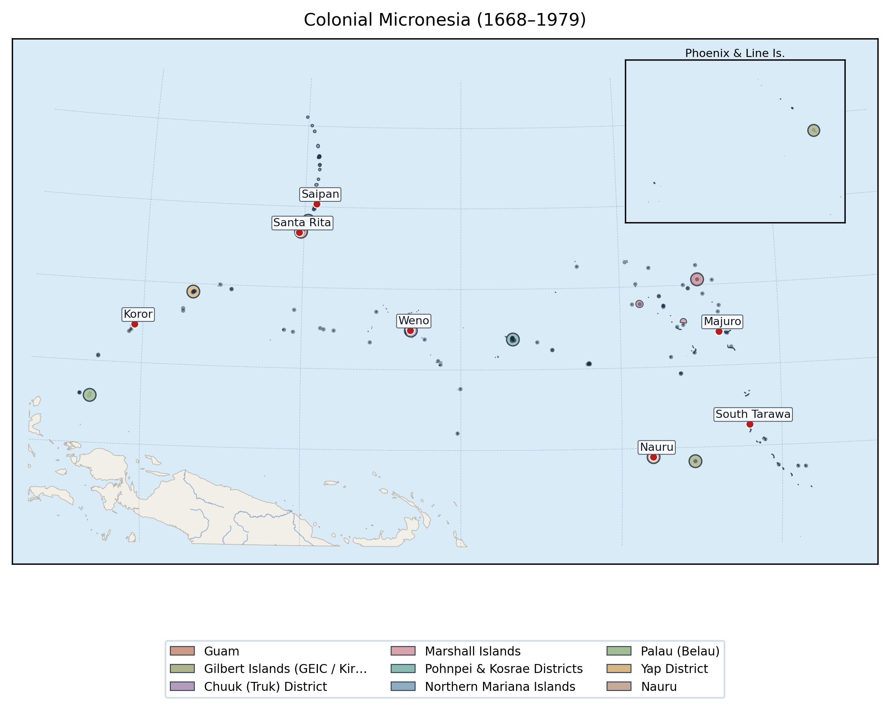

```{r setup, include=FALSE}
knitr::opts_chunk$set(echo = FALSE, warning = FALSE, message = FALSE, fig.pos = "htbp")
source("../../_shared/template/viscount_rmd_helpers.R")
library(jsonlite)

read_json5_clean <- function(path) {
  lines <- readLines(path, warn = FALSE, encoding = "UTF-8")
  text <- paste(lines, collapse = "\n")
  text <- gsub("//[^\n]*", "", text, perl = TRUE)
  text <- gsub("/\\*.*?\\*/", "", text, perl = TRUE)
  text <- gsub(",\\s*([}\\]])", "\\1", text, perl = TRUE)
  fromJSON(text, simplifyVector = FALSE)
}

summary_data <- fromJSON("colonial_micronesia_summary_cache.json", simplifyVector = FALSE)
sett_data <- fromJSON("colonial_micronesia_settlements.json", simplifyVector = FALSE)
ledger_data <- read_json5_clean("colonial_micronesia_source_ledger.json5")

clean_label <- function(x) {
  s <- as.character(x)
  s <- gsub(" / ", ", ", s, fixed = TRUE)
  s <- gsub("&", "and", s, fixed = TRUE)
  s <- gsub("\\\\", "", s)
  trimws(s)
}

subregions <- summary_data$subregions
submask_cov <- ledger_data$saturation_audit$submask_coverage

tot_1668 <- as.numeric(summary_data$domain_totals[["1668"]])
tot_1783 <- as.numeric(summary_data$domain_totals[["1783"]])
tot_1850 <- as.numeric(summary_data$domain_totals[["1850"]])
tot_1900 <- as.numeric(summary_data$domain_totals[["1900"]])
tot_1940 <- as.numeric(summary_data$domain_totals[["1940"]])
tot_1970 <- as.numeric(summary_data$domain_totals[["1970"]])
tot_area <- as.numeric(summary_data$total_area_km2)
n_sites <- as.integer(summary_data$settlement_count)
n_obs <- as.integer(summary_data$observation_count)
```

```{r hero-md-fallback, results='asis'}
if (!knitr::is_latex_output()) {
  cat("\n\n")
}
```

# Abstract

Between the arrival of the Spanish Jesuit mission on Guam in June 1668 and the decolonisation threshold of 1979—when Kiribati gained independence and the Federated States of Micronesia and Marshall Islands adopted constitutional self-government—Micronesia passed through four imperial regimes and a double demographic revolution [@underwood1973population; @hezel1995strangers; @peattie1988nan]. Across nine island jurisdictions occupying `r viscount_fmt_number(tot_area, 1L)` km² of buffered oceanic and atoll mask footprint (Guam, Northern Mariana Islands, Palau, Yap, Chuuk, Pohnpei with Kosrae, Marshall Islands, Gilbert Islands and Nauru), total population plunged from an estimated `r viscount_fmt_pop(tot_1668)` inhabitants in 1668 to `r viscount_fmt_pop(tot_1783)` in 1783 and a colonial trough of `r viscount_fmt_pop(tot_1850)` in 1850 under Spanish reduction wars in the Marianas and nineteenth-century whaler-borne epidemics across Kosrae, Pohnpei, Palau and Yap [@taeuber1963demographic; @gorenflo1992regional; @gorenflo1996demographic]. Modest stabilisation under German copra and phosphate rule lifted the archipelago to `r viscount_fmt_pop(tot_1900)` by 1900 before Japanese colonial migration under the League of Nations South Seas Mandate (*Nan'yō Guntō*) transformed the demographic landscape, swelling mandate numbers from 52.222 in 1920 to 102.537 in 1935 and 131.258 in 1940 as 80k Japanese and Okinawan sugar farmers, fishermen and administrators outnumbered 51k Indigenous islanders [@nanyocho1937annual; @peattie1988nan; @centralstatist2002commonwealth]. Pacific War bombardment and the 1945–1947 repatriation of Japanese civilians emptied Saipan, Tinian and Koror, yet rapid post-war mortality decline, American military construction on Guam and Kwajalein, phosphate immigration to Nauru and Banaba, and sustained natural increase drove regional numbers from `r viscount_fmt_pop(tot_1940)` on the 1940 benchmark to `r viscount_fmt_pop(tot_1970)` (`r viscount_fmt_number(tot_1970, 0L)`, buffered mask density 4,68 inhabitants per km²) by 1970 [@census19631960; @census19731970; @mcarthur1964report]. At closing, Guam (85k, 34,8% of Micronesia) and the Gilbert Islands (48,9k, 20%) accounted for over half the region, ahead of Chuuk (28,9k), the Marshall Islands (22,3k), Pohnpei with Kosrae (21,1k), the Northern Mariana Islands (12,8k), Palau (11,8k), Yap (7,3k) and Nauru (6k). Across `r viscount_fmt_number(n_sites, 0L)` catalogued colonial settlements and `r viscount_fmt_number(n_obs, 0L)` dated observations, archipelagic fragmentation produced a flat, polycentric rank-size curve ($\alpha = 0,70$, $R^2 = 0,90$ across the top 35 centres) topped by Japanese-era Saipan (23,6k in 1935), South Tarawa (17,9k in 1978) and Tinian (14,1k in 1935).

# Background

## Spanish Conquest and the Chamorro Reduction in the Marianas (1668 to 1815)

Permanent European rule reached Micronesia two centuries earlier than almost anywhere else in Oceania. Although Ferdinand Magellan sighted Guam in 1521 and Manila galleons provisioned sporadically off the Marianas from 1565 onward, colonial occupation began only on 15 June 1668, when the Spanish Jesuit Diego Luis de San Vitores landed at Hagåtña with a small garrison to evangelise an estimated 40k Chamorro speakers spread across Guam (25k) and the northern chain from Rota and Tinian to Saipan and the volcanic northern islands (15k) [@underwood1973population; @taeuber1963demographic]. Conversion collided immediately with clan rank, ancestral burial rites and Spanish demands for tribute and obedience. Armed resistance erupted within two years and flared intermittently for a quarter century until Governor José de Quiroga completed the military subjugation of Saipan, Tinian and the northern islands in 1695.

Spanish victory brought demographic catastrophe through the policy of *reducción*—the forcible concentration of dispersed Chamorro coastal villages into six fortified mission parishes on Guam (Hagåtña, Agat, Umatac, Merizo, Inarajan and Pago) and a single surviving outpost on Rota [@underwood1973population]. Stripped of their dispersed gardens and crowded around churches and barracks, survivors suffered relentless waves of smallpox, influenza, measles and dysentery introduced by arriving galleons from Acapulco and Manila. The first Spanish padrones already exposed the collapse: by 1710 Guam and Rota held fewer than 3.600 counted residents, with Hagåtña reduced from 3k in 1668 to 1.648 and Rota down to 467 [@underwood1973population]. Tinian, Saipan and every island north of Rota lay virtually deserted for more than a century, turning the Northern Mariana Islands into feral cattle ranches supplying passing Spanish ships.

Chamorro numbers touched bottom during the late eighteenth century. Guam's official 1783 count stood at just 3.231 inhabitants—an 87% decline from 1668—including Spanish troops, Filipino auxiliaries and growing numbers of *mestizo* households forged through intermarriage between Chamorro women and Spanish or Tagalog settlers [@underwood1973population; @ilina2020terms]. Recovery crept slowly forward only after vaccination campaigns and the termination of the Manila galleon trade in 1815 reduced epidemic importations. During the same decade, devastating typhoons in the central Carolines drove canoe fleets from Satawal, Lamotrek and Woleai northward to seek Spanish sanctuary; colonial governors settled these Carolinian *Refaluwasch* migrants at Garapan on empty Saipan from 1815 onward, inaugurating the repopulation of the Northern Marianas (roughly 950 residents by 1850) [@centralstatist2002commonwealth].

## Whalers, Epidemics and Nineteenth-Century Depopulation in the Carolines and Marshalls (1783 to 1885)

Outside the Spanish Marianas, the Caroline, Marshall, Gilbert and Nauru archipelagos remained politically independent until the mid-1880s, yet maritime commerce still inflicted profound demographic shocks across the high volcanic islands [@hezel1995strangers; @taeuber1963demographic]. British East Indiamen wrecked at Palau in 1783 inaugurated firearms diplomacy between Koror and Melekeok, while Russian and French scientific expeditions charted the Ratak Marshalls, Kosrae, Pohnpei and Chuuk between 1817 and 1828. Far more disruptive were the American New England whaleships that converged on the eastern Carolines and Marshalls between 1835 and 1865, anchoring for months at a time in Kitti harbour on Pohnpei, Lelu on Kosrae and Ebon Atoll to cut wood, fill water casks and trade iron, tobacco and rum [@hezel1995strangers; @gorenflo1992regional].

Exposed crews carried lethal pathogens into immunologically naive island populations. On Kosrae, where the centralised Tokosra monarchy at Leluh ruled roughly 3k people when French hydrographers arrived in 1824, waves of influenza, dysentery and venereal infertility cut the entire island to barely 300 souls by 1880—a 90% collapse that emptied the stone compounds of Leluh [@hezel1995strangers; @gorenflo1992regional]. Pohnpei fared nearly as badly: a devastating smallpox outbreak brought ashore by the whaleship *Delta* in 1854 killed between 2k and 4k people across the five traditional chiefdoms within six months, helping drag combined Pohnpei and Kosrae numbers from 14k in 1668 down to 6,2k by 1900 [@gorenflo1992regional; @balick2019traditional]. In western Micronesia, Palau fell from an estimated 24k in 1668 (10,1k by 1783) to 4,2k by 1900 under repeated influenza, dysentery and declining fertility, while Yap dropped from 14k to 7,5k as bêche-de-mer traders, German copra stations and endemic gonorrhoea depressed birth rates across Gagil-Tomil and Rull [@gorenflo1996demographic; @gorenflo1991regional].

Atoll societies displayed a strikingly different trajectory. Dispersed across dozens of narrow coral islets with limited anchorages for large whaleships, the Marshall Islands declined more gradually from 15k in 1668 to 11k in 1900 despite severe typhoons and introduced syphilis around Ebon and Jaluit [@gorenflo1994evolution]. Chuuk Lagoon, protected by a formidable barrier reef and a fierce reputation among passing ships, retained 13k inhabitants in 1900 against 16k in 1668 [@hezel1995strangers]. Southward along the equator, the densely settled Gilbert Islands weathered blackbirding raids to Peru and Fiji during the 1860s and 1870s alongside civil wars on Abemama, Tabiteuea and Tarawa while maintaining roughly 26,5k people in 1900 against 28k in 1668 [@mcarthur1964report]. On solitary Nauru, a ten-year clan war fuelled by traders' rifles ended only with German annexation in 1888, when the first imperial headcount registered 1.294 Nauruans [@storr2017nauru].

## German Imperial Annexation and British Phosphate Rule (1885 to 1914)

The European scramble for Pacific copra and coaling stations partitioned Micronesia between 1885 and 1899 [@hezel1995strangers; @storr2017nauru]. Germany declared a protectorate over the Marshall Islands in October 1885—handing administration to the Hamburg trading syndicate *Jaluit-Gesellschaft*, which made Jabor on Jaluit Atoll its commercial capital—and annexed Nauru in 1888 [@gorenflo1994evolution; @storr2017nauru]. Spain countered by asserting formal sovereignty over the Carolines in 1886–1887, founding fortified garrison towns at Colonia on Yap and Santiago de la Ascensión (Kolonia) on Pohnpei, where Pohnpeian resistance repeatedly besieged Spanish troops [@gorenflo1992regional; @hezel1995strangers]. Following defeat in the Spanish-American War of 1898, Spain ceded Guam directly to the United States Navy and sold the Northern Mariana and Caroline Islands to Imperial Germany in 1899 for 25M pesetas, completing the political division between American Guam and German Micronesia [@lai2011discontiguou; @hezel1995strangers].

German colonial governors introduced systematic copra-planting ordinances, public-health inspections, road-building corvée and early district headcounts across Saipan, Yap, Koror, Kolonia and Jaluit [@hezel1995strangers; @gorenflo1991regional]. Resistance flared dramatically in the 1910–1911 Sokehs Rebellion on Pohnpei, after which German authorities deported 426 Sokehs islanders to Palau and resettled outer-islanders from Pingelap, Mokil and the Mortlocks onto Pohnpei [@gorenflo1992regional]. Simultaneously, the discovery of high-grade rock phosphate transformed three coral islands overnight: the British Pacific Phosphate Company began mining Banaba (Ocean Island) in 1900 and Nauru in 1906, while a German consortium opened phosphate quarries on Angaur in southern Palau in 1909 [@storr2017nauru; @mcarthur1964report; @gorenflo1996demographic]. Britain had already proclaimed a protectorate over the Gilbert and Ellice Islands in 1892, annexing Banaba in 1900 and elevating the archipelago into the Gilbert and Ellice Islands Colony (GEIC) in 1916 [@mcarthur1964report]. Indentured Gilbertese, Chinese and Carolinian contract miners soon reshaped the ethnic and demographic profile of Nauru, Banaba and Angaur [@storr2017nauru; @repository2014compendium].

## Japanese South Seas Mandate (*Nan'yō Guntō*), War and Post-War Trust Territory (1914 to 1979)

When the First World War broke out in October 1914, Imperial Japanese Navy squadrons swiftly occupied all German islands north of the equator, while Australian forces seized Nauru [@peattie1988nan; @storr2017nauru]. Confirmed as a Class C League of Nations Mandate in 1920 and placed under a civilian South Seas Bureau (*Nan'yō-chō*) headquartered at Koror from 1922, Japanese Micronesia experienced the single most intense colonial settlement boom in Pacific Island history [@peattie1988nan; @nanyocho1937annual]. Backed by state subsidies and the South Seas Development Company (*Nan'yō Kōhatsu Kabushiki Kaisha*, NKK), tens of thousands of impoverished tenant farmers from Okinawa, Fukushima and Kyushu migrated to clear sugar-cane estates across Saipan, Tinian and Rota, build skipjack tuna fisheries and katsuobushi plants at Koror, Tonoas (Dublon) and Kolonia, and mine bauxite and phosphate [@peattie1988nan; @centralstatist2002commonwealth; @planning2002republic].

Five quinquennial *Nan'yō-chō* censuses recorded this demographic surge with metropolitan statistical precision [@nanyocho1937annual; @peattie1988nan]. Across the six mandate districts, Indigenous islanders edged up slowly from 48.505 in 1920 to 50.573 in 1935 and roughly 51k in 1940—gains in Chuuk, Pohnpei and the Marianas barely offsetting persistent decline in Yap [@gorenflo1991regional; @taeuber1963demographic]. Japanese civilians, by contrast, multiplied twenty-two-fold from 3.671 in 1920 to 19.835 in 1930, 51.861 in 1935 (surpassing Indigenous islanders for the first time) and roughly 80k by 1940, lifting the mandate total to 131.258 [@nanyocho1937annual; @peattie1988nan]. In the Northern Mariana Islands, Japanese and Okinawan settlers comprised over 90% of the 44.043 residents counted in 1935, turning Garapan (14k), Tinian (14,1k) and Chalan Kanoa (7,8k) into Japanese plantation towns [@centralstatist2002commonwealth].

The Second World War shattered that colonial society within eighteen months. American amphibious invasions tore across Tarawa (November 1943), Kwajalein and Enewetak (January–February 1944), Saipan, Tinian and Guam (June–August 1944) and Peleliu and Angaur (September 1944), while bypassed Japanese garrisons on Chuuk, Pohnpei, Yap, Jaluit, Wotje and Maloelap starved under blockade [@peattie1988nan; @hezel1995strangers]. Garapan and Hagåtña were levelled to rubble, hundreds of Chamorros and Okinawan civilians perished on Saipan, and Japanese authorities deported 1.200 Nauruans to Chuuk in 1943, where over a third died before repatriation in January 1946 [@storr2017nauru]. Between 1945 and 1947, United States military authorities repatriated virtually the entire surviving Japanese, Okinawan and Korean civilian population from the former mandate—over 100k people—instantly collapsing the Northern Mariana Islands from 44k in 1935 to fewer than 8,3k in 1958 and Palau from 12,8k to 8,9k [@peattie1988nan; @centralstatist2002commonwealth; @planning2002republic].

In 1947, the United Nations designated the former Japanese mandate as the Strategic Trust Territory of the Pacific Islands (TTPI) under United States administration, while Guam became an unincorporated organised territory under the 1950 Organic Act and Nauru passed under an Australian-administered UN trusteeship until independence in 1968 [@lai2011discontiguou; @storr2017nauru; @hezel1995strangers]. Between 1946 and 1958, American nuclear weapons testing displaced Bikini, Enewetak and Rongelap communities in the northern Marshalls while missile-range construction at Kwajalein concentrated thousands of Marshallese workers on tiny Ebeye islet [@gorenflo1994evolution; @allwood2013how]. Simultaneously, antibiotics, modern obstetrics and rising federal expenditure slashed infant mortality across every district, triggering explosive Indigenous natural increase exceeding 3% per annum throughout the 1960s and 1970s [@census19631960; @census19731970; @statistics2014federated]. By 1978–1979—as the Northern Marianas formed a United States Commonwealth, the Federated States of Micronesia and Marshall Islands inaugurated constitutional governments and the Gilbert Islands separated from Ellice (Tuvalu) to become independent Kiribati—colonial Micronesia had entered a new era of rapid urban concentration and trans-Pacific labour mobility [@eria2022micronesian; @borovnik2009remittances; @group2026kiribati].

# Methodology

## Nine-Jurisdiction Constant-Boundary Partition and Buffered Oceanic Mask

To trace demographic continuity across four overlapping colonial empires without territorial discontinuities, AUSTRAL partitions Colonial Micronesia (1668 to 1979) into nine constant-boundary island jurisdictions spanning `r viscount_fmt_number(tot_area, 1L)` km² of buffered coastal and atoll raster mask footprint. Six sub-regions correspond directly to the six districts of the Japanese South Seas Mandate and United States Trust Territory of the Pacific Islands: Northern Mariana Islands (10.913,9 km² mask), Palau (3.928,2 km²), Yap District (1.952 km²), Chuuk District (4.343,7 km²), Pohnpei combined with Kosrae (2.732 km², united administratively within Ponape District until Kosrae's separation in 1977) and the Marshall Islands (17.307,3 km²). The remaining three sub-regions encompass American Guam (1.085,7 km²), the British Gilbert Islands alongside Banaba and the Line and Phoenix annexes of modern Kiribati (9.524,2 km²) and solitary Nauru (429,3 km²).

Because coral atolls and small high islands across Micronesia possess tiny subaerial dry-land areas—roughly 3.150 km² combined across all nine jurisdictions, from Guam's 549 km² and Pohnpei's 345 km² down to Nauru's 21 km² and low-lying Marshallese and Gilbertese ribbons measuring just fractions of a square kilometre—macro-regional cartographic masking applies a uniform coastal-and-lagoon buffer so every inhabited island remains spatially resolvable. Readers must therefore interpret all sub-regional density figures reported in this chapter as buffered-mask densities (4,68 inhabitants per km² regionally in 1970, ranging from 78,29 on Guam and 13,86 on Nauru to 1,18 across the dispersed Northern Mariana chain) rather than strict dry-land crowding metrics, which reached several hundred persons per dry km² on South Tarawa, Ebeye and Nauru by the late 1970s [@mcarthur1964report; @gorenflo1994evolution; @storr2017nauru].

## Multi-Empire Archival Census Harmonisation and Growth Estimation

Colonial Micronesia's statistical archive spans four distinct administrative traditions, each with its own enumeration cadence, territorial grouping and ethnic taxonomy [@broman2013making; @taeuber1963demographic]. Early benchmarks from 1668 to 1899 combine Spanish *padrones* and missionary parish registers on Guam and Rota [@underwood1973population], naval expedition headcounts and American Board of Commissioners for Foreign Missions (ABCFM) estimates on Pohnpei, Kosrae and Ebon [@hezel1995strangers; @gorenflo1992regional], and early German imperial counts in Nauru (1886) and the Marshalls [@storr2017nauru; @gorenflo1994evolution]. From 1901 onward, official statistical censuses take over: United States Naval Government and U.S. Census Bureau decennial censuses of Guam (1901, 1910, 1920, 1930, 1940, 1950, 1960 and 1970) [@census19631960; @census19731970]; Japanese *Nan'yō-chō* quinquennial censuses of 1920, 1925, 1930, 1935 and 1940 disaggregating Indigenous islanders, Japanese settlers and foreign nationals [@nanyocho1937annual; @peattie1988nan]; United States TTPI High Commissioner and Census Bureau enumerations in 1958, 1967, 1970, 1973 and 1980 [@archivend1980; @archivend1980b; @eric1999eric]; British GEIC censuses in 1921, 1931, 1947, 1963, 1973 and 1978 [@mcarthur1964report]; and Australian Mandate and Republic of Nauru censuses from 1921 to 1977 [@storr2017nauru].

For any jurisdiction $j$ with raw primary census anchors at bounding years $t_1 < t < t_2$, harmonised benchmark totals $P_j(t)$ at the six cross-regional comparison dates ($1668, 1783, 1850, 1900, 1940, 1970$) are obtained by log-linear interpolation:

$$P_j(t) = P_j(t_1) \cdot \left(\frac{P_j(t_2)}{P_j(t_1)}\right)^{\frac{t - t_1}{t_2 - t_1}}$$

Compound annual growth rates across any historical phase are evaluated uniformly as:

$$g_j(t_1, t_2) = \left(\frac{P_j(t_2)}{P_j(t_1)}\right)^{\frac{1}{t_2 - t_1}} - 1$$

Where abrupt colonial discontinuities—above all the 1920–1940 Japanese sugar-settlement boom and 1945–1947 repatriation in the Northern Mariana Islands and Palau—produce sharp non-monotonic peaks between raw anchors, our regional analysis pairs the harmonised benchmark curves directly against the exact uninterpolated *Nan'yō-chō*, TTPI, Guam, GEIC and Nauru census totals stored in our primary census series [@nanyocho1937annual; @census19731970; @centralstatist2002commonwealth; @planning2002republic].

## Four-Wave Settlement Gazetteer Assembly and Rank-Size Modelling

Alongside territorial aggregates, AUSTRAL assembles an evidence-based settlement gazetteer of `r viscount_fmt_number(n_sites, 0L)` colonial island centres and `r viscount_fmt_number(n_obs, 0L)` dated population observations (mean 4,56 observations per site) spanning 1668 to 1979, with 0% crowd-sourced fallback across all nine jurisdictions. Assembly proceeded through four audited ledger waves: Wave 1 extracted 34 urban and administrative series from primary Spanish, *Nan'yō-chō*, TTPI, U.S. Census Bureau, GEIC and Nauru census reports; Wave 2 integrated 35 pre-colonial, mission-era and early colonial island centres from peer-reviewed archaeological and ethnohistorical monographs (such as Tumon, Mochong, Ngerdubech, Badrulchau, Leluh, Nan Madol, Gagil-Tomil and Utiroa); Wave 3 standardised WGS84 coordinates, consolidated historical toponyms and merged 22 duplicate colonial or pre-colonial alias records within 25 km of canonical entities (such as Jabor into Jaluit, Songsong into Rota, San Jose and Taga into Tinian, Santa Rita into Agat and Buada and Denigomodu into Aiwo); and Wave 4 executed a sub-region coverage sweep closing at 1,45% marginal gain (1 final verification addition), zero empty sub-regions and zero unaccounted candidates. Spatial scope separates 5 island-wide or lagoon-corridor metropolitan envelopes (Saipan Metro, South Tarawa Metro, Majuro Metro, Nauru Metro and Kwajalein Metro) from 65 individual town, village or atoll-municipality cores. Upper-half rank-size scaling fits $\log_{10} P_{(r)} = a - \alpha \log_{10} r$ across the top 35 settlements to evaluate archipelagic urban primacy against continental settler regimes.

# Testing and Validation

## Cross-Checking Constant-Boundary Benchmarks Against Historical GIS Regimes and Censuses

Independent reconciliation against the 102-row Historical GIS (HGIS) territorial panel spanning eleven snapshots from 1700 to 1960 confirms close structural agreement across three centuries while spotlighting three instructive calibration points. In 1780, the nine-unit HGIS snapshot totals 93.590 inhabitants against 91.586 on our 1783 constant-boundary benchmark (a 2,1% spread consistent with ongoing Marianas and Palauan decline). Across the nineteenth-century nadir, HGIS totals track 90.335 in 1800, 86.130 in 1840 and 85.476 in 1860 against our 1850 benchmark of 82.707, before rising to 89.027 in 1890 and 92.322 in 1900 (within 4,2% of our 1900 benchmark of 88.558). Early twentieth-century HGIS regimes capture the onset of Japanese and phosphate growth cleanly at 103.031 in 1910, 118.292 in 1920 and 150.905 in 1950 (closely tracking post-repatriation recovery after wartime losses).

Two deliberate methodological contrasts require explicit transparency. First, in the Northern Mariana Islands, sparse raw anchors at 1850 (950), 1935 (44.025) and 1958 (8.290) cause smooth log-linear interpolation to overstate 1900 (9.072 interpolated against roughly 2.000–2.600 counted in early German Saipan and Rota returns) and understate peak 1940 Japanese numbers (30.624 interpolated against over 45k actual wartime residents on Saipan, Tinian and Rota prior to June 1944) [@centralstatist2002commonwealth; @peattie1988nan]. Second, in the 1960 disaggregated HGIS snapshot (summing to 220.318 across seven separate national statistical agencies), the Kiribati ADM1 panel reports 72.335 across three island groups—significantly above the 1963 GEIC Gilbert-and-Line census count of 43.336 because colonial GEIC aggregates periodically combined the Ellice Islands (Tuvalu) or duplicated outer-atoll totals [@mcarthur1964report]. Meanwhile, the sub-pixel continental raster grid registers zero populated pixels across Micronesia's narrow coral ribbons, confirming that historical demographic modelling in oceanic archipelagos must rely on polygon-level HGIS and census-anchored benchmarks rather than coarse continental rasters.

## Census Reliability, Ethnic Taxonomy and Undercount Biases

Twentieth-century Micronesian censuses rank among the most comprehensive small-island enumerations anywhere in the tropics, yet shifting imperial categories demand careful reading [@broman2013making]. *Nan'yō-chō* censuses between 1920 and 1935 distinguished cleanly between Chamorro and Kanaka (Carolinian and Marshallese) islanders, metropolitan Japanese (including Okinawan and Korean subjects of the empire) and foreign nationals, though after 1939 military fortification led Japanese authorities to withhold full garrison counts from League of Nations reports [@nanyocho1937annual; @peattie1988nan]. United States decennial censuses on Guam from 1950 onward enumerated resident military personnel and dependents alongside civilian Chamorros—producing sudden decadal jumps whenever naval bases expanded or contracted, as seen in Barrigada (11.534 in 1950 falling to 5.430 in 1960) and Yigo (jumping from 324 in 1940 to 9.022 in 1950 around Andersen Air Force Base) [@census19631960; @census19731970; @lai2011discontiguou]. Within the TTPI, minor coverage discrepancies occurred between the 1958 High Commissioner census and the 1970 U.S. Census Bureau enumeration—which undercounted outer atolls in Pohnpei, Chuuk and the Marshalls sufficiently that the TTPI administration conducted a dedicated territory-wide re-enumeration in September 1973 (lifting the TTPI count from 90.940 in 1970 to 114.773 in 1973) [@census19731970; @gorenflo1992regional; @gorenflo1994evolution].

Table \ref{tab:jurisdiction-benchmarks} compiles buffered mask footprints and harmonised constant-boundary population trajectories across five milestone dates from 1668 to 1970 for all nine Micronesian jurisdictions.

```{r tab-jurisdiction-benchmarks, results='asis'}
rows <- lapply(subregions, function(r) {
  a <- as.numeric(r$area_km2)
  p1668 <- as.numeric(r$population[["1668"]])
  p1783 <- as.numeric(r$population[["1783"]])
  p1900 <- as.numeric(r$population[["1900"]])
  p1940 <- as.numeric(r$population[["1940"]])
  p1970 <- as.numeric(r$population[["1970"]])
  data.frame(
    Jurisdiction = clean_label(r$name),
    Area = viscount_fmt_number(round(a), 0L),
    P1668 = viscount_fmt_pop(p1668),
    P1783 = viscount_fmt_pop(p1783),
    P1900 = viscount_fmt_pop(p1900),
    P1940 = viscount_fmt_pop(p1940),
    P1970 = viscount_fmt_pop(p1970),
    stringsAsFactors = FALSE
  )
})
df_bench <- do.call(rbind, rows)
df_tot <- data.frame(
  Jurisdiction = "Micronesia Total (9 Jurisdictions)",
  Area = viscount_fmt_number(round(tot_area), 0L),
  P1668 = viscount_fmt_pop(tot_1668),
  P1783 = viscount_fmt_pop(tot_1783),
  P1900 = viscount_fmt_pop(tot_1900),
  P1940 = viscount_fmt_pop(tot_1940),
  P1970 = viscount_fmt_pop(tot_1970),
  stringsAsFactors = FALSE
)
df_bench <- rbind(df_bench, df_tot)
rownames(df_bench) <- NULL

viscount_table(
  df_bench,
  "Harmonised total population across five benchmark horizons and buffered mask areas (km²) for the nine jurisdictions of Colonial Micronesia, 1668 to 1970.",
  c("Jurisdiction", "Mask (km²)", "1668", "1783", "1900", "1940", "1970"),
  list(label = "tab:jurisdiction-benchmarks", font_size = "scriptsize")
)
```

# Results

## Archipelagic Demographic Trajectory (1668 to 1979)

Colonial Micronesia traced a deep, three-century asymmetrical U-curve followed by an extraordinary twentieth-century surge, captured visually in Figure \ref{fig:micro-trajectory}. Starting from an estimated `r viscount_fmt_pop(tot_1668)` islanders in 1668—split relatively evenly among the Gilbert Islands (28k), Guam (25k), Palau (24k), Chuuk (16k), the Northern Marianas (15k), the Marshalls (15k), Yap (14k), Pohnpei with Kosrae (14k) and Nauru (1,4k)—aggregate numbers dropped 40% across the first colonial century to `r viscount_fmt_pop(tot_1783)` in 1783 as Spanish *reducción* hollowed out the Mariana Islands while Palauan and eastern Caroline communities began experiencing initial contact losses [@underwood1973population; @taeuber1963demographic].

```{r fig-trajectory, results='asis'}
viscount_figure(
  "figures/colonial_micronesia_population_trajectory.png",
  "Colonial Micronesian demographic trajectory from 1668 to 1970 across major island jurisdictions (Panel A) and buffered-mask population density rankings in 1970 (Panel B).",
  "fig:micro-trajectory"
)
```

Throughout the nineteenth century, epidemics across Kosrae, Pohnpei, Palau and Yap pushed Micronesia downward to a regional trough of `r viscount_fmt_pop(tot_1850)` in 1850—just 54,3% of its 1668 total—before slow Guam recovery and Gilbertese stability lifted the region marginally to `r viscount_fmt_pop(tot_1900)` by 1900 [@hezel1995strangers; @gorenflo1992regional; @gorenflo1996demographic]. Between 1900 and 1940, Japanese plantation immigration to the Marianas and Palau combined with natural increase on Guam, Chuuk, Pohnpei and the Gilberts to raise the constant-boundary benchmark to `r viscount_fmt_pop(tot_1940)` (and actual 1940 combined colonial headcount to roughly 185k–190k once peak pre-war Japanese residents in Saipan, Tinian and Koror are counted directly) [@nanyocho1937annual; @peattie1988nan]. Despite the abrupt post-war removal of over 100k Japanese civilians, plunging post-war mortality, high fertility and American base expansion drove Micronesia cleanly past its 1668 pre-contact ceiling during the late 1950s and carried the nine jurisdictions to `r viscount_fmt_pop(tot_1970)` in 1970 (compound growth +1,69% per annum across 1940–1970, accelerating past 3% per annum on the 1958–1978 census series to exceed 285k by 1979) [@census19731970; @mcarthur1964report].

Tables \ref{tab:mandate-censuses} and \ref{tab:postwar-censuses} present the primary official colonial enumerations across both the Japanese South Seas Mandate (1920 to 1940) and the post-war Trust Territory, Guam, GEIC and Nauru administrations (1958 to 1978).

```{r tab-mandate-censuses, results='asis'}
pce <- summary_data$primary_census_enumerations
get_pce <- function(terr, uname, yr) {
  for (item in pce) {
    if (identical(item$territory, terr) &&
        identical(item$unit_name, uname) &&
        identical(as.integer(item$year), as.integer(yr))) {
      return(as.numeric(item$population))
    }
  }
  return(NA_real_)
}
fmt_pce <- function(v) {
  if (is.na(v)) return("-")
  viscount_fmt_pop(v)
}

m_spec <- list(
  list("Mandate Indigenous Islanders", "colonial_mandate_and_ttpi", "islanders_est"),
  list("Mandate Japanese Settlers", "colonial_mandate_and_ttpi", "japanese_est"),
  list("Mandate Foreign Nationals", "colonial_mandate_and_ttpi", "foreigners"),
  list("South Seas Mandate Total", "colonial_mandate_and_ttpi", "total"),
  list("Northern Mariana Islands (Saipan District)", "northern_mariana_islands", "historical_national_totals"),
  list("Marshall Islands (Jaluit District)", "marshall_islands", "historical_national_totals"),
  list("Guam (U.S. Naval Territory)", "guam", "historical_national_totals")
)

m_rows <- lapply(m_spec, function(sp) {
  data.frame(
    Group = sp[[1]],
    Y1920 = fmt_pce(get_pce(sp[[2]], sp[[3]], 1920)),
    Y1925 = fmt_pce(get_pce(sp[[2]], sp[[3]], 1925)),
    Y1930 = fmt_pce(get_pce(sp[[2]], sp[[3]], 1930)),
    Y1935 = fmt_pce(get_pce(sp[[2]], sp[[3]], 1935)),
    Y1940 = fmt_pce(get_pce(sp[[2]], sp[[3]], 1940)),
    stringsAsFactors = FALSE
  )
})
df_mand <- do.call(rbind, m_rows)
rownames(df_mand) <- NULL

viscount_table(
  df_mand,
  "Official quinquennial census enumerations across the Japanese South Seas Mandate (Nan'yo-cho) and U.S. Naval Guam, 1920 to 1940.",
  c("Administrative Group", "1920", "1925", "1930", "1935", "1940"),
  list(label = "tab:mandate-censuses", font_size = "scriptsize")
)
```

```{r tab-postwar-censuses, results='asis'}
pw_spec <- list(
  list("Guam (U.S. Territory)", "guam", "historical_national_totals", c(1950, 1960, 1970, NA, NA)),
  list("Gilbert Islands (GEIC and Kiribati)", "kiribati", "historical_national_totals", c(1947, 1963, NA, 1973, 1978)),
  list("Chuuk District (TTPI)", "colonial_mandate_and_ttpi", "Truk", c(NA, 1958, 1970, 1973, NA)),
  list("Marshall Islands (TTPI)", "colonial_mandate_and_ttpi", "Marshalls", c(NA, 1958, 1970, 1973, NA)),
  list("Pohnpei and Kosrae (TTPI)", "colonial_mandate_and_ttpi", "Ponape_incl_Kosrae", c(NA, 1958, 1970, 1973, NA)),
  list("Northern Mariana Islands (TTPI)", "colonial_mandate_and_ttpi", "Marianas", c(NA, 1958, 1970, 1973, NA)),
  list("Palau District (TTPI)", "colonial_mandate_and_ttpi", "Palau", c(NA, 1958, 1970, 1973, NA)),
  list("Yap District (TTPI)", "colonial_mandate_and_ttpi", "Yap", c(NA, 1958, 1970, 1973, NA)),
  list("TTPI Six-District Total", "colonial_mandate_and_ttpi", "total", c(NA, 1958, 1970, 1973, NA)),
  list("Nauru (Trust Territory and Republic)", "nauru", "historical_national_totals", c(1947, 1961, 1966, NA, 1977))
)

pw_rows <- lapply(pw_spec, function(sp) {
  yrs <- sp[[4]]
  vals <- vapply(yrs, function(y) {
    if (is.na(y)) return("-")
    fmt_pce(get_pce(sp[[2]], sp[[3]], y))
  }, character(1))
  data.frame(
    Territory = sp[[1]],
    C1 = vals[1],
    C2 = vals[2],
    C3 = vals[3],
    C4 = vals[4],
    C5 = vals[5],
    stringsAsFactors = FALSE
  )
})
df_pw <- do.call(rbind, pw_rows)
rownames(df_pw) <- NULL

viscount_table(
  df_pw,
  "Post-war official census enumerations across Guam, the Trust Territory of the Pacific Islands (TTPI), the Gilbert Islands and Nauru, 1947 to 1978.",
  c("Territory or District", "1947–1950", "1958–1963", "1966–1970", "1973", "1977–1978"),
  list(label = "tab:postwar-censuses", font_size = "scriptsize")
)
```

## The Mariana Arc: Guam and the Northern Mariana Islands

No two neighbouring island groups in Oceania followed more divergent twentieth-century demographic curves than Guam and the Northern Mariana Islands despite sharing an identical Chamorro heritage and Spanish collapse [@underwood1973population; @centralstatist2002commonwealth]. On Guam (1.085,7 km² buffered mask), recovery from the 1783 nadir (3.231) progressed steadily through late Spanish rule to 9.676 at the first U.S. Naval census in 1901, 13.275 in 1920, 18.509 in 1930 and 22.290 in 1940—almost entirely Chamorro civilians centred on Hagåtña (10.004 in 1940) and commercial port Sumay (1.997) [@underwood1973population]. The 1944 American liberation and subsequent Cold War transformation into a major Pacific air and naval bastion turned Guam's geography inside out. Pre-war Hagåtña was demolished by bombardment and never regained its historic population (falling to 1.330 in 1950 and 2.119 in 1970), while Sumay was cleared entirely for Apra Harbor Naval Station. Instead, military personnel, Filipino construction workers and suburbanising Chamorro families flooded northern and central municipalities: total population leaped to 59.498 in 1950, 67.044 in 1960 and 84.996 in 1970 (density 78,29 per km² mask, five times higher than any other Micronesian jurisdiction), led by Yigo (11.542), Dededo (10.780), Tamuning (10.218), Barrigada (6.356, down from 11.534 in 1950), Agat (4.308) and Mangilao (3.228) [@census19631960; @census19731970; @lai2011discontiguou; @ilina2020terms].

Across the narrow channel northward, the Northern Mariana Islands (10.913,9 km² buffered mask) experienced an astonishing roller-coaster driven entirely by Japanese sugar imperialism and its wartime erasure [@peattie1988nan; @centralstatist2002commonwealth]. Nearly empty at 950 Chamorro and Carolinian inhabitants in 1850 and still modest at 5.159 in 1920, the archipelago vaulted to 19.496 in 1930 and 44.043 in 1935 as NKK plantations covered Saipan (23.582 in 1935, anchored by Garapan at 14k and the sugar-mill town of Chalan Kanoa at 7.820), Tinian (14.108, up from just 102 in 1920!) and Rota (5.608, up from 491 in 1920) [@nanyocho1937annual; @peattie1988nan]. Repatriation after 1945 emptied Tinian back to 405 residents in 1958 and Rota to 969, reducing the entire district to 8.290 in 1958 before steady natural increase and administrative reconstruction centred on Chalan Kanoa and Saipan lifted the territory to 9.640 in 1970 (12.846 on the 1970 benchmark interpolation) and 14.333 at the 1973 TTPI census [@archivend1980; @eric1999eric].

## Western Carolines: Palau and Yap

Palau and Yap illustrate two contrasting paths out of nineteenth-century demographic collapse [@gorenflo1996demographic; @gorenflo1991regional]. Palau (3.928,2 km² mask) fell steeply from an estimated 24k in 1668 to barely 4,2k in 1900, leaving ancient Babeldaob village centres such as Melekeok (1.890 in 1783) and northern terrace districts sparsely occupied [@gorenflo1996demographic]. Selection of Koror as the *Nan'yō-chō* mandate capital in 1922 transformed Palau into a bustling Japanese administrative, fisheries and mining hub: island total tripled to 12.798 in 1935 as Koror reached 6.500, Peleliu grew to 1.150 and phosphate-mining Angaur climbed to 1.100 [@nanyocho1937annual; @peattie1988nan]. Post-war repatriation dropped Palau back to 8.884–8.987 in 1958, yet rapid Palauan natural increase and internal migration from outer Babeldaob and southwest islands (such as Sonsorol, 62 residents in 1970) restored the territory to 11.210 in 1970 (11.804 benchmark; density 3,01) and 12.673 by 1973, with 60,5% (7.669) concentrated in Koror [@planning2002republic; @gorenflo1996demographic].

Yap District (1.952 km² mask) endured the longest uninterrupted population decline in Micronesia [@gorenflo1991regional; @taeuber1963demographic]. Dropping from 14k in 1668 to 7,5k in 1900, Yap continued contracting throughout the entire Japanese era—slipping to 6.006 in 1935 and bottoming out near 5.540 in 1958 as chronic respiratory infection, intestinal parasites and sub-fertility persisted across Yap Proper's municipalities (Gagil-Tomil fell continuously from 4.120 in 1800 to 2.180 in 1900, 1.320 in 1935 and 1.205 in 1973) [@gorenflo1991regional]. Only post-war penicillin campaigns and modern maternal care broke that century-long downward spiral, lifting Yap District back to 7.625 in 1970 (7.336 benchmark; density 3,76) and 7.870 in 1973, anchored by Colonia (1.850) and the outer-atoll hub of Falalop on Ulithi (710) [@census19731970; @statistics2014federated].

## Central and Eastern Carolines: Chuuk, Pohnpei and Kosrae

East of Yap, Chuuk and Pohnpei-Kosrae emerged as the primary demographic engines of the future Federated States of Micronesia [@gorenflo1992regional; @statistics2014federated]. Chuuk District (4.343,7 km² mask) suffered comparatively light nineteenth-century losses (16k in 1668 to 13k in 1900) and expanded steadily thereafter: 17.133 in 1935 (with Japanese naval headquarters on Tonoas/Dublon swelling to 4.850), 20.124 in 1958, 29.334 in 1970 (28.880 benchmark; density 6,65) and 31.609 in 1973—making Chuuk the single most populous district of the TTPI [@nanyocho1937annual; @census19731970]. After American administration shifted district headquarters from bomb-damaged Tonoas (1.528 in 1958; 2.558 in 1973) to Weno (Moen), urban pull drew migrants from outer Faichuk islands (Tol Chuuk, 5.439 in 1973), Uman (1.891) and the Mortlock atolls (Satawan, 826), tripling Weno from 3.314 in 1958 to 9.568 in 1973 and seeding later Chuukese out-migration to Guam and the United States [@eria2022micronesian].

Pohnpei and Kosrae (2.732 km² mask) staged a remarkable twentieth-century rebound from their nineteenth-century demographic collapse (14k in 1668 to 6,2k in 1900) [@gorenflo1992regional; @balick2019traditional]. Under German and Japanese rule, population nearly doubled to 11.467 in 1935 as Kolonia grew into a thriving administrative and agricultural port (3.500 in 1935) alongside rural chiefdoms such as Kitti (1.580) and Polynesian outlier atolls Kapingamarangi (396) and Nukuoro (191). Following brief post-war Japanese repatriation (Kolonia dipped to 1.720 in 1958), surging Indigenous birth rates carried combined Pohnpei and Kosrae totals from 13.620–14.335 in 1958 to 18.526 in 1970 (21.108 benchmark; density 7,73, third highest in Micronesia) and 23.252 in 1973, with Kolonia reaching 4.795 and Kosrae's revived municipalities of Lelu (1.650), Tafunsak (981) and Malem (788) rebuilding a growing island society more than twelve times larger than its 1880 nadir [@gorenflo1992regional; @census19731970].

## Eastern Atolls and Phosphate Islands: Marshall Islands, Gilbert Islands and Nauru

Across eastern Micronesia, atoll ecology, Cold War military basing and rock-phosphate extraction reshaped settlement geography completely [@gorenflo1994evolution; @mcarthur1964report; @storr2017nauru]. In the Marshall Islands (17.307,3 km² buffered mask), population hovered quietly near 10k–11k for half a century—11k in 1900, 9.800 in 1920, 10.412 in 1930 and 10.446 in 1935—when the German and Japanese administrative capital sat at Jaluit (peaking at 2.149 in 1930) alongside traditional chiefly centres at Ailinglaplap, Arno, Ebon and the deBrum-Capelle copra estate on Likiep [@gorenflo1994evolution; @hezel1995strangers]. Wartime destruction of Jaluit and American designation of Majuro as TTPI district capital alongside the Kwajalein missile range inverted the entire archipelago's spatial centre of gravity. Marshallese numbers leaped from 13.928–14.163 in 1958 to 18.925 in 1967, 20.206 in 1970 (22.272 benchmark; density 1,29) and 25.045 in 1973. By 1973, Majuro Atoll (10.290, up from 753 in 1930) and Kwajalein Atoll (5.469, with 5.123 jammed onto 0,36 dry km² of Ebeye islet after 1951 labour resettlement) concentrated 62,9% of the entire archipelago while Jaluit slid to 925 [@gorenflo1994evolution; @allwood2013how].

South across the equator, the British Gilbert Islands (9.524,2 km² mask) remained Micronesia's largest Indigenous population throughout the nineteenth and early twentieth centuries: 28k in 1668, 26,5k in 1900, 26.430 in 1921, 29.751 in 1931 and 31.513 in 1947 despite Japanese occupation and the bloody 1943 Battle of Tarawa [@mcarthur1964report]. Rapid post-war public-health improvements propelled Kiribati's population to 43.336 in 1963, 48.930 on the 1970 benchmark (density 5,14), 51.926 in 1973 and 56.213 at the pre-independence 1978 census [@mcarthur1964report; @group2026kiribati]. When the GEIC moved colony headquarters from phosphate-scarred Banaba (2.706 in 1963; 2.314 in 1973 prior to mine exhaustion in 1979) to Tarawa after the war, South Tarawa surged into Micronesia's second-largest colonial conurbation—reaching 17.921 in 1978 (31,9% of the nation), led by port Betio (7.626, up from 920 in 1931) and administrative-educational hub Bikenibeu (3.971) alongside outer-island copra resettlement at London on Kiritimati in the Line Islands (1.265) and overseas merchant-seafarer remittance networks [@borovnik2009remittances; @repository2014compendium].

Finally, solitary Nauru (429,3 km² buffered mask; 21 km² dry land) grew steadily from 1.294 at its 1886 German count to 2.066 in 1921 and 2.641 in 1933 as British Phosphate Commissioners imported Chinese and Gilbertese contract workers to Aiwo and Denigomodu [@storr2017nauru]. Despite losing over a third of its Indigenous citizens during wartime deportation to Chuuk, post-war recovery, booming phosphate royalties and national independence in January 1968 carried Nauru from 2.855 in 1947 to 4.613 in 1961, 6.057 in 1966 (5.951 on the 1970 benchmark; density 13,86, second highest in Micronesia) and 6.966–7.254 in 1977 [@storr2017nauru; @group2026kiribati].

## Polycentric Island Hierarchy and Rank-Size Structure

Unlike continental settler colonies where railways funnelled national wealth into one or two primate port metropolises, Micronesia's oceanic fragmentation prevented any single capital from dominating the entire region. Figure \ref{fig:micro-hierarchy} displays the twelve largest catalogued colonial settlements alongside the remarkably flat log-log rank-size distribution across all `r viscount_fmt_number(n_sites, 0L)` centres.

```{r fig-hierarchy, results='asis'}
viscount_figure(
  "figures/colonial_micronesia_urban_hierarchy.png",
  "Twelve largest catalogued colonial Micronesian settlements by peak recorded population (Panel A) and rank-size distribution across 70 island centres with upper-half power-law fit ($\\alpha = 0,70$, $R^2 = 0,90$ across the top 35 centres, Panel B), 1668 to 1979.",
  "fig:micro-hierarchy"
)
```

Peak colonial urban size crested at just 23.582 in Japanese-era Saipan Metro (1935), followed closely by South Tarawa Metro (17.921 in 1978), Tinian (14.108 in 1935), Garapan (14k in 1935), Guam's four post-war suburban-military municipalities—Yigo (11.542), Barrigada (11.534), Dededo (10.780) and Tamuning (10.218)—Majuro Metro (10.290 in 1973), pre-war Hagåtña (10.004 in 1940), Weno (9.568 in 1973) and Chalan Kanoa (7.820 in 1935). Because seven separate political territories each sustained a compact district port or administrative town in the 5k–18k bracket, the upper-half Zipf exponent registers a distinctly flat $\alpha = 0,70$ ($R^2 = 0,90$ across ranks 1 to 35; full 70-centre slope $-1,09$, $R^2 = 0,83$). Table \ref{tab:jurisdiction-shares} pairs each jurisdiction's shifting share of regional population across 1668, 1900 and 1970 with its catalogued settlement count and leading recorded centre.

```{r tab-jurisdiction-shares, results='asis'}
inc_cands <- Filter(function(c) identical(c$status, "included"), ledger_data$candidates)
cand_map <- setNames(
  vapply(inc_cands, function(c) {
    sub(".*sub-region ([a-z_]+)\\.$", "\\1", c$justification)
  }, character(1)),
  vapply(inc_cands, function(c) c$settlement_key, character(1))
)

share_rows <- lapply(subregions, function(r) {
  rid <- r$id
  p1668 <- as.numeric(r$population[["1668"]])
  p1900 <- as.numeric(r$population[["1900"]])
  p1970 <- as.numeric(r$population[["1970"]])
  sh1668 <- 100 * p1668 / tot_1668
  sh1900 <- 100 * p1900 / tot_1900
  sh1970 <- 100 * p1970 / tot_1970
  sc <- as.integer(submask_cov[[rid]])
  reg_keys <- names(cand_map)[cand_map == rid]
  lead_str <- "-"
  if (length(reg_keys) > 0L) {
    pks <- vapply(reg_keys, function(k) {
      e <- sett_data[[k]]
      if (is.null(e)) return(0)
      max(as.numeric(unlist(e$population)))
    }, numeric(1))
    idx_m <- which.max(pks)
    lead_e <- sett_data[[reg_keys[idx_m]]]
    lead_str <- paste0(clean_label(lead_e$name), " (", viscount_fmt_pop(pks[idx_m]), ")")
  }
  data.frame(
    Jurisdiction = clean_label(r$name),
    Sh1668 = paste0(viscount_fmt_number(sh1668, 1L), "%"),
    Sh1900 = paste0(viscount_fmt_number(sh1900, 1L), "%"),
    Sh1970 = paste0(viscount_fmt_number(sh1970, 1L), "%"),
    Sites = viscount_fmt_number(sc, 0L),
    Leading = lead_str,
    stringsAsFactors = FALSE
  )
})
df_shares <- do.call(rbind, share_rows)
rownames(df_shares) <- NULL

viscount_table(
  df_shares,
  "Jurisdictional shares of Micronesian population in 1668, 1900 and 1970 paired with catalogued settlement counts and leading recorded centres.",
  c("Jurisdiction", "1668", "1900", "1970", "Sites", "Leading Centre (Peak)"),
  list(label = "tab:jurisdiction-shares", font_size = "scriptsize")
)
```

# Limitations

Four structural uncertainties qualify demographic reconstructions for Colonial Micronesia between 1668 and 1979.

First, pre-contact baselines in 1668 remain wide approximation bands outside the early Spanish Marianas [@underwood1973population; @taeuber1963demographic]. While Jesuit reports and archaeological latte-site surveys bound Guam and the Northern Marianas reasonably tightly around 40k combined in 1668, contact-era estimates for Palau (24k), Yap (14k), Chuuk (16k), Pohnpei with Kosrae (14k), the Marshalls (15k) and the Gilberts (28k) rest on retrospective archaeological settlement reconstructions and early nineteenth-century shipboard tallies made decades after indirect disease exposure had begun [@gorenflo1991regional; @gorenflo1992regional; @gorenflo1996demographic]. Alternative higher pre-contact estimates for Palau (up to 40k–50k) or Pohnpei would deepen the 1668–1850 contraction without altering twentieth-century census series after 1901.

Second, log-linear benchmark interpolation between widely spaced raw anchors smooths abrupt twentieth-century colonial shocks—most notably in the Northern Mariana Islands, where interpolating between 1850 (950), 1935 (44.025) and 1958 (8.290) yields an overstated 1900 figure (9.072 against roughly 2k–2,6k actual residents) and an understated 1940 figure (30.624 against over 45k actual pre-invasion residents) [@centralstatist2002commonwealth; @peattie1988nan]. Readers analysing interwar Japanese settlement or wartime depopulation must therefore rely on the direct quinquennial *Nan'yō-chō* and TTPI census tables presented in Tables \ref{tab:mandate-censuses} and \ref{tab:postwar-censuses}.

Third, military garrisons, expatriate contract miners and shifting census coverage complicate strict comparisons between Indigenous and de facto resident totals [@broman2013making; @census19731970]. Late-war Japanese military garrisons exceeding 100k troops across Micronesia in 1943–1944 are excluded from civilian demographic benchmarks, whereas U.S. post-war censuses on Guam include active-duty military personnel and dependents (roughly one quarter to one third of Guam's 1950–1970 headcount), and Nauru and Banaba totals combine Indigenous islanders with rotating Chinese, Gilbertese and Tuvaluan phosphate contract workers [@storr2017nauru; @mcarthur1964report; @repository2014compendium]. Similarly, the 1960 disaggregated HGIS Kiribati ADM1 figure (72.335) reflects broader GEIC administrative grouping and exceeds the Gilbert-and-Line census baseline of 43.336 in 1963.

Fourth, buffered cartographic mask areas (`r viscount_fmt_number(tot_area, 1L)` km²) cannot be equated with habitable dry land (~3.150 km²). While buffered polygons ensure uniform visibility across 4.500 km of open ocean, real physiological crowding on coral islets such as Ebeye, South Tarawa and Nauru stood two orders of magnitude above buffered-mask density by 1979 [@allwood2013how; @group2026kiribati].

# Conclusion

Across three centuries of Spanish, German, Japanese, British, Australian and American rule, Micronesia experienced two sweeping demographic inversions that reshaped every island chain from Koror to Tarawa [@hezel1995strangers; @peattie1988nan]. The first inversion—driven by Spanish *reducción* in the Marianas after 1668 and whaler-borne epidemics across Kosrae, Pohnpei, Palau and Yap during the nineteenth century—cut regional numbers nearly in half from `r viscount_fmt_pop(tot_1668)` in 1668 to `r viscount_fmt_pop(tot_1850)` in 1850 [@underwood1973population; @taeuber1963demographic; @gorenflo1992regional]. The second inversion unfolded in two contrasting twentieth-century acts: an explosive Japanese civilian sugar-and-fisheries colonisation that lifted the South Seas Mandate from 52,2k in 1920 to 131,3k in 1940 before wartime ruin and post-war repatriation swept it away [@nanyocho1937annual; @peattie1988nan], followed immediately by an Indigenous post-war public-health transition and Cold War military-economic boom that carried regional population past its pre-contact peak to `r viscount_fmt_pop(tot_1970)` in 1970 and well past 285k by 1979 [@census19731970; @mcarthur1964report; @storr2017nauru].

On the eve of decolonisation in 1979, every demographic feature of contemporary Micronesia stood firmly established. Guam (85k in 1970, 34,8% of the region) and the Gilbert Islands (48,9k, 20%) anchored opposite ends of the oceanic arc, while rapid natural increase across Chuuk (31,6k in 1973), the Marshall Islands (25k), Pohnpei with Kosrae (23,3k), the Northern Marianas (14,3k), Palau (12,7k), Yap (7,9k) and phosphate-rich Nauru (7k in 1977) concentrated islanders tightly into polycentric district capitals—Saipan, South Tarawa, Majuro, Ebeye, Weno, Koror and Kolonia ($\alpha = 0,70$)—setting the stage for late twentieth-century atoll urbanisation, climate vulnerability and trans-Pacific diaspora migration [@allwood2013how; @eria2022micronesian; @borovnik2009remittances; @group2026kiribati].

# Appendix

## Historical GIS Territorial Regime Snapshots (1700 to 1960)

Table \ref{tab:hgis-regimes} aggregates the 102-row Historical GIS territorial regime panel across all eleven historical snapshots from 1700 to 1960, documenting the transition from nine harmonised archipelagic reconstructions to seven disaggregated post-war national statistical agencies in 1960.

```{r tab-hgis-regimes, results='asis'}
hgis_list <- summary_data$hgis_regime_summary
reg_yrs <- sort(unique(vapply(hgis_list, function(h) as.integer(h$snapshot_regime), integer(1))))
regime_label <- function(yr) {
  if (yr <= 1860L) return("Spanish Marianas and Independent Archipelagos")
  if (yr <= 1910L) return("German Protectorate, U.S. Guam and British GEIC")
  if (yr == 1920L) return("Japanese Mandate, U.S. Guam, GEIC and Nauru")
  if (yr == 1950L) return("Early Post-War TTPI, Guam, GEIC and Nauru")
  "Disaggregated Official National Censuses (7 Agencies)"
}

hgis_rows <- lapply(reg_yrs, function(yr) {
  sub_h <- Filter(function(h) as.integer(h$snapshot_regime) == yr, hgis_list)
  u_sum <- sum(vapply(sub_h, function(h) as.integer(h$units), integer(1)))
  p_sum <- sum(vapply(sub_h, function(h) as.numeric(h$population_sum), numeric(1)))
  data.frame(
    Year = as.character(yr),
    Units = viscount_fmt_number(u_sum, 0L),
    Regime = regime_label(yr),
    HGIS = viscount_fmt_number(round(p_sum), 0L),
    Compact = viscount_fmt_pop(p_sum),
    stringsAsFactors = FALSE
  )
})
df_hgis <- do.call(rbind, hgis_rows)
rownames(df_hgis) <- NULL

viscount_table(
  df_hgis,
  "Historical GIS territorial regime totals across eleven archival snapshots spanning 1700 to 1960 (102 jurisdictional unit-rows).",
  c("Year", "Units", "Territorial Regime", "HGIS Total", "Compact"),
  list(label = "tab:hgis-regimes", font_size = "scriptsize")
)
```

## Full Six-Benchmark Matrix and Closing Mask Densities (1668 to 1970)

Table \ref{tab:full-benchmarks} prints the full six-horizon benchmark matrix including the 1850 regional nadir alongside closing 1970 buffered-mask densities (inhabitants per km²) for all nine jurisdictions.

```{r tab-full-benchmarks, results='asis'}
full_rows <- lapply(subregions, function(r) {
  data.frame(
    Jurisdiction = clean_label(r$name),
    P1668 = viscount_fmt_pop(as.numeric(r$population[["1668"]])),
    P1783 = viscount_fmt_pop(as.numeric(r$population[["1783"]])),
    P1850 = viscount_fmt_pop(as.numeric(r$population[["1850"]])),
    P1900 = viscount_fmt_pop(as.numeric(r$population[["1900"]])),
    P1970 = viscount_fmt_pop(as.numeric(r$population[["1970"]])),
    Dens1970 = viscount_fmt_number(as.numeric(r$end_epoch_density_km2), 2L),
    stringsAsFactors = FALSE
  )
})
df_full <- do.call(rbind, full_rows)
df_full_tot <- data.frame(
  Jurisdiction = "Micronesia Total (9 Jurisdictions)",
  P1668 = viscount_fmt_pop(tot_1668),
  P1783 = viscount_fmt_pop(tot_1783),
  P1850 = viscount_fmt_pop(tot_1850),
  P1900 = viscount_fmt_pop(tot_1900),
  P1970 = viscount_fmt_pop(tot_1970),
  Dens1970 = viscount_fmt_number(tot_1970 / tot_area, 2L),
  stringsAsFactors = FALSE
)
df_full <- rbind(df_full, df_full_tot)
rownames(df_full) <- NULL

viscount_table(
  df_full,
  "Harmonised benchmark population totals including the 1850 regional nadir and closing 1970 buffered-mask density (inhabitants per km²) across nine Micronesian jurisdictions.",
  c("Jurisdiction", "1668", "1783", "1850", "1900", "1970", "1970 Dens."),
  list(label = "tab:full-benchmarks", font_size = "scriptsize")
)
```

# Sources

::: {#refs}
:::

# Footnotes

All numerical values follow European decimal formatting (comma decimals and dot thousands separators) paired with semantic magnitude suffixes (k for thousands, M for millions). Constant-boundary jurisdictional tables preserve the nine-unit colonial partition across 1668 to 1979, keeping Pohnpei united with Kosrae prior to Kosrae's 1977 district separation and reporting buffered coastal-and-atoll mask footprints (52.216,3 km²) alongside strict census enumerations from Spanish, German, Japanese (*Nan'yō-chō*), United States (Guam and TTPI), British (GEIC) and Nauruan statistical archives.
