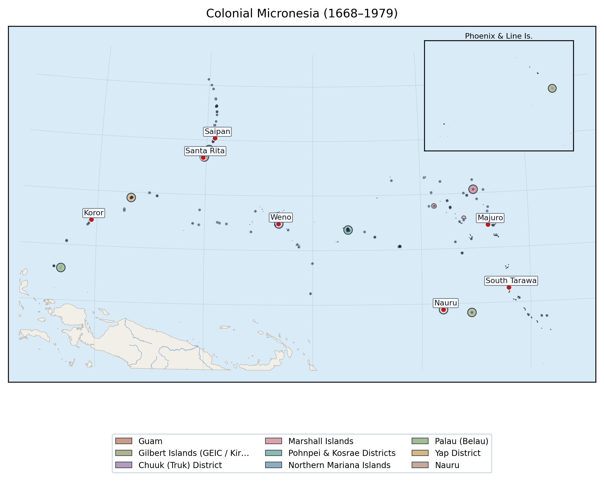
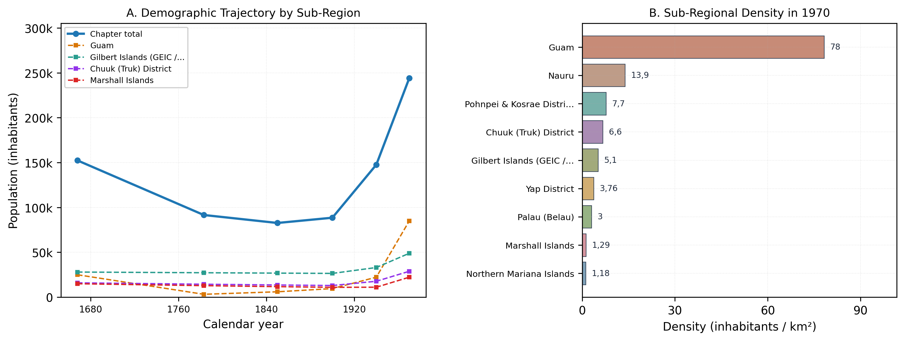
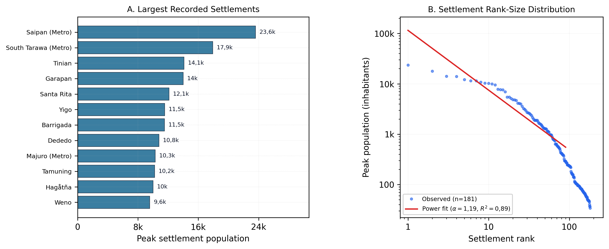

Colonial Micronesia
================
Aust Kätzchen
23 November 2026

- [Abstract](#abstract)
- [Background](#background)
  - [Spanish Conquest and the Chamorro Reduction in the Marianas (1668
    to
    1815)](#spanish-conquest-and-the-chamorro-reduction-in-the-marianas-1668-to-1815)
  - [Whalers, Epidemics and Nineteenth-Century Depopulation in the
    Carolines and Marshalls (1783 to
    1885)](#whalers-epidemics-and-nineteenth-century-depopulation-in-the-carolines-and-marshalls-1783-to-1885)
  - [German Imperial Annexation and British Phosphate Rule (1885 to
    1914)](#german-imperial-annexation-and-british-phosphate-rule-1885-to-1914)
  - [Japanese South Seas Mandate (*Nan’yō Guntō*), War and Post-War
    Trust Territory (1914 to
    1979)](#japanese-south-seas-mandate-nanyō-guntō-war-and-post-war-trust-territory-1914-to-1979)
- [Methodology](#methodology)
  - [Nine-Jurisdiction Constant-Boundary Partition and Buffered Oceanic
    Mask](#nine-jurisdiction-constant-boundary-partition-and-buffered-oceanic-mask)
  - [Multi-Empire Archival Census Harmonisation and Growth
    Estimation](#multi-empire-archival-census-harmonisation-and-growth-estimation)
  - [Four-Wave Settlement Gazetteer Assembly and Rank-Size
    Modelling](#four-wave-settlement-gazetteer-assembly-and-rank-size-modelling)
- [Testing and Validation](#testing-and-validation)
  - [Cross-Checking Constant-Boundary Benchmarks Against Historical GIS
    Regimes and
    Censuses](#cross-checking-constant-boundary-benchmarks-against-historical-gis-regimes-and-censuses)
  - [Census Reliability, Ethnic Taxonomy and Undercount
    Biases](#census-reliability-ethnic-taxonomy-and-undercount-biases)
- [Results](#results)
  - [Archipelagic Demographic Trajectory (1668 to
    1979)](#archipelagic-demographic-trajectory-1668-to-1979)
  - [The Mariana Arc: Guam and the Northern Mariana
    Islands](#the-mariana-arc-guam-and-the-northern-mariana-islands)
  - [Western Carolines: Palau and Yap](#western-carolines-palau-and-yap)
  - [Central and Eastern Carolines: Chuuk, Pohnpei and
    Kosrae](#central-and-eastern-carolines-chuuk-pohnpei-and-kosrae)
  - [Eastern Atolls and Phosphate Islands: Marshall Islands, Gilbert
    Islands and
    Nauru](#eastern-atolls-and-phosphate-islands-marshall-islands-gilbert-islands-and-nauru)
  - [Polycentric Island Hierarchy and Rank-Size
    Structure](#polycentric-island-hierarchy-and-rank-size-structure)
- [Limitations](#limitations)
- [Conclusion](#conclusion)
- [Appendix](#appendix)
  - [Historical GIS Territorial Regime Snapshots (1700 to
    1960)](#historical-gis-territorial-regime-snapshots-1700-to-1960)
  - [Full Six-Benchmark Matrix and Closing Mask Densities (1668 to
    1970)](#full-six-benchmark-matrix-and-closing-mask-densities-1668-to-1970)
- [Sources](#sources)
- [Footnotes](#footnotes)

<figure>

<figcaption aria-hidden="true">Nine colonial Micronesian jurisdictions
and 70 catalogued settlements across the Mariana, Caroline, Marshall,
Gilbert and Nauru archipelagos, 1668 to 1979.</figcaption>
</figure>

# Abstract

Between the arrival of the Spanish Jesuit mission on Guam in June 1668
and the decolonisation threshold of 1979—when Kiribati gained
independence and the Federated States of Micronesia and Marshall Islands
adopted constitutional self-government—Micronesia passed through four
imperial regimes and a double demographic revolution
[\[1\]](#ref-underwood1973population)[\[2\]](#ref-hezel1995strangers)[\[3\]](#ref-peattie1988nan).
Across nine island jurisdictions occupying 52.216,3 km² of buffered
oceanic and atoll mask footprint (Guam, Northern Mariana Islands, Palau,
Yap, Chuuk, Pohnpei with Kosrae, Marshall Islands, Gilbert Islands and
Nauru), total population plunged from an estimated 152,4k inhabitants in
1668 to 91,6k in 1783 and a colonial trough of 82,7k in 1850 under
Spanish reduction wars in the Marianas and nineteenth-century
whaler-borne epidemics across Kosrae, Pohnpei, Palau and Yap
[\[4\]](#ref-taeuber1963demographic)[\[5\]](#ref-gorenflo1992regional)[\[6\]](#ref-gorenflo1996demographic).
Modest stabilisation under German copra and phosphate rule lifted the
archipelago to 88,6k by 1900 before Japanese colonial migration under
the League of Nations South Seas Mandate (*Nan’yō Guntō*) transformed
the demographic landscape, swelling mandate numbers from 52.222 in 1920
to 102.537 in 1935 and 131.258 in 1940 as 80k Japanese and Okinawan
sugar farmers, fishermen and administrators outnumbered 51k Indigenous
islanders
[\[3\]](#ref-peattie1988nan)[\[7\]](#ref-nanyocho1937annual)[\[8\]](#ref-centralstatist2002commonwealth).
Pacific War bombardment and the 1945–1947 repatriation of Japanese
civilians emptied Saipan, Tinian and Koror, yet rapid post-war mortality
decline, American military construction on Guam and Kwajalein, phosphate
immigration to Nauru and Banaba, and sustained natural increase drove
regional numbers from 147,6k on the 1940 benchmark to 244,1k (244.123,
buffered mask density 4,68 inhabitants per km²) by 1970
[\[9\]](#ref-census19631960)[\[10\]](#ref-census19731970)[\[11\]](#ref-mcarthur1964report).
At closing, Guam (85k, 34,8% of Micronesia) and the Gilbert Islands
(48,9k, 20%) accounted for over half the region, ahead of Chuuk (28,9k),
the Marshall Islands (22,3k), Pohnpei with Kosrae (21,1k), the Northern
Mariana Islands (12,8k), Palau (11,8k), Yap (7,3k) and Nauru (6k).
Across 181 catalogued colonial settlements and 468 dated observations,
archipelagic fragmentation produced a flat, polycentric rank-size curve
($\alpha = 0,70$, $R^2 = 0,90$ across the top 35 centres) topped by
Japanese-era Saipan (23,6k in 1935), South Tarawa (17,9k in 1978) and
Tinian (14,1k in 1935).

# Background

## Spanish Conquest and the Chamorro Reduction in the Marianas (1668 to 1815)

Permanent European rule reached Micronesia two centuries earlier than
almost anywhere else in Oceania. Although Ferdinand Magellan sighted
Guam in 1521 and Manila galleons provisioned sporadically off the
Marianas from 1565 onward, colonial occupation began only on 15 June
1668, when the Spanish Jesuit Diego Luis de San Vitores landed at
Hagåtña with a small garrison to evangelise an estimated 40k Chamorro
speakers spread across Guam (25k) and the northern chain from Rota and
Tinian to Saipan and the volcanic northern islands (15k)
[\[1\]](#ref-underwood1973population)[\[4\]](#ref-taeuber1963demographic).
Conversion collided immediately with clan rank, ancestral burial rites
and Spanish demands for tribute and obedience. Armed resistance erupted
within two years and flared intermittently for a quarter century until
Governor José de Quiroga completed the military subjugation of Saipan,
Tinian and the northern islands in 1695.

Spanish victory brought demographic catastrophe through the policy of
*reducción*—the forcible concentration of dispersed Chamorro coastal
villages into six fortified mission parishes on Guam (Hagåtña, Agat,
Umatac, Merizo, Inarajan and Pago) and a single surviving outpost on
Rota [\[1\]](#ref-underwood1973population). Stripped of their dispersed
gardens and crowded around churches and barracks, survivors suffered
relentless waves of smallpox, influenza, measles and dysentery
introduced by arriving galleons from Acapulco and Manila. The first
Spanish padrones already exposed the collapse: by 1710 Guam and Rota
held fewer than 3.600 counted residents, with Hagåtña reduced from 3k in
1668 to 1.648 and Rota down to 467
[\[1\]](#ref-underwood1973population). Tinian, Saipan and every island
north of Rota lay virtually deserted for more than a century, turning
the Northern Mariana Islands into feral cattle ranches supplying passing
Spanish ships.

Chamorro numbers touched bottom during the late eighteenth century.
Guam’s official 1783 count stood at just 3.231 inhabitants—an 87%
decline from 1668—including Spanish troops, Filipino auxiliaries and
growing numbers of *mestizo* households forged through intermarriage
between Chamorro women and Spanish or Tagalog settlers
[\[1\]](#ref-underwood1973population)[\[12\]](#ref-ilina2020terms).
Recovery crept slowly forward only after vaccination campaigns and the
termination of the Manila galleon trade in 1815 reduced epidemic
importations. During the same decade, devastating typhoons in the
central Carolines drove canoe fleets from Satawal, Lamotrek and Woleai
northward to seek Spanish sanctuary; colonial governors settled these
Carolinian *Refaluwasch* migrants at Garapan on empty Saipan from 1815
onward, inaugurating the repopulation of the Northern Marianas (roughly
950 residents by 1850) [\[8\]](#ref-centralstatist2002commonwealth).

## Whalers, Epidemics and Nineteenth-Century Depopulation in the Carolines and Marshalls (1783 to 1885)

Outside the Spanish Marianas, the Caroline, Marshall, Gilbert and Nauru
archipelagos remained politically independent until the mid-1880s, yet
maritime commerce still inflicted profound demographic shocks across the
high volcanic islands
[\[2\]](#ref-hezel1995strangers)[\[4\]](#ref-taeuber1963demographic).
British East Indiamen wrecked at Palau in 1783 inaugurated firearms
diplomacy between Koror and Melekeok, while Russian and French
scientific expeditions charted the Ratak Marshalls, Kosrae, Pohnpei and
Chuuk between 1817 and 1828. Far more disruptive were the American New
England whaleships that converged on the eastern Carolines and Marshalls
between 1835 and 1865, anchoring for months at a time in Kitti harbour
on Pohnpei, Lelu on Kosrae and Ebon Atoll to cut wood, fill water casks
and trade iron, tobacco and rum
[\[2\]](#ref-hezel1995strangers)[\[5\]](#ref-gorenflo1992regional).

Exposed crews carried lethal pathogens into immunologically naive island
populations. On Kosrae, where the centralised Tokosra monarchy at Leluh
ruled roughly 3k people when French hydrographers arrived in 1824, waves
of influenza, dysentery and venereal infertility cut the entire island
to barely 300 souls by 1880—a 90% collapse that emptied the stone
compounds of Leluh
[\[2\]](#ref-hezel1995strangers)[\[5\]](#ref-gorenflo1992regional).
Pohnpei fared nearly as badly: a devastating smallpox outbreak brought
ashore by the whaleship *Delta* in 1854 killed between 2k and 4k people
across the five traditional chiefdoms within six months, helping drag
combined Pohnpei and Kosrae numbers from 14k in 1668 down to 6,2k by
1900
[\[5\]](#ref-gorenflo1992regional)[\[13\]](#ref-balick2019traditional).
In western Micronesia, Palau fell from an estimated 24k in 1668 (10,1k
by 1783) to 4,2k by 1900 under repeated influenza, dysentery and
declining fertility, while Yap dropped from 14k to 7,5k as bêche-de-mer
traders, German copra stations and endemic gonorrhoea depressed birth
rates across Gagil-Tomil and Rull
[\[6\]](#ref-gorenflo1996demographic)[\[14\]](#ref-gorenflo1991regional).

Atoll societies displayed a strikingly different trajectory. Dispersed
across dozens of narrow coral islets with limited anchorages for large
whaleships, the Marshall Islands declined more gradually from 15k in
1668 to 11k in 1900 despite severe typhoons and introduced syphilis
around Ebon and Jaluit [\[15\]](#ref-gorenflo1994evolution). Chuuk
Lagoon, protected by a formidable barrier reef and a fierce reputation
among passing ships, retained 13k inhabitants in 1900 against 16k in
1668 [\[2\]](#ref-hezel1995strangers). Southward along the equator, the
densely settled Gilbert Islands weathered blackbirding raids to Peru and
Fiji during the 1860s and 1870s alongside civil wars on Abemama,
Tabiteuea and Tarawa while maintaining roughly 26,5k people in 1900
against 28k in 1668 [\[11\]](#ref-mcarthur1964report). On solitary
Nauru, a ten-year clan war fuelled by traders’ rifles ended only with
German annexation in 1888, when the first imperial headcount registered
1.294 Nauruans [\[16\]](#ref-storr2017nauru).

## German Imperial Annexation and British Phosphate Rule (1885 to 1914)

The European scramble for Pacific copra and coaling stations partitioned
Micronesia between 1885 and 1899
[\[2\]](#ref-hezel1995strangers)[\[16\]](#ref-storr2017nauru). Germany
declared a protectorate over the Marshall Islands in October
1885—handing administration to the Hamburg trading syndicate
*Jaluit-Gesellschaft*, which made Jabor on Jaluit Atoll its commercial
capital—and annexed Nauru in 1888
[\[15\]](#ref-gorenflo1994evolution)[\[16\]](#ref-storr2017nauru). Spain
countered by asserting formal sovereignty over the Carolines in
1886–1887, founding fortified garrison towns at Colonia on Yap and
Santiago de la Ascensión (Kolonia) on Pohnpei, where Pohnpeian
resistance repeatedly besieged Spanish troops
[\[2\]](#ref-hezel1995strangers)[\[5\]](#ref-gorenflo1992regional).
Following defeat in the Spanish-American War of 1898, Spain ceded Guam
directly to the United States Navy and sold the Northern Mariana and
Caroline Islands to Imperial Germany in 1899 for 25M pesetas, completing
the political division between American Guam and German Micronesia
[\[2\]](#ref-hezel1995strangers)[\[17\]](#ref-lai2011discontiguou).

German colonial governors introduced systematic copra-planting
ordinances, public-health inspections, road-building corvée and early
district headcounts across Saipan, Yap, Koror, Kolonia and Jaluit
[\[2\]](#ref-hezel1995strangers)[\[14\]](#ref-gorenflo1991regional).
Resistance flared dramatically in the 1910–1911 Sokehs Rebellion on
Pohnpei, after which German authorities deported 426 Sokehs islanders to
Palau and resettled outer-islanders from Pingelap, Mokil and the
Mortlocks onto Pohnpei [\[5\]](#ref-gorenflo1992regional).
Simultaneously, the discovery of high-grade rock phosphate transformed
three coral islands overnight: the British Pacific Phosphate Company
began mining Banaba (Ocean Island) in 1900 and Nauru in 1906, while a
German consortium opened phosphate quarries on Angaur in southern Palau
in 1909
[\[6\]](#ref-gorenflo1996demographic)[\[11\]](#ref-mcarthur1964report)[\[16\]](#ref-storr2017nauru).
Britain had already proclaimed a protectorate over the Gilbert and
Ellice Islands in 1892, annexing Banaba in 1900 and elevating the
archipelago into the Gilbert and Ellice Islands Colony (GEIC) in 1916
[\[11\]](#ref-mcarthur1964report). Indentured Gilbertese, Chinese and
Carolinian contract miners soon reshaped the ethnic and demographic
profile of Nauru, Banaba and Angaur
[\[16\]](#ref-storr2017nauru)[\[18\]](#ref-repository2014compendium).

## Japanese South Seas Mandate (*Nan’yō Guntō*), War and Post-War Trust Territory (1914 to 1979)

When the First World War broke out in October 1914, Imperial Japanese
Navy squadrons swiftly occupied all German islands north of the equator,
while Australian forces seized Nauru
[\[3\]](#ref-peattie1988nan)[\[16\]](#ref-storr2017nauru). Confirmed as
a Class C League of Nations Mandate in 1920 and placed under a civilian
South Seas Bureau (*Nan’yō-chō*) headquartered at Koror from 1922,
Japanese Micronesia experienced the single most intense colonial
settlement boom in Pacific Island history
[\[3\]](#ref-peattie1988nan)[\[7\]](#ref-nanyocho1937annual). Backed by
state subsidies and the South Seas Development Company (*Nan’yō Kōhatsu
Kabushiki Kaisha*, NKK), tens of thousands of impoverished tenant
farmers from Okinawa, Fukushima and Kyushu migrated to clear sugar-cane
estates across Saipan, Tinian and Rota, build skipjack tuna fisheries
and katsuobushi plants at Koror, Tonoas (Dublon) and Kolonia, and mine
bauxite and phosphate
[\[3\]](#ref-peattie1988nan)[\[8\]](#ref-centralstatist2002commonwealth)[\[19\]](#ref-planning2002republic).

Five quinquennial *Nan’yō-chō* censuses recorded this demographic surge
with metropolitan statistical precision
[\[3\]](#ref-peattie1988nan)[\[7\]](#ref-nanyocho1937annual). Across the
six mandate districts, Indigenous islanders edged up slowly from 48.505
in 1920 to 50.573 in 1935 and roughly 51k in 1940—gains in Chuuk,
Pohnpei and the Marianas barely offsetting persistent decline in Yap
[\[4\]](#ref-taeuber1963demographic)[\[14\]](#ref-gorenflo1991regional).
Japanese civilians, by contrast, multiplied twenty-two-fold from 3.671
in 1920 to 19.835 in 1930, 51.861 in 1935 (surpassing Indigenous
islanders for the first time) and roughly 80k by 1940, lifting the
mandate total to 131.258
[\[3\]](#ref-peattie1988nan)[\[7\]](#ref-nanyocho1937annual). In the
Northern Mariana Islands, Japanese and Okinawan settlers comprised over
90% of the 44.043 residents counted in 1935, turning Garapan (14k),
Tinian (14,1k) and Chalan Kanoa (7,8k) into Japanese plantation towns
[\[8\]](#ref-centralstatist2002commonwealth).

The Second World War shattered that colonial society within eighteen
months. American amphibious invasions tore across Tarawa (November
1943), Kwajalein and Enewetak (January–February 1944), Saipan, Tinian
and Guam (June–August 1944) and Peleliu and Angaur (September 1944),
while bypassed Japanese garrisons on Chuuk, Pohnpei, Yap, Jaluit, Wotje
and Maloelap starved under blockade
[\[2\]](#ref-hezel1995strangers)[\[3\]](#ref-peattie1988nan). Garapan
and Hagåtña were levelled to rubble, hundreds of Chamorros and Okinawan
civilians perished on Saipan, and Japanese authorities deported 1.200
Nauruans to Chuuk in 1943, where over a third died before repatriation
in January 1946 [\[16\]](#ref-storr2017nauru). Between 1945 and 1947,
United States military authorities repatriated virtually the entire
surviving Japanese, Okinawan and Korean civilian population from the
former mandate—over 100k people—instantly collapsing the Northern
Mariana Islands from 44k in 1935 to fewer than 8,3k in 1958 and Palau
from 12,8k to 8,9k
[\[3\]](#ref-peattie1988nan)[\[8\]](#ref-centralstatist2002commonwealth)[\[19\]](#ref-planning2002republic).

In 1947, the United Nations designated the former Japanese mandate as
the Strategic Trust Territory of the Pacific Islands (TTPI) under United
States administration, while Guam became an unincorporated organised
territory under the 1950 Organic Act and Nauru passed under an
Australian-administered UN trusteeship until independence in 1968
[\[2\]](#ref-hezel1995strangers)[\[16\]](#ref-storr2017nauru)[\[17\]](#ref-lai2011discontiguou).
Between 1946 and 1958, American nuclear weapons testing displaced
Bikini, Enewetak and Rongelap communities in the northern Marshalls
while missile-range construction at Kwajalein concentrated thousands of
Marshallese workers on tiny Ebeye islet
[\[15\]](#ref-gorenflo1994evolution)[\[20\]](#ref-allwood2013how).
Simultaneously, antibiotics, modern obstetrics and rising federal
expenditure slashed infant mortality across every district, triggering
explosive Indigenous natural increase exceeding 3% per annum throughout
the 1960s and 1970s
[\[9\]](#ref-census19631960)[\[10\]](#ref-census19731970)[\[21\]](#ref-statistics2014federated).
By 1978–1979—as the Northern Marianas formed a United States
Commonwealth, the Federated States of Micronesia and Marshall Islands
inaugurated constitutional governments and the Gilbert Islands separated
from Ellice (Tuvalu) to become independent Kiribati—colonial Micronesia
had entered a new era of rapid urban concentration and trans-Pacific
labour mobility
[\[22\]](#ref-eria2022micronesian)[\[23\]](#ref-borovnik2009remittances)[\[24\]](#ref-group2026kiribati).

# Methodology

## Nine-Jurisdiction Constant-Boundary Partition and Buffered Oceanic Mask

To trace demographic continuity across four overlapping colonial empires
without territorial discontinuities, AUSTRAL partitions Colonial
Micronesia (1668 to 1979) into nine constant-boundary island
jurisdictions spanning 52.216,3 km² of buffered coastal and atoll raster
mask footprint. Six sub-regions correspond directly to the six districts
of the Japanese South Seas Mandate and United States Trust Territory of
the Pacific Islands: Northern Mariana Islands (10.913,9 km² mask), Palau
(3.928,2 km²), Yap District (1.952 km²), Chuuk District (4.343,7 km²),
Pohnpei combined with Kosrae (2.732 km², united administratively within
Ponape District until Kosrae’s separation in 1977) and the Marshall
Islands (17.307,3 km²). The remaining three sub-regions encompass
American Guam (1.085,7 km²), the British Gilbert Islands alongside
Banaba and the Line and Phoenix annexes of modern Kiribati (9.524,2 km²)
and solitary Nauru (429,3 km²).

Because coral atolls and small high islands across Micronesia possess
tiny subaerial dry-land areas—roughly 3.150 km² combined across all nine
jurisdictions, from Guam’s 549 km² and Pohnpei’s 345 km² down to Nauru’s
21 km² and low-lying Marshallese and Gilbertese ribbons measuring just
fractions of a square kilometre—macro-regional cartographic masking
applies a uniform coastal-and-lagoon buffer so every inhabited island
remains spatially resolvable. Readers must therefore interpret all
sub-regional density figures reported in this chapter as buffered-mask
densities (4,68 inhabitants per km² regionally in 1970, ranging from
78,29 on Guam and 13,86 on Nauru to 1,18 across the dispersed Northern
Mariana chain) rather than strict dry-land crowding metrics, which
reached several hundred persons per dry km² on South Tarawa, Ebeye and
Nauru by the late 1970s
[\[11\]](#ref-mcarthur1964report)[\[15\]](#ref-gorenflo1994evolution)[\[16\]](#ref-storr2017nauru).

## Multi-Empire Archival Census Harmonisation and Growth Estimation

Colonial Micronesia’s statistical archive spans four distinct
administrative traditions, each with its own enumeration cadence,
territorial grouping and ethnic taxonomy
[\[4\]](#ref-taeuber1963demographic)[\[25\]](#ref-broman2013making).
Early benchmarks from 1668 to 1899 combine Spanish *padrones* and
missionary parish registers on Guam and Rota
[\[1\]](#ref-underwood1973population), naval expedition headcounts and
American Board of Commissioners for Foreign Missions (ABCFM) estimates
on Pohnpei, Kosrae and Ebon
[\[2\]](#ref-hezel1995strangers)[\[5\]](#ref-gorenflo1992regional), and
early German imperial counts in Nauru (1886) and the Marshalls
[\[15\]](#ref-gorenflo1994evolution)[\[16\]](#ref-storr2017nauru). From
1901 onward, official statistical censuses take over: United States
Naval Government and U.S. Census Bureau decennial censuses of Guam
(1901, 1910, 1920, 1930, 1940, 1950, 1960 and 1970)
[\[9\]](#ref-census19631960)[\[10\]](#ref-census19731970); Japanese
*Nan’yō-chō* quinquennial censuses of 1920, 1925, 1930, 1935 and 1940
disaggregating Indigenous islanders, Japanese settlers and foreign
nationals [\[3\]](#ref-peattie1988nan)[\[7\]](#ref-nanyocho1937annual);
United States TTPI High Commissioner and Census Bureau enumerations in
1958, 1967, 1970, 1973 and 1980
[\[26\]](#ref-archivend1980)[\[27\]](#ref-archivend1980b)[\[28\]](#ref-eric1999eric);
British GEIC censuses in 1921, 1931, 1947, 1963, 1973 and 1978
[\[11\]](#ref-mcarthur1964report); and Australian Mandate and Republic
of Nauru censuses from 1921 to 1977 [\[16\]](#ref-storr2017nauru).

For any jurisdiction $j$ with raw primary census anchors at bounding
years $t_1 < t < t_2$, harmonised benchmark totals $P_j(t)$ at the six
cross-regional comparison dates ($1668, 1783, 1850, 1900, 1940, 1970$)
are obtained by log-linear interpolation:

$$P_j(t) = P_j(t_1) \cdot \left(\frac{P_j(t_2)}{P_j(t_1)}\right)^{\frac{t - t_1}{t_2 - t_1}}$$

Compound annual growth rates across any historical phase are evaluated
uniformly as:

$$g_j(t_1, t_2) = \left(\frac{P_j(t_2)}{P_j(t_1)}\right)^{\frac{1}{t_2 - t_1}} - 1$$

Where abrupt colonial discontinuities—above all the 1920–1940 Japanese
sugar-settlement boom and 1945–1947 repatriation in the Northern Mariana
Islands and Palau—produce sharp non-monotonic peaks between raw anchors,
our regional analysis pairs the harmonised benchmark curves directly
against the exact uninterpolated *Nan’yō-chō*, TTPI, Guam, GEIC and
Nauru census totals stored in our primary census series
[\[7\]](#ref-nanyocho1937annual)[\[8\]](#ref-centralstatist2002commonwealth)[\[10\]](#ref-census19731970)[\[19\]](#ref-planning2002republic).

## Four-Wave Settlement Gazetteer Assembly and Rank-Size Modelling

Alongside territorial aggregates, AUSTRAL assembles an evidence-based
settlement gazetteer of 181 colonial island centres and 468 dated
population observations (mean 4,56 observations per site) spanning 1668
to 1979, with 0% crowd-sourced fallback across all nine jurisdictions.
Assembly proceeded through four audited ledger waves: Wave 1 extracted
34 urban and administrative series from primary Spanish, *Nan’yō-chō*,
TTPI, U.S. Census Bureau, GEIC and Nauru census reports; Wave 2
integrated 35 pre-colonial, mission-era and early colonial island
centres from peer-reviewed archaeological and ethnohistorical monographs
(such as Tumon, Mochong, Ngerdubech, Badrulchau, Leluh, Nan Madol,
Gagil-Tomil and Utiroa); Wave 3 standardised WGS84 coordinates,
consolidated historical toponyms and merged 22 duplicate colonial or
pre-colonial alias records within 25 km of canonical entities (such as
Jabor into Jaluit, Songsong into Rota, San Jose and Taga into Tinian,
Santa Rita into Agat and Buada and Denigomodu into Aiwo); and Wave 4
executed a sub-region coverage sweep closing at 1,45% marginal gain (1
final verification addition), zero empty sub-regions and zero
unaccounted candidates. Spatial scope separates 5 island-wide or
lagoon-corridor metropolitan envelopes (Saipan Metro, South Tarawa
Metro, Majuro Metro, Nauru Metro and Kwajalein Metro) from 65 individual
town, village or atoll-municipality cores. Upper-half rank-size scaling
fits $\log_{10} P_{(r)} = a - \alpha \log_{10} r$ across the top 35
settlements to evaluate archipelagic urban primacy against continental
settler regimes.

# Testing and Validation

## Cross-Checking Constant-Boundary Benchmarks Against Historical GIS Regimes and Censuses

Independent reconciliation against the 102-row Historical GIS (HGIS)
territorial panel spanning eleven snapshots from 1700 to 1960 confirms
close structural agreement across three centuries while spotlighting
three instructive calibration points. In 1780, the nine-unit HGIS
snapshot totals 93.590 inhabitants against 91.586 on our 1783
constant-boundary benchmark (a 2,1% spread consistent with ongoing
Marianas and Palauan decline). Across the nineteenth-century nadir, HGIS
totals track 90.335 in 1800, 86.130 in 1840 and 85.476 in 1860 against
our 1850 benchmark of 82.707, before rising to 89.027 in 1890 and 92.322
in 1900 (within 4,2% of our 1900 benchmark of 88.558). Early
twentieth-century HGIS regimes capture the onset of Japanese and
phosphate growth cleanly at 103.031 in 1910, 118.292 in 1920 and 150.905
in 1950 (closely tracking post-repatriation recovery after wartime
losses).

Two deliberate methodological contrasts require explicit transparency.
First, in the Northern Mariana Islands, sparse raw anchors at 1850
(950), 1935 (44.025) and 1958 (8.290) cause smooth log-linear
interpolation to overstate 1900 (9.072 interpolated against roughly
2.000–2.600 counted in early German Saipan and Rota returns) and
understate peak 1940 Japanese numbers (30.624 interpolated against over
45k actual wartime residents on Saipan, Tinian and Rota prior to June
1944)
[\[3\]](#ref-peattie1988nan)[\[8\]](#ref-centralstatist2002commonwealth).
Second, in the 1960 disaggregated HGIS snapshot (summing to 220.318
across seven separate national statistical agencies), the Kiribati ADM1
panel reports 72.335 across three island groups—significantly above the
1963 GEIC Gilbert-and-Line census count of 43.336 because colonial GEIC
aggregates periodically combined the Ellice Islands (Tuvalu) or
duplicated outer-atoll totals [\[11\]](#ref-mcarthur1964report).
Meanwhile, the sub-pixel continental raster grid registers zero
populated pixels across Micronesia’s narrow coral ribbons, confirming
that historical demographic modelling in oceanic archipelagos must rely
on polygon-level HGIS and census-anchored benchmarks rather than coarse
continental rasters.

## Census Reliability, Ethnic Taxonomy and Undercount Biases

Twentieth-century Micronesian censuses rank among the most comprehensive
small-island enumerations anywhere in the tropics, yet shifting imperial
categories demand careful reading [\[25\]](#ref-broman2013making).
*Nan’yō-chō* censuses between 1920 and 1935 distinguished cleanly
between Chamorro and Kanaka (Carolinian and Marshallese) islanders,
metropolitan Japanese (including Okinawan and Korean subjects of the
empire) and foreign nationals, though after 1939 military fortification
led Japanese authorities to withhold full garrison counts from League of
Nations reports
[\[3\]](#ref-peattie1988nan)[\[7\]](#ref-nanyocho1937annual). United
States decennial censuses on Guam from 1950 onward enumerated resident
military personnel and dependents alongside civilian Chamorros—producing
sudden decadal jumps whenever naval bases expanded or contracted, as
seen in Barrigada (11.534 in 1950 falling to 5.430 in 1960) and Yigo
(jumping from 324 in 1940 to 9.022 in 1950 around Andersen Air Force
Base)
[\[9\]](#ref-census19631960)[\[10\]](#ref-census19731970)[\[17\]](#ref-lai2011discontiguou).
Within the TTPI, minor coverage discrepancies occurred between the 1958
High Commissioner census and the 1970 U.S. Census Bureau
enumeration—which undercounted outer atolls in Pohnpei, Chuuk and the
Marshalls sufficiently that the TTPI administration conducted a
dedicated territory-wide re-enumeration in September 1973 (lifting the
TTPI count from 90.940 in 1970 to 114.773 in 1973)
[\[5\]](#ref-gorenflo1992regional)[\[10\]](#ref-census19731970)[\[15\]](#ref-gorenflo1994evolution).

Table compiles buffered mask footprints and harmonised constant-boundary
population trajectories across five milestone dates from 1668 to 1970
for all nine Micronesian jurisdictions.

| Jurisdiction | Mask (km²) | 1668 | 1783 | 1900 | 1940 | 1970 |
|:---|:---|:---|:---|:---|:---|:---|
| **Guam** | 1.086 | 25k | 3,2k | 9,6k | 22,3k | 85k |
| **Northern Mariana Islands** | 10.914 | 15k | 2,6k | 9,1k | 30,6k | 12,8k |
| **Palau (Belau)** | 3.928 | 24k | 10,1k | 4,2k | 11,8k | 11,8k |
| **Yap District** | 1.952 | 14k | 10,3k | 7,5k | 5,9k | 7,3k |
| **Chuuk (Truk) District** | 4.344 | 16k | 14,4k | 13k | 17,7k | 28,9k |
| **Pohnpei and Kosrae Districts** | 2.732 | 14k | 9,3k | 6,2k | 12k | 21,1k |
| **Marshall Islands** | 17.307 | 15k | 12,9k | 11k | 11,1k | 22,3k |
| **Gilbert Islands (GEIC, Kiribati)** | 9.524 | 28k | 27,2k | 26,5k | 33,1k | 48,9k |
| **Nauru** | 429 | 1,4k | 1,4k | 1,5k | 3k | 6k |
| **Micronesia Total (9 Jurisdictions)** | 52.216 | 152,4k | 91,6k | 88,6k | 147,6k | 244,1k |

Harmonised total population across five benchmark horizons and buffered
mask areas (km²) for the nine jurisdictions of Colonial Micronesia, 1668
to 1970.

# Results

## Archipelagic Demographic Trajectory (1668 to 1979)

Colonial Micronesia traced a deep, three-century asymmetrical U-curve
followed by an extraordinary twentieth-century surge, captured visually
in Figure . Starting from an estimated 152,4k islanders in 1668—split
relatively evenly among the Gilbert Islands (28k), Guam (25k), Palau
(24k), Chuuk (16k), the Northern Marianas (15k), the Marshalls (15k),
Yap (14k), Pohnpei with Kosrae (14k) and Nauru (1,4k)—aggregate numbers
dropped 40% across the first colonial century to 91,6k in 1783 as
Spanish *reducción* hollowed out the Mariana Islands while Palauan and
eastern Caroline communities began experiencing initial contact losses
[\[1\]](#ref-underwood1973population)[\[4\]](#ref-taeuber1963demographic).

Throughout the nineteenth century, epidemics across Kosrae, Pohnpei,
Palau and Yap pushed Micronesia downward to a regional trough of 82,7k
in 1850—just 54,3% of its 1668 total—before slow Guam recovery and
Gilbertese stability lifted the region marginally to 88,6k by 1900
[\[2\]](#ref-hezel1995strangers)[\[5\]](#ref-gorenflo1992regional)[\[6\]](#ref-gorenflo1996demographic).
Between 1900 and 1940, Japanese plantation immigration to the Marianas
and Palau combined with natural increase on Guam, Chuuk, Pohnpei and the
Gilberts to raise the constant-boundary benchmark to 147,6k (and actual
1940 combined colonial headcount to roughly 185k–190k once peak pre-war
Japanese residents in Saipan, Tinian and Koror are counted directly)
[\[3\]](#ref-peattie1988nan)[\[7\]](#ref-nanyocho1937annual). Despite
the abrupt post-war removal of over 100k Japanese civilians, plunging
post-war mortality, high fertility and American base expansion drove
Micronesia cleanly past its 1668 pre-contact ceiling during the late
1950s and carried the nine jurisdictions to 244,1k in 1970 (compound
growth +1,69% per annum across 1940–1970, accelerating past 3% per annum
on the 1958–1978 census series to exceed 285k by 1979)
[\[10\]](#ref-census19731970)[\[11\]](#ref-mcarthur1964report).

Tables and present the primary official colonial enumerations across
both the Japanese South Seas Mandate (1920 to 1940) and the post-war
Trust Territory, Guam, GEIC and Nauru administrations (1958 to 1978).

| Administrative Group | 1920 | 1925 | 1930 | 1935 | 1940 |
|:---|:---|:---|:---|:---|:---|
| **Mandate Indigenous Islanders** | 48,5k | 48,8k | 49,7k | 50,6k | 51k |
| **Mandate Japanese Settlers** | 3,7k | 7,4k | 19,8k | 51,9k | 80k |
| **Mandate Foreign Nationals** | 46 | 66 | 96 | 103 | \- |
| **South Seas Mandate Total** | 52,2k | 56,3k | 69,6k | 102,5k | 131,3k |
| **Northern Mariana Islands (Saipan District)** | 5,2k | \- | 19,5k | 44k | \- |
| **Marshall Islands (Jaluit District)** | 9,8k | 9,6k | 10,4k | 10,4k | \- |
| **Guam (U.S. Naval Territory)** | 13,3k | \- | 18,5k | \- | 22,3k |

Official quinquennial census enumerations across the Japanese South Seas
Mandate (Nan’yo-cho) and U.S. Naval Guam, 1920 to 1940.

| Territory or District | 1947-1950 | 1958-1963 | 1966-1970 | 1973 | 1977-1978 |
|:---|:---|:---|:---|:---|:---|
| **Guam (U.S. Territory)** | 59,5k | 67k | 85k | \- | \- |
| **Gilbert Islands (GEIC and Kiribati)** | 31,5k | 43,3k | \- | 51,9k | 56,2k |
| **Chuuk District (TTPI)** | \- | 20,1k | 29,3k | 31,6k | \- |
| **Marshall Islands (TTPI)** | \- | 14,2k | 20,2k | 25k | \- |
| **Pohnpei and Kosrae (TTPI)** | \- | 13,6k | 18,5k | 23,3k | \- |
| **Northern Mariana Islands (TTPI)** | \- | 8,3k | 9,6k | 14,3k | \- |
| **Palau District (TTPI)** | \- | 9k | 11,2k | 12,7k | \- |
| **Yap District (TTPI)** | \- | 5,5k | 7,6k | 7,9k | \- |
| **TTPI Six-District Total** | \- | 70,7k | 90,9k | 114,8k | \- |
| **Nauru (Trust Territory and Republic)** | 2,9k | 4,6k | 6,1k | \- | 7k |

Post-war official census enumerations across Guam, the Trust Territory
of the Pacific Islands (TTPI), the Gilbert Islands and Nauru, 1947 to
1978.

## The Mariana Arc: Guam and the Northern Mariana Islands

No two neighbouring island groups in Oceania followed more divergent
twentieth-century demographic curves than Guam and the Northern Mariana
Islands despite sharing an identical Chamorro heritage and Spanish
collapse
[\[1\]](#ref-underwood1973population)[\[8\]](#ref-centralstatist2002commonwealth).
On Guam (1.085,7 km² buffered mask), recovery from the 1783 nadir
(3.231) progressed steadily through late Spanish rule to 9.676 at the
first U.S. Naval census in 1901, 13.275 in 1920, 18.509 in 1930 and
22.290 in 1940—almost entirely Chamorro civilians centred on Hagåtña
(10.004 in 1940) and commercial port Sumay (1.997)
[\[1\]](#ref-underwood1973population). The 1944 American liberation and
subsequent Cold War transformation into a major Pacific air and naval
bastion turned Guam’s geography inside out. Pre-war Hagåtña was
demolished by bombardment and never regained its historic population
(falling to 1.330 in 1950 and 2.119 in 1970), while Sumay was cleared
entirely for Apra Harbor Naval Station. Instead, military personnel,
Filipino construction workers and suburbanising Chamorro families
flooded northern and central municipalities: total population leaped to
59.498 in 1950, 67.044 in 1960 and 84.996 in 1970 (density 78,29 per km²
mask, five times higher than any other Micronesian jurisdiction), led by
Yigo (11.542), Dededo (10.780), Tamuning (10.218), Barrigada (6.356,
down from 11.534 in 1950), Agat (4.308) and Mangilao (3.228)
[\[9\]](#ref-census19631960)[\[10\]](#ref-census19731970)[\[12\]](#ref-ilina2020terms)[\[17\]](#ref-lai2011discontiguou).

Across the narrow channel northward, the Northern Mariana Islands
(10.913,9 km² buffered mask) experienced an astonishing roller-coaster
driven entirely by Japanese sugar imperialism and its wartime erasure
[\[3\]](#ref-peattie1988nan)[\[8\]](#ref-centralstatist2002commonwealth).
Nearly empty at 950 Chamorro and Carolinian inhabitants in 1850 and
still modest at 5.159 in 1920, the archipelago vaulted to 19.496 in 1930
and 44.043 in 1935 as NKK plantations covered Saipan (23.582 in 1935,
anchored by Garapan at 14k and the sugar-mill town of Chalan Kanoa at
7.820), Tinian (14.108, up from just 102 in 1920!) and Rota (5.608, up
from 491 in 1920)
[\[3\]](#ref-peattie1988nan)[\[7\]](#ref-nanyocho1937annual).
Repatriation after 1945 emptied Tinian back to 405 residents in 1958 and
Rota to 969, reducing the entire district to 8.290 in 1958 before steady
natural increase and administrative reconstruction centred on Chalan
Kanoa and Saipan lifted the territory to 9.640 in 1970 (12.846 on the
1970 benchmark interpolation) and 14.333 at the 1973 TTPI census
[\[26\]](#ref-archivend1980)[\[28\]](#ref-eric1999eric).

## Western Carolines: Palau and Yap

Palau and Yap illustrate two contrasting paths out of nineteenth-century
demographic collapse
[\[6\]](#ref-gorenflo1996demographic)[\[14\]](#ref-gorenflo1991regional).
Palau (3.928,2 km² mask) fell steeply from an estimated 24k in 1668 to
barely 4,2k in 1900, leaving ancient Babeldaob village centres such as
Melekeok (1.890 in 1783) and northern terrace districts sparsely
occupied [\[6\]](#ref-gorenflo1996demographic). Selection of Koror as
the *Nan’yō-chō* mandate capital in 1922 transformed Palau into a
bustling Japanese administrative, fisheries and mining hub: island total
tripled to 12.798 in 1935 as Koror reached 6.500, Peleliu grew to 1.150
and phosphate-mining Angaur climbed to 1.100
[\[3\]](#ref-peattie1988nan)[\[7\]](#ref-nanyocho1937annual). Post-war
repatriation dropped Palau back to 8.884–8.987 in 1958, yet rapid
Palauan natural increase and internal migration from outer Babeldaob and
southwest islands (such as Sonsorol, 62 residents in 1970) restored the
territory to 11.210 in 1970 (11.804 benchmark; density 3,01) and 12.673
by 1973, with 60,5% (7.669) concentrated in Koror
[\[6\]](#ref-gorenflo1996demographic)[\[19\]](#ref-planning2002republic).

Yap District (1.952 km² mask) endured the longest uninterrupted
population decline in Micronesia
[\[4\]](#ref-taeuber1963demographic)[\[14\]](#ref-gorenflo1991regional).
Dropping from 14k in 1668 to 7,5k in 1900, Yap continued contracting
throughout the entire Japanese era—slipping to 6.006 in 1935 and
bottoming out near 5.540 in 1958 as chronic respiratory infection,
intestinal parasites and sub-fertility persisted across Yap Proper’s
municipalities (Gagil-Tomil fell continuously from 4.120 in 1800 to
2.180 in 1900, 1.320 in 1935 and 1.205 in 1973)
[\[14\]](#ref-gorenflo1991regional). Only post-war penicillin campaigns
and modern maternal care broke that century-long downward spiral,
lifting Yap District back to 7.625 in 1970 (7.336 benchmark; density
3,76) and 7.870 in 1973, anchored by Colonia (1.850) and the outer-atoll
hub of Falalop on Ulithi (710)
[\[10\]](#ref-census19731970)[\[21\]](#ref-statistics2014federated).

## Central and Eastern Carolines: Chuuk, Pohnpei and Kosrae

East of Yap, Chuuk and Pohnpei-Kosrae emerged as the primary demographic
engines of the future Federated States of Micronesia
[\[5\]](#ref-gorenflo1992regional)[\[21\]](#ref-statistics2014federated).
Chuuk District (4.343,7 km² mask) suffered comparatively light
nineteenth-century losses (16k in 1668 to 13k in 1900) and expanded
steadily thereafter: 17.133 in 1935 (with Japanese naval headquarters on
Tonoas/Dublon swelling to 4.850), 20.124 in 1958, 29.334 in 1970 (28.880
benchmark; density 6,65) and 31.609 in 1973—making Chuuk the single most
populous district of the TTPI
[\[7\]](#ref-nanyocho1937annual)[\[10\]](#ref-census19731970). After
American administration shifted district headquarters from bomb-damaged
Tonoas (1.528 in 1958; 2.558 in 1973) to Weno (Moen), urban pull drew
migrants from outer Faichuk islands (Tol Chuuk, 5.439 in 1973), Uman
(1.891) and the Mortlock atolls (Satawan, 826), tripling Weno from 3.314
in 1958 to 9.568 in 1973 and seeding later Chuukese out-migration to
Guam and the United States [\[22\]](#ref-eria2022micronesian).

Pohnpei and Kosrae (2.732 km² mask) staged a remarkable
twentieth-century rebound from their nineteenth-century demographic
collapse (14k in 1668 to 6,2k in 1900)
[\[5\]](#ref-gorenflo1992regional)[\[13\]](#ref-balick2019traditional).
Under German and Japanese rule, population nearly doubled to 11.467 in
1935 as Kolonia grew into a thriving administrative and agricultural
port (3.500 in 1935) alongside rural chiefdoms such as Kitti (1.580) and
Polynesian outlier atolls Kapingamarangi (396) and Nukuoro (191).
Following brief post-war Japanese repatriation (Kolonia dipped to 1.720
in 1958), surging Indigenous birth rates carried combined Pohnpei and
Kosrae totals from 13.620–14.335 in 1958 to 18.526 in 1970 (21.108
benchmark; density 7,73, third highest in Micronesia) and 23.252 in
1973, with Kolonia reaching 4.795 and Kosrae’s revived municipalities of
Lelu (1.650), Tafunsak (981) and Malem (788) rebuilding a growing island
society more than twelve times larger than its 1880 nadir
[\[5\]](#ref-gorenflo1992regional)[\[10\]](#ref-census19731970).

## Eastern Atolls and Phosphate Islands: Marshall Islands, Gilbert Islands and Nauru

Across eastern Micronesia, atoll ecology, Cold War military basing and
rock-phosphate extraction reshaped settlement geography completely
[\[11\]](#ref-mcarthur1964report)[\[15\]](#ref-gorenflo1994evolution)[\[16\]](#ref-storr2017nauru).
In the Marshall Islands (17.307,3 km² buffered mask), population hovered
quietly near 10k–11k for half a century—11k in 1900, 9.800 in 1920,
10.412 in 1930 and 10.446 in 1935—when the German and Japanese
administrative capital sat at Jaluit (peaking at 2.149 in 1930)
alongside traditional chiefly centres at Ailinglaplap, Arno, Ebon and
the deBrum-Capelle copra estate on Likiep
[\[2\]](#ref-hezel1995strangers)[\[15\]](#ref-gorenflo1994evolution).
Wartime destruction of Jaluit and American designation of Majuro as TTPI
district capital alongside the Kwajalein missile range inverted the
entire archipelago’s spatial centre of gravity. Marshallese numbers
leaped from 13.928–14.163 in 1958 to 18.925 in 1967, 20.206 in 1970
(22.272 benchmark; density 1,29) and 25.045 in 1973. By 1973, Majuro
Atoll (10.290, up from 753 in 1930) and Kwajalein Atoll (5.469, with
5.123 jammed onto 0,36 dry km² of Ebeye islet after 1951 labour
resettlement) concentrated 62,9% of the entire archipelago while Jaluit
slid to 925
[\[15\]](#ref-gorenflo1994evolution)[\[20\]](#ref-allwood2013how).

South across the equator, the British Gilbert Islands (9.524,2 km² mask)
remained Micronesia’s largest Indigenous population throughout the
nineteenth and early twentieth centuries: 28k in 1668, 26,5k in 1900,
26.430 in 1921, 29.751 in 1931 and 31.513 in 1947 despite Japanese
occupation and the bloody 1943 Battle of Tarawa
[\[11\]](#ref-mcarthur1964report). Rapid post-war public-health
improvements propelled Kiribati’s population to 43.336 in 1963, 48.930
on the 1970 benchmark (density 5,14), 51.926 in 1973 and 56.213 at the
pre-independence 1978 census
[\[11\]](#ref-mcarthur1964report)[\[24\]](#ref-group2026kiribati). When
the GEIC moved colony headquarters from phosphate-scarred Banaba (2.706
in 1963; 2.314 in 1973 prior to mine exhaustion in 1979) to Tarawa after
the war, South Tarawa surged into Micronesia’s second-largest colonial
conurbation—reaching 17.921 in 1978 (31,9% of the nation), led by port
Betio (7.626, up from 920 in 1931) and administrative-educational hub
Bikenibeu (3.971) alongside outer-island copra resettlement at London on
Kiritimati in the Line Islands (1.265) and overseas merchant-seafarer
remittance networks
[\[18\]](#ref-repository2014compendium)[\[23\]](#ref-borovnik2009remittances).

Finally, solitary Nauru (429,3 km² buffered mask; 21 km² dry land) grew
steadily from 1.294 at its 1886 German count to 2.066 in 1921 and 2.641
in 1933 as British Phosphate Commissioners imported Chinese and
Gilbertese contract workers to Aiwo and Denigomodu
[\[16\]](#ref-storr2017nauru). Despite losing over a third of its
Indigenous citizens during wartime deportation to Chuuk, post-war
recovery, booming phosphate royalties and national independence in
January 1968 carried Nauru from 2.855 in 1947 to 4.613 in 1961, 6.057 in
1966 (5.951 on the 1970 benchmark; density 13,86, second highest in
Micronesia) and 6.966–7.254 in 1977
[\[16\]](#ref-storr2017nauru)[\[24\]](#ref-group2026kiribati).

## Polycentric Island Hierarchy and Rank-Size Structure

Unlike continental settler colonies where railways funnelled national
wealth into one or two primate port metropolises, Micronesia’s oceanic
fragmentation prevented any single capital from dominating the entire
region. Figure displays the twelve largest catalogued colonial
settlements alongside the remarkably flat log-log rank-size distribution
across all 181 centres.

Peak colonial urban size crested at just 23.582 in Japanese-era Saipan
Metro (1935), followed closely by South Tarawa Metro (17.921 in 1978),
Tinian (14.108 in 1935), Garapan (14k in 1935), Guam’s four post-war
suburban-military municipalities—Yigo (11.542), Barrigada (11.534),
Dededo (10.780) and Tamuning (10.218)—Majuro Metro (10.290 in 1973),
pre-war Hagåtña (10.004 in 1940), Weno (9.568 in 1973) and Chalan Kanoa
(7.820 in 1935). Because seven separate political territories each
sustained a compact district port or administrative town in the 5k–18k
bracket, the upper-half Zipf exponent registers a distinctly flat
$\alpha = 0,70$ ($R^2 = 0,90$ across ranks 1 to 35; full 70-centre slope
$-1,09$, $R^2 = 0,83$). Table pairs each jurisdiction’s shifting share
of regional population across 1668, 1900 and 1970 with its catalogued
settlement count and leading recorded centre.

| Jurisdiction | 1668 | 1900 | 1970 | Sites | Leading Centre (Peak) |
|:---|:---|:---|:---|:---|:---|
| **Guam** | 16,4% | 10,8% | 34,8% | 36 | Santa Rita (12,1k) |
| **Northern Mariana Islands** | 9,8% | 10,2% | 5,3% | 23 | Saipan (Metro) (23,6k) |
| **Palau (Belau)** | 15,7% | 4,7% | 4,8% | 25 | Koror (7,7k) |
| **Yap District** | 9,2% | 8,5% | 3% | 16 | Gagil (4,1k) |
| **Chuuk (Truk) District** | 10,5% | 14,7% | 11,8% | 15 | Weno (9,6k) |
| **Pohnpei and Kosrae Districts** | 9,2% | 7% | 8,6% | 19 | Kolonia (4,8k) |
| **Marshall Islands** | 9,8% | 12,4% | 9,1% | 32 | Majuro (Metro) (10,3k) |
| **Gilbert Islands (GEIC, Kiribati)** | 18,4% | 29,9% | 20% | 13 | South Tarawa (Metro) (17,9k) |
| **Nauru** | 0,9% | 1,7% | 2,4% | 2 | Nauru (Metro) (7k) |

Jurisdictional shares of Micronesian population in 1668, 1900 and 1970
paired with catalogued settlement counts and leading recorded centres.

# Limitations

Four structural uncertainties qualify demographic reconstructions for
Colonial Micronesia between 1668 and 1979.

First, pre-contact baselines in 1668 remain wide approximation bands
outside the early Spanish Marianas
[\[1\]](#ref-underwood1973population)[\[4\]](#ref-taeuber1963demographic).
While Jesuit reports and archaeological latte-site surveys bound Guam
and the Northern Marianas reasonably tightly around 40k combined in
1668, contact-era estimates for Palau (24k), Yap (14k), Chuuk (16k),
Pohnpei with Kosrae (14k), the Marshalls (15k) and the Gilberts (28k)
rest on retrospective archaeological settlement reconstructions and
early nineteenth-century shipboard tallies made decades after indirect
disease exposure had begun
[\[5\]](#ref-gorenflo1992regional)[\[6\]](#ref-gorenflo1996demographic)[\[14\]](#ref-gorenflo1991regional).
Alternative higher pre-contact estimates for Palau (up to 40k–50k) or
Pohnpei would deepen the 1668–1850 contraction without altering
twentieth-century census series after 1901.

Second, log-linear benchmark interpolation between widely spaced raw
anchors smooths abrupt twentieth-century colonial shocks—most notably in
the Northern Mariana Islands, where interpolating between 1850 (950),
1935 (44.025) and 1958 (8.290) yields an overstated 1900 figure (9.072
against roughly 2k–2,6k actual residents) and an understated 1940 figure
(30.624 against over 45k actual pre-invasion residents)
[\[3\]](#ref-peattie1988nan)[\[8\]](#ref-centralstatist2002commonwealth).
Readers analysing interwar Japanese settlement or wartime depopulation
must therefore rely on the direct quinquennial *Nan’yō-chō* and TTPI
census tables presented in Tables and .

Third, military garrisons, expatriate contract miners and shifting
census coverage complicate strict comparisons between Indigenous and de
facto resident totals
[\[10\]](#ref-census19731970)[\[25\]](#ref-broman2013making). Late-war
Japanese military garrisons exceeding 100k troops across Micronesia in
1943–1944 are excluded from civilian demographic benchmarks, whereas
U.S. post-war censuses on Guam include active-duty military personnel
and dependents (roughly one quarter to one third of Guam’s 1950–1970
headcount), and Nauru and Banaba totals combine Indigenous islanders
with rotating Chinese, Gilbertese and Tuvaluan phosphate contract
workers
[\[11\]](#ref-mcarthur1964report)[\[16\]](#ref-storr2017nauru)[\[18\]](#ref-repository2014compendium).
Similarly, the 1960 disaggregated HGIS Kiribati ADM1 figure (72.335)
reflects broader GEIC administrative grouping and exceeds the
Gilbert-and-Line census baseline of 43.336 in 1963.

Fourth, buffered cartographic mask areas (52.216,3 km²) cannot be
equated with habitable dry land (~3.150 km²). While buffered polygons
ensure uniform visibility across 4.500 km of open ocean, real
physiological crowding on coral islets such as Ebeye, South Tarawa and
Nauru stood two orders of magnitude above buffered-mask density by 1979
[\[20\]](#ref-allwood2013how)[\[24\]](#ref-group2026kiribati).

# Conclusion

Across three centuries of Spanish, German, Japanese, British, Australian
and American rule, Micronesia experienced two sweeping demographic
inversions that reshaped every island chain from Koror to Tarawa
[\[2\]](#ref-hezel1995strangers)[\[3\]](#ref-peattie1988nan). The first
inversion—driven by Spanish *reducción* in the Marianas after 1668 and
whaler-borne epidemics across Kosrae, Pohnpei, Palau and Yap during the
nineteenth century—cut regional numbers nearly in half from 152,4k in
1668 to 82,7k in 1850
[\[1\]](#ref-underwood1973population)[\[4\]](#ref-taeuber1963demographic)[\[5\]](#ref-gorenflo1992regional).
The second inversion unfolded in two contrasting twentieth-century acts:
an explosive Japanese civilian sugar-and-fisheries colonisation that
lifted the South Seas Mandate from 52,2k in 1920 to 131,3k in 1940
before wartime ruin and post-war repatriation swept it away
[\[3\]](#ref-peattie1988nan)[\[7\]](#ref-nanyocho1937annual), followed
immediately by an Indigenous post-war public-health transition and Cold
War military-economic boom that carried regional population past its
pre-contact peak to 244,1k in 1970 and well past 285k by 1979
[\[10\]](#ref-census19731970)[\[11\]](#ref-mcarthur1964report)[\[16\]](#ref-storr2017nauru).

On the eve of decolonisation in 1979, every demographic feature of
contemporary Micronesia stood firmly established. Guam (85k in 1970,
34,8% of the region) and the Gilbert Islands (48,9k, 20%) anchored
opposite ends of the oceanic arc, while rapid natural increase across
Chuuk (31,6k in 1973), the Marshall Islands (25k), Pohnpei with Kosrae
(23,3k), the Northern Marianas (14,3k), Palau (12,7k), Yap (7,9k) and
phosphate-rich Nauru (7k in 1977) concentrated islanders tightly into
polycentric district capitals—Saipan, South Tarawa, Majuro, Ebeye, Weno,
Koror and Kolonia ($\alpha = 0,70$)—setting the stage for late
twentieth-century atoll urbanisation, climate vulnerability and
trans-Pacific diaspora migration
[\[20\]](#ref-allwood2013how)[\[22\]](#ref-eria2022micronesian)[\[23\]](#ref-borovnik2009remittances)[\[24\]](#ref-group2026kiribati).

# Appendix

## Historical GIS Territorial Regime Snapshots (1700 to 1960)

Table aggregates the 102-row Historical GIS territorial regime panel
across all eleven historical snapshots from 1700 to 1960, documenting
the transition from nine harmonised archipelagic reconstructions to
seven disaggregated post-war national statistical agencies in 1960.

| Year | Units | Territorial Regime | HGIS Total | Compact |
|:---|:---|:---|:---|:---|
| **1700** | 9 | Spanish Marianas and Independent Archipelagos | 126.212 | 126,2k |
| **1780** | 9 | Spanish Marianas and Independent Archipelagos | 93.590 | 93,6k |
| **1800** | 9 | Spanish Marianas and Independent Archipelagos | 90.335 | 90,3k |
| **1840** | 9 | Spanish Marianas and Independent Archipelagos | 86.130 | 86,1k |
| **1860** | 9 | Spanish Marianas and Independent Archipelagos | 85.476 | 85,5k |
| **1890** | 9 | German Protectorate, U.S. Guam and British GEIC | 89.027 | 89k |
| **1900** | 9 | German Protectorate, U.S. Guam and British GEIC | 92.322 | 92,3k |
| **1910** | 9 | German Protectorate, U.S. Guam and British GEIC | 103.031 | 103k |
| **1920** | 9 | Japanese Mandate, U.S. Guam, GEIC and Nauru | 118.292 | 118,3k |
| **1950** | 9 | Early Post-War TTPI, Guam, GEIC and Nauru | 150.905 | 150,9k |
| **1960** | 12 | Disaggregated Official National Censuses (7 Agencies) | 220.318 | 220,3k |

Historical GIS territorial regime totals across eleven archival
snapshots spanning 1700 to 1960 (102 jurisdictional unit-rows).

## Full Six-Benchmark Matrix and Closing Mask Densities (1668 to 1970)

Table prints the full six-horizon benchmark matrix including the 1850
regional nadir alongside closing 1970 buffered-mask densities
(inhabitants per km²) for all nine jurisdictions.

| Jurisdiction | 1668 | 1783 | 1850 | 1900 | 1970 | 1970 Dens. |
|:---|:---|:---|:---|:---|:---|:---|
| **Guam** | 25k | 3,2k | 6k | 9,6k | 85k | 78,29 |
| **Northern Mariana Islands** | 15k | 2,6k | 950 | 9,1k | 12,8k | 1,18 |
| **Palau (Belau)** | 24k | 10,1k | 6,1k | 4,2k | 11,8k | 3 |
| **Yap District** | 14k | 10,3k | 8,6k | 7,5k | 7,3k | 3,76 |
| **Chuuk (Truk) District** | 16k | 14,4k | 13,6k | 13k | 28,9k | 6,65 |
| **Pohnpei and Kosrae Districts** | 14k | 9,3k | 7,4k | 6,2k | 21,1k | 7,73 |
| **Marshall Islands** | 15k | 12,9k | 11,8k | 11k | 22,3k | 1,29 |
| **Gilbert Islands (GEIC, Kiribati)** | 28k | 27,2k | 26,8k | 26,5k | 48,9k | 5,14 |
| **Nauru** | 1,4k | 1,4k | 1,5k | 1,5k | 6k | 13,86 |
| **Micronesia Total (9 Jurisdictions)** | 152,4k | 91,6k | 82,7k | 88,6k | 244,1k | 4,68 |

Harmonised benchmark population totals including the 1850 regional nadir
and closing 1970 buffered-mask density (inhabitants per km²) across nine
Micronesian jurisdictions.

# Sources

1.
Underwood, Jane H. “Population
History of Guam: Context of Microevolution.” *Micronesica*, vol. 9, no.
1, 1973, pp. 11-44, <https://micronesica.org/>.

2.
Hezel, Francis X. *Strangers in
Their Own Land: A Century of Colonial Rule in the Caroline and Marshall
Islands*. University of Hawai’i Press, 1995,
<https://uhpress.hawaii.edu/title/strangers-in-their-own-land-a-century-of-colonial-rule-in-the-caroline-and-marshall-islands/>.

3.
Peattie, Mark R. *Nan’yo: The Rise
and Fall of the Japanese in Micronesia, 1885-1945*. University of
Hawai’i Press, 1988,
<https://uhpress.hawaii.edu/title/nanyo-the-rise-and-fall-of-the-japanese-in-micronesia-1885-1945/>.

4.
Taeuber, Irene B. “Demographic
Instability in Island Ecosystems.” Bishop Museum Press, 1963, pp.
226-52, <https://www.jstor.org/>.

5.
Gorenflo, L. J., and Michael J.
Levin. “Regional Demographic Change in Pohnpei State, Federated States
of Micronesia.” *Pacific Studies*, vol. 15, no. 1, 1992, pp. 1-49,
<https://digitalcollections.byuh.edu/pacific-studies-journal>.

6.
Gorenflo, L. J. “Demographic
Change in the Republic of Palau.” *Pacific Studies*, vol. 19, no. 3,
1996, pp. 37-106,
<https://digitalcollections.byuh.edu/pacific-studies-journal>.

7.
(Nan’yo-cho), South Seas Bureau.
*Annual Report to the League of Nations on the Administration of the
South Sea Islands Under Japanese Mandate (1935 Census Summary)*.
Japanese Government, Tokyo, 1937, <https://archive.org/>.

8.
Central Statistics Division, CNMI
Department of Commerce. *Commonwealth of the Northern Mariana Islands
Statistical Yearbook 2001 (Historical Population Series)*. CNMI
Department of Commerce, 2002,
<https://pacificweb.org/DOCS/cnmi/pdf/2001%20Yearbook.pdf>.

9.
Census, United States Bureau of
the. *1960 Census of Population, Volume 1, Parts 54-57: Outlying Areas
(Guam, Trust Territory of the Pacific Islands)*. U.S. Government
Printing Office, 1963,
<https://www2.census.gov/library/publications/decennial/1960/population-volume-1/32111904v1p54-57ch1.pdf>.

10.
Census, United States Bureau of
the. *1970 Census of Population, Volume 1, Parts 54-58: Guam and Trust
Territory of the Pacific Islands (General Population Characteristics)*.
U.S. Government Printing Office, 1973,
<https://www2.census.gov/library/publications/decennial/1970/population-volume-1/00496492v1p54-58ch1.pdf>.

11.
McArthur, Norma, and J. B. McCaig.
*A Report on the Results of the Census of the Population of the Gilbert
and Ellice Islands Colony, 1963*. Government Press, Suva, 1964,
<https://nso.gov.ki/>.

12.
Il’ina, Svetlana S., and Yuliya V.
Bekisheva. “Terms of Address in Guam (Chamorro) Variety of the English
Language as a Means to Express Guamanians’ National Identity.”
*Polylinguality and Transcultural Practices*, vol. 17, no. 2, Peoples’
Friendship University of Russia (RUDN University), 2020, pp. 140-56,
<https://doi.org/10.22363/2618-897X-2019-17-2-140-156>.

13.
Balick, Michael J, et al.
“Traditional Lifestyles, Transition, and Implications for Healthy Aging:
An Example from the Remote Island of Pohnpei, Micronesia.” *PLoS ONE*,
vol. 14, no. 3, Public Library of Science (PLoS), 2019, p. e0213567,
<https://doi.org/10.1371/journal.pone.0213567>.

14.
Gorenflo, L. J., and Michael J.
Levin. “Regional Demographic Change in Yap State, Federated States of
Micronesia.” *Pacific Studies*, vol. 14, no. 3, 1991, pp. 97-145,
<https://digitalcollections.byuh.edu/pacific-studies-journal>.

15.
Gorenflo, L. J., and Michael J.
Levin. “The Evolution of Regional Demography in the Marshall Islands.”
*Pacific Studies*, vol. 17, no. 1, 1994, pp. 93-158,
<https://digitalcollections.byuh.edu/pacific-studies-journal>.

16.
Storr, Anne Caithleen. *Nauru:
International Status, Imperial Form, and the Histories of International
Law*. University of Melbourne Minerva Access, 2017,
<https://hdl.handle.net/11343/190804>.

17.
Lai, Paul. “Discontiguous States
of America: The Paradox of Unincorporation in Craig Santos Perez’s
Poetics of Chamorro Guam.” *Journal of Transnational American Studies*,
vol. 3, no. 2, eScholarship Publishing, University of California, 2011,
<https://doi.org/10.5070/T832011622>.

18.
Repository, UN ESCAP. *Compendium
of Legislation and Institutional Arrangements for Labour Migration in
Pacific Island Countries*. United Nations, 2014,
<https://hdl.handle.net/20.500.12870/2852>.

19.
Planning, Office of, and Republic
of Palau Statistics. *Republic of Palau Statistical Yearbook 2001
(Historical Census and Population Series)*. Government of the Republic
of Palau, 2002,
<https://pacificweb.org/DOCS/rop/pdf/2001Statsyrbk.pdf>.

20.
Allwood, James. *How Climate
Change Displaces Pacific Island Settlements and the Public’s Perception
of Large Scale Migration*. University of Waikato, 2013,
<https://hdl.handle.net/10289/7904>.

21.
Statistics, FSM Division of.
*Federated States of Micronesia Household Income and Expenditure Survey
2013/14 Main Report*. FSM Office of Statistics, Budget; Economic
Management, 2014,
<https://www.pacificweb.org/wp-content/uploads/2018/05/HIES2013_MainReport_FINAL-1.pdf>.

22.
Eria, Josealyn, et al.
“Micronesian Conceptions of Home and Gender in Chuuk and the US: Between
the Presence of Absent Islanders and Island Imaginaries Abroad.”
*Pacific Geographies*, no. 58, Arbeitsgemeinschaft für Pazifische
Studien e.V., 2022, pp. 11-18, <https://doi.org/10.23791/581118>.

23.
Borovnik, Maria. *Remittances: An
Informal but Indispensable Form of Income for Seafarer Families in
Kiribati*. Massey University Research Online, 2009,
<https://hdl.handle.net/10179/933>.

24.
Group, World Bank. *Kiribati,
Marshall Islands, Federated States of Micronesia, Nauru, Palau, Samoa,
Tonga, Tuvalu, and Vanuatu - Regional Partnership Framework for the
Period FY2026-FY2031*. Washington, DC: World Bank, 2026,
<https://doi.org/10.1596/45013>.

25.
Broman, Patrick David. *Making
Sense of the Census: Classifying and Counting Ethnicity in Oceania,
1965-2011*. University of Waikato, 2013,
<https://hdl.handle.net/10289/8442>.

26.
Archive, Government Statistical.
*1980 Census of Population. Characteristics of the Population.detailed
Social and Economic Characteristics. Northern Mariana Islands*. Internet
Archive, <https://archive.org/details/1980censusofpop80157unse>.

27.
Archive, Government Statistical.
*1980 Census of Housing. Detailed Housing Characteristics. Trust
Territory of the Pacific Islands*. United States. Bureau of the Census.,
<https://archive.org/details/1980censusofhous80157u>.

28.
ERIC. *ERIC ED444915: Making Sense
of Census 2000–Commonwealth of the Northern Mariana Islands. \[Teaching
Guide\]. Grades k-12.* Internet Archive, 1999,
<https://archive.org/details/ERIC_ED444915>.

# Footnotes

All numerical values follow European decimal formatting (comma decimals
and dot thousands separators) paired with semantic magnitude suffixes (k
for thousands, M for millions). Constant-boundary jurisdictional tables
preserve the nine-unit colonial partition across 1668 to 1979, keeping
Pohnpei united with Kosrae prior to Kosrae’s 1977 district separation
and reporting buffered coastal-and-atoll mask footprints (52.216,3 km²)
alongside strict census enumerations from Spanish, German, Japanese
(*Nan’yō-chō*), United States (Guam and TTPI), British (GEIC) and
Nauruan statistical archives.
