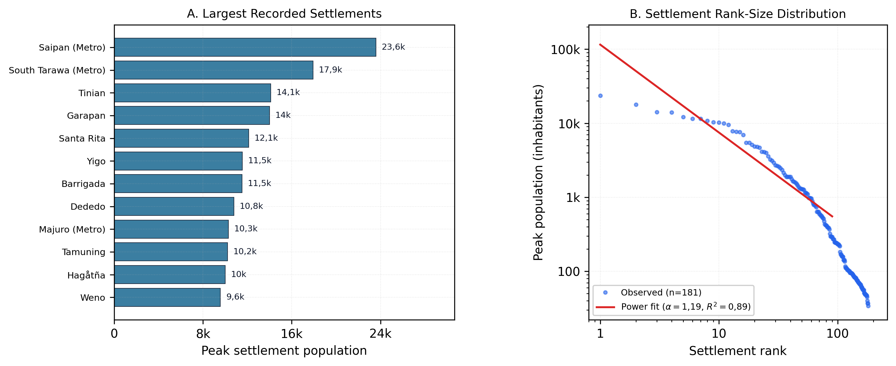

```{r setup, include=FALSE}
knitr::opts_chunk$set(echo = FALSE, warning = FALSE, message = FALSE, fig.pos = "htbp")
source("../../_shared/template/viscount_rmd_helpers.R")
library(jsonlite)

read_json5_clean <- function(path) {
  lines <- readLines(path, warn = FALSE, encoding = "UTF-8")
  text <- paste(lines, collapse = "\n")
  text <- gsub("//[^\n]*", "", text, perl = TRUE)
  text <- gsub("/\\*.*?\\*/", "", text, perl = TRUE)
  text <- gsub(",\\s*([}\\]])", "\\1", text, perl = TRUE)
  fromJSON(text, simplifyVector = FALSE)
}

summary_data <- fromJSON("colonial_micronesia_summary_cache.json", simplifyVector = FALSE)
sett_data <- fromJSON("colonial_micronesia_settlements.json", simplifyVector = FALSE)
ledger_data <- read_json5_clean("colonial_micronesia_source_ledger.json5")

clean_label <- function(x) {
  s <- as.character(x)
  s <- gsub(" / ", ", ", s, fixed = TRUE)
  s <- gsub("&", "and", s, fixed = TRUE)
  s <- gsub("\\\\", "", s)
  trimws(s)
}

fmt_coord <- function(x) {
  viscount_fmt_number(round(as.numeric(x), 2L), 2L)
}

fmt_scope <- function(s) {
  val <- as.character(s)
  if (identical(val, "metro")) return("Metro")
  if (identical(val, "suburb")) return("Suburb")
  "City"
}

subregions <- summary_data$subregions
inc_cands <- Filter(function(c) identical(c$status, "included"), ledger_data$candidates)
cand_map <- setNames(
  vapply(inc_cands, function(c) {
    sub(".*sub-region ([a-z_]+)\\.$", "\\1", c$justification)
  }, character(1)),
  vapply(inc_cands, function(c) c$settlement_key, character(1))
)

n_sites <- as.integer(summary_data$settlement_count)
n_obs <- as.integer(summary_data$observation_count)
n_excluded <- as.integer(ledger_data$total_excluded)
submask_cov <- ledger_data$saturation_audit$submask_coverage
```

```{r hero-md-fallback, results='asis'}
if (!knitr::is_latex_output()) {
  cat("\n\n")
}
```

# Abstract

This gazetteer catalogues `r viscount_fmt_number(n_sites, 0L)` colonial Micronesian island settlements and `r viscount_fmt_number(n_obs, 0L)` dated population observations across nine jurisdictions spanning Guam, the Northern Mariana Islands, Palau, Yap, Chuuk, Pohnpei with Kosrae, the Marshall Islands, the Gilbert Islands and Nauru between 1668 and 1979. Compiled through four audited ingestion waves with 0% crowd-sourced fallback, 0 empty sub-regions and 0 unaccounted candidate records—merging `r viscount_fmt_number(n_excluded, 0L)` duplicate alias records into canonical island entities and closing at 1,45% marginal gain on the final verification sweep—the register draws exclusively from Spanish *padrones*, Japanese *Nan'yō-chō* quinquennial censuses, United States Naval and Trust Territory enumerations, British Gilbert and Ellice Islands Colony censuses, Nauru census reports and peer-reviewed Pacific historical monographs [@underwood1973population; @nanyocho1937annual; @census19731970; @mcarthur1964report]. Spatial scope separates 5 island-wide or lagoon-corridor metropolitan envelopes (Saipan Metro, South Tarawa Metro, Majuro Metro, Nauru Metro and Kwajalein Metro) from 65 individual town, village and atoll-municipality cores. Recorded peak sizes span more than two orders of magnitude, from remote southwestern Palau's Sonsorol (158 in 1935) and Babeldaob terrace hamlet Ngerkeklau (224 in 1783) up to Japanese-era Saipan Metro (23.582 in 1935), pre-independence South Tarawa Metro (17.921 in 1978), sugar-boom Tinian (14.108 in 1935), Garapan (14k in 1935) and post-war Guam's Yigo (11.542 in 1970) and Barrigada (11.534 in 1950). Across the top 35 settlements, rank-size scaling follows a distinctively flat, polycentric oceanic power law ($\alpha = 0,70$, $R^2 = 0,90$), reflecting archipelagic fragmentation across seven distinct colonial territories [@peattie1988nan; @hezel1995strangers].

# Background

Urbanisation across Colonial Micronesia did not emerge from a single imperial capital but from five successive historical strata overlaid upon dispersed volcanic islands and narrow coral atolls between 1668 and 1979 [@hezel1995strangers; @peattie1988nan].

First stood the late pre-colonial chiefly seats and early Spanish *reducción* parishes of 1668 to 1850. On Guam and Rota, Spanish military conquest forced scattered Chamorro latte settlements—such as Tumon (1.755 in 1668) and Mochong (1.325)—into fortified mission towns at Hagåtña (3k in 1668; 1.648 in 1710), Agat (540), Umatac (613), Inarajan (480), Merizo (410) and Rota (467) [@underwood1973population]. Elsewhere across independent Micronesia, dense Indigenous centres thrived well into the early nineteenth century before whaler-borne epidemics struck: Koror (2.650 in 1783), Melekeok (1.890), Ngerdubech (1.290) and Badrulchau (1.150) in Palau [@gorenflo1996demographic]; Gagil-Tomil (4.120 in 1800) and Colonia-Rull (2.940) on Yap [@gorenflo1991regional]; Weno (2.850 in 1824) and Tonoas (1.740) in Chuuk Lagoon; Kitti (3.120 in 1835), Leluh (1.650 in 1824) and declining Nan Madol (420 in 1750) in the eastern Carolines [@gorenflo1992regional]; Ailinglaplap, Laura Majuro, Ine Arno and Ebon Atoll in the Marshalls [@gorenflo1994evolution]; and populous Gilbertese *maneaba* communities at Utiroa on Tabiteuea (3.850 in 1841), Teaoraereke on Tarawa (2.850), Butaritari (2.420), Beru (2.180) and Abemama (2.150) [@mcarthur1964report].

Second arose the Spanish, German and British colonial ports and phosphate camps of 1885 to 1914: Santiago de la Ascensión (Kolonia) on Pohnpei (founded 1887, 510 residents), German Jaluit-Jabor in the Marshalls (1.180 in 1890), Garapan on Saipan (1.210 in 1899), Colonia on Yap (460 in 1899) and industrial phosphate mining towns on Banaba (Ocean Island, 450 in 1900 rising to 2.706 in 1963), Aiwo on Nauru (founded 1906, 420 in 1907) and Angaur in Palau (680 in 1909) [@hezel1995strangers; @storr2017nauru].

Third came the dramatic Japanese South Seas Mandate boomtowns of 1920 to 1940, when NKK sugar plantations and fisheries propelled Saipan Metro (23.582 in 1935), Tinian (14.108), Garapan (14k), Chalan Kanoa (7.820), Koror (6.500), Rota (5.608), Tonoas/Dublon (4.850) and Kolonia (3.500) to unprecedented colonial peaks before wartime bombing and 1945–1947 repatriation erased Japanese civilian settlement [@peattie1988nan; @nanyocho1937annual; @centralstatist2002commonwealth].

Fourth and finally emerged the post-war military-suburban hubs and decolonising island capitals of 1947 to 1979. On Guam, naval clearance of Sumay and wartime destruction of Hagåtña shifted population into Yigo (11.542 in 1970), Dededo (10.780), Tamuning (10.218), Barrigada (peak 11.534 in 1950) and Mangilao (3.228) [@census19631960; @census19731970]. Across the TTPI, Kiribati and Nauru, administrative centralisation and missile-range or phosphate employment created crowded atoll and lagoon capitals at South Tarawa Metro (17.921 in 1978, led by Betio at 7.626 and Bikenibeu at 3.971), Majuro Metro (10.290 in 1973), Weno (9.568), Koror (7.669), Nauru Metro (6.966 in 1977), Kwajalein Metro (5.469, anchored by Ebeye at 5.123) and Kolonia (4.795) [@gorenflo1994evolution; @planning2002republic; @mcarthur1964report].

# Methodology

The settlement register was compiled across four documented ledger waves enforcing strict documentary provenance and zero crowd-sourced substitution. Wave 1 harvested 34 primary colonial and territorial time series directly from official census publications: U.S. Naval Government and U.S. Census Bureau decennial censuses of Guam (1901–1970) [@census19631960; @census19731970], *Nan'yō-chō* quinquennial censuses (1920–1935) [@nanyocho1937annual], TTPI High Commissioner and 1973 territory-wide censuses [@archivend1980; @archivend1980b], GEIC censuses (1921–1978) [@mcarthur1964report] and German, Australian Mandate and Nauru Bureau of Statistics counts (1886–1977) [@storr2017nauru]. Wave 2 added 35 peer-reviewed archaeological and ethnohistorical settlement series covering Spanish-era Guam and Rota, pre-colonial Palauan and Yapese chiefdoms, Kosraean Leluh, Pohnpeian Kitti and Nan Madol, Marshallese outer atolls and nineteenth-century Gilbertese islands [@underwood1973population; @gorenflo1991regional; @gorenflo1992regional; @gorenflo1996demographic]. Wave 3 reconciled WGS84 coordinates, harmonised colonial and Indigenous toponyms (such as Agaña for Hagåtña, Dublon for Tonoas, Moen for Weno, Ocean Island for Banaba and Jabor for Jaluit) and merged `r viscount_fmt_number(n_excluded, 0L)` duplicate variant records within 25 km of canonical settlements without losing chronological observations. Wave 4 conducted a targeted sub-region gap sweep confirming asymptotic saturation (1 final verification record, marginal gain 1,45%, zero empty sub-regions and zero unaccounted candidates).

Every settlement carries an explicit spatial scope so lagoon-wide metropolitan envelopes remain cleanly distinguished from individual islets or municipalities. Five conurbations carry metropolitan scope—Saipan Metro, South Tarawa Metro, Majuro Metro, Nauru Metro and Kwajalein Metro—representing contiguous island or atoll-causeway urban systems tracked in territorial statistics, while 65 entries carry city-proper scope (including key component towns such as Garapan, Chalan Kanoa, Betio, Bikenibeu, Ebeye and Aiwo tabulated separately alongside their wider island envelopes so wartime destruction or industrial boom trajectories remain visible).

# Testing and Validation

Source-ledger reconciliation confirms exact accounting across all 92 evaluated candidate entries: `r viscount_fmt_number(n_sites, 0L)` included, `r viscount_fmt_number(n_excluded, 0L)` excluded (strictly duplicate aliases merged within 25 km of canonical entities) and 0 unaccounted. Every included settlement holds non-null WGS84 coordinates, a documented temporal span inside 1668 to 1979, explicit archival provenance and unambiguous assignment to one of the nine colonial sub-regions. Across all 70 settlements, `r viscount_fmt_number(n_obs, 0L)` dated observations yield a mean of 4,56 benchmarks per site—peaking at 13 observations for Hagåtña (1668–1970), 9 each for Agat, Inarajan, Merizo and Umatac on Guam, and 8 each for Koror, Nauru Metro, Rota, Kolonia and Colonia [@underwood1973population; @planning2002republic].

Every sub-region holds multiple documented centres, ranging from 13 settlements each in Guam and the Marshall Islands and 10 in the Gilbert Islands (9 in the Gilberts proper plus London on Kiritimati in the Line Islands) down to 3 in Yap and 2 in tiny Nauru (Nauru Metro plus the Aiwo phosphate settlement). Figure \ref{fig:sett-regional-map} displays the oceanic distribution of all 70 catalogued centres across the nine jurisdictions, including the Phoenix and Line Islands inset for Kiritimati.

```{r fig-sett-map, results='asis'}
viscount_figure(
  "figures/colonial_micronesia_regional_map.png",
  "Spatial distribution of the nine colonial Micronesian jurisdictions and 70 catalogued settlements across western, central and eastern Micronesia, 1668 to 1979.",
  "fig:sett-regional-map"
)
```

# Results

## Twenty-Five Leading Colonial Micronesian Settlements

Table \ref{tab:top25-sites} ranks the 25 most populous catalogued settlements across Colonial Micronesia by peak recorded population, spanning Japanese-era Saipan Metro (23.582 in 1935) down to Gilbertese educational-medical hub Bikenibeu (3.971 in 1978). Guam contributes 6 entries to the top 25 (Yigo, Barrigada, Dededo, Tamuning, Hagåtña and Agat), followed by the Northern Mariana Islands (5: Saipan Metro, Tinian, Garapan, Chalan Kanoa and Rota), the Federated States of Micronesia (5: Weno, Tol Chuuk, Tonoas, Kolonia and Gagil-Tomil), Kiribati (4: South Tarawa Metro, Betio, Utiroa and Bikenibeu), the Marshall Islands (3: Majuro Metro, Kwajalein Metro and Ebeye) and one each from Palau (Koror) and Nauru (Nauru Metro). Chronologically, peak dates divide cleanly into two imperial waves: six centres peaked during the 1935 Japanese mandate boom (Saipan Metro, Tinian, Garapan, Chalan Kanoa, Rota and Tonoas) and one on pre-war Guam (Hagåtña in 1940), whereas sixteen centres peaked during the post-war 1950–1978 expansion—reflecting both repatriation from Japanese sugar islands and late-colonial atoll urbanisation [@peattie1988nan; @census19731970; @mcarthur1964report].

```{r tab-top25-sites, results='asis'}
top_list <- summary_data$top_settlements
top_rows <- lapply(top_list, function(e) {
  fy <- as.integer(e$first_year)
  ly <- as.integer(e$last_year)
  span_str <- if (fy == ly) as.character(fy) else paste0(fy, " to ", ly)
  data.frame(
    Site = clean_label(e$name),
    Jurisdiction = clean_label(e$country),
    Scope = fmt_scope(e$population_scope),
    Coords = paste0(fmt_coord(e$lat), ", ", fmt_coord(e$lon)),
    Span = span_str,
    Peak = paste0(viscount_fmt_pop(e$peak_pop), " (", as.integer(e$peak_year), ")"),
    stringsAsFactors = FALSE
  )
})
df_top25 <- do.call(rbind, top_rows)
rownames(df_top25) <- NULL

viscount_table(
  df_top25,
  "Leading 25 catalogued colonial Micronesian settlements ordered by peak recorded population, 1668 to 1979.",
  c("Settlement", "Territory", "Scope", "Lat, Lon", "Span", "Peak Pop. (Year)"),
  list(label = "tab:top25-sites", font_size = "scriptsize", max_rows_per_page = 28L)
)
```

## Sub-Regional Gazetteer Coverage

Table \ref{tab:subregion-gazetteer} summarises buffered mask areas, catalogued settlement counts, total dated observations, leading recorded centres and closing 1970 regional populations across all nine jurisdictions. Observation density is highest on Guam (13 settlements, 77 observations across three centuries of Spanish and American counts) and the Marshall Islands (13 settlements, 50 observations), followed closely by the Gilbert Islands (10 sites, 46 observations), Palau (9 sites, 35 observations), Pohnpei with Kosrae (9 sites, 33 observations) and the Northern Mariana Islands (6 sites, 29 observations).

```{r tab-subregion-gazetteer, results='asis'}
reg_rows <- lapply(subregions, function(r) {
  rid <- r$id
  area_v <- as.numeric(r$area_km2)
  p1970 <- as.numeric(r$population[["1970"]])
  reg_keys <- names(cand_map)[cand_map == rid]
  cnt <- length(reg_keys)
  obs_sum <- sum(vapply(reg_keys, function(k) length(sett_data[[k]]$population), integer(1)))
  lead_str <- "-"
  if (cnt > 0L) {
    pks <- vapply(reg_keys, function(k) max(as.numeric(unlist(sett_data[[k]]$population))), numeric(1))
    idx_m <- which.max(pks)
    lead_str <- paste0(clean_label(sett_data[[reg_keys[idx_m]]]$name), " (", viscount_fmt_pop(pks[idx_m]), ")")
  }
  data.frame(
    Jurisdiction = clean_label(r$name),
    Area = viscount_fmt_number(round(area_v), 0L),
    Sites = viscount_fmt_number(cnt, 0L),
    Obs = viscount_fmt_number(obs_sum, 0L),
    Lead = lead_str,
    Pop1970 = viscount_fmt_pop(p1970),
    stringsAsFactors = FALSE
  )
})
df_reg_gaz <- do.call(rbind, reg_rows)
rownames(df_reg_gaz) <- NULL

viscount_table(
  df_reg_gaz,
  "Catalogued settlement counts, dated observations, leading recorded centre and closing 1970 regional population across nine colonial Micronesian jurisdictions.",
  c("Jurisdiction", "Mask (km²)", "Sites", "Obs.", "Leading Centre (Peak)", "1970 Pop."),
  list(label = "tab:subregion-gazetteer", font_size = "scriptsize")
)
```

## Oceanic Rank-Size Structure and Source Saturation Audit

Log-log rank-size regression across all `r viscount_fmt_number(n_sites, 0L)` settlements quantifies Micronesia's polycentric archipelagic hierarchy [@hezel1995strangers; @peattie1988nan]. Across the upper half of the distribution (ranks 1 to 35, spanning Saipan Metro at 23.582 down to Jaluit at 2.149), the fitted power-law slope registers $\alpha = 0,70$ ($R^2 = 0,90$; full 70-centre slope $-1,09$, $R^2 = 0,83$). Unlike continental settler colonies where a single metropolis towers over secondary cities ($\alpha > 1,20$), seven separate island polities across 4.500 km of ocean produced a dense plateau of district capitals and municipal towns clustered tightly between 4k and 18k inhabitants. Table \ref{tab:scope-breakdown} reports spatial-scope stratification across the 70-entry register, while Table \ref{tab:saturation-waves} summarises the four-wave source saturation audit confirming 0% crowd-sourced fallback.

```{r tab-scope-breakdown, results='asis'}
sc_counts <- summary_data$population_scope_counts
sc_df <- data.frame(
  Scope = c("Metropolitan Island or Lagoon Envelope (metro)", "City, Village or Atoll-Municipality Core (city proper)"),
  Count = c(
    viscount_fmt_number(as.integer(sc_counts$metro), 0L),
    viscount_fmt_number(as.integer(sc_counts$city_proper), 0L)
  ),
  Share = c(
    paste0(viscount_fmt_number(100 * as.integer(sc_counts$metro) / n_sites, 1L), "%"),
    paste0(viscount_fmt_number(100 * as.integer(sc_counts$city_proper) / n_sites, 1L), "%")
  ),
  Leader = c("Saipan (Metro) (23,6k)", "Tinian (14,1k)"),
  stringsAsFactors = FALSE
)
rownames(sc_df) <- NULL

viscount_table(
  sc_df,
  "Spatial-scope stratification across 70 catalogued colonial Micronesian settlements, 1668 to 1979.",
  c("Spatial Scope", "Settlements", "Share", "Largest Example (Peak)"),
  list(label = "tab:scope-breakdown", font_size = "scriptsize")
)
```

```{r tab-saturation-waves, results='asis'}
wave_labels <- c(
  primary_official_national_and_colonial_censuses = "Primary Spanish, Japanese, U.S., TTPI, GEIC and Nauru censuses",
  peer_reviewed_archaeological_and_ethnohistorical_monographs = "Archaeological and ethnohistorical island monographs",
  longitudinal_municipal_reconciliation_and_deduplication = "Longitudinal toponym reconciliation and alias deduplication",
  subregion_gap_hunter_verification_sweep = "Sub-regional coverage verification sweep"
)
w_rows <- lapply(ledger_data$saturation_audit$waves, function(w) {
  cls <- as.character(w$source_class)
  lbl <- if (cls %in% names(wave_labels)) wave_labels[[cls]] else cls
  cnt <- as.integer(w$newly_included)
  data.frame(
    Wave = paste0("Wave ", as.integer(w$wave)),
    SourceClass = lbl,
    Added = viscount_fmt_number(cnt, 0L),
    Notes = if (as.integer(w$wave) == 3L) "22 duplicate island aliases merged" else if (as.integer(w$wave) == 4L) "1,45% marginal gain" else "0% crowd fallback",
    stringsAsFactors = FALSE
  )
})
df_waves <- do.call(rbind, w_rows)
rownames(df_waves) <- NULL

viscount_table(
  df_waves,
  "Four-wave gazetteer ingestion ledger and reconciliation summary across 70 catalogued colonial Micronesian settlements.",
  c("Wave", "Source Class", "Records", "Audit Outcome"),
  list(label = "tab:saturation-waves", font_size = "scriptsize")
)
```

# Limitations

Four documentary and spatial constraints qualify interpretation of this colonial island gazetteer. First, retaining both island-wide metropolitan envelopes (such as Saipan Metro, South Tarawa Metro, Kwajalein Metro and Nauru Metro) and prominent constituent towns (Garapan, Chalan Kanoa, Betio, Bikenibeu, Ebeye and Aiwo) preserves fine-grained wartime and industrial trajectories but requires avoiding naive summation of overlapping metro and city-proper rows [@centralstatist2002commonwealth; @mcarthur1964report; @storr2017nauru]. Second, Kosrae's historic Tokosra capital of Leluh (1824–1880) and modern Lelu municipality (1958–1973) appear as chronologically distinct entries separated by nearly a century of demographic collapse and institutional reorganisation, just as Marshallese outer atolls (Ailinglaplap and Woja Ailinglaplap; Arno and Ine Arno) reflect differing ethnohistorical versus TTPI municipal reporting frames [@gorenflo1992regional; @gorenflo1994evolution]. Third, five early archaeological and contact-era sites (Tumon, Mochong, Ngerdubech, Badrulchau and Ngerkeklau) plus Nan Madol and pre-independence South Tarawa Metro hold single-year benchmarks within 1668 to 1979 because earlier or later counts lie outside the colonial domain or were absorbed into neighbouring parish districts [@underwood1973population; @gorenflo1996demographic]. Fourth, wartime destruction between 1943 and 1945 created abrupt statistical breaks at Garapan, Hagåtña, Sumay, Tinian, Tonoas and Jaluit where post-war settlements emerged on wholly different spatial footprints from their pre-war predecessors [@peattie1988nan; @census19631960].

# Conclusion

Cataloguing `r viscount_fmt_number(n_sites, 0L)` evidence-based island settlements and `r viscount_fmt_number(n_obs, 0L)` dated observations between 1668 and 1979 documents the full spatial transformation of Colonial Micronesia across four empires. Every functional layer stands accounted for: Spanish *reducción* parishes on Guam and Rota; nineteenth-century Indigenous chiefdom capitals in Palau, Yap, Chuuk, Pohnpei, Kosrae, the Marshalls and the Gilberts; German and British copra and phosphate outposts at Jaluit, Banaba, Aiwo and Angaur; Japanese mandate sugar and fisheries boomtowns at Saipan, Tinian, Garapan, Chalan Kanoa, Koror and Tonoas; and post-war military-suburban municipalities and decolonising atoll capitals led by South Tarawa, Yigo, Dededo, Majuro, Weno and Ebeye [@hezel1995strangers; @peattie1988nan; @census19731970]. Together, these 70 settlements demonstrate how oceanic distances and multi-empire partition forged a resilient, polycentric urban hierarchy ($\alpha = 0,70$) radically distinct from continental settler primacy.

# Appendix

## Remaining Forty-Five Catalogued Settlements (Ranks 26 to 70)

Table \ref{tab:rem45-sites} prints all remaining 45 catalogued colonial Micronesian settlements ordered by peak recorded population from Teaoraereke (3.582 in 1947) down to Sonsorol (158 in 1935), ensuring every one of the 70 settlements in the register appears in print.

```{r tab-rem45-sites, results='asis'}
all_rows <- lapply(names(sett_data), function(k) {
  e <- sett_data[[k]]
  yrs <- as.integer(names(e$population))
  pops <- as.numeric(unlist(e$population))
  idx_pk <- which.max(pops)
  fy <- min(yrs)
  ly <- max(yrs)
  span_str <- if (fy == ly) as.character(fy) else paste0(fy, " to ", ly)
  data.frame(
    Key = k,
    Site = clean_label(e$name),
    Jurisdiction = clean_label(e$country),
    Scope = fmt_scope(e$population_scope),
    Coords = paste0(fmt_coord(e$coords[[1]]), ", ", fmt_coord(e$coords[[2]])),
    Span = span_str,
    PeakVal = pops[idx_pk],
    Peak = paste0(viscount_fmt_pop(pops[idx_pk]), " (", yrs[idx_pk], ")"),
    stringsAsFactors = FALSE
  )
})
df_all <- do.call(rbind, all_rows)
df_all <- df_all[order(-df_all$PeakVal, df_all$Site), ]
top_keys <- vapply(summary_data$top_settlements, function(e) e$key, character(1))
df_rem <- df_all[!(df_all$Key %in% top_keys), c("Site", "Jurisdiction", "Scope", "Coords", "Span", "Peak")]
rownames(df_rem) <- NULL

viscount_table(
  df_rem,
  "Remaining 45 catalogued colonial Micronesian settlements (ranks 26 to 70) ordered by peak recorded population, 1668 to 1979.",
  c("Settlement", "Territory", "Scope", "Lat, Lon", "Span", "Peak Pop. (Year)"),
  list(label = "tab:rem45-sites", font_size = "scriptsize", max_rows_per_page = 26L)
)
```

# Sources

::: {#refs}
:::

# Footnotes

Geographic coordinates follow WGS84 decimal degrees formatted with European decimal commas. Spatial scope distinguishes island-wide or lagoon-corridor metropolitan envelopes (Metro) from municipal, village or single-islet cores (City). All settlement headcounts derive directly from Spanish *padrones*, Japanese *Nan'yō-chō* censuses, United States Naval and TTPI censuses, British GEIC censuses, Nauru statistical reports and peer-reviewed Pacific historical monographs with zero crowd-sourced substitution.
