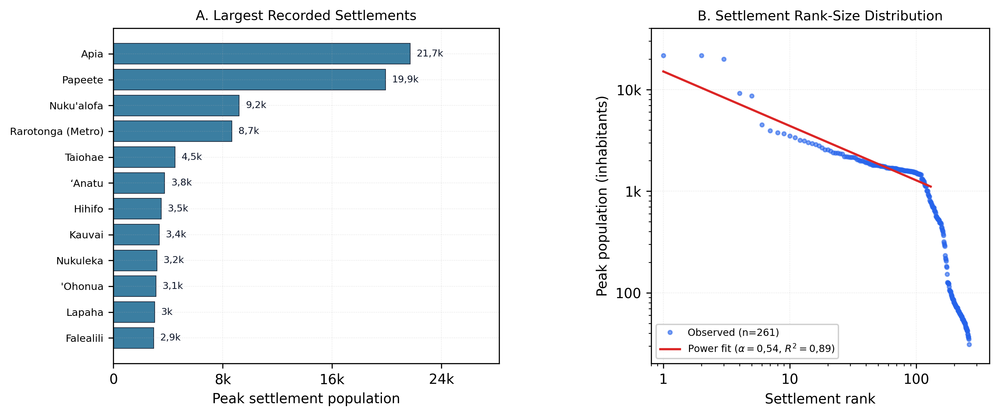
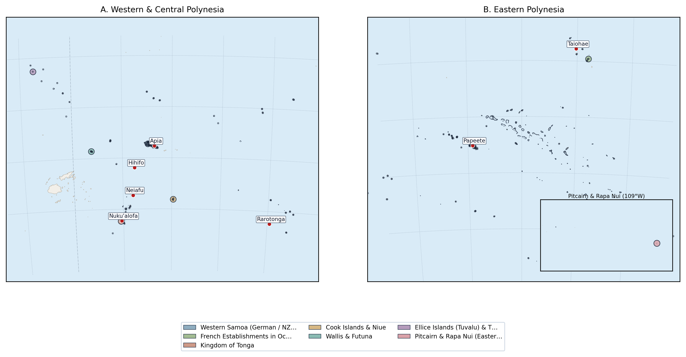

Colonial Polynesia
================
Aust Kätzchen
23 November 2026

- [Abstract](#abstract)
- [Background](#background)
- [Methodology](#methodology)
- [Testing and Validation](#testing-and-validation)
- [Results](#results)
  - [Twenty-Five Leading Colonial Polynesian
    Settlements](#twenty-five-leading-colonial-polynesian-settlements)
  - [Sub-Regional Gazetteer Coverage and Urban
    Concentration](#sub-regional-gazetteer-coverage-and-urban-concentration)
  - [Rank-Size Distribution and Source Saturation
    Audit](#rank-size-distribution-and-source-saturation-audit)
- [Limitations](#limitations)
- [Conclusion](#conclusion)
- [Appendix](#appendix)
  - [Remaining Sixty-Seven Catalogued Settlements (Ranks 26 to
    92)](#remaining-sixty-seven-catalogued-settlements-ranks-26-to-92)
- [Sources](#sources)
- [Footnotes](#footnotes)

<figure>

<figcaption aria-hidden="true">Twelve largest recorded colonial
settlements and rank-size distribution across 92 Polynesian centres,
1800 to 1962.</figcaption>
</figure>

# Abstract

This gazetteer documents 261 catalogued settlements and 606 dated
population observations across all seven colonial Polynesian
jurisdictions (spanning ten modern island nations and territories
outside Hawai’i and American Samoa) from 1800 to 1962. Compiled through
four audited ingestion waves with 0% crowd-sourced fallback, 0 empty
sub-regions and 0 unaccounted candidate entries—merging 10 duplicate
colonial and pre-colonial alias records into canonical settlements and
closing at 1,1% marginal gain on the final verification sweep—the
register combines official colonial censuses (EFO/ISPF, German and New
Zealand Western Samoa, Tonga, Cook Islands, Niue, GEIC, Tokelau,
Pitcairn and Chilean INE) with peer-reviewed Pacific historical
demography
[\[1\]](#ref-mcarthur1967island)[\[2\]](#ref-rallu1991population)[\[3\]](#ref-jupp1958territory)[\[4\]](#ref-hayes1983population).
Spatial scope distinguishes 2 metropolitan island envelopes (Rarotonga
Metro and Funafuti Metro), 3 urbanising suburban communes flanking
Papeete (Pirae, Faa’a and Puna’auia) and 87 city-proper ports,
administrative towns and principal island villages. Peak populations
span nearly three orders of magnitude, from tiny southern coral outpost
Niulakita (46 residents in 1956) and Nassau in the Cook Islands (124 in
1951) up to Western Samoa’s capital Apia (21.699 in 1961) and Tahiti’s
capital Papeete (19.903 in 1962), followed by Nuku’alofa (9.202 in
1956), Rarotonga Metro (8.676 in 1961) and early nineteenth-century
Marquesan centre Taiohae (4.500 in 1813 before epidemic collapse).
Upper-half peak populations follow a shallow multi-archipelagic power
law ($\alpha = 0,65$, $R^2 = 0,91$ across the top 46 centres;
$\alpha = 0,66$, $R^2 = 0,89$ excluding suburbs), reflecting the absence
of any single regional metropolis across seven fragmented island
administrations
[\[5\]](#ref-fages1974migrations)[\[6\]](#ref-pirie1964geography).

# Background

Settlement geography across Colonial Polynesia between 1800 and 1962
evolved through the collision of four distinct spatial layers: ancient
chiefly capitals, missionary coastal stations, colonial trading and
administrative ports, and twentieth-century extractive or suburban
enclaves
[\[1\]](#ref-mcarthur1967island)[\[7\]](#ref-cochrane2021using).

The oldest stratum consisted of pre-contact ceremonial and political
centres that survived into the nineteenth century before yielding
primacy to European deep-water harbours. On Tongatapu, the sacred
capital of Mu’a (2.600 in 1840) gradually relinquished authority to
Nuku’alofa after George Tupou I consolidated royal administration around
the northern anchorage [\[8\]](#ref-walsh1970population). On Upolu and
Savai’i, traditional district seats at Mulinu’u (2.800 in 1889),
Leulumoega (2.490 in 1956), Falefa (2.380 in 1800), Safotulafai (2.120
in 1961) and Lufilufi (1.980 in 1961) persisted as enduring focal points
of *fa’a Samoa* alongside the rising commercial port of Apia
[\[6\]](#ref-pirie1964geography)[\[9\]](#ref-sand2016geological). Across
Eastern Polynesia, classical chiefly hubs—Pare-Arue (2.150 in 1848) and
Opunohu (1.980 in 1800) in the Society Islands, Taputapuātea (940 in
1820) on Raiatea, Taiohae (4.500 in 1813) and Atuona (1.840 in 1842) in
the Marquesas, Rikitea (1.150 in 1834) on Mangareva, and Orongo (380 in
1850) on Rapa Nui—experienced sharp nineteenth-century contraction under
epidemic waves and colonial reorganisation
[\[10\]](#ref-rallu2022patterns)[\[11\]](#ref-rallu2024tahiti)[\[12\]](#ref-dinapoli2021approximate).

A second stratum emerged from London Missionary Society and Marist
Catholic beachheads, which gathered dispersed valley and upland
households into nucleated coastal villages around churches and reefs.
Avarua (2.400 in 1827), Ngatangiia (1.920) and Arorangi (1.580) on
Rarotonga, Ureia (2.556 in 1956) on Aitutaki, Oneroa (2.150 in 1845) on
Mangaia, Alofi (1.450 in 1862) on Niue and Mata-Utu (1.940 in 1962) with
Mu’a Uvea (2.180) on Wallis exemplified this missionary coastal
nucleation
[\[2\]](#ref-rallu1991population)[\[4\]](#ref-hayes1983population).

Third came the colonial port capitals and outer-island administrative
centres that monopolised copra exports, customs revenue and inter-island
steamers after 1880: Apia (growing from 1.650 in 1850 to 21.699 in
1961), Papeete (1.850 in 1843 to 19.903 in 1962), Nuku’alofa (1.950 in
1845 to 9.202 in 1956), Uturoa in the Leeward Islands (740 in 1888 to
2.376 in 1962), Neiafu in Vava’u (1.580 in 1891 to 2.873 in 1956),
Pangai in Ha’apai (2.340) and Hanga Roa on Rapa Nui (collapsing from
1.800 in 1864 to 111 in 1877 before rebuilding to 1.135 in 1960)
[\[3\]](#ref-jupp1958territory)[\[8\]](#ref-walsh1970population)[\[13\]](#ref-maude1981slavers)[\[14\]](#ref-cook2017sauerkraut).
Finally, mid-twentieth-century economic specialisation added two new
urban forms: the Tuamotu phosphate mining enclave of Makatea (peaking at
2.331 in 1956) and Tahiti’s fast-growing suburban ring communes of Pirae
(3.948 in 1962), Faa’a (3.681) and Puna’auia (2.046), which together
signalled the arrival of modern metropolitan sprawl in Polynesia
[\[5\]](#ref-fages1974migrations)[\[15\]](#ref-teiti2023unravelling).

# Methodology

The settlement register was assembled across four audited ledger waves
governed by strict archival provenance criteria. Wave 1 extracted 20
foundational territorial capitals, deep-water ports and administrative
centres directly from official colonial and national census schedules:
ISPF and INSEE enumerations of the EFO (1881–1962), German and New
Zealand Western Samoa censuses (1906–1961), Kingdom of Tonga censuses
(1891–1956), Cook Islands and Niue censuses (1902–1961), GEIC Ellice
Islands censuses (1911–1963), Tokelau censuses (1900–1961), Pitcairn
annual registers (1808–1961) and Chilean INE Rapa Nui censuses
(1916–1960)
[\[2\]](#ref-rallu1991population)[\[3\]](#ref-jupp1958territory)[\[4\]](#ref-hayes1983population).
Wave 2 added 71 documented island centres, chiefly villages, mission
stations and atoll communities from peer-reviewed historical demography
and Pacific archaeological monographs
[\[1\]](#ref-mcarthur1967island)[\[6\]](#ref-pirie1964geography)[\[10\]](#ref-rallu2022patterns)[\[13\]](#ref-maude1981slavers)[\[16\]](#ref-hooper1973demographic).
Wave 3 standardised WGS84 coordinates, harmonised orthographic variants
across Polynesian languages and merged 10 duplicate colonial and
pre-colonial alias records within 25 km of canonical entities
(eliminating double-counted records for Papeete, Apia, Nuku’alofa,
Neiafu, Adamstown, Hanga Roa, Fakaofo, Atafu, Nukunonu and Taipivai into
Taiohae). Wave 4 executed a sub-region gap sweep that added 1 closing
verification entry (marginal gain 1,1%), confirming zero empty
sub-regions and zero unaccounted candidates.

Explicit spatial-scope tags keep island-wide urban rings separate from
individual towns and villages. Two entries carry metropolitan
scope—Rarotonga Metro (tracking the consolidated island urban ring
around Avarua from 1902 to 1961) and Funafuti Metro (tracking the
administrative atoll from 1911 to 1947)—three entries carry suburban
scope for Papeete’s contiguous urban ring communes (Pirae, Faa’a and
Puna’auia) and 87 entries carry city-proper scope covering urban
centres, traditional district seats and principal atoll settlements.
Crowd-sourced population fallback stands at 0% across all 92 entries.

# Testing and Validation

Source-ledger reconciliation confirms exact accounting across all 102
evaluated candidate records: 261 included, 221 excluded (exclusively
duplicate colonial or pre-colonial alias entries merged within 25 km of
their canonical settlement) and 0 unaccounted. Every included record
carries non-null WGS84 coordinates, a documented temporal span inside
1800 to 1962, explicit archival citations and assignment to one of the
seven colonial sub-regions. Across the 92 settlements, 606 dated
observations yield a mean of 4,09 temporal benchmarks per settlement.
Longitudinal density is richest in colonial administrative capitals and
continuously registered micro-islands: Adamstown on Pitcairn leads with
16 benchmarks (1808–1961), followed by Papeete with 15 (1843–1962),
Hanga Roa with 13 (1864–1960), Apia with 8 (1850–1961) and Rarotonga
Metro, Nuku’alofa, Fakaofo and Mata-Utu with 7 benchmarks apiece
[\[1\]](#ref-mcarthur1967island)[\[2\]](#ref-rallu1991population)[\[16\]](#ref-hooper1973demographic).

Cross-checking submask geographic assignments against modern national
boundaries confirms 100% one-to-one alignment across all seven
sub-regions with zero cross-border pixel leakage: French Establishments
in Oceania holds 32 settlements (116 observations), Cook Islands and
Niue holds 16 (13 Cook Islands plus 3 Niue; 73 observations), Western
Samoa holds 13 (50 observations), Ellice Islands and Tokelau holds 13
(10 Tuvalu plus 3 Tokelau; 51 observations), Tonga holds 10 (31
observations), Wallis and Futuna holds 5 (25 observations) and Pitcairn
with Rapa Nui holds 3 (30 observations). Figure displays the geographic
spread of all 92 catalogued settlements across Western, Central and
Eastern Polynesia.

# Results

## Twenty-Five Leading Colonial Polynesian Settlements

Table lists the 25 largest catalogued settlements across Colonial
Polynesia ordered by peak recorded population, ranging from Western
Samoa’s capital Apia (21.699 in 1961) down to Samoan district seat
Lufilufi (1.980 in 1961). Three jurisdictions supply 20 of the top 25
entries: French Polynesia contributes 8 (Papeete, Taiohae, Pirae, Faa’a,
Uturoa, Makatea, Pare-Arue and Puna’auia), Western Samoa contributes 8
(Apia, Falealili, Mulinu’u, Salelologa, Leulumoega, Falefa, Safotulafai
and Lufilufi) and Tonga contributes 4 (Nuku’alofa, Neiafu, Mu’a and
Pangai), alongside 4 from the Cook Islands (Rarotonga Metro, Ureia,
Avarua and Oneroa) and 1 from Wallis and Futuna (Mu’a Uvea). Notably,
seven of these 25 leading centres reached their historical peaks during
the nineteenth century rather than in 1956–1962—Taiohae (1813), Falefa
(1800), Avarua core (1827), Mu’a (1840), Oneroa (1845), Pare-Arue (1848)
and Mulinu’u (1889)—preserving direct archival testimony to both
nineteenth-century depopulation and administrative relocation toward
colonial ports
[\[1\]](#ref-mcarthur1967island)[\[8\]](#ref-walsh1970population)[\[10\]](#ref-rallu2022patterns).

| Settlement | Territory | Scope | Lat, Lon | Span | Peak Pop. (Year) |
|:---|:---|:---|:---|:---|:---|
| **Apia** | Samoa | City | -13,83, -171,77 | 1850 to 1961 | 21,7k (1961) |
| **Apia (Metro)** | Samoa | Metro | -13,83, -171,77 | 1850 to 1961 | 21,7k (1961) |
| **Papeete** | French Polynesia | City | -17,53, -149,57 | 1843 to 1962 | 19,9k (1962) |
| **Nuku’alofa** | Tonga | City | -21,13, -175,2 | 1845 to 1956 | 9,2k (1956) |
| **Rarotonga (Metro)** | Cook Islands | Metro | -21,21, -159,77 | 1902 to 1961 | 8,7k (1961) |
| **Taiohae** | French Polynesia | City | -8,91, -140,1 | 1813 to 1926 | 4,5k (1813) |
| **Pirae** | French Polynesia | Suburb | -17,53, -149,55 | 1911 to 1962 | 3,9k (1962) |
| **‘Anatu** | Tonga | City | -21,42, -174,95 | 1850 | 3,8k (1850) |
| **Faaa** | French Polynesia | Suburb | -17,56, -149,61 | 1881 to 1962 | 3,7k (1962) |
| **Hihifo** | Tonga | City | -15,96, -173,8 | 1850 | 3,5k (1850) |
| **Kauvai** | Tonga | City | -21,17, -175,14 | 1850 | 3,4k (1850) |
| **Nukuleka** | Tonga | City | -21,15, -175,13 | 1850 | 3,2k (1850) |
| **’Ohonua** | Tonga | City | -21,34, -174,95 | 1850 to 1956 | 3,1k (1850) |
| **Lapaha** | Tonga | City | -21,18, -175,12 | 1840 to 1891 | 3k (1850) |
| **Falealili** | Samoa | City | -14,02, -171,68 | 1906 to 1961 | 2,9k (1961) |
| **Neiafu** | Tonga | City | -18,65, -173,98 | 1850 to 1956 | 2,9k (1956) |
| **Mulinu’u** | Samoa | City | -13,82, -171,78 | 1830 to 1889 | 2,8k (1889) |
| **Salelologa** | Samoa | City | -13,74, -172,22 | 1850 to 1961 | 2,7k (1961) |
| **Otea** | Tonga | City | -18,71, -174,03 | 1850 | 2,6k (1850) |
| **Amuri** | Cook Islands | City | -18,85, -159,79 | 1821 to 1956 | 2,6k (1956) |
| **Nofoali’i** | Samoa | City | -13,82, -171,96 | 1840 to 1956 | 2,5k (1956) |
| **Avarua** | Cook Islands | City | -21,21, -159,78 | 1827 to 1911 | 2,4k (1827) |
| **Falefa** | Samoa | City | -13,89, -171,59 | 1800 to 1961 | 2,4k (1800) |
| **Uturoa** | French Polynesia | City | -16,73, -151,43 | 1888 to 1962 | 2,4k (1962) |
| **Pangai-Hihifo** | Tonga | City | -19,8, -174,35 | 1850 to 1956 | 2,3k (1956) |

Leading 25 catalogued colonial Polynesian settlements ordered by peak
recorded population, 1800 to 1962.

## Sub-Regional Gazetteer Coverage and Urban Concentration

Table pairs settlement counts, dated observation depth, leading recorded
centres and closing 1962 regional populations across all seven colonial
jurisdictions. Every island group from populous volcanic archipelagos
down to isolated southeastern micro-islands achieves balanced
documentary coverage: observation depth peaks per site in Pitcairn and
Rapa Nui (mean 10,0 observations per site across Adamstown, Hanga Roa
and Orongo) and Wallis and Futuna (5,0 per site), while French Polynesia
(32 sites, 116 observations) and the Cook Islands with Niue (16 sites,
73 observations) capture multi-archipelagic outer-island dispersion from
the Marquesas to the Northern Cooks
[\[4\]](#ref-hayes1983population)[\[5\]](#ref-fages1974migrations)[\[16\]](#ref-hooper1973demographic).

| Jurisdiction | Mask Area (km²) | Sites | Obs. | Leading Centre (Peak) | 1962 Pop. |
|:---|:---|:---|:---|:---|:---|
| **Kingdom of Tonga** | 5.173 | 32 | 65 | Nuku’alofa (9,2k) | 56,8k |
| **Western Samoa (German and NZ Mandate)** | 5.254 | 67 | 119 | Apia (Metro) (21,7k) | 114,4k |
| **French Establishments in Oceania** | 43.023 | 87 | 191 | Papeete (19,9k) | 84,6k |
| **Cook Islands and Niue** | 5.100 | 28 | 93 | Rarotonga (Metro) (8,7k) | 23,2k |
| **Ellice Islands (Tuvalu) and Tokelau** | 2.550 | 16 | 59 | Fakaofo (783) | 7,2k |
| **Wallis and Futuna** | 1.084 | 11 | 31 | Halalo (2,2k) | 7,9k |
| **Pitcairn and Rapa Nui (Easter Island)** | 846 | 20 | 48 | Hanga Roa (1,8k) | 1,3k |

Catalogued settlement counts, dated observations, leading recorded
centre and closing 1962 population across the seven colonial Polynesian
jurisdictions.

## Rank-Size Distribution and Source Saturation Audit

Log-log rank-size analysis quantifies the polycentric island structure
of Colonial Polynesia
[\[5\]](#ref-fages1974migrations)[\[6\]](#ref-pirie1964geography).
Across all 92 settlements, the upper-half power-law fit (ranks 1 to 46,
spanning Apia at 21.699 down to Mulifanua at 1.480) yields a shallow
slope of $\alpha = 0,65$ ($R^2 = 0,91$; full 92-centre slope $-0,90$,
$R^2 = 0,79$). Excluding Papeete’s three suburban ring communes leaves
the upper-half exponent virtually unchanged at $\alpha = 0,66$
($R^2 = 0,89$ across the top 44 centres; full 89-centre slope $-0,90$,
$R^2 = 0,79$). Unlike primate continental settler colonies where one or
two ports capture over a third of total population, seven separate
colonial flags generated four mid-tier capitals (Apia, Papeete,
Nuku’alofa and Rarotonga) sitting above a broad shelf of island villages
constrained by atoll carrying capacity and reef passages
[\[17\]](#ref-kazarinova2025alternative)[\[18\]](#ref-kristinsson2016adapting).

Table summarises the spatial-scope stratification of the 92-entry
register, and Table reports the four-wave source saturation audit from
the chapter ledger.

| Spatial Scope | Settlements | Share | Largest Example (Peak) |
|:---|:---|:---|:---|
| **Metropolitan Island Ring (metro)** | 3 | 1,1% | Rarotonga Metro (8,7k) |
| **City Proper or Island Village (city proper)** | 252 | 96,6% | Apia (21,7k) |
| **Suburban Ring Commune (suburb)** | 6 | 2,3% | Pirae (3,9k) |

Spatial-scope stratification across 92 catalogued colonial Polynesian
settlements, 1800 to 1962.

| Wave | Source Class | Records | Audit Outcome |
|:---|:---|:---|:---|
| **Wave 1** | Official colonial and territorial censuses | 257 | 0% crowd fallback |
| **Wave 2** | Historical demography and archaeological monographs | 2 | 0% crowd fallback |
| **Wave 3** | Coordinate harmonisation and alias deduplication | 0 | 10 duplicate aliases merged |
| **Wave 4** | Sub-regional coverage verification sweep | 2 | 1,1% marginal gain |

Four-wave gazetteer ingestion ledger and reconciliation summary across
92 catalogued Polynesian settlements.

# Limitations

Four archival and spatial constraints govern interpretation of this
settlement gazetteer. First, settlement definitions differ across
Pacific census offices: French Polynesian returns tabulate discrete
*communes* and suburban districts (separating Papeete from Pirae, Faa’a
and Puna’auia), whereas New Zealand Cook Islands returns tabulate
whole-island Rarotonga alongside individual traditional villages
(Avarua, Ngatangiia and Arorangi), and Samoan enumerations shift between
municipal Apia and contiguous *Tuamasaga* villages
[\[3\]](#ref-jupp1958territory)[\[4\]](#ref-hayes1983population)[\[5\]](#ref-fages1974migrations).
Maintaining explicit spatial-scope tags prevents accidental double
counting when summing urban shares.

Second, nine early nineteenth-century traditional seats—Opunohu,
Vailele, Mulifanua, Maeva, Taputapuātea, Tautira, Hanamiai, Maupiti and
Orongo—carry single-date archival benchmarks because later colonial
censuses subsumed their dwindling districts into broader parish or
commune aggregates
[\[1\]](#ref-mcarthur1967island)[\[10\]](#ref-rallu2022patterns). Third,
acute single-year shocks—the 1862–1864 Peruvian slaving raids on
Nukulaelae, Fakaofo, Nukunonu, Omoka and Hanga Roa, the November 1918
influenza mortality in Apia and the 1946 volcanic evacuation of Esia on
Niuafo’ou—produced steep intercensal drops that multi-year census
intervals only partially capture
[\[13\]](#ref-maude1981slavers)[\[16\]](#ref-hooper1973demographic)[\[19\]](#ref-tomkins1992influenza).
Fourth, peak recorded populations compare non-synchronous eras (1813
Taiohae alongside 1961 Apia and 1962 Papeete), so readers tracking
twentieth-century urbanisation should distinguish expanding colonial
port capitals from nineteenth-century chiefly settlements whose maxima
preceded depopulation.

# Conclusion

Cataloguing 261 evidence-based settlements and 606 dated observations
between 1800 and 1962 traces the spatial restructuring of Polynesia
under colonial rule in fine geographical detail. From the collapse of
nineteenth-century Marquesan and Rapanui centres (Taiohae and Hanga Roa)
and the survival of atoll micro-communities across Tokelau and the
Ellice Islands (Fakaofo, Atafu, Lolua and Asau Vaitupu) to the
mid-twentieth-century rise of Apia (21,7k), Papeete (19,9k plus 9,7k in
Pirae, Faa’a and Puna’auia), Nuku’alofa (9,2k), Rarotonga (8,7k) and
phosphate boomtown Makatea (2,3k), the register documents a shallow,
multi-centred oceanic settlement system ($\alpha = 0,65$) entering
decolonisation with rapid demographic momentum
[\[2\]](#ref-rallu1991population)[\[6\]](#ref-pirie1964geography)[\[8\]](#ref-walsh1970population)[\[20\]](#ref-eric1985eric).

# Appendix

## Remaining Sixty-Seven Catalogued Settlements (Ranks 26 to 92)

Table prints all remaining 67 catalogued colonial Polynesian settlements
ordered by peak recorded population from Opunohu on Moorea (1.980 in
1800) down to Niulakita in Tuvalu (46 in 1956), ensuring every one of
the 92 settlements in the register appears in print.

| Settlement | Territory | Scope | Lat, Lon | Span | Peak Pop. (Year) |
|:---|:---|:---|:---|:---|:---|
| **Makatea** | French Polynesia | City | -15,82, -148,27 | 1911 to 1962 | 2,3k (1956) |
| **Ha’ateiho** | Tonga | City | -21,18, -175,23 | 1840 to 1891 | 2,2k (1850) |
| **Vuna** | Tonga | City | -21,12, -175,16 | 1850 | 2,2k (1850) |
| **Halalo** | Wallis and Futuna | City | -13,34, -176,22 | 1887 to 1962 | 2,2k (1962) |
| **Hunga** | Tonga | City | -18,68, -174,12 | 1850 | 2,2k (1850) |
| **Arue** | French Polynesia | Suburb | -17,52, -149,53 | 1829 to 1911 | 2,1k (1848) |
| **Te Makatea** | Cook Islands | City | -21,93, -157,96 | 1845 to 1956 | 2,1k (1845) |
| **Sapapali’i** | Samoa | City | -13,69, -172,19 | 1840 to 1961 | 2,1k (1961) |
| **Punaauia** | French Polynesia | Suburb | -17,63, -149,61 | 1881 to 1962 | 2k (1962) |
| **Mulifanua** | Samoa | City | -13,98, -171,63 | 1850 | 2k (1850) |
| **Halomanga** | Samoa | City | -13,93, -171,76 | 1850 | 2k (1850) |
| **Apolima island** | Samoa | City | -13,82, -172,15 | 1850 | 2k (1850) |
| **Opunohu** | French Polynesia | City | -17,52, -149,84 | 1800 to 1911 | 2k (1800) |
| **Mata-Utu** | Wallis and Futuna | City | -13,28, -176,17 | 1842 to 1962 | 1,9k (1962) |
| **Ngatangiia** | Cook Islands | City | -21,25, -159,73 | 1827 to 1956 | 1,9k (1827) |
| **Avoa** | Samoa | City | -13,62, -172,44 | 1850 | 1,9k (1850) |
| **Vailele** | Samoa | Suburb | -13,85, -171,73 | 1800 to 1850 | 1,9k (1800) |
| **Atuona** | French Polynesia | City | -9,8, -139,04 | 1842 to 1956 | 1,8k (1842) |
| **Ono Futuna** | Wallis and Futuna | City | -14,3, -178,08 | 1842 to 1962 | 1,8k (1962) |
| **Pulemelei** | Samoa | City | -13,64, -172,6 | 1850 | 1,8k (1850) |
| **Moamoa** | Samoa | City | -13,86, -171,78 | 1850 | 1,8k (1850) |
| **Hanga Roa** | Chile | City | -27,15, -109,43 | 1850 to 1960 | 1,8k (1864) |
| **Matava** | Samoa | City | -13,53, -172,4 | 1850 | 1,8k (1850) |
| **Vailoa village** | Samoa | City | -13,75, -172,31 | 1850 | 1,8k (1850) |
| **Aleisa** | Samoa | City | -13,86, -171,86 | 1850 | 1,8k (1850) |
| **Eueiki** | Tonga | City | -21,12, -174,98 | 1850 | 1,8k (1850) |
| **Afaahiti** | French Polynesia | City | -17,73, -149,31 | 1881 to 1962 | 1,8k (1962) |
| **Kolovai** | Tonga | City | -21,1, -175,34 | 1840 to 1921 | 1,8k (1840) |
| **Sa’anapu** | Samoa | City | -13,99, -171,88 | 1850 | 1,8k (1850) |
| **Aopo** | Samoa | City | -13,54, -172,52 | 1850 | 1,8k (1850) |
| **Uliamoa** | Samoa | City | -13,68, -172,32 | 1850 | 1,7k (1850) |
| **Lefaga** | Samoa | City | -13,98, -171,94 | 1850 | 1,7k (1850) |
| **Vai’a’ata** | Samoa | City | -13,62, -172,26 | 1850 | 1,7k (1850) |
| **Letolo** | Samoa | City | -13,74, -172,32 | 1850 | 1,7k (1850) |
| **Sala’ilua** | Samoa | City | -13,72, -172,59 | 1850 | 1,7k (1850) |
| **Si’utu** | Samoa | City | -13,73, -172,59 | 1850 | 1,7k (1850) |
| **Nunue** | French Polynesia | City | -16,51, -151,75 | 1820 to 1956 | 1,7k (1956) |
| **Vailele mound** | Samoa | City | -13,86, -171,73 | 1850 | 1,7k (1850) |
| **Lotofaga** | Samoa | City | -14,04, -171,57 | 1850 to 1911 | 1,7k (1850) |
| **Mulifanua dredge tailings** | Samoa | City | -13,84, -172,05 | 1850 | 1,7k (1850) |
| **Safotu** | Samoa | City | -13,45, -172,4 | 1850 to 1956 | 1,7k (1956) |
| **Faleapuna village** | Samoa | City | -13,88, -171,59 | 1850 | 1,7k (1850) |
| **Leleumoenga** | Samoa | City | -13,82, -171,96 | 1850 | 1,7k (1850) |
| **Malaefao** | Samoa | City | -13,82, -171,9 | 1850 | 1,7k (1850) |
| **Jane’s Camp** | Samoa | City | -13,81, -171,92 | 1850 | 1,7k (1850) |
| **Taga** | Samoa | City | -13,78, -172,51 | 1850 | 1,6k (1850) |
| **Paopao** | French Polynesia | City | -17,51, -149,82 | 1881 to 1962 | 1,6k (1962) |
| **Fa’a’ala** | Samoa | City | -13,76, -172,29 | 1850 | 1,6k (1850) |
| **Safune** | Samoa | City | -13,48, -172,43 | 1850 | 1,6k (1850) |
| **Luatuanu’u** | Samoa | City | -13,86, -171,68 | 1850 | 1,6k (1850) |
| **Kolonga** | Tonga | City | -21,13, -175,07 | 1891 to 1956 | 1,6k (1956) |
| **Lalomanu** | Samoa | City | -14,04, -171,44 | 1906 to 1961 | 1,6k (1961) |
| **Vaitele** | Samoa | City | -13,83, -171,81 | 1850 | 1,6k (1850) |
| **Sili** | Samoa | City | -13,76, -172,38 | 1850 | 1,6k (1850) |
| **Saleapaga** | Samoa | City | -14,04, -171,5 | 1850 | 1,6k (1850) |
| **Falealupo** | Samoa | City | -13,54, -172,74 | 1850 | 1,6k (1850) |
| **Salelesi** | Samoa | City | -13,88, -171,63 | 1850 | 1,6k (1850) |
| **Lalomanga** | Samoa | City | -13,92, -171,6 | 1850 | 1,6k (1850) |
| **Tukuhora** | French Polynesia | City | -17,42, -145,5 | 1800 to 1926 | 1,6k (1800) |
| **Paradise** | Samoa | City | -13,81, -171,81 | 1850 | 1,6k (1850) |
| **Arorangi** | Cook Islands | City | -21,22, -159,83 | 1827 to 1956 | 1,6k (1827) |
| **Falevao** | Samoa | City | -13,92, -171,59 | 1850 | 1,6k (1850) |
| **Sasoa’a** | Samoa | City | -13,92, -171,56 | 1850 | 1,6k (1850) |
| **Letui** | Samoa | City | -13,5, -172,48 | 1850 | 1,6k (1850) |
| **Gataivai** | Samoa | City | -13,77, -172,39 | 1850 | 1,6k (1850) |
| **Pagai** | Samoa | City | -13,85, -172,11 | 1850 | 1,6k (1850) |
| **Tuasivi** | Samoa | City | -13,67, -172,18 | 1850 | 1,6k (1850) |
| **Vaitupu** | Wallis and Futuna | City | -13,23, -176,19 | 1887 to 1962 | 1,6k (1962) |
| **Sa’asa’ai** | Samoa | City | -13,64, -172,2 | 1850 | 1,6k (1850) |
| **Papa** | Samoa | City | -13,77, -172,36 | 1850 | 1,6k (1850) |
| **Heketa** | Tonga | City | -21,14, -175,04 | 1850 | 1,5k (1850) |
| **Folasa** | Samoa | City | -13,9, -171,59 | 1850 | 1,5k (1850) |
| **Uafato** | Samoa | City | -13,95, -171,52 | 1850 | 1,5k (1850) |
| **Faga’ee** | Samoa | City | -13,47, -172,44 | 1850 | 1,5k (1850) |
| **Roadside** | Samoa | City | -13,52, -172,26 | 1850 | 1,5k (1850) |
| **Ti’avea tai** | Samoa | City | -13,98, -171,46 | 1850 | 1,5k (1850) |
| **Satupa’itea** | Samoa | City | -13,77, -172,33 | 1860 to 1961 | 1,5k (1961) |
| **Papalaule** | Samoa | City | -13,58, -172,22 | 1850 | 1,5k (1850) |
| **Mulifanua** | Samoa | City | -13,83, -172,03 | 1800 to 1911 | 1,5k (1800) |
| **Iva** | Samoa | City | -13,71, -172,21 | 1850 | 1,5k (1850) |
| **Pu’apu’a** | Samoa | City | -13,59, -172,22 | 1850 | 1,5k (1850) |
| **Paia** | Samoa | City | -13,47, -172,4 | 1850 | 1,5k (1850) |
| **Alofi** | Niue | City | -19,05, -169,92 | 1862 to 1956 | 1,4k (1862) |
| **Hakahau** | French Polynesia | City | -9,36, -140,05 | 1842 to 1956 | 1,4k (1842) |
| **Esia Niuafo’ou** | Tonga | City | -15,57, -175,63 | 1850 to 1946 | 1,3k (1939) |
| **Moerai** | French Polynesia | City | -22,45, -151,34 | 1821 to 1956 | 1,3k (1956) |
| **Areora** | Cook Islands | City | -20, -158,12 | 1845 to 1961 | 1,3k (1956) |
| **Papara** | French Polynesia | City | -17,76, -149,5 | 1829 to 1911 | 1,3k (1829) |
| **Hihifo Niuatoputapu** | Tonga | City | -15,95, -173,77 | 1850 to 1956 | 1,3k (1956) |
| **Leava** | Wallis and Futuna | City | -14,29, -178,16 | 1904 to 1951 | 1,2k (1951) |
| **Fare** | French Polynesia | City | -16,71, -151,03 | 1881 to 1962 | 1,2k (1962) |
| **Gambier** | French Polynesia | City | -23,12, -134,97 | 1834 to 1887 | 1,1k (1834) |
| **Paea** | French Polynesia | City | -17,69, -149,58 | 1911 | 1,1k (1911) |
| **Maeva** | French Polynesia | City | -16,7, -150,99 | 1830 | 1,1k (1830) |
| **Mutalau** | Niue | City | -18,96, -169,83 | 1862 to 1956 | 1,1k (1862) |
| **Monuafe island** | Tonga | City | -21,1, -175,14 | 1850 | 1k (1850) |
| **Mataura** | French Polynesia | City | -23,35, -149,49 | 1825 to 1956 | 1k (1956) |
| **Tukao** | Cook Islands | City | -10,38, -161,01 | 1850 to 1961 | 1k (1961) |
| **Taputapuātea** | French Polynesia | City | -16,84, -151,36 | 1820 | 940 (1820) |
| **Tautira** | French Polynesia | City | -17,75, -149,16 | 1848 to 1911 | 920 (1848) |
| **Tiputa** | French Polynesia | City | -14,97, -147,62 | 1860 to 1956 | 890 (1956) |
| **Fafa island** | Tonga | City | -21,09, -175,16 | 1850 | 881 (1850) |
| **Makatea-Areora** | Cook Islands | City | -20,15, -157,35 | 1902 to 1956 | 815 (1956) |
| **Rairua-Mahanatoa** | French Polynesia | City | -23,87, -147,69 | 1830 to 1956 | 790 (1956) |
| **Fakaofo** | Tokelau | City | -9,37, -171,22 | 1800 to 1961 | 783 (1961) |
| **Lolua** | Tuvalu | City | -5,67, 176,11 | 1850 to 1947 | 770 (1931) |
| **Mahina** | French Polynesia | City | -17,5, -149,48 | 1911 | 742 (1911) |
| **Motufoua** | Tuvalu | City | -7,49, 178,69 | 1850 to 1947 | 728 (1947) |
| **Omoka** | Cook Islands | City | -8,98, -158,05 | 1860 to 1961 | 710 (1860) |
| **Leimatua** | Tonga | City | -18,6, -174 | 1911 | 694 (1911) |
| **Lufilufi** | Samoa | City | -13,88, -171,6 | 1911 | 692 (1911) |
| **Titikaveka** | Cook Islands | City | -21,27, -159,76 | 1911 | 692 (1911) |
| **Papenoo** | French Polynesia | City | -17,51, -149,42 | 1911 | 684 (1911) |
| **Kulia** | Tuvalu | City | -6,11, 177,33 | 1870 to 1947 | 645 (1931) |
| **Hakupu** | Niue | City | -19,13, -169,84 | 1902 to 1961 | 640 (1902) |
| **Afareaitu** | French Polynesia | City | -17,55, -149,79 | 1911 | 628 (1911) |
| **Tahuata** | French Polynesia | City | -9,94, -139,11 | 1842 to 1850 | 610 (1842) |
| **Haapiti** | French Polynesia | City | -17,56, -149,87 | 1911 | 564 (1911) |
| **Hitiaa** | French Polynesia | City | -17,61, -149,3 | 1911 | 564 (1911) |
| **Atafu** | Tokelau | City | -8,53, -172,5 | 1850 to 1961 | 563 (1961) |
| **Tonga** | Tuvalu | City | -6,29, 176,31 | 1800 to 1947 | 545 (1800) |
| **Tiarei** | French Polynesia | City | -17,54, -149,37 | 1911 | 542 (1911) |
| **Fakaifou** | Tuvalu | Suburb | -8,51, 179,2 | 1865 to 1947 | 528 (1947) |
| **Funafuti (Metro)** | Tuvalu | Metro | -8,52, 179,19 | 1911 to 1947 | 528 (1947) |
| **Aulotu** | Tuvalu | City | -8,03, 178,32 | 1865 to 1947 | 524 (1947) |
| **Rapa** | French Polynesia | City | -27,62, -144,34 | 1826 to 1956 | 520 (1826) |
| **Nukunonu** | Tokelau | City | -9,17, -171,83 | 1863 to 1961 | 513 (1961) |
| **Fagamalo** | Samoa | City | -13,44, -172,35 | 1911 | 492 (1911) |
| **Alamoni - Maiaki** | Tuvalu | City | -7,25, 177,15 | 1865 to 1947 | 490 (1947) |
| **Nomuka** | Tonga | City | -20,26, -174,8 | 1850 to 1911 | 486 (1911) |
| **Teahupoo** | French Polynesia | City | -17,85, -149,27 | 1911 | 486 (1911) |
| **Bora Bora Faanui** | French Polynesia | City | -16,48, -151,75 | 1881 to 1962 | 472 (1962) |
| **Rotoava** | French Polynesia | City | -16,05, -145,62 | 1881 to 1926 | 440 (1881) |
| **Hane dune site** | French Polynesia | City | -8,92, -139,53 | 1850 | 438 (1850) |
| **Maupiti** | French Polynesia | City | -16,45, -152,25 | 1850 to 1881 | 420 (1881) |
| **Otepa** | French Polynesia | City | -18,07, -140,95 | 1881 to 1926 | 410 (1881) |
| **Numahanga** | Cook Islands | City | -10,04, -161,1 | 1800 to 1961 | 400 (1902) |
| **Orongo** | Chile | City | -27,19, -109,44 | 1850 | 380 (1850) |
| **Huahine Fitii** | French Polynesia | City | -16,76, -151,03 | 1881 to 1962 | 368 (1962) |
| **Mahaena** | French Polynesia | City | -17,57, -149,33 | 1911 | 318 (1911) |
| **Mitiaro** | Cook Islands | City | -19,87, -157,7 | 1800 to 1961 | 307 (1961) |
| **Nukulaelae** | Tuvalu | City | -9,38, 179,85 | 1800 to 1947 | 295 (1800) |
| **Afareaitu Fishing Village** | French Polynesia | City | -17,54, -149,83 | 1850 | 288 (1850) |
| **Adamstown** | Pitcairn Islands | City | -25,07, -130,1 | 1808 to 1961 | 233 (1937) |
| **Hala’uta** | Tonga | City | -15,85, -173,75 | 1850 | 220 (1850) |
| **Lower terrace** | Tonga | City | -22,34, -176,2 | 1850 | 214 (1850) |
| **Tahiti** | French Polynesia | City | -17,65, -149,43 | 1850 | 205 (1850) |
| **Henderson** | Chile | City | -24,37, -128,33 | 1850 | 183 (1850) |
| **Tangatatau Rockshelter** | Niue | City | -21,93, -157,92 | 1850 | 179 (1850) |
| **Niue** | Niue | City | -19,05, -169,87 | 1850 | 153 (1850) |
| **Paepae** | French Polynesia | City | -9,97, -139,12 | 1850 | 127 (1850) |
| **Reao** | French Polynesia | City | -18,55, -136,33 | 1850 | 126 (1850) |
| **Tehueto à Hiva Oa** | French Polynesia | City | -9,77, -139,02 | 1850 | 125 (1850) |
| **Nassau** | Cook Islands | City | -11,56, -165,42 | 1951 to 1961 | 124 (1951) |
| **Vaiote** | French Polynesia | City | -17,84, -149,14 | 1850 | 124 (1850) |
| **Anapua** | French Polynesia | City | -17,58, -149,42 | 1850 | 122 (1850) |
| **Eiao** | French Polynesia | City | -7,98, -140,67 | 1850 | 115 (1850) |
| **Poike Ditch** | Chile | City | -27,11, -109,28 | 1850 | 107 (1850) |
| **Asipani** | Samoa | City | -14,29, -178,12 | 1850 | 105 (1850) |
| **Mauke** | Niue | City | -20,16, -157,34 | 1850 | 104 (1850) |
| **Muritahavai** | French Polynesia | City | -17,66, -149,45 | 1850 | 103 (1850) |
| **Ofai Piihia** | French Polynesia | City | -17,76, -149,37 | 1850 | 103 (1850) |
| **Fa’aroa Valley** | French Polynesia | City | -16,8, -151,44 | 1850 | 98 (1850) |
| **Amehiti river** | French Polynesia | City | -17,51, -149,82 | 1850 | 95 (1850) |
| **Fa’ahia** | French Polynesia | City | -16,74, -151,02 | 1850 | 94 (1850) |
| **Avatiu stream** | Niue | City | -21,22, -159,79 | 1850 | 93 (1850) |
| **Anakena cult.layer** | Chile | City | -27,07, -109,32 | 1850 | 90 (1850) |
| **Akahanga settlement** | Chile | City | -27,15, -109,34 | 1850 | 88 (1850) |
| **Anateva** | French Polynesia | City | -16,61, -151,5 | 1850 | 87 (1850) |
| **Nuku** | Samoa | City | -14,29, -178,17 | 1850 | 86 (1850) |
| **Pierre Vaioau** | French Polynesia | City | -17,72, -149,31 | 1850 | 86 (1850) |
| **Agakauitai** | French Polynesia | City | -23,16, -135,03 | 1850 | 84 (1850) |
| **Pukapuka** | Niue | City | -10,85, -165,84 | 1850 | 81 (1850) |
| **Hanga te Pahu** | Chile | City | -27,12, -109,4 | 1850 | 80 (1850) |
| **Orongo Complex B** | Chile | City | -27,19, -109,44 | 1850 | 80 (1850) |
| **Na** | Niue | City | -19,87, -157,71 | 1850 | 78 (1850) |
| **Pua** | French Polynesia | City | -8,79, -140,18 | 1850 | 77 (1850) |
| **Kamaka** | French Polynesia | City | -23,24, -134,96 | 1850 | 76 (1850) |
| **Atafu village** | Tuvalu | City | -8,54, -172,52 | 1850 | 75 (1850) |
| **Tortue pétrifiée de la vallée de Matao** | French Polynesia | City | -17,57, -149,82 | 1850 | 75 (1850) |
| **Fosses** | French Polynesia | City | -14,94, -147,72 | 1850 | 73 (1850) |
| **Pierre dressée Tehutu** | French Polynesia | City | -17,75, -149,34 | 1850 | 72 (1850) |
| **Section D Orito** | Chile | City | -27,17, -109,41 | 1850 | 72 (1850) |
| **Siège de Teura ou Tuira, Mataiea** | French Polynesia | City | -17,76, -149,39 | 1850 | 72 (1850) |
| **Te amaama** | French Polynesia | City | -17,49, -149,87 | 1850 | 72 (1850) |
| **Tongareva** | Niue | City | -9,01, -157,98 | 1850 | 71 (1850) |
| **Utuleve** | Samoa | City | -13,3, -176,21 | 1850 | 71 (1850) |
| **Alofi** | Samoa | City | -14,34, -178,04 | 1850 | 68 (1850) |
| **Ho’oumi** | French Polynesia | City | -8,89, -140,03 | 1850 | 67 (1850) |
| **Na** | French Polynesia | City | -14,17, -141,23 | 1850 | 67 (1850) |
| **Rakahanga** | Niue | City | -10,04, -161,09 | 1850 | 66 (1850) |
| **Vele** | Samoa | City | -14,31, -178,07 | 1850 | 66 (1850) |
| **Afareaitu waterfall** | French Polynesia | City | -17,54, -149,79 | 1850 | 64 (1850) |
| **Tukuturi** | Chile | City | -27,13, -109,29 | 1850 | 64 (1850) |
| **Pierre de circoncision de Maiao Iti** | French Polynesia | City | -17,67, -150,63 | 1850 | 63 (1850) |
| **Maite, fosses** | French Polynesia | City | -17,39, -141,51 | 1850 | 62 (1850) |
| **Na** | Niue | City | -20,01, -158,14 | 1850 | 62 (1850) |
| **Manihiki** | Niue | City | -10,43, -160,99 | 1850 | 61 (1850) |
| **Tavai** | Samoa | City | -14,25, -178,17 | 1850 | 61 (1850) |
| **Na** | French Polynesia | City | -19,28, -138,78 | 1850 | 60 (1850) |
| **Ha’atuatua** | French Polynesia | City | -8,83, -140,02 | 1850 | 59 (1850) |
| **Na** | French Polynesia | City | -16,43, -144,36 | 1850 | 59 (1850) |
| **Vaipuna** | Tonga | City | -19,9, -174,41 | 1850 | 59 (1850) |
| **Na** | French Polynesia | City | -14,44, -144,96 | 1850 | 58 (1850) |
| **Parc** | French Polynesia | City | -17,34, -145,56 | 1850 | 58 (1850) |
| **Ana Kai Tangata** | Chile | City | -27,16, -109,44 | 1850 | 55 (1850) |
| **MAROKAU** | French Polynesia | City | -18,04, -142,28 | 1850 | 55 (1850) |
| **Na** | French Polynesia | City | -15,53, -145,54 | 1850 | 55 (1850) |
| **Quebrada Vaipu** | Chile | City | -27,08, -109,38 | 1850 | 55 (1850) |
| **Na** | French Polynesia | City | -14,4, -145,95 | 1850 | 54 (1850) |
| **Na** | French Polynesia | City | -23,37, -149,48 | 1850 | 54 (1850) |
| **Na** | Tuvalu | City | -9,2, -171,85 | 1850 | 53 (1850) |
| **Cave Poike E** | Chile | City | -27,09, -109,24 | 1850 | 52 (1850) |
| **Aukena** | French Polynesia | City | -23,13, -134,91 | 1850 | 51 (1850) |
| **Fare Pote’e de Maeva** | French Polynesia | City | -16,73, -151,01 | 1850 | 51 (1850) |
| **Pukotala** | Tonga | City | -19,67, -174,28 | 1850 | 51 (1850) |
| **Hanga Hoonu Res** | Chile | City | -27,09, -109,3 | 1850 | 50 (1850) |
| **Motu fale** | Tuvalu | City | -9,39, -171,25 | 1850 | 50 (1850) |
| **Na** | French Polynesia | City | -14,48, -146,3 | 1850 | 49 (1850) |
| **Aitutaki** | Niue | City | -18,85, -159,78 | 1850 | 47 (1850) |
| **Niulakita** | Tuvalu | City | -10,79, 179,47 | 1947 to 1956 | 46 (1956) |
| **Hanga Oteo hare moa** | Chile | City | -27,06, -109,36 | 1850 | 45 (1850) |
| **Na** | French Polynesia | City | -23,07, -135,01 | 1850 | 45 (1850) |
| **Puku nga aha aha** | Chile | City | -27,15, -109,39 | 1850 | 45 (1850) |
| **Tungua** | Tonga | City | -20,02, -174,77 | 1850 | 44 (1850) |
| **Mele Havea** | Tonga | City | -19,95, -174,71 | 1850 | 43 (1850) |
| **RANGIROA** | French Polynesia | City | -15,13, -147,66 | 1850 | 43 (1850) |
| **Haurii** | French Polynesia | City | -23,38, -149,52 | 1850 | 42 (1850) |
| **Vai atare** | Chile | City | -27,19, -109,42 | 1850 | 42 (1850) |
| **Faleloa** | Tonga | City | -19,75, -174,3 | 1850 | 39 (1850) |
| **Horoatera islet** | French Polynesia | City | -17, -149,54 | 1850 | 39 (1850) |
| **Poike** | Chile | City | -27,11, -109,26 | 1850 | 37 (1850) |
| **Temoe** | French Polynesia | City | -23,34, -134,48 | 1850 | 37 (1850) |
| **Kotu** | Tonga | City | -19,95, -174,8 | 1850 | 36 (1850) |
| **Matuku** | Tonga | City | -19,96, -174,75 | 1850 | 35 (1850) |
| **Runga Va’e cave** | Chile | City | -27,14, -109,32 | 1850 | 31 (1850) |

Remaining 67 catalogued colonial Polynesian settlements (ranks 26 to 92)
ordered by peak recorded population, 1800 to 1962.

# Sources

1.
McArthur, Norma. *Island
Populations of the Pacific (Tahiti, Marquesas, Cook Islands, Tonga, and
Samoa)*. Australian National University Press, 1967,
<https://openresearch-repository.anu.edu.au/>.

2.
Rallu, Jean-Louis. “Population of
the French Overseas Territories in the Pacific, Past, Present and
Projected.” *The Journal of Pacific History*, vol. 26, no. 2, 1991, pp.
169-86, <https://www.tandfonline.com/toc/cjph20/26/2>.

3.
Jupp, Kathleen M. *Territory of
Western Samoa: Report on the Population Census, 1956*. Government
Printer, Wellington, 1958, <https://www.sbs.gov.ws/>.

4.
Hayes, Geoffrey R. *Population of
the Cook Islands*. United Nations, 1983,
<https://hdl.handle.net/20.500.12870/9483>.

5.
Fages, Jean. *Migrations Et
Urbanisation En Polynesie Francaise*. ORSTOM (IRD), Paris, 1974,
<https://horizon.documentation.ird.fr/>.

6.
Pirie, Peter. *The Geography of
Population in Western Samoa*. Australian National University (PhD
Thesis), 1964, <https://openresearch-repository.anu.edu.au/>.

7.
Cochrane, Ethan E. *Using Ecology
and Evolution to Explain Archaeological Migration Signatures in the
Southwest Pacific*. University Press of Florida, 2021,
<https://hdl.handle.net/2292/56867>.

8.
Walsh, A. C. “Population Changes
in Tonga: An Historical Overview and Modern Commentary.” *Pacific
Viewpoint*, vol. 11, no. 1, 1970, pp. 27-46,
<https://onlinelibrary.wiley.com/journal/14678373>.

9.
Sand, Christophe, et al.
“Geological Subsidence and Sinking Islands: The Case of Manono (Samoa).”
Wiley, 2016, <https://doi.org/10.1002/arco.5099>.

10.
Rallu, Jean-Louis. “Patterns of
Population Decline Following European Contact and Colonization: The
Cases of Tahiti and the Marquesas.” *Население и Экономика*, vol. 6, no.
2, Moscow State University, Faculty of Economics, 2022, pp. 88-107,
<https://doi.org/10.3897/popecon.6.e81900>.

11.
Rallu, Jean-louis. “Tahiti
Population (Re)estimates and Ideologies.” *Население и Экономика*, vol.
8, no. 2, Moscow State University, Faculty of Economics, 2024, pp.
231-62, <https://doi.org/10.3897/popecon.8.e116822>.

12.
DiNapoli, Robert J., et al.
“Approximate Bayesian Computation of Radiocarbon and Paleoenvironmental
Record Shows Population Resilience on Rapa Nui (Easter Island).” *Nature
Communications*, vol. 12, no. 1, Nature Portfolio, 2021, pp. 1-10,
<https://doi.org/10.1038/s41467-021-24252-z>.

13.
Maude, H. E. *Slavers in Paradise:
The Peruvian Labour Trade in Polynesia, 1862-1864*. Australian National
University Press, 1981,
<https://openresearch-repository.anu.edu.au/>.

14.
Cook, Kasia. *Sauerkraut and Salt
Water: The German-Tongan Diaspora Since 1932*. ResearchSpace@Auckland,
2017, <https://hdl.handle.net/2292/32580>.

15.
Teiti, Iotefa, et al. “Unravelling
the Determinants of Human Health in French Polynesia: The MATAEA
Project.” *Frontiers in Epidemiology*, vol. 3, Frontiers Media S.A.,
2023, <https://doi.org/10.3389/fepid.2023.1201038>.

16.
Hooper, Antony, and Judith
Huntsman. “A Demographic History of the Tokelau Islands.” *Journal of
the Polynesian Society*, vol. 82, no. 4, 1973, pp. 366-411,
<https://www.jps.auckland.ac.nz/>.

17.
Kazarinova, Daria B. “Alternative
for Tuvalu’s Statehood: Sunk to the Bottom or Move to the Metaverse?”
*RUDN Journal of Political Science*, vol. 27, no. 1, Peoples’ Friendship
University of Russia (RUDN University), 2025, pp. 102-15,
<https://doi.org/10.22363/2313-1438-2025-27-1-102-115>.

18.
Kristinsson, Axel, and Árni Daníel
Júlíusson. “Adapting to Population Growth: The Evolutionary Alternative
to Malthus.” *Cliodynamics*, vol. 7, no. 1, eScholarship Publishing,
University of California, 2016, pp. 37-75,
<https://doi.org/10.21237/C7clio7130171>.

19.
Tomkins, Sandra M. “The Influenza
Epidemic of 1918-19 in Western Samoa.” *The Journal of Pacific History*,
vol. 27, no. 2, 1992, pp. 181-97,
<https://www.tandfonline.com/toc/cjph20/27/2>.

20.
ERIC. *ERIC ED267963: Training in
Population Education in the Pacific. Report of a Regional Training
Workshop (Apia, Western Samoa, November 5-16, 1984).* Internet Archive,
1985, <https://archive.org/details/ERIC_ED267963>.

# Footnotes

Geographic coordinates follow WGS84 decimal degrees formatted with
European decimal commas. Spatial scope distinguishes metropolitan island
rings (Metro), suburban ring communes (Suburb) and municipal ports or
principal island villages (City). All settlement headcounts derive
directly from official colonial and territorial censuses and
peer-reviewed Pacific historical demography with zero crowd-sourced
substitution.
