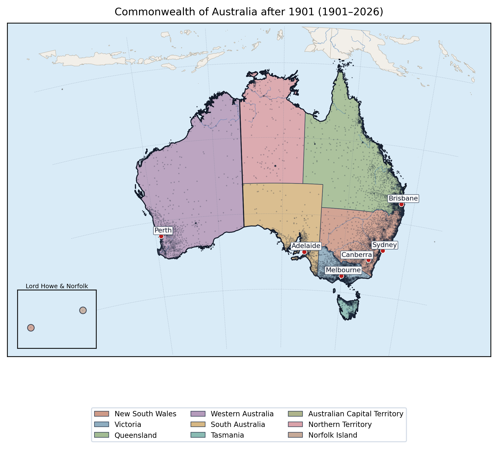

```{r setup, include=FALSE}
knitr::opts_chunk$set(echo = FALSE, warning = FALSE, message = FALSE, fig.pos = "htbp")
source("../../_shared/template/viscount_rmd_helpers.R")
library(jsonlite)

read_json5_clean <- function(path) {
  lines <- readLines(path, warn = FALSE, encoding = "UTF-8")
  text <- paste(lines, collapse = "\n")
  text <- gsub("//[^\n]*", "", text, perl = TRUE)
  text <- gsub("/\\*.*?\\*/", "", text, perl = TRUE)
  text <- gsub(",\\s*([}\\]])", "\\1", text, perl = TRUE)
  fromJSON(text, simplifyVector = FALSE)
}

summary_data <- fromJSON("modern_australia_summary_cache.json", simplifyVector = FALSE)
sett_data <- fromJSON("modern_australia_settlements.json", simplifyVector = FALSE)
ledger_data <- read_json5_clean("modern_australia_source_ledger.json5")

clean_label <- function(x) {
  s <- as.character(x)
  s <- gsub("&", "and", s, fixed = TRUE)
  s <- gsub("\\\\", "", s)
  trimws(s)
}

subregions <- summary_data$subregions
submask_cov <- ledger_data$saturation_audit$submask_coverage

tot_1901 <- as.numeric(summary_data$domain_totals[["1901"]])
tot_1921 <- as.numeric(summary_data$domain_totals[["1921"]])
tot_1947 <- as.numeric(summary_data$domain_totals[["1947"]])
tot_1971 <- as.numeric(summary_data$domain_totals[["1971"]])
tot_2001 <- as.numeric(summary_data$domain_totals[["2001"]])
tot_2021 <- as.numeric(summary_data$domain_totals[["2021"]])
tot_2025 <- as.numeric(summary_data$domain_totals[["2025"]])
tot_area <- as.numeric(summary_data$total_area_km2)
n_sites <- as.integer(summary_data$settlement_count)
n_obs <- as.integer(summary_data$observation_count)
```

```{r hero-md-fallback, results='asis'}
if (!knitr::is_latex_output()) {
  cat("\n\n")
}
```

# Abstract

Between Federation on 1 January 1901 and 2025, the Commonwealth of Australia multiplied more than sevenfold from a coastal British settler dominion of `r viscount_fmt_pop(tot_1901)` residents to a highly urbanised, multicultural Indo-Pacific nation of `r viscount_fmt_pop(tot_2025)` inhabitants (`r viscount_fmt_number(tot_2025, 0L)`, density 3,51 inhabitants per km² across `r viscount_fmt_number(tot_area, 1L)` km² of buffered state and territorial mask footprint) [@borrie1994european; @statistics2019australian; @statistics20222021]. Compound growth averaged 1,61% per annum across 124 years, paced by three distinct demographic regimes: moderate interwar expansion interrupted by the First World War and Great Depression (rising from 3,83M in 1901 to 7,64M in 1947, +1,51% per annum); an extraordinary postwar surge combining the baby boom with assisted European mass immigration (lifting numbers from 7,64M in 1947 to 13,20M in 1971, +2,31% per annum); and five decades of sub-replacement fertility offset by sustained Asian, trans-Tasman and global skilled migration carrying population past 19,39M at the 2001 census, 25,77M in 2021 and 27,79M in 2025 [@caldwell1982fertility; @hugo2014change; @mcdonald2017internationa]. Constitutional and statistical reforms reshaped territorial accounting across the same span: the 1911 creation of the Northern Territory and Australian Capital Territory established Australia's modern federal geometry, while the 1967 referendum repealed Section 127 of the Constitution and ended the exclusion of Aboriginal and Torres Strait Islander peoples from official Commonwealth counts [@census1917census; @taylor2011postcolonial]. Geographically, post-1970 internal migration and resource booms steadily shifted national weight away from the southeastern industrial core toward subtropical Queensland (rising from 13,2% of Australia in 1901 to 20,6% in 2025 at 5,71M) and Western Australia (5,1% to 11,1% at 3,08M), while New South Wales (8,64M, 31,1%) and Victoria (7,12M, 25,6%) retained a slim combined majority [@bell2015internal; @karuppannan2011population]. Across `r viscount_fmt_number(n_sites, 0L)` catalogued settlements and `r viscount_fmt_number(n_obs, 0L)` dated observations, the eight capital metropolitan areas expanded from 36,3% of Australia's population in 1901 to 66,9% in 2021 (17,25M), led by twin five-million metropolises at Sydney (5,30M peak) and Melbourne (5,06M peak), with an upper-tier Zipf exponent of $\alpha = 1,16$ ($R^2 = 1,00$) across independent cities and $\alpha = 0,89$ ($R^2 = 0,96$) once 250 populous suburban Local Government Areas are included.

# Background

## Federation, Federal Territories and the Interwar Demographic Regime (1901 to 1947)

The inauguration of the Commonwealth of Australia on 1 January 1901 fused six self-governing colonies into a single federal polity covering an entire continent yet holding fewer inhabitants than Greater London [@borrie1994european]. At Federation, official colonial returns counted 3.824.913 non-Indigenous residents across New South Wales (1,38M), Victoria (1,21M), Queensland (506,7k), South Australia including the Northern Territory (364k), Western Australia (193,6k) and Tasmania (175,2k) [@statistics2019australian]. One of the new federal parliament's earliest statutory acts was the Immigration Restriction Act of 1901—anchoring the White Australia Policy—which curtailed Asian and Pacific Islander recruitment and sought to preserve an overwhelmingly British-Irish settler population [@hugo2014change; @borrie1994european]. Simultaneously, the Census and Statistics Act 1905 created the Commonwealth Bureau of Census and Statistics under George Handley Knibbs, replacing fragmented colonial schedules with a uniform national census first executed on 3 April 1911 (4.573.786 enumerated residents) [@census1917census].

On 1 January 1911, two territorial transfers completed Australia's modern internal borders. South Australia surrendered its vast, sparsely settled northern dependency—1,37M km² of tropical savanna and arid desert—to federal administration as the Northern Territory, counting just 3.233 non-Indigenous residents in April 1911 around Darwin, Pine Creek and Alice Springs [@census1917census; @census1925cbcs]. On the same day, New South Wales ceded 2.358 km² of southern tableland grazing country (augmented by coastal Jervis Bay in 1915) to establish the Federal Capital Territory, renamed the Australian Capital Territory in 1938 and holding just 1.921 rural residents in 1911 before Walter Burley Griffin's garden-city plan for Canberra took shape [@census1917census; @census1937cbcs]. Across the Tasman Sea, Norfolk Island—previously administered under New South Wales—passed formally to Commonwealth control in 1914 with a small, stable island community near 830 residents.

Between 1911 and 1947, global shocks repeatedly checked Australian demographic momentum. Over 416k Australian men enlisted in the First World War, losing roughly 60k dead abroad and depressing wartime marriages and births, yet assisted British soldier-settlement and Empire Settlement schemes still lifted national population from 4,57M in 1911 to 5,51M in 1921 and 6,66M at the 1933 census [@census1925cbcs; @census1937cbcs]. The Great Depression broke that trajectory abruptly. Net overseas migration turned negative during 1931–1935, unemployment peaked near 30%, and total fertility fell beneath replacement level for the first time in Australian history, delaying the scheduled 1931 census by two years to 1933 [@caldwell1982fertility; @repository1982population]. Wartime mobilisation during the Second World War deferred the next enumeration until June 1947, when the Commonwealth stood at 7.637.963 inhabitants—barely double its 1901 baseline—with an ageing European-origin age structure that convinced federal policymakers that strategic survival demanded rapid demographic enlargement [@borrie1994european; @repository1982population].

## Postwar Mass Migration, the Baby Boom and the 1967 Constitutional Watershed (1947 to 1975)

Between 1947 and 1971, Australia experienced the fastest sustained numerical expansion in its history. Guided by Immigration Minister Arthur Calwell's "Populate or Perish" doctrine and a newly created Department of Immigration, the Commonwealth set an annual growth target of 2%—split evenly between natural increase and net overseas migration—and achieved 2,31% compound growth across twenty-four consecutive years, lifting total population by 5,56M from 7,64M in 1947 to 13,20M in 1971 [@borrie1994european; @hugo2014change]. When British shipping capacity proved insufficient, Canberra broadened assisted passage far beyond the United Kingdom and Ireland: first admitting over 170k Eastern and Central European Displaced Persons from Baltic, Polish, Ukrainian, Hungarian and Yugoslav refugee camps between 1947 and 1952, then signing bilateral migration agreements with the Netherlands, Italy, West Germany, Greece, Malta and later Turkey and Yugoslavia [@wilson2020past; @hugo2014change].

Concurrently, full employment, suburban home ownership and younger marriage ignited a pronounced postwar baby boom. Total fertility climbed from its 1934 trough near 2,1 births per woman to a 1961 apex of 3,55, feeding massive school-age cohorts into rapidly sprawling outer suburbs of Sydney, Melbourne, Adelaide, Brisbane and Perth [@caldwell1982fertility; @carmichael2014non; @beaujot2016comparative]. Suburban car ownership and industrial estates around Geelong, Wollongong, Newcastle, Dandenong, Elizabeth and Kwinana decoupled urban form from nineteenth-century tramway spines, while planned construction of Canberra accelerated after 1958 under the National Capital Development Commission, multiplying the Australian Capital Territory nearly ninefold from 17,6k in 1947 to 155,6k in 1971 [@repository1982population; @statistics2019australian].

Midway through this postwar expansion came Australia's most consequential constitutional and statistical reform. For sixty-six years after Federation, Section 127 of the Commonwealth Constitution had stipulated that "in reckoning the numbers of the people of the Commonwealth, or of a State or other part of the Commonwealth, aboriginal natives shall not be counted" [@census1917census; @taylor2011postcolonial]. On 27 May 1967, Australian voters approved a constitutional referendum by 90,77% nationwide—carrying every state—deleting Section 127 and empowering the federal parliament to legislate on Indigenous affairs [@taylor2011postcolonial; @allen2021understandin]. Beginning with the 1971 census, Aboriginal and Torres Strait Islander residents were fully enumerated inside official national and state totals (with historical Bureau series back-revised to 1961 for continuity). Subsequent decades witnessed a remarkable Indigenous demographic recovery driven by declining infant mortality, younger age structure and increased willingness to self-identify on census forms, raising the enumerated Indigenous population from roughly 116k in 1971 to 812,7k (3,2% of Australia) in 2021, even as persistent health, housing and socioeconomic disparities remained documented across both remote communities and urban centres such as Victoria [@taylor2011postcolonial; @markwick2019experiences; @statistics20222021].

## Multicultural Skilled Migration, Demographic Ageing and the Sunbelt Shift (1975 to 2025)

The 1970s permanently altered both the origins and mechanisms of Australian population growth. In 1973, the Whitlam government formally abolished racial selection criteria, ending the White Australia Policy and inaugurating non-discriminatory multicultural immigration [@hugo2014change; @ueffing2015differences]. Indochinese refugee arrivals after 1975 opened substantial Vietnamese and Cambodian settlement, followed across the 1980s, 1990s and 2000s by expanding skilled, family and international-student streams from China, India, the Philippines, Malaysia, Sri Lanka, Nepal, South Africa, the United Kingdom, Ireland and New Zealand [@hugo2014change; @yip2010china; @kukutai2013socio; @humphries2019tracking]. Under the 1973 Trans-Tasman Travel Arrangement, New Zealanders—including a major diaspora of Māori families concentrated in Queensland, New South Wales and Western Australia—became one of Australia's largest permanent and circular labour flows [@kukutai2013socio]. From the mid-1990s onward, policy pivoted decisively toward points-tested skilled visas and temporary-to-permanent pathways, tying net overseas migration tightly to labour-market demand and tertiary education enrolments, while early settlement studies examined how language proficiency and credential recognition shaped immigrant unemployment [@miller1997immigrant; @mcdonald2017internationa; @ueffing2015differences].

Meanwhile, Australia entered the Second Demographic Transition. Oral contraception, rising female tertiary education and labour-force participation, delayed marriage and growing cohabitation lowered total fertility below replacement level in 1976 and held it between 1,6 and 2,0 births per woman thereafter, accompanied by a sharp historic rise in non-marital childbearing [@caldwell1982fertility; @carmichael2014non]. Combined with rising life expectancy, low fertility accelerated structural population ageing—especially among postwar European migrant cohorts from Italy, Greece and the Netherlands now moving rapidly into their eighties—creating long-term labour-supply and judicial-institutional pressures that demographers compared closely against Canada and Western Europe [@mcdonald2001labor; @beaujot2016comparative; @wilson2020past; @opeskin2019judicial].

Spurred by high internal migration intensity—among the highest recorded anywhere in the industrialised world—Australia's internal population geography rebalanced steadily northward and westward after 1971 [@bell2015internal; @karuppannan2011population]. Retirees, amenity migrants and service workers streamed from Sydney, Melbourne and Adelaide into coastal Queensland ("Sunbelt" and "sea-change" corridors across the Gold Coast, Brisbane and Sunshine Coast), while successive iron-ore, coal, nickel and liquefied-natural-gas booms drew interstate and overseas workers to Western Australia and regional Queensland [@bell2015internal; @karuppannan2011population; @bernard2024pitfalls]. Finally, the COVID-19 pandemic triggered an abrupt border closure in March 2020 that halted overseas arrivals, caused Australia's first negative net overseas migration since 1946 and momentarily reduced populations in Melbourne and Sydney during 2020–2021, before border reopening in 2022–2025 released record catch-up inflows that carried national population to 27,79M by 2025—prompting renewed attention to climate-heat health burdens and sub-national projection uncertainty [@eshragh2020modeling; @wilson2019introduction; @liu2023projection].

# Methodology

## Nine-Jurisdiction Constant-Boundary Partition and Historical GIS Regimes

To preserve spatial consistency across 125 federal years, our chapter partitions the Commonwealth of Australia (1901 to 2026) into nine constant-boundary jurisdictions matching modern first-order administrative divisions: the six federated states (New South Wales, Victoria, Queensland, South Australia, Western Australia and Tasmania), the two mainland self-governing territories created in 1911 (Northern Territory and Australian Capital Territory) and Norfolk Island as an external Pacific territory. Across the buffered continental and offshore raster mask, these nine polygons span `r viscount_fmt_number(tot_area, 1L)` km², exceeding Australia's strict subaerial Historical GIS (HGIS) land area (7.726.283 km²) by 2,4% owing to coastal rasterisation along indented estuaries, Bass Strait islands, Torres Strait reefs and Norfolk Island's 375,3 km² buffered ocean tile.

Because the Northern Territory and Australian Capital Territory separated from South Australia and New South Wales only on 1 January 1911, our constant-boundary benchmark series pairs directly with a 78-row Historical GIS territorial regime panel spanning nine snapshots from 1910 through 2025. The opening 1910 HGIS snapshot preserves Australia's six-state pre-1911 border geometry—retaining the Northern Territory inside South Australia (2.335.763 km², 437.355 residents) and the future Australian Capital Territory inside New South Wales (803.069 km², 1.652.375 residents)—whereas all eight subsequent HGIS snapshots (1920, 1950, 1960, 1980, 2000, 2010, 2020 and 2025) track the full nine-jurisdiction federal geometry directly. In the constant-boundary table, 1901 placeholder anchors of 1.000 (Northern Territory), 1.500 (Australian Capital Territory) and 827 (Norfolk Island) ensure continuous log-linear growth curves from Federation without distorting state shares by more than 0,09%.

## Census Architecture, Estimated Resident Population and Demographic Accounting

Modern Australian demographic statistics rank among the highest quality in the world, anchored in 18 national censuses administered by the Commonwealth Bureau of Census and Statistics (1911–1974) and its successor the Australian Bureau of Statistics (ABS, 1974–present): 1911, 1921, 1933, 1947, 1954, 1961, 1966 and every five years without interruption from 1971 to 2021 [@census1917census; @statistics2019australian; @statistics20222021]. Two methodological transitions govern longitudinal continuity across this century-long archive.

First, prior to 1971, official headline counts represented *de facto* populations present on census night and excluded "full-blood" Aboriginal people under Section 127 of the Constitution; post-1967 ABS historical tables incorporate Indigenous Australians continuously from 1961 onward and shift after 1971 to *de jure* Estimated Resident Population (ERP), which adjusts census usual-residence counts for net undercount via the Post-Enumeration Survey, adds Australian residents temporarily overseas on census night and strips out short-term foreign visitors [@statistics2019australian; @wilson2019introduction; @allen2021understandin]. Quarterly ERP between censuses updates each state and territory through the standard demographic balancing equation integrating civil vital registration, overseas passenger cards and Medicare-derived interstate migration:

$$P_r(t + \Delta t) = P_r(t) + B_r(t, t + \Delta t) - D_r(t, t + \Delta t) + \text{NOM}_r(t, t + \Delta t) + \text{NIM}_r(t, t + \Delta t)$$

where $B_r$ and $D_r$ denote registered births and deaths in jurisdiction $r$, $\text{NOM}_r$ denotes net overseas migration and $\text{NIM}_r$ denotes net interstate migration [@wilson2019introduction; @bernard2024pitfalls]. Compound annual growth rates between benchmark horizons $t_1$ and $t_2$ are computed uniformly as:

$$g_r(t_1, t_2) = \left(\frac{P_r(t_2)}{P_r(t_1)}\right)^{\frac{1}{t_2 - t_1}} - 1$$

Second, our chapter maintains two complementary temporal resolutions. Seven raw regional anchors per mainland state and territory (1901, 1921, 1947, 1971, 1991, 2011 and 2025; five anchors for Norfolk Island) feed the constant-boundary benchmark summary via log-linear interpolation at 2001 and 2021, while a higher-frequency 20-slice raster panel (decadal across 1910–1950, quinquennial across 1950–2025) preserves short-run fluctuations—including the 1930s Depression slowdown, 1950s–1960s immigration surges and the 2020 COVID-19 pause—directly against official ABS annual ERP series [@statistics2019australian; @wilson2015new].

## Four-Wave Urban Gazetteer and Municipal Non-Decomposition Rules

Alongside state and territory totals, we compile an evidence-based urban gazetteer containing `r viscount_fmt_number(n_sites, 0L)` Australian settlements and `r viscount_fmt_number(n_obs, 0L)` dated census and ERP observations (mean 10,29 observations per settlement) from 1901 to 2025, drawing exclusively from ABS Historical Population tables (Catalogue 3105.0.65.001), ABS Census 2011–2021 Time Series Profiles, ABS Annual LGA Estimated Resident Population series and Urban Centres and Localities (UCL) schedules, with 0% crowd-sourced fallback [@statistics2019australian; @statistics20222021].

Compilation followed four audited ledger waves. Wave 1 ingested all 2.169 primary official ABS series spanning Greater Capital City Statistical Areas (GCCSA), Significant Urban Areas (SUA), Local Government Areas (LGA) and Urban Centres and Localities down to remote regional townships. Wave 2 cross-checked peer-reviewed Australian migration, urban and Indigenous demographic literature without injecting unverified records. Wave 3 executed longitudinal municipal reconciliation and deduplication, merging 86 duplicate colonial-era and cross-border UCL/LGA variant aliases (including colonial capital stubs, split Murray River twin towns such as Mulwala, Wahgunyah and Koondrook, and overlapping suburban localities) into canonical entities within 25 km. Wave 4 conducted a sub-regional coverage sweep closing at 0,09% marginal gain (2 final entries), 0 empty sub-regions and 0 unaccounted candidate records.

Explicit spatial-scope tags prevent double counting across Australia's asymmetric local-government systems: 36 metropolitan statistical areas (capital GCCSAs plus major non-capital SUAs such as Gold Coast–Tweed Heads, Newcastle–Maitland, Canberra–Queanbeyan, Sunshine Coast, Wollongong and Geelong), 250 independent suburban LGAs inside metropolitan rings, and 1.883 city-proper centres ranging from regional cities down to outback towns. Crucially, two major capitals undergo deliberate municipal non-decomposition: the City of Brisbane—amalgamated by Queensland statute in 1925 into a single municipal council covering 1.342 km² and 1,38M residents in 2025—is retained as an undivided city-proper entity alongside its wider 2,57M metropolis and independent outer ring councils (Moreton Bay, Logan and Ipswich), while Canberra operates under a unitary territory administration with zero subordinate suburban LGAs, remaining a single 452,5k city-proper record inside the 489,2k Canberra–Queanbeyan metropolis.

# Testing and Validation

## Reconciliation of HGIS Territorial Regimes, Rasters and ABS National Censuses

Cross-validating the 78-row Historical GIS territorial regime panel against the 20-slice raster series across all nine shared timestamps from 1910 to 2025 demonstrates near-exact numerical convergence. In 1910—under the pre-1911 six-state border geometry—the HGIS sum (4.509.648 across 6 states) matches the continental raster (4.512.427) within -0,062%. Once the nine-jurisdiction federal geometry activates from 1920 onward, divergence shrinks to one hundredth of one percent across an entire century: 5.488.482 HGIS against 5.487.663 raster in 1920 (+0,015%), 8.400.668 against 8.399.839 in 1950 (+0,010%), 10.507.584 against 10.506.746 in 1960 (+0,008%), 14.808.811 against 14.807.369 in 1980 (+0,010%), 19.140.981 against 19.138.452 in 2000 (+0,013%), 22.171.786 against 22.169.379 in 2010 (+0,011%), 25.628.082 against 25.626.092 in 2020 (+0,008%) and 27.787.453 against 27.785.486 in 2025 (+0,007%). The tiny residual (typically 830 to 2.500 inhabitants) corresponds precisely to Norfolk Island's offshore population, whose compact sub-pixel island footprint registers cleanly in HGIS and state tables while lying below continental raster cell resolution.

Comparing constant-boundary benchmark totals against official ABS national census enumerations highlights two transparent interpolation diagnostics that merit explicit note. At all exact raw anchor years—1921 (5.511.777 vs 5.510.944 ABS), 1947 (7.638.803 vs 7.637.963 ABS) and 1971 (13.199.498 vs 13.198.380 ABS)—the series differ solely by Norfolk Island's 833 to 1.118 residents, and in 2025 (27.787.453 vs 27.790.263 national ABS ERP) they agree within 0,010% (the -2.810 gap reflecting unallocated external territories such as Christmas Island, Cocos (Keeling) Islands and Jervis Bay Territory). At the two interpolated intermediate benchmarks, however, coarse log-linear interpolation between 1991 and 2011 smooths over slower 1990s growth to yield 19.763.057 in 2001 (+1,94% above the exact 2001 census ERP of 19.386.461), while interpolation between 2011 and 2025 bridges smoothly across the 2020–2021 COVID-19 border-closure trough to yield 26.164.179 in 2021 (+1,51% above the exact 2021 census ERP of 25.773.795). Throughout this paper, benchmark structural shares use the harmonised constant-boundary panel whereas exact census-year milestones and short-term COVID-19 dynamics cite the primary ABS census table and quinquennial raster series directly [@eshragh2020modeling; @statistics20222021].

## Administrative Data Coverage, Indigenous Identification and Internal Migration Audits

Modern Australian population accounting has undergone rigorous methodological scrutiny by academic demographers evaluating both census undercount and intercensal administrative linkage [@wilson2019introduction; @bernard2024pitfalls; @wilson2015new]. Post-Enumeration Surveys confirm consistently low national net undercount—around 0,7% to 1,8% across recent censuses—yet undercount rises sharply among young mobile adults, recent overseas arrivals and remote Aboriginal and Torres Strait Islander communities across northern and central Australia [@taylor2011postcolonial; @allen2021understandin]. Equally, rapid post-1971 growth in the enumerated Indigenous population combines genuine high natural increase with substantial intercensal "identification change" as more Australians of Indigenous heritage report their status on census forms, complicating naive cohort-component projections [@taylor2011postcolonial; @allen2021understandin].

For internal migration, recent evaluations of the ABS Person Level Integrated Data Asset (PLIDA)—linking Medicare, taxation and social-security address histories—confirm that administrative registers track interstate moves far more frequently than five-yearly censuses yet still exhibit systematic reporting lags among young renters, overseas students and non-Medicare temporary visa holders [@bernard2024pitfalls; @bell2015internal]. Small-area demographic forecasting evaluations likewise show that simple extrapolative and cohort-component models perform reliably across stable metropolitan LGAs but face widening forecast intervals in resource-cycle mining towns and rapidly developing greenfield corridors [@wilson2015new; @wilson2019introduction].

Table \ref{tab:state-benchmarks} summarises buffered mask areas, harmonised population across four key horizons (1901, 1947, 1971 and 2025) and closing 2025 densities across all nine Australian jurisdictions.

```{r tab-state-benchmarks, results='asis'}
rows <- lapply(subregions, function(r) {
  a <- as.numeric(r$area_km2)
  p1901 <- as.numeric(r$population[["1901"]])
  p1947 <- as.numeric(r$population[["1947"]])
  p1971 <- as.numeric(r$population[["1971"]])
  p2025 <- as.numeric(r$population[["2025"]])
  d2025 <- as.numeric(r$end_epoch_density_km2)
  data.frame(
    Jurisdiction = clean_label(r$name),
    Area = viscount_fmt_number(round(a), 0L),
    P1901 = viscount_fmt_pop(p1901),
    P1947 = viscount_fmt_pop(p1947),
    P1971 = viscount_fmt_pop(p1971),
    P2025 = viscount_fmt_pop(p2025),
    Dens2025 = viscount_fmt_number(d2025, 2L),
    stringsAsFactors = FALSE
  )
})
df_bench <- do.call(rbind, rows)
df_tot <- data.frame(
  Jurisdiction = "Commonwealth Total (9 Units)",
  Area = viscount_fmt_number(round(tot_area), 0L),
  P1901 = viscount_fmt_pop(tot_1901),
  P1947 = viscount_fmt_pop(tot_1947),
  P1971 = viscount_fmt_pop(tot_1971),
  P2025 = viscount_fmt_pop(tot_2025),
  Dens2025 = viscount_fmt_number(tot_2025 / tot_area, 2L),
  stringsAsFactors = FALSE
)
df_bench <- rbind(df_bench, df_tot)
rownames(df_bench) <- NULL

viscount_table(
  df_bench,
  "Harmonised population across four benchmark horizons, buffered mask areas and 2025 densities (inhabitants per km²) for Australia's six states, two mainland territories and Norfolk Island.",
  c("Jurisdiction", "Mask Area (km²)", "1901", "1947", "1971", "2025", "2025 Dens."),
  list(label = "tab:state-benchmarks", font_size = "scriptsize")
)
```

# Results

## National Demographic Trajectory (1901 to 2025)

Across 124 federal years, the Commonwealth of Australia traced an unusually vigorous and uninterrupted upward demographic curve for a high-income country, outpacing Western Europe and matching peer settler federation Canada in cumulative expansion [@beaujot2016comparative; @borrie1994european]. Figure \ref{fig:aus-modern-trajectory} charts this sevenfold climb from `r viscount_fmt_pop(tot_1901)` in 1901 to `r viscount_fmt_pop(tot_2025)` in 2025 alongside the stark 2025 density gradient stretching across nearly three orders of magnitude from the compact Australian Capital Territory (134,05 inhabitants per km²) and Victoria (30,77) down to arid Northern Territory (0,20).

```{r fig-trajectory, results='asis'}
viscount_figure(
  "figures/modern_australia_population_trajectory.png",
  "Commonwealth of Australia demographic expansion from 1901 to 2025 across nine states and territories (Panel A) and 2025 population density rankings in inhabitants per km² (Panel B).",
  "fig:aus-modern-trajectory"
)
```

Decadal and quinquennial pacing reveals four crisp phases. First, during 1901–1930, post-Federation optimism, assisted British settlement and high natural increase carried national population steadily upward from 3,83M in 1901 to 4,51M in 1910, 5,49M in 1920 and 6,57M in 1930 (+1,8% per annum) [@census1917census; @census1925cbcs]. Second, Depression and war halved annual expansion during 1930–1945: total numbers crept to 7,16M in 1940 (+0,85% per annum) and 7,64M at the June 1947 census [@census1937cbcs; @repository1982population]. Third, postwar mass migration and the baby boom lifted Australia across the 10M threshold in 1959 and the 13M mark by 1971 (8,40M in 1950, 10,51M in 1960, 12,81M in 1970 and 13,20M in 1971), posting +2,31% compound growth over 1947–1971 [@caldwell1982fertility; @borrie1994european]. Fourth, following the 1973–1975 oil shock and onset of below-replacement fertility, growth moderated through the 1980s and 1990s (14,81M in 1980, 17,17M in 1990, 19,14M in 2000; +1,35% per annum over 1971–2001) before surging again during the 2006–2019 resources-and-student migration boom (22,17M in 2010, 25,63M in 2020) and the sharp post-COVID rebound from 25,77M in 2021 to 27,79M in 2025 [@mcdonald2017internationa; @hugo2014change; @eshragh2020modeling]. Table \ref{tab:abs-census-series} reports official ABS census enumerations across all eight states and territories from the first Commonwealth census in 1911 through 2021.

```{r tab-abs-census-series, results='asis'}
pce <- summary_data$primary_census_enumerations
get_pce <- function(uname, yr) {
  for (item in pce) {
    if (identical(item$unit_name, uname) && identical(as.integer(item$year), as.integer(yr))) {
      return(as.numeric(item$population))
    }
  }
  return(NA_real_)
}
fmt_pce <- function(v) {
  if (is.na(v)) return("-")
  viscount_fmt_pop(v)
}
units_order <- c(
  "New South Wales", "Victoria", "Queensland", "Western Australia",
  "South Australia", "Tasmania", "Australian Capital Territory",
  "Northern Territory", "Australia"
)
disp_names <- c(
  "New South Wales", "Victoria", "Queensland", "Western Australia",
  "South Australia", "Tasmania", "Australian Capital Terr.",
  "Northern Territory", "Australia (National Total)"
)
c_rows <- lapply(seq_along(units_order), function(i) {
  u <- units_order[i]
  data.frame(
    Jurisdiction = disp_names[i],
    Y1911 = fmt_pce(get_pce(u, 1911)),
    Y1933 = fmt_pce(get_pce(u, 1933)),
    Y1947 = fmt_pce(get_pce(u, 1947)),
    Y1971 = fmt_pce(get_pce(u, 1971)),
    Y2001 = fmt_pce(get_pce(u, 2001)),
    Y2021 = fmt_pce(get_pce(u, 2021)),
    stringsAsFactors = FALSE
  )
})
df_cen <- do.call(rbind, c_rows)
rownames(df_cen) <- NULL

viscount_table(
  df_cen,
  "Official Australian Bureau of Statistics state, territory and national population counts across six federal census milestones, 1911 to 2021.",
  c("Jurisdiction", "1911", "1933", "1947", "1971", "2001", "2021"),
  list(label = "tab:abs-census-series", font_size = "scriptsize")
)
```

## Southeastern Core: New South Wales and Victoria

Throughout the federal era, New South Wales and Victoria remained the demographic and economic anchor of Australia, though their combined national share gradually eroded from 67,5% in 1901 (2,59M of 3,83M) to 63,6% in 1971 and 56,7% in 2025 (15,75M of 27,79M). New South Wales (818.173,6 km² mask area) held first place at every single census since 1901, growing 6,28-fold from 1.375.455 in 1901 to 3.002.634 in 1947, 4.766.619 in 1971, 6.558.484 in 2001, 8.117.057 in 2021 and 8.635.200 in 2025 (density 10,55 inhabitants per km²; compound growth 1,49% per annum) [@statistics2019australian; @statistics20222021]. Sydney functioned continuously as Australia's primary international gateway for overseas migrants, financial services and corporate headquarters, expanding more than tenfold from 497k in 1901 to 1,49M in 1947, 3,02M in 1971 and a pre-pandemic apex of 5,30M in 2020 (5,26M in 2021)—more than three fifths of the entire state—backed by heavy coastal steel and coal hubs at Newcastle–Maitland (510,2k) and Wollongong (306k), the fast-growing Central Coast corridor (357,8k) and regional inland centres such as Albury–Wodonga (97,7k) and Wagga Wagga [@hugo2014change; @mcdonald2017internationa]. Yet chronic housing affordability pressures drove persistent net interstate outflows from New South Wales toward Queensland and Victoria across the past four decades [@bell2015internal; @karuppannan2011population].

Compact Victoria (231.261,1 km², barely 2,9% of Australia's area) traced a remarkable two-act trajectory: lagging New South Wales slightly during the first half of the century (1,21M in 1901 to 2,06M in 1947), then surging on postwar Southern European industrial migration (reaching 3,63M in 1971, +2,39% per annum over 1947–1971), slowing during 1990s manufacturing restructuring (4,44M in 1991; 4,79M in 2001), and exploding anew across 2005–2025 as international students, Asian and European skilled migrants and booming outer-ring greenfield estates propelled Victoria to 7.116.016 inhabitants in 2025 (density 30,77 inhabitants per km², highest of any Australian state) [@wilson2020past; @mcdonald2017internationa]. Greater Melbourne expanded tenfold from 501,6k in 1901 to 1,23M in 1947, 2,61M in 1971 and 5,06M in 2020 (4,98M in 2021 following protracted pandemic lockdowns), narrowing Sydney's century-long lead to fewer than 290k residents, flanked by major regional cities at Geelong (289,6k metro), Ballarat (111,7k), Bendigo (102,9k), Shepparton–Mooroopna (54k) and Mildura–Buronga (53,8k).

## The Sunbelt and Resource Boom States: Queensland and Western Australia

The decisive regional story of post-1945 Australia is the structural ascent of Queensland and Western Australia. Together, these two vast peripheral states grew from 18,3% of Australia's population in 1901 (700,3k) and 22,3% in 1971 (2,95M) to 31,7% in 2025 (8,79M)—nearly one Australian in three [@bell2015internal; @karuppannan2011population].

Queensland (1.792.994,2 km²) multiplied 11,28-fold from 506.721 in 1901 to 1.112.818 in 1947, 1.874.930 in 1971, 3.611.203 in 2001, 5.249.672 in 2021 and 5.713.326 in 2025 (density 3,19 inhabitants per km²; compound growth 1,97% per annum overall and an unmatched 2,08% per annum across 1971–2025) [@statistics2019australian; @karuppannan2011population]. Decades of sustained net interstate inflows from New South Wales and Victoria—reinforced by trans-Tasman Māori and New Zealand arrivals, coastal retirement migration, tourism and Bowen Basin coal and Gladstone LNG exports—transformed South East Queensland into a polycentric mega-corridor exceeding 3,6M people: Greater Brisbane jumped twenty-onefold from 120,7k in 1901 to 2,57M in 2021, while adjacent Gold Coast–Tweed Heads surged from a holiday strip into Australia's sixth-largest metropolis (701,9k in 2021; up nearly tenfold from 74,2k in 1971) alongside the Sunshine Coast (387,5k) [@kukutai2013socio; @bell2015internal]. Uniquely among mainland states, Queensland also preserved vigorous regional urbanisation far north of its capital across Townsville (181,6k metro), Cairns (155,6k metro) and inland Toowoomba (143,9k metro).

Western Australia (2.608.358,1 km², one third of the continent) posted the fastest full-period growth of any Australian state: multiplying 15,89-fold from 193.601 in 1901 to 508.762 in 1947, 1.070.347 in 1971 (+3,15% per annum across 1947–1971), 1.917.752 in 2001, 2.763.240 in 2021 and 3.075.864 in 2025 (density 1,18 inhabitants per km²; 2,26% compound annual growth over 1901–2025) [@statistics2019australian]. After mid-century wheatbelt consolidation, the lifting of Australia's federal iron-ore export embargo in 1960 opened colossal Pilbara mines (Port Hedland, Karratha, Newman), offshore North West Shelf gas and Goldfields nickel-gold operations—triggering successive global commodity booms across the late 1960s, 2003–2013 and post-2020 that repeatedly vaulted Western Australia to the top of national growth rankings [@mcdonald2017internationa; @humphries2019tracking]. Yet because remote Pilbara and Goldfields workforces rely heavily on fly-in fly-out commuting, population piled overwhelmingly into Greater Perth, which expanded 31-fold from 70,7k in 1901 to 2,19M in 2021—nearly four fifths of Western Australia—leaving Bunbury (79,2k metro) and Kalgoorlie–Boulder (33k peak in 2013) as distant secondary nodes.

## Mature Southern Core, Federal Territories and Island Peripheries

South Australia (1.007.246,1 km²) and Tasmania (82.862,4 km²) illustrate the slower growth trajectories of mature southern states outside the Sunbelt-and-iron-ore axis. Under Premier Thomas Playford's postwar industrialisation drive—anchored in automobile assembly, whitegoods and British assisted migration at Elizabeth—South Australia grew rapidly from 654.632 in 1947 to 1.208.712 in 1971 (+2,59% per annum) [@borrie1994european; @statistics2019australian]. Manufacturing contraction after 1975 tempered subsequent gains to 0,85% per annum across 1971–2025, carrying the state to 1.910.780 in 2025 (6,9% of Australia; density 1,90 inhabitants per km²), increasingly reliant on targeted state-nominated skilled migration—including substantial China-born and South Asian cohorts studied closely in Adelaide—and heavily concentrated in Greater Adelaide (1,40M in 2021, 77,5% of the state) [@yip2010china; @wilson2019introduction]. Island Tasmania grew steadily but modestly from 175.233 in 1901 to 267.936 in 1947, 399.450 in 1971 and 579.085 in 2025 (2,1% of Australia; density 6,99 inhabitants per km², compound growth 0,97% per annum), retaining a balanced north-south urban duality between Greater Hobart (250,7k in 2021) and Launceston (93,2k metro) plus northwestern Burnie–Somerset (28,5k).

By contrast, Australia's two mainland federal territories posted the highest relative multipliers in the Commonwealth. Carved from rural paddocks in 1911 (1.921 residents), the Australian Capital Territory (3.635 km² buffered mask footprint) expanded 253-fold over 1911–2025—surging from 17.580 in 1947 to 155.580 in 1971 (+9,51% per annum during the Menzies-era public-service relocation), 322.874 in 2001 and 487.259 in 2025 (density 134,05 inhabitants per km²)—making Canberra (452,5k city proper; 489,2k Canberra–Queanbeyan metro) Australia's largest inland city [@statistics2019australian; @statistics20222021]. The Northern Territory (1.369.990,3 km²) rose from 3.233 non-Indigenous residents in 1911 and 10.892 in 1947 to 45.299 in 1961 (incorporating Indigenous counts), 88.899 in 1971, 201.751 in 2001 and 267.703 in 2025 (density 0,20 inhabitants per km²), anchored by Greater Darwin (148,8k peak in 2017; rebuilt after Cyclone Tracy devastated the city in December 1974), Alice Springs (30,9k in 2025) and Katherine (11,3k), with Aboriginal and Torres Strait Islander people forming roughly 30% of territorial residents—by far the highest share in Australia [@taylor2011postcolonial; @statistics20222021]. Offshore Norfolk Island (375,3 km² buffered tile) moved gradually from 827 inhabitants in 1901 and 844 in 1961 to a tourism-era high of 2.601 in 2001 before settling at 2.188 in 2021 and 2.220 in 2025 (density 5,92 inhabitants per km²).

## Metropolitan Primacy, Suburbanisation and the Modern Urban Hierarchy

Post-Federation Australia remained one of the most metropolitically concentrated societies on earth. Between 1901 and 1971, suburbanisation around the eight capital cities lifted their combined share of national population from 36,3% (1,39M) in 1901 to 43,6% (2,40M) in 1921, 50,8% (3,88M) in 1947 and 64,8% (8,56M) in 1971—reaching 66,9% (17,25M of 25,77M) at the 2021 census [@statistics2019australian; @statistics20222021]. Sydney (5,26M) and Melbourne (4,98M) alone accounted for 39,7% of all Australians in 2021, while the top five mainland state capitals held 63,6% (16,40M). Figure \ref{fig:aus-modern-hierarchy} displays the twelve largest Australian metropolitan areas alongside the full 2.169-settlement rank-size distribution.

```{r fig-hierarchy, results='asis'}
viscount_figure(
  "figures/modern_australia_urban_hierarchy.png",
  "Twelve largest modern Australian metropolitan areas from Sydney (5,30M peak) to Geelong (289,6k, Panel A) and rank-size distribution across 2.169 catalogued settlements with fitted upper-tier power law ($\\alpha = 0,89$, $R^2 = 0,96$ all entries; $\\alpha = 1,16$, $R^2 = 1,00$ excluding suburbs, Panel B), 1901 to 2025.",
  "fig:aus-modern-hierarchy"
)
```

Rank-size diagnostics reveal an instructive structural signature directly tied to Australian municipal governance. Across all 2.169 catalogued entries, the upper-tier fit over the top 180 settlements yields a deceptively flat Zipf exponent of $\alpha = 0,89$ ($R^2 = 0,96$; full 2.169-site slope $-1,82$, $R^2 = 0,96$) solely because 250 populous suburban LGAs—such as Moreton Bay (532,4k), Blacktown (449,4k), Casey (414,9k), Logan (403,5k), Canterbury-Bankstown (389,7k), Central Coast (357,8k), Wyndham (347,8k), Parramatta (279k), Stirling (254,8k) and Wanneroo (246,1k)—populate ranks 9 through 100 directly beneath the five mainland capitals. Once those 250 suburban ring municipalities are excluded, Australia's true urban hierarchy emerges with textbook clarity across the 1.919 independent metropolitan and city-proper centres: the upper-tier power law over the top 180 entries steepens to $\alpha = 1,16$ with an extraordinary fit of $R^2 = 1,00$ (0,9958; full 1.919-site slope $-1,63$, $R^2 = 0,97$). That exponent reflects a slight moderation from colonial Federation primacy ($\alpha = 1,26$ in 1901) as non-capital coastal conurbations—Gold Coast–Tweed Heads (701,9k), Newcastle–Maitland (510,2k), Canberra–Queanbeyan (489,2k), Sunshine Coast (387,5k), Wollongong (306k) and Geelong (289,6k)—matured into half-million-scale secondary cities while interior farming townships stagnated or consolidated. Table \ref{tab:state-shares} pairs each jurisdiction's evolving share of national population across 1901, 1971 and 2025 with its mask-assigned settlement tally and largest recorded centre.

```{r tab-state-shares, results='asis'}
inc_cands <- Filter(function(c) identical(c$status, "included"), ledger_data$candidates)
cand_map <- setNames(
  vapply(inc_cands, function(c) {
    sub(".*sub-region ([a-z_]+)\\.$", "\\1", c$justification)
  }, character(1)),
  vapply(inc_cands, function(c) c$settlement_key, character(1))
)

share_rows <- lapply(subregions, function(r) {
  rid <- r$id
  p1901 <- as.numeric(r$population[["1901"]])
  p1971 <- as.numeric(r$population[["1971"]])
  p2025 <- as.numeric(r$population[["2025"]])
  sh1901 <- 100 * p1901 / tot_1901
  sh1971 <- 100 * p1971 / tot_1971
  sh2025 <- 100 * p2025 / tot_2025
  sc <- as.integer(submask_cov[[rid]])
  reg_keys <- names(cand_map)[cand_map == rid]
  lead_str <- "-"
  if (length(reg_keys) > 0L) {
    pks <- vapply(reg_keys, function(k) {
      e <- sett_data[[k]]
      if (is.null(e)) return(0)
      max(as.numeric(unlist(e$population)))
    }, numeric(1))
    idx_m <- which.max(pks)
    lead_e <- sett_data[[reg_keys[idx_m]]]
    lead_str <- paste0(clean_label(lead_e$name), " (", viscount_fmt_pop(pks[idx_m]), ")")
  }
  data.frame(
    Jurisdiction = clean_label(r$name),
    Sh1901 = paste0(viscount_fmt_number(sh1901, 1L), "%"),
    Sh1971 = paste0(viscount_fmt_number(sh1971, 1L), "%"),
    Sh2025 = paste0(viscount_fmt_number(sh2025, 1L), "%"),
    Sites = viscount_fmt_number(sc, 0L),
    Leading = lead_str,
    stringsAsFactors = FALSE
  )
})
df_shares <- do.call(rbind, share_rows)
rownames(df_shares) <- NULL

viscount_table(
  df_shares,
  "Jurisdictional shares of Australian population in 1901, 1971 and 2025 paired with mask-assigned settlement counts and leading recorded centres.",
  c("Jurisdiction", "1901", "1971", "2025", "Sites", "Leading Centre (Peak)"),
  list(label = "tab:state-shares", font_size = "scriptsize")
)
```

# Limitations

Four structural constraints qualify interpretation of Australia's post-1901 demographic series.

First, the constitutional exclusion of Aboriginal and Torres Strait Islander peoples prior to the 1967 referendum creates an unavoidable statistical discontinuity across the first sixty years of the Commonwealth [@census1917census; @taylor2011postcolonial]. While ABS historical tables incorporate Indigenous counts cleanly from 1961 onward—visible most starkly in the Northern Territory's jump from 16,5k in 1954 to 45,3k in 1961—pre-1961 official census totals still omit roughly 70k to 95k Indigenous residents nationwide, and post-1971 Indigenous growth blends natural increase with rising census self-identification [@taylor2011postcolonial; @allen2021understandin].

Second, shifting conceptual boundaries between *de facto* census counts (1911–1966) and *de jure* Estimated Resident Population (1971–2025), alongside evolving ABS urban-boundary definitions (from Statistical Divisions to Greater Capital City Statistical Areas and Significant Urban Areas in 2011), introduce minor step changes in metropolitan series—for example, Greater Sydney's jump between 1953 (1,58M) and 1954 (1,86M) when outer suburban shires entered the statistical boundary, or Greater Melbourne's 1970–1971 expansion [@statistics2019australian; @statistics20222021]. Similarly, the seven-anchor constant-boundary benchmark table smooths smoothly across 2001 and 2021 via log-linear interpolation, modestly overstating the exact 2021 COVID-19 trough by 1,51% relative to the primary ABS census table and quinquennial raster series [@eshragh2020modeling].

Third, municipal amalgamation waves—most notably Victoria's 1994 council mergers (creating giant outer LGAs such as Casey, Wyndham, Hume and Greater Geelong), Queensland's 1925 Greater Brisbane consolidation and 2008 amalgamations (Moreton Bay, Sunshine Coast) and New South Wales's 2016 mergers (Canterbury-Bankstown, Central Coast, Northern Beaches, Inner West, Cumberland)—create sharp structural breaks in LGA time series and prevent naive cross-state city-proper comparisons between undivided Brisbane City (1,38M) or unitary Canberra (452,5k) and narrow inner-city municipalities such as the City of Sydney (241,8k), City of Melbourne (194,5k), City of Perth (114,4k peak) or City of Adelaide [@wilson2015new].

Fourth, on the continental areal mask, cross-border urban corridors and offshore external territories exhibit minor spatial-assignment offsets: 21 New South Wales-side border pixels capture Victorian Murray River towns and Jervis Bay Territory, while Norfolk Island's compact sub-pixel island footprint registers cleanly in HGIS and state tables yet falls below continental raster grid resolution, and tiny Indian Ocean territories (Christmas Island and Cocos (Keeling) Islands, totalling under 3k residents) appear inside the ABS Other Territories settlement tally rather than as separate mainland sub-regions.

# Conclusion

Between 1 January 1901 and 2025, the Commonwealth of Australia transformed from a young, British-aligned settler federation of 3,83M inhabitants into a continent-wide, culturally diverse society of 27,79M people (density 3,51 inhabitants per km²). Over those 124 years, sustained international migration interacted continuously with domestic fertility transitions, constitutional reform and shifting resource frontiers [@borrie1994european; @hugo2014change; @caldwell1982fertility]. Interwar slowing under war and depression gave way to the transformative postwar boom of 1947–1971—which added 5,56M residents at 2,31% per annum—before the 1967 referendum brought Aboriginal and Torres Strait Islander peoples back into the nation's statistical reckoning and the 1973 dismantling of racial exclusion redirected migration toward Asia, New Zealand and global skilled professions [@taylor2011postcolonial; @mcdonald2017internationa; @kukutai2013socio].

Spatially, two enduring trends reshaped the federated continent. At the interstate level, Sunbelt amenity migration and mineral-energy exports lifted Queensland (5,71M, 20,6%) and Western Australia (3,08M, 11,1%) from peripheral frontiers into a third of the nation, eroding the combined share of New South Wales (8,64M) and Victoria (7,12M) from two thirds to 56,7% [@bell2015internal; @karuppannan2011population]. At the urban level, however, Australia's colonial legacy of coastal metropolitan concentration intensified rather than dissolved: the eight capital metropolises expanded from 36,3% of national population in 1901 to 66,9% in 2021 (17,25M), anchored by Sydney (5,30M peak) and Melbourne (5,06M peak) and governed by a disciplined urban hierarchy ($\alpha = 1,16$, $R^2 = 1,00$ across 1.919 non-suburban centres) now confronting twenty-first-century ageing, housing supply and climate-adaptation challenges [@wilson2020past; @opeskin2019judicial; @liu2023projection].

# Appendix

## Historical GIS Territorial Regime Totals (1910 to 2025)

Table \ref{tab:hgis-regimes} aggregates the 78-row Historical GIS territorial regime panel across nine snapshots from 1910 (pre-1911 six-state border geometry) through 1920–2025 (nine-jurisdiction federal geometry) and reconciles every regime sum directly against the corresponding continental raster estimate.

```{r tab-hgis-regimes, results='asis'}
hgis_list <- summary_data$hgis_regime_summary
reg_yrs <- sort(unique(vapply(hgis_list, function(h) as.integer(h$snapshot_regime), integer(1))))
hgis_rows <- lapply(reg_yrs, function(yr) {
  sub_h <- Filter(function(h) as.integer(h$snapshot_regime) == yr, hgis_list)
  u_sum <- sum(vapply(sub_h, function(h) as.integer(h$units), integer(1)))
  p_sum <- sum(vapply(sub_h, function(h) as.numeric(h$population_sum), numeric(1)))
  a_sum <- sum(vapply(sub_h, function(h) as.numeric(h$area_km2_sum), numeric(1)))
  r_tot <- as.numeric(summary_data$raster_domain_totals[[as.character(yr)]])
  diff_pct <- 100 * (p_sum - r_tot) / r_tot
  data.frame(
    Year = as.character(yr),
    Units = viscount_fmt_number(u_sum, 0L),
    Area = viscount_fmt_number(round(a_sum), 0L),
    HGIS = viscount_fmt_number(round(p_sum), 0L),
    Raster = viscount_fmt_number(round(r_tot), 0L),
    Diff = paste0(viscount_fmt_number(diff_pct, 3L), "%"),
    stringsAsFactors = FALSE
  )
})
df_hgis <- do.call(rbind, hgis_rows)
rownames(df_hgis) <- NULL

viscount_table(
  df_hgis,
  "Historical GIS territorial regime totals reconciled against continental raster estimates across nine federal snapshots, 1910 to 2025.",
  c("Year", "Units", "HGIS Area (km²)", "HGIS Pop.", "Raster Pop.", "Diff."),
  list(label = "tab:hgis-regimes", font_size = "scriptsize")
)
```

## Decadal and Quinquennial Raster Trajectory (1910 to 2025)

Table \ref{tab:raster-quinquennial} prints all 20 continental and jurisdictional raster slices from 1910 to 2025, capturing the interwar slowdown, postwar immigration acceleration, Queensland's post-1975 climb and Western Australia's mining surges.

```{r tab-raster-quinquennial, results='asis'}
r_yrs <- as.character(unlist(summary_data$raster_years))
get_sub_r <- function(id_str, yr_str) {
  for (sr in subregions) {
    if (identical(sr$id, id_str)) return(as.numeric(sr$raster_population[[yr_str]]))
  }
  return(NA_real_)
}
dec_rows <- lapply(r_yrs, function(y) {
  tot_y <- as.numeric(summary_data$raster_domain_totals[[y]])
  nsw_y <- get_sub_r("new_south_wales", y)
  vic_y <- get_sub_r("victoria", y)
  qld_y <- get_sub_r("queensland", y)
  wasa_y <- get_sub_r("western_australia", y) + get_sub_r("south_australia", y)
  taster_y <- get_sub_r("tasmania", y) + get_sub_r("northern_territory", y) + get_sub_r("australian_capital_territory", y) + get_sub_r("norfolk_island", y)
  data.frame(
    Year = y,
    Total = viscount_fmt_pop(tot_y),
    NSW = viscount_fmt_pop(nsw_y),
    VIC = viscount_fmt_pop(vic_y),
    QLD = viscount_fmt_pop(qld_y),
    WASA = viscount_fmt_pop(wasa_y),
    TASTER = viscount_fmt_pop(taster_y),
    stringsAsFactors = FALSE
  )
})
df_dec <- do.call(rbind, dec_rows)
rownames(df_dec) <- NULL

viscount_table(
  df_dec,
  "Continental and state raster population estimates across 20 decadal and quinquennial slices from 1910 to 2025 (Tasmania, NT and ACT combined in final column).",
  c("Year", "Australia", "NSW", "Victoria", "Queensland", "WA and SA", "Tas., NT, ACT"),
  list(label = "tab:raster-quinquennial", font_size = "scriptsize")
)
```

# Sources

::: {#refs}
:::

# Footnotes

All numerical values follow European decimal formatting (comma decimals and dot thousands separators) paired with semantic magnitude suffixes (k for thousands, M for millions). Constant-boundary tables partition the Commonwealth across its post-1911 nine-jurisdiction geometry (six states, Northern Territory, Australian Capital Territory and Norfolk Island) throughout 1901 to 2025, whereas the 1910 Historical GIS snapshot preserves pre-1911 six-state boundaries prior to the transfer of the Northern Territory and Federal Capital Territory to Commonwealth control. Official Australian Bureau of Statistics counts exclude "full-blood" Aboriginal people prior to 1961 under Section 127 of the Constitution (repealed by referendum in May 1967) and transition from *de facto* census counts to Estimated Resident Population from 1971 onward.
