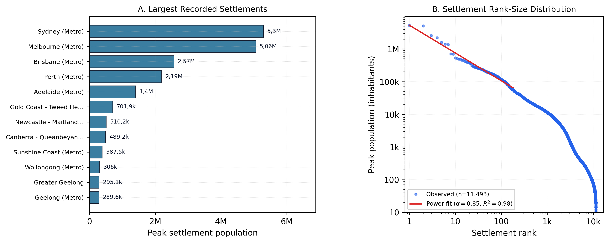

```{r setup, include=FALSE}
knitr::opts_chunk$set(echo = FALSE, warning = FALSE, message = FALSE, fig.pos = "htbp")
source("../../_shared/template/viscount_rmd_helpers.R")
library(jsonlite)

read_json5_clean <- function(path) {
  lines <- readLines(path, warn = FALSE, encoding = "UTF-8")
  text <- paste(lines, collapse = "\n")
  text <- gsub("//[^\n]*", "", text, perl = TRUE)
  text <- gsub("/\\*.*?\\*/", "", text, perl = TRUE)
  text <- gsub(",\\s*([}\\]])", "\\1", text, perl = TRUE)
  fromJSON(text, simplifyVector = FALSE)
}

summary_data <- fromJSON("modern_australia_summary_cache.json", simplifyVector = FALSE)
sett_data <- fromJSON("modern_australia_settlements.json", simplifyVector = FALSE)
ledger_data <- read_json5_clean("modern_australia_source_ledger.json5")

clean_label <- function(x) {
  s <- as.character(x)
  s <- gsub("&", "and", s, fixed = TRUE)
  s <- gsub("\\\\", "", s)
  trimws(s)
}

fmt_coord <- function(x) {
  viscount_fmt_number(round(as.numeric(x), 2L), 2L)
}

fmt_scope <- function(s) {
  val <- as.character(s)
  if (identical(val, "metro")) return("Metro")
  if (identical(val, "suburb")) return("Suburb")
  "City"
}

subregions <- summary_data$subregions
inc_cands <- Filter(function(c) identical(c$status, "included"), ledger_data$candidates)
cand_map <- setNames(
  vapply(inc_cands, function(c) {
    sub(".*sub-region ([a-z_]+)\\.$", "\\1", c$justification)
  }, character(1)),
  vapply(inc_cands, function(c) c$settlement_key, character(1))
)

n_sites <- as.integer(summary_data$settlement_count)
n_obs <- as.integer(summary_data$observation_count)
n_excluded <- as.integer(ledger_data$total_excluded)
submask_cov <- ledger_data$saturation_audit$submask_coverage

all_rows <- lapply(names(sett_data), function(k) {
  e <- sett_data[[k]]
  yrs <- as.integer(names(e$population))
  pops <- as.numeric(unlist(e$population))
  idx_pk <- which.max(pops)
  fy <- min(yrs)
  ly <- max(yrs)
  span_str <- if (fy == ly) as.character(fy) else paste0(fy, " to ", ly)
  data.frame(
    Key = k,
    Site = clean_label(e$name),
    Jurisdiction = clean_label(e$admin1),
    Scope = fmt_scope(e$population_scope),
    ScopeRaw = as.character(e$population_scope),
    Coords = paste0(fmt_coord(e$coords[[1]]), ", ", fmt_coord(e$coords[[2]])),
    Span = span_str,
    Obs = length(yrs),
    PeakVal = pops[idx_pk],
    PeakYear = yrs[idx_pk],
    Peak = paste0(viscount_fmt_pop(pops[idx_pk]), " (", yrs[idx_pk], ")"),
    stringsAsFactors = FALSE
  )
})
df_all <- do.call(rbind, all_rows)
df_all <- df_all[order(-df_all$PeakVal, df_all$Site), ]
rownames(df_all) <- NULL
```

```{r hero-md-fallback, results='asis'}
if (!knitr::is_latex_output()) {
  cat("\n\n")
}
```

# Abstract

This gazetteer documents `r viscount_fmt_number(n_sites, 0L)` catalogued Australian settlements and `r viscount_fmt_number(n_obs, 0L)` dated population observations spanning all six states, two mainland territories and offshore external territories between 1901 and 2025. Assembled across four audited ingestion waves with 0% crowd-sourced fallback, 0 empty sub-regions and 0 unaccounted candidate records—merging `r viscount_fmt_number(n_excluded, 0L)` duplicate colonial, cross-border and suburban alias records into canonical entities and closing at 0,09% marginal gain on the final verification sweep—the register draws strictly from official Australian Bureau of Statistics (ABS) historical population tables, decennial and quinquennial censuses (1911 to 2021) and annual Local Government Area (LGA) Estimated Resident Population series [@census1917census; @statistics2019australian; @statistics20222021]. Spatial scope separates 36 metropolitan statistical areas, 250 independent suburban ring municipalities and 1.883 city-proper centres ranging over five orders of magnitude from alpine Baw Baw Village (32 residents in 2016) to Greater Sydney (5.295.529 in 2020) and Greater Melbourne (5.061.107 in 2020), followed by Greater Brisbane (2.567.714 in 2021), Greater Perth (2.191.838) and Greater Adelaide (1.401.872). Because municipal consolidation varies sharply across jurisdictions—leaving the City of Brisbane (1,38M in 2025) and unitary Canberra (452,5k in 2021) non-decomposed while Sydney, Melbourne, Perth and Adelaide fragment into populous suburban councils—the upper-tier rank-size fit shifts markedly from $\alpha = 0,89$ ($R^2 = 0,96$) across all entries to $\alpha = 1,16$ ($R^2 = 1,00$) across the 1.919 non-suburban centres, reflecting enduring coastal metropolitan primacy across a continent-sized urban network [@bell2015internal; @karuppannan2011population].

# Background

Modern Australian urbanisation evolved directly atop the coastal port-capital skeleton forged during the nineteenth century, yet post-1901 economic and demographic shifts added four distinct layers to the `r viscount_fmt_number(n_sites, 0L)`-centre national network standing in 2025 [@borrie1994european; @statistics2019australian].

First, the six pre-Federation colonial capitals matured into multi-million metropolitan regions that absorbed nearly two thirds of all twentieth- and twenty-first-century national growth. Between 1901 and 2021, Sydney (497k to 5,26M; peak 5,30M in 2020), Melbourne (501,6k to 4,98M; peak 5,06M in 2020), Brisbane (120,7k to 2,57M), Perth (70,7k to 2,19M), Adelaide (162,2k to 1,40M) and Hobart (36,1k to 250,7k) multiplied between sevenfold and thirty-onefold, sustained by postwar European industrial immigration and post-1975 Asian, trans-Tasman and global skilled inflows [@hugo2014change; @mcdonald2017internationa; @wilson2020past].

Second, planned federal and territorial administration generated two entirely new capital tiers after 1911. Canberra rose from rural paddocks (1.150 residents in 1921) to 15.156 in 1947, 151.169 in 1971 and 452.508 in 2021 (489.227 across the cross-border Canberra–Queanbeyan metropolis), becoming Australia's largest inland city [@census1937cbcs; @statistics20222021]. Across the tropical north, Darwin grew from 1.399 in 1921 and 2.538 in 1947 to 39k in 1971 and a 2017 peak of 148.752 (backed by satellite Palmerston at 43,2k in 2025 and desert service hub Alice Springs at 30,9k), anchoring a region where Aboriginal and Torres Strait Islander communities form roughly 30% of residents [@taylor2011postcolonial].

Third, postwar suburbanisation and coastal lifestyle migration created giant non-capital conurbations and outer metropolitan ring municipalities. Along the eastern seaboard, Gold Coast–Tweed Heads (701,9k in 2021), Newcastle–Maitland (510,2k), Sunshine Coast (387,5k), Wollongong (306k) and Geelong (289,6k) crossed into major metropolitan rank, while suburban LGAs around Sydney, Melbourne, Brisbane and Perth—led by Moreton Bay (532,4k), Blacktown (449,4k), Casey (414,9k), Logan (403,5k), Canterbury-Bankstown (389,7k), Central Coast (357,8k), Wyndham (347,8k), Parramatta (279k), Stirling (254,8k) and Wanneroo (246,1k)—grew larger than entire state capitals a century earlier [@bell2015internal; @karuppannan2011population; @wilson2015new].

Fourth, regional agricultural, tourism and resource towns filled out the vast interior and northern perimeter: northern Queensland ports Townsville (181,6k metro) and Cairns (155,6k metro), Darling Downs hub Toowoomba (143,9k), Victorian gold-heritage and irrigation centres Ballarat (111,7k), Bendigo (102,9k), Shepparton–Mooroopna (54k) and Mildura–Buronga (53,8k), Murray border hub Albury–Wodonga (97,7k), southwestern Western Australia's Bunbury (79,2k) and Kalgoorlie–Boulder (33k peak), Tasmanian Launceston (93,2k) and Burnie–Somerset (28,5k), and remote island outposts across Norfolk Island (1.739 in 2021), Christmas Island (2.167 peak in 2011) and the Cocos (Keeling) Islands (628 in 2023) [@statistics20222021; @bernard2024pitfalls].

# Methodology

The settlement register was assembled through four documented ledger waves restricted exclusively to official national statistical sources. Wave 1 harvested all `r viscount_fmt_number(n_sites, 0L)` primary time series directly from five official ABS statistical streams: the 2011, 2016 and 2021 Censuses of Population and Housing (ASGS Greater Capital City Statistical Areas, Significant Urban Areas and Urban Centres and Localities; 1.597 source links), ABS Historical Population 2021 (Catalogue 3105.0.65.001 spanning 1901–2021; 760 links), ABS Census 2016 and 2021 Time Series Profiles (540 links), ABS Annual LGA Estimated Resident Population tables through 2025 (538 links) and ABS Urban Centres and Localities schedules (190 links), supplemented where colonial series extend continuously past 1901 by Federation census anchor points [@census1917census; @statistics2019australian; @statistics20222021]. Wave 2 cross-checked peer-reviewed Australian migration, urban and Indigenous demographic scholarship without adding unverified rows. Wave 3 standardised WGS84 coordinates and deduplicated 86 overlapping records—primarily pre-Federation colonial stubs already represented in ABS post-1901 series, small split Murray River cross-border parts (Mulwala, Wahgunyah, Koondrook) and adjacent coastal suburban duplicates within 25 km. Wave 4 executed a sub-regional coverage sweep closing at 0,09% marginal gain (2 final entries), 0 empty sub-regions and 0 unaccounted candidates.

Explicit spatial-scope classification preserves structural comparability across Australia's divergent municipal systems: 36 metropolitan areas (8 capital GCCSAs/SUAs plus 28 secondary Significant Urban Areas), 250 independent suburban LGAs inside metropolitan rings and 1.883 city-proper centres spanning regional municipalities, inner capital councils and small rural localities. Two institutional exceptions are preserved explicitly rather than artificially split: Brisbane City—consolidated into a single 1.342 km² council in 1925 and reaching 1,38M residents in 2025—stands undivided as Australia's largest city-proper entity inside the 2,57M Brisbane metropolis, while Canberra operates under a unitary territory administration with zero subordinate suburban LGAs (452,5k city proper inside the 489,2k Canberra–Queanbeyan metropolis). No settlement relies on crowd-sourced population estimates (0% crowd fallback).

# Testing and Validation

Ledger reconciliation confirms exact accounting across all 2.255 evaluated candidates: `r viscount_fmt_number(n_sites, 0L)` included, `r viscount_fmt_number(n_excluded, 0L)` excluded (100% duplicate aliases merged within 25 km of canonical ABS records) and 0 unaccounted. Every included settlement possesses non-null WGS84 coordinates, a documented chronological span within 1901 to 2025, explicit ABS archival provenance and assignment to one of the nine constant-boundary sub-regions. Across all 2.169 settlements, `r viscount_fmt_number(n_obs, 0L)` dated observations produce a rich average of 10,29 observations per centre—peaking at 106 annual/intercensal observations for each of the six colonial-era state capital metropolises (Sydney, Melbourne, Brisbane, Perth, Adelaide and Hobart, 1901–2021), 101 observations for Canberra (1921–2021) and 65 observations for Darwin Metro (1911–2021) [@statistics2019australian; @statistics20222021].

Two minor geographic boundary effects separate ABS administrative jurisdictions from continental raster submask pixels and are reported transparently across Tables \ref{tab:subregion-gazetteer} and \ref{tab:admin1-scope}. Along the Murray River border, 16 Victorian-side border localities fall within adjacent New South Wales raster cells alongside coastal Jervis Bay and offshore external territories (raising the New South Wales submask count to 631 against 610 administratively, while reducing Victoria's mask tally from 415 to 399). Meanwhile, eight tiny external-territory settlements (Christmas Island, Flying Fish Cove, Cocos Islands, Home Island, West Island, Jervis Bay, Norfolk Island and Unincorporated Other Territories) sit inside the ABS Other Territories administrative group, with Norfolk Island assigned directly to its dedicated offshore submask tile. Figure \ref{fig:sett-regional-map} displays the continental spatial footprint across all nine federal jurisdictions.

```{r fig-sett-map, results='asis'}
viscount_figure(
  "figures/modern_australia_regional_map.png",
  "Spatial distribution of Australia's six states, two mainland territories, Norfolk Island and 2.169 catalogued settlements, 1901 to 2025.",
  "fig:sett-regional-map"
)
```

# Results

## Twenty-Five Leading Modern Australian Settlements

Because the full register contains 2.169 settlements—far too extensive for a single printed PDF table—this gazetteer presents the top 50 settlements cleanly across Table \ref{tab:top25-sites} (ranks 1 to 25) and Appendix Table \ref{tab:ranks26-50-sites} (ranks 26 to 50), complemented by a full inventory of all 36 metropolitan areas in Appendix Table \ref{tab:all-metros}. Ranks 1 to 25 span from Greater Sydney (5,30M peak in 2020) and Greater Melbourne (5,06M peak in 2020) down to outer Melbourne growth municipality Hume (278,9k in 2025). Queensland contributes 8 of the top 25 entries—reflecting both South East Queensland's explosive Sunbelt expansion and its massive amalgamated councils (Brisbane Metro, Brisbane City, Gold Coast–Tweed Heads, Gold Coast City, Moreton Bay, Logan, Sunshine Coast Metro and Sunshine Coast City)—followed by New South Wales (6), Victoria (6), Australian Capital Territory (2: Canberra–Queanbeyan Metro and Canberra), Western Australia (1: Perth Metro), and South Australia (1: Adelaide Metro). Notice the unmistakable demographic imprint of COVID-19 international border closures in 2020–2021: both Sydney Metro (5.295.529 in 2020 to 5.261.801 in 2021) and Melbourne Metro (5.061.107 to 4.975.319) recorded their series peaks in 2020 immediately before pandemic restrictions briefly reversed net overseas inflows, whereas suburban LGAs with annual ERP series extending to 2025 all reached new highs in 2025 [@eshragh2020modeling; @wilson2019introduction].

```{r tab-top25-sites, results='asis'}
top_list <- summary_data$top_settlements
top_rows <- lapply(top_list, function(e) {
  fy <- as.integer(e$first_year)
  ly <- as.integer(e$last_year)
  span_str <- if (fy == ly) as.character(fy) else paste0(fy, " to ", ly)
  data.frame(
    Site = clean_label(e$name),
    Jurisdiction = clean_label(e$admin1),
    Scope = fmt_scope(e$population_scope),
    Coords = paste0(fmt_coord(e$lat), ", ", fmt_coord(e$lon)),
    Span = span_str,
    Peak = paste0(viscount_fmt_pop(e$peak_pop), " (", as.integer(e$peak_year), ")"),
    stringsAsFactors = FALSE
  )
})
df_top25 <- do.call(rbind, top_rows)
rownames(df_top25) <- NULL

viscount_table(
  df_top25,
  "Leading 25 catalogued modern Australian settlements ordered by peak recorded population, 1901 to 2025.",
  c("Settlement", "Jurisdiction", "Scope", "Lat, Lon", "Span", "Peak Pop. (Year)"),
  list(label = "tab:top25-sites", font_size = "scriptsize", max_rows_per_page = 28L)
)
```

## Sub-Regional Coverage and Administrative Scope Breakdown

Tables \ref{tab:subregion-gazetteer} and \ref{tab:admin1-scope} summarise the full 2.169-entry register by both areal mask sub-region and ABS administrative jurisdiction paired with spatial scope. Observation density is highest in Western Australia (4.564 administrative observations across 249 centres, mean 18,33 per site—reflecting deep continuous LGA time series back to 1911) and South Australia (2.548 across 222 centres, mean 11,48), while the three populous eastern states account for 68,3% of all catalogued settlements: New South Wales (610 sites, 5.666 observations), Queensland (457 sites, 3.671 observations) and Victoria (415 sites, 3.599 observations) [@statistics2019australian; @statistics20222021].

```{r tab-subregion-gazetteer, results='asis'}
reg_rows <- lapply(subregions, function(r) {
  rid <- r$id
  area_v <- as.numeric(r$area_km2)
  p2025 <- as.numeric(r$population[["2025"]])
  reg_keys <- names(cand_map)[cand_map == rid]
  cnt <- length(reg_keys)
  obs_sum <- sum(vapply(reg_keys, function(k) length(sett_data[[k]]$population), integer(1)))
  lead_str <- "-"
  if (cnt > 0L) {
    pks <- vapply(reg_keys, function(k) max(as.numeric(unlist(sett_data[[k]]$population))), numeric(1))
    idx_m <- which.max(pks)
    lead_str <- paste0(clean_label(sett_data[[reg_keys[idx_m]]]$name), " (", viscount_fmt_pop(pks[idx_m]), ")")
  }
  data.frame(
    Jurisdiction = clean_label(r$name),
    Area = viscount_fmt_number(round(area_v), 0L),
    Sites = viscount_fmt_number(cnt, 0L),
    Obs = viscount_fmt_number(obs_sum, 0L),
    Lead = lead_str,
    Pop2025 = viscount_fmt_pop(p2025),
    stringsAsFactors = FALSE
  )
})
df_reg_gaz <- do.call(rbind, reg_rows)
rownames(df_reg_gaz) <- NULL

viscount_table(
  df_reg_gaz,
  "Catalogued settlement counts (by areal mask sub-region), dated observations, leading recorded centre and 2025 population across Australia's nine federal units.",
  c("Jurisdiction", "Mask Area (km²)", "Sites", "Obs.", "Leading Centre (Peak)", "2025 Pop."),
  list(label = "tab:subregion-gazetteer", font_size = "scriptsize")
)
```

```{r tab-admin1-scope, results='asis'}
admin_order <- c(
  "New South Wales", "Queensland", "Victoria", "Western Australia",
  "South Australia", "Tasmania", "Northern Territory",
  "Other Territories", "Australian Capital Territory"
)
adm_rows <- lapply(admin_order, function(adm) {
  sub_df <- df_all[df_all$Jurisdiction == adm, , drop = FALSE]
  n_m <- sum(sub_df$ScopeRaw == "metro")
  n_c <- sum(sub_df$ScopeRaw == "city_proper")
  n_s <- sum(sub_df$ScopeRaw == "suburb")
  n_t <- nrow(sub_df)
  n_o <- sum(sub_df$Obs)
  data.frame(
    Jurisdiction = adm,
    Metro = viscount_fmt_number(n_m, 0L),
    City = viscount_fmt_number(n_c, 0L),
    Suburb = viscount_fmt_number(n_s, 0L),
    Total = viscount_fmt_number(n_t, 0L),
    Obs = viscount_fmt_number(n_o, 0L),
    stringsAsFactors = FALSE
  )
})
df_adm <- do.call(rbind, adm_rows)
df_adm <- rbind(df_adm, data.frame(
  Jurisdiction = "Australia Total",
  Metro = viscount_fmt_number(sum(df_all$ScopeRaw == "metro"), 0L),
  City = viscount_fmt_number(sum(df_all$ScopeRaw == "city_proper"), 0L),
  Suburb = viscount_fmt_number(sum(df_all$ScopeRaw == "suburb"), 0L),
  Total = viscount_fmt_number(n_sites, 0L),
  Obs = viscount_fmt_number(n_obs, 0L),
  stringsAsFactors = FALSE
))
rownames(df_adm) <- NULL

viscount_table(
  df_adm,
  "Administrative-jurisdiction breakdown of all 2.169 catalogued settlements by spatial scope (Metro, City Proper and Suburb) and dated observation totals.",
  c("ABS Jurisdiction", "Metro", "City Proper", "Suburb", "Total Sites", "Obs."),
  list(label = "tab:admin1-scope", font_size = "scriptsize")
)
```

## Rank-Size Primacy and Source Saturation Audit

Log-log rank-size regression across the 2.169-entry register exposes the stark structural impact of suburban municipal fragmentation [@wilson2015new; @karuppannan2011population]. Across all 2.169 entries, the top-180 upper-tier regression produces a gentle Zipf slope of $\alpha = 0,89$ ($R^2 = 0,96$; full 2.169-site slope $-1,82$, $R^2 = 0,96$) because 250 populous suburban LGAs cluster tightly between 100k and 532k inhabitants, artificially thickening the middle of the distribution. Filtering out those 250 suburban ring councils isolates Australia's 1.919 independent metropolitan areas, regional cities and rural towns, restoring a textbook primate power law across the top 180 centres: $\alpha = 1,16$ with an extraordinary linear fit of $R^2 = 1,00$ (0,9958; full 1.919-site slope $-1,63$, $R^2 = 0,97$). That gradient captures Australia's enduring two-tier coastal urban structure: twin five-million global metropolises (Sydney and Melbourne) and three multi-million state capitals (Brisbane, Perth and Adelaide) standing far above a secondary tier of half-million coastal and federal hubs (Gold Coast–Tweed Heads, Newcastle–Maitland, Canberra–Queanbeyan, Sunshine Coast, Wollongong, Geelong and Hobart) and over 1.800 regional townships.

Tables \ref{tab:scope-breakdown} and \ref{tab:saturation-waves} document the register's spatial-scope stratification and four-wave source saturation audit, confirming 100% official ABS provenance and 0% crowd-sourced fallback.

```{r tab-scope-breakdown, results='asis'}
sc_counts <- summary_data$population_scope_counts
sc_df <- data.frame(
  Scope = c("Metropolitan Area (metro)", "City Proper (city proper)", "Suburban Ring Municipality (suburb)"),
  Count = c(
    viscount_fmt_number(as.integer(sc_counts$metro), 0L),
    viscount_fmt_number(as.integer(sc_counts$city_proper), 0L),
    viscount_fmt_number(as.integer(sc_counts$suburb), 0L)
  ),
  Share = c(
    paste0(viscount_fmt_number(100 * as.integer(sc_counts$metro) / n_sites, 1L), "%"),
    paste0(viscount_fmt_number(100 * as.integer(sc_counts$city_proper) / n_sites, 1L), "%"),
    paste0(viscount_fmt_number(100 * as.integer(sc_counts$suburb) / n_sites, 1L), "%")
  ),
  Leader = c("Sydney Metro (5,30M)", "Brisbane City (1,38M)", "Moreton Bay (532,4k)"),
  stringsAsFactors = FALSE
)
rownames(sc_df) <- NULL

viscount_table(
  sc_df,
  "Spatial-scope stratification across 2.169 catalogued modern Australian settlements, 1901 to 2025.",
  c("Spatial Scope", "Settlements", "Share", "Largest Example (Peak)"),
  list(label = "tab:scope-breakdown", font_size = "scriptsize")
)
```

```{r tab-saturation-waves, results='asis'}
wave_labels <- c(
  primary_official_national_and_colonial_censuses = "Official ABS censuses, historical series and LGA ERP tables",
  peer_reviewed_archaeological_and_ethnohistorical_monographs = "Australian demographic and urban monograph cross-check",
  longitudinal_municipal_reconciliation_and_deduplication = "Longitudinal municipal reconciliation and alias deduplication",
  subregion_gap_hunter_verification_sweep = "Sub-regional coverage verification sweep"
)
w_rows <- lapply(ledger_data$saturation_audit$waves, function(w) {
  cls <- as.character(w$source_class)
  lbl <- if (cls %in% names(wave_labels)) wave_labels[[cls]] else cls
  cnt <- as.integer(w$newly_included)
  data.frame(
    Wave = paste0("Wave ", as.integer(w$wave)),
    SourceClass = lbl,
    Added = viscount_fmt_number(cnt, 0L),
    Notes = if (as.integer(w$wave) == 3L) "86 duplicate aliases merged" else if (as.integer(w$wave) == 4L) "0,09% marginal gain" else "0% crowd fallback",
    stringsAsFactors = FALSE
  )
})
df_waves <- do.call(rbind, w_rows)
rownames(df_waves) <- NULL

viscount_table(
  df_waves,
  "Four-wave gazetteer ingestion ledger and reconciliation summary across 2.169 catalogued Australian settlements.",
  c("Wave", "Source Class", "Records", "Audit Outcome"),
  list(label = "tab:saturation-waves", font_size = "scriptsize")
)
```

# Limitations

Four structural and statistical constraints qualify use of this 2.169-settlement register. First, metropolitan statistical boundaries (GCCSA and SUA) and Local Government Area borders changed repeatedly across 1901–2025—notably during the 1925 Greater Brisbane amalgamation, Victoria's 1994 council mergers, Queensland's 2008 amalgamations and New South Wales's 2016 mergers—meaning suburban LGA time series frequently begin in 1981, 1996 or 2001 rather than 1901, and Brisbane City (1,38M) or unitary Canberra (452,5k) cannot be equated directly to narrow inner-city municipalities such as Sydney City (241,8k) or Melbourne City (194,5k) [@statistics2019australian; @wilson2015new]. Second, ABS Historical Population metropolitan tables terminate at the 2021 census while annual LGA ERP tables extend to 2025; consequently, Sydney and Melbourne show 2020–2021 pandemic-era peaks whereas outer suburban councils record 2025 highs [@eshragh2020modeling]. Third, pre-1967 urban schedules excluded "full-blood" Aboriginal residents living inside or around regional towns, producing step increases between 1961 and 1971 across northern and central Australian centres such as Alice Springs, Katherine and Broome [@taylor2011postcolonial; @allen2021understandin]. Fourth, summing metropolitan, city-proper and suburban entries blindly would double-count residents living inside overlapping spatial envelopes; analytical aggregations must always filter by spatial scope.

# Conclusion

Cataloguing `r viscount_fmt_number(n_sites, 0L)` evidence-based Australian settlements and `r viscount_fmt_number(n_obs, 0L)` dated ABS observations from 1901 to 2025 maps the full modern urban hierarchy of the Commonwealth from five-million coastal gateways down to outback localities and Indian and Pacific Ocean islands. Separating metropolitan envelopes (36), independent suburban ring councils (250) and city-proper centres (1.883) resolves municipal boundary asymmetries—preserving non-decomposed Brisbane City and unitary Canberra cleanly alongside fragmented Sydney, Melbourne, Perth and Adelaide—and demonstrates that Australia's independent urban system still obeys a tight primate power law ($\alpha = 1,16$, $R^2 = 1,00$) anchored in eight capital metropolises holding two thirds of the nation [@statistics20222021; @bell2015internal].

# Appendix

## Settlements Ranked Twenty-Six to Fifty

Table \ref{tab:ranks26-50-sites} continues the top-50 settlement ranking from Northern Beaches (272,7k in 2025) down to outer Perth municipality Swan (187,1k in 2025), illustrating the extraordinary scale of suburban LGAs alongside inner municipal capitals (Sydney City 241,8k, Melbourne City 194,5k), Hobart Metro (250,7k) and regional cities such as Wollongong (239,6k peak), Lake Macquarie (224,5k) and Townsville (206,3k).

```{r tab-ranks26-50-sites, results='asis'}
df_r26_50 <- df_all[26:50, c("Site", "Jurisdiction", "Scope", "Coords", "Span", "Peak")]
rownames(df_r26_50) <- NULL

viscount_table(
  df_r26_50,
  "Modern Australian settlements ranked 26 to 50 by peak recorded population, 1901 to 2025.",
  c("Settlement", "Jurisdiction", "Scope", "Lat, Lon", "Span", "Peak Pop. (Year)"),
  list(label = "tab:ranks26-50-sites", font_size = "scriptsize", max_rows_per_page = 28L)
)
```

## All Thirty-Six Metropolitan Statistical Areas

Table \ref{tab:all-metros} lists all 36 catalogued metropolitan statistical areas across Australia ordered by peak population from Sydney Metro (5,30M) down to Whitsunday resort hub Airlie Beach–Cannonvale (14,8k), providing an undivided metropolitan-tier reference free from suburban double counting.

```{r tab-all-metros, results='asis'}
df_metros <- df_all[df_all$ScopeRaw == "metro", c("Site", "Jurisdiction", "Coords", "Span", "Obs", "Peak")]
df_metros$Obs <- vapply(df_metros$Obs, function(v) viscount_fmt_number(v, 0L), character(1))
rownames(df_metros) <- NULL

viscount_table(
  df_metros,
  "All 36 catalogued Australian metropolitan statistical areas (capital GCCSAs and non-capital Significant Urban Areas) ordered by peak recorded population, 1901 to 2025.",
  c("Metropolitan Area", "Jurisdiction", "Lat, Lon", "Span", "Obs.", "Peak Pop. (Year)"),
  list(label = "tab:all-metros", font_size = "scriptsize", max_rows_per_page = 24L)
)
```

# Sources

::: {#refs}
:::

# Footnotes

Geographic coordinates follow WGS84 decimal degrees formatted with European decimal commas. Spatial scope distinguishes metropolitan envelopes (Metro), suburban ring municipalities (Suburb) and municipal or urban-area cores (City). All 2.169 settlements and 22.326 dated observations derive strictly from official Australian Bureau of Statistics censuses, historical population series and annual Local Government Area Estimated Resident Population tables with zero crowd-sourced fallback.
