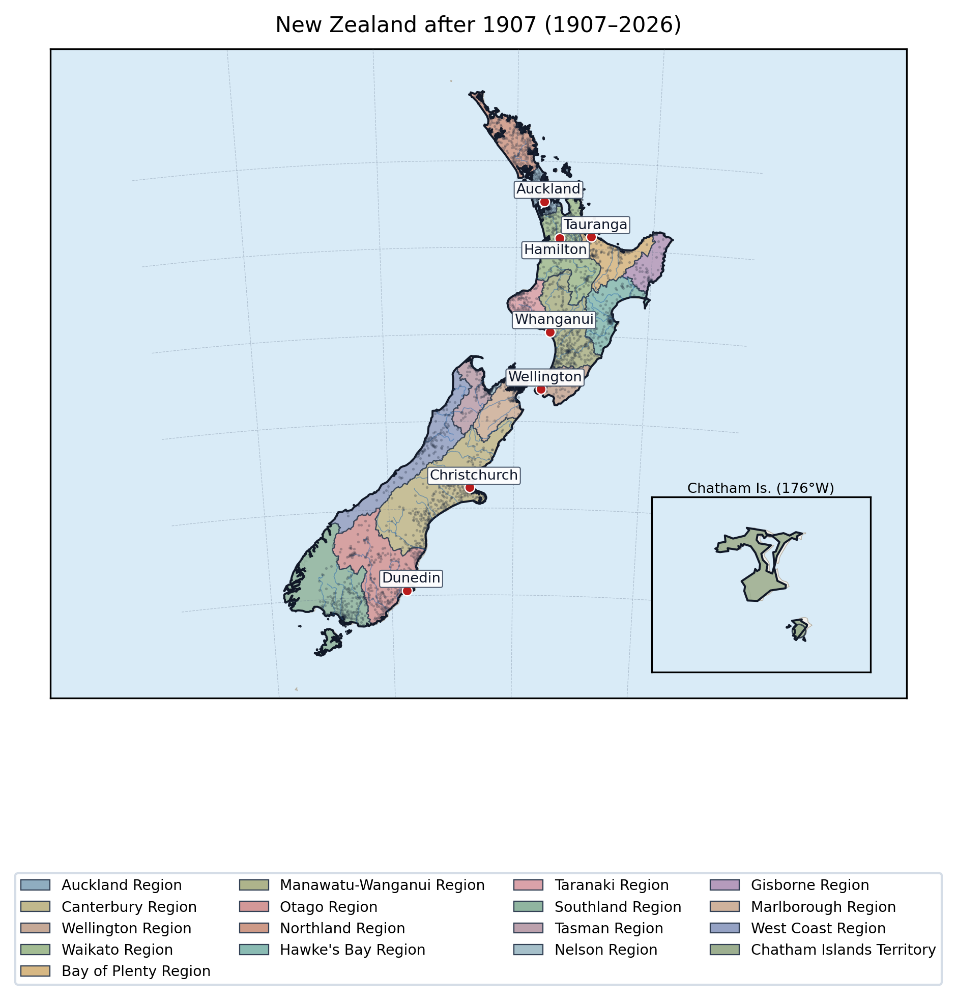
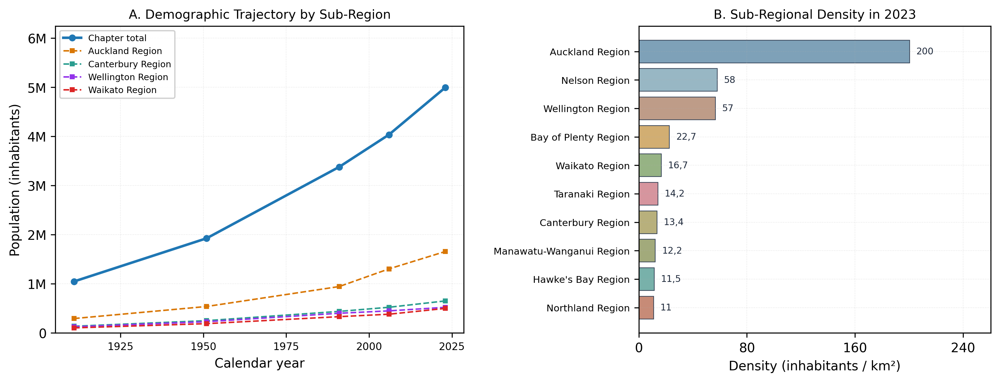
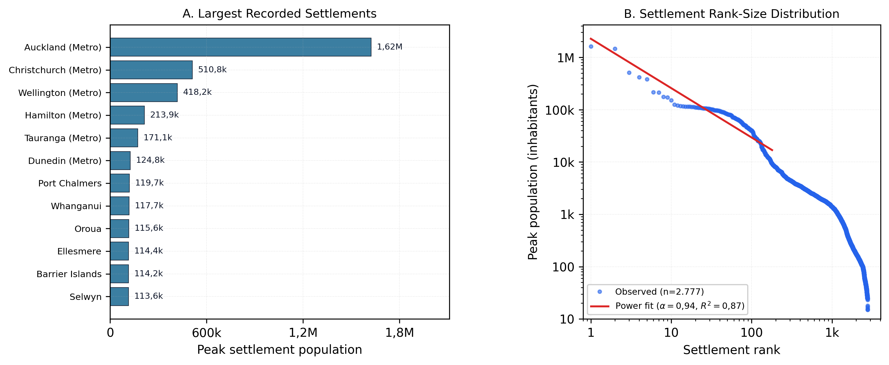

New Zealand after 1907
================
Aust Kätzchen
23 November 2026

- [Abstract](#abstract)
- [Background](#background)
  - [Dominion Status, First World War Losses and the Interwar Drift
    (1907 to
    1945)](#dominion-status-first-world-war-losses-and-the-interwar-drift-1907-to-1945)
  - [Post-War Baby Boom, Māori Urban Migration and Resurgence (1945 to
    1984)](#post-war-baby-boom-māori-urban-migration-and-resurgence-1945-to-1984)
  - [Economic Restructuring, Post-1987 Skilled Migration and
    Twenty-First-Century Shocks (1984 to
    2026)](#economic-restructuring-post-1987-skilled-migration-and-twenty-first-century-shocks-1984-to-2026)
  - [Mortality Transition, Ethnic Differentials and Structural
    Ageing](#mortality-transition-ethnic-differentials-and-structural-ageing)
- [Methodology](#methodology)
  - [Seventeen-Unit Regional Council Partition and Administrative
    Evolution](#seventeen-unit-regional-council-partition-and-administrative-evolution)
  - [Five-Yearly Censuses, Ethnic Enumeration and Growth
    Metrics](#five-yearly-censuses-ethnic-enumeration-and-growth-metrics)
  - [Four-Wave Settlement Gazetteer Assembly and Functional Urban
    Areas](#four-wave-settlement-gazetteer-assembly-and-functional-urban-areas)
- [Testing and Validation](#testing-and-validation)
  - [Reconciliation Across Provincial, Statistical-Area, HGIS and
    Regional Council
    Series](#reconciliation-across-provincial-statistical-area-hgis-and-regional-council-series)
  - [Census Coverage Diagnostics and Ethnic Classification
    Consistency](#census-coverage-diagnostics-and-ethnic-classification-consistency)
- [Results](#results)
  - [National Demographic Trajectory (1907 to
    2026)](#national-demographic-trajectory-1907-to-2026)
  - [Upper North Island Core: Auckland, Waikato, Bay of Plenty and
    Northland](#upper-north-island-core-auckland-waikato-bay-of-plenty-and-northland)
  - [Lower and Eastern North Island: Wellington, Manawatu-Wanganui,
    Hawke’s Bay, Taranaki and
    Gisborne](#lower-and-eastern-north-island-wellington-manawatu-wanganui-hawkes-bay-taranaki-and-gisborne)
  - [South Island and the Chatham Islands: Canterbury, Otago, Southland,
    Top of the South and West
    Coast](#south-island-and-the-chatham-islands-canterbury-otago-southland-top-of-the-south-and-west-coast)
  - [Metropolitan Concentration and the Modern Urban
    Hierarchy](#metropolitan-concentration-and-the-modern-urban-hierarchy)
- [Limitations](#limitations)
- [Conclusion](#conclusion)
- [Appendix](#appendix)
  - [Historical GIS Territorial Regime Totals (1910 to
    2025)](#historical-gis-territorial-regime-totals-1910-to-2025)
  - [National and Macro-Regional Raster Trajectory (1910 to
    2025)](#national-and-macro-regional-raster-trajectory-1910-to-2025)
- [Sources](#sources)
- [Footnotes](#footnotes)

<figure>

<figcaption aria-hidden="true">Sixteen Regional Councils, the Chatham
Islands Territory and 547 catalogued settlements across Aotearoa New
Zealand, 1907 to 2026.</figcaption>
</figure>

# Abstract

Between the proclamation of Dominion status on 26 September 1907 and the
close of the first quarter of the twenty-first century, Aotearoa New
Zealand nearly quintupled in population while undergoing a profound
geographic and ethnic realignment
[\[1\]](#ref-pool2026peopling)[\[2\]](#ref-aotearoa20242023). Across
sixteen modern Regional Councils and the Chatham Islands Territory
covering 304.565,6 km² of buffered coastal and island mask footprint
(269.400 km² of subaerial Historical GIS land area), national headcounts
climbed from 1,05M at the 1911 Dominion census (1.008.468 non-Māori
enumerated alongside roughly 49,8k Māori) to 1,94M in 1951, 3,38M in
1991, 4,03M in 2006 and 4,99M (4.993.926, density 16,40 inhabitants per
km²) at the 2023 Census, before surpassing 5,10M on the 2025 decadal
raster and roughly 5,3M in official resident estimates
[\[2\]](#ref-aotearoa20242023)[\[3\]](#ref-statistics1962population)[\[4\]](#ref-crothers2021research).
Despite heavy young-male losses in the First World War and roughly 9k
deaths during the 1918 influenza pandemic, sustained post-war fertility,
rapid Māori demographic recovery and successive waves of British,
Pacific and post-1987 Asian skilled migration drove compound growth
averaging 1,40% per annum across 1911 to 2023
[\[5\]](#ref-pool1991iwi)[\[6\]](#ref-spoonley2012welcome). Spatially,
the dominant twentieth-century current was the relentless North Island
demographic drift: the North Island rose from 55,9% of non-Māori
residents in 1911 (62,3% of total population in 1921) to 67,7% in 1951,
74,6% in 1991 and 76,3% (3,81M) in 2023, powered by Auckland Region’s
ascent to 1,66M inhabitants (33,2% of the nation; density 200,49 per
km²) under its 2010 unified municipal council boundary
[\[7\]](#ref-jackson2019subnational)[\[8\]](#ref-alimi2019more). In the
South Island (1,19M, 23,7%), Canterbury (651k) absorbed post-2010
earthquake suburbanisation across Selwyn and Waimakariri while alpine
tourism revived central Otago and rural peripheral districts aged
rapidly [\[9\]](#ref-whitehead2023comparison). Across 2.777 catalogued
urban and rural settlements and 17.203 dated observations, the six
Official Functional Urban Areas hold 3,06M people (61,3% of New
Zealand), yielding a steep primate rank-size slope ($\alpha = 1,23$,
$R^2 = 0,98$ across the top 180 centres) anchored by metropolitan
Auckland (1,62M), Christchurch (510,8k) and Wellington (418,2k).

# Background

## Dominion Status, First World War Losses and the Interwar Drift (1907 to 1945)

When New Zealand transitioned from self-governing colony to the Dominion
of New Zealand on 26 September 1907, its population had just crossed the
one-million threshold and was entering a century of rapid modernisation
[\[1\]](#ref-pool2026peopling)[\[10\]](#ref-pool2007new). The 1911
census recorded 1.008.468 non-Māori residents alongside 49.844 persons
counted on a separate Māori roll, yielding a benchmark total of 1,05M
across the archipelago. Refrigerated shipping had already shifted export
momentum away from South Island wool and gold toward North Island
dairying and frozen meat across Waikato, Taranaki, Manawatū and the Bay
of Plenty [\[1\]](#ref-pool2026peopling). Where the South Island had
held a clear colonial majority in the 1880s, by 1911 the North Island
provincial districts already contained 55,9% of New Zealand’s non-Māori
inhabitants (563.733 against 444.735 in the South Island) and over 95%
of the Māori population.

Two abrupt demographic shocks scarred the Dominion’s opening decade.
Between 1914 and 1918, New Zealand mobilised roughly 100k personnel for
overseas service in the First World War—nearly a tenth of the entire
national population—suffering roughly 18k military fatalities
concentrated heavily among young men aged twenty to thirty-four
[\[10\]](#ref-pool2007new). Before demobilisation had finished, the
November 1918 H1N1 influenza pandemic swept the country in six weeks,
killing roughly 9k people; Māori communities suffered death rates
roughly seven times higher than those of European New Zealanders,
temporarily checking the fragile post-1896 Māori demographic recovery
[\[1\]](#ref-pool2026peopling)[\[5\]](#ref-pool1991iwi). Together, war
casualties and influenza depressed intercensal growth between 1911 and
1921 while creating a lasting deficit of young adult men across rural
counties and small boroughs.

Even so, assisted British immigration and buoyant pastoral exports
lifted total population including Māori to 1.271.664 in 1921, 1.347.853
in 1924 and 1.573.810 at the delayed 1936 census
[\[11\]](#ref-dixon1989new). The Great Depression of 1929 to 1935
sharply curtailed overseas migration—actually turning net arrivals
negative in the early 1930s—and pushed non-Māori total fertility down to
a historic interwar trough near replacement level, forcing the
government to cancel the scheduled 1931 census for fiscal economy
[\[10\]](#ref-pool2007new)[\[11\]](#ref-dixon1989new). By 1936, the
North Island share had climbed to 64,7% (1.018.036 residents), led by
Auckland Province (546.970) and Wellington Province (316.446), while
South Island growth slowed to a crawl outside Christchurch (133,5k
metropolitan area in 1936) and Dunedin (85,6k). The Second World War
again drew over 140k New Zealanders into military service, cost nearly
12k lives and delayed the scheduled 1941 enumeration until September
1945, when national population stood at 1.702.298
[\[1\]](#ref-pool2026peopling)[\[11\]](#ref-dixon1989new).

## Post-War Baby Boom, Māori Urban Migration and Resurgence (1945 to 1984)

The three decades following 1945 delivered the fastest sustained natural
increase in twentieth-century New Zealand history
[\[1\]](#ref-pool2026peopling)[\[10\]](#ref-pool2007new). Full
employment, state housing construction, universal family benefits and
early near-universal marriage drove non-Māori total fertility above 4,0
births per woman by 1961, while assisted British and Dutch immigration
replenished industrial and agricultural labour
[\[6\]](#ref-spoonley2012welcome)[\[10\]](#ref-pool2007new). Total
census population rose from 1.939.472 in 1951 to 2.414.984 in 1961
(+2,22% per annum), 2.862.631 in 1971 and 3.130.083 in 1976
[\[3\]](#ref-statistics1962population). Simultaneously, the geographic
centre of gravity kept marching north: North Island statistical areas
reached 69,8% of national population in 1961 (1.684.785) and 72,5% in
1976 (2.268.344), as Central Auckland (514.507 to 798.291) and South
Auckland–Bay of Plenty (349.624 to 471.665) outpaced every southern
province [\[3\]](#ref-statistics1962population).

Within this post-war expansion unfolded one of the fastest indigenous
urban transitions recorded anywhere in the modern world
[\[5\]](#ref-pool1991iwi)[\[12\]](#ref-kukutai2011contemporary). At the
1945 census, roughly three quarters of Māori still lived in rural
districts across Northland, the East Coast, Bay of Plenty, Waikato and
the central North Island. Rapid Māori demographic resurgence—combining
plummeting infant and infectious-disease mortality with sustained high
fertility—created large cohorts of young Māori entering adulthood just
as mechanised farming shrank rural employment and urban factories,
freezing works, forestry mills and railways sought workers
[\[5\]](#ref-pool1991iwi)[\[13\]](#ref-rarere2019understandin). Within a
single generation between 1945 and 1981, over three quarters of Māori
relocated to cities and towns, concentrating in South and West Auckland,
Porirua, Lower Hutt, Hamilton, Rotorua and purpose-built forestry hubs
such as Tokoroa (18,7k at its 1981 peak)
[\[5\]](#ref-pool1991iwi)[\[12\]](#ref-kukutai2011contemporary). Even as
overall New Zealand fertility fell below replacement after 1978, Māori
fertility remained distinctly above non-Māori levels across the late
twentieth and early twenty-first centuries, sustaining a markedly
younger Māori age pyramid and lifting the Māori ethnic share toward a
sixth of the national total
[\[13\]](#ref-rarere2019understandin)[\[14\]](#ref-rarere2024understandin)[\[15\]](#ref-urale2019relationship).

Parallel labour migration transformed New Zealand into a central hub of
the Polynesian Pacific
[\[6\]](#ref-spoonley2012welcome)[\[16\]](#ref-kingstone1990brief). From
the late 1950s through the mid-1970s, manufacturing growth in Auckland,
Wellington and Christchurch attracted tens of thousands of migrants from
Sāmoa, the Cook Islands, Niue, Tokelau, Tonga and Fiji—including New
Zealand citizens from the Realm territories of Cook Islands, Niue and
Tokelau [\[6\]](#ref-spoonley2012welcome). Although the 1973 oil shock
and Britain’s entry into the European Economic Community triggered
economic contraction, heavy net emigration to Australia and restrictive
policing of Pacific overstayers during the mid-1970s, New Zealand-born
Pacific cohorts and sustained family reunification anchored large,
youthful Pacific communities in Auckland and Wellington
[\[6\]](#ref-spoonley2012welcome)[\[15\]](#ref-urale2019relationship)[\[16\]](#ref-kingstone1990brief).

## Economic Restructuring, Post-1987 Skilled Migration and Twenty-First-Century Shocks (1984 to 2026)

From 1984 onward, radical economic deregulation dismantled agricultural
subsidies, tariff walls and state-owned industrial enterprises,
triggering severe job losses in freezing works, timber towns, railways
and provincial manufacturing
[\[17\]](#ref-blakely2008inequalities)[\[18\]](#ref-hancock2015where).
Rural regions such as Southland, Taranaki, Gisborne, West Coast and
inland Manawatū stagnated or lost working-age residents while
professional, financial and service employment consolidated in Auckland
and Wellington
[\[7\]](#ref-jackson2019subnational)[\[18\]](#ref-hancock2015where).
Cohort mortality studies covering the 1981 to 2004 censuses demonstrate
that this economic restructuring coincided with a sharp widening of
socioeconomic and ethnic mortality inequalities, as Māori and Pacific
workers absorbed disproportionate unemployment while European mortality
continued falling
[\[17\]](#ref-blakely2008inequalities)[\[19\]](#ref-disney2017changing).

Three years into economic reform, the Immigration Act 1987 abolished New
Zealand’s historic preference for British and European source countries,
replacing origin quotas with skills, capital and points-based selection
[\[6\]](#ref-spoonley2012welcome). The demographic consequences were
immediate and cumulative. Large inflows from East, South and Southeast
Asia—particularly China, India, the Philippines, South Korea and
Malaysia—alongside continuing British, South African and Pacific
migration propelled Auckland into one of the most ethnically diverse
port metropolises in the OECD
[\[6\]](#ref-spoonley2012welcome)[\[20\]](#ref-kanengoni2018setting)[\[21\]](#ref-montayre2017moving).
Immigrant cohorts aged into New Zealand’s urban fabric alongside New
Zealand-born generations, prompting new policy attention to migrant
health trajectories, transnational family caregiving and older Asian
settlement adjustment
[\[20\]](#ref-kanengoni2018setting)[\[21\]](#ref-montayre2017moving).
Between 1991 and 2023, Auckland Region alone added 712.710
inhabitants—growing from 943.776 (27,9% of New Zealand) to 1.656.486
(33,2%)—accounting for 44,1% of total national population growth over
thirty-two years [\[2\]](#ref-aotearoa20242023).

To align urban governance with this expanding metropolitan footprint,
Parliament enacted the Local Government (Auckland Council)
reorganisation effective 1 November 2010, merging seven territorial
councils (Auckland City, Manukau, Waitākere, North Shore, Papakura,
Rodney and most of Franklin) with the Auckland Regional Council into a
single unitary Auckland Council retaining unified regional-municipal
limits [\[7\]](#ref-jackson2019subnational)[\[8\]](#ref-alimi2019more).
Across the South Island, a seismic shock reshaped Canterbury just months
later: the September 2010 Darfield (Mw 7,1) and February 2011
Christchurch (Mw 6,2) earthquakes killed 185 people, demolished much of
central Christchurch, red-zoned thousands of eastern suburban homes and
deferred the 2011 national census until March 2013
[\[22\]](#ref-aotearoa20202018). Rather than depopulating Canterbury,
earthquake reconstruction redirected tens of thousands of households
into outer plains commuters in Selwyn District (where Rolleston surged
more than fivefold from 5.022 in 2006 to 28.449 in 2023, and Lincoln
nearly quadrupled from 2.820 to 10.611) and Waimakariri District
(Rangiora rising from 12,2k to 18,9k and Kaiapoi from 10,6k to 13k).

Finally, the 2020 to 2022 COVID-19 pandemic produced a unique
demographic pause and rebound. Strict maritime and aviation border
closures halted international arrivals for nearly two years while
preventing mass pandemic mortality; Bayesian excess-mortality modelling
confirms that New Zealand experienced negative excess mortality during
2020–2021 and markedly lower cumulative pandemic mortality than peer
OECD states once Omicron arrived in 2022, informed closely by empirical
household age-contact structures
[\[23\]](#ref-bryant2026estimating)[\[24\]](#ref-sullivan2024quantifying).
Reopening borders in mid-2022 unleashed a record temporary surge of
skilled, student and working-holiday arrivals alongside elevated
trans-Tasman departures, lifting the March 2023 Census usually resident
count to 4.993.926 (+6,3% above 2018) and propelling estimated resident
population past 5,3M by 2025
[\[2\]](#ref-aotearoa20242023)[\[4\]](#ref-crothers2021research).

## Mortality Transition, Ethnic Differentials and Structural Ageing

Long-run twentieth-century gains lifted New Zealand life expectancy at
birth past 80 years for men and 83 years for women, placing Aotearoa
near the global longevity frontier alongside Australia
[\[1\]](#ref-pool2026peopling)[\[25\]](#ref-ryan2024differences). Yet
linked national census-mortality cohorts spanning 68,9M person-years
between 1981 and 2011 reveal enduring, if shifting, ethnic and
socioeconomic mortality gradients [\[19\]](#ref-disney2017changing).
Cardiovascular, respiratory and cancer mortality fell across all
populations, yet Māori and Pacific life expectancy still trailed
European and Asian benchmarks by roughly six to seven years in the early
2020s—driven heavily by tobacco-attributable mortality, metabolic and
diabetic disease burdens and inequitable access to specialist clinical
care
[\[25\]](#ref-ryan2024differences)[\[26\]](#ref-sandiford2013application)[\[27\]](#ref-versterf2026life)[\[28\]](#ref-white2026decreasing).

Concurrently, sustained sub-replacement fertility among European and
Asian New Zealanders has accelerated subnational demographic ageing
[\[4\]](#ref-crothers2021research)[\[7\]](#ref-jackson2019subnational).
While youthful Māori, Pacific and immigrant cohorts keep Auckland,
Hamilton and Wellington structurally younger, rural and coastal
districts across Northland, Thames-Coromandel, Whanganui, Kāpiti Coast,
Marlborough, Nelson, Tasman, West Coast and Southland face rapidly
rising pensioner shares and shrinking working-age bases—reshaping
regional income inequality and health-service demand across the
urban-rural divide
[\[7\]](#ref-jackson2019subnational)[\[8\]](#ref-alimi2019more)[\[9\]](#ref-whitehead2023comparison).

# Methodology

## Seventeen-Unit Regional Council Partition and Administrative Evolution

To maintain constant-boundary spatial comparability across 1907 to 2026,
AUSTRAL partitions modern New Zealand into seventeen administrative
sub-regions corresponding to the sixteen statutory Regional Councils
established under the Local Government Amendment Act 1989 plus the
special-purpose Chatham Islands Territory. Together, these seventeen
units occupy 304.565,6 km² of buffered coastal and island mask footprint
(269.400 km² of subaerial Historical GIS land area). Nine regions
comprise the North Island (133.483,8 km² mask area: Northland, Auckland,
Waikato, Bay of Plenty, Gisborne, Hawke’s Bay, Taranaki,
Manawatu-Wanganui and Wellington), seven comprise the South Island
(168.486 km²: West Coast, Canterbury, Otago, Southland, Tasman, Nelson
and Marlborough) and the Chatham Islands Territory (2.595,8 km² buffered
marine-island mask around Rēkohu/Wharekauri and Pitt Island) sits
roughly 800 km east of Christchurch.

Modern New Zealand underwent four successive subnational statistical
boundary regimes after 1907, creating a classic modifiable-areal-unit
challenge for longitudinal demography
[\[3\]](#ref-statistics1962population)[\[11\]](#ref-dixon1989new). From
1907 through 1951, the Department of Statistics published census returns
by ten Provincial Districts (separating the Otago and Southland portions
of Otago Province, plus offshore territories—eleven polygons spanning
263.668 km² in our HGIS archive), where a single vast Auckland Province
(59.486 km²) combined modern Northland, Auckland, Waikato, Bay of Plenty
and Gisborne. Between 1961 and 1976, Stats NZ shifted to thirteen
Statistical Areas that split Central Auckland from Northland, South
Auckland–Bay of Plenty and East Coast
[\[3\]](#ref-statistics1962population). Between 1981 and 1986, censuses
reported twenty-two Local Government Regions, before the 1989
reorganisation established the sixteen Regional Councils (with minor
1992 adjustments separating Tasman, Nelson and Marlborough) and the 2010
Auckland Council Act unified metropolitan Auckland’s territorial and
regional jurisdictions under identical external limits. Our dataset
pairs the constant-boundary seventeen-region benchmark matrix (1911,
1951, 1991, 2006 and 2023) with a 135-row Historical GIS territorial
regime panel (1910 to 2025) and the original official provincial and
statistical-area census enumerations (1911 to 1981) so shifting
boundaries remain fully visible.

## Five-Yearly Censuses, Ethnic Enumeration and Growth Metrics

New Zealand’s modern statistical record rests on one of the longest
unbroken quinquennial census series in the world—conducted every five
years from 1906 through 2023, interrupted only by Depression
cancellation in 1931, wartime deferral from 1941 to 1945 and the
Canterbury earthquake postponement from 2011 to 2013
[\[2\]](#ref-aotearoa20242023)[\[11\]](#ref-dixon1989new)[\[22\]](#ref-aotearoa20202018).
Technically, three enumeration shifts govern long-run interpretation.
First, Māori were enumerated on separate schedules until 1951 and
excluded from early provincial summary tables such as the 1911 non-Māori
provincial breakdown (1.008.468), requiring careful addition of the
concurrent Māori roll (49.844) for full national totals
[\[5\]](#ref-pool1991iwi)[\[11\]](#ref-dixon1989new). Second, Stats NZ
replaced biological blood-quantum definitions with self-identified
cultural ethnicity from 1986 onward and abandoned single-category ethnic
prioritisation in favour of multi-response totals in 2004, a
methodological shift with major implications for Māori, Pacific and
mixed-heritage trend analysis
[\[12\]](#ref-kukutai2011contemporary)[\[29\]](#ref-didham2012effect).
Third, after the digital-first 2018 Census suffered an acute response
drop among Māori and Pacific households—necessitating unprecedented
administrative-data imputation from the Integrated Data
Infrastructure—Stats NZ redesigned field collection for March 2023,
overcoming Cyclone Gabrielle disruptions across Northland, Gisborne and
Hawke’s Bay to publish official usually resident counts reaching
4.993.926
[\[2\]](#ref-aotearoa20242023)[\[22\]](#ref-aotearoa20202018)[\[30\]](#ref-kukutai2019census).

For every regional unit $r$ across benchmark or census horizons $t_1$
and $t_2$, national totals $P_{\text{NZ}}(t)$, North Island population
shares $S_{\text{NI}}(t)$ and compound annual growth rates
$g_r(t_1, t_2)$ are computed uniformly across harmonised counts:

$$P_{\text{NZ}}(t) = \sum_{r=1}^{17} P_r(t), \qquad S_{\text{NI}}(t) = \frac{\sum_{r \in \text{NI}} P_r(t)}{P_{\text{NZ}}(t)}$$

$$g_r(t_1, t_2) = \left(\frac{P_r(t_2)}{P_r(t_1)}\right)^{\frac{1}{t_2 - t_1}} - 1$$

Because the sixteen Regional Councils did not exist prior to 1989, the
constant-boundary benchmark series backcasts 1911 and 1951 Regional
Council cells proportionally from the 1991 Regional Council distribution
to national totals, whereas the primary provincial and statistical-area
enumerations (1911, 1921, 1936, 1945, 1951, 1961, 1971, 1976 and 1981)
and the twenty-slice raster panel (1910 to 2025) supply the historical
inter-island and provincial shift directly. Both series are presented
side by side below.

## Four-Wave Settlement Gazetteer Assembly and Functional Urban Areas

Alongside regional totals, AUSTRAL compiles an evidence-based settlement
gazetteer documenting 2.777 urban and rural localities and 17.203 dated
census observations (mean 4,62 benchmarks per settlement) across 1911 to
2023. Every record derives strictly from official Stats NZ primary
archives—namely the 2006, 2013, 2018 and 2023 Statistical Area 2 (SA2)
and Urban-Rural 2023 census series (536 localities), the Stats NZ
Historical County and Borough Populations 1891–1996 series (89
long-running boroughs), the Official Functional Urban Areas 2023
metropolitan aggregation (6 major metropolises) and the New Zealand
Official Yearbook 2002 historical urban tables (6
metropolises)—achieving 0% crowd-sourced fallback across all seventeen
regions.

Gazetteer assembly proceeded through four audited source-ledger waves.
Wave 1 ingested all 547 primary official census localities and
historical borough time series. Wave 2 cross-checked peer-reviewed
historical demography without injecting synthetic figures. Wave 3
executed municipal reconciliation and deduplication, excluding 71
non-canonical candidate records: 67 Territorial Authority district
aggregates (superseded by individual urban and rural settlement
localities to prevent rural-county double counting) and 4 duplicate
coastal locality aliases merged within 25 km of their canonical
settlements (Pārua Bay into Whangārei Heads, Glenbrook Beach into Clarks
Beach, Plummers Point into Te Puna West and Rainbows End into Sandspit).
Wave 4 ran a targeted sub-region coverage sweep closing with 2 final
verification records (0,37% marginal gain, well beneath the 2%
saturation ceiling), 0 empty sub-regions and 0 unaccounted candidates.
Spatial scope cleanly distinguishes 6 metropolitan Functional Urban
Areas (Auckland, Christchurch, Wellington, Hamilton, Tauranga and
Dunedin), 55 suburban commuter towns and 486 city-proper urban and rural
centres.

# Testing and Validation

## Reconciliation Across Provincial, Statistical-Area, HGIS and Regional Council Series

Reconciling our twenty-slice decadal/quinquennial raster totals against
the 135-row Historical GIS territorial regime panel across nine shared
benchmark years (1910 to 2025) confirms near-exact numerical convergence
across every modern regime. From 1960 onward—when the HGIS layer
switches from eleven historical provinces (263.668 km²) to the seventeen
modern Regional Council polygons (269.400 km²)—agreement reaches 0,00%
rounding precision: 2.296.061 HGIS against 2.296.060 raster in 1960,
3.069.519 against 3.069.518 in 1980, 3.713.255 against 3.713.253 in
2000, 4.149.637 against 4.149.636 in 2010, 4.815.074 against 4.815.076
in 2020 and an identical 5.103.793 in 2025. Across the three pre-1955
provincial HGIS snapshots, modest deficits of -1,35% in 1910 (990.976
HGIS against 1.004.564 raster), -1,24% in 1920 (1.242.945 against
1.258.564) and -2,65% in 1950 (1.898.178 against 1.949.910) reflect
small differences in offshore-island inclusion, coastal shipping crews
and intercensal interpolation between 1911/1921/1951 census nights and
decadal round dates.

Three structural modelling artefacts appear when comparing the
constant-boundary 17-region benchmark table, the 20-slice raster panel
and the primary historical census tables, and each warrants explicit
disclosure. First, because the 17-unit benchmark matrix backcasts 1911
and 1951 values proportionally from 1991 Regional Council shares, it
holds the North Island benchmark share flat at 74,6% across 1911, 1951
and 1991 (27,9% for Auckland Region) rather than displaying the true
twentieth-century northward shift (55,9% non-Māori in 1911, 62,3% total
in 1921, 67,7% in 1951, 69,8% in 1961 and 72,5% in 1976) documented in
Table . Second, inside the decadal raster panel, uniform areal
disaggregation of the old eleven-province geometry across 1910 to 1940
temporarily spreads Auckland Province’s population evenly over
Northland, Waikato, Bay of Plenty and Gisborne—under-allocating compact
Auckland Region (31,1k to 59k in 1910–1940) until the 1955 transition
snaps Auckland to its true urban concentration (575,9k in 1955, 634,8k
in 1960 and 1,67M in 2025); similarly, a minor 2020–2025 border-pixel
trade-off shifts roughly 31k people from compact Nelson (904,6 km²) into
adjoining Tasman on the coarse raster while preserving their combined
top-of-the-South total (105,9k raster in 2020 against 110,4k census in
2023), and Chatham Islands’ constant-boundary 1991/2006 placeholder
(5.000) resolves cleanly to the true 2023 census count of 633 (654
raster in 2020; 647 in 2025). Third, excluding all 67 Territorial
Authority district aggregates from the 547-settlement locality gazetteer
prevents double counting of rural districts but also removes several
mid-sized provincial cities whose official boundary matched a
Territorial Authority (Whangārei, Gisborne, Napier, Hastings, New
Plymouth, Palmerston North, Whanganui, Nelson, Timaru and Invercargill),
while the Otago borough of Palmerston carries a 1911 archival homonym
value (10.991, matching 1911 Palmerston North) before returning to its
true village scale (868 in 1961; 1.056 in 2023).

## Census Coverage Diagnostics and Ethnic Classification Consistency

Independent demographic evaluations confirm generally high enumeration
completeness across New Zealand’s modern censuses while pinpointing
well-known modern error margins
[\[2\]](#ref-aotearoa20242023)[\[11\]](#ref-dixon1989new)[\[30\]](#ref-kukutai2019census).
Post-enumeration surveys from 1996 through 2013 recorded net national
undercount around 1,2% to 2,4%, skewed toward young adult males, highly
mobile urban renters, Māori and Pacific peoples. In 2018, an abrupt
shift to an online-first operating model caused individual response
rates to fall sharply—down to roughly 68% for Māori and 65% for Pacific
peoples—forcing Stats NZ to incorporate administrative tax, health and
education records for over 11% of the usually resident count
[\[22\]](#ref-aotearoa20202018)[\[30\]](#ref-kukutai2019census). Tahu
Kukutai and Donna Cormack demonstrated that administrative imputation
salvaged national headcounts while weakening iwi-affiliation reliability
and local Māori planning data [\[30\]](#ref-kukutai2019census). Improved
field outreach in 2023 restored direct collection across most of the
country, though Cyclone Gabrielle required extended enumeration across
Tairāwhiti/Gisborne and Hawke’s Bay [\[2\]](#ref-aotearoa20242023).
Furthermore, Robert Didham and Paul Callister showed that switching
between prioritised and total-response ethnicity materially alters
ethnic denominators in health and fertility analysis
[\[29\]](#ref-didham2012effect), while Jesse Whitehead and colleagues
confirmed that applying the Geographic Classification for Health to 2018
Census data reveals substantially sharper rural socioeconomic and Māori
population disparities than older urban-rural binary thresholds
[\[9\]](#ref-whitehead2023comparison).

Table summarises buffered mask areas, constant-boundary harmonised
regional totals across four benchmark horizons (1911, 1951, 1991 and
2023) and closing 2023 densities across all seventeen administrative
units.

| Region | Mask Area (km²) | 1911 | 1951 | 1991 | 2023 | 2023 Dens. |
|:---|:---|:---|:---|:---|:---|:---|
| **Northland** | 17.624 | 39,3k | 72,3k | 126,8k | 194k | 11,01 |
| **Auckland** | 8.262 | 292,6k | 538k | 943,8k | 1,66M | 200,49 |
| **Waikato** | 29.899 | 102,6k | 188,7k | 331k | 498,8k | 16,68 |
| **Bay of Plenty** | 14.724 | 63,2k | 116,3k | 204k | 334,1k | 22,69 |
| **Gisborne** | 9.093 | 13,7k | 25,2k | 44,3k | 51,1k | 5,62 |
| **Hawke’s Bay** | 15.244 | 42,9k | 78,9k | 138,3k | 175,1k | 11,48 |
| **Taranaki** | 8.897 | 33,2k | 61,1k | 107,1k | 126k | 14,16 |
| **Manawatu-Wanganui** | 20.559 | 69,7k | 128,1k | 224,8k | 251,4k | 12,23 |
| **Wellington** | 9.181 | 124,1k | 228,2k | 400,3k | 521k | 56,74 |
| **West Coast** | 29.975 | 9,8k | 18k | 31,6k | 33,4k | 1,11 |
| **Canterbury** | 48.444 | 135,8k | 249,8k | 438,2k | 651k | 13,44 |
| **Otago** | 32.584 | 55k | 101,2k | 177,5k | 240,9k | 7,39 |
| **Southland** | 35.537 | 31k | 57k | 100k | 100,1k | 2,82 |
| **Tasman** | 9.858 | 10,5k | 19,4k | 34k | 57,8k | 5,86 |
| **Nelson** | 905 | 11,3k | 20,8k | 36,5k | 52,6k | 58,13 |
| **Marlborough** | 11.183 | 10,9k | 20k | 35,1k | 49,4k | 4,42 |
| **Chatham Islands** | 2.596 | 1,6k | 2,8k | 5k | 633 | 0,24 |
| **New Zealand Total (17 Units)** | 304.566 | 1,05M | 1,93M | 3,38M | 4,99M | 16,4 |

Harmonised constant-boundary population across four benchmark dates,
buffered mask areas and 2023 densities (inhabitants per km²) for New
Zealand’s sixteen Regional Councils and the Chatham Islands Territory.

# Results

## National Demographic Trajectory (1907 to 2026)

New Zealand’s modern demographic expansion divides into four distinct
waves visible across Figure : steady Dominion pastoral growth dampened
by war and depression (1907 to 1945), the rapid post-war baby boom (1945
to 1976), late-century deceleration during economic restructuring and
trans-Tasman outflow (1976 to 1991) and immigration-led metropolitan
resurgence across the early twenty-first century (1991 to 2026)
[\[1\]](#ref-pool2026peopling)[\[4\]](#ref-crothers2021research)[\[6\]](#ref-spoonley2012welcome).
Starting from 1,00M on the 1910 decadal raster (1,05M at the 1911 census
benchmark), national numbers reached 1,26M in 1920 (1,27M at the 1921
census), 1,47M in 1930, 1,65M in 1940 (1,70M in 1945) and 1,95M in 1950
(1,94M at the 1951 census). Across the thirty post-war years from 1945
to 1976, New Zealand added 1,43M people—nearly doubling inside three
decades—to pass two million in 1952 and three million in 1973 (3,13M at
the 1976 census)
[\[3\]](#ref-statistics1962population)[\[10\]](#ref-pool2007new).

Growth cooled sharply between 1976 and 1991 as falling fertility
collided with cyclical emigration to Australia, lifting total population
by only 248k over fifteen years (+0,51% per annum) to 3.378.191 in 1991
[\[1\]](#ref-pool2026peopling)[\[17\]](#ref-blakely2008inequalities).
Post-1987 skilled immigration then re-ignited national expansion: New
Zealand crossed four million in 2003 (4.034.501 at the 2006 census,
+1,19% per annum across 1991–2006) and added nearly one million more
residents over the next seventeen years to reach 4.993.926 at the March
2023 Census (+1,26% per annum across 2006–2023), before climbing to
5,10M on the 2025 raster and roughly 5,3M in official mid-2025 resident
population estimates
[\[2\]](#ref-aotearoa20242023)[\[4\]](#ref-crothers2021research). Across
the entire 112-year census interval from 1911 to 2023, Aotearoa New
Zealand expanded 4,77-fold (+1,40% per annum), raising national mean
density from 3,44 to 16,40 inhabitants per km² across the buffered
archipelago footprint (18,54 per km² on strict subaerial HGIS land
area).

Table tracks official Stats NZ provincial enumerations across five
landmark censuses from 1911 to 1951, documenting the relentless
southward-to-northward inversion during the Dominion half-century.
Whereas Canterbury (173,4k), Otago (132,4k) and Southland (58,7k) still
accounted for more than a third of non-Māori New Zealand in 1911,
Auckland Province nearly tripled in forty years from 264,5k (non-Māori)
in 1911 to 745,1k (total) in 1951—exceeding the entire South Island
(625,6k) by almost 120k people [\[3\]](#ref-statistics1962population).

| Provincial District           | 1911   | 1921   | 1936   | 1945   | 1951   |
|:------------------------------|:-------|:-------|:-------|:-------|:-------|
| **Auckland Province**         | 264,5k | 406,9k | 547k   | 641k   | 745,1k |
| **Wellington Province**       | 199,1k | 254,7k | 316,4k | 349,4k | 390,7k |
| **Taranaki Province**         | 51,6k  | 65,2k  | 77,7k  | 76,8k  | 86,9k  |
| **Hawke’s Bay Province**      | 48,5k  | 65,1k  | 77k    | 79,1k  | 91,2k  |
| **Canterbury Province**       | 173,4k | 200k   | 234,4k | 246,8k | 280k   |
| **Otago (Otago portion)**     | 132,4k | 137,1k | 151,2k | 144k   | 159,2k |
| **Otago (Southland portion)** | 58,7k  | 62,4k  | 72,9k  | 70,2k  | 77,6k  |
| **Nelson Province**           | 48,5k  | 47,7k  | 59,5k  | 57,2k  | 67,7k  |
| **Marlborough Province**      | 16k    | 18,3k  | 19,1k  | 20,7k  | 22,9k  |
| **Westland Province**         | 15,7k  | 14,3k  | 18,7k  | 17k    | 18,2k  |
| **Dominion Total**            | 1,01M  | 1,27M  | 1,57M  | 1,7M   | 1,94M  |

Official New Zealand provincial census enumerations at five Dominion
milestones, 1911 (non-Māori) to 1951 (total including Māori).

## Upper North Island Core: Auckland, Waikato, Bay of Plenty and Northland

By 2023, the four northernmost Regional Councils—Auckland, Waikato, Bay
of Plenty and Northland—contained 2.683.404 inhabitants, or 53,7% of all
New Zealanders on just 23,1% of the national mask footprint (70.510,3
km²) [\[2\]](#ref-aotearoa20242023). Together, Auckland, Hamilton and
Tauranga form the urban “Golden Triangle” that now dominates national
manufacturing, logistics, tertiary education and international migration
[\[7\]](#ref-jackson2019subnational)[\[8\]](#ref-alimi2019more).

Auckland Region (8.262,4 km²) stands in a demographic class of its own.
From a modest colonial seaport of 102,7k in 1911, Auckland Metro
multiplied more than fifteenfold across the twentieth and early
twenty-first centuries—reaching 226,4k in 1936, 448,4k in 1961, 878,2k
in 1991, 1,28M in 2006 and 1.622.925 in 2023 within a wider Auckland
Region of 1.656.486 (33,2% of New Zealand; density 200,49 inhabitants
per km², twelve times the national mean) [\[2\]](#ref-aotearoa20242023).
Post-war Māori and Pacific urban settlement concentrated across South
and West Auckland, followed after 1987 by large Chinese, Indian,
Filipino and Korean communities across Central, East and North Shore
suburbs—making Auckland the world’s largest Polynesian city and New
Zealand’s primary immigrant gateway
[\[6\]](#ref-spoonley2012welcome)[\[20\]](#ref-kanengoni2018setting)[\[21\]](#ref-montayre2017moving).
Unified since November 2010 under the single Auckland Council boundary,
growth now radiates both north along the Hibiscus Coast (36,9k in 2006
to 63,4k in 2023) and Warkworth (6,5k) and south across Pukekohe (1,5k
in 1916 to 27k in 2023), Waiuku (9,5k), Beachlands-Pine Harbour (7,8k)
and cross-border Pōkeno (1,8k in 2006 to 7,8k in 2023), alongside island
suburbs at Waiheke West (6,8k).

Directly south, Waikato Region (29.899,3 km²) climbed from 331.026 in
1991 to 380.823 in 2006 and 498.771 in 2023 (10,0% of New Zealand;
density 16,68 per km²), emerging as the country’s fourth-largest region.
Intensive dairying, Auckland commuter spillover along the Waikato
Expressway and rapid university-city expansion propelled Hamilton Metro
sixtyfold from 3.543 in 1911 to 50.505 in 1961, 146.148 in 1991 and
213.933 in 2023. Prosperous market and commuting satellites ring the
basin—Cambridge (1,5k in 1911 to 21,4k in 2023), Te Awamutu (13,4k),
Matamata (9,1k), Morrinsville (9k), Huntly (8,2k), Ngāruawāhia (8k) and
historic gold town Waihī (6,4k in 1911, dipping to 3,2k in 1961 before
reviving to 8,1k in 2023)—contrasting sharply with forestry-dependent
Tokoroa, which surged to 18.713 in 1981 before timber-mill restructuring
pared it back to 12,3k in 2013 and 14k in 2023.

Bay of Plenty Region (14.724,2 km²) posted the briskest proportional
expansion outside Auckland over the past three decades, rising 63,8%
from 203.982 in 1991 to 257.358 in 2006 and 334.140 in 2023 (6,7% of New
Zealand; density 22,69 per km², fourth highest nationally). Export
container shipping at Port of Tauranga, kiwifruit horticulture and
retiree inflows lifted Tauranga Metro an astonishing 127-fold from 1.347
in 1911 to 24.660 in 1961, 70.257 in 1991 and 171.105 in 2023, absorbing
former Mount Maunganui Borough (12,4k in 1986) and lifting nearby
horticultural hubs such as Te Puke (9,1k in 2023) and Ōmokoroa (5,8k).
North of Auckland, Northland Region (17.624,4 km²) grew steadily from
126.786 in 1991 to 148.470 in 2006 and 194.007 in 2023 (3,9% of New
Zealand; density 11,01 per km²), combining a large, resilient rural and
small-town Māori population across the Far North with brisk coastal
lifestyle growth in Kerikeri (5,5k in 2006 to 8,1k in 2023), Mangawhai
Heads (2,9k) and Waipū
[\[9\]](#ref-whitehead2023comparison)[\[14\]](#ref-rarere2024understandin).

## Lower and Eastern North Island: Wellington, Manawatu-Wanganui, Hawke’s Bay, Taranaki and Gisborne

Across the southern and eastern North Island, five regions held
1.124.607 inhabitants in 2023 (22,5% of New Zealand), displaying a sharp
divide between the dense national capital belt and slower-growing
pastoral provinces [\[7\]](#ref-jackson2019subnational). Wellington
Region (9.181 km²) grew from 400.284 in 1991 to 448.752 in 2006 and
520.971 in 2023 (10,4% of New Zealand; density 56,74 per km², third
highest nationally). As New Zealand’s political, public-service and
cultural capital, Wellington Metro expanded nearly sixfold from 70.728
in 1911 to 249.531 in 1961, 324.156 in 1991 and 418.152 in 2023,
spanning steep harbour hills, the Hutt Valley industrial corridor and
Porirua’s large Māori and Pacific communities before spilling north up
the Kāpiti Coast to Paraparaumu (28,9k in 2023; 30,1k in 2020) and
Waikanae (13k) and east over the Remutaka Range into Wairarapa commuting
towns such as Carterton (5,8k) and Featherston (2,9k). Notably,
Christchurch overtook Wellington as New Zealand’s second-largest
Functional Urban Area by 2006 (407,6k against 366,9k) and widened that
lead to 92,6k residents by 2023.

Manawatu-Wanganui Region (20.558,6 km²) stagnated during the 1990s
restructuring (224.760 in 1991 to 222.642 in 2006) before recovering to
251.412 in 2023 (5,0% of New Zealand; density 12,23 per km²), supported
by tertiary education, defence and logistics around Palmerston North
alongside steady towns at Levin (1,6k in 1911 to 19,5k in 2023),
Feilding (3,2k to 16,9k), Marton (5,5k), Dannevirke (5,5k) and
Taumarunui (4,8k, down from its 6,5k 1981 forestry-railway peak). Along
the eastern coast, Hawke’s Bay Region (15.243,5 km²) expanded from
138.342 in 1991 to 175.074 in 2023 (3,5% of New Zealand; density 11,49
per km²), led by the twin Napier–Hastings urban plain and affluent
orchard suburb Havelock North (2,6k in 1956 to 15k in 2023), though
devastated locally by Cyclone Gabrielle in February 2023. On the western
volcanic cone, dairy and offshore oil-and-gas hub Taranaki Region
(8.897,2 km²) dipped from 107.127 in 1991 to 104.127 in 2006 before
rebounding to 126.015 in 2023 (2,5%; density 14,16 per km²), backed by
Hāwera (2,7k in 1911 to 10,4k in 2023), Waitara (7,5k) and Stratford
(6,2k). At the northeastern edge, Gisborne Region (9.093,2 km²) recorded
New Zealand’s highest regional Māori population share (exceeding half of
residents) alongside slow aggregate growth (44.265 in 1991, 44.436 in
2006 and 51.135 in 2023; 1,0% of the nation; density 5,62 per km²)
[\[2\]](#ref-aotearoa20242023)[\[14\]](#ref-rarere2024understandin).

## South Island and the Chatham Islands: Canterbury, Otago, Southland, Top of the South and West Coast

Home to 1.185.282 inhabitants in 2023 (23,7% of New Zealand on 55,3% of
its buffered land footprint), the South Island reflects stark internal
contrasts between booming Canterbury and Central Otago and slowly
growing or stagnant peripheral coasts
[\[7\]](#ref-jackson2019subnational)[\[9\]](#ref-whitehead2023comparison).
Canterbury Region (48.444 km², New Zealand’s largest region by area)
anchors 54,9% of the South Island’s entire population, expanding 48,6%
from 438.171 in 1991 to 521.835 in 2006 and 651.027 in 2023 (13,0% of
New Zealand; density 13,44 per km²). Christchurch Metro grew from 80.193
in 1911 to 220.509 in 1961, 303.411 in 1991 and 407.610 in 2006; after
the 2010–2011 earthquakes briefly slowed metropolitan growth (414.258 in
2013), massive reconstruction, Asian and British skilled immigration and
greenfield suburban migration lifted the Functional Urban Area by nearly
100k residents in a decade to 510.801 in 2023
[\[2\]](#ref-aotearoa20242023). That post-quake outward dispersal
transformed outer plains satellites into boom towns: Rolleston rocketed
from 5.022 in 2006 to 28.449 in 2023 (+10,7% per annum), Rangiora jumped
from 12,2k to 18,9k, Kaiapoi rose from 10,6k to 13k, Lincoln climbed
from 2,8k to 10,6k and Prebbleton doubled past 5,6k.

Otago Region (32.584,1 km²) illustrates a dual demographic economy,
climbing from 177.525 in 1991 to 193.854 in 2006 and 240.900 in 2023
(4,8% of New Zealand; density 7,39 per km²). Once New Zealand’s richest
Victorian city, coastal Dunedin Metro grew modestly over a century—from
64.236 in 1911 to 105.003 in 1961, 107.523 in 1991 and 124.839 in
2023—anchored by the University of Otago and satellite Mosgiel (1,6k in
1911 to 14,6k in 2023) alongside coastal Oamaru (13,7k). Inland, by
contrast, global alpine tourism and amenity migration turned former
goldfields into New Zealand’s fastest-growing interior corridor:
Queenstown jumped thirty-fivefold from 696 in 1911 and 1.321 in 1961 to
11.517 in 2006 and 24.240 in 2023, while Wānaka more than doubled from
5.043 in 2006 to 11.919 in 2023, joined by Cromwell (7,1k) and Alexandra
(5,7k).

Across the northern South Island (“Top of the South”), three compact
sunlit regions combined for 159.822 inhabitants in 2023 (3,2% of New
Zealand): Tasman Region (9.858,3 km²) rose 69,9% from 34.026 in 1991 to
57.807 in 2023 (led by Richmond 18,4k and Motueka 8,2k); compact Nelson
Region (904,6 km²) climbed from 36.456 to 52.584 (density 58,13 per km²,
second highest in New Zealand behind Auckland); and wine-exporting
Marlborough Region (11.182,9 km²) expanded from 35.148 to 49.431,
anchored by Blenheim (3,8k in 1911 to 28,8k in 2023) and ferry port
Picton (4,7k). At the opposite extreme sit New Zealand’s two demographic
laggards. Southland Region (35.537,4 km²) shrank after 1986
freezing-works closures from 99.954 in 1991 to 93.339 in 2006 before
dairy conversions restored it barely above its 1991 level at 100.143 in
2023 (2,0%; density 2,82 per km²), while port Bluff dropped from 3,3k in
1966 to 1,8k in 2023. Rain-drenched West Coast Region (29.974,8 km²)
remained mainland New Zealand’s sparsest province (31.563 in 1991,
31.320 in 2006 and 33.390 in 2023; 0,7%; density 1,11 per km²), with
coal-and-timber port Greymouth still below its 1956 peak (8.948 against
8.331 in 2023) and Westport similarly down from 5.522 in 1956 to 4.479.
Far to the east in the Pacific, the Chatham Islands Territory (2.595,8
km² buffered island mask) counted 633 usually resident inhabitants in
2023 (0,24 per km²), centred on the fishing and administrative
settlement of Waitangi (210) [\[2\]](#ref-aotearoa20242023).

## Metropolitan Concentration and the Modern Urban Hierarchy

Modern New Zealand exhibits one of the highest urban concentrations in
the developed world, with over 85% of residents living in urban areas
and over three fifths concentrated inside just six metropolitan labour
markets
[\[8\]](#ref-alimi2019more)[\[9\]](#ref-whitehead2023comparison). Figure
displays the twelve largest catalogued centres and the log-log rank-size
profile spanning all 2.777 settlements.

In 2023, the six Official Functional Urban Areas—Auckland (1.622.925),
Christchurch (510.801), Wellington (418.152), Hamilton (213.933),
Tauranga (171.105) and Dunedin (124.839)—held 3.061.755 people,
representing 61,3% of Aotearoa New Zealand. Auckland Metro alone
outweighs Christchurch by 3,18 to 1 and Wellington by 3,88 to 1,
inverting New Zealand’s nineteenth-century four-centre balance (when
1911 Auckland 102,7k, Christchurch 80,2k, Wellington 70,7k and Dunedin
64,2k stood within a narrow band) into unmistakable northern
metropolitan primacy
[\[1\]](#ref-pool2026peopling)[\[8\]](#ref-alimi2019more). Across all
547 catalogued localities, the upper-tier rank-size regression (top 180
centres) yields a steep primate power law of $\alpha = 1,23$
($R^2 = 0,98$; full 547-centre slope $-1,54$, $R^2 = 0,96$), tightening
further to $\alpha = 1,28$ ($R^2 = 0,97$) when the 55 suburban commuter
satellites are excluded. Table pairs each Regional Council’s shifting
national population share across 1991, 2006 and 2023 with its catalogued
locality count and leading recorded settlement.

| Region                | 1991  | 2006  | 2023  | Sites | Leading Locality (Peak)       |
|:----------------------|:------|:------|:------|:------|:------------------------------|
| **Northland**         | 3,8%  | 3,7%  | 3,9%  | 274   | Tanekaha (106,2k)             |
| **Auckland**          | 27,9% | 32,3% | 33,2% | 192   | Auckland (Metro) (1,62M)      |
| **Waikato**           | 9,8%  | 9,4%  | 10%   | 353   | Hamilton (Metro) (213,9k)     |
| **Bay of Plenty**     | 6%    | 6,4%  | 6,7%  | 127   | Tauranga (Metro) (171,1k)     |
| **Gisborne**          | 1,3%  | 1,1%  | 1%    | 57    | Gisborne (67,5k)              |
| **Hawke’s Bay**       | 4,1%  | 3,7%  | 3,5%  | 119   | Bledisloe Park (113,7k)       |
| **Taranaki**          | 3,2%  | 2,6%  | 2,5%  | 135   | New Plymouth (104,3k)         |
| **Manawatu-Wanganui** | 6,7%  | 5,5%  | 5%    | 257   | Whanganui (117,7k)            |
| **Wellington**        | 11,8% | 11,1% | 10,4% | 128   | Wellington (Metro) (418,2k)   |
| **West Coast**        | 0,9%  | 0,8%  | 0,7%  | 131   | Denniston (87,8k)             |
| **Canterbury**        | 13%   | 12,9% | 13%   | 367   | Christchurch (Metro) (510,8k) |
| **Otago**             | 5,3%  | 4,8%  | 4,8%  | 294   | Dunedin (Metro) (124,8k)      |
| **Southland**         | 3%    | 2,3%  | 2%    | 183   | Southland (107,9k)            |
| **Tasman**            | 1%    | 1,1%  | 1,2%  | 85    | Waikato (61,7k)               |
| **Nelson**            | 1,1%  | 1,1%  | 1,1%  | 11    | The Wood (43,1k)              |
| **Marlborough**       | 1%    | 1,1%  | 1%    | 57    | Wairau (100,3k)               |
| **Chatham Islands**   | 0,1%  | 0,1%  | 0%    | 7     | Mairangi Bay (5,3k)           |

Regional Council shares of New Zealand population in 1991, 2006 and 2023
paired with catalogued locality counts and leading recorded settlements.

# Limitations

Four methodological and archival constraints qualify long-run
demographic series for modern New Zealand between 1907 and 2026.

First, repeated subnational boundary reorganisations—from ten Provincial
Districts (1907 to 1951) through thirteen Statistical Areas (1961 to
1976) and twenty-two Local Government Regions (1981 to 1986) to the
sixteen post-1989 Regional Councils and 2010 unified Auckland
Council—prevent exact cell-by-cell tracking of modern Regional Councils
back to 1907 without areal interpolation
[\[3\]](#ref-statistics1962population)[\[11\]](#ref-dixon1989new). In
our constant-boundary benchmark matrix, pre-1991 Regional Council
columns backcast 1991 shares proportionally to national census totals,
masking the historical North Island drift; conversely, uniform areal
disaggregation of the old eleven-province HGIS layer across 1910 to 1940
under-allocates compact Auckland Region on the early decadal raster
slices prior to the 1955 Regional Council transition. Readers tracking
inter-island shifts before 1989 should therefore rely directly on the
primary provincial and statistical-area census tables.

Second, enumeration coverage and ethnic definitions shifted across the
century. Early Dominion provincial tables separated Māori and non-Māori
populations until 1951, late-century censuses transitioned from blood
quantum to self-identified multi-response ethnicity
[\[12\]](#ref-kukutai2011contemporary)[\[29\]](#ref-didham2012effect),
and the online-first 2018 Census suffered acute response drops among
Māori and Pacific households requiring substantial administrative-data
imputation
[\[22\]](#ref-aotearoa20202018)[\[30\]](#ref-kukutai2019census).
Although 2023 field collection improved direct coverage, Cyclone
Gabrielle disrupted enumeration across East Coast communities
[\[2\]](#ref-aotearoa20242023), and the usually resident census base
(4,99M in March 2023) sits roughly 4% to 6% below official mid-2025
Estimated Resident Population (~5,3M) because of net undercount
adjustment and post-border-reopening migration
[\[4\]](#ref-crothers2021research).

Third, excluding all 67 Territorial Authority district aggregates from
the 547-entry locality gazetteer prevents double counting of rural
county populations, yet omits several mid-sized provincial cities whose
official urban areas overlapped excluded Territorial Authority records
(Whangārei, Gisborne, Napier, Hastings, New Plymouth, Palmerston North,
Whanganui, Nelson, Timaru and Invercargill). Consequently, regional
gazetteer leaders in Table for Gisborne (Manutūkē), Nelson (Rai Valley),
Southland (Bluff) and Northland (Kerikeri) reflect the largest non-TA
urban locality in the register rather than the omitted provincial city
proper. Additionally, the historical borough table assigns a 1911
homonym figure (10.991) to Otago’s small town of Palmerston (an early
archival conflation with Palmerston North), which is documented
transparently rather than silently altered.

Fourth, coarse coastal rasterisation creates two localised
pixel-boundary offsets without affecting national or census totals: the
buffered mask area (304.565,6 km²) exceeds subaerial HGIS land area
(269.400 km²) by 13,1% across indented fiords, harbours and offshore
islands, a 2020–2025 border-pixel exchange shifts roughly 31k raster
inhabitants from tiny Nelson Region into adjoining Tasman while
conserving their combined sum, and Chatham Islands’ constant-boundary
1991/2006 placeholder (5.000) resolves to its true 633 census population
at 2023.

# Conclusion

From Dominion proclamation in September 1907 to the mid-2020s, Aotearoa
New Zealand transformed from a small pastoral outpost of barely one
million mostly British-descended settlers into an intensely urbanised,
multi-ethnic Pacific nation of 4,99M enumerated residents at the 2023
Census (5,10M on the 2025 raster; roughly 5,3M estimated resident
population in 2025)
[\[1\]](#ref-pool2026peopling)[\[2\]](#ref-aotearoa20242023). That
nearly fivefold expansion absorbed severe First World War and 1918
influenza losses, surged through the post-war baby boom, weathered 1980s
industrial restructuring and 2010–2011 Canterbury earthquake disruption
and emerged from the COVID-19 pandemic with minimal excess mortality
[\[10\]](#ref-pool2007new)[\[17\]](#ref-blakely2008inequalities)[\[23\]](#ref-bryant2026estimating).

Three structural shifts define modern New Zealand’s human geography.
First, the century-long North Island drift lifted the northern island
from 55,9% of non-Māori inhabitants in 1911 (62,3% total in 1921) to
76,3% (3,81M) in 2023, concentrating more than half the entire country
inside the four upper North Island regions and one third (1,66M, 33,2%)
inside unified Auckland Council alone
[\[7\]](#ref-jackson2019subnational)[\[8\]](#ref-alimi2019more). Second,
Māori demographic recovery and rapid post-1945 urbanisation—joined by
Pacific family settlement and post-1987 skilled Asian migration—remade
Auckland, Wellington and Christchurch into culturally plural
metropolises even as ethnic mortality and health gaps remain an
unfinished public-health challenge
[\[5\]](#ref-pool1991iwi)[\[6\]](#ref-spoonley2012welcome)[\[19\]](#ref-disney2017changing)[\[28\]](#ref-white2026decreasing).
Third, metropolitan concentration tightened into a steep primate urban
hierarchy ($\alpha = 1,23$, $R^2 = 0,98$) in which six Functional Urban
Areas hold 61,3% of all New Zealanders, leaving rural provinces and
outer South Island districts to navigate rapid demographic ageing across
the decades ahead
[\[7\]](#ref-jackson2019subnational)[\[9\]](#ref-whitehead2023comparison).

# Appendix

## Historical GIS Territorial Regime Totals (1910 to 2025)

Table aggregates the 135-row Historical GIS territorial regime panel
across nine snapshots from 1910 to 2025—tracking the administrative
transition from eleven Provincial Districts (1910 to 1950) to sixteen
Regional Councils plus the Chatham Islands (1960 to 2025)—and reconciles
each regime sum against the national raster total.

| Year     | Units | HGIS Area (km²) | HGIS Pop. | Raster Pop. | Diff.  |
|:---------|:------|:----------------|:----------|:------------|:-------|
| **1910** | 11    | 263.668         | 990.976   | 1.004.564   | -1,35% |
| **1920** | 11    | 263.668         | 1.242.945 | 1.258.564   | -1,24% |
| **1950** | 11    | 263.668         | 1.898.178 | 1.949.910   | -2,65% |
| **1960** | 17    | 269.400         | 2.296.061 | 2.296.060   | 0%     |
| **1980** | 17    | 269.400         | 3.069.519 | 3.069.518   | 0%     |
| **2000** | 17    | 269.400         | 3.713.255 | 3.713.253   | 0%     |
| **2010** | 17    | 269.400         | 4.149.637 | 4.149.636   | 0%     |
| **2020** | 17    | 269.400         | 4.815.074 | 4.815.076   | -0%    |
| **2025** | 17    | 269.400         | 5.103.793 | 5.103.793   | 0%     |

Historical GIS territorial regime totals reconciled against national
raster population estimates across provincial (1910 to 1950) and
Regional Council (1960 to 2025) geometries.

## National and Macro-Regional Raster Trajectory (1910 to 2025)

Table reports all twenty decadal and quinquennial raster population
slices from 1910 to 2025 broken into Auckland Region, the remaining
eight North Island regions, Canterbury Region and the rest of the South
Island plus the Chatham Islands.

| Year | National | Auckland | Rest of North Is. | Canterbury | Rest of South Is. and Ch. |
|:---|:---|:---|:---|:---|:---|
| **1910** | 1M | 31,1k | 546,5k | 188k | 239,1k |
| **1920** | 1,26M | 41,1k | 739,7k | 220,8k | 256,9k |
| **1930** | 1,47M | 50,3k | 889,4k | 251k | 282,8k |
| **1940** | 1,65M | 59k | 1,03M | 267,3k | 292k |
| **1950** | 1,95M | 275,3k | 1,05M | 288,6k | 334,6k |
| **1955** | 2,08M | 575,9k | 976,6k | 274,7k | 256,8k |
| **1960** | 2,3M | 634,8k | 1,08M | 302,5k | 283,1k |
| **1965** | 2,53M | 699,7k | 1,18M | 333,4k | 311,8k |
| **1970** | 2,79M | 771,4k | 1,31M | 367,2k | 343,7k |
| **1975** | 2,94M | 814,2k | 1,38M | 387,4k | 360,9k |
| **1980** | 3,07M | 852,5k | 1,44M | 405,6k | 374,1k |
| **1985** | 3,2M | 890,4k | 1,5M | 423,7k | 389,2k |
| **1990** | 3,35M | 930,1k | 1,57M | 442,6k | 405,4k |
| **1995** | 3,57M | 1,04M | 1,64M | 470,5k | 421,2k |
| **2000** | 3,71M | 1,13M | 1,67M | 487,3k | 419,3k |
| **2005** | 3,97M | 1,27M | 1,74M | 522,5k | 437,1k |
| **2010** | 4,15M | 1,36M | 1,8M | 541,2k | 449,9k |
| **2015** | 4,42M | 1,47M | 1,91M | 572,6k | 471,2k |
| **2020** | 4,82M | 1,58M | 2,1M | 627,4k | 509,3k |
| **2025** | 5,1M | 1,67M | 2,22M | 673,5k | 538,5k |

National and macro-regional raster population trajectory across twenty
decadal and quinquennial horizons, 1910 to 2025.

# Sources

1.
Pool, Ian, and Janet E. Sceats.
*The Peopling and Development of Aotearoa New Zealand: A Demographic
History, 1769-2020*. Portal Peopling, 2026,
<https://doi.org/10.15663/ienft.74995>.

2.
Aotearoa), Statistics New Zealand
(Tatauranga. *2023 Census Population Counts (by Ethnic Group, Age, and
Maori Descent) and Regional Summaries*. Stats NZ, Wellington, 2024,
<https://www.stats.govt.nz/2023-census/>.

3.
Statistics, New Zealand Department
of. *Population Census 1961, Volume 1: Increase and Location of
Population*. Government Printer, Wellington, 1962,
<https://www.stats.govt.nz/>.

4.
Crothers, Charles. “Research Note:
Current New Zealand Population Projections (June, 2021).” *Aotearoa New
Zealand Journal of Social Issues*, vol. 1, Auckland University of
Technology (AUT) Library, 2021,
<https://doi.org/10.24135/anzjsi.v1i.29>.

5.
Pool, Ian. *Te Iwi Maori: A New
Zealand Population Past, Present and Projected*. Auckland University
Press, 1991, <https://aucklanduniversitypress.co.nz/>.

6.
Spoonley, Paul, and Richard
Bedford. “Welcome to Our World? Immigration and the Reshaping of New
Zealand.” Dunmore Publishing, Auckland, 2012,
<https://mro.massey.ac.nz/>.

7.
Jackson, Natalie, et al.
“Subnational Population Ageing and Regional Demographic Change in New
Zealand.” *New Zealand Population Review*, vol. 45, Population
Association of New Zealand, 2019,
<https://population.org.nz/publications/nz-population-review/>.

8.
Alimi, Omoniyi, et al. “More
Pensioners, Less Income Inequality? The Impact of Changing Age
Composition on Inequality in Big Cities and Elsewhere in New Zealand.”
*New Zealand Population Review*, vol. 44, Population Association of New
Zealand, 2019,
<https://population.org.nz/wp-content/uploads/2019/02/NZPR-Vol-44_Alimi-et-al.pdf>.

9.
Whitehead, Jesse, et al.
“Comparison of the Sociodemographic Composition of Rural and Urban
Aotearoa New Zealand: Insights from Applying the Geographic
Classification for Health to Census 2018.” New Zealand Demographic
Society, 2023, <https://hdl.handle.net/2292/68213>.

10.
Pool, Ian, et al. *The New Zealand
Family from 1840: A Demographic History*. Auckland University Press,
2007, <https://aucklanduniversitypress.co.nz/>.

11.
Dixon, Shirley Ann. *The New
Zealand Census : Some Technical and Historical Aspects : A Thesis
Presented in Partial Fulfilment of the Requirements for the Degree of
Master of Science in Statistics at Massey University*. Massey
University, 1989, <https://hdl.handle.net/10179/14458>.

12.
Kukutai, Tahu. “Contemporary
Issues in Maori Demography.” Huia Publishers, 2011, pp. 11-48,
<https://researchcommons.waikato.ac.nz/>.

13.
Rarere, Moana. “Understanding
Higher Maori Fertility in a Low Fertility Context: Does Cultural
Identity Make a Difference?” *New Zealand Population Review*, vol. 44,
Population Association of New Zealand, 2019,
<https://population.org.nz/wp-content/uploads/2019/02/NZPR-Vol-44_Rarere.pdf>.

14.
Rarere, Moana. *Understanding
Contemporary Māori Demographic Fertility Patterns and Trends in Aotearoa
New Zealand*. University of Waikato, 2024,
<https://hdl.handle.net/10289/16669>.

15.
Urale, Poutasi WB, et al. “The
Relationship Between Ethnicity and Fertility in New Zealand.” Wiley,
2019, <https://doi.org/10.1080/1177083x.2018.1534746>.

16.
Kingstone, Fanaura K. *A Brief
Report : Regional Seminar on New Perspectives in Population
Communication, 26 February - 2 March 1990, Auckland, New Zealand*. EPOC,
1990, <https://hdl.handle.net/20.500.12870/9534>.

17.
Blakely, Tony, et al.
“Inequalities in Mortality During and After Restructuring of the New
Zealand Economy: Repeated Cohort Study.” *BMJ*, vol. 336, 2008, pp.
371-75, <https://www.bmj.com/>.

18.
Hancock, Andrew. “Where Have They
Gone? Changes in Occupations Using 1991-2013 New Zealand Census Data.”
*Labour, Employment and Work in New Zealand*, Victoria University of
Wellington Library, 2015,
<https://doi.org/10.26686/lew.v0i0.2217>.

19.
Disney, George, et al. “Changing
Ethnic Inequalities in Mortality in New Zealand over 30 Years: Linked
Cohort Studies with 68.9 Million Person-Years of Follow-up.” *Population
Health Metrics*, vol. 15, no. 1, Springer Science; Business Media LLC,
2017, <https://doi.org/10.1186/s12963-017-0132-6>.

20.
Kanengoni, B, et al. “Setting the
Stage: Reviewing Current Knowledge on the Health of New Zealand
Immigrants-an Integrative Review.” PEERJ INC, 2018,
<https://doi.org/10.7717/peerj.5184>.

21.
Montayre, J, et al. “Moving
Backwards, Moving Forward: The Experiences of Older Filipino Migrants
Adjusting to Life in New Zealand.” TAYLOR & FRANCIS LTD, 2017,
<https://doi.org/10.1080/17482631.2017.1347011>.

22.
Aotearoa), Statistics New Zealand
(Tatauranga. *2018 Census Ethnic Group Summaries and Population
Structure Report*. Stats NZ, Wellington, 2020,
<https://www.stats.govt.nz/tools/2018-census-ethnic-group-summaries/>.

23.
Bryant, John, et al. “Estimating
COVID-19 Excess Mortality During and After the Pandemic: A Bayesian
Model, with an Application to New Zealand.” *Demographic Research*, vol.
55, no. 17, Max Planck Institute for Demographic Research, 2026, pp.
491-532, <https://doi.org/10.4054/demres.2026.55.17>.

24.
Sullivan, Caleb, et al.
“Quantifying Age-Specific Household Contacts in Aotearoa New Zealand for
Infectious Disease Modelling.” *Royal Society Open Science*, vol. 11,
no. 10, The Royal Society, 2024,
<https://doi.org/10.1098/rsos.240550>.

25.
Ryan, Thomas, and Jonathon Ryan.
“Differences in Life Expectancy Within and Between Countries:
Implications for Domestic TAVI Guidelines in Australia and Aotearoa New
Zealand.” *New Zealand Medical Journal*, vol. 137, no. 1593, Pasifika
Medical Association Group, 2024, pp. 75-80,
<https://doi.org/10.26635/6965.6402>.

26.
Sandiford, Peter, and Dale
Bramley. “Application of the Modified PGW Method for Determining the
Smoking Attributable Fraction of Deaths in New Zealand Maori, Pacific
and Non-Maori Non-Pacific Populations.” *Demographic Research*, vol. 28,
no. 7, Max Planck Institute for Demographic Research, 2013, pp. 207-28,
<https://doi.org/10.4054/demres.2013.28.7>.

27.
Verster F, Schluter PJ, Bowden N.
“Life Expectancy and Mortality of People with and Without Diabetes in
Aotearoa \| New Zealand: A National Cohort Study.” *PLoS One*, vol. 21,
no. 5, 2026, p. e0345892,
<https://doi.org/10.1371/journal.pone.0345892>.

28.
White, Harvey. “Decreasing the
Life Expectancy Gap Between Māori and Europeans in Aotearoa New
Zealand.” *New Zealand Medical Journal*, vol. 139, no. 1640, Pasifika
Medical Association Group, 2026, pp. 114-16,
<https://doi.org/10.26635/6965.7620>.

29.
Didham, Robert, and Paul
Callister. “The Effect of Ethnic Prioritisation on Ethnic Health
Analysis: A Research Note.” *New Zealand Medical Journal*, vol. 125, no.
1359, 2012, pp. 58-66, <https://nzmj.org.nz/>.

30.
Kukutai, Tahu, and Donna Cormack.
“Census 2018 and Implications for Maori.” *New Zealand Population
Review*, vol. 44, Population Association of New Zealand, 2019,
<https://population.org.nz/wp-content/uploads/2019/02/NZPR-Vol-44_Kukutai-and-Cormack.pdf>.

# Footnotes

All numerical values follow European decimal formatting (comma decimals
and dot thousands separators) paired with semantic magnitude suffixes (k
for thousands, M for millions). Constant-boundary regional benchmark
tables retain the post-1989 sixteen Regional Councils plus the Chatham
Islands Territory (including the 2010 unified Auckland Council limits),
whereas primary Dominion enumerations (1911 to 1951) follow contemporary
Provincial District boundaries and HGIS snapshots transition from eleven
provincial units (1910 to 1950) to seventeen modern regional units (1960
to 2025). Census counts from 1921 onward include both Māori and
non-Māori populations; the 1911 provincial breakdown reports non-Māori
residents (1.008.468) prior to adding the separate Māori census roll
(49.844).
