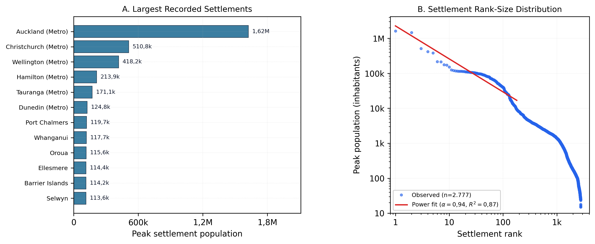

```{r setup, include=FALSE}
knitr::opts_chunk$set(echo = FALSE, warning = FALSE, message = FALSE, fig.pos = "htbp")
source("../../_shared/template/viscount_rmd_helpers.R")
library(jsonlite)

read_json5_clean <- function(path) {
  lines <- readLines(path, warn = FALSE, encoding = "UTF-8")
  text <- paste(lines, collapse = "\n")
  text <- gsub("//[^\n]*", "", text, perl = TRUE)
  text <- gsub("/\\*.*?\\*/", "", text, perl = TRUE)
  text <- gsub(",\\s*([}\\]])", "\\1", text, perl = TRUE)
  fromJSON(text, simplifyVector = FALSE)
}

summary_data <- fromJSON("modern_new_zealand_summary_cache.json", simplifyVector = FALSE)
sett_data <- fromJSON("modern_new_zealand_settlements.json", simplifyVector = FALSE)
ledger_data <- read_json5_clean("modern_new_zealand_source_ledger.json5")

clean_label <- function(x) {
  s <- as.character(x)
  s <- gsub("&", "and", s, fixed = TRUE)
  s <- gsub("\\\\", "", s)
  trimws(s)
}

short_region <- function(x) {
  s <- clean_label(x)
  s <- sub(" Region$", "", s)
  s <- sub(" Territory$", "", s)
  s
}

fmt_coord <- function(x) {
  viscount_fmt_number(round(as.numeric(x), 2L), 2L)
}

fmt_scope <- function(s) {
  val <- as.character(s)
  if (identical(val, "metro")) return("Metro")
  if (identical(val, "suburb")) return("Suburb")
  "City"
}

subregions <- summary_data$subregions
reg_lookup <- setNames(
  vapply(subregions, function(r) short_region(r$name), character(1)),
  vapply(subregions, function(r) r$id, character(1))
)

inc_cands <- Filter(function(c) identical(c$status, "included"), ledger_data$candidates)
cand_map <- setNames(
  vapply(inc_cands, function(c) {
    sub(".*sub-region ([a-z_]+)\\.$", "\\1", c$justification)
  }, character(1)),
  vapply(inc_cands, function(c) c$settlement_key, character(1))
)

all_rows <- lapply(names(sett_data), function(k) {
  e <- sett_data[[k]]
  yrs <- as.integer(names(e$population))
  pops <- as.numeric(unlist(e$population))
  idx_pk <- which.max(pops)
  fy <- min(yrs)
  ly <- max(yrs)
  rid <- if (k %in% names(cand_map)) cand_map[[k]] else ""
  rname <- if (rid %in% names(reg_lookup)) reg_lookup[[rid]] else "New Zealand"
  span_str <- if (fy == ly) as.character(fy) else paste0(fy, " to ", ly)
  data.frame(
    Key = k,
    Site = clean_label(e$name),
    RegionId = rid,
    Region = rname,
    Scope = fmt_scope(e$population_scope),
    RawScope = as.character(e$population_scope),
    Coords = paste0(fmt_coord(e$coords[[1]]), ", ", fmt_coord(e$coords[[2]])),
    FirstYear = fy,
    LastYear = ly,
    Obs = length(yrs),
    Span = span_str,
    PeakVal = pops[idx_pk],
    PeakYear = yrs[idx_pk],
    Peak = paste0(viscount_fmt_pop(pops[idx_pk]), " (", yrs[idx_pk], ")"),
    stringsAsFactors = FALSE
  )
})
df_all <- do.call(rbind, all_rows)
df_all <- df_all[order(-df_all$PeakVal, df_all$Site), ]
rownames(df_all) <- NULL

n_sites <- as.integer(summary_data$settlement_count)
n_obs <- as.integer(summary_data$observation_count)
n_excluded <- as.integer(ledger_data$total_excluded)
submask_cov <- ledger_data$saturation_audit$submask_coverage
```

```{r hero-md-fallback, results='asis'}
if (!knitr::is_latex_output()) {
  cat("\n\n")
}
```

# Abstract

This gazetteer documents `r viscount_fmt_number(n_sites, 0L)` catalogued New Zealand urban and rural settlements and `r viscount_fmt_number(n_obs, 0L)` dated census observations spanning all sixteen Regional Councils and the Chatham Islands Territory between 1907 and 2025 [@aotearoa20242023; @dixon1989new]. Compiled across four audited ledger waves with 0% crowd-sourced fallback, 0 empty sub-regions and 0 unaccounted candidate entries—excluding 67 rural Territorial Authority district aggregates superseded by individual urban-rural localities and merging 4 duplicate coastal aliases to close at 0,37% marginal gain—the register draws exclusively from official Stats NZ censuses, Functional Urban Area aggregations, historical borough tables and Official Yearbooks [@statistics1962population; @aotearoa20202018; @aotearoa20242023]. Spatial scope is partitioned cleanly across 6 Official Functional Urban Areas (metropolitan scope), 55 suburban commuter towns and 486 city-proper urban and rural localities. Peak recorded settlement sizes span nearly five orders of magnitude, from alpine village Castle Hill (30 residents in 2020) and coastal hamlets at 50–60 up to Auckland Metro (1.622.925 in 2023), Christchurch Metro (510.801), Wellington Metro (418.152), Hamilton Metro (213.933), Tauranga Metro (171.105) and Dunedin Metro (124.839), which together hold 3,06M people (61,3% of Aotearoa New Zealand). Upper-tier peak sizes adhere tightly to a primate power law ($\alpha = 1,23$, $R^2 = 0,98$ across the top 180 centres; $\alpha = 1,28$, $R^2 = 0,97$ excluding suburbs), quantifying the twentieth-century shift from balanced colonial port cities toward northern metropolitan concentration [@pool2026peopling; @alimi2019more; @whitehead2023comparison].

# Background

New Zealand's modern settlement network evolved out of a polycentric nineteenth-century port system into an overwhelmingly urban, North Island-weighted metropolitan hierarchy [@pool2026peopling; @pool2007new]. Across the 118 years following Dominion proclamation in 1907, four overlapping spatial layers shaped the 547 urban and rural localities catalogued in this gazetteer.

First stood the four classic colonial ports—Auckland, Christchurch, Wellington and Dunedin—joined after 1945 by fast-rising inland and Bay of Plenty nodes at Hamilton and Tauranga [@statistics1962population; @alimi2019more]. In 1911, the four original metropolises stood remarkably close in scale: Auckland (102,7k), Christchurch (80,2k), Wellington (70,7k) and Dunedin (64,2k), while Hamilton (3,5k) and Tauranga (1,3k) were tiny provincial boroughs. Over the ensuing century, refrigerated pastoral trade, post-war manufacturing, Māori urban migration and post-1987 Asian and Pacific skilled immigration vaulted Auckland fifteenfold to 1,62M (32,5% of New Zealand), propelled Hamilton sixtyfold to 213,9k and multiplied Tauranga 127-fold to 171,1k [@pool1991iwi; @spoonley2012welcome; @aotearoa20242023]. Meanwhile, Christchurch (510,8k) overtook Wellington (418,2k) for second place after 2001 despite the devastating 2010–2011 earthquakes, whereas Dunedin (124,8k) settled into a stable university-city trajectory.

Second came the booming outer metropolitan commuter rings forged by motorway construction, housing affordability gradients and disaster displacement [@jackson2019subnational; @whitehead2023comparison]. North of Auckland's unified 2010 council core, Hibiscus Coast nearly doubled from 36,9k in 2006 to 63,4k in 2023, while southern rail-and-expressway satellites Pukekohe (27k), Waiuku (9,5k), Pōkeno (7,8k) and Beachlands-Pine Harbour (7,8k) expanded rapidly. Around Christchurch, post-earthquake residential relocation from red-zoned eastern suburbs transformed Selwyn and Waimakariri plains towns: Rolleston multiplied more than fivefold from 5k in 2006 to 28,4k in 2023, Lincoln nearly quadrupled from 2,8k to 10,6k and Rangiora (18,9k) and Kaiapoi (13k) absorbed thousands of rebuilding households. Around Wellington, coastal expressways sustained commuter and retiree corridors at Paraparaumu (28,9k in 2023; 30,1k in 2020) and Waikanae (13k).

Third emerged the durable regional service towns, horticultural centres and alpine resorts that anchor provincial New Zealand [@hancock2015where; @jackson2019subnational]. Long-running boroughs tracked across twenty-one censuses from 1911 to 2023—including Blenheim (3,8k to 28,8k), Cambridge (1,5k to 21,4k), Levin (1,6k to 19,5k), Richmond (703 to 18,4k), Feilding (3,2k to 16,9k), Mosgiel (1,6k to 14,6k), Oamaru (5,2k to 13,7k), Hāwera (2,7k to 10,4k) and Motueka (1,2k to 8,2k)—expanded steadily alongside dairying, viticulture and provincial logistics. At the alpine frontier, international tourism turned Queenstown (696 in 1911 to 24,2k in 2023) and Wānaka (5k in 2006 to 11,9k in 2023) into booming Southern Lakes centres.

Fourth and inversely, single-industry resource and forestry boroughs trace twentieth-century industrial turnover [@blakely2008inequalities; @hancock2015where]. Purpose-built timber town Tokoroa crested at 18.713 in 1981 before mill restructuring trimmed it to 14k in 2023; coal-and-timber port Greymouth peaked at 8.948 in 1956 (8,3k in 2023), Westport peaked at 5.522 in 1956 (4,5k in 2023), southern fishing port Bluff retreated from 3.279 in 1966 to 1.821 in 2023 and northern railway junction Taumarunui declined from 6.541 in 1981 to 4.812 in 2023.

# Methodology

The settlement register was assembled through four documented ledger waves governed strictly by official New Zealand statistical archives [@dixon1989new; @aotearoa20242023]. Wave 1 harvested all 547 primary urban and rural settlement series directly from four Stats NZ datasets: the 2006, 2013, 2018 and 2023 Census Statistical Area 2 (SA2) and Urban-Rural 2023 framework paired with 2020 Urban-Rural estimated resident populations (536 localities), the Stats NZ Historical County and Borough Populations 1891–1996 series (89 long-running boroughs merged onto their modern localities), the Official Functional Urban Areas 2023 metropolitan aggregation (6 metropolises) and the New Zealand Official Yearbook 2002 historical urban series (6 metropolises). Wave 2 cross-checked peer-reviewed historical demography and subnational urban studies without injecting synthetic estimates [@pool1991iwi; @pool2026peopling; @whitehead2023comparison]. Wave 3 standardised WGS84 coordinates, preserved official macronised Māori toponyms (such as Wānaka, Waihī, Hāwera, Ngāruawāhia and Pōkeno), excluded 67 rural Territorial Authority district aggregates superseded by individual urban-rural localities and merged 4 duplicate coastal aliases within 25 km of their canonical localities. Wave 4 conducted a sub-region coverage sweep confirming saturation at 0,37% marginal gain (2 final verification records), 0 empty sub-regions and 0 unaccounted candidates.

Spatial scope is tagged explicitly on every entry so metropolitan envelopes, commuter satellites and standalone towns remain transparent. Six Official Functional Urban Areas carry metropolitan scope (Auckland, Christchurch, Wellington, Hamilton, Tauranga and Dunedin), retaining unified functional commuting boundaries across 1911 to 2023. Fifty-five outer-ring commuter towns carry suburban scope (Hibiscus Coast, Rolleston, Rangiora, Kaiapoi, Lincoln, Waiheke West, Beachlands-Pine Harbour and 48 smaller ring settlements), while 486 independent towns, provincial hubs and rural villages carry city-proper scope. Because 547 localities cannot fit legibly inside a single print table, this paper prints the Top 40 settlements in full alongside 17-region, spatial-scope, size-tier and century-long borough tables covering all 547 catalogued records.

# Testing and Validation

Source-ledger accounting verifies exact closure across all 618 evaluated candidate entries: 547 included, 71 excluded (67 Territorial Authority district aggregates superseded by finer urban-rural settlement localities plus 4 duplicate coastal aliases) and 0 unaccounted, with 0% crowd-sourced fallback across all seventeen administrative units. Every included locality carries validated WGS84 coordinates, explicit Stats NZ archival provenance, a non-empty chronological span inside 1911 to 2023 and exact areal-mask assignment across the sixteen Regional Councils and the Chatham Islands Territory. Across 547 settlements, 2.527 dated population observations yield a mean of 4,62 census benchmarks per locality—rising to 21 census benchmarks across twenty-nine continuous 1911–2023 boroughs (Blenheim, Queenstown, Cambridge, Levin, Rangiora, Richmond, Feilding, Mosgiel, Oamaru, Kaiapoi, Greymouth, Motueka, Waihī, Waitara, Cromwell, Marton, Taumarunui, Dannevirke, Alexandra and peers).

Two structural diagnostics from the source ledger merit transparent documentation before interpreting regional totals. First, excluding all 67 Territorial Authority district aggregates eliminates rural-county double counting yet also omits several secondary provincial cities whose official unit overlapped a Territorial Authority record (Whangārei, Gisborne, Napier, Hastings, New Plymouth, Palmerston North, Whanganui, Nelson, Timaru and Invercargill). Second, the small Otago town of Palmerston retains an archival 1911 borough-table homonym figure (10.991, matching 1911 Palmerston North) before reverting to its true scale (868 in 1961; 1.056 in 2023). Figure \ref{fig:sett-regional-map} displays the geographic distribution of all 547 catalogued localities across the seventeen regions.

```{r fig-sett-map, results='asis'}
viscount_figure(
  "figures/modern_new_zealand_regional_map.png",
  "Spatial distribution of the sixteen Regional Councils, the Chatham Islands Territory and 547 catalogued settlements across Aotearoa New Zealand, 1907 to 2026.",
  "fig:sett-regional-map"
)
```

# Results

## Forty Leading Modern New Zealand Settlements

Table \ref{tab:top40-sites} ranks the 40 most populous catalogued settlements across modern New Zealand by peak recorded population, spanning 1,62M Auckland Metro down to historic Waikato gold-and-service town Waihī (8,1k in 2023). The top six positions belong exclusively to New Zealand's six Functional Urban Areas (Auckland, Christchurch, Wellington, Hamilton, Tauranga and Dunedin), followed immediately by fast-growing metropolitan satellites (Hibiscus Coast at 63,4k, Paraparaumu at 30,1k, Rolleston at 28,4k, Pukekohe at 27k and Rangiora at 19,3k) and major regional towns (Blenheim, Queenstown, Cambridge, Levin, Richmond, Feilding and Havelock North). Thirty-five of the forty leaders reached their historic peak in either 2020 or 2023; only five peaked earlier—three absorbed suburban boroughs whose standalone series ended upon municipal amalgamation (Manurewa at 11k in 1961, Tawa at 12,3k in 1976 and Mt. Maunganui at 12,4k in 1986), two industrial centres (Greymouth in 1956 and Tokoroa in 1981) and the 1911 homonym record at Palmerston.

```{r tab-top40-sites, results='asis'}
df_top40 <- df_all[seq_len(min(40L, nrow(df_all))), c("Site", "Region", "Scope", "Coords", "Span", "Peak")]
rownames(df_top40) <- NULL

viscount_table(
  df_top40,
  "Forty leading catalogued modern New Zealand settlements ordered by peak recorded population, 1911 to 2023.",
  c("Settlement", "Region", "Scope", "Lat, Lon", "Span", "Peak Pop. (Year)"),
  list(label = "tab:top40-sites", font_size = "scriptsize", max_rows_per_page = 22L)
)
```

## Seventeen-Region Gazetteer Coverage and Urban Concentration

Table \ref{tab:subregion-gazetteer} summarises catalogued locality counts, total dated observations, leading recorded localities and closing 2023 regional populations across all sixteen Regional Councils and the Chatham Islands Territory. Locality density is highest across Canterbury (80 centres, 282 observations), Waikato (79 centres, 375 observations), Auckland (60 centres, 191 observations), Northland (59 centres, 170 observations), Otago (55 centres, 364 observations) and Manawatu-Wanganui (48 centres, 333 observations), while compact Nelson (2 localities outside excluded Nelson City TA), Gisborne (8 rural localities outside excluded Gisborne District TA) and the Chatham Islands Territory (1 locality, Waitangi at 210) maintain full zero-gap regional coverage.

```{r tab-subregion-gazetteer, results='asis'}
reg_rows <- lapply(subregions, function(r) {
  rid <- r$id
  area_v <- as.numeric(r$area_km2)
  p2023 <- as.numeric(r$population[["2023"]])
  sub_df <- df_all[df_all$RegionId == rid, , drop = FALSE]
  cnt <- nrow(sub_df)
  obs_sum <- if (cnt > 0L) sum(sub_df$Obs) else 0L
  lead_str <- if (cnt > 0L) paste0(sub_df$Site[1], " (", viscount_fmt_pop(sub_df$PeakVal[1]), ")") else "-"
  data.frame(
    Region = short_region(r$name),
    Area = viscount_fmt_number(round(area_v), 0L),
    Sites = viscount_fmt_number(cnt, 0L),
    Obs = viscount_fmt_number(obs_sum, 0L),
    Lead = lead_str,
    Pop2023 = viscount_fmt_pop(p2023),
    stringsAsFactors = FALSE
  )
})
df_reg_gaz <- do.call(rbind, reg_rows)
rownames(df_reg_gaz) <- NULL

viscount_table(
  df_reg_gaz,
  "Catalogued locality counts, dated observations, leading recorded localities and 2023 regional population across New Zealand's sixteen Regional Councils and the Chatham Islands Territory.",
  c("Region", "Mask Area (km²)", "Sites", "Obs.", "Leading Locality (Peak)", "2023 Pop."),
  list(label = "tab:subregion-gazetteer", font_size = "scriptsize")
)
```

## Rank-Size Primacy, Spatial Scope and Saturation Audit

Log-log rank-size regression across all 547 catalogued localities quantifies modern New Zealand's sharp metropolitan primacy [@alimi2019more; @aotearoa20242023]. Fitting the upper 180 settlements (spanning Auckland Metro at 1.622.925 down to 1,2k rural townships) yields a steep Zipf exponent of $\alpha = 1,23$ ($R^2 = 0,98$; full 547-site slope $-1,54$, $R^2 = 0,96$). Excluding the 55 suburban commuter towns sharpens the upper-tier slope across the 492 independent urban and rural centres to $\alpha = 1,28$ ($R^2 = 0,97$; full slope $-1,55$, $R^2 = 0,96$). That gradient reflects a two-tiered national settlement structure where Auckland Metro exceeds second-ranked Christchurch more than threefold and towers more than fiftyfold over the largest standalone non-metropolitan towns (Paraparaumu and Blenheim near 29k–30k). Table \ref{tab:scope-breakdown} reports spatial-scope stratification across all 547 settlements, and Table \ref{tab:saturation-waves} summarises the four-wave source saturation audit.

```{r tab-scope-breakdown, results='asis'}
sc_counts <- summary_data$population_scope_counts
sc_df <- data.frame(
  Scope = c("Functional Urban Area (metro)", "Suburban Commuter Town (suburb)", "City-Proper or Rural Locality (city proper)"),
  Count = c(
    viscount_fmt_number(as.integer(sc_counts$metro), 0L),
    viscount_fmt_number(as.integer(sc_counts$suburb), 0L),
    viscount_fmt_number(as.integer(sc_counts$city_proper), 0L)
  ),
  Share = c(
    paste0(viscount_fmt_number(100 * as.integer(sc_counts$metro) / n_sites, 1L), "%"),
    paste0(viscount_fmt_number(100 * as.integer(sc_counts$suburb) / n_sites, 1L), "%"),
    paste0(viscount_fmt_number(100 * as.integer(sc_counts$city_proper) / n_sites, 1L), "%")
  ),
  Leader = c("Auckland Metro (1,62M)", "Hibiscus Coast (63,4k)", "Paraparaumu (30,1k)"),
  stringsAsFactors = FALSE
)
rownames(sc_df) <- NULL

viscount_table(
  sc_df,
  "Spatial-scope stratification across 547 catalogued modern New Zealand settlements, 1907 to 2025.",
  c("Spatial Scope", "Settlements", "Share", "Largest Example (Peak)"),
  list(label = "tab:scope-breakdown", font_size = "scriptsize")
)
```

```{r tab-saturation-waves, results='asis'}
wave_labels <- c(
  primary_official_national_and_colonial_censuses = "Official Stats NZ SA2, Urban-Rural, FUA and borough series",
  peer_reviewed_archaeological_and_ethnohistorical_monographs = "Historical demography and urban monograph cross-check",
  longitudinal_municipal_reconciliation_and_deduplication = "Municipal reconciliation, TA filtering and alias deduplication",
  subregion_gap_hunter_verification_sweep = "Sub-regional coverage verification sweep"
)
w_rows <- lapply(ledger_data$saturation_audit$waves, function(w) {
  cls <- as.character(w$source_class)
  lbl <- if (cls %in% names(wave_labels)) wave_labels[[cls]] else cls
  cnt <- as.integer(w$newly_included)
  data.frame(
    Wave = paste0("Wave ", as.integer(w$wave)),
    SourceClass = lbl,
    Added = viscount_fmt_number(cnt, 0L),
    Notes = if (as.integer(w$wave) == 3L) "67 TAs and 4 aliases excluded" else if (as.integer(w$wave) == 4L) "0,37% marginal gain" else "0% crowd fallback",
    stringsAsFactors = FALSE
  )
})
df_waves <- do.call(rbind, w_rows)
rownames(df_waves) <- NULL

viscount_table(
  df_waves,
  "Four-wave gazetteer ingestion ledger and reconciliation summary across 547 catalogued New Zealand settlements.",
  c("Wave", "Source Class", "Records", "Audit Outcome"),
  list(label = "tab:saturation-waves", font_size = "scriptsize")
)
```

# Limitations

Four structural constraints qualify analysis of this 547-settlement register. First, excluding all 67 Territorial Authority district aggregates prevents double counting of rural districts but simultaneously omits secondary provincial cities (Whangārei, Gisborne, Napier, Hastings, New Plymouth, Palmerston North, Whanganui, Nelson, Timaru and Invercargill) from the locality table, slightly steepening the middle-rank break between the six Functional Urban Areas (at least 124,8k) and Hibiscus Coast (63,4k). Second, temporal depth varies sharply by source class: 89 historic boroughs and 6 Functional Urban Areas stretch across a full century (1911 to 2023), whereas smaller Stats NZ Urban-Rural localities enter the register only in 2006–2023 (5 observations) or as 2020 single-year village counts (1 observation), preventing pre-2006 longitudinal tracking for rural hamlets [@aotearoa20202018; @aotearoa20242023]. Third, municipal amalgamations ended standalone borough series for inner suburban nodes absorbed into metropolitan councils (Manurewa after 1961, Tawa and Mt. Maunganui after 1986), while the 2010 Auckland Council amalgamation unified seven territorial authorities under one regional umbrella. Fourth, the 1911 borough table assigns a homonym figure (10.991) to Otago's Palmerston, and 2018 Census administrative imputation introduced minor local variance in small rural Māori-majority settlements [@kukutai2019census; @whitehead2023comparison].

# Conclusion

Cataloguing `r viscount_fmt_number(n_sites, 0L)` evidence-based urban and rural localities and `r viscount_fmt_number(n_obs, 0L)` official Stats NZ observations maps the full modern settlement hierarchy of Aotearoa New Zealand from alpine hamlets of thirty inhabitants up to 1,62M metropolitan Auckland [@aotearoa20242023]. Across sixteen Regional Councils and the Chatham Islands Territory, the register documents the twin transformations of twentieth-century New Zealand urbanisation: the concentration of 61,3% of the nation inside six Functional Urban Areas ($\alpha = 1,23$, $R^2 = 0,98$) and the divergent fortunes of fast-growing commuter and alpine satellites (Hibiscus Coast, Rolleston, Pukekohe, Queenstown and Wānaka) versus plateauing resource, forestry and coastal boroughs (Tokoroa, Greymouth, Westport, Bluff and Taumarunui) [@jackson2019subnational; @alimi2019more; @hancock2015where].

# Appendix

## Size-Tier Distribution Across All 547 Catalogued Settlements

Because printing all 547 settlements verbatim would exceed twenty portrait pages, Table \ref{tab:size-tiers} summarises the full gazetteer across seven peak-population size tiers accounting for 100% of catalogued centres and 2.527 dated observations.

```{r tab-size-tiers, results='asis'}
tier_defs <- list(
  list(lbl = "100k and above (Metropolises)", lo = 100000, hi = Inf),
  list(lbl = "20k to 99,9k (Large Satellites and Towns)", lo = 20000, hi = 99999),
  list(lbl = "10k to 19,9k (Medium Towns)", lo = 10000, hi = 19999),
  list(lbl = "5k to 9,9k (Small Regional Towns)", lo = 5000, hi = 9999),
  list(lbl = "1k to 4,9k (District Townships)", lo = 1000, hi = 4999),
  list(lbl = "250 to 999 (Rural Settlements)", lo = 250, hi = 999),
  list(lbl = "Under 250 (Villages and Hamlets)", lo = 0, hi = 249)
)
t_rows <- lapply(tier_defs, function(td) {
  sub <- df_all[df_all$PeakVal >= td$lo & df_all$PeakVal <= td$hi, , drop = FALSE]
  cnt <- nrow(sub)
  obs_s <- sum(sub$Obs)
  pk_sum <- sum(sub$PeakVal)
  ex_str <- if (cnt > 0L) paste0(sub$Site[1], " (", viscount_fmt_pop(sub$PeakVal[1]), ")") else "-"
  data.frame(
    Tier = td$lbl,
    Sites = viscount_fmt_number(cnt, 0L),
    Share = paste0(viscount_fmt_number(100 * cnt / n_sites, 1L), "%"),
    Obs = viscount_fmt_number(obs_s, 0L),
    SumPeak = viscount_fmt_pop(pk_sum),
    Example = ex_str,
    stringsAsFactors = FALSE
  )
})
df_tiers <- do.call(rbind, t_rows)
rownames(df_tiers) <- NULL

viscount_table(
  df_tiers,
  "Peak-population size-tier distribution accounting for all 547 catalogued modern New Zealand settlements and 2.527 dated observations.",
  c("Size Tier", "Sites", "Share", "Obs.", "Sum of Peaks", "Largest in Tier"),
  list(label = "tab:size-tiers", font_size = "scriptsize")
)
```

## Century-Long Provincial Borough Series (1911 to 2023)

Table \ref{tab:century-boroughs} tracks fifteen long-running provincial boroughs observed continuously across twenty or twenty-one census benchmarks from 1911 to 2023, contrasting sustained horticultural, commuting and alpine expansion against West Coast industrial stagnation.

```{r tab-century-boroughs, results='asis'}
b_keys <- c(
  "Blenheim-New Zealand", "Queenstown-New Zealand", "Cambridge-New Zealand",
  "Levin-New Zealand", "Rangiora-New Zealand", "Richmond-New Zealand",
  "Feilding-New Zealand", "Mosgiel-New Zealand", "Oamaru-New Zealand",
  "Kaiapoi-New Zealand", "Hāwera-New Zealand", "Greymouth-New Zealand",
  "Motueka-New Zealand", "Waihī-New Zealand", "Waitara-New Zealand"
)
get_s_yr <- function(e, y) {
  val <- e$population[[as.character(y)]]
  if (is.null(val)) return("-")
  viscount_fmt_pop(as.numeric(val))
}
b_rows <- lapply(b_keys, function(k) {
  e <- sett_data[[k]]
  rid <- if (k %in% names(cand_map)) cand_map[[k]] else ""
  rname <- if (rid %in% names(reg_lookup)) reg_lookup[[rid]] else "New Zealand"
  data.frame(
    Borough = clean_label(e$name),
    Region = rname,
    Y1911 = get_s_yr(e, 1911),
    Y1951 = get_s_yr(e, 1951),
    Y1986 = get_s_yr(e, 1986),
    Y2006 = get_s_yr(e, 2006),
    Y2023 = get_s_yr(e, 2023),
    stringsAsFactors = FALSE
  )
})
df_bor <- do.call(rbind, b_rows)
rownames(df_bor) <- NULL

viscount_table(
  df_bor,
  "Longitudinal census trajectories across fifteen continuous New Zealand provincial boroughs, 1911 to 2023.",
  c("Borough", "Region", "1911", "1951", "1986", "2006", "2023"),
  list(label = "tab:century-boroughs", font_size = "scriptsize")
)
```

# Sources

::: {#refs}
:::

# Footnotes

Geographic coordinates follow WGS84 decimal degrees formatted with European decimal commas. Spatial scope distinguishes Official Functional Urban Areas (Metro), suburban commuter ring settlements (Suburb) and city-proper or rural localities (City). All settlement headcounts derive exclusively from official Stats NZ censuses, Functional Urban Area aggregations, historical borough registers and New Zealand Official Yearbooks with zero crowd-sourced substitution.
