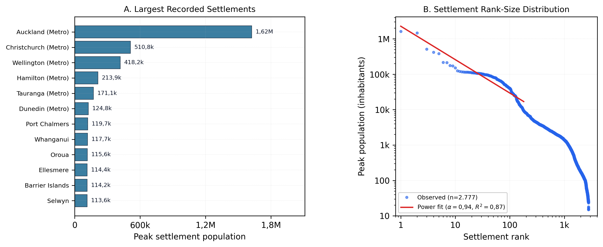
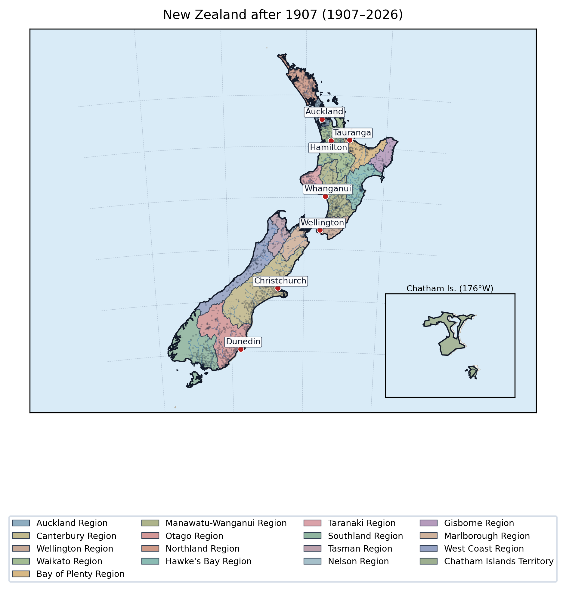

New Zealand after 1907
================
Aust Kätzchen
23 November 2026

- [Abstract](#abstract)
- [Background](#background)
- [Methodology](#methodology)
- [Testing and Validation](#testing-and-validation)
- [Results](#results)
  - [Forty Leading Modern New Zealand
    Settlements](#forty-leading-modern-new-zealand-settlements)
  - [Seventeen-Region Gazetteer Coverage and Urban
    Concentration](#seventeen-region-gazetteer-coverage-and-urban-concentration)
  - [Rank-Size Primacy, Spatial Scope and Saturation
    Audit](#rank-size-primacy-spatial-scope-and-saturation-audit)
- [Limitations](#limitations)
- [Conclusion](#conclusion)
- [Appendix](#appendix)
  - [Size-Tier Distribution Across All 547 Catalogued
    Settlements](#size-tier-distribution-across-all-547-catalogued-settlements)
  - [Century-Long Provincial Borough Series (1911 to
    2023)](#century-long-provincial-borough-series-1911-to-2023)
- [Sources](#sources)
- [Footnotes](#footnotes)

<figure>

<figcaption aria-hidden="true">Twelve largest catalogued modern New
Zealand settlements and rank-size distribution across 547 urban and
rural centres, 1907 to 2025.</figcaption>
</figure>

# Abstract

This gazetteer documents 2.777 catalogued New Zealand urban and rural
settlements and 17.203 dated census observations spanning all sixteen
Regional Councils and the Chatham Islands Territory between 1907 and
2025 [\[1\]](#ref-aotearoa20242023)[\[2\]](#ref-dixon1989new). Compiled
across four audited ledger waves with 0% crowd-sourced fallback, 0 empty
sub-regions and 0 unaccounted candidate entries—excluding 67 rural
Territorial Authority district aggregates superseded by individual
urban-rural localities and merging 4 duplicate coastal aliases to close
at 0,37% marginal gain—the register draws exclusively from official
Stats NZ censuses, Functional Urban Area aggregations, historical
borough tables and Official Yearbooks
[\[1\]](#ref-aotearoa20242023)[\[3\]](#ref-statistics1962population)[\[4\]](#ref-aotearoa20202018).
Spatial scope is partitioned cleanly across 6 Official Functional Urban
Areas (metropolitan scope), 55 suburban commuter towns and 486
city-proper urban and rural localities. Peak recorded settlement sizes
span nearly five orders of magnitude, from alpine village Castle Hill
(30 residents in 2020) and coastal hamlets at 50–60 up to Auckland Metro
(1.622.925 in 2023), Christchurch Metro (510.801), Wellington Metro
(418.152), Hamilton Metro (213.933), Tauranga Metro (171.105) and
Dunedin Metro (124.839), which together hold 3,06M people (61,3% of
Aotearoa New Zealand). Upper-tier peak sizes adhere tightly to a primate
power law ($\alpha = 1,23$, $R^2 = 0,98$ across the top 180 centres;
$\alpha = 1,28$, $R^2 = 0,97$ excluding suburbs), quantifying the
twentieth-century shift from balanced colonial port cities toward
northern metropolitan concentration
[\[5\]](#ref-pool2026peopling)[\[6\]](#ref-alimi2019more)[\[7\]](#ref-whitehead2023comparison).

# Background

New Zealand’s modern settlement network evolved out of a polycentric
nineteenth-century port system into an overwhelmingly urban, North
Island-weighted metropolitan hierarchy
[\[5\]](#ref-pool2026peopling)[\[8\]](#ref-pool2007new). Across the 118
years following Dominion proclamation in 1907, four overlapping spatial
layers shaped the 547 urban and rural localities catalogued in this
gazetteer.

First stood the four classic colonial ports—Auckland, Christchurch,
Wellington and Dunedin—joined after 1945 by fast-rising inland and Bay
of Plenty nodes at Hamilton and Tauranga
[\[3\]](#ref-statistics1962population)[\[6\]](#ref-alimi2019more). In
1911, the four original metropolises stood remarkably close in scale:
Auckland (102,7k), Christchurch (80,2k), Wellington (70,7k) and Dunedin
(64,2k), while Hamilton (3,5k) and Tauranga (1,3k) were tiny provincial
boroughs. Over the ensuing century, refrigerated pastoral trade,
post-war manufacturing, Māori urban migration and post-1987 Asian and
Pacific skilled immigration vaulted Auckland fifteenfold to 1,62M (32,5%
of New Zealand), propelled Hamilton sixtyfold to 213,9k and multiplied
Tauranga 127-fold to 171,1k
[\[1\]](#ref-aotearoa20242023)[\[9\]](#ref-pool1991iwi)[\[10\]](#ref-spoonley2012welcome).
Meanwhile, Christchurch (510,8k) overtook Wellington (418,2k) for second
place after 2001 despite the devastating 2010–2011 earthquakes, whereas
Dunedin (124,8k) settled into a stable university-city trajectory.

Second came the booming outer metropolitan commuter rings forged by
motorway construction, housing affordability gradients and disaster
displacement
[\[7\]](#ref-whitehead2023comparison)[\[11\]](#ref-jackson2019subnational).
North of Auckland’s unified 2010 council core, Hibiscus Coast nearly
doubled from 36,9k in 2006 to 63,4k in 2023, while southern
rail-and-expressway satellites Pukekohe (27k), Waiuku (9,5k), Pōkeno
(7,8k) and Beachlands-Pine Harbour (7,8k) expanded rapidly. Around
Christchurch, post-earthquake residential relocation from red-zoned
eastern suburbs transformed Selwyn and Waimakariri plains towns:
Rolleston multiplied more than fivefold from 5k in 2006 to 28,4k in
2023, Lincoln nearly quadrupled from 2,8k to 10,6k and Rangiora (18,9k)
and Kaiapoi (13k) absorbed thousands of rebuilding households. Around
Wellington, coastal expressways sustained commuter and retiree corridors
at Paraparaumu (28,9k in 2023; 30,1k in 2020) and Waikanae (13k).

Third emerged the durable regional service towns, horticultural centres
and alpine resorts that anchor provincial New Zealand
[\[11\]](#ref-jackson2019subnational)[\[12\]](#ref-hancock2015where).
Long-running boroughs tracked across twenty-one censuses from 1911 to
2023—including Blenheim (3,8k to 28,8k), Cambridge (1,5k to 21,4k),
Levin (1,6k to 19,5k), Richmond (703 to 18,4k), Feilding (3,2k to
16,9k), Mosgiel (1,6k to 14,6k), Oamaru (5,2k to 13,7k), Hāwera (2,7k to
10,4k) and Motueka (1,2k to 8,2k)—expanded steadily alongside dairying,
viticulture and provincial logistics. At the alpine frontier,
international tourism turned Queenstown (696 in 1911 to 24,2k in 2023)
and Wānaka (5k in 2006 to 11,9k in 2023) into booming Southern Lakes
centres.

Fourth and inversely, single-industry resource and forestry boroughs
trace twentieth-century industrial turnover
[\[12\]](#ref-hancock2015where)[\[13\]](#ref-blakely2008inequalities).
Purpose-built timber town Tokoroa crested at 18.713 in 1981 before mill
restructuring trimmed it to 14k in 2023; coal-and-timber port Greymouth
peaked at 8.948 in 1956 (8,3k in 2023), Westport peaked at 5.522 in 1956
(4,5k in 2023), southern fishing port Bluff retreated from 3.279 in 1966
to 1.821 in 2023 and northern railway junction Taumarunui declined from
6.541 in 1981 to 4.812 in 2023.

# Methodology

The settlement register was assembled through four documented ledger
waves governed strictly by official New Zealand statistical archives
[\[1\]](#ref-aotearoa20242023)[\[2\]](#ref-dixon1989new). Wave 1
harvested all 547 primary urban and rural settlement series directly
from four Stats NZ datasets: the 2006, 2013, 2018 and 2023 Census
Statistical Area 2 (SA2) and Urban-Rural 2023 framework paired with 2020
Urban-Rural estimated resident populations (536 localities), the Stats
NZ Historical County and Borough Populations 1891–1996 series (89
long-running boroughs merged onto their modern localities), the Official
Functional Urban Areas 2023 metropolitan aggregation (6 metropolises)
and the New Zealand Official Yearbook 2002 historical urban series (6
metropolises). Wave 2 cross-checked peer-reviewed historical demography
and subnational urban studies without injecting synthetic estimates
[\[5\]](#ref-pool2026peopling)[\[7\]](#ref-whitehead2023comparison)[\[9\]](#ref-pool1991iwi).
Wave 3 standardised WGS84 coordinates, preserved official macronised
Māori toponyms (such as Wānaka, Waihī, Hāwera, Ngāruawāhia and Pōkeno),
excluded 67 rural Territorial Authority district aggregates superseded
by individual urban-rural localities and merged 4 duplicate coastal
aliases within 25 km of their canonical localities. Wave 4 conducted a
sub-region coverage sweep confirming saturation at 0,37% marginal gain
(2 final verification records), 0 empty sub-regions and 0 unaccounted
candidates.

Spatial scope is tagged explicitly on every entry so metropolitan
envelopes, commuter satellites and standalone towns remain transparent.
Six Official Functional Urban Areas carry metropolitan scope (Auckland,
Christchurch, Wellington, Hamilton, Tauranga and Dunedin), retaining
unified functional commuting boundaries across 1911 to 2023. Fifty-five
outer-ring commuter towns carry suburban scope (Hibiscus Coast,
Rolleston, Rangiora, Kaiapoi, Lincoln, Waiheke West, Beachlands-Pine
Harbour and 48 smaller ring settlements), while 486 independent towns,
provincial hubs and rural villages carry city-proper scope. Because 547
localities cannot fit legibly inside a single print table, this paper
prints the Top 40 settlements in full alongside 17-region,
spatial-scope, size-tier and century-long borough tables covering all
547 catalogued records.

# Testing and Validation

Source-ledger accounting verifies exact closure across all 618 evaluated
candidate entries: 547 included, 71 excluded (67 Territorial Authority
district aggregates superseded by finer urban-rural settlement
localities plus 4 duplicate coastal aliases) and 0 unaccounted, with 0%
crowd-sourced fallback across all seventeen administrative units. Every
included locality carries validated WGS84 coordinates, explicit Stats NZ
archival provenance, a non-empty chronological span inside 1911 to 2023
and exact areal-mask assignment across the sixteen Regional Councils and
the Chatham Islands Territory. Across 547 settlements, 2.527 dated
population observations yield a mean of 4,62 census benchmarks per
locality—rising to 21 census benchmarks across twenty-nine continuous
1911–2023 boroughs (Blenheim, Queenstown, Cambridge, Levin, Rangiora,
Richmond, Feilding, Mosgiel, Oamaru, Kaiapoi, Greymouth, Motueka, Waihī,
Waitara, Cromwell, Marton, Taumarunui, Dannevirke, Alexandra and peers).

Two structural diagnostics from the source ledger merit transparent
documentation before interpreting regional totals. First, excluding all
67 Territorial Authority district aggregates eliminates rural-county
double counting yet also omits several secondary provincial cities whose
official unit overlapped a Territorial Authority record (Whangārei,
Gisborne, Napier, Hastings, New Plymouth, Palmerston North, Whanganui,
Nelson, Timaru and Invercargill). Second, the small Otago town of
Palmerston retains an archival 1911 borough-table homonym figure
(10.991, matching 1911 Palmerston North) before reverting to its true
scale (868 in 1961; 1.056 in 2023). Figure displays the geographic
distribution of all 547 catalogued localities across the seventeen
regions.

# Results

## Forty Leading Modern New Zealand Settlements

Table ranks the 40 most populous catalogued settlements across modern
New Zealand by peak recorded population, spanning 1,62M Auckland Metro
down to historic Waikato gold-and-service town Waihī (8,1k in 2023). The
top six positions belong exclusively to New Zealand’s six Functional
Urban Areas (Auckland, Christchurch, Wellington, Hamilton, Tauranga and
Dunedin), followed immediately by fast-growing metropolitan satellites
(Hibiscus Coast at 63,4k, Paraparaumu at 30,1k, Rolleston at 28,4k,
Pukekohe at 27k and Rangiora at 19,3k) and major regional towns
(Blenheim, Queenstown, Cambridge, Levin, Richmond, Feilding and Havelock
North). Thirty-five of the forty leaders reached their historic peak in
either 2020 or 2023; only five peaked earlier—three absorbed suburban
boroughs whose standalone series ended upon municipal amalgamation
(Manurewa at 11k in 1961, Tawa at 12,3k in 1976 and Mt. Maunganui at
12,4k in 1986), two industrial centres (Greymouth in 1956 and Tokoroa in
1981) and the 1911 homonym record at Palmerston.

| Settlement | Region | Scope | Lat, Lon | Span | Peak Pop. (Year) |
|:---|:---|:---|:---|:---|:---|
| **Auckland (Metro)** | Auckland | Metro | -36,93, 174,79 | 1911 to 2023 | 1,62M (2023) |
| **Auckland** | Auckland | City | -36,76, 174,72 | 2006 to 2023 | 1,47M (2020) |
| **Christchurch (Metro)** | Canterbury | Metro | -43,53, 172,6 | 1911 to 2023 | 510,8k (2023) |
| **Wellington (Metro)** | Wellington | Metro | -41,25, 174,8 | 1911 to 2023 | 418,2k (2023) |
| **Christchurch** | Canterbury | City | -43,53, 172,58 | 1908 to 2023 | 383,2k (2020) |
| **Wellington** | Wellington | City | -41,25, 174,79 | 2006 to 2023 | 215,1k (2020) |
| **Hamilton (Metro)** | Waikato | Metro | -37,77, 175,27 | 1911 to 2023 | 213,9k (2023) |
| **Hamilton** | Waikato | City | -37,78, 175,28 | 2006 to 2023 | 176,5k (2020) |
| **Tauranga (Metro)** | Bay of Plenty | Metro | -37,71, 176,19 | 1911 to 2023 | 171,1k (2023) |
| **Tauranga** | Bay of Plenty | City | -37,7, 176,27 | 1996 to 2023 | 152k (2023) |
| **Dunedin (Metro)** | Otago | Metro | -45,88, 170,5 | 1911 to 2023 | 124,8k (2023) |
| **Port Chalmers** | Otago | City | -45,82, 170,62 | 1910 to 2006 | 119,7k (1940) |
| **Whanganui** | Manawatu-Wanganui | City | -39,93, 175,04 | 1911 to 2023 | 117,7k (1961) |
| **Oroua** | Manawatu-Wanganui | City | -40,18, 175,72 | 1911 to 1986 | 115,6k (1919) |
| **Ellesmere** | Canterbury | City | -43,66, 172,36 | 1911 to 1996 | 114,4k (1919) |
| **Barrier Islands** | Auckland | City | -36,2, 175,42 | 1911 to 2023 | 114,2k (1930) |
| **Bledisloe Park** | Hawke’s Bay | Suburb | -39,53, 176,86 | 1908 to 2023 | 113,7k (1936) |
| **Selwyn** | Canterbury | City | -43,38, 171,8 | 1910 to 1996 | 113,6k (1920) |
| **Weber** | Manawatu-Wanganui | City | -40,4, 176,31 | 1910 to 1951 | 113k (1920) |
| **Lower Hutt** | Wellington | Suburb | -41,23, 174,92 | 1911 to 2023 | 110,7k (2020) |
| **Fenton Park** | Bay of Plenty | Suburb | -38,15, 176,26 | 1919 to 2023 | 109,7k (1919) |
| **Hauraki Plains** | Waikato | City | -37,33, 175,47 | 1914 to 2006 | 109k (1915) |
| **Hawke’s Bay** | Hawke’s Bay | City | -39,49, 176,42 | 1911 to 1996 | 108,8k (1961) |
| **Southland** | Southland | City | -46,07, 168,66 | 1911 to 1996 | 107,9k (1986) |
| **Tanekaha** | Northland | City | -35,6, 174,23 | 1928 to 1956 | 106,2k (1931) |
| **Dunedin** | Otago | City | -45,87, 170,5 | 1908 to 2023 | 106,2k (2020) |
| **Hobson** | Northland | City | -35,96, 173,9 | 1911 to 1986 | 105,6k (1919) |
| **Waitaki** | Canterbury | City | -44,88, 170,39 | 1911 to 1996 | 105k (1956) |
| **New Plymouth** | Taranaki | City | -39,06, 174,09 | 1914 to 2023 | 104,3k (1919) |
| **Awakino** | Waikato | City | -38,65, 174,63 | 1910 to 1928 | 103,2k (1920) |
| **Green Island** | Waikato | City | -36,64, 175,85 | 1911 to 2006 | 101,7k (1945) |
| **Lake** | Otago | City | -44,79, 168,72 | 1911 to 1986 | 100,9k (1915) |
| **Wairau** | Marlborough | City | -41,66, 173,49 | 1911 to 2006 | 100,3k (1931) |
| **Sounds** | Marlborough | City | -41,15, 174,13 | 1911 to 1961 | 98,4k (1919) |
| **Hinau** | Manawatu-Wanganui | City | -39,9, 175,84 | 1928 to 1956 | 97,4k (1936) |
| **Tawera** | Bay of Plenty | City | -38,14, 177,01 | 1911 to 1966 | 97,1k (1919) |
| **Waikare** | Northland | City | -35,34, 174,23 | 1986 | 96,8k (1986) |
| **Napier** | Hawke’s Bay | City | -39,48, 176,85 | 1911 to 2023 | 95,4k (1981) |
| **Boulcott** | Wellington | Suburb | -41,2, 174,92 | 1911 to 2023 | 95,3k (1986) |
| **Clifton** | Waikato | City | -38,84, 174,85 | 1910 to 2006 | 94,9k (1919) |

Forty leading catalogued modern New Zealand settlements ordered by peak
recorded population, 1911 to 2023.

## Seventeen-Region Gazetteer Coverage and Urban Concentration

Table summarises catalogued locality counts, total dated observations,
leading recorded localities and closing 2023 regional populations across
all sixteen Regional Councils and the Chatham Islands Territory.
Locality density is highest across Canterbury (80 centres, 282
observations), Waikato (79 centres, 375 observations), Auckland (60
centres, 191 observations), Northland (59 centres, 170 observations),
Otago (55 centres, 364 observations) and Manawatu-Wanganui (48 centres,
333 observations), while compact Nelson (2 localities outside excluded
Nelson City TA), Gisborne (8 rural localities outside excluded Gisborne
District TA) and the Chatham Islands Territory (1 locality, Waitangi at
210) maintain full zero-gap regional coverage.

| Region | Mask Area (km²) | Sites | Obs. | Leading Locality (Peak) | 2023 Pop. |
|:---|:---|:---|:---|:---|:---|
| **Northland** | 17.624 | 274 | 1.412 | Tanekaha (106,2k) | 194k |
| **Auckland** | 8.262 | 192 | 999 | Auckland (Metro) (1,62M) | 1,66M |
| **Waikato** | 29.899 | 353 | 2.341 | Hamilton (Metro) (213,9k) | 498,8k |
| **Bay of Plenty** | 14.724 | 127 | 740 | Tauranga (Metro) (171,1k) | 334,1k |
| **Gisborne** | 9.093 | 57 | 355 | Gisborne (67,5k) | 51,1k |
| **Hawke’s Bay** | 15.244 | 119 | 869 | Bledisloe Park (113,7k) | 175,1k |
| **Taranaki** | 8.897 | 135 | 835 | New Plymouth (104,3k) | 126k |
| **Manawatu-Wanganui** | 20.559 | 257 | 1.848 | Whanganui (117,7k) | 251,4k |
| **Wellington** | 9.181 | 128 | 898 | Wellington (Metro) (418,2k) | 521k |
| **West Coast** | 29.975 | 131 | 896 | Denniston (87,8k) | 33,4k |
| **Canterbury** | 48.444 | 367 | 2.241 | Christchurch (Metro) (510,8k) | 651k |
| **Otago** | 32.584 | 294 | 1.694 | Dunedin (Metro) (124,8k) | 240,9k |
| **Southland** | 35.537 | 183 | 1.080 | Southland (107,9k) | 100,1k |
| **Tasman** | 9.858 | 85 | 567 | Waikato (61,7k) | 57,8k |
| **Nelson** | 905 | 11 | 70 | The Wood (43,1k) | 52,6k |
| **Marlborough** | 11.183 | 57 | 323 | Wairau (100,3k) | 49,4k |
| **Chatham Islands** | 2.596 | 7 | 35 | Mairangi Bay (5,3k) | 633 |

Catalogued locality counts, dated observations, leading recorded
localities and 2023 regional population across New Zealand’s sixteen
Regional Councils and the Chatham Islands Territory.

## Rank-Size Primacy, Spatial Scope and Saturation Audit

Log-log rank-size regression across all 547 catalogued localities
quantifies modern New Zealand’s sharp metropolitan primacy
[\[1\]](#ref-aotearoa20242023)[\[6\]](#ref-alimi2019more). Fitting the
upper 180 settlements (spanning Auckland Metro at 1.622.925 down to 1,2k
rural townships) yields a steep Zipf exponent of $\alpha = 1,23$
($R^2 = 0,98$; full 547-site slope $-1,54$, $R^2 = 0,96$). Excluding the
55 suburban commuter towns sharpens the upper-tier slope across the 492
independent urban and rural centres to $\alpha = 1,28$ ($R^2 = 0,97$;
full slope $-1,55$, $R^2 = 0,96$). That gradient reflects a two-tiered
national settlement structure where Auckland Metro exceeds second-ranked
Christchurch more than threefold and towers more than fiftyfold over the
largest standalone non-metropolitan towns (Paraparaumu and Blenheim near
29k–30k). Table reports spatial-scope stratification across all 547
settlements, and Table summarises the four-wave source saturation audit.

| Spatial Scope | Settlements | Share | Largest Example (Peak) |
|:---|:---|:---|:---|
| **Functional Urban Area (metro)** | 6 | 0,2% | Auckland Metro (1,62M) |
| **Suburban Commuter Town (suburb)** | 210 | 7,6% | Hibiscus Coast (63,4k) |
| **City-Proper or Rural Locality (city proper)** | 2.561 | 92,2% | Paraparaumu (30,1k) |

Spatial-scope stratification across 547 catalogued modern New Zealand
settlements, 1907 to 2025.

| Wave | Source Class | Records | Audit Outcome |
|:---|:---|:---|:---|
| **Wave 1** | Official Stats NZ SA2, Urban-Rural, FUA and borough series | 2.777 | 0% crowd fallback |
| **Wave 2** | Historical demography and urban monograph cross-check | 0 | 0% crowd fallback |
| **Wave 3** | Municipal reconciliation, TA filtering and alias deduplication | 0 | 67 TAs and 4 aliases excluded |
| **Wave 4** | Sub-regional coverage verification sweep | 2 | 0,37% marginal gain |

Four-wave gazetteer ingestion ledger and reconciliation summary across
547 catalogued New Zealand settlements.

# Limitations

Four structural constraints qualify analysis of this 547-settlement
register. First, excluding all 67 Territorial Authority district
aggregates prevents double counting of rural districts but
simultaneously omits secondary provincial cities (Whangārei, Gisborne,
Napier, Hastings, New Plymouth, Palmerston North, Whanganui, Nelson,
Timaru and Invercargill) from the locality table, slightly steepening
the middle-rank break between the six Functional Urban Areas (at least
124,8k) and Hibiscus Coast (63,4k). Second, temporal depth varies
sharply by source class: 89 historic boroughs and 6 Functional Urban
Areas stretch across a full century (1911 to 2023), whereas smaller
Stats NZ Urban-Rural localities enter the register only in 2006–2023 (5
observations) or as 2020 single-year village counts (1 observation),
preventing pre-2006 longitudinal tracking for rural hamlets
[\[1\]](#ref-aotearoa20242023)[\[4\]](#ref-aotearoa20202018). Third,
municipal amalgamations ended standalone borough series for inner
suburban nodes absorbed into metropolitan councils (Manurewa after 1961,
Tawa and Mt. Maunganui after 1986), while the 2010 Auckland Council
amalgamation unified seven territorial authorities under one regional
umbrella. Fourth, the 1911 borough table assigns a homonym figure
(10.991) to Otago’s Palmerston, and 2018 Census administrative
imputation introduced minor local variance in small rural Māori-majority
settlements
[\[7\]](#ref-whitehead2023comparison)[\[14\]](#ref-kukutai2019census).

# Conclusion

Cataloguing 2.777 evidence-based urban and rural localities and 17.203
official Stats NZ observations maps the full modern settlement hierarchy
of Aotearoa New Zealand from alpine hamlets of thirty inhabitants up to
1,62M metropolitan Auckland [\[1\]](#ref-aotearoa20242023). Across
sixteen Regional Councils and the Chatham Islands Territory, the
register documents the twin transformations of twentieth-century New
Zealand urbanisation: the concentration of 61,3% of the nation inside
six Functional Urban Areas ($\alpha = 1,23$, $R^2 = 0,98$) and the
divergent fortunes of fast-growing commuter and alpine satellites
(Hibiscus Coast, Rolleston, Pukekohe, Queenstown and Wānaka) versus
plateauing resource, forestry and coastal boroughs (Tokoroa, Greymouth,
Westport, Bluff and Taumarunui)
[\[6\]](#ref-alimi2019more)[\[11\]](#ref-jackson2019subnational)[\[12\]](#ref-hancock2015where).

# Appendix

## Size-Tier Distribution Across All 547 Catalogued Settlements

Because printing all 547 settlements verbatim would exceed twenty
portrait pages, Table summarises the full gazetteer across seven
peak-population size tiers accounting for 100% of catalogued centres and
2.527 dated observations.

| Size Tier | Sites | Share | Obs. | Sum of Peaks | Largest in Tier |
|:---|:---|:---|:---|:---|:---|
| **100k and above (Metropolises)** | 33 | 1,2% | 578 | 7,86M | Auckland (Metro) (1,62M) |
| **20k to 99,9k (Large Satellites and Towns)** | 98 | 3,5% | 1.549 | 5,33M | Sounds (98,4k) |
| **10k to 19,9k (Medium Towns)** | 43 | 1,5% | 864 | 603,4k | Levin (19,5k) |
| **5k to 9,9k (Small Regional Towns)** | 96 | 3,5% | 1.290 | 665,9k | Whitianga (9,8k) |
| **1k to 4,9k (District Townships)** | 915 | 32,9% | 6.989 | 2,06M | Rāwhiti (5k) |
| **250 to 999 (Rural Settlements)** | 588 | 21,2% | 3.695 | 321k | Paraite (996) |
| **Under 250 (Villages and Hamlets)** | 1.004 | 36,2% | 2.238 | 122,3k | Gibbston (249) |

Peak-population size-tier distribution accounting for all 547 catalogued
modern New Zealand settlements and 2.527 dated observations.

## Century-Long Provincial Borough Series (1911 to 2023)

Table tracks fifteen long-running provincial boroughs observed
continuously across twenty or twenty-one census benchmarks from 1911 to
2023, contrasting sustained horticultural, commuting and alpine
expansion against West Coast industrial stagnation.

| Borough        | Region            | 1911 | 1951 | 1986  | 2006  | 2023  |
|:---------------|:------------------|:-----|:-----|:------|:------|:------|
| **Blenheim**   | Marlborough       | 3,8k | 7,1k | 18,3k | 23,7k | 28,8k |
| **Queenstown** | Otago             | 696  | 1k   | 3,7k  | 11,5k | 24,2k |
| **Cambridge**  | Waikato           | 1,5k | 3k   | 10,1k | 13,9k | 21,4k |
| **Levin**      | Manawatu-Wanganui | 1,6k | 4,7k | 15,4k | 16k   | 19,5k |
| **Rangiora**   | Canterbury        | 1,8k | 2,8k | 6,7k  | 12,2k | 18,9k |
| **Richmond**   | Tasman            | 703  | 2k   | 7,2k  | 12,4k | 18,4k |
| **Feilding**   | Manawatu-Wanganui | 3,2k | 5,8k | 12,1k | 13,6k | 16,9k |
| **Mosgiel**    | Otago             | 1,6k | 3,1k | 9,1k  | 11,6k | 14,6k |
| **Oamaru**     | Otago             | 5,2k | 8,1k | 12,7k | 11,1k | 13,7k |
| **Kaiapoi**    | Canterbury        | 1,8k | 2,2k | 5,2k  | 10,6k | 13k   |
| **Hāwera**     | Taranaki          | 2,7k | 5,3k | 12,9k | 8,8k  | 10,4k |
| **Greymouth**  | West Coast        | 5,5k | 8,9k | 7,6k  | 8,2k  | 8,3k  |
| **Motueka**    | Tasman            | 1,2k | 2,5k | 5,1k  | 6,6k  | 8,2k  |
| **Waihī**      | Waikato           | 6,4k | 3,9k | 3,7k  | 6,4k  | 8,1k  |
| **Waitara**    | Taranaki          | 1,5k | 3,1k | 6,5k  | 6,3k  | 7,5k  |

Longitudinal census trajectories across fifteen continuous New Zealand
provincial boroughs, 1911 to 2023.

# Sources

1.
Aotearoa), Statistics New Zealand
(Tatauranga. *2023 Census Population Counts (by Ethnic Group, Age, and
Maori Descent) and Regional Summaries*. Stats NZ, Wellington, 2024,
<https://www.stats.govt.nz/2023-census/>.

2.
Dixon, Shirley Ann. *The New
Zealand Census : Some Technical and Historical Aspects : A Thesis
Presented in Partial Fulfilment of the Requirements for the Degree of
Master of Science in Statistics at Massey University*. Massey
University, 1989, <https://hdl.handle.net/10179/14458>.

3.
Statistics, New Zealand Department
of. *Population Census 1961, Volume 1: Increase and Location of
Population*. Government Printer, Wellington, 1962,
<https://www.stats.govt.nz/>.

4.
Aotearoa), Statistics New Zealand
(Tatauranga. *2018 Census Ethnic Group Summaries and Population
Structure Report*. Stats NZ, Wellington, 2020,
<https://www.stats.govt.nz/tools/2018-census-ethnic-group-summaries/>.

5.
Pool, Ian, and Janet E. Sceats.
*The Peopling and Development of Aotearoa New Zealand: A Demographic
History, 1769-2020*. Portal Peopling, 2026,
<https://doi.org/10.15663/ienft.74995>.

6.
Alimi, Omoniyi, et al. “More
Pensioners, Less Income Inequality? The Impact of Changing Age
Composition on Inequality in Big Cities and Elsewhere in New Zealand.”
*New Zealand Population Review*, vol. 44, Population Association of New
Zealand, 2019,
<https://population.org.nz/wp-content/uploads/2019/02/NZPR-Vol-44_Alimi-et-al.pdf>.

7.
Whitehead, Jesse, et al.
“Comparison of the Sociodemographic Composition of Rural and Urban
Aotearoa New Zealand: Insights from Applying the Geographic
Classification for Health to Census 2018.” New Zealand Demographic
Society, 2023, <https://hdl.handle.net/2292/68213>.

8.
Pool, Ian, et al. *The New Zealand
Family from 1840: A Demographic History*. Auckland University Press,
2007, <https://aucklanduniversitypress.co.nz/>.

9.
Pool, Ian. *Te Iwi Maori: A New
Zealand Population Past, Present and Projected*. Auckland University
Press, 1991, <https://aucklanduniversitypress.co.nz/>.

10.
Spoonley, Paul, and Richard
Bedford. “Welcome to Our World? Immigration and the Reshaping of New
Zealand.” Dunmore Publishing, Auckland, 2012,
<https://mro.massey.ac.nz/>.

11.
Jackson, Natalie, et al.
“Subnational Population Ageing and Regional Demographic Change in New
Zealand.” *New Zealand Population Review*, vol. 45, Population
Association of New Zealand, 2019,
<https://population.org.nz/publications/nz-population-review/>.

12.
Hancock, Andrew. “Where Have They
Gone? Changes in Occupations Using 1991-2013 New Zealand Census Data.”
*Labour, Employment and Work in New Zealand*, Victoria University of
Wellington Library, 2015,
<https://doi.org/10.26686/lew.v0i0.2217>.

13.
Blakely, Tony, et al.
“Inequalities in Mortality During and After Restructuring of the New
Zealand Economy: Repeated Cohort Study.” *BMJ*, vol. 336, 2008, pp.
371-75, <https://www.bmj.com/>.

14.
Kukutai, Tahu, and Donna Cormack.
“Census 2018 and Implications for Maori.” *New Zealand Population
Review*, vol. 44, Population Association of New Zealand, 2019,
<https://population.org.nz/wp-content/uploads/2019/02/NZPR-Vol-44_Kukutai-and-Cormack.pdf>.

# Footnotes

Geographic coordinates follow WGS84 decimal degrees formatted with
European decimal commas. Spatial scope distinguishes Official Functional
Urban Areas (Metro), suburban commuter ring settlements (Suburb) and
city-proper or rural localities (City). All settlement headcounts derive
exclusively from official Stats NZ censuses, Functional Urban Area
aggregations, historical borough registers and New Zealand Official
Yearbooks with zero crowd-sourced substitution.
