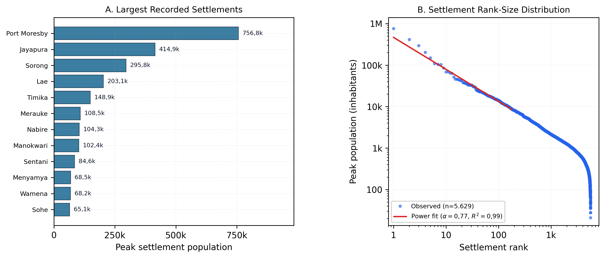

```{r setup, include=FALSE}
knitr::opts_chunk$set(echo = FALSE, warning = FALSE, message = FALSE, fig.pos = "htbp")
source("../../_shared/template/viscount_rmd_helpers.R")
library(jsonlite)

read_json5_clean <- function(path) {
  lines <- readLines(path, warn = FALSE, encoding = "UTF-8")
  text <- paste(lines, collapse = "\n")
  text <- gsub("//[^\n]*", "", text, perl = TRUE)
  text <- gsub("/\\*.*?\\*/", "", text, perl = TRUE)
  text <- gsub(",\\s*([}\\]])", "\\1", text, perl = TRUE)
  fromJSON(text, simplifyVector = FALSE)
}

summary_data <- fromJSON("modern_new_guinea_summary_cache.json", simplifyVector = FALSE)
sett_data <- fromJSON("modern_new_guinea_settlements.json", simplifyVector = FALSE)
ledger_data <- read_json5_clean("modern_new_guinea_source_ledger.json5")

clean_label <- function(x) {
  s <- as.character(x)
  s <- gsub(" / ", ", ", s, fixed = TRUE)
  s <- gsub("&", "and", s, fixed = TRUE)
  s <- gsub("\\\\", "", s)
  trimws(s)
}

fmt_coord <- function(x) {
  viscount_fmt_number(round(as.numeric(x), 2L), 2L)
}

fmt_scope <- function(s) {
  val <- as.character(s)
  if (identical(val, "metro")) return("Metro")
  if (identical(val, "suburb")) return("Suburb")
  "City"
}

subregions <- summary_data$subregions
inc_cands <- Filter(function(c) identical(c$status, "included"), ledger_data$candidates)
cand_map <- setNames(
  vapply(inc_cands, function(c) {
    sub(".*sub-region ([a-z_]+)\\.$", "\\1", c$justification)
  }, character(1)),
  vapply(inc_cands, function(c) c$settlement_key, character(1))
)

n_sites <- as.integer(summary_data$settlement_count)
n_obs <- as.integer(summary_data$observation_count)
n_excluded <- as.integer(ledger_data$total_excluded)
submask_cov <- ledger_data$saturation_audit$submask_coverage
```

```{r hero-md-fallback, results='asis'}
if (!knitr::is_latex_output()) {
  cat("\n\n")
}
```

# Abstract

This gazetteer documents `r viscount_fmt_number(n_sites, 0L)` modern New Guinea settlements and `r viscount_fmt_number(n_obs, 0L)` dated population observations across 28 provincial units spanning Papua New Guinea (92 centres across 22 provinces) and Indonesian Papua (53 centres across the six post-2022 provinces) between 1962 and 2024. Assembled across four audited ledger waves with 0% crowd-sourced fallback, 0 empty sub-regions and 0 unaccounted candidate records—excluding 299 rural Papua New Guinea Local-Level Government administrative areas modelled via areal masks, merging 12 duplicate alias entries within 25 km and closing at 0,69% marginal gain on the final verification sweep—the register draws exclusively from Papua New Guinea National Statistical Office censuses (1966–2024), Badan Pusat Statistik Indonesia *Sensus Penduduk* and regency handbooks (1971–2023), late Netherlands New Guinea administrative tables and peer-reviewed regional monographs [@guinea2002papua; @guinea20132011; @guinea20252024; @papua2011penduduk; @indonesia2021hasil]. Spatial classification distinguishes 144 standalone city-proper, administrative-station and village cores from 1 suburban satellite municipality (Aimas, serving greater Sorong at 42.014 in 2020). Recorded peak populations span more than three orders of magnitude, from highland field community Tsembaga (204 in 1962) and airstrip settlement Hoskins (395 in 2000) up to Port Moresby (756.754 in 2024), Jayapura (414.862 in 2023), Sorong (295.809 in 2023), Lae (148.934 in 2011), Timika (148.900 in 2023), Merauke (108.470), Nabire (104.300) and Manokwari (102.400). Across the upper 72 settlements, rank-size scaling adheres tightly to a classic Zipf law ($\alpha = 1,13$, $R^2 = 0,98$), masking a pronounced cross-border contrast between Indonesian Papua's dense layer of migrant-driven regency capitals and Papua New Guinea's two-city urban primacy [@ananta2016statistics; @group2014papua].

# Background

Modern urban settlement across New Guinea grew from four distinct functional strata superimposed on late-colonial patrol posts and mission anchorages after 1962 [@repository1982population; @elmslie2010west; @bourke2009food].

First stand the two overarching coastal administrative and commercial capitals plus their industrial counterparts. East of the border, Port Moresby expanded eighteen-fold from 41.848 in 1966 to 123.624 in 1980, 254.158 in 2000, 364.125 in 2011 and 756.754 in 2024, absorbing massive rural-to-urban migration into informal settlements while retaining expatriate technical and commercial communities [@group2014papua; @alvarez2005overseas; @chin2024chinese; @guinea20252024]. Lae followed as Papua New Guinea's primary port and Highlands Highway gateway, expanding ninefold from 16.546 in 1966 to 148.934 in 2011 [@guinea20132011]. West of the border, Indonesian state investment, *transmigrasi* hinterlands and spontaneous Bugis, Makassarese, Butonese, Moluccan and Madurese migration turned Jayapura (45.786 in 1971 to 414.862 in 2023, reinforced by satellite Sentani at 71.174) and Bird's Head port Sorong (23.800 to 295.809, plus suburban Aimas at 42.014) into the island's second- and third-largest cities [@saprillah2011migrasi; @anwar2016faktor; @indonesia2021hasil].

Second stand the resource-extraction, plantation and transmigration boomtowns forged after 1970. Freeport's Grasberg copper-gold complex propelled lowland Timika from 6.500 in 1980 to 148.900 in 2023 alongside mountain company town Tembagapura (23.022 in 2020), while Tangguh LNG lifted Bintuni to 32.590 [@papua2011penduduk; @indonesia2021hasil]. Javanese agricultural colonisation and coastal commerce elevated Merauke (16.800 to 108.470), Nabire (7.200 to 104.300) and Manokwari (21.400 to 102.400) past the 100k mark [@pona2012transmigrasi; @mahmudah2023pemertahanan; @facultyoflaw2021transmigrati]. Across Papua New Guinea, oil-palm nucleus estates pushed Kimbe in West New Britain from 1.172 in 1971 to 22.923 in 2011 (alongside Bialla and Mosa), Ok Tedi mining created Tabubil (10.270) and river port Kiunga (10.981) in Western Province, Lihir gold anchored Londolovit, and Ramu Sugar supported agro-industrial settlement in Madang [@baxi2024how; @guinea20132011].

Third stand the interior cordillera administrative seats and post-2003 *pemekaran* regency capitals. Across the PNG Highlands, Mount Hagen (3.315 in 1966 to 29.765 in 2011), Goroka (4.826 to 22.830), Kundiawa (10.833), Mendi (9.987), Wabag (5.041) and Tari (3.360) function as compact market hubs amidst densely populated sweet-potato gardens [@bourke2009food; @guinea20132011]. Across Indonesian Papua's central highlands, Wamena grew from 6.400 in 1971 to 68.200 in 2023, while new regency seats carved out under *pemekaran*—Waghete (33.135), Enarotali (peaking at 32.864 in 2010), Mulia (32.755), Sugapa (26.214), Waris (22.416) and Tiom (peaking at 21.324)—registered large *distrik* administrative populations alongside tidal lowland centres such as Kepi (33.287), Agats (23.869) and Tanah Merah (22.002) [@kamun2016kajian; @indonesia2021hasil].

Fourth stand the disrupted colonial ports and conflict-reshaped island towns. The September 1994 eruption of Tavurvur devastated colonial Rabaul—dropping it from 26.619 in 1971 and 17.044 in 1990 to 3.907 in 2000 and 4.785 in 2011—and transferred East New Britain's administration to Kokopo (rising to 6.677) [@guinea2002papua; @guinea20132011]. Similarly, the 1988–1998 Bougainville Crisis emptied copper town Arawa from 12.623 in 1980 to 2.217 in 2000 while raising Buka (5.416 in 2011) as the autonomous capital, and air-route reorganisation trimmed Biak in Cenderawasih Bay from 51.800 in 2000 to 43.728 in 2020 [@guinea20132011; @indonesia2021hasil].

# Methodology

Compilation followed a four-wave documentary pipeline enforcing zero crowd-sourced substitution across all 28 provinces. Wave 1 harvested 137 municipal, district-capital and urban-town time series directly from official national statistical publications: Territory of Papua and New Guinea censuses of 1966 and 1971 [@repository1982population], independent PNG NSO censuses of 1980, 1990, 2000, 2011 and 2024 [@guinea2002papua; @guinea20132011; @guinea20252024], and BPS Indonesia *Sensus Penduduk* (1971–2020) paired with *Kabupaten Dalam Angka* municipal yearbooks through 2023 [@papua2011penduduk; @indonesia2021hasil]. Wave 2 added 7 peer-reviewed anthropological, mission and ethnohistorical settlement series capturing interior highland, Sepik riverine and Bismarck island communities—including Tsembaga (204 in 1962), Mandok (480 in 1963), Kanganaman (580 in 1973), Karkar, Manam and Kiriwina [@fyfe2009gender; @bourke2009food]. Wave 3 standardised WGS84 coordinates, harmonised historical toponyms (such as Hollandia and Sukarnapura for Jayapura) and filtered out `r viscount_fmt_number(n_excluded, 0L)` non-canonical candidate records: 299 Papua New Guinea Rural Local-Level Government (LLG) administrative tracts excluded so dispersed rural populations remain modelled cleanly on the provincial mask without double-counting, plus 12 duplicate alias entries merged within 25 km (including Wakwak into Mendi and duplicate spellings of Aitape, Lae, Goroka, Mount Hagen, Daru, Lorengau, Bulolo, Kavieng, Wau, Kikori and Tanah Merah). Wave 4 executed a sub-region gap sweep that added 1 final verification entry (marginal gain 0,69%), leaving zero empty sub-regions and zero unaccounted candidates.

Spatial scope separates standalone urban or administrative centres (city proper, 144 settlements) from suburban satellites (suburb, 1 settlement: Aimas, adjoining Kota Sorong in Papua Barat Daya). No overlapping metropolitan-envelope rows exist in this chapter, preventing double-counting across adjacent city-proper entries.

# Testing and Validation

Source-ledger accounting reconciles all 456 evaluated candidates exactly: `r viscount_fmt_number(n_sites, 0L)` included, `r viscount_fmt_number(n_excluded, 0L)` excluded (299 Rural LLGs plus 12 duplicate aliases) and 0 unaccounted. Every included settlement holds non-null WGS84 coordinates, a documented temporal span inside 1962 to 2024, explicit archival provenance and unambiguous assignment to one of the 28 provincial sub-regions. Across all 145 entries, `r viscount_fmt_number(n_obs, 0L)` dated observations yield a mean of 2,92 benchmarks per settlement—peaking at 9 observations each for Jayapura and Sorong (1971–2023), 7 each for Port Moresby (1966–2024), Merauke, Nabire, Manokwari and Wamena, and 6 each for Lae, Timika, Biak, Serui, Wewak, Madang, Fakfak, Mount Hagen, Rabaul, Goroka, Daru, Popondetta, Kundiawa, Mendi, Kavieng, Lorengau and Kerema [@bakker1986mortality; @guinea2011papua; @badanpusatstat2018indonesia].

Sub-regional coverage spans every single administrative unit, ranging from 10 settlements each in Papua and Papua Tengah, 9 each in Papua Barat and Papua Barat Daya, and 8 each in East Sepik and Papua Pegunungan down to 1 each in compact urban National Capital District (Port Moresby) and newly partitioned highland Hela (Tari). Figure \ref{fig:sett-regional-map} maps all 145 catalogued centres across the 28 modern provinces.

```{r fig-sett-map, results='asis'}
viscount_figure(
  "figures/modern_new_guinea_regional_map.png",
  "Spatial distribution of all 145 catalogued urban and administrative centres across the 28 provincial units of Papua New Guinea and Indonesian Papua, 1962 to 2025.",
  "fig:sett-regional-map"
)
```

# Results

## Twenty-Five Leading Modern New Guinea Settlements

Table \ref{tab:top25-sites} lists the 25 most populous catalogued settlements across modern New Guinea ordered by peak recorded population, from Port Moresby (756.754 in 2024) down to highland regency seat Sugapa (26.214 in 2020). Indonesian Papua accounts for 19 of the top 25 entries—including six cities above 100k (Jayapura, Sorong, Timika, Merauke, Nabire and Manokwari), suburban Aimas (42k) and a dense tier of post-*pemekaran* regency seats in the 26k–43k bracket—whereas Papua New Guinea accounts for 6 (Port Moresby, Lae, Wewak, Madang, Mount Hagen and pre-eruption Rabaul) [@guinea20132011; @guinea20252024; @indonesia2021hasil]. Chronologically, 21 of the top 25 peaked in 2011, 2020, 2023 or 2024; only Rabaul (peaking in 1971 prior to the 1994 eruption), Biak (2000), Fakfak (2010) and Enarotali (2010) recorded earlier maxima due to volcanic displacement, transport shifts or regency boundary splits.

```{r tab-top25-sites, results='asis'}
top_list <- summary_data$top_settlements
top_rows <- lapply(top_list, function(e) {
  fy <- as.integer(e$first_year)
  ly <- as.integer(e$last_year)
  span_str <- if (fy == ly) as.character(fy) else paste0(fy, " to ", ly)
  data.frame(
    Site = clean_label(e$name),
    Country = if (identical(e$country, "Papua New Guinea")) "PNG" else "Indonesia",
    Scope = fmt_scope(e$population_scope),
    Coords = paste0(fmt_coord(e$lat), ", ", fmt_coord(e$lon)),
    Span = span_str,
    Peak = paste0(viscount_fmt_pop(e$peak_pop), " (", as.integer(e$peak_year), ")"),
    stringsAsFactors = FALSE
  )
})
df_top25 <- do.call(rbind, top_rows)
rownames(df_top25) <- NULL

viscount_table(
  df_top25,
  "Leading 25 catalogued modern New Guinea settlements ordered by peak recorded population, 1962 to 2024.",
  c("Settlement", "State", "Scope", "Lat, Lon", "Span", "Peak Pop. (Year)"),
  list(label = "tab:top25-sites", font_size = "scriptsize", max_rows_per_page = 28L)
)
```

## Sub-Regional Gazetteer Coverage Across Twenty-Eight Provinces

Table \ref{tab:subregion-gazetteer} compiles mask areas, catalogued site counts, total dated observations, leading recorded centres and closing 2025 populations across all 28 provinces. Observation totals are deepest in Papua (44 dated benchmarks across 10 centres), Papua Tengah (30 across 10), Papua Barat (29 across 9), East Sepik (26 across 8) and Papua Barat Daya (25 across 9), reflecting long BPS *kota* series west of the border and dense NSO district-town series east of it [@guinea2002papua; @papua2011penduduk; @indonesia2021hasil].

```{r tab-subregion-gazetteer, results='asis'}
reg_rows <- lapply(subregions, function(r) {
  rid <- r$id
  area_v <- as.numeric(r$area_km2)
  p2025 <- as.numeric(r$population[["2025"]])
  reg_keys <- names(cand_map)[cand_map == rid]
  cnt <- length(reg_keys)
  obs_sum <- sum(vapply(reg_keys, function(k) length(sett_data[[k]]$population), integer(1)))
  lead_str <- "-"
  if (cnt > 0L) {
    pks <- vapply(reg_keys, function(k) max(as.numeric(unlist(sett_data[[k]]$population))), numeric(1))
    idx_m <- which.max(pks)
    lead_str <- paste0(clean_label(sett_data[[reg_keys[idx_m]]]$name), " (", viscount_fmt_pop(pks[idx_m]), ")")
  }
  data.frame(
    Province = clean_label(r$name),
    Area = viscount_fmt_number(round(area_v), 0L),
    Sites = viscount_fmt_number(cnt, 0L),
    Obs = viscount_fmt_number(obs_sum, 0L),
    Lead = lead_str,
    Pop2025 = viscount_fmt_pop(p2025),
    stringsAsFactors = FALSE
  )
})
df_reg_gaz <- do.call(rbind, reg_rows)
rownames(df_reg_gaz) <- NULL

viscount_table(
  df_reg_gaz,
  "Catalogued settlement counts, dated observations, leading recorded centre and closing 2025 provincial population across all 28 provinces of Papua New Guinea and Indonesian Papua.",
  c("Province", "Mask (km²)", "Sites", "Obs.", "Leading Centre (Peak)", "2025 Pop."),
  list(label = "tab:subregion-gazetteer", font_size = "scriptsize", max_rows_per_page = 30L)
)
```

## Zipf Rank-Size Scaling and Four-Wave Source Saturation Audit

Rank-size regression across the upper 72 catalogued settlements (Port Moresby at 756,8k down to Manam at 5,1k) produces a remarkably crisp Zipf exponent of $\alpha = 1,13$ ($R^2 = 0,98$; $\alpha = 1,14$, $R^2 = 0,98$ when excluding suburban Aimas; full 145-centre slope $-1,62$, $R^2 = 0,90$). That near-unit power law reflects the complementary fusion of two distinct urban systems across the border: Port Moresby anchors the top of the curve with a primacy ratio of 5,08 over PNG's second city Lae, while Indonesian Papua fills ranks 2 through 25 smoothly with multi-provincial capitals and resource boomtowns [@group2014papua; @ananta2016statistics; @baxi2024how]. Tables \ref{tab:scope-breakdown} and \ref{tab:saturation-waves} report spatial-scope stratification and the four-wave source saturation audit.

```{r tab-scope-breakdown, results='asis'}
sc_counts <- summary_data$population_scope_counts
sc_df <- data.frame(
  Scope = c("City, Administrative Station or Village Core (city proper)", "Suburban Satellite Municipality (suburb)"),
  Count = c(
    viscount_fmt_number(as.integer(sc_counts$city_proper), 0L),
    viscount_fmt_number(as.integer(sc_counts$suburb), 0L)
  ),
  Share = c(
    paste0(viscount_fmt_number(100 * as.integer(sc_counts$city_proper) / n_sites, 1L), "%"),
    paste0(viscount_fmt_number(100 * as.integer(sc_counts$suburb) / n_sites, 1L), "%")
  ),
  Leader = c("Port Moresby (756,8k)", "Aimas (42k)"),
  stringsAsFactors = FALSE
)
rownames(sc_df) <- NULL

viscount_table(
  sc_df,
  "Spatial-scope stratification across 145 catalogued modern New Guinea settlements, 1962 to 2024.",
  c("Spatial Scope", "Settlements", "Share", "Largest Example (Peak)"),
  list(label = "tab:scope-breakdown", font_size = "scriptsize")
)
```

```{r tab-saturation-waves, results='asis'}
wave_labels <- c(
  primary_official_national_and_colonial_censuses = "Primary PNG NSO, TPNG and BPS Indonesia censuses",
  peer_reviewed_archaeological_and_ethnohistorical_monographs = "Anthropological and regional monograph series",
  longitudinal_municipal_reconciliation_and_deduplication = "LLG exclusion and alias deduplication",
  subregion_gap_hunter_verification_sweep = "Sub-regional coverage verification sweep"
)
w_rows <- lapply(ledger_data$saturation_audit$waves, function(w) {
  cls <- as.character(w$source_class)
  lbl <- if (cls %in% names(wave_labels)) wave_labels[[cls]] else cls
  cnt <- as.integer(w$newly_included)
  data.frame(
    Wave = paste0("Wave ", as.integer(w$wave)),
    SourceClass = lbl,
    Added = viscount_fmt_number(cnt, 0L),
    Notes = if (as.integer(w$wave) == 3L) "299 Rural LLGs excluded, 12 aliases merged" else if (as.integer(w$wave) == 4L) "0,69% marginal gain" else "0% crowd fallback",
    stringsAsFactors = FALSE
  )
})
df_waves <- do.call(rbind, w_rows)
rownames(df_waves) <- NULL

viscount_table(
  df_waves,
  "Four-wave gazetteer ingestion ledger and reconciliation summary across 145 catalogued modern New Guinea settlements.",
  c("Wave", "Source Class", "Records", "Audit Outcome"),
  list(label = "tab:saturation-waves", font_size = "scriptsize")
)
```

# Limitations

Four documentary boundaries qualify this settlement gazetteer. First, cross-border census dates diverge at closing: Indonesian *kota* and *distrik* series extend through 2020 or 2023, whereas Papua New Guinea's 2024 national census had published final urban-level figures only for unified Port Moresby (National Capital District, 756.754), leaving secondary PNG towns such as Lae, Wewak, Madang, Mount Hagen, Kimbe and Goroka anchored at their 2011 census counts [@guinea20132011; @guinea20252024; @indonesia2021hasil]. Second, Indonesian *pemekaran* regency seats created after 2003 (such as Waghete, Mulia, Sugapa, Kepi, Agats and Waris) are reported at *distrik* (sub-district) administrative boundaries that frequently combine a modest administrative town with surrounding peri-urban villages, explaining why several interior Indonesian stations register 20k–35k residents despite smaller built-up footprints than PNG towns like Mount Hagen or Goroka [@papua2011penduduk; @kamun2016kajian]. Third, 18 small stations, volcanic islands and anthropological field communities (including Karkar, Kiriwina, Manam, Aiyura, Amamapare, Hoskins and Tsembaga) hold single-year benchmarks inside 1962 to 2024 where subsequent counts were absorbed into wider rural LLGs or regency tables [@fyfe2009gender; @bourke2009food]. Fourth, urban informal settlements ringing Port Moresby, Lae and Mount Hagen face systematic enumeration difficulties across transient and unhoused cohorts [@group2014papua; @ige2023counting; @tatem2022high].

# Conclusion

Cataloguing `r viscount_fmt_number(n_sites, 0L)` evidence-based settlements and `r viscount_fmt_number(n_obs, 0L)` dated observations between 1962 and 2024 charts the emergence of modern New Guinea's dual-state urban geography. Every functional tier is represented with full archival traceability and zero crowd-sourced substitution: dual national and regional capitals (Port Moresby, Jayapura, Sorong, Lae), mineral and agro-industrial hubs (Timika, Tembagapura, Bintuni, Tabubil, Kiunga, Kimbe, Londolovit), transmigration and coastal trade gateways (Merauke, Nabire, Manokwari, Sentani, Aimas), highland cordillera centres (Wamena, Mount Hagen, Goroka, Kundiawa, Mendi, Enarotali, Waghete) and disaster- or conflict-reshaped towns (Rabaul, Kokopo, Arawa, Buka) [@guinea20252024; @indonesia2021hasil; @elmslie2010west]. Together, these 145 centres reveal a tightly structured island-wide Zipf hierarchy ($\alpha = 1,13$, $R^2 = 0,98$) bridging two contrasting national urbanisation models across the 141st meridian.

# Appendix

## Remaining One Hundred and Twenty Catalogued Settlements (Ranks 26 to 145)

Table \ref{tab:rem120-sites} prints all remaining 120 catalogued modern New Guinea settlements ordered by peak recorded population from Agats (23.869 in 2020) down to Tsembaga (204 in 1962), ensuring all 145 entries in the register appear in print.

```{r tab-rem120-sites, results='asis'}
all_rows <- lapply(names(sett_data), function(k) {
  e <- sett_data[[k]]
  yrs <- as.integer(names(e$population))
  pops <- as.numeric(unlist(e$population))
  idx_pk <- which.max(pops)
  fy <- min(yrs)
  ly <- max(yrs)
  span_str <- if (fy == ly) as.character(fy) else paste0(fy, " to ", ly)
  data.frame(
    Key = k,
    Site = clean_label(e$name),
    Country = if (identical(e$country, "Papua New Guinea")) "PNG" else "Indonesia",
    Scope = fmt_scope(e$population_scope),
    Coords = paste0(fmt_coord(e$coords[[1]]), ", ", fmt_coord(e$coords[[2]])),
    Span = span_str,
    PeakVal = pops[idx_pk],
    Peak = paste0(viscount_fmt_pop(pops[idx_pk]), " (", yrs[idx_pk], ")"),
    stringsAsFactors = FALSE
  )
})
df_all <- do.call(rbind, all_rows)
df_all <- df_all[order(-df_all$PeakVal, df_all$Site), ]
top_keys <- vapply(summary_data$top_settlements, function(e) e$key, character(1))
df_rem <- df_all[!(df_all$Key %in% top_keys), c("Site", "Country", "Scope", "Coords", "Span", "Peak")]
rownames(df_rem) <- NULL

viscount_table(
  df_rem,
  "Remaining 120 catalogued modern New Guinea settlements (ranks 26 to 145) ordered by peak recorded population, 1962 to 2024.",
  c("Settlement", "State", "Scope", "Lat, Lon", "Span", "Peak Pop. (Year)"),
  list(label = "tab:rem120-sites", font_size = "scriptsize", max_rows_per_page = 28L)
)
```

# Sources

::: {#refs}
:::

# Footnotes

Geographic coordinates follow WGS84 decimal degrees formatted with European decimal commas. Spatial scope separates standalone city, administrative-station and village cores (City) from suburban satellite municipalities (Suburb). All 145 settlement series derive from Papua New Guinea National Statistical Office censuses (1966–2024), Badan Pusat Statistik Indonesia *Sensus Penduduk* and regency handbooks (1971–2023), late Dutch New Guinea reports and peer-reviewed monographs with zero crowd-sourced fallback.
