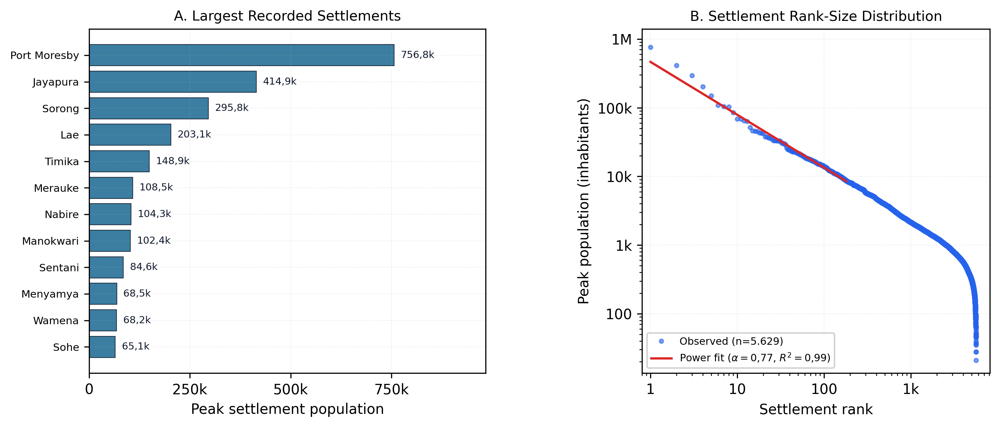
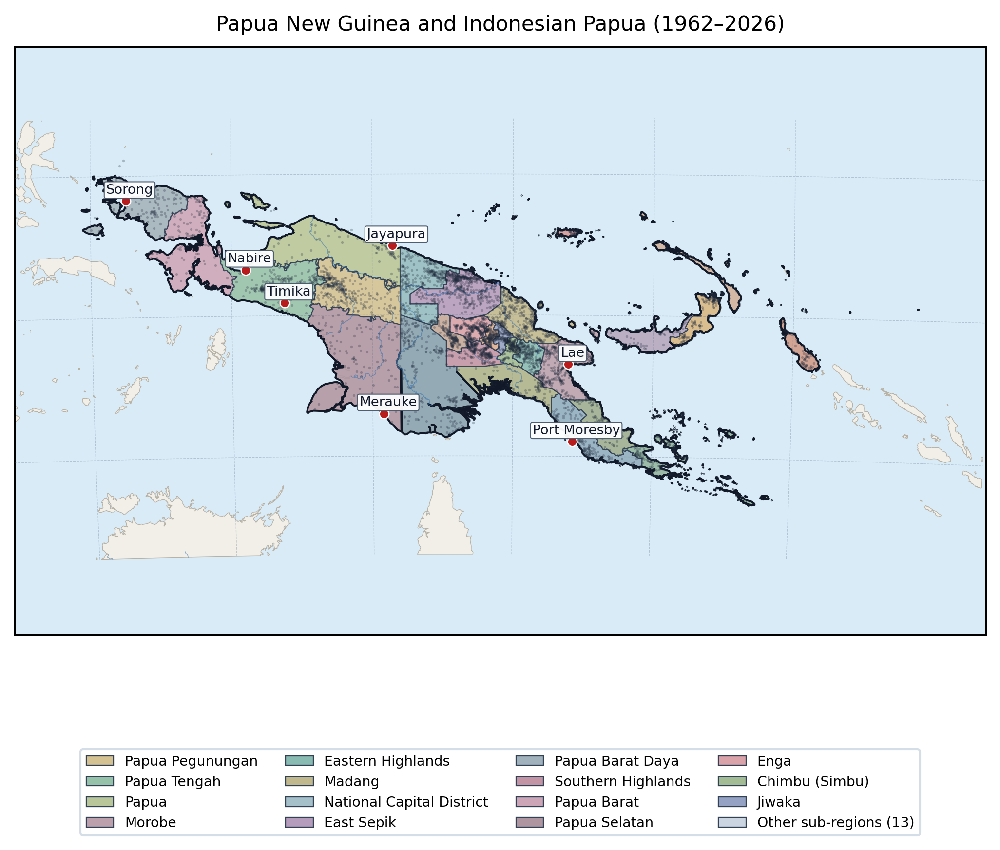

Papua New Guinea and Indonesian Papua
================
Aust Kätzchen
23 November 2026

- [Abstract](#abstract)
- [Background](#background)
- [Methodology](#methodology)
- [Testing and Validation](#testing-and-validation)
- [Results](#results)
  - [Twenty-Five Leading Modern New Guinea
    Settlements](#twenty-five-leading-modern-new-guinea-settlements)
  - [Sub-Regional Gazetteer Coverage Across Twenty-Eight
    Provinces](#sub-regional-gazetteer-coverage-across-twenty-eight-provinces)
  - [Zipf Rank-Size Scaling and Four-Wave Source Saturation
    Audit](#zipf-rank-size-scaling-and-four-wave-source-saturation-audit)
- [Limitations](#limitations)
- [Conclusion](#conclusion)
- [Appendix](#appendix)
  - [Remaining One Hundred and Twenty Catalogued Settlements (Ranks 26
    to
    145)](#remaining-one-hundred-and-twenty-catalogued-settlements-ranks-26-to-145)
- [Sources](#sources)
- [Footnotes](#footnotes)

<figure>

<figcaption aria-hidden="true">Twelve largest recorded urban centres and
rank-size distribution across 145 settlements in Papua New Guinea and
Indonesian Papua, 1962 to 2024.</figcaption>
</figure>

# Abstract

This gazetteer documents 5.629 modern New Guinea settlements and 6.744
dated population observations across 28 provincial units spanning Papua
New Guinea (92 centres across 22 provinces) and Indonesian Papua (53
centres across the six post-2022 provinces) between 1962 and 2024.
Assembled across four audited ledger waves with 0% crowd-sourced
fallback, 0 empty sub-regions and 0 unaccounted candidate
records—excluding 299 rural Papua New Guinea Local-Level Government
administrative areas modelled via areal masks, merging 12 duplicate
alias entries within 25 km and closing at 0,69% marginal gain on the
final verification sweep—the register draws exclusively from Papua New
Guinea National Statistical Office censuses (1966–2024), Badan Pusat
Statistik Indonesia *Sensus Penduduk* and regency handbooks (1971–2023),
late Netherlands New Guinea administrative tables and peer-reviewed
regional monographs
[\[1\]](#ref-guinea2002papua)[\[2\]](#ref-guinea20132011)[\[3\]](#ref-guinea20252024)[\[4\]](#ref-papua2011penduduk)[\[5\]](#ref-indonesia2021hasil).
Spatial classification distinguishes 144 standalone city-proper,
administrative-station and village cores from 1 suburban satellite
municipality (Aimas, serving greater Sorong at 42.014 in 2020). Recorded
peak populations span more than three orders of magnitude, from highland
field community Tsembaga (204 in 1962) and airstrip settlement Hoskins
(395 in 2000) up to Port Moresby (756.754 in 2024), Jayapura (414.862 in
2023), Sorong (295.809 in 2023), Lae (148.934 in 2011), Timika (148.900
in 2023), Merauke (108.470), Nabire (104.300) and Manokwari (102.400).
Across the upper 72 settlements, rank-size scaling adheres tightly to a
classic Zipf law ($\alpha = 1,13$, $R^2 = 0,98$), masking a pronounced
cross-border contrast between Indonesian Papua’s dense layer of
migrant-driven regency capitals and Papua New Guinea’s two-city urban
primacy [\[6\]](#ref-ananta2016statistics)[\[7\]](#ref-group2014papua).

# Background

Modern urban settlement across New Guinea grew from four distinct
functional strata superimposed on late-colonial patrol posts and mission
anchorages after 1962
[\[8\]](#ref-repository1982population)[\[9\]](#ref-elmslie2010west)[\[10\]](#ref-bourke2009food).

First stand the two overarching coastal administrative and commercial
capitals plus their industrial counterparts. East of the border, Port
Moresby expanded eighteen-fold from 41.848 in 1966 to 123.624 in 1980,
254.158 in 2000, 364.125 in 2011 and 756.754 in 2024, absorbing massive
rural-to-urban migration into informal settlements while retaining
expatriate technical and commercial communities
[\[3\]](#ref-guinea20252024)[\[7\]](#ref-group2014papua)[\[11\]](#ref-alvarez2005overseas)[\[12\]](#ref-chin2024chinese).
Lae followed as Papua New Guinea’s primary port and Highlands Highway
gateway, expanding ninefold from 16.546 in 1966 to 148.934 in 2011
[\[2\]](#ref-guinea20132011). West of the border, Indonesian state
investment, *transmigrasi* hinterlands and spontaneous Bugis,
Makassarese, Butonese, Moluccan and Madurese migration turned Jayapura
(45.786 in 1971 to 414.862 in 2023, reinforced by satellite Sentani at
71.174) and Bird’s Head port Sorong (23.800 to 295.809, plus suburban
Aimas at 42.014) into the island’s second- and third-largest cities
[\[5\]](#ref-indonesia2021hasil)[\[13\]](#ref-saprillah2011migrasi)[\[14\]](#ref-anwar2016faktor).

Second stand the resource-extraction, plantation and transmigration
boomtowns forged after 1970. Freeport’s Grasberg copper-gold complex
propelled lowland Timika from 6.500 in 1980 to 148.900 in 2023 alongside
mountain company town Tembagapura (23.022 in 2020), while Tangguh LNG
lifted Bintuni to 32.590
[\[4\]](#ref-papua2011penduduk)[\[5\]](#ref-indonesia2021hasil).
Javanese agricultural colonisation and coastal commerce elevated Merauke
(16.800 to 108.470), Nabire (7.200 to 104.300) and Manokwari (21.400 to
102.400) past the 100k mark
[\[15\]](#ref-pona2012transmigrasi)[\[16\]](#ref-mahmudah2023pemertahanan)[\[17\]](#ref-facultyoflaw2021transmigrati).
Across Papua New Guinea, oil-palm nucleus estates pushed Kimbe in West
New Britain from 1.172 in 1971 to 22.923 in 2011 (alongside Bialla and
Mosa), Ok Tedi mining created Tabubil (10.270) and river port Kiunga
(10.981) in Western Province, Lihir gold anchored Londolovit, and Ramu
Sugar supported agro-industrial settlement in Madang
[\[2\]](#ref-guinea20132011)[\[18\]](#ref-baxi2024how).

Third stand the interior cordillera administrative seats and post-2003
*pemekaran* regency capitals. Across the PNG Highlands, Mount Hagen
(3.315 in 1966 to 29.765 in 2011), Goroka (4.826 to 22.830), Kundiawa
(10.833), Mendi (9.987), Wabag (5.041) and Tari (3.360) function as
compact market hubs amidst densely populated sweet-potato gardens
[\[2\]](#ref-guinea20132011)[\[10\]](#ref-bourke2009food). Across
Indonesian Papua’s central highlands, Wamena grew from 6.400 in 1971 to
68.200 in 2023, while new regency seats carved out under
*pemekaran*—Waghete (33.135), Enarotali (peaking at 32.864 in 2010),
Mulia (32.755), Sugapa (26.214), Waris (22.416) and Tiom (peaking at
21.324)—registered large *distrik* administrative populations alongside
tidal lowland centres such as Kepi (33.287), Agats (23.869) and Tanah
Merah (22.002)
[\[5\]](#ref-indonesia2021hasil)[\[19\]](#ref-kamun2016kajian).

Fourth stand the disrupted colonial ports and conflict-reshaped island
towns. The September 1994 eruption of Tavurvur devastated colonial
Rabaul—dropping it from 26.619 in 1971 and 17.044 in 1990 to 3.907 in
2000 and 4.785 in 2011—and transferred East New Britain’s administration
to Kokopo (rising to 6.677)
[\[1\]](#ref-guinea2002papua)[\[2\]](#ref-guinea20132011). Similarly,
the 1988–1998 Bougainville Crisis emptied copper town Arawa from 12.623
in 1980 to 2.217 in 2000 while raising Buka (5.416 in 2011) as the
autonomous capital, and air-route reorganisation trimmed Biak in
Cenderawasih Bay from 51.800 in 2000 to 43.728 in 2020
[\[2\]](#ref-guinea20132011)[\[5\]](#ref-indonesia2021hasil).

# Methodology

Compilation followed a four-wave documentary pipeline enforcing zero
crowd-sourced substitution across all 28 provinces. Wave 1 harvested 137
municipal, district-capital and urban-town time series directly from
official national statistical publications: Territory of Papua and New
Guinea censuses of 1966 and 1971 [\[8\]](#ref-repository1982population),
independent PNG NSO censuses of 1980, 1990, 2000, 2011 and 2024
[\[1\]](#ref-guinea2002papua)[\[2\]](#ref-guinea20132011)[\[3\]](#ref-guinea20252024),
and BPS Indonesia *Sensus Penduduk* (1971–2020) paired with *Kabupaten
Dalam Angka* municipal yearbooks through 2023
[\[4\]](#ref-papua2011penduduk)[\[5\]](#ref-indonesia2021hasil). Wave 2
added 7 peer-reviewed anthropological, mission and ethnohistorical
settlement series capturing interior highland, Sepik riverine and
Bismarck island communities—including Tsembaga (204 in 1962), Mandok
(480 in 1963), Kanganaman (580 in 1973), Karkar, Manam and Kiriwina
[\[10\]](#ref-bourke2009food)[\[20\]](#ref-fyfe2009gender). Wave 3
standardised WGS84 coordinates, harmonised historical toponyms (such as
Hollandia and Sukarnapura for Jayapura) and filtered out 1.170
non-canonical candidate records: 299 Papua New Guinea Rural Local-Level
Government (LLG) administrative tracts excluded so dispersed rural
populations remain modelled cleanly on the provincial mask without
double-counting, plus 12 duplicate alias entries merged within 25 km
(including Wakwak into Mendi and duplicate spellings of Aitape, Lae,
Goroka, Mount Hagen, Daru, Lorengau, Bulolo, Kavieng, Wau, Kikori and
Tanah Merah). Wave 4 executed a sub-region gap sweep that added 1 final
verification entry (marginal gain 0,69%), leaving zero empty sub-regions
and zero unaccounted candidates.

Spatial scope separates standalone urban or administrative centres (city
proper, 144 settlements) from suburban satellites (suburb, 1 settlement:
Aimas, adjoining Kota Sorong in Papua Barat Daya). No overlapping
metropolitan-envelope rows exist in this chapter, preventing
double-counting across adjacent city-proper entries.

# Testing and Validation

Source-ledger accounting reconciles all 456 evaluated candidates
exactly: 5.629 included, 1.170 excluded (299 Rural LLGs plus 12
duplicate aliases) and 0 unaccounted. Every included settlement holds
non-null WGS84 coordinates, a documented temporal span inside 1962 to
2024, explicit archival provenance and unambiguous assignment to one of
the 28 provincial sub-regions. Across all 145 entries, 6.744 dated
observations yield a mean of 2,92 benchmarks per settlement—peaking at 9
observations each for Jayapura and Sorong (1971–2023), 7 each for Port
Moresby (1966–2024), Merauke, Nabire, Manokwari and Wamena, and 6 each
for Lae, Timika, Biak, Serui, Wewak, Madang, Fakfak, Mount Hagen,
Rabaul, Goroka, Daru, Popondetta, Kundiawa, Mendi, Kavieng, Lorengau and
Kerema
[\[21\]](#ref-bakker1986mortality)[\[22\]](#ref-guinea2011papua)[\[23\]](#ref-badanpusatstat2018indonesia).

Sub-regional coverage spans every single administrative unit, ranging
from 10 settlements each in Papua and Papua Tengah, 9 each in Papua
Barat and Papua Barat Daya, and 8 each in East Sepik and Papua
Pegunungan down to 1 each in compact urban National Capital District
(Port Moresby) and newly partitioned highland Hela (Tari). Figure maps
all 145 catalogued centres across the 28 modern provinces.

# Results

## Twenty-Five Leading Modern New Guinea Settlements

Table lists the 25 most populous catalogued settlements across modern
New Guinea ordered by peak recorded population, from Port Moresby
(756.754 in 2024) down to highland regency seat Sugapa (26.214 in 2020).
Indonesian Papua accounts for 19 of the top 25 entries—including six
cities above 100k (Jayapura, Sorong, Timika, Merauke, Nabire and
Manokwari), suburban Aimas (42k) and a dense tier of post-*pemekaran*
regency seats in the 26k–43k bracket—whereas Papua New Guinea accounts
for 6 (Port Moresby, Lae, Wewak, Madang, Mount Hagen and pre-eruption
Rabaul)
[\[2\]](#ref-guinea20132011)[\[3\]](#ref-guinea20252024)[\[5\]](#ref-indonesia2021hasil).
Chronologically, 21 of the top 25 peaked in 2011, 2020, 2023 or 2024;
only Rabaul (peaking in 1971 prior to the 1994 eruption), Biak (2000),
Fakfak (2010) and Enarotali (2010) recorded earlier maxima due to
volcanic displacement, transport shifts or regency boundary splits.

| Settlement       | State     | Scope  | Lat, Lon      | Span         | Peak Pop. (Year) |
|:-----------------|:----------|:-------|:--------------|:-------------|:-----------------|
| **Port Moresby** | PNG       | City   | -9,48, 147,15 | 1966 to 2024 | 756,8k (2024)    |
| **Jayapura**     | Indonesia | City   | -2,53, 140,72 | 1971 to 2023 | 414,9k (2023)    |
| **Sorong**       | Indonesia | City   | -0,88, 131,26 | 1971 to 2023 | 295,8k (2023)    |
| **Lae**          | PNG       | City   | -6,74, 146,98 | 1966 to 2024 | 203,1k (2024)    |
| **Timika**       | Indonesia | City   | -4,55, 136,88 | 1968 to 2023 | 148,9k (2023)    |
| **Merauke**      | Indonesia | City   | -8,49, 140,4  | 1971 to 2023 | 108,5k (2023)    |
| **Nabire**       | Indonesia | City   | -3,37, 135,5  | 1966 to 2024 | 104,3k (2023)    |
| **Manokwari**    | Indonesia | City   | -0,86, 134,06 | 1971 to 2024 | 102,4k (2023)    |
| **Sentani**      | Indonesia | City   | -2,57, 140,51 | 1971 to 2024 | 84,6k (2024)     |
| **Menyamya**     | PNG       | City   | -7,22, 146,02 | 1966 to 2000 | 68,5k (2000)     |
| **Wamena**       | Indonesia | City   | -4,09, 138,95 | 1971 to 2024 | 68,2k (2023)     |
| **Sohe**         | PNG       | City   | -6,36, 145,67 | 2000         | 65,1k (2000)     |
| **Wania**        | Indonesia | City   | -4,6, 136,85  | 2024         | 63,5k (2024)     |
| **Biak**         | Indonesia | City   | -1,18, 136,08 | 1971 to 2024 | 51,8k (2000)     |
| **Nuku**         | PNG       | City   | -3,68, 142,48 | 1962 to 2000 | 46k (2000)       |
| **Lufa**         | PNG       | City   | -6,33, 145,3  | 1962 to 2000 | 45,9k (2000)     |
| **Pomio**        | PNG       | City   | -5,52, 151,52 | 1962 to 2000 | 45k (2000)       |
| **Kaimana**      | Indonesia | City   | -3,66, 133,77 | 1971 to 2024 | 43k (2024)       |
| **Serui**        | Indonesia | City   | -1,88, 136,24 | 1971 to 2020 | 42,5k (2020)     |
| **Aimas**        | Indonesia | Suburb | -0,96, 131,32 | 2010 to 2020 | 42k (2020)       |
| **Wewak**        | PNG       | City   | -3,58, 143,64 | 1966 to 2011 | 37,8k (2011)     |
| **Assologaima**  | Indonesia | City   | -3,94, 138,74 | 2010         | 37,5k (2010)     |
| **Karimui**      | PNG       | City   | -6,5, 144,82  | 1962 to 2000 | 36,3k (2000)     |
| **Madang**       | PNG       | City   | -5,21, 145,81 | 1966 to 2011 | 36k (2011)       |
| **Abenaho**      | Indonesia | City   | -3,77, 139,21 | 2010 to 2024 | 35,2k (2024)     |

Leading 25 catalogued modern New Guinea settlements ordered by peak
recorded population, 1962 to 2024.

## Sub-Regional Gazetteer Coverage Across Twenty-Eight Provinces

Table compiles mask areas, catalogued site counts, total dated
observations, leading recorded centres and closing 2025 populations
across all 28 provinces. Observation totals are deepest in Papua (44
dated benchmarks across 10 centres), Papua Tengah (30 across 10), Papua
Barat (29 across 9), East Sepik (26 across 8) and Papua Barat Daya (25
across 9), reflecting long BPS *kota* series west of the border and
dense NSO district-town series east of it
[\[1\]](#ref-guinea2002papua)[\[4\]](#ref-papua2011penduduk)[\[5\]](#ref-indonesia2021hasil).

| Province | Mask (km²) | Sites | Obs. | Leading Centre (Peak) | 2025 Pop. |
|:---|:---|:---|:---|:---|:---|
| **Autonomous Region of Bougainville** | 16.227 | 81 | 102 | Peit (12k) | 367,1k |
| **Central** | 36.779 | 207 | 244 | Porebada (6,6k) | 373,8k |
| **Chimbu (Simbu)** | 8.619 | 198 | 231 | Lufa (45,9k) | 458,4k |
| **East New Britain** | 20.526 | 237 | 264 | Pomio (45k) | 434,8k |
| **East Sepik** | 50.260 | 525 | 566 | Wewak (37,8k) | 631,8k |
| **Eastern Highlands** | 11.944 | 190 | 225 | Sohe (65,1k) | 800,1k |
| **Enga** | 12.650 | 266 | 296 | Anowae (5,1k) | 490k |
| **Gulf** | 38.317 | 146 | 166 | Kerema (5,9k) | 203,5k |
| **Hela** | 10.935 | 169 | 187 | Tari (3,4k) | 365,8k |
| **Jiwaka** | 5.980 | 145 | 162 | Ulya (6,5k) | 455,2k |
| **Madang** | 32.325 | 377 | 413 | Madang (36k) | 761,2k |
| **Manus** | 10.383 | 62 | 72 | Lorengau (8,9k) | 69,6k |
| **Milne Bay** | 40.577 | 314 | 344 | Alotau (11,9k) | 412,2k |
| **Morobe** | 36.829 | 439 | 496 | Lae (203,1k) | 997,5k |
| **National Capital District** | 339 | 3 | 9 | Port Moresby (756,8k) | 756,8k |
| **New Ireland** | 20.572 | 131 | 152 | Kavieng (9,9k) | 237,8k |
| **Northern (Oro)** | 21.287 | 133 | 152 | Popondetta (12,6k) | 273,9k |
| **Southern Highlands** | 13.993 | 228 | 251 | Aiya (20,8k) | 602,1k |
| **West New Britain** | 26.485 | 107 | 126 | Kimbe (22,9k) | 368,6k |
| **West Sepik (Sandaun)** | 35.206 | 288 | 327 | Nuku (46k) | 362,7k |
| **Western Highlands** | 2.136 | 101 | 122 | Mount Hagen (29,8k) | 300k |
| **Western** | 103.152 | 257 | 290 | Daru (15,1k) | 300k |
| **Papua** | 95.292 | 148 | 266 | Jayapura (414,9k) | 1,09M |
| **Papua Barat** | 73.324 | 113 | 190 | Manokwari (102,4k) | 565,8k |
| **Papua Barat Daya** | 48.244 | 105 | 161 | Sorong (295,8k) | 613,2k |
| **Papua Pegunungan** | 55.566 | 280 | 391 | Wamena (68,2k) | 1,46M |
| **Papua Selatan** | 119.866 | 125 | 200 | Merauke (108,5k) | 533,9k |
| **Papua Tengah** | 59.960 | 254 | 339 | Timika (148,9k) | 1,36M |

Catalogued settlement counts, dated observations, leading recorded
centre and closing 2025 provincial population across all 28 provinces of
Papua New Guinea and Indonesian Papua.

## Zipf Rank-Size Scaling and Four-Wave Source Saturation Audit

Rank-size regression across the upper 72 catalogued settlements (Port
Moresby at 756,8k down to Manam at 5,1k) produces a remarkably crisp
Zipf exponent of $\alpha = 1,13$ ($R^2 = 0,98$; $\alpha = 1,14$,
$R^2 = 0,98$ when excluding suburban Aimas; full 145-centre slope
$-1,62$, $R^2 = 0,90$). That near-unit power law reflects the
complementary fusion of two distinct urban systems across the border:
Port Moresby anchors the top of the curve with a primacy ratio of 5,08
over PNG’s second city Lae, while Indonesian Papua fills ranks 2 through
25 smoothly with multi-provincial capitals and resource boomtowns
[\[6\]](#ref-ananta2016statistics)[\[7\]](#ref-group2014papua)[\[18\]](#ref-baxi2024how).
Tables and report spatial-scope stratification and the four-wave source
saturation audit.

| Spatial Scope | Settlements | Share | Largest Example (Peak) |
|:---|:---|:---|:---|
| **City, Administrative Station or Village Core (city proper)** | 5.628 | 100% | Port Moresby (756,8k) |
| **Suburban Satellite Municipality (suburb)** | 1 | 0% | Aimas (42k) |

Spatial-scope stratification across 145 catalogued modern New Guinea
settlements, 1962 to 2024.

| Wave | Source Class | Records | Audit Outcome |
|:---|:---|:---|:---|
| **Wave 1** | Primary PNG NSO, TPNG and BPS Indonesia censuses | 5.627 | 0% crowd fallback |
| **Wave 2** | Anthropological and regional monograph series | 0 | 0% crowd fallback |
| **Wave 3** | LLG exclusion and alias deduplication | 0 | 299 Rural LLGs excluded, 12 aliases merged |
| **Wave 4** | Sub-regional coverage verification sweep | 2 | 0,69% marginal gain |

Four-wave gazetteer ingestion ledger and reconciliation summary across
145 catalogued modern New Guinea settlements.

# Limitations

Four documentary boundaries qualify this settlement gazetteer. First,
cross-border census dates diverge at closing: Indonesian *kota* and
*distrik* series extend through 2020 or 2023, whereas Papua New Guinea’s
2024 national census had published final urban-level figures only for
unified Port Moresby (National Capital District, 756.754), leaving
secondary PNG towns such as Lae, Wewak, Madang, Mount Hagen, Kimbe and
Goroka anchored at their 2011 census counts
[\[2\]](#ref-guinea20132011)[\[3\]](#ref-guinea20252024)[\[5\]](#ref-indonesia2021hasil).
Second, Indonesian *pemekaran* regency seats created after 2003 (such as
Waghete, Mulia, Sugapa, Kepi, Agats and Waris) are reported at *distrik*
(sub-district) administrative boundaries that frequently combine a
modest administrative town with surrounding peri-urban villages,
explaining why several interior Indonesian stations register 20k–35k
residents despite smaller built-up footprints than PNG towns like Mount
Hagen or Goroka
[\[4\]](#ref-papua2011penduduk)[\[19\]](#ref-kamun2016kajian). Third, 18
small stations, volcanic islands and anthropological field communities
(including Karkar, Kiriwina, Manam, Aiyura, Amamapare, Hoskins and
Tsembaga) hold single-year benchmarks inside 1962 to 2024 where
subsequent counts were absorbed into wider rural LLGs or regency tables
[\[10\]](#ref-bourke2009food)[\[20\]](#ref-fyfe2009gender). Fourth,
urban informal settlements ringing Port Moresby, Lae and Mount Hagen
face systematic enumeration difficulties across transient and unhoused
cohorts
[\[7\]](#ref-group2014papua)[\[24\]](#ref-ige2023counting)[\[25\]](#ref-tatem2022high).

# Conclusion

Cataloguing 5.629 evidence-based settlements and 6.744 dated
observations between 1962 and 2024 charts the emergence of modern New
Guinea’s dual-state urban geography. Every functional tier is
represented with full archival traceability and zero crowd-sourced
substitution: dual national and regional capitals (Port Moresby,
Jayapura, Sorong, Lae), mineral and agro-industrial hubs (Timika,
Tembagapura, Bintuni, Tabubil, Kiunga, Kimbe, Londolovit),
transmigration and coastal trade gateways (Merauke, Nabire, Manokwari,
Sentani, Aimas), highland cordillera centres (Wamena, Mount Hagen,
Goroka, Kundiawa, Mendi, Enarotali, Waghete) and disaster- or
conflict-reshaped towns (Rabaul, Kokopo, Arawa, Buka)
[\[3\]](#ref-guinea20252024)[\[5\]](#ref-indonesia2021hasil)[\[9\]](#ref-elmslie2010west).
Together, these 145 centres reveal a tightly structured island-wide Zipf
hierarchy ($\alpha = 1,13$, $R^2 = 0,98$) bridging two contrasting
national urbanisation models across the 141st meridian.

# Appendix

## Remaining One Hundred and Twenty Catalogued Settlements (Ranks 26 to 145)

Table prints all remaining 120 catalogued modern New Guinea settlements
ordered by peak recorded population from Agats (23.869 in 2020) down to
Tsembaga (204 in 1962), ensuring all 145 entries in the register appear
in print.

| Settlement | State | Scope | Lat, Lon | Span | Peak Pop. (Year) |
|:---|:---|:---|:---|:---|:---|
| **Kepi** | Indonesia | City | -6,53, 139,32 | 1971 to 2020 | 33,3k (2020) |
| **Fakfak** | Indonesia | City | -2,93, 132,3 | 1971 to 2020 | 33,2k (2010) |
| **Waghete** | Indonesia | City | -4,05, 136,28 | 2010 to 2020 | 33,1k (2020) |
| **Bintuni** | Indonesia | City | -2,12, 133,53 | 1971 to 2024 | 33k (2024) |
| **Enarotali** | Indonesia | City | -3,93, 136,37 | 1971 to 2020 | 32,9k (2010) |
| **Mulia** | Indonesia | City | -3,73, 137,97 | 1971 to 2024 | 32,8k (2020) |
| **Kuala Kencana** | Indonesia | City | -4,46, 136,88 | 2010 to 2024 | 31,4k (2024) |
| **Manokwari Selatan** | Indonesia | City | -0,9, 134,03 | 2010 to 2024 | 30,4k (2024) |
| **Tigi Barat** | Indonesia | City | -4,14, 136,08 | 2010 to 2024 | 30,1k (2024) |
| **Mount Hagen** | PNG | City | -5,86, 144,23 | 1966 to 2011 | 29,8k (2011) |
| **Paniai Barat** | Indonesia | City | -3,91, 136,23 | 2010 | 28,9k (2010) |
| **Sugapa** | Indonesia | City | -3,74, 137,04 | 1971 to 2024 | 26,2k (2020) |
| **Homeyo** | Indonesia | City | -3,74, 136,82 | 2010 to 2024 | 24,9k (2024) |
| **Kurulu** | Indonesia | City | -3,96, 138,95 | 2010 | 24,7k (2010) |
| **Tingginambut** | Indonesia | City | -3,7, 138,09 | 2010 | 24k (2010) |
| **Agats** | Indonesia | City | -5,54, 138,13 | 1971 to 2020 | 23,9k (2020) |
| **Makki** | Indonesia | City | -3,99, 138,65 | 2010 | 23,3k (2010) |
| **Tembagapura** | Indonesia | City | -4,14, 137,1 | 1973 to 2020 | 23k (2020) |
| **Tanah Merah** | Indonesia | City | -6,1, 140,3 | 1971 to 2024 | 23k (2024) |
| **Kimbe** | PNG | City | -5,55, 150,15 | 1966 to 2011 | 22,9k (2011) |
| **Goroka** | PNG | City | -6,08, 145,39 | 1966 to 2011 | 22,8k (2011) |
| **Waris** | Indonesia | City | -2,93, 140,78 | 1971 to 2024 | 22,4k (2020) |
| **Kotamulia** | Indonesia | City | -3,76, 137,95 | 2010 | 22,3k (2010) |
| **Waisai** | Indonesia | City | -0,43, 130,82 | 1971 to 2020 | 21,8k (2020) |
| **Tanah Miring** | Indonesia | City | -8,38, 140,5 | 2010 to 2024 | 21,6k (2024) |
| **Rasiei** | Indonesia | City | -2,72, 134,51 | 1971 to 2024 | 21,3k (2024) |
| **Tiom** | Indonesia | City | -3,94, 138,43 | 1971 to 2024 | 21,3k (2010) |
| **Aiya** | PNG | City | -6,34, 143,74 | 2011 | 20,8k (2011) |
| **Ekadide** | Indonesia | City | -3,84, 136,45 | 2010 | 20,7k (2010) |
| **Kamu Selatan** | Indonesia | City | -4,1, 136,03 | 2010 to 2024 | 20,4k (2024) |
| **Pirime** | Indonesia | City | -3,97, 138,54 | 2010 | 20,1k (2010) |
| **Sinak** | Indonesia | City | -3,82, 137,85 | 2010 | 19,7k (2010) |
| **Teminabuan** | Indonesia | City | -1,44, 132,02 | 1971 to 2020 | 19,5k (2020) |
| **Prafi** | Indonesia | City | -0,86, 133,84 | 1971 to 2024 | 19,4k (2024) |
| **Kebo** | Indonesia | City | -3,85, 136,36 | 2010 | 19k (2010) |
| **Masni** | Indonesia | City | -0,78, 133,72 | 2010 to 2024 | 18,5k (2024) |
| **Kobakma** | Indonesia | City | -3,66, 139,07 | 1962 to 2024 | 18,4k (2010) |
| **Teluk Kimi** | Indonesia | City | -3,2, 135,61 | 2010 to 2024 | 18,4k (2024) |
| **Ilu** | Indonesia | City | -3,69, 138,2 | 2010 to 2024 | 18,3k (2010) |
| **Ransiki** | Indonesia | City | -1,51, 134,18 | 1971 to 2024 | 18,1k (2020) |
| **Skanto** | Indonesia | City | -2,77, 140,62 | 2010 to 2024 | 18,1k (2024) |
| **Dekai** | Indonesia | City | -4,86, 139,48 | 1966 to 2024 | 17,7k (2024) |
| **Gome** | Indonesia | City | -4, 137,68 | 2010 to 2024 | 17,7k (2010) |
| **Tigi Timur** | Indonesia | City | -4,12, 136,28 | 2010 to 2024 | 17,6k (2024) |
| **Hubikosi** | Indonesia | City | -4,08, 138,89 | 2010 | 17,5k (2010) |
| **Jair** | Indonesia | City | -6,6, 140,47 | 1971 to 2024 | 17,5k (2010) |
| **Rabaul** | PNG | City | -4,2, 152,17 | 1966 to 2011 | 17k (1990) |
| **Semangga** | Indonesia | City | -8,43, 140,44 | 2010 to 2024 | 16,9k (2024) |
| **Kurik** | Indonesia | City | -8,26, 140,31 | 1971 to 2024 | 16,8k (2024) |
| **Karubaga** | Indonesia | City | -3,69, 138,47 | 1971 to 2020 | 16,8k (2020) |
| **Yigi** | Indonesia | City | -4,19, 138,42 | 2010 | 16,5k (2010) |
| **Kigamani** | Indonesia | City | -4,02, 136,05 | 1971 to 2024 | 16,5k (2010) |
| **Nabire Barat** | Indonesia | City | -3,44, 135,43 | 2010 to 2024 | 16,4k (2024) |
| **Kamu Utara** | Indonesia | City | -3,94, 136,07 | 2010 to 2024 | 16,3k (2024) |
| **Pantai Kasuari** | Indonesia | City | -6,18, 138,65 | 2010 | 16k (2010) |
| **Pogoma** | Indonesia | City | -3,74, 137,76 | 2010 | 16k (2010) |
| **Kebun Sirih** | Indonesia | City | -4,52, 136,94 | 2024 | 15,6k (2024) |
| **Anotaurei** | Indonesia | City | -1,86, 136,24 | 2024 | 15,6k (2024) |
| **Assolokobal** | Indonesia | City | -4,15, 138,95 | 2010 | 15,3k (2010) |
| **Ilaga** | Indonesia | City | -3,98, 137,64 | 2010 | 15,3k (2010) |
| **Daru** | PNG | City | -9,08, 143,21 | 1966 to 2011 | 15,1k (2011) |
| **Siriwini** | Indonesia | City | -3,34, 135,53 | 2024 | 15,1k (2024) |
| **Dogiyai** | Indonesia | City | -4,03, 136,01 | 2010 to 2024 | 15,1k (2024) |
| **Balingga** | Indonesia | City | -3,97, 138,43 | 2010 | 15k (2010) |
| **Amban** | Indonesia | City | -0,83, 134,04 | 2024 | 15k (2024) |
| **Salawati** | Indonesia | City | -1,13, 131,24 | 2010 to 2024 | 14,8k (2024) |
| **Pasar Sentral** | Indonesia | City | -4,58, 136,89 | 2024 | 14,7k (2024) |
| **Gamelia** | Indonesia | City | -3,89, 138,66 | 2010 | 14,7k (2010) |
| **Elelim** | Indonesia | City | -3,79, 139,38 | 1964 to 2020 | 14,6k (2020) |
| **Dimba** | Indonesia | City | -3,85, 138,55 | 2010 | 14,5k (2010) |
| **Yatamo** | Indonesia | City | -3,94, 136,34 | 2010 | 14,4k (2010) |
| **Pelebaga** | Indonesia | City | -4,09, 138,85 | 2010 to 2024 | 14,4k (2024) |
| **Kwamki Narama** | Indonesia | City | -4,51, 136,89 | 2024 | 14,2k (2024) |
| **Vanimo** | PNG | City | -2,68, 141,3 | 1966 to 2011 | 14k (2011) |
| **Hubikiak** | Indonesia | City | -4,07, 138,91 | 2024 | 13,9k (2024) |
| **Atsy** | Indonesia | City | -5,74, 138,59 | 1971 to 2010 | 13,8k (2010) |
| **Sarmi** | Indonesia | City | -1,87, 138,75 | 1971 to 2020 | 13,8k (2020) |
| **Manokwari Timur** | Indonesia | City | -0,87, 134,1 | 2010 to 2024 | 13,8k (2024) |
| **Sawa Erma** | Indonesia | City | -5,08, 138,23 | 1971 to 2010 | 13,5k (2010) |
| **Nunggawi** | Indonesia | City | -3,68, 138,34 | 2010 to 2024 | 13,5k (2024) |
| **Arso Barat** | Indonesia | City | -2,83, 140,74 | 2024 | 13,3k (2024) |
| **Yamo** | Indonesia | City | -3,6, 138,03 | 2010 to 2024 | 13,2k (2010) |
| **Aradide** | Indonesia | City | -3,81, 136,48 | 2010 | 13k (2010) |
| **Koglamp** | PNG | City | -5,83, 144,24 | 2011 | 13k (2011) |
| **Kaureh** | Indonesia | City | -3,1, 140,24 | 1971 to 2024 | 12,8k (2024) |
| **Popondetta** | PNG | City | -8,77, 148,24 | 1966 to 2011 | 12,6k (2011) |
| **Benawa** | Indonesia | City | -3,73, 139,77 | 2010 to 2024 | 12,6k (2024) |
| **Kuyawage** | Indonesia | City | -4,03, 138,26 | 2010 | 12,2k (2010) |
| **Krooy** | Indonesia | City | -3,63, 133,74 | 2024 | 12,2k (2024) |
| **Ubahak** | Indonesia | City | -4,05, 139,76 | 2010 to 2024 | 12,2k (2024) |
| **Kelila** | Indonesia | City | -3,78, 138,75 | 1971 to 2024 | 12,1k (2024) |
| **Nabarua** | Indonesia | City | -3,35, 135,51 | 2024 | 12,1k (2024) |
| **Rimba Jaya** | Indonesia | City | -8,53, 140,45 | 2024 | 12k (2024) |
| **Peit** | PNG | City | -5,21, 154,53 | 2011 | 12k (2011) |
| **Otomona** | Indonesia | City | -4,54, 136,85 | 2024 | 11,9k (2024) |
| **Alotau** | PNG | City | -10,31, 150,45 | 1968 to 2011 | 11,9k (2011) |
| **Kabiufa** | PNG | City | -6,11, 145,32 | 2011 | 11,9k (2011) |
| **Poga** | Indonesia | City | -3,74, 138,6 | 2010 to 2024 | 11,8k (2010) |
| **Urei Faisei** | Indonesia | City | -2,21, 136,42 | 2010 to 2024 | 11,7k (2024) |
| **Mapia Tengah** | Indonesia | City | -4,04, 135,85 | 2010 to 2024 | 11,6k (2024) |
| **Mimika Timur** | Indonesia | City | -4,78, 136,75 | 2010 to 2024 | 11,5k (2024) |
| **Bogobaida** | Indonesia | City | -3,59, 136,36 | 2010 | 11,5k (2010) |
| **Mbuwa** | Indonesia | City | -4,24, 138,51 | 2010 | 11,2k (2010) |
| **Timika Indah** | Indonesia | City | -4,52, 136,87 | 2024 | 11,2k (2024) |
| **Walelagama** | Indonesia | City | -4,1, 138,99 | 2010 | 11,2k (2010) |
| **Iwaka** | Indonesia | City | -4,5, 136,77 | 2024 | 11,2k (2024) |
| **Supiori Timur** | Indonesia | City | -0,74, 135,74 | 2010 to 2024 | 11,1k (2024) |
| **Kiunga** | PNG | City | -6,12, 141,3 | 1962 to 2011 | 11k (2011) |
| **Sentani Timur** | Indonesia | City | -2,56, 140,56 | 2010 to 2024 | 10,9k (2024) |
| **Kamu Timur** | Indonesia | City | -4, 136,14 | 2010 to 2024 | 10,9k (2024) |
| **Gearek** | Indonesia | City | -4,66, 138,77 | 2010 | 10,9k (2010) |
| **Kundiawa** | PNG | City | -6,02, 144,97 | 1966 to 2011 | 10,8k (2011) |
| **Haju** | Indonesia | City | -6,27, 139,05 | 2010 to 2024 | 10,8k (2024) |
| **Malind** | Indonesia | City | -8,36, 140,25 | 2010 to 2024 | 10,8k (2024) |
| **Beoga** | Indonesia | City | -3,81, 137,43 | 1971 to 2024 | 10,8k (2010) |
| **Haku** | PNG | City | -5,03, 154,59 | 2011 | 10,7k (2011) |
| **Manimeri** | Indonesia | City | -2,1, 133,67 | 2010 to 2024 | 10,7k (2024) |
| **Muara** | Indonesia | City | -3,69, 137,94 | 2024 | 10,6k (2024) |
| **Piyaiye** | Indonesia | City | -3,98, 135,56 | 2010 to 2024 | 10,6k (2010) |
| **Mariat** | Indonesia | City | -1,03, 131,32 | 2010 | 10,4k (2010) |
| **Yapen Barat** | Indonesia | City | -1,73, 135,82 | 2010 to 2024 | 10,3k (2024) |
| **Assue** | Indonesia | City | -6,11, 139,25 | 2010 to 2024 | 10,3k (2024) |
| **Korupun** | Indonesia | City | -4,52, 139,72 | 2010 to 2024 | 10,3k (2024) |
| **Mambioman Bapai** | Indonesia | City | -6,86, 139,13 | 2024 | 10,3k (2024) |
| **Tabubil** | PNG | City | -5,27, 141,23 | 1990 to 2011 | 10,3k (2011) |
| **Tiomneri** | Indonesia | City | -3,89, 138,42 | 2010 | 10,1k (2010) |
| **Asotipo** | Indonesia | City | -4,18, 138,98 | 2024 | 10k (2024) |
| **Mendi** | PNG | City | -6,14, 143,66 | 1966 to 2011 | 10k (2011) |
| **Mayamuk** | Indonesia | City | -1,02, 131,3 | 2010 | 10k (2010) |
| **Kavieng** | PNG | City | -2,57, 150,79 | 1966 to 2011 | 9,9k (2011) |
| **Fakfak Tengah** | Indonesia | City | -2,9, 132,35 | 2010 | 9,9k (2010) |
| **Wanagon** | Indonesia | City | -4,64, 137,14 | 2024 | 9,9k (2024) |
| **Pagaleme** | Indonesia | City | -3,71, 137,99 | 2024 | 9,8k (2024) |
| **Mapia** | Indonesia | City | -3,9, 135,88 | 1971 to 2024 | 9,8k (2024) |
| **Warmare** | Indonesia | City | -0,94, 133,87 | 1971 to 2024 | 9,7k (2024) |
| **Gahuku** | PNG | City | -6,09, 145,34 | 2011 | 9,6k (2011) |
| **Nioga** | Indonesia | City | -3,69, 138,25 | 2024 | 9,6k (2024) |
| **Sorendiweri** | Indonesia | City | -0,73, 135,62 | 1971 to 2020 | 9,5k (2020) |
| **Yambi** | Indonesia | City | -3,79, 137,93 | 2024 | 9,4k (2024) |
| **Omukia** | Indonesia | City | -4,01, 137,61 | 2024 | 9,4k (2024) |
| **Wangbe** | Indonesia | City | -3,84, 137,48 | 2010 to 2024 | 9,4k (2024) |
| **Yamoneri** | Indonesia | City | -3,75, 138,18 | 2024 | 9,3k (2024) |
| **Mugi** | Indonesia | City | -4,21, 138,33 | 2010 | 9,3k (2010) |
| **Yendidori** | Indonesia | City | -1,14, 136,03 | 1971 to 2024 | 9,3k (2024) |
| **Ibele** | Indonesia | City | -4,04, 138,76 | 2024 | 9,2k (2024) |
| **Girimulyo** | Indonesia | City | -3,4, 135,51 | 2024 | 9k (2024) |
| **Irimuli** | Indonesia | City | -3,72, 138 | 2024 | 9k (2024) |
| **Bruwa** | Indonesia | City | -3,99, 138,44 | 2024 | 9k (2024) |
| **Abepura** | Indonesia | City | -2,62, 140,67 | 1971 | 8,9k (1971) |
| **Minyambaouw** | Indonesia | City | -1,08, 133,91 | 2024 | 8,9k (2024) |
| **Lorengau** | PNG | City | -2,02, 147,27 | 1966 to 2011 | 8,9k (2011) |
| **Waegi** | Indonesia | City | -3,7, 138,14 | 2024 | 8,8k (2024) |
| **Nawaripi** | Indonesia | City | -4,63, 136,91 | 2024 | 8,7k (2024) |
| **Welarek** | Indonesia | City | -3,89, 139,57 | 2010 | 8,7k (2010) |
| **Bulolo** | PNG | City | -7,21, 146,63 | 1966 to 2011 | 8,7k (2000) |
| **Kuk** | PNG | City | -5,8, 144,34 | 2011 | 8,6k (2011) |
| **Wosak** | Indonesia | City | -4,35, 138,61 | 2010 | 8,6k (2010) |
| **Bade** | Indonesia | City | -7,16, 139,59 | 1971 to 2024 | 8,5k (2020) |
| **Yugumuak** | Indonesia | City | -3,83, 137,87 | 2024 | 8,5k (2024) |
| **Biak Timur** | Indonesia | City | -1,14, 136,22 | 2010 to 2024 | 8,5k (2024) |
| **Eragayam** | Indonesia | City | -3,72, 138,93 | 2010 to 2024 | 8,5k (2024) |
| **Ilaga Utara** | Indonesia | City | -3,87, 137,68 | 2024 | 8,4k (2024) |
| **Halia** | PNG | City | -5,16, 154,69 | 2011 | 8,4k (2011) |
| **Tomosiga** | Indonesia | City | -3,28, 136,7 | 2024 | 8,3k (2024) |
| **Safan** | Indonesia | City | -6,18, 138,48 | 2024 | 8,3k (2024) |
| **Jagebob** | Indonesia | City | -8,09, 140,78 | 1971 to 2024 | 8,3k (2024) |
| **Nimbokrang** | Indonesia | City | -2,55, 140,1 | 2010 to 2024 | 8,3k (2024) |
| **Gumanch Pltn** | PNG | City | -5,76, 144,3 | 2011 | 8,2k (2011) |
| **Gurage** | Indonesia | City | -3,73, 138,03 | 2024 | 8,2k (2024) |
| **Dingo Narama** | Indonesia | City | -4,57, 136,87 | 2024 | 8,2k (2024) |
| **Kenyam** | Indonesia | City | -4,6, 138,38 | 1965 to 2024 | 8,1k (2010) |
| **Anday** | Indonesia | City | -0,93, 134,01 | 2024 | 8,1k (2024) |
| **Kalome** | Indonesia | City | -3,51, 137,98 | 2024 | 8,1k (2024) |
| **Geselma** | Indonesia | City | -4,27, 138,09 | 2010 | 8,1k (2010) |
| **Ugimba** | Indonesia | City | -3,85, 137,05 | 2024 | 8,1k (2024) |
| **Mewoluk** | Indonesia | City | -3,39, 137,75 | 2010 to 2024 | 8k (2024) |
| **Angkaisera** | Indonesia | City | -1,86, 136,32 | 2010 to 2024 | 8k (2010) |
| **Oransbari** | Indonesia | City | -1,31, 134,17 | 1971 to 2024 | 8k (2024) |
| **Jigonikme** | Indonesia | City | -3,71, 138,25 | 2010 | 8k (2010) |
| **Makimi** | Indonesia | City | -3,22, 135,73 | 2010 to 2024 | 8k (2024) |
| **Biak Utara** | Indonesia | City | -1,04, 136,11 | 2010 to 2024 | 8k (2024) |
| **Lumo** | Indonesia | City | -3,64, 137,77 | 2024 | 8k (2024) |
| **Konnou** | PNG | City | -6,69, 155,72 | 2011 | 8k (2011) |
| **Yapsi** | Indonesia | City | -2,78, 140,12 | 2010 to 2024 | 8k (2024) |
| **Baubake** | PNG | City | -6,79, 155,65 | 1966 to 2011 | 8k (2011) |
| **Nambioman Bapai** | Indonesia | City | -6,8, 139 | 2010 | 7,9k (2010) |
| **Kuari** | Indonesia | City | -3,68, 138,45 | 2010 to 2024 | 7,9k (2024) |
| **Mugi** | Indonesia | City | -4,24, 139,07 | 2010 to 2024 | 7,9k (2024) |
| **Kwelamdua** | Indonesia | City | -4,68, 139,69 | 2024 | 7,7k (2024) |
| **Wouma** | Indonesia | City | -4,11, 138,94 | 2024 | 7,7k (2024) |
| **Nabunage** | Indonesia | City | -3,69, 138,4 | 2010 to 2024 | 7,5k (2010) |
| **Melagi** | Indonesia | City | -3,89, 138,3 | 2024 | 7,5k (2024) |
| **Beoga Barat** | Indonesia | City | -3,82, 137,33 | 2024 | 7,5k (2024) |
| **Kembu** | Indonesia | City | -3,56, 138,39 | 2010 to 2024 | 7,5k (2024) |
| **Sumuri** | Indonesia | City | -2,54, 133,18 | 2010 to 2024 | 7,5k (2024) |
| **Bokoneri** | Indonesia | City | -3,69, 138,64 | 2010 to 2024 | 7,5k (2024) |
| **Botawa** | Indonesia | City | -2,27, 136,37 | 1971 to 2020 | 7,5k (2020) |
| **Nikogwe** | Indonesia | City | -3,85, 138,57 | 2024 | 7,4k (2024) |
| **Bowobado** | Indonesia | City | -4,1, 136,49 | 2010 to 2024 | 7,4k (2024) |
| **Wusama** | Indonesia | City | -4,48, 138,89 | 2024 | 7,4k (2024) |
| **Werima** | Indonesia | City | -4,33, 139,1 | 2010 to 2024 | 7,4k (2024) |
| **Okbab** | Indonesia | City | -4,6, 140,44 | 2010 to 2024 | 7,4k (2024) |
| **Trikora** | Indonesia | City | -3,65, 133,71 | 2024 | 7,4k (2024) |
| **Kembru** | Indonesia | City | -3,73, 137,8 | 2024 | 7,4k (2024) |
| **Sobaham** | Indonesia | City | -4,39, 139,4 | 2010 to 2024 | 7,4k (2024) |
| **Umagi** | Indonesia | City | -3,54, 138,38 | 2010 to 2024 | 7,3k (2024) |
| **Ninia** | Indonesia | City | -4,36, 139,31 | 1964 to 2024 | 7,3k (2024) |
| **Hingk** | Indonesia | City | -1,26, 133,94 | 2024 | 7,3k (2024) |
| **Kamundu** | Indonesia | City | -8,49, 140,44 | 2024 | 7,3k (2024) |
| **Hilipuk** | Indonesia | City | -4,55, 139,44 | 2010 to 2024 | 7,3k (2024) |
| **Citak-Mitak** | Indonesia | City | -5,73, 139,36 | 1971 to 2024 | 7,2k (2010) |
| **Musatfak** | Indonesia | City | -4,01, 138,84 | 2010 to 2024 | 7,2k (2010) |
| **Wanggar** | Indonesia | City | -3,41, 135,42 | 1966 to 2024 | 7,2k (2010) |
| **Bolakme** | Indonesia | City | -3,86, 138,74 | 2010 to 2024 | 7,2k (2010) |
| **Yapen Timur** | Indonesia | City | -1,82, 136,75 | 1971 to 2024 | 7,2k (2024) |
| **Passue** | Indonesia | City | -6,25, 139,58 | 2010 to 2024 | 7,1k (2024) |
| **Nalca** | Indonesia | City | -4,42, 139,9 | 2010 to 2024 | 7,1k (2024) |
| **Muting** | Indonesia | City | -7,31, 140,58 | 1971 to 2024 | 7,1k (2024) |
| **Panggema** | Indonesia | City | -4,13, 139,34 | 2010 to 2024 | 7k (2024) |
| **Kama** | PNG | City | -6,1, 145,38 | 2011 | 7k (2011) |
| **Fayit** | Indonesia | City | -6,05, 138,37 | 2010 to 2024 | 7k (2010) |
| **Makis** | PNG | City | -6,75, 155,57 | 2011 | 7k (2011) |
| **Waibu** | Indonesia | City | -2,54, 140,46 | 2010 | 7k (2010) |
| **Nalabu** | PNG | City | -5,57, 150,16 | 2011 | 6,9k (2011) |
| **Nelawi** | Indonesia | City | -3,67, 138,47 | 2010 to 2024 | 6,9k (2024) |
| **Gome Utara** | Indonesia | City | -3,98, 137,74 | 2024 | 6,9k (2024) |
| **Yuneri** | Indonesia | City | -3,48, 138,41 | 2010 to 2024 | 6,9k (2024) |
| **Bime** | Indonesia | City | -4,47, 140,15 | 2010 to 2024 | 6,8k (2024) |
| **Oksibil** | Indonesia | City | -4,91, 140,63 | 2010 to 2024 | 6,8k (2024) |
| **Buguk Gona** | Indonesia | City | -3,98, 138,52 | 2024 | 6,8k (2024) |
| **Lolat** | Indonesia | City | -4,51, 139,41 | 2010 to 2024 | 6,8k (2024) |
| **Ogamanim** | Indonesia | City | -3,73, 137,49 | 2024 | 6,8k (2024) |
| **Hereapini** | Indonesia | City | -4,3, 139,48 | 2010 to 2024 | 6,7k (2024) |
| **Musaik** | Indonesia | City | -4,58, 139,02 | 2010 to 2024 | 6,7k (2024) |
| **Biak Barat** | Indonesia | City | -1,05, 135,87 | 2010 to 2024 | 6,7k (2024) |
| **Sanoba** | Indonesia | City | -3,32, 135,54 | 2024 | 6,7k (2024) |
| **Torere** | Indonesia | City | -3,57, 137,9 | 2010 to 2024 | 6,7k (2010) |
| **Sentani Barat** | Indonesia | City | -2,51, 140,43 | 2010 to 2024 | 6,7k (2024) |
| **Kokopo** | PNG | City | -4,34, 152,27 | 1966 to 2011 | 6,7k (2011) |
| **Wunim** | Indonesia | City | -3,65, 138,56 | 2024 | 6,6k (2024) |
| **Kurima** | Indonesia | City | -4,29, 139,03 | 1971 to 2010 | 6,6k (2010) |
| **Porebada** | PNG | City | -9,42, 147,04 | 1966 to 2011 | 6,6k (2011) |
| **Sumo** | Indonesia | City | -4,73, 139,4 | 2010 to 2024 | 6,6k (2024) |
| **Panguna** | PNG | City | -6,32, 155,49 | 1966 to 1971 | 6,6k (1971) |
| **Bugal** | PNG | City | -5,63, 150,38 | 2011 | 6,6k (2011) |
| **Maima** | Indonesia | City | -4,15, 138,98 | 2024 | 6,6k (2024) |
| **Sausapor** | Indonesia | City | -0,51, 132,08 | 1971 to 2020 | 6,5k (2020) |
| **Sidey** | Indonesia | City | -0,78, 133,59 | 2010 to 2024 | 6,5k (2024) |
| **Ulya** | PNG | City | -5,87, 144,35 | 2011 | 6,5k (2011) |
| **Teop** | PNG | City | -5,58, 155,07 | 2011 | 6,5k (2011) |
| **Kosarek** | Indonesia | City | -4,13, 139,51 | 2010 to 2024 | 6,5k (2024) |
| **Hogio** | Indonesia | City | -4,51, 139,26 | 2010 to 2024 | 6,5k (2024) |
| **Agadugume** | Indonesia | City | -3,92, 137,85 | 2010 | 6,5k (2010) |
| **Gubume** | Indonesia | City | -3,66, 138,24 | 2024 | 6,5k (2024) |
| **Suator** | Indonesia | City | -5,46, 139,1 | 1971 to 2024 | 6,5k (2010) |
| **Popugoba** | Indonesia | City | -4,13, 139,19 | 2024 | 6,4k (2024) |
| **Muliama** | Indonesia | City | -4, 138,79 | 2024 | 6,4k (2024) |
| **Soloikma** | Indonesia | City | -4,44, 139,58 | 2010 to 2024 | 6,4k (2024) |
| **Siriwo** | Indonesia | City | -3,56, 136,07 | 2010 to 2024 | 6,4k (2010) |
| **South Nasioi** | PNG | City | -6,3, 155,66 | 2011 | 6,4k (2011) |
| **Mapenduma** | Indonesia | City | -4,3, 138,24 | 2010 to 2024 | 6,3k (2010) |
| **Kosiwo** | Indonesia | City | -1,82, 136,07 | 2010 to 2024 | 6,3k (2024) |
| **Obio** | Indonesia | City | -4,78, 139,19 | 2010 to 2024 | 6,3k (2024) |
| **Aitape** | PNG | City | -3,14, 142,35 | 1966 to 2011 | 6,2k (2011) |
| **Rufaer** | Indonesia | City | -2,75, 138,47 | 2024 | 6,2k (2024) |
| **Kepulauan Aruri** | Indonesia | City | -0,81, 135,49 | 2010 to 2024 | 6,2k (2024) |
| **Matawolot** | Indonesia | City | -1,2, 131,18 | 2024 | 6,2k (2024) |
| **Emete** | Indonesia | City | -6,55, 139,28 | 2024 | 6,1k (2024) |
| **Tagime** | Indonesia | City | -3,82, 138,72 | 2024 | 6k (2024) |
| **Warsa** | Indonesia | City | -0,8, 135,91 | 1971 to 2024 | 6k (2024) |
| **Elikobal** | Indonesia | City | -7,55, 140,87 | 2024 | 5,9k (2024) |
| **Bintuni Barat** | Indonesia | City | -2,13, 133,43 | 2024 | 5,9k (2024) |
| **Kerema** | PNG | City | -7,96, 145,77 | 1966 to 2011 | 5,9k (2011) |
| **Wando** | PNG | City | -6,23, 145,27 | 2011 | 5,8k (2011) |
| **Apalapsili** | Indonesia | City | -3,9, 139,32 | 2010 | 5,8k (2010) |
| **Ukha** | Indonesia | City | -4,4, 139,05 | 2010 to 2024 | 5,8k (2024) |
| **Yal** | Indonesia | City | -4,22, 138,37 | 2024 | 5,8k (2024) |
| **Kapiraya** | Indonesia | City | -4,17, 136,17 | 2010 to 2024 | 5,8k (2024) |
| **Gilubandu** | Indonesia | City | -3,65, 138,4 | 2010 to 2024 | 5,8k (2010) |
| **Burmeso** | Indonesia | City | -2,32, 138,02 | 1971 to 2020 | 5,8k (2020) |
| **Oneri** | Indonesia | City | -3,87, 137,89 | 2024 | 5,7k (2024) |
| **Depapre** | Indonesia | City | -2,41, 140,36 | 1971 to 2024 | 5,7k (2024) |
| **Piramid** | Indonesia | City | -3,88, 138,76 | 1971 to 2024 | 5,7k (2024) |
| **Waropen Atas** | Indonesia | City | -2,14, 136,98 | 2010 to 2024 | 5,7k (2024) |
| **Kemtuk Gresi** | Indonesia | City | -2,67, 140,23 | 2010 to 2024 | 5,7k (2024) |
| **Geya** | Indonesia | City | -3,71, 138,46 | 2010 to 2024 | 5,7k (2024) |
| **Silimo** | Indonesia | City | -4,48, 138,91 | 2010 | 5,7k (2010) |
| **Gupura** | Indonesia | City | -3,94, 138,6 | 2024 | 5,6k (2024) |
| **Biuk** | Indonesia | City | -3,64, 138,46 | 2024 | 5,6k (2024) |
| **Agisiga** | Indonesia | City | -3,69, 137,09 | 2010 | 5,6k (2010) |
| **Tangma** | Indonesia | City | -4,32, 139,04 | 2010 to 2024 | 5,6k (2024) |
| **Hagogohe** | PNG | City | -5,28, 154,7 | 2011 | 5,6k (2011) |
| **Kimaam** | Indonesia | City | -8,06, 138,89 | 1971 to 2024 | 5,6k (2010) |
| **Asologaima** | Indonesia | City | -3,96, 138,8 | 2024 | 5,6k (2024) |
| **Ayamaru** | Indonesia | City | -1,26, 132,2 | 1971 to 2020 | 5,6k (2010) |
| **Minyamur** | Indonesia | City | -6,58, 138,72 | 2010 to 2024 | 5,6k (2024) |
| **Oridek** | Indonesia | City | -1,13, 136,31 | 2010 to 2024 | 5,6k (2024) |
| **Kabianggama** | Indonesia | City | -4,46, 139,39 | 2010 to 2024 | 5,6k (2024) |
| **Tinputz** | PNG | City | -5,6, 155,01 | 1966 to 2011 | 5,5k (2011) |
| **Tubusereia** | PNG | City | -9,55, 147,32 | 1966 to 2011 | 5,5k (2011) |
| **Tsitalato** | PNG | City | -5,31, 154,69 | 2011 | 5,5k (2011) |
| **Bokondini** | Indonesia | City | -3,69, 138,67 | 2010 to 2024 | 5,5k (2024) |
| **Ilamburawi** | Indonesia | City | -3,79, 138 | 2024 | 5,5k (2024) |
| **Malagaineri** | Indonesia | City | -3,94, 138,17 | 2010 | 5,5k (2010) |
| **Gundagi** | Indonesia | City | -3,45, 138,33 | 2010 to 2024 | 5,5k (2024) |
| **Nimboran** | Indonesia | City | -2,59, 140,17 | 2010 to 2024 | 5,5k (2024) |
| **Endomen** | Indonesia | City | -4,23, 139,88 | 2010 to 2024 | 5,4k (2024) |
| **Beoga Timur** | Indonesia | City | -3,57, 137,26 | 2024 | 5,4k (2024) |
| **Napua** | Indonesia | City | -4,1, 138,88 | 2024 | 5,4k (2024) |
| **Milimbo** | Indonesia | City | -3,95, 138,55 | 2024 | 5,4k (2024) |
| **Buka** | PNG | City | -5,43, 154,67 | 1966 to 2011 | 5,4k (2011) |
| **Mabugi** | Indonesia | City | -3,88, 137,59 | 2024 | 5,4k (2024) |
| **Kemtuk** | Indonesia | City | -2,67, 140,34 | 1971 to 2024 | 5,4k (2024) |
| **Melagineri** | Indonesia | City | -3,92, 138,29 | 2024 | 5,4k (2024) |
| **Ubae** | PNG | City | -5,61, 150,71 | 2011 | 5,4k (2011) |
| **Akat** | Indonesia | City | -5,35, 138,31 | 2010 | 5,4k (2010) |
| **Holuwon** | Indonesia | City | -4,43, 139,25 | 2024 | 5,4k (2024) |
| **Wano Barat** | Indonesia | City | -4,02, 138,23 | 2024 | 5,4k (2024) |
| **Boge** | PNG | City | -5,52, 150,07 | 2011 | 5,4k (2011) |
| **Mamberamo Hulu** | Indonesia | City | -3,26, 138,7 | 2024 | 5,3k (2024) |
| **Kasoru** | PNG | City | -6,52, 145,6 | 1962 to 2011 | 5,3k (2011) |
| **Wina** | Indonesia | City | -3,3, 138,09 | 2010 to 2024 | 5,3k (2024) |
| **Teluk Arguni Atas** | Indonesia | City | -3,02, 134,02 | 2024 | 5,3k (2024) |
| **Karu** | Indonesia | City | -3,86, 138,62 | 2024 | 5,3k (2024) |
| **Bogonuk** | Indonesia | City | -3,64, 138,29 | 2024 | 5,3k (2024) |
| **Silo Karno Doga** | Indonesia | City | -3,94, 138,86 | 2024 | 5,3k (2024) |
| **Tonsu** | PNG | City | -5,32, 154,55 | 2011 | 5,3k (2011) |
| **Ramu Sugar** | PNG | City | -5,96, 145,89 | 2000 to 2011 | 5,3k (2000) |
| **Duram** | Indonesia | City | -4,59, 139,59 | 2010 to 2024 | 5,3k (2024) |
| **Dervos** | Indonesia | City | -4,44, 137,1 | 2024 | 5,3k (2024) |
| **Wereka** | Indonesia | City | -3,88, 138,39 | 2024 | 5,2k (2024) |
| **Nogi** | Indonesia | City | -3,91, 138,46 | 2024 | 5,2k (2024) |
| **Akuitenu** | PNG | City | -6,26, 145,91 | 2011 | 5,2k (2011) |
| **Momi Waren** | Indonesia | City | -1,54, 134,13 | 1971 to 2024 | 5,2k (2024) |
| **Muara** | Indonesia | City | -3,83, 138,59 | 2024 | 5,2k (2024) |
| **Megambilis** | Indonesia | City | -3,57, 139,27 | 2010 | 5,2k (2010) |
| **Wenam** | Indonesia | City | -3,71, 138,47 | 2024 | 5,2k (2024) |
| **Taganombak** | Indonesia | City | -3,62, 138,04 | 2024 | 5,2k (2024) |
| **Kiyage** | Indonesia | City | -3,65, 137,9 | 2024 | 5,2k (2024) |
| **Tiom Ollo** | Indonesia | City | -3,88, 138,44 | 2024 | 5,2k (2024) |
| **Aitinyo** | Indonesia | City | -1,44, 132,38 | 2010 | 5,2k (2010) |
| **Piambil** | PNG | City | -6,07, 144,06 | 2011 | 5,1k (2011) |
| **Mimika Tengah** | Indonesia | City | -4,77, 136,61 | 2010 to 2024 | 5,1k (2024) |
| **Kami-Seigu** | PNG | City | -6,1, 145,42 | 2011 | 5,1k (2011) |
| **Manam** | PNG | City | -4,08, 145,03 | 1966 | 5,1k (1966) |
| **Seradala** | Indonesia | City | -4,99, 139,99 | 2010 to 2024 | 5,1k (2024) |
| **Pantai Timur Bagian Barat** | Indonesia | City | -2,01, 139,14 | 2010 to 2024 | 5,1k (2024) |
| **Biandoga** | Indonesia | City | -3,58, 136,65 | 2010 | 5,1k (2010) |
| **Konda** | Indonesia | City | -3,69, 138,5 | 2010 to 2024 | 5,1k (2024) |
| **Bonggo** | Indonesia | City | -3,43, 139,41 | 2010 to 2024 | 5,1k (2024) |
| **Anowae** | PNG | City | -5,46, 143,11 | 2011 | 5,1k (2011) |
| **Wabag** | PNG | City | -5,48, 143,67 | 1966 to 2011 | 5k (2011) |
| **Wiringgambut** | Indonesia | City | -3,94, 138,5 | 2024 | 5k (2024) |
| **Eipumek** | Indonesia | City | -4,43, 140,09 | 2024 | 5k (2024) |
| **Bina** | Indonesia | City | -3,49, 137,5 | 2024 | 5k (2024) |
| **Lugakei** | PNG | City | -6,67, 155,67 | 2011 | 5k (2011) |
| **Sela** | Indonesia | City | -4,53, 139,81 | 2010 | 5k (2010) |
| **Dimbinyaundo** | PNG | City | -5,95, 144,88 | 2011 | 5k (2011) |
| **Salawati Utara** | Indonesia | City | -0,92, 131,12 | 2010 | 5k (2010) |
| **Ilyawab** | Indonesia | City | -7,53, 138,8 | 2010 | 4,9k (2010) |
| **Tabonji** | Indonesia | City | -7,4, 138,73 | 2010 to 2024 | 4,9k (2010) |
| **Ayumnati** | Indonesia | City | -3,96, 138,45 | 2024 | 4,9k (2024) |
| **Lambewi** | Indonesia | City | -3,89, 137,94 | 2024 | 4,9k (2024) |
| **Mokoni** | Indonesia | City | -3,95, 138,47 | 2024 | 4,9k (2024) |
| **Ibusa** | PNG | City | -6,45, 145,62 | 2011 | 4,9k (2011) |
| **Dumadama** | Indonesia | City | -3,99, 137,17 | 2010 | 4,9k (2010) |
| **Arso Timur** | Indonesia | City | -2,91, 140,92 | 2010 to 2024 | 4,8k (2024) |
| **Sinak Barat** | Indonesia | City | -3,86, 137,76 | 2024 | 4,8k (2024) |
| **Sangara** | PNG | City | -8,73, 148,2 | 1966 to 2011 | 4,8k (2011) |
| **Okaba** | Indonesia | City | -8,1, 139,71 | 1971 to 2024 | 4,8k (2010) |
| **Fawi** | Indonesia | City | -3,11, 137,74 | 2010 to 2024 | 4,7k (2024) |
| **Numba** | Indonesia | City | -3,67, 138,51 | 2010 to 2024 | 4,7k (2024) |
| **Der Koumur** | Indonesia | City | -6,27, 138,84 | 2024 | 4,7k (2024) |
| **Wanwi** | Indonesia | City | -3,79, 138,04 | 2024 | 4,7k (2024) |
| **Kerowagi** | PNG | City | -5,89, 144,86 | 1966 to 2011 | 4,7k (2011) |
| **Yalengga** | Indonesia | City | -3,89, 138,81 | 2010 to 2024 | 4,7k (2024) |
| **Kuanie** | PNG | City | -3,05, 152,63 | 2011 | 4,7k (2011) |
| **Sirets** | Indonesia | City | -5,57, 138,82 | 2024 | 4,7k (2024) |
| **Goa Balim** | Indonesia | City | -3,98, 138,29 | 2024 | 4,7k (2024) |
| **Gaopore** | PNG | City | -5,58, 150,28 | 2011 | 4,6k (2011) |
| **Kainantu** | PNG | City | -6,29, 145,86 | 1966 to 2011 | 4,6k (2011) |
| **Gollo** | Indonesia | City | -3,92, 138,5 | 2024 | 4,6k (2024) |
| **Gelok Beam** | Indonesia | City | -3,9, 138,71 | 2024 | 4,6k (2024) |
| **Kokas** | Indonesia | City | -2,7, 132,43 | 2010 to 2020 | 4,6k (2010) |
| **Kokas** | Indonesia | City | -2,89, 132,75 | 2010 | 4,6k (2010) |
| **Dopdop** | PNG | City | -5,8, 144,4 | 2011 | 4,6k (2011) |
| **Nokondi** | PNG | City | -6, 145,37 | 2011 | 4,6k (2011) |
| **Argosigemerai** | Indonesia | City | -2,11, 133,6 | 2024 | 4,6k (2024) |
| **Amungkalpia** | Indonesia | City | -4,06, 137,84 | 2024 | 4,6k (2024) |
| **Mapia Barat** | Indonesia | City | -4,03, 135,74 | 2010 to 2024 | 4,6k (2010) |
| **Swandiwe** | Indonesia | City | -0,87, 135,79 | 2010 to 2024 | 4,5k (2024) |
| **Sukikai Selatan** | Indonesia | City | -4,08, 135,5 | 2010 to 2024 | 4,5k (2024) |
| **Li Anogomma** | Indonesia | City | -3,66, 138,49 | 2024 | 4,5k (2024) |
| **Molanikime** | Indonesia | City | -3,61, 137,86 | 2024 | 4,5k (2024) |
| **Buruway** | Indonesia | City | -4,21, 133,48 | 2024 | 4,5k (2024) |
| **Mannem** | Indonesia | City | -3, 140,82 | 2024 | 4,5k (2024) |
| **Klamono** | Indonesia | City | -1,17, 131,47 | 1971 to 2010 | 4,5k (2010) |
| **Kolawa** | Indonesia | City | -3,95, 138,64 | 2024 | 4,5k (2024) |
| **Gapsongkeg** | PNG | City | -6,58, 146,77 | 2011 | 4,5k (2011) |
| **Dokome** | Indonesia | City | -3,64, 137,95 | 2024 | 4,5k (2024) |
| **Kai** | Indonesia | City | -3,68, 138,54 | 2024 | 4,4k (2024) |
| **Baisu** | PNG | City | -5,78, 144,36 | 2011 | 4,4k (2011) |
| **Tombil** | PNG | City | -5,87, 144,66 | 2011 | 4,4k (2011) |
| **Yagai** | Indonesia | City | -3,81, 136,35 | 2024 | 4,4k (2024) |
| **Wugi** | Indonesia | City | -3,72, 138,5 | 2024 | 4,4k (2024) |
| **Hitadipa** | Indonesia | City | -3,69, 137,15 | 2010 | 4,4k (2010) |
| **Rapois** | PNG | City | -5,87, 154,82 | 2011 | 4,4k (2011) |
| **Balimo** | PNG | City | -8,01, 142,91 | 1966 to 2011 | 4,4k (2011) |
| **Itlay Hisage** | Indonesia | City | -4,08, 139,05 | 2024 | 4,4k (2024) |
| **Mindiptana** | Indonesia | City | -5,88, 140,7 | 1971 to 2024 | 4,4k (2024) |
| **Mebarok** | Indonesia | City | -4,17, 138,19 | 2024 | 4,4k (2024) |
| **Erelmakawia** | Indonesia | City | -4,13, 137,58 | 2024 | 4,4k (2024) |
| **Waan** | Indonesia | City | -8,31, 137,92 | 1971 to 2010 | 4,4k (2010) |
| **Manokwari Utara** | Indonesia | City | -0,81, 133,99 | 2010 to 2024 | 4,4k (2024) |
| **Wau** | PNG | City | -7,34, 146,72 | 1966 to 2011 | 4,4k (2000) |
| **Eivo** | PNG | City | -6,15, 155,36 | 2011 | 4,4k (2011) |
| **Dagai** | Indonesia | City | -3,35, 137,99 | 2024 | 4,3k (2024) |
| **Gabadi** | PNG | City | -9,01, 146,87 | 2011 | 4,3k (2011) |
| **Kali Harapan** | Indonesia | City | -3,38, 135,52 | 2024 | 4,3k (2024) |
| **Bewani** | Indonesia | City | -3,66, 138,7 | 2010 to 2024 | 4,3k (2024) |
| **Wusuma** | Indonesia | City | -4,47, 138,88 | 2010 | 4,3k (2010) |
| **Nami Kapin** | PNG | City | -7,32, 146,7 | 2011 | 4,3k (2011) |
| **Kotuni** | PNG | City | -6,04, 145,31 | 2011 | 4,3k (2011) |
| **Kelulome** | Indonesia | City | -3,78, 138,4 | 2024 | 4,3k (2024) |
| **Amuma** | Indonesia | City | -4,54, 139,1 | 2010 | 4,3k (2010) |
| **Tanah Rubuh** | Indonesia | City | -1,18, 134,12 | 2024 | 4,3k (2024) |
| **Wegee Bino** | Indonesia | City | -3,89, 136,41 | 2024 | 4,3k (2024) |
| **Suru Suru** | Indonesia | City | -4,65, 139,11 | 2010 to 2024 | 4,2k (2024) |
| **Poom** | Indonesia | City | -1,63, 135,7 | 1971 to 2024 | 4,2k (2024) |
| **Sarakolok** | PNG | City | -5,64, 150,22 | 2011 | 4,2k (2011) |
| **Alemsom** | Indonesia | City | -4,74, 140,23 | 2010 to 2024 | 4,2k (2024) |
| **Aviamp** | PNG | City | -5,78, 144,46 | 2011 | 4,2k (2011) |
| **Kimil** | PNG | City | -5,76, 144,51 | 2011 | 4,2k (2011) |
| **Yiginua** | Indonesia | City | -3,93, 138,44 | 2024 | 4,2k (2024) |
| **Doufo** | Indonesia | City | -3,19, 137,28 | 2010 to 2024 | 4,2k (2024) |
| **Demta** | Indonesia | City | -2,34, 140,13 | 1971 to 2024 | 4,2k (2024) |
| **Babo** | Indonesia | City | -2,55, 133,43 | 1971 to 2024 | 4,2k (2020) |
| **Riwo** | PNG | City | -5,15, 145,8 | 2011 | 4,1k (2011) |
| **Batom** | Indonesia | City | -4,33, 140,89 | 2010 to 2024 | 4,1k (2010) |
| **Catubouw** | Indonesia | City | -1,26, 133,79 | 2024 | 4,1k (2024) |
| **Nume** | Indonesia | City | -3,45, 137,7 | 2024 | 4,1k (2024) |
| **Fakfak Barat** | Indonesia | City | -2,89, 132,15 | 2010 | 4,1k (2010) |
| **Buin** | PNG | City | -6,75, 155,68 | 1966 | 4,1k (1966) |
| **Nambluong** | Indonesia | City | -2,59, 140,23 | 2024 | 4,1k (2024) |
| **Wesiri** | Indonesia | City | -2,05, 133,45 | 2024 | 4,1k (2024) |
| **Supiori Selatan** | Indonesia | City | -0,81, 135,56 | 2010 to 2024 | 4,1k (2024) |
| **Teluk Ampimoi** | Indonesia | City | -1,85, 136,5 | 2010 to 2024 | 4,1k (2024) |
| **Kumurkek** | Indonesia | City | -1,27, 132,52 | 1971 to 2024 | 4,1k (2024) |
| **Balingga Barat** | Indonesia | City | -4,01, 138,36 | 2024 | 4,1k (2024) |
| **Bung** | PNG | City | -5,79, 144,55 | 2011 | 4,1k (2011) |
| **Kimi** | Indonesia | City | -3,31, 135,59 | 2024 | 4,1k (2024) |
| **Pulau Tiga** | Indonesia | City | -5,01, 137,89 | 2024 | 4,1k (2024) |
| **Gaire** | PNG | City | -9,67, 147,41 | 1966 to 2011 | 4,1k (2011) |
| **Hilu** | PNG | City | -5,26, 145,73 | 2011 | 4,1k (2011) |
| **Nupuru** | PNG | City | -6,36, 145,47 | 2011 | 4,1k (2011) |
| **Mbulmu Yalma** | Indonesia | City | -4,36, 138,45 | 2024 | 4,1k (2024) |
| **Syahcame** | Indonesia | City | -7,03, 139,58 | 2024 | 4,1k (2024) |
| **Niname** | Indonesia | City | -3,93, 138,4 | 2024 | 4k (2024) |
| **Ulilin** | Indonesia | City | -6,94, 140,57 | 2010 | 4k (2010) |
| **Suir Inland** | PNG | City | -5,57, 154,94 | 2011 | 4k (2011) |
| **Kopay** | Indonesia | City | -6,35, 138,63 | 2024 | 4k (2024) |
| **Kavui** | PNG | City | -5,59, 150,31 | 2011 | 4k (2011) |
| **Kubu** | Indonesia | City | -3,75, 138,5 | 2010 to 2024 | 4k (2024) |
| **Wegee Muka** | Indonesia | City | -3,91, 136,56 | 2024 | 4k (2024) |
| **Mam** | Indonesia | City | -4,28, 138,35 | 2024 | 4k (2024) |
| **Kaming** | PNG | City | -5,83, 144,78 | 2011 | 4k (2011) |
| **Eddie Creek** | PNG | City | -7,44, 146,73 | 2011 | 4k (2011) |
| **Mimika Timur Jauh** | Indonesia | City | -4,94, 137,16 | 2010 to 2024 | 4k (2024) |
| **Airgaram** | Indonesia | City | -3,73, 138,51 | 2010 to 2024 | 4k (2024) |
| **Iwur** | Indonesia | City | -5,1, 140,83 | 2010 to 2024 | 4k (2024) |
| **Longwi** | PNG | City | -7,2, 145,96 | 2011 | 4k (2011) |
| **Kaibar** | Indonesia | City | -5,6, 139,61 | 2010 to 2024 | 4k (2010) |
| **Wandai** | Indonesia | City | -3,68, 136,67 | 2010 | 4k (2010) |
| **Mimika Barat** | Indonesia | City | -4,6, 136,49 | 2010 to 2024 | 4k (2010) |
| **Telepi** | PNG | City | -6,43, 155,43 | 2011 | 4k (2011) |
| **Ifiyufa** | PNG | City | -6,01, 145,35 | 2011 | 3,9k (2011) |
| **Kiwirok** | Indonesia | City | -4,73, 140,73 | 1971 to 2024 | 3,9k (2024) |
| **Uwapa** | Indonesia | City | -3,47, 135,53 | 2010 to 2024 | 3,9k (2024) |
| **Kiliga** | PNG | City | -5,89, 144,38 | 2011 | 3,9k (2011) |
| **Usilimo** | Indonesia | City | -3,92, 138,91 | 2024 | 3,9k (2024) |
| **Dipa** | Indonesia | City | -3,71, 135,73 | 2010 | 3,9k (2010) |
| **Kegayem** | Indonesia | City | -4,3, 138,28 | 2024 | 3,9k (2024) |
| **Yawakukat** | Indonesia | City | -1,81, 136,29 | 2024 | 3,9k (2024) |
| **Unurum Guay** | Indonesia | City | -2,51, 140,02 | 2010 to 2024 | 3,9k (2024) |
| **Yiluk** | Indonesia | City | -3,88, 138,62 | 2024 | 3,9k (2024) |
| **Aswi** | Indonesia | City | -6,08, 138,53 | 2024 | 3,9k (2024) |
| **Okbibab** | Indonesia | City | -4,66, 140,59 | 2024 | 3,9k (2024) |
| **Topiyai** | Indonesia | City | -3,86, 136,45 | 2024 | 3,8k (2024) |
| **Aubana** | PNG | City | -6,2, 145,88 | 2011 | 3,8k (2011) |
| **Venaha** | Indonesia | City | -6,85, 139,89 | 2010 to 2024 | 3,8k (2010) |
| **Ayamaru Utara** | Indonesia | City | -1,22, 132,26 | 2010 | 3,8k (2010) |
| **Kelua** | PNG | City | -5,78, 144,27 | 2011 | 3,8k (2011) |
| **Yagareba** | PNG | City | -6,64, 145,59 | 2011 | 3,8k (2011) |
| **Pamek** | Indonesia | City | -4,39, 140,01 | 2010 to 2024 | 3,8k (2024) |
| **Tomu** | Indonesia | City | -2,17, 132,94 | 2010 to 2024 | 3,8k (2024) |
| **Ketepung** | PNG | City | -5,86, 144,44 | 2011 | 3,8k (2011) |
| **Ebungfao** | Indonesia | City | -2,62, 140,54 | 2024 | 3,8k (2024) |
| **Mbua Tengah** | Indonesia | City | -4,43, 138,53 | 2024 | 3,8k (2024) |
| **Menyama S’ment** | PNG | City | -6,7, 146,95 | 2011 | 3,8k (2011) |
| **Mamberamo Hilir** | Indonesia | City | -2,05, 137,98 | 2024 | 3,8k (2024) |
| **Jila** | Indonesia | City | -4,33, 137,49 | 1971 to 2024 | 3,8k (2010) |
| **Sawai** | Indonesia | City | -1,92, 137,16 | 2010 to 2024 | 3,8k (2024) |
| **Teluk Patipi** | Indonesia | City | -2,74, 132,19 | 2010 | 3,8k (2010) |
| **Telenggeme** | Indonesia | City | -3,57, 138,27 | 2024 | 3,8k (2024) |
| **Yasubi** | PNG | City | -6,56, 145,58 | 2011 | 3,8k (2011) |
| **Kwalakesi** | PNG | City | -5,48, 150,38 | 2011 | 3,8k (2011) |
| **Eligobel** | Indonesia | City | -7,55, 140,79 | 2010 | 3,7k (2010) |
| **Getentiri** | Indonesia | City | -6,61, 140,37 | 2024 | 3,7k (2024) |
| **Rieit** | PNG | City | -4,55, 152,11 | 2011 | 3,7k (2011) |
| **Muye** | Indonesia | City | -3,89, 136,26 | 2024 | 3,7k (2024) |
| **Gotomi** | PNG | City | -6,33, 145,36 | 2011 | 3,7k (2011) |
| **Kereaka** | PNG | City | -5,97, 154,82 | 2011 | 3,7k (2011) |
| **Lannyna** | Indonesia | City | -3,95, 138,58 | 2024 | 3,7k (2024) |
| **Timori** | Indonesia | City | -3,6, 138,46 | 2010 to 2024 | 3,7k (2024) |
| **Lovanua** | PNG | City | -4,88, 149,15 | 2011 | 3,7k (2011) |
| **Siepkosi** | Indonesia | City | -4,05, 138,97 | 2024 | 3,7k (2024) |
| **Talambo** | Indonesia | City | -3,64, 139,91 | 2010 to 2024 | 3,7k (2024) |
| **Bahor Sahgala** | PNG | City | -5,29, 145,76 | 2011 | 3,7k (2011) |
| **Lenoke** | PNG | City | -6,71, 155,64 | 2011 | 3,7k (2011) |
| **Teluk Arguni Bawah** | Indonesia | City | -3,22, 133,59 | 2010 to 2024 | 3,7k (2024) |
| **Papoga** | PNG | City | -8,74, 148,09 | 2011 | 3,7k (2011) |
| **Nipsan** | Indonesia | City | -4,24, 139,65 | 2010 to 2024 | 3,7k (2024) |
| **Gavuone** | PNG | City | -10,09, 148,18 | 2011 | 3,7k (2011) |
| **Aifat Utara** | Indonesia | City | -1,14, 132,45 | 2010 to 2024 | 3,7k (2010) |
| **Windesi** | Indonesia | City | -1,65, 136,02 | 2010 to 2024 | 3,7k (2024) |
| **Kepulauan Ambai** | Indonesia | City | -1,91, 136,39 | 2010 to 2024 | 3,7k (2010) |
| **Moitemp** | PNG | City | -5,74, 144,34 | 2011 | 3,7k (2011) |
| **Orokolo** | PNG | City | -7,88, 145,32 | 1966 | 3,6k (1966) |
| **Wisai** | PNG | City | -6,57, 155,77 | 2011 | 3,6k (2011) |
| **Pasusu** | PNG | City | -5,55, 150,76 | 2011 | 3,6k (2011) |
| **Lemakot** | PNG | City | -2,88, 151,24 | 1966 to 2011 | 3,6k (2011) |
| **Pisugi** | Indonesia | City | -4,05, 138,95 | 2024 | 3,6k (2024) |
| **Anggi** | Indonesia | City | -1,38, 133,9 | 1971 to 2024 | 3,6k (2024) |
| **Panaga** | Indonesia | City | -3,57, 138,45 | 2010 to 2024 | 3,6k (2024) |
| **Iniye** | Indonesia | City | -4,31, 138,52 | 2024 | 3,6k (2024) |
| **Sota** | Indonesia | City | -8,41, 140,82 | 1971 to 2024 | 3,6k (2024) |
| **Taelarek** | Indonesia | City | -4,09, 138,74 | 2024 | 3,6k (2024) |
| **Fimito** | PNG | City | -6,13, 145,37 | 2011 | 3,6k (2011) |
| **Wunin** | Indonesia | City | -3,63, 138,59 | 2010 | 3,6k (2010) |
| **Wonawa** | Indonesia | City | -1,67, 135,5 | 2010 to 2024 | 3,6k (2024) |
| **Busanim** | PNG | City | -6,64, 146,9 | 2011 | 3,6k (2011) |
| **Tabibuga** | PNG | City | -5,56, 144,67 | 2011 | 3,6k (2011) |
| **Teluk Deya** | Indonesia | City | -3,78, 136,27 | 2024 | 3,6k (2024) |
| **Lealea** | PNG | City | -9,29, 146,99 | 2011 | 3,6k (2011) |
| **Kamba** | PNG | City | -5,2, 145,77 | 2011 | 3,6k (2011) |
| **Wondiboy** | Indonesia | City | -2,81, 134,56 | 2010 to 2024 | 3,6k (2024) |
| **Aligayufa** | PNG | City | -6,2, 145,4 | 2011 | 3,5k (2011) |
| **Teluk Arguni** | Indonesia | City | -3,12, 134,04 | 2010 | 3,5k (2010) |
| **Inikgal** | Indonesia | City | -4,24, 138,39 | 2024 | 3,5k (2024) |
| **Avi** | PNG | City | -5,82, 144,4 | 2011 | 3,5k (2011) |
| **Buruwai** | Indonesia | City | -3,72, 133,2 | 2010 | 3,5k (2010) |
| **Korenju** | PNG | City | -5,6, 144,67 | 2011 | 3,5k (2011) |
| **Nakama** | Indonesia | City | -3,8, 136,2 | 2024 | 3,5k (2024) |
| **Bonggo Timur** | Indonesia | City | -2,38, 139,7 | 2010 to 2024 | 3,5k (2024) |
| **Walaik** | Indonesia | City | -4,15, 138,8 | 2024 | 3,5k (2024) |
| **Oksop** | Indonesia | City | -4,79, 140,53 | 2010 to 2024 | 3,5k (2024) |
| **Goyage** | Indonesia | City | -3,72, 138,43 | 2010 | 3,5k (2010) |
| **Kalu** | PNG | City | -5,43, 150,45 | 2011 | 3,5k (2011) |
| **Aweku** | Indonesia | City | -3,68, 138,37 | 2024 | 3,4k (2024) |
| **Lovongai** | PNG | City | -2,66, 150,28 | 2011 | 3,4k (2011) |
| **Hantoa** | PNG | City | -5,45, 154,76 | 2011 | 3,4k (2011) |
| **Sorom** | PNG | City | -5,42, 154,69 | 2011 | 3,4k (2011) |
| **Awillunga** | PNG | City | -6,68, 146,92 | 2011 | 3,4k (2011) |
| **Dirwemna** | Indonesia | City | -4,31, 139,96 | 2010 to 2024 | 3,4k (2024) |
| **Yapen Utara** | Indonesia | City | -1,68, 136,27 | 2010 to 2024 | 3,4k (2024) |
| **Sek** | PNG | City | -5,09, 145,82 | 2011 | 3,4k (2011) |
| **Holuon** | Indonesia | City | -4,49, 139,31 | 2010 | 3,4k (2010) |
| **Baitsi** | PNG | City | -6,54, 155,33 | 2011 | 3,4k (2011) |
| **Munum** | PNG | City | -6,39, 146,45 | 2011 | 3,4k (2011) |
| **Mrs Booth** | PNG | City | -7,3, 146,69 | 2011 | 3,4k (2011) |
| **Tomau** | PNG | City | -6,47, 155,41 | 2011 | 3,4k (2011) |
| **Mikitimp** | PNG | City | -5,75, 144,26 | 2011 | 3,4k (2011) |
| **Arsopura** | Indonesia | City | -2,76, 140,58 | 2024 | 3,4k (2024) |
| **Didohu** | Indonesia | City | -1,46, 133,71 | 2024 | 3,4k (2024) |
| **Tari** | PNG | City | -5,84, 142,94 | 1962 to 2011 | 3,4k (2011) |
| **Welesi** | Indonesia | City | -4,18, 138,9 | 2024 | 3,4k (2024) |
| **Laloki** | PNG | City | -9,37, 147,23 | 2011 | 3,4k (2011) |
| **Moba** | Indonesia | City | -4,53, 138,8 | 2024 | 3,3k (2024) |
| **Kiwirok Timur** | Indonesia | City | -4,77, 140,79 | 2010 to 2024 | 3,3k (2024) |
| **Betcbamu** | Indonesia | City | -5,76, 138,23 | 2024 | 3,3k (2024) |
| **Kindeng** | PNG | City | -5,78, 144,44 | 2011 | 3,3k (2011) |
| **Dataran Isim** | Indonesia | City | -1,66, 133,94 | 2024 | 3,3k (2024) |
| **Asaro** | PNG | City | -6,01, 145,31 | 1966 to 2011 | 3,3k (2011) |
| **Bandi** | PNG | City | -6,04, 144,86 | 2011 | 3,3k (2011) |
| **Danggatadi** | Indonesia | City | -3,59, 136,72 | 2024 | 3,3k (2024) |
| **Baya Biru** | Indonesia | City | -3,7, 136,47 | 2024 | 3,3k (2024) |
| **Desay** | Indonesia | City | -0,9, 133,88 | 2024 | 3,3k (2024) |
| **Apupul** | PNG | City | -5,3, 151,06 | 2011 | 3,3k (2011) |
| **Yopa** | PNG | City | -6,04, 144,84 | 2011 | 3,3k (2011) |
| **Guna** | Indonesia | City | -3,92, 138,66 | 2024 | 3,3k (2024) |
| **Bibida** | Indonesia | City | -4,02, 136,78 | 2010 to 2024 | 3,3k (2024) |
| **Oksamol** | Indonesia | City | -4,85, 140,97 | 2024 | 3,3k (2024) |
| **Ngavalus** | PNG | City | -2,76, 151,09 | 2011 | 3,3k (2011) |
| **Yaria** | PNG | City | -6,25, 143,67 | 2011 | 3,3k (2011) |
| **Kuly Lanny** | Indonesia | City | -3,96, 138,61 | 2024 | 3,3k (2024) |
| **Anji** | PNG | City | -5,73, 143,94 | 2011 | 3,2k (2011) |
| **Joerat** | Indonesia | City | -5,27, 138,09 | 2024 | 3,2k (2024) |
| **Serambakon** | Indonesia | City | -4,86, 140,57 | 2010 to 2024 | 3,2k (2024) |
| **Inanwatan** | Indonesia | City | -2,12, 132,16 | 1971 to 2024 | 3,2k (2020) |
| **Fane** | PNG | City | -8,54, 147,07 | 2011 | 3,2k (2011) |
| **Sururey** | Indonesia | City | -1,38, 133,86 | 2024 | 3,2k (2024) |
| **Bava Pirung** | PNG | City | -6,25, 155,63 | 2011 | 3,2k (2011) |
| **Amele** | PNG | City | -5,24, 145,68 | 1966 to 2011 | 3,2k (2011) |
| **Makbon** | Indonesia | City | -0,74, 131,53 | 1971 to 2024 | 3,2k (2024) |
| **Kokoda** | PNG | City | -6,46, 155,83 | 2011 | 3,2k (2011) |
| **Yaro** | Indonesia | City | -3,46, 135,33 | 2010 | 3,2k (2010) |
| **Moswaren** | Indonesia | City | -1,59, 132,24 | 2024 | 3,2k (2024) |
| **Testega** | Indonesia | City | -1,38, 133,6 | 2024 | 3,2k (2024) |
| **Usurufa** | PNG | City | -6,44, 145,68 | 2011 | 3,2k (2011) |
| **Taige** | Indonesia | City | -1,3, 133,86 | 2024 | 3,2k (2024) |
| **Kamahedoga** | Indonesia | City | -8,45, 140,39 | 2024 | 3,2k (2024) |
| **Kurumul** | PNG | City | -5,87, 144,61 | 2011 | 3,2k (2011) |
| **Hagita** | PNG | City | -10,3, 150,29 | 2011 | 3,2k (2011) |
| **Hagita Estate** | PNG | City | -10,32, 150,31 | 2000 to 2011 | 3,2k (2011) |
| **Mamberamo Tengah** | Indonesia | City | -2,28, 138,12 | 2010 | 3,2k (2010) |
| **Ijavinon - Ta** | PNG | City | -6,34, 145,69 | 2011 | 3,2k (2011) |
| **Kagugl** | PNG | City | -6,13, 144,97 | 2011 | 3,2k (2011) |
| **Okbape** | Indonesia | City | -4,76, 140,42 | 2024 | 3,1k (2024) |
| **Suru-Suru** | Indonesia | City | -4,98, 138,78 | 2010 to 2024 | 3,1k (2024) |
| **Kiseveroka** | PNG | City | -6,38, 145,43 | 2011 | 3,1k (2011) |
| **Kompri** | PNG | City | -6,29, 145,73 | 2011 | 3,1k (2011) |
| **Mopi** | PNG | City | -5,61, 144,29 | 2011 | 3,1k (2011) |
| **Kokonao** | Indonesia | City | -4,72, 136,45 | 1971 | 3,1k (1971) |
| **Conner Bena** | PNG | City | -6,23, 145,54 | 2011 | 3,1k (2011) |
| **Sarmi Selatan** | Indonesia | City | -2,01, 138,67 | 2010 to 2024 | 3,1k (2024) |
| **Teluk Etna** | Indonesia | City | -3,93, 134,39 | 2010 to 2024 | 3,1k (2010) |
| **Anumaga** | PNG | City | -6,4, 145,7 | 2011 | 3,1k (2011) |
| **Seget** | Indonesia | City | -1,41, 130,98 | 1971 to 2010 | 3,1k (2010) |
| **Weime** | Indonesia | City | -4,41, 140,29 | 2010 to 2024 | 3,1k (2024) |
| **Wolo** | Indonesia | City | -3,88, 138,91 | 2010 | 3,1k (2010) |
| **Silanga** | PNG | City | -5,56, 150,85 | 2011 | 3,1k (2011) |
| **Kagamuga** | PNG | City | -5,83, 144,3 | 1962 to 2011 | 3,1k (2011) |
| **Mando-Yamayufa** | PNG | City | -6,02, 145,27 | 2011 | 3,1k (2011) |
| **Situm** | PNG | City | -6,65, 147,07 | 2011 | 3,1k (2011) |
| **Mimika Barat Tengah** | Indonesia | City | -4,55, 136,05 | 1971 to 2024 | 3,1k (2024) |
| **Asyaman** | Indonesia | City | -2,87, 140,74 | 2024 | 3,1k (2024) |
| **Dal** | Indonesia | City | -4,23, 138,45 | 2024 | 3,1k (2024) |
| **Waris** | Indonesia | City | -3,36, 140,93 | 1971 to 2010 | 3,1k (2010) |
| **Pugo Dagi** | Indonesia | City | -3,97, 136,43 | 2024 | 3k (2024) |
| **Yaur** | Indonesia | City | -3,38, 135,21 | 2010 to 2024 | 3k (2024) |
| **Bubia** | PNG | City | -6,66, 146,91 | 2011 | 3k (2011) |
| **Endugla Kunaunaku** | PNG | City | -6, 144,82 | 2011 | 3k (2011) |
| **Misool Selatan** | Indonesia | City | -1,96, 130,33 | 2010 | 3k (2010) |
| **Kawaleku** | PNG | City | -6,17, 144,87 | 2011 | 3k (2011) |
| **Bagildik** | PNG | City | -4,92, 145,78 | 2011 | 3k (2011) |
| **Sigon** | PNG | City | -4,47, 154,2 | 2011 | 3k (2011) |
| **Kendine** | PNG | City | -5,92, 144,87 | 2011 | 3k (2011) |
| **Passue Bawah** | Indonesia | City | -6,08, 139,52 | 2024 | 3k (2024) |
| **Ahioma** | PNG | City | -10,32, 150,48 | 2011 | 3k (2011) |
| **Supiori Barat** | Indonesia | City | -0,68, 135,55 | 2010 to 2024 | 3k (2024) |
| **Fakfak Timur** | Indonesia | City | -3,06, 132,68 | 2010 | 3k (2010) |
| **Kona** | Indonesia | City | -4,28, 139,74 | 2010 to 2024 | 3k (2024) |
| **Mawokau Jaya** | Indonesia | City | -4,57, 136,81 | 2024 | 3k (2024) |
| **Kuma** | PNG | City | -6,02, 143,74 | 2011 | 3k (2011) |
| **Kusi** | PNG | City | -6,02, 143,61 | 2011 | 3k (2011) |
| **Fofi** | Indonesia | City | -6,31, 139,81 | 2010 to 2024 | 3k (2024) |
| **Unasa** | PNG | City | -6,66, 145,48 | 2011 | 3k (2011) |
| **Mamberamo Ulu** | Indonesia | City | -3,06, 138,56 | 2010 | 3k (2010) |
| **Motuna** | PNG | City | -6,63, 155,41 | 2011 | 3k (2011) |
| **Fomurenave** | PNG | City | -6,26, 145,61 | 1966 to 2011 | 3k (2011) |
| **Pija** | Indonesia | City | -4,49, 138,77 | 2024 | 3k (2024) |
| **Utikini Baru** | Indonesia | City | -4,47, 136,82 | 2024 | 3k (2024) |
| **Nimboran Timur** | Indonesia | City | -2,61, 140,21 | 2010 | 3k (2010) |
| **Yokari** | Indonesia | City | -2,41, 140,26 | 2010 to 2024 | 3k (2024) |
| **Bomberay** | Indonesia | City | -2,91, 133,24 | 2010 | 3k (2010) |
| **Hula** | PNG | City | -10,1, 147,73 | 1966 to 2011 | 2,9k (2011) |
| **Pantai Timur** | Indonesia | City | -2,19, 139,15 | 2010 to 2024 | 2,9k (2024) |
| **Anawa-Yonki** | PNG | City | -6,23, 145,95 | 2011 | 2,9k (2011) |
| **Marga Mulya** | Indonesia | City | -8,42, 140,49 | 2024 | 2,9k (2024) |
| **Lamane East** | PNG | City | -6,44, 155,42 | 2011 | 2,9k (2011) |
| **Pantai Barat** | Indonesia | City | -1,78, 138,37 | 2010 to 2024 | 2,9k (2024) |
| **Yagusa** | PNG | City | -6,58, 145,63 | 2011 | 2,9k (2011) |
| **Finschafen** | PNG | City | -6,61, 147,85 | 1966 to 2011 | 2,9k (2011) |
| **Paro** | Indonesia | City | -4,38, 138,24 | 2024 | 2,9k (2024) |
| **Tiling** | PNG | City | -5,86, 144,26 | 2011 | 2,9k (2011) |
| **Menou** | Indonesia | City | -3,79, 135,17 | 2010 | 2,9k (2010) |
| **Aroba** | Indonesia | City | -2,47, 133,26 | 2010 to 2024 | 2,9k (2010) |
| **Handarituru** | PNG | City | -8,83, 148,07 | 2011 | 2,9k (2011) |
| **Embetpen** | Indonesia | City | -4,55, 138,59 | 2024 | 2,9k (2024) |
| **Krepkuri** | Indonesia | City | -4,52, 138,36 | 2024 | 2,9k (2024) |
| **Rikau** | PNG | City | -5,48, 150,44 | 2011 | 2,9k (2011) |
| **Yobeh** | Indonesia | City | -2,59, 140,51 | 2024 | 2,9k (2024) |
| **Air Mandidi** | Indonesia | City | -3,25, 135,58 | 2024 | 2,9k (2024) |
| **Bomakia** | Indonesia | City | -5,84, 139,94 | 2010 to 2024 | 2,9k (2024) |
| **Jetsy** | Indonesia | City | -5,61, 138,37 | 2024 | 2,9k (2024) |
| **Kip** | PNG | City | -6,12, 143,55 | 2011 | 2,9k (2011) |
| **Andey** | Indonesia | City | -0,85, 135,95 | 2010 to 2024 | 2,9k (2024) |
| **Awyu** | Indonesia | City | -5,94, 138,86 | 2024 | 2,8k (2024) |
| **Borme** | Indonesia | City | -4,35, 140,44 | 2010 | 2,8k (2010) |
| **Korofeigu** | PNG | City | -6,21, 145,45 | 2011 | 2,8k (2011) |
| **Avaipa** | PNG | City | -6,23, 155,38 | 2011 | 2,8k (2011) |
| **Kauwi** | PNG | City | -5,85, 144,54 | 2011 | 2,8k (2011) |
| **Sein** | PNG | City | -5,29, 145,73 | 2011 | 2,8k (2011) |
| **Gika** | Indonesia | City | -3,54, 138,44 | 2024 | 2,8k (2024) |
| **Kofiau** | Indonesia | City | -1,17, 129,92 | 2010 to 2024 | 2,8k (2024) |
| **Malala** | PNG | City | -5,5, 150,58 | 2011 | 2,8k (2011) |
| **Supiori Utara** | Indonesia | City | -0,68, 135,66 | 2010 to 2024 | 2,8k (2024) |
| **Garomatong** | PNG | City | -4,91, 149,14 | 2011 | 2,8k (2011) |
| **Meteselen** | PNG | City | -2,66, 150,16 | 2011 | 2,8k (2011) |
| **Tungol** | PNG | City | -4,52, 154,17 | 2011 | 2,8k (2011) |
| **Senggi** | Indonesia | City | -3,52, 140,69 | 1971 to 2024 | 2,8k (2024) |
| **Kasuilo** | PNG | City | -6,3, 150,07 | 2011 | 2,8k (2011) |
| **Biak** | PNG | City | -5,13, 143,45 | 2011 | 2,8k (2011) |
| **Kalarin** | Indonesia | City | -3,79, 138,8 | 2024 | 2,8k (2024) |
| **Komp** | PNG | City | -6,13, 143,57 | 2011 | 2,8k (2011) |
| **Arawa** | PNG | City | -6,23, 155,57 | 1969 to 2011 | 2,8k (2011) |
| **Kombuku** | PNG | City | -5,96, 144,86 | 2011 | 2,8k (2011) |
| **Tsigmil** | PNG | City | -5,92, 144,72 | 2011 | 2,8k (2011) |
| **Kilmid** | Indonesia | City | -4,43, 138,1 | 2024 | 2,8k (2024) |
| **Nengia** | PNG | City | -6,09, 143,53 | 2011 | 2,8k (2011) |
| **Salor Indah** | Indonesia | City | -8,26, 140,37 | 2024 | 2,8k (2024) |
| **Londol** | PNG | City | -5,66, 143,86 | 2011 | 2,8k (2011) |
| **Neney** | Indonesia | City | -1,49, 133,98 | 2024 | 2,8k (2024) |
| **Sintogora** | PNG | City | -6,45, 146,64 | 2011 | 2,8k (2011) |
| **Uasilau** | PNG | City | -5,54, 150,87 | 2011 | 2,8k (2011) |
| **Amaira** | PNG | City | -6,5, 145,82 | 2011 | 2,8k (2011) |
| **Kadun Jaya** | Indonesia | City | -4,62, 136,83 | 2024 | 2,7k (2024) |
| **Kramongmongga** | Indonesia | City | -2,75, 132,35 | 2010 | 2,7k (2010) |
| **Kwelemdua** | Indonesia | City | -4,74, 139,76 | 2010 | 2,7k (2010) |
| **Mimika Barat Jauh** | Indonesia | City | -4,29, 135,41 | 2010 to 2024 | 2,7k (2024) |
| **Talasea** | PNG | City | -5,53, 149,67 | 2000 to 2011 | 2,7k (2000) |
| **North Nasioi** | PNG | City | -6,26, 155,57 | 2011 | 2,7k (2011) |
| **Lani** | Indonesia | City | -3,32, 135,57 | 2024 | 2,7k (2024) |
| **Wadio** | Indonesia | City | -3,46, 135,47 | 2024 | 2,7k (2024) |
| **Iva** | PNG | City | -6,28, 145,84 | 2011 | 2,7k (2011) |
| **Prafi Mulya** | Indonesia | City | -0,92, 133,89 | 2024 | 2,7k (2024) |
| **Koroptak** | Indonesia | City | -4,31, 138,38 | 2024 | 2,7k (2024) |
| **Molagalome** | Indonesia | City | -3,85, 138,69 | 2024 | 2,7k (2024) |
| **Ayamaru Tengah** | Indonesia | City | -1,29, 132,22 | 2024 | 2,7k (2024) |
| **Forapi** | PNG | City | -6,23, 145,44 | 2011 | 2,7k (2011) |
| **Yarik** | PNG | City | -5,45, 143,1 | 2011 | 2,7k (2011) |
| **Kikori** | PNG | City | -7,41, 144,24 | 1966 to 2011 | 2,7k (2000) |
| **Gakokebo** | Indonesia | City | -4,02, 136,2 | 2024 | 2,7k (2024) |
| **Kuianda** | PNG | City | -6,06, 143,54 | 2011 | 2,7k (2011) |
| **Kongu** | PNG | City | -6,22, 143,5 | 2011 | 2,7k (2011) |
| **Bialla** | PNG | City | -5,31, 151,01 | 1968 to 2011 | 2,7k (2011) |
| **Hahon** | PNG | City | -5,61, 154,73 | 2011 | 2,7k (2011) |
| **Minj** | PNG | City | -5,91, 144,68 | 1966 to 2011 | 2,7k (2011) |
| **Yalu** | PNG | City | -6,6, 146,87 | 2011 | 2,7k (2011) |
| **Polga** | PNG | City | -5,9, 144,31 | 2011 | 2,7k (2011) |
| **Aimando Padaido** | Indonesia | City | -1,22, 136,61 | 2024 | 2,7k (2024) |
| **Lapai** | PNG | City | -2,97, 150,94 | 2011 | 2,7k (2011) |
| **Maopa** | PNG | City | -10,14, 148,02 | 1966 to 2011 | 2,7k (2011) |
| **Yabiyufa** | PNG | City | -6,21, 145,34 | 2011 | 2,7k (2011) |
| **Krumbukari** | PNG | City | -5,53, 145,18 | 2011 | 2,7k (2011) |
| **Ononge** | PNG | City | -8,65, 147,23 | 2011 | 2,7k (2011) |
| **Kami** | PNG | City | -6,3, 145,42 | 2011 | 2,7k (2011) |
| **Misool Timur** | Indonesia | City | -1,91, 130,3 | 2010 | 2,7k (2010) |
| **Alama** | Indonesia | City | -4,45, 137,89 | 2024 | 2,6k (2024) |
| **Boteka** | PNG | City | -9,32, 147,13 | 2011 | 2,6k (2011) |
| **Wabui** | Indonesia | City | -3,69, 137,02 | 2024 | 2,6k (2024) |
| **Amron** | PNG | City | -5,13, 145,76 | 2011 | 2,6k (2011) |
| **Duglgambagl** | PNG | City | -5,97, 144,89 | 1966 to 2011 | 2,6k (2011) |
| **Mosa** | PNG | City | -5,63, 150,24 | 2000 to 2011 | 2,6k (2011) |
| **Aitinyo Utara** | Indonesia | City | -1,36, 132,35 | 2010 | 2,6k (2010) |
| **Munuma** | PNG | City | -6,08, 144,95 | 2011 | 2,6k (2011) |
| **Kambrau** | Indonesia | City | -3,44, 133,39 | 2010 to 2024 | 2,6k (2024) |
| **Imi** | PNG | City | -5,56, 143,79 | 2011 | 2,6k (2011) |
| **Alama** | Indonesia | City | -4,52, 136,84 | 2024 | 2,6k (2024) |
| **Sunam** | PNG | City | -4,48, 152,16 | 1962 to 2011 | 2,6k (2011) |
| **Kokoda** | Indonesia | City | -2,12, 132,46 | 1971 to 2024 | 2,6k (2024) |
| **Wapoga** | Indonesia | City | -2,78, 136,24 | 2010 to 2024 | 2,6k (2024) |
| **Aiyak** | PNG | City | -5,47, 143,46 | 2011 | 2,6k (2011) |
| **Karas** | Indonesia | City | -3,48, 133,05 | 2010 | 2,6k (2010) |
| **Krevanofi** | PNG | City | -6,29, 145,71 | 2011 | 2,6k (2011) |
| **Aduai** | PNG | City | -8,66, 147,32 | 2011 | 2,6k (2011) |
| **Gumaru Mawan** | PNG | City | -5,21, 145,59 | 2011 | 2,6k (2011) |
| **Mambisanda** | PNG | City | -5,63, 143,91 | 2011 | 2,6k (2011) |
| **Papen** | PNG | City | -5,82, 144,45 | 2011 | 2,6k (2011) |
| **Ayamaru Jaya** | Indonesia | City | -1,24, 132,19 | 2024 | 2,6k (2024) |
| **Yagaito** | Indonesia | City | -3,38, 136,38 | 2024 | 2,6k (2024) |
| **Kuana** | PNG | City | -6,38, 145,59 | 2011 | 2,6k (2011) |
| **Sol** | PNG | City | -6,04, 143,65 | 2011 | 2,6k (2011) |
| **Naukenjerai** | Indonesia | City | -8,79, 140,67 | 2010 to 2024 | 2,6k (2024) |
| **Mindima** | PNG | City | -5,97, 144,91 | 2011 | 2,6k (2011) |
| **Bu’u** | PNG | City | -7,3, 145,78 | 2011 | 2,6k (2011) |
| **Damba** | PNG | City | -5,91, 144,81 | 2011 | 2,6k (2011) |
| **Kanak** | PNG | City | -5,5, 143,51 | 2011 | 2,6k (2011) |
| **Rofaer** | Indonesia | City | -2,83, 137,5 | 2010 | 2,5k (2010) |
| **Amar** | Indonesia | City | -4,52, 136,18 | 2024 | 2,5k (2024) |
| **Nogar** | PNG | City | -5,95, 144,96 | 2011 | 2,5k (2011) |
| **Sor Ep** | Indonesia | City | -5,4, 138,54 | 2024 | 2,5k (2024) |
| **Sarang** | PNG | City | -4,77, 145,7 | 2011 | 2,5k (2011) |
| **Jetfa** | Indonesia | City | -4,14, 140,62 | 2024 | 2,5k (2024) |
| **Kaul** | PNG | City | -5,68, 144,64 | 2011 | 2,5k (2011) |
| **Napapar** | PNG | City | -4,34, 152,12 | 2011 | 2,5k (2011) |
| **Bomau I** | Indonesia | City | -4,08, 136,27 | 2024 | 2,5k (2024) |
| **Aifat Timur** | Indonesia | City | -1,43, 132,68 | 2010 | 2,5k (2010) |
| **Meos Mansar** | Indonesia | City | -0,51, 130,62 | 2010 to 2024 | 2,5k (2024) |
| **Ungalik** | PNG | City | -2,38, 150,24 | 2011 | 2,5k (2011) |
| **Tubang** | Indonesia | City | -8,17, 139,02 | 2010 to 2024 | 2,5k (2024) |
| **Buti** | Indonesia | City | -8,53, 140,41 | 2024 | 2,5k (2024) |
| **Numfor Barat** | Indonesia | City | -0,99, 134,8 | 2010 to 2024 | 2,5k (2010) |
| **Ketarabo** | PNG | City | -6,18, 145,44 | 2011 | 2,5k (2011) |
| **Ngguti** | Indonesia | City | -7,6, 139,54 | 2010 to 2024 | 2,5k (2024) |
| **Wadangku** | Indonesia | City | -3,96, 138,99 | 2024 | 2,5k (2024) |
| **Hepinja** | PNG | City | -6,2, 143,44 | 2011 | 2,5k (2011) |
| **Anigl** | PNG | City | -6,01, 144,95 | 2011 | 2,5k (2011) |
| **Onil** | PNG | City | -5,84, 144,76 | 2011 | 2,5k (2011) |
| **Ilwayab** | Indonesia | City | -7,4, 139,02 | 2024 | 2,5k (2024) |
| **Genyem** | Indonesia | City | -2,63, 140,18 | 1971 | 2,5k (1971) |
| **Moveave** | PNG | City | -8,23, 146,16 | 1966 | 2,5k (1966) |
| **Yenggelo** | Indonesia | City | -4,36, 138,04 | 2024 | 2,5k (2024) |
| **Hawain** | PNG | City | -3,47, 143,49 | 2011 | 2,5k (2011) |
| **Coa** | Indonesia | City | -3,59, 133,7 | 2024 | 2,5k (2024) |
| **Hofagaiufa** | PNG | City | -6,11, 145,49 | 2011 | 2,5k (2011) |
| **Teluk Duairi** | Indonesia | City | -2,58, 134,5 | 2024 | 2,5k (2024) |
| **Chirima Valley** | PNG | City | -8,49, 147,41 | 2011 | 2,5k (2011) |
| **Wanigela** | PNG | City | -10,05, 148,22 | 2011 | 2,5k (2011) |
| **Eknemba** | Indonesia | City | -3,7, 137 | 2024 | 2,5k (2024) |
| **Libarek** | Indonesia | City | -3,99, 138,98 | 2024 | 2,5k (2024) |
| **Tamba** | PNG | City | -5,65, 150,26 | 2011 | 2,5k (2011) |
| **Ke’efu** | PNG | City | -6,52, 145,5 | 2011 | 2,5k (2011) |
| **Papake** | PNG | City | -5,19, 142,76 | 2011 | 2,5k (2011) |
| **Diyai** | Indonesia | City | -4,07, 136,22 | 2024 | 2,5k (2024) |
| **Birop** | PNG | City | -6, 143,72 | 2011 | 2,5k (2011) |
| **Madina** | PNG | City | -2,9, 151,37 | 2011 | 2,5k (2011) |
| **Bamgi** | Indonesia | City | -6,99, 139,44 | 2024 | 2,5k (2024) |
| **Waharia** | Indonesia | City | -3,29, 135,56 | 2024 | 2,5k (2024) |
| **Tomor Birip** | Indonesia | City | -5,03, 138,6 | 2024 | 2,5k (2024) |
| **Kumunga** | PNG | City | -5,78, 144,2 | 2011 | 2,5k (2011) |
| **Raimbawi** | Indonesia | City | -1,78, 136,87 | 2010 to 2024 | 2,5k (2010) |
| **Padaido** | Indonesia | City | -1,27, 136,42 | 2010 to 2024 | 2,5k (2024) |
| **Maniuwo** | Indonesia | City | -3,53, 136,53 | 2024 | 2,4k (2024) |
| **Anginmol** | PNG | City | -5,89, 144,69 | 2011 | 2,4k (2011) |
| **Rintebe** | PNG | City | -6,14, 145,55 | 2011 | 2,4k (2011) |
| **Kutubugl** | PNG | City | -5,87, 144,39 | 2011 | 2,4k (2011) |
| **Orumba** | PNG | City | -6,21, 145,31 | 2011 | 2,4k (2011) |
| **Gabagaba** | PNG | City | -9,8, 147,52 | 1966 to 2011 | 2,4k (2011) |
| **Ebungfau** | Indonesia | City | -2,66, 140,51 | 2010 | 2,4k (2010) |
| **Yate** | PNG | City | -6,39, 145,55 | 2011 | 2,4k (2011) |
| **Web** | Indonesia | City | -3,66, 140,86 | 2010 to 2024 | 2,4k (2010) |
| **Kalo** | PNG | City | -10,04, 147,79 | 1966 to 2011 | 2,4k (2011) |
| **Teka** | PNG | City | -5,96, 144,15 | 2011 | 2,4k (2011) |
| **Bau** | PNG | City | -5,26, 145,63 | 2011 | 2,4k (2011) |
| **Bemahal** | PNG | City | -5,23, 145,65 | 2011 | 2,4k (2011) |
| **Korowa** | PNG | City | -6,34, 145,28 | 2011 | 2,4k (2011) |
| **Kayoma** | PNG | City | -4,56, 144,62 | 2011 | 2,4k (2011) |
| **Ti Zain** | Indonesia | City | -5,45, 139,57 | 2024 | 2,4k (2024) |
| **Biaprui** | PNG | City | -5,85, 144,21 | 1966 to 2011 | 2,4k (2011) |
| **Sarmi Timur** | Indonesia | City | -1,99, 138,9 | 2010 to 2024 | 2,4k (2024) |
| **Seremuk** | Indonesia | City | -1,33, 131,88 | 2024 | 2,4k (2024) |
| **Kalomdol** | Indonesia | City | -4,9, 140,61 | 2024 | 2,4k (2024) |
| **Nanapki** | PNG | City | -4,43, 152 | 2011 | 2,4k (2011) |
| **Brown River** | PNG | City | -9,24, 147,23 | 2011 | 2,4k (2011) |
| **Okhika** | Indonesia | City | -4,66, 140,64 | 2010 to 2024 | 2,4k (2024) |
| **Paiela** | PNG | City | -5,37, 142,97 | 2011 | 2,4k (2011) |
| **Kamund** | PNG | City | -5,69, 144,36 | 2011 | 2,4k (2011) |
| **Wandumi** | PNG | City | -7,33, 146,75 | 2011 | 2,4k (2011) |
| **Zenag** | PNG | City | -6,95, 146,6 | 1966 to 2011 | 2,4k (2011) |
| **Kieta** | PNG | City | -6,22, 155,63 | 1966 to 1971 | 2,4k (1971) |
| **Bebere** | PNG | City | -5,6, 150,23 | 2011 | 2,4k (2011) |
| **Naromangki** | PNG | City | -6,58, 146,66 | 2011 | 2,4k (2011) |
| **Omena** | PNG | City | -6,28, 145,79 | 2011 | 2,4k (2011) |
| **Waigeo Utara** | Indonesia | City | -0,12, 130,92 | 2010 | 2,4k (2010) |
| **Animha** | Indonesia | City | -7,98, 140,26 | 2010 to 2024 | 2,4k (2024) |
| **Kaviak** | PNG | City | -4,56, 145,94 | 2011 | 2,4k (2011) |
| **Kainal** | PNG | City | -7,19, 145,94 | 2011 | 2,4k (2011) |
| **Teiraplu** | Indonesia | City | -3,99, 140,46 | 2010 to 2024 | 2,4k (2024) |
| **Aitinyo Barat** | Indonesia | City | -1,37, 132,28 | 2010 | 2,4k (2010) |
| **Wayer** | Indonesia | City | -1,47, 132,18 | 2024 | 2,4k (2024) |
| **Onampinka** | PNG | City | -6,3, 145,83 | 2011 | 2,4k (2011) |
| **Kagagu** | PNG | City | -5,47, 150,56 | 2011 | 2,4k (2011) |
| **Korikunu** | PNG | City | -6,67, 155,44 | 2011 | 2,4k (2011) |
| **Rauna** | PNG | City | -5,73, 144,34 | 2011 | 2,4k (2011) |
| **Yawosi** | Indonesia | City | -0,83, 136 | 2010 to 2024 | 2,4k (2024) |
| **Aifat Selatan** | Indonesia | City | -1,38, 132,53 | 2010 to 2024 | 2,4k (2024) |
| **Kimadan** | PNG | City | -3,19, 151,8 | 2011 | 2,4k (2011) |
| **Padua** | Indonesia | City | -7,59, 138,68 | 2024 | 2,4k (2024) |
| **Bikar** | Indonesia | City | -0,53, 132,23 | 2024 | 2,4k (2024) |
| **Pronggoli** | Indonesia | City | -4,22, 139,28 | 2010 | 2,4k (2010) |
| **Napan** | Indonesia | City | -3,05, 135,8 | 2010 to 2024 | 2,4k (2010) |
| **Olubus** | PNG | City | -5,89, 144,72 | 2011 | 2,4k (2011) |
| **Joutu** | Indonesia | City | -5,46, 139,44 | 2024 | 2,4k (2024) |
| **Kambai** | PNG | City | -6,06, 143,65 | 2011 | 2,3k (2011) |
| **Lower Yaukave** | PNG | City | -6,06, 145,41 | 2011 | 2,3k (2011) |
| **Towe Hitam** | Indonesia | City | -3,83, 140,86 | 2010 | 2,3k (2010) |
| **Sanggaria** | Indonesia | City | -2,8, 140,76 | 2024 | 2,3k (2024) |
| **Kivori** | PNG | City | -8,59, 146,4 | 2011 | 2,3k (2011) |
| **Lese** | PNG | City | -8,28, 146,28 | 2011 | 2,3k (2011) |
| **Janamba** | Indonesia | City | -3,71, 137,12 | 2024 | 2,3k (2024) |
| **Awon** | PNG | City | -6,05, 149,65 | 2011 | 2,3k (2011) |
| **Injip** | PNG | City | -6,18, 143,46 | 2011 | 2,3k (2011) |
| **Togoba** | PNG | City | -5,89, 144,17 | 2011 | 2,3k (2011) |
| **Parakris** | PNG | City | -6,93, 146,61 | 2011 | 2,3k (2011) |
| **Mandekman** | Indonesia | City | -7,27, 140,8 | 2024 | 2,3k (2024) |
| **Gamapili** | PNG | City | -5,66, 150,41 | 2011 | 2,3k (2011) |
| **Akuku** | PNG | City | -9,05, 147,1 | 2011 | 2,3k (2011) |
| **Langda** | Indonesia | City | -4,67, 139,96 | 2010 | 2,3k (2010) |
| **Sim** | PNG | City | -5,93, 144,89 | 2011 | 2,3k (2011) |
| **Kwikma** | Indonesia | City | -4,32, 139,32 | 2010 | 2,3k (2010) |
| **Tabekemeli** | PNG | City | -5,22, 150,01 | 2011 | 2,3k (2011) |
| **Kamaneku** | PNG | City | -5,92, 144,83 | 2011 | 2,3k (2011) |
| **Waraitama** | Indonesia | City | -2,12, 133,72 | 2024 | 2,3k (2024) |
| **Veifa’a** | PNG | City | -8,54, 146,56 | 1966 to 2011 | 2,3k (2011) |
| **Hartingli** | PNG | City | -7,28, 145,92 | 2011 | 2,3k (2011) |
| **Kerevat** | PNG | City | -4,35, 152,04 | 1966 to 2011 | 2,3k (1971) |
| **Barakau** | PNG | City | -9,59, 147,35 | 2011 | 2,3k (2011) |
| **Woitape** | PNG | City | -8,54, 147,25 | 1966 to 2011 | 2,3k (2011) |
| **Akivilik** | PNG | City | -5,54, 149,17 | 2011 | 2,3k (2011) |
| **Arimop** | Indonesia | City | -5,7, 140,59 | 2010 to 2024 | 2,3k (2024) |
| **Kambaia** | PNG | City | -5,11, 151,16 | 2011 | 2,3k (2011) |
| **Naura** | PNG | City | -10,31, 150,26 | 2011 | 2,3k (2011) |
| **Walani** | Indonesia | City | -2,93, 137,16 | 2010 | 2,3k (2010) |
| **Kapari** | PNG | City | -10,14, 148,34 | 2011 | 2,3k (2011) |
| **Waiori** | PNG | City | -10,02, 148,21 | 2011 | 2,3k (2011) |
| **Benevenabo** | PNG | City | -6,06, 145,54 | 2011 | 2,3k (2011) |
| **Windesi** | Indonesia | City | -2,46, 134,24 | 2010 to 2024 | 2,3k (2024) |
| **Kiberu** | PNG | City | -6,17, 143,67 | 2011 | 2,3k (2011) |
| **Kilenge** | PNG | City | -5,47, 148,36 | 1966 to 2011 | 2,3k (2011) |
| **Mogl** | PNG | City | -6,04, 145 | 2011 | 2,3k (2011) |
| **Marup** | PNG | City | -4,7, 145,92 | 2011 | 2,3k (2011) |
| **Wita Waya** | Indonesia | City | -4,02, 138,91 | 2024 | 2,3k (2024) |
| **M’bauya** | PNG | City | -7,72, 145,88 | 2011 | 2,2k (2011) |
| **Vudal** | PNG | City | -4,35, 152 | 2011 | 2,2k (2011) |
| **Pokili** | PNG | City | -5,53, 150,59 | 2011 | 2,2k (2011) |
| **Boera** | PNG | City | -9,39, 147,02 | 1966 to 2011 | 2,2k (2011) |
| **Fajar Timur** | Indonesia | City | -3,51, 136,19 | 2024 | 2,2k (2024) |
| **Rukraka** | PNG | City | -5,85, 144,47 | 2011 | 2,2k (2011) |
| **Oliguti** | PNG | City | -6,31, 145,42 | 2011 | 2,2k (2011) |
| **Taonita** | PNG | City | -5,74, 155,11 | 2011 | 2,2k (2011) |
| **Tauruba** | PNG | City | -9,9, 147,62 | 2011 | 2,2k (2011) |
| **Oklip** | Indonesia | City | -4,73, 140,79 | 2010 to 2024 | 2,2k (2024) |
| **Gouno** | PNG | City | -6,41, 145,23 | 2011 | 2,2k (2011) |
| **Anjareuw** | Indonesia | City | -1,15, 136,12 | 2024 | 2,2k (2024) |
| **Ormand West** | PNG | City | -9,88, 147,8 | 2011 | 2,2k (2011) |
| **Sabri** | Indonesia | City | -1,46, 134,16 | 2024 | 2,2k (2024) |
| **Bhintuka** | Indonesia | City | -4,45, 136,83 | 2024 | 2,2k (2024) |
| **Maipka** | PNG | City | -5,74, 144,85 | 1964 to 2011 | 2,2k (2011) |
| **Inaui** | PNG | City | -8,57, 146,55 | 2011 | 2,2k (2011) |
| **Bruyadori** | Indonesia | City | -1,06, 134,97 | 2010 to 2024 | 2,2k (2024) |
| **Kepulauan Ayau** | Indonesia | City | 0,37, 131,05 | 2010 | 2,2k (2010) |
| **Ikumdi** | PNG | City | -7,24, 145,91 | 2011 | 2,2k (2011) |
| **Roon** | Indonesia | City | -2,37, 134,53 | 2010 to 2024 | 2,2k (2024) |
| **Kenembomuka** | PNG | City | -5,71, 144,36 | 2011 | 2,2k (2011) |
| **Kogaru Megabo** | PNG | City | -6,05, 145,57 | 2011 | 2,2k (2011) |
| **Okbemtau** | Indonesia | City | -4,45, 140,67 | 2024 | 2,2k (2024) |
| **Selemama** | Indonesia | City | -3,72, 136,85 | 2024 | 2,2k (2024) |
| **Velipe** | PNG | City | -6,41, 155,44 | 2011 | 2,2k (2011) |
| **Kogmul** | PNG | City | -5,81, 144,21 | 2011 | 2,2k (2011) |
| **Timini** | PNG | City | -6,8, 146,64 | 2011 | 2,2k (2011) |
| **Samarai** | PNG | City | -10,61, 150,66 | 1966 to 2000 | 2,2k (1966) |
| **Kora** | Indonesia | City | -4,68, 138,62 | 2024 | 2,2k (2024) |
| **Dabu** | PNG | City | -6,3, 146,23 | 2011 | 2,2k (2011) |
| **Mil** | PNG | City | -6,17, 143,6 | 2011 | 2,2k (2011) |
| **Simberi** | PNG | City | -2,6, 152,01 | 2011 | 2,2k (2011) |
| **Kiorota** | PNG | City | -8,86, 148,13 | 2011 | 2,2k (2011) |
| **Wusi** | Indonesia | City | -4,63, 138,79 | 2024 | 2,2k (2024) |
| **Wimbuka** | PNG | City | -5,81, 144,27 | 2011 | 2,2k (2011) |
| **Ngunba Tsents** | PNG | City | -5,87, 144,68 | 2011 | 2,2k (2011) |
| **Ayamaru Selatan** | Indonesia | City | -1,32, 132,15 | 2024 | 2,2k (2024) |
| **Kagai** | PNG | City | -6,02, 145 | 2011 | 2,2k (2011) |
| **Padang Raharja** | Indonesia | City | -8,29, 140,22 | 2024 | 2,2k (2024) |
| **Waroki** | Indonesia | City | -3,38, 135,43 | 2024 | 2,2k (2024) |
| **Pandami** | PNG | City | -5,45, 143,16 | 2011 | 2,2k (2011) |
| **Girai Tamagle** | PNG | City | -5,92, 145,04 | 2011 | 2,2k (2011) |
| **Aigon** | PNG | City | -6,25, 150,22 | 2011 | 2,2k (2011) |
| **Katagu** | PNG | City | -6,15, 145,47 | 2011 | 2,2k (2011) |
| **Sumber Harapan** | Indonesia | City | -8,36, 140,46 | 2024 | 2,2k (2024) |
| **Ainando Padaido** | Indonesia | City | -1,24, 136,52 | 2010 | 2,2k (2010) |
| **Rotokas** | PNG | City | -5,96, 155,08 | 2011 | 2,2k (2011) |
| **Purosa** | PNG | City | -6,69, 145,56 | 2011 | 2,2k (2011) |
| **Ilugwa** | Indonesia | City | -3,84, 138,92 | 2010 | 2,2k (2010) |
| **Didimaua** | PNG | City | -7,93, 145,85 | 2011 | 2,2k (2011) |
| **Ulaveo** | PNG | City | -4,34, 152,36 | 2011 | 2,2k (2011) |
| **Heavala** | PNG | City | -8,16, 146,16 | 2011 | 2,2k (2011) |
| **Keta** | PNG | City | -5,72, 144,27 | 2011 | 2,2k (2011) |
| **Tumolbil** | PNG | City | -4,75, 141 | 2011 | 2,1k (2011) |
| **Sauruan** | PNG | City | -6,27, 146,27 | 1966 to 2011 | 2,1k (2011) |
| **Kwipun** | PNG | City | -5,54, 144,63 | 2011 | 2,1k (2011) |
| **Dageyogombo** | PNG | City | -5,94, 144,82 | 2011 | 2,1k (2011) |
| **Tor Atas** | Indonesia | City | -2,22, 138,84 | 2010 to 2024 | 2,1k (2024) |
| **Magitu** | PNG | City | -6,15, 145,5 | 2011 | 2,1k (2011) |
| **Wame** | Indonesia | City | -3,91, 138,74 | 2024 | 2,1k (2024) |
| **Opic** | PNG | City | -8,8, 148,13 | 2011 | 2,1k (2011) |
| **Penata** | PNG | City | -4,9, 149,12 | 2011 | 2,1k (2011) |
| **Lossu** | PNG | City | -3,07, 151,68 | 2011 | 2,1k (2011) |
| **Sambio** | PNG | City | -7,06, 146,59 | 2011 | 2,1k (2011) |
| **Wakuo** | Indonesia | City | -3,68, 138,42 | 2010 | 2,1k (2010) |
| **Inggerus** | Indonesia | City | -2,69, 136,22 | 2010 to 2024 | 2,1k (2024) |
| **Isano Mbias** | Indonesia | City | -8,33, 140,45 | 2024 | 2,1k (2024) |
| **Kanabea** | PNG | City | -7,55, 145,9 | 2011 | 2,1k (2011) |
| **Islands** | PNG | City | -5,59, 154,71 | 2011 | 2,1k (2011) |
| **Anea** | PNG | City | -7,52, 145,81 | 2011 | 2,1k (2011) |
| **Birip** | PNG | City | -5,55, 143,81 | 2011 | 2,1k (2011) |
| **Merep** | PNG | City | -6,14, 143,46 | 2011 | 2,1k (2011) |
| **Siara** | PNG | City | -5,56, 154,82 | 2011 | 2,1k (2011) |
| **Imilhoma** | PNG | City | -6,03, 143,48 | 2011 | 2,1k (2011) |
| **Kema** | PNG | City | -6,05, 143,51 | 2011 | 2,1k (2011) |
| **Ok Aom** | Indonesia | City | -4,84, 140,64 | 2024 | 2,1k (2024) |
| **Chivasing** | PNG | City | -6,59, 146,59 | 2011 | 2,1k (2011) |
| **Macuan** | Indonesia | City | -0,85, 133,79 | 2024 | 2,1k (2024) |
| **Huyono** | PNG | City | -6,6, 155,38 | 2011 | 2,1k (2011) |
| **Konos** | PNG | City | -3,1, 151,71 | 1966 to 2011 | 2,1k (2011) |
| **Kwikila** | PNG | City | -9,81, 147,66 | 1966 to 2011 | 2,1k (1971) |
| **Rumberpon** | Indonesia | City | -1,84, 134,17 | 2010 to 2024 | 2,1k (2024) |
| **Endugla Nanginku** | PNG | City | -5,97, 144,82 | 2011 | 2,1k (2011) |
| **Kimupugi** | Indonesia | City | -4,04, 136,04 | 2024 | 2,1k (2024) |
| **Siku** | PNG | City | -5,91, 144,85 | 2011 | 2,1k (2011) |
| **Kitiga** | PNG | City | -5,85, 144,19 | 2011 | 2,1k (2011) |
| **Onkono** | PNG | City | -6,24, 145,87 | 2011 | 2,1k (2011) |
| **Kitali** | PNG | City | -5,67, 143,43 | 2011 | 2,1k (2011) |
| **Batani** | Indonesia | City | -4,21, 140,16 | 2010 to 2024 | 2,1k (2024) |
| **Sesnuk** | Indonesia | City | -6,25, 140,87 | 2010 | 2,1k (2010) |
| **Tipinini** | PNG | City | -5,4, 143,2 | 2011 | 2,1k (2011) |
| **Murip** | PNG | City | -5,73, 143,47 | 2011 | 2,1k (2011) |
| **Yauna-Koko** | PNG | City | -6,11, 145,28 | 2011 | 2,1k (2011) |
| **Bujon** | PNG | City | -4,65, 145,88 | 2011 | 2,1k (2011) |
| **Kusa** | PNG | City | -6,25, 143,52 | 2011 | 2,1k (2011) |
| **Jamjam** | PNG | City | -5,48, 145,7 | 2011 | 2,1k (2011) |
| **Kumga** | PNG | City | -5,97, 144,81 | 2011 | 2,1k (2011) |
| **Lamusmus** | PNG | City | -2,89, 151,14 | 2011 | 2,1k (2011) |
| **Waigeo Barat Kepulauan** | Indonesia | City | -0,3, 130,22 | 2010 to 2024 | 2,1k (2010) |
| **East Garove** | PNG | City | -4,64, 149,49 | 2011 | 2,1k (2011) |
| **Totovel** | PNG | City | -4,25, 152,09 | 2011 | 2,1k (2011) |
| **Vinum** | PNG | City | -6,14, 149,07 | 2011 | 2,1k (2011) |
| **Nenggeagin** | Indonesia | City | -4,44, 137,94 | 2024 | 2,1k (2024) |
| **Angoram** | PNG | City | -4,06, 144,07 | 1966 to 2011 | 2,1k (2000) |
| **Weriagar** | Indonesia | City | -2,16, 132,87 | 2010 to 2024 | 2,1k (2024) |
| **Puput** | PNG | City | -3,12, 152,66 | 2011 | 2,1k (2011) |
| **Intaimelyan** | Indonesia | City | -2,77, 140,66 | 2024 | 2,1k (2024) |
| **Pembi** | PNG | City | -6,03, 143,61 | 2011 | 2,1k (2011) |
| **Yakaendis** | PNG | City | -5,69, 143,91 | 2011 | 2,1k (2011) |
| **Yametadi** | Indonesia | City | -3,78, 136,1 | 2024 | 2,1k (2024) |
| **Navo** | PNG | City | -5,08, 151,21 | 2011 | 2,1k (2011) |
| **Uritai** | PNG | City | -8,2, 146,14 | 2011 | 2,1k (2011) |
| **Yatu Raharja** | Indonesia | City | -2,88, 140,71 | 2024 | 2,1k (2024) |
| **Salawati Selatan** | Indonesia | City | -1,15, 130,83 | 2010 | 2,1k (2010) |
| **Kuglkane** | PNG | City | -5,9, 145,06 | 2011 | 2,1k (2011) |
| **Siokie** | PNG | City | -6,11, 145,44 | 2011 | 2,1k (2011) |
| **Keltiga** | PNG | City | -5,87, 144,2 | 2011 | 2k (2011) |
| **Waitari** | PNG | City | -7,33, 144,64 | 2011 | 2k (2011) |
| **Tiplol Mayalibit** | Indonesia | City | -0,12, 130,64 | 2024 | 2k (2024) |
| **Ioudo** | PNG | City | -6,06, 149,34 | 2011 | 2k (2011) |
| **Samenage** | Indonesia | City | -4,46, 139,06 | 2010 | 2k (2010) |
| **Gumilababa** | PNG | City | -8,53, 151,06 | 1966 to 2011 | 2k (2011) |
| **Mouk** | PNG | City | -5,73, 149,06 | 2011 | 2k (2011) |
| **West Garove** | PNG | City | -4,7, 149,46 | 2011 | 2k (2011) |
| **Nongme** | Indonesia | City | -4,25, 140,17 | 2010 to 2024 | 2k (2010) |
| **Aiyap** | PNG | City | -5,27, 145,69 | 2011 | 2k (2011) |
| **Botumoma** | Indonesia | City | -4,05, 136,09 | 2024 | 2k (2024) |
| **Bamba** | Indonesia | City | -3,7, 136,88 | 2024 | 2k (2024) |
| **Yameve** | PNG | City | -6,39, 145,49 | 2011 | 2k (2011) |
| **Honda** | PNG | City | -6,17, 143,51 | 2011 | 2k (2011) |
| **Bago** | PNG | City | -5,17, 151,36 | 2011 | 2k (2011) |
| **Budad Haven** | PNG | City | -5,08, 145,78 | 2011 | 2k (2011) |
| **Urugen** | PNG | City | -4,56, 145,98 | 2011 | 2k (2011) |
| **Lamane South** | PNG | City | -6,48, 155,48 | 2011 | 2k (2011) |
| **Kuri Wamesa** | Indonesia | City | -2,9, 134,39 | 2010 to 2024 | 2k (2024) |
| **Ayatei** | Indonesia | City | -4,05, 136,22 | 2024 | 2k (2024) |
| **Obolma** | Indonesia | City | -4,24, 139,05 | 2024 | 2k (2024) |
| **Patiagaga** | PNG | City | -2,53, 150,44 | 2011 | 2k (2011) |
| **Ialibu** | PNG | City | -6,26, 143,98 | 1962 to 2011 | 2k (2011) |
| **Mongamonga** | PNG | City | -5,56, 149,29 | 2011 | 2k (2011) |
| **Amun Kay** | Indonesia | City | -8,28, 140,55 | 2024 | 2k (2024) |
| **Navunaram** | PNG | City | -4,3, 152,13 | 2011 | 2k (2011) |
| **Boroman** | PNG | City | -4,72, 145,94 | 2011 | 2k (2011) |
| **Dimert** | PNG | City | -4,78, 145,63 | 2011 | 2k (2011) |
| **Finintugu** | PNG | City | -6,19, 145,65 | 2011 | 2k (2011) |
| **Injet** | PNG | City | -6,04, 143,53 | 2011 | 2k (2011) |
| **Demba** | Indonesia | City | -2,29, 136,7 | 2010 to 2024 | 2k (2010) |
| **Sawar** | Indonesia | City | -1,91, 138,76 | 2024 | 2k (2024) |
| **Misingi** | PNG | City | -4,67, 144,67 | 2011 | 2k (2011) |
| **Rogomp** | PNG | City | -5,89, 144,49 | 2011 | 2k (2011) |
| **Kiwi** | PNG | City | -5,46, 143,67 | 2011 | 2k (2011) |
| **Tigibi** | PNG | City | -5,93, 143,03 | 2011 | 2k (2011) |
| **Mugamamp** | PNG | City | -5,77, 144,41 | 2011 | 2k (2011) |
| **Koalilombo** | PNG | City | -6,42, 143,9 | 2011 | 2k (2011) |
| **Ningerum** | PNG | City | -5,67, 141,14 | 1966 to 2011 | 2k (2011) |
| **Madi** | Indonesia | City | -3,99, 136,57 | 2024 | 2k (2024) |
| **Tumudane** | PNG | City | -5,37, 143,31 | 2011 | 2k (2011) |
| **Kelekapana** | PNG | City | -10,13, 148,09 | 2011 | 2k (2011) |
| **Okaneiwa** | PNG | City | -7,36, 146,33 | 2011 | 2k (2011) |
| **Tebega** | PNG | City | -6,23, 145,71 | 2011 | 2k (2011) |
| **Ubaigubi** | PNG | City | -6,49, 145,18 | 2011 | 2k (2011) |
| **Yomodaka** | PNG | City | -5,44, 143,2 | 2011 | 2k (2011) |
| **Putapa** | Indonesia | City | -4,11, 135,84 | 2024 | 2k (2024) |
| **Suma** | PNG | City | -6,12, 143,43 | 2011 | 2k (2011) |
| **Jita** | Indonesia | City | -4,9, 137,65 | 2010 to 2024 | 2k (2024) |
| **Lagari Jaya** | Indonesia | City | -3,16, 135,77 | 2024 | 2k (2024) |
| **Barisari** | PNG | City | -8,76, 148,41 | 2011 | 2k (2011) |
| **Kengaglku** | PNG | City | -5,91, 145,01 | 2011 | 2k (2011) |
| **Baisarik** | PNG | City | -5,22, 145,47 | 2011 | 2k (2011) |
| **Wanu** | PNG | City | -6,48, 144,21 | 2011 | 2k (2011) |
| **Anggi Gida** | Indonesia | City | -1,43, 134,04 | 2024 | 2k (2024) |
| **Faiyantina** | PNG | City | -6,36, 145,52 | 2011 | 2k (2011) |
| **Fore** | PNG | City | -6,27, 145,54 | 2011 | 2k (2011) |
| **Haguragave** | PNG | City | -6,13, 145,73 | 2011 | 2k (2011) |
| **Rapitok** | PNG | City | -4,39, 152,1 | 2011 | 2k (2011) |
| **Marangis** | PNG | City | -4,61, 145,92 | 2011 | 2k (2011) |
| **Toberaki** | PNG | City | -6,38, 155,33 | 2011 | 2k (2011) |
| **Yaffi** | Indonesia | City | -3,42, 140,94 | 2024 | 2k (2024) |
| **Anonapa** | PNG | City | -6,25, 145,89 | 2011 | 2k (2011) |
| **Namatanai** | PNG | City | -3,67, 152,44 | 1966 to 2011 | 2k (1971) |
| **Orkeri** | Indonesia | City | -1,14, 134,89 | 2010 to 2024 | 2k (2024) |
| **Mesime** | PNG | City | -9,39, 147,29 | 2011 | 2k (2011) |
| **Refugee** | PNG | City | -6,24, 141,6 | 2011 | 2k (2011) |
| **Liksal** | PNG | City | -4,85, 145,78 | 2011 | 2k (2011) |
| **Aeglep** | PNG | City | -6,28, 149,6 | 2011 | 2k (2011) |
| **Widimei** | Indonesia | City | -4,04, 136,21 | 2024 | 2k (2024) |
| **Salawati Timur** | Indonesia | City | -1,31, 131,25 | 2010 | 2k (2010) |
| **Aweida** | Indonesia | City | -3,7, 136,56 | 2024 | 2k (2024) |
| **Vanapa** | PNG | City | -9,16, 147,15 | 2011 | 2k (2011) |
| **Waimerimanda** | PNG | City | -5,55, 143,75 | 2011 | 1,9k (2011) |
| **Bainu** | PNG | City | -7,45, 146,17 | 2011 | 1,9k (2011) |
| **Malangta** | PNG | City | -7,14, 146,6 | 2011 | 1,9k (2011) |
| **Waropko** | Indonesia | City | -5,62, 140,84 | 1971 to 2024 | 1,9k (2024) |
| **Koropata** | PNG | City | -8,84, 148 | 2011 | 1,9k (2011) |
| **Muluk** | PNG | City | -4,66, 146,06 | 2011 | 1,9k (2011) |
| **Wara Muli** | PNG | City | -7,23, 146,67 | 2011 | 1,9k (2011) |
| **Amaimon** | PNG | City | -5,2, 145,38 | 2011 | 1,9k (2011) |
| **Baliondo** | PNG | City | -5,41, 149,97 | 2011 | 1,9k (2011) |
| **Minabua** | Indonesia | City | -4,54, 136,83 | 2024 | 1,9k (2024) |
| **Bunga** | PNG | City | -5,35, 149,98 | 2011 | 1,9k (2011) |
| **Nugunt** | PNG | City | -5,28, 144,54 | 2011 | 1,9k (2011) |
| **Woge** | Indonesia | City | -4,12, 136,58 | 2024 | 1,9k (2024) |
| **Kido** | PNG | City | -9,27, 146,91 | 2011 | 1,9k (2011) |
| **Society** | PNG | City | -7,2, 146,54 | 2011 | 1,9k (2011) |
| **Andarora** | PNG | City | -7,24, 146,48 | 2011 | 1,9k (2011) |
| **Balima** | PNG | City | -5,35, 145,71 | 2011 | 1,9k (2011) |
| **Yakomi** | Indonesia | City | -6,83, 139,69 | 2024 | 1,9k (2024) |
| **Wulukubun** | Indonesia | City | -2,86, 140,65 | 2024 | 1,9k (2024) |
| **Lenki** | PNG | City | -5,51, 143,76 | 2011 | 1,9k (2011) |
| **Yamor** | Indonesia | City | -3,64, 134,84 | 2010 to 2024 | 1,9k (2024) |
| **Puldama** | Indonesia | City | -4,31, 139,89 | 2010 | 1,9k (2010) |
| **Ekemanida** | Indonesia | City | -4,01, 136,03 | 2024 | 1,9k (2024) |
| **Ofafina** | PNG | City | -6,47, 145,66 | 2011 | 1,9k (2011) |
| **Papa** | PNG | City | -9,3, 147 | 2011 | 1,9k (2011) |
| **Umba** | PNG | City | -7,03, 145,97 | 2011 | 1,9k (2011) |
| **Hisiu** | PNG | City | -9,05, 146,77 | 1966 to 2011 | 1,9k (2011) |
| **Mukakuru** | PNG | City | -6,65, 155,51 | 2011 | 1,9k (2011) |
| **Kunarku** | PNG | City | -6,2, 144,93 | 2011 | 1,9k (2011) |
| **Ababe** | PNG | City | -6,29, 145,63 | 2011 | 1,9k (2011) |
| **Kabagang** | PNG | City | -5,84, 144,56 | 2011 | 1,9k (2011) |
| **Kongra** | PNG | City | -5,94, 144,17 | 2011 | 1,9k (2011) |
| **Tandis** | PNG | City | -3,03, 151,61 | 2011 | 1,9k (2011) |
| **Singeiapa** | PNG | City | -7,07, 145,94 | 2011 | 1,9k (2011) |
| **Paruai** | PNG | City | -2,78, 151,13 | 2011 | 1,9k (2011) |
| **Ugiya** | Indonesia | City | -4,01, 136,25 | 2024 | 1,9k (2024) |
| **Waramanz** | PNG | City | -5,71, 144,79 | 2011 | 1,9k (2011) |
| **Kungar** | PNG | City | -5,85, 144,58 | 2011 | 1,9k (2011) |
| **Gaulim** | PNG | City | -4,44, 152,09 | 2011 | 1,9k (2011) |
| **Siasiada** | PNG | City | -10,44, 150,15 | 2011 | 1,9k (2011) |
| **Sapundis** | PNG | City | -5,71, 143,87 | 2011 | 1,9k (2011) |
| **Weilo** | PNG | City | -4,12, 153,01 | 2011 | 1,9k (2011) |
| **Dikiyouwo** | Indonesia | City | -3,99, 136,04 | 2024 | 1,9k (2024) |
| **Kingaldui** | PNG | City | -5,87, 144,24 | 2011 | 1,9k (2011) |
| **Barum** | PNG | City | -5,32, 145,59 | 2011 | 1,9k (2011) |
| **Kaul** | PNG | City | -4,56, 146,01 | 2011 | 1,9k (2011) |
| **Yuko** | Indonesia | City | -3,59, 138,55 | 2024 | 1,9k (2024) |
| **Yaibos** | PNG | City | -5,57, 143,84 | 2011 | 1,9k (2011) |
| **Aspringa** | PNG | City | -5,38, 143 | 2011 | 1,9k (2011) |
| **Bitakapuk** | PNG | City | -4,38, 152,17 | 2011 | 1,9k (2011) |
| **Nandi** | PNG | City | -5,45, 143,64 | 2011 | 1,9k (2011) |
| **Bioko** | PNG | City | -5,88, 143,41 | 2011 | 1,9k (2011) |
| **Gebgya** | PNG | City | -7,23, 146,04 | 2011 | 1,9k (2011) |
| **Gwelikum** | PNG | City | -3,65, 143,01 | 2011 | 1,9k (2011) |
| **Atzunas** | PNG | City | -6,13, 146,11 | 2011 | 1,9k (2011) |
| **Utupia** | PNG | City | -6,26, 143,56 | 2011 | 1,9k (2011) |
| **Wariba** | PNG | City | -5,95, 143,46 | 2011 | 1,9k (2011) |
| **Puweta Ii** | Indonesia | City | -4,08, 136,09 | 2024 | 1,9k (2024) |
| **Unir Sirau** | Indonesia | City | -5,26, 138,33 | 2024 | 1,9k (2024) |
| **Kivaumai** | PNG | City | -7,6, 144,66 | 2011 | 1,9k (2011) |
| **Moru** | Indonesia | City | -2,7, 134,54 | 2024 | 1,9k (2024) |
| **Inawaia** | PNG | City | -8,63, 146,58 | 2011 | 1,9k (2011) |
| **Kar** | PNG | City | -6,24, 143,55 | 2011 | 1,9k (2011) |
| **Neligum** | PNG | City | -3,61, 143,07 | 2011 | 1,9k (2011) |
| **Bisapu** | PNG | City | -3,7, 152,51 | 2011 | 1,9k (2011) |
| **Hidup Baru** | Indonesia | City | -8,35, 140,55 | 2024 | 1,9k (2024) |
| **Numfor Timur** | Indonesia | City | -0,99, 134,86 | 1971 to 2024 | 1,9k (2024) |
| **Patep** | PNG | City | -6,91, 146,63 | 2011 | 1,9k (2011) |
| **Poiru** | Indonesia | City | -1, 134,93 | 2010 to 2024 | 1,9k (2024) |
| **Youtadi** | Indonesia | City | -3,76, 136,48 | 2024 | 1,9k (2024) |
| **Mabey** | PNG | City | -5,58, 148,04 | 2011 | 1,9k (2011) |
| **Wiantre** | Indonesia | City | -2,82, 140,65 | 2024 | 1,9k (2024) |
| **Ruhwaku** | PNG | City | -6,72, 155,46 | 2011 | 1,9k (2011) |
| **Barag** | PNG | City | -4,84, 145,75 | 2011 | 1,9k (2011) |
| **Kewandeku** | PNG | City | -5,95, 145,02 | 2011 | 1,9k (2011) |
| **Vunapalading** | PNG | City | -4,38, 151,97 | 2011 | 1,9k (2011) |
| **Tavui** | PNG | City | -4,38, 152,32 | 2011 | 1,9k (2011) |
| **Mamba** | PNG | City | -8,85, 147,72 | 2000 to 2011 | 1,9k (2011) |
| **Kimbre** | PNG | City | -6,03, 144,98 | 2011 | 1,9k (2011) |
| **Okaimaul** | PNG | City | -6,05, 145,02 | 2011 | 1,9k (2011) |
| **Furan** | PNG | City | -5,22, 145,75 | 2011 | 1,9k (2011) |
| **Ikrar** | Indonesia | City | -3,97, 136,11 | 2024 | 1,9k (2024) |
| **Gabensis** | PNG | City | -6,72, 146,77 | 2011 | 1,9k (2011) |
| **Keraldong** | PNG | City | -5,73, 144,28 | 2011 | 1,9k (2011) |
| **Makapa** | PNG | City | -7,94, 142,58 | 2011 | 1,9k (2011) |
| **Klai** | PNG | City | -6,1, 145,04 | 2011 | 1,9k (2011) |
| **Kogoraipa** | PNG | City | -6,44, 145,43 | 2011 | 1,9k (2011) |
| **Bunbun** | PNG | City | -4,57, 145,5 | 2011 | 1,9k (2011) |
| **Gabuna** | PNG | City | -5,4, 150,07 | 2011 | 1,9k (2011) |
| **Kuyahapa** | PNG | City | -6,09, 145,69 | 2011 | 1,9k (2011) |
| **Una** | PNG | City | -6,18, 143,63 | 2011 | 1,9k (2011) |
| **Yaba Maru** | Indonesia | City | -8,2, 140,44 | 2024 | 1,9k (2024) |
| **Ayau** | Indonesia | City | 0,56, 131,19 | 2024 | 1,8k (2024) |
| **Bumbu** | PNG | City | -5,98, 145,9 | 2011 | 1,8k (2011) |
| **Nonovaul** | PNG | City | -2,65, 150,72 | 2011 | 1,8k (2011) |
| **Waip** | PNG | City | -6, 143,55 | 2011 | 1,8k (2011) |
| **Kemiu** | PNG | City | -6,42, 145,6 | 2011 | 1,8k (2011) |
| **Aifat Timur Tengah** | Indonesia | City | -1,32, 132,64 | 2024 | 1,8k (2024) |
| **Gaima** | PNG | City | -6,11, 144,93 | 2011 | 1,8k (2011) |
| **Kokoda** | PNG | City | -8,88, 147,74 | 1966 to 2011 | 1,8k (1971) |
| **Mainyen** | PNG | City | -3,1, 142,22 | 2011 | 1,8k (2011) |
| **Waigeo Timur** | Indonesia | City | -0,32, 131,24 | 2010 to 2024 | 1,8k (2024) |
| **Matakues** | PNG | City | -3,15, 152,66 | 2011 | 1,8k (2011) |
| **Tuwaida** | Indonesia | City | -4,06, 136,06 | 2024 | 1,8k (2024) |
| **Kamunga** | PNG | City | -5,82, 144,05 | 2011 | 1,8k (2011) |
| **Bumi Saniari** | Indonesia | City | -1,92, 133,76 | 2024 | 1,8k (2024) |
| **Orumba-Foe** | PNG | City | -6,16, 145,26 | 2011 | 1,8k (2011) |
| **Suka Maju** | Indonesia | City | -8,25, 140,2 | 2024 | 1,8k (2024) |
| **Kafkaf** | PNG | City | -2,97, 151,48 | 2011 | 1,8k (2011) |
| **Kasmin** | PNG | City | -3,93, 144,02 | 2011 | 1,8k (2011) |
| **Kumbaia** | PNG | City | -5,95, 144,11 | 2011 | 1,8k (2011) |
| **Kumbanda** | PNG | City | -5,69, 143,42 | 2011 | 1,8k (2011) |
| **Moora** | Indonesia | City | -3,08, 135,58 | 2024 | 1,8k (2024) |
| **Banz** | PNG | City | -5,8, 144,63 | 1966 to 2011 | 1,8k (2011) |
| **Kuduk** | PNG | City | -4,66, 145,9 | 2011 | 1,8k (2011) |
| **Pore** | PNG | City | -5,43, 143,52 | 2011 | 1,8k (2011) |
| **Nemnem** | PNG | City | -7,37, 146,7 | 2011 | 1,8k (2011) |
| **Bang Wokam** | PNG | City | -4,55, 144,59 | 2011 | 1,8k (2011) |
| **Kakota** | PNG | City | -5,5, 149,84 | 2011 | 1,8k (2011) |
| **Limau Asri Barat** | Indonesia | City | -4,56, 136,73 | 2024 | 1,8k (2024) |
| **Tavilo** | PNG | City | -4,3, 152,03 | 2011 | 1,8k (2011) |
| **Megino** | PNG | City | -6,44, 145,23 | 2011 | 1,8k (2011) |
| **Soba** | PNG | City | -6,02, 143,54 | 2011 | 1,8k (2011) |
| **Aranday** | Indonesia | City | -2,14, 133,15 | 1971 to 2024 | 1,8k (2024) |
| **Daginava** | PNG | City | -6,41, 145,45 | 2011 | 1,8k (2011) |
| **Hagini** | PNG | City | -5,44, 142,47 | 2011 | 1,8k (2011) |
| **Wanagapali** | PNG | City | -7,15, 145,92 | 2011 | 1,8k (2011) |
| **Warbo** | Indonesia | City | -2,76, 140,74 | 2024 | 1,8k (2024) |
| **Bpiri** | Indonesia | City | -3,84, 138,87 | 2024 | 1,8k (2024) |
| **Monta** | PNG | City | -6,17, 143,53 | 2011 | 1,8k (2011) |
| **Pukari** | PNG | City | -8,06, 146,02 | 2011 | 1,8k (2011) |
| **Apangai** | PNG | City | -3,63, 143,02 | 2011 | 1,8k (2011) |
| **Ivandu** | PNG | City | -7,72, 145,94 | 2011 | 1,8k (2011) |
| **Waninggap Kai** | Indonesia | City | -8,34, 140,41 | 2024 | 1,8k (2024) |
| **Isivini** | PNG | City | -8,75, 148,14 | 2011 | 1,8k (2011) |
| **Namta** | PNG | City | -5,95, 145,25 | 2011 | 1,8k (2011) |
| **Kenta** | PNG | City | -5,81, 144,29 | 2011 | 1,8k (2011) |
| **Waninggap Miraf** | Indonesia | City | -8,34, 140,49 | 2024 | 1,8k (2024) |
| **Auga** | PNG | City | -8,5, 147,05 | 2011 | 1,8k (2011) |
| **Kendu** | PNG | City | -5,84, 144,66 | 2011 | 1,8k (2011) |
| **Naena Muktipura** | Indonesia | City | -4,52, 136,65 | 2024 | 1,8k (2024) |
| **Raveni Rara** | Indonesia | City | -2,44, 140,56 | 2010 to 2024 | 1,8k (2024) |
| **Barauoro** | PNG | City | -10,24, 149,31 | 2011 | 1,8k (2011) |
| **Kararata** | PNG | City | -8,8, 148,36 | 2011 | 1,8k (2011) |
| **Masirei** | Indonesia | City | -2,49, 137,06 | 2010 to 2024 | 1,8k (2024) |
| **Walma** | Indonesia | City | -4,23, 139,4 | 2010 | 1,8k (2010) |
| **Meterangkang** | PNG | City | -2,66, 150,39 | 2011 | 1,8k (2011) |
| **Ekimani** | Indonesia | City | -3,98, 136,06 | 2024 | 1,8k (2024) |
| **Kolf Braza** | Indonesia | City | -5,34, 139,53 | 2024 | 1,8k (2024) |
| **Maglau** | PNG | City | -5,83, 145,1 | 2011 | 1,8k (2011) |
| **Makurapau** | PNG | City | -4,4, 152,36 | 2011 | 1,8k (2011) |
| **Dogomo** | Indonesia | City | -4,08, 136,75 | 2024 | 1,8k (2024) |
| **Kombulno** | PNG | City | -5,89, 144,77 | 2011 | 1,8k (2011) |
| **Rugusak** | PNG | City | -4,21, 144,88 | 2011 | 1,8k (2011) |
| **Barevoturu** | PNG | City | -8,86, 148,11 | 2011 | 1,8k (2011) |
| **Membey** | Indonesia | City | -1,32, 134,04 | 2024 | 1,8k (2024) |
| **Teluk Mayalibit** | Indonesia | City | -0,3, 130,81 | 2010 | 1,8k (2010) |
| **Jimbi** | Indonesia | City | -4,48, 136,86 | 2024 | 1,8k (2024) |
| **Warwarbomi** | Indonesia | City | -0,04, 131,07 | 2010 to 2024 | 1,8k (2024) |
| **Workwana** | Indonesia | City | -2,98, 140,79 | 2024 | 1,8k (2024) |
| **Yambaraka** | PNG | City | -6,01, 143,37 | 2011 | 1,8k (2011) |
| **Ameiaka** | PNG | City | -8,4, 146,48 | 2011 | 1,8k (2011) |
| **Pouwouda** | Indonesia | City | -4,04, 136,1 | 2024 | 1,8k (2024) |
| **Arowa** | PNG | City | -5,92, 144,18 | 2011 | 1,8k (2011) |
| **Hiripau** | Indonesia | City | -4,69, 136,78 | 2024 | 1,8k (2024) |
| **Kindarep** | PNG | City | -5,58, 143,39 | 2011 | 1,8k (2011) |
| **Wamesa** | Indonesia | City | -2,47, 134,07 | 2010 to 2024 | 1,8k (2024) |
| **Markham Bridge** | PNG | City | -6,7, 146,87 | 2011 | 1,8k (2011) |
| **Karadiri** | Indonesia | City | -3,38, 135,38 | 2024 | 1,8k (2024) |
| **Fonli** | PNG | City | -3,38, 153,33 | 2011 | 1,8k (2011) |
| **Misool** | Indonesia | City | -1,87, 130,01 | 2010 to 2024 | 1,8k (2010) |
| **Buroa** | PNG | City | -5,36, 145,67 | 2011 | 1,8k (2011) |
| **Dumbola** | PNG | City | -5,81, 144,65 | 2011 | 1,8k (2011) |
| **Aipinamanda** | PNG | City | -5,49, 143,72 | 2011 | 1,8k (2011) |
| **Erima** | PNG | City | -5,42, 145,73 | 1966 to 2011 | 1,8k (2011) |
| **Dakebo** | Indonesia | City | -4,07, 136,32 | 2024 | 1,8k (2024) |
| **Oma-Kasoru** | PNG | City | -6,53, 145,52 | 2011 | 1,8k (2011) |
| **Waima** | PNG | City | -8,63, 146,46 | 2011 | 1,8k (2011) |
| **Anemsahe** | PNG | City | -5,47, 148,88 | 2011 | 1,8k (2011) |
| **Poronga** | PNG | City | -6,28, 150,4 | 2011 | 1,8k (2011) |
| **Taipoko** | PNG | City | -5,37, 143,15 | 2011 | 1,8k (2011) |
| **Gugmar** | PNG | City | -5,98, 144,78 | 2011 | 1,8k (2011) |
| **Maus Bokis** | PNG | City | -7,28, 146,68 | 2011 | 1,8k (2011) |
| **Kumbruf** | PNG | City | -5,34, 144,58 | 2011 | 1,7k (2011) |
| **Paup** | PNG | City | -3,24, 142,6 | 2011 | 1,7k (2011) |
| **Rarai** | PNG | City | -8,5, 146,61 | 2011 | 1,7k (2011) |
| **Waramesa** | PNG | City | -6,26, 143,63 | 2011 | 1,7k (2011) |
| **Okaiboma** | PNG | City | -8,54, 151,12 | 2011 | 1,7k (2011) |
| **Dangsai** | PNG | City | -4,75, 145,96 | 2011 | 1,7k (2011) |
| **Yango** | PNG | City | -6,48, 143,85 | 2011 | 1,7k (2011) |
| **Malohum** | PNG | City | -3,64, 142,95 | 2011 | 1,7k (2011) |
| **Menya** | PNG | City | -7,17, 146,01 | 2011 | 1,7k (2011) |
| **Emondi** | Indonesia | City | -3,67, 136,9 | 2024 | 1,7k (2024) |
| **Liluta** | PNG | City | -8,44, 151,11 | 2011 | 1,7k (2011) |
| **Teteopa** | Indonesia | City | -3,91, 137,12 | 2024 | 1,7k (2024) |
| **Kutunga** | PNG | City | -5,72, 144,44 | 2011 | 1,7k (2011) |
| **Zhake** | PNG | City | -8,01, 146,9 | 2011 | 1,7k (2011) |
| **Hol’la** | PNG | City | -6,2, 143,15 | 2011 | 1,7k (2011) |
| **Taulil** | PNG | City | -4,41, 152,09 | 2011 | 1,7k (2011) |
| **Boko** | PNG | City | -5,56, 145,36 | 1964 to 2011 | 1,7k (2011) |
| **Pawabi** | PNG | City | -6,42, 143,92 | 2011 | 1,7k (2011) |
| **Mamberamo Ilir** | Indonesia | City | -1,81, 137,99 | 2010 | 1,7k (2010) |
| **Motito** | Indonesia | City | -4,06, 136,04 | 2024 | 1,7k (2024) |
| **Yanei** | Indonesia | City | -3,37, 136,49 | 2024 | 1,7k (2024) |
| **Amio** | PNG | City | -6,11, 150,75 | 2011 | 1,7k (2011) |
| **Kudjip** | PNG | City | -5,83, 144,59 | 1962 to 2011 | 1,7k (2011) |
| **Yatgu-Safa Megunagu** | PNG | City | -6,14, 145,57 | 2011 | 1,7k (2011) |
| **Illusilimo** | Indonesia | City | -3,79, 138,93 | 2024 | 1,7k (2024) |
| **Nikiwar** | Indonesia | City | -2,47, 134,18 | 2010 to 2024 | 1,7k (2024) |
| **Wambip** | PNG | City | -6,08, 143,62 | 2011 | 1,7k (2011) |
| **Kuimamanda** | PNG | City | -5,6, 143,83 | 2011 | 1,7k (2011) |
| **Siambugla Waugku** | PNG | City | -5,9, 144,88 | 2011 | 1,7k (2011) |
| **Ero** | PNG | City | -7,45, 144,36 | 1966 to 2011 | 1,7k (2011) |
| **Kombiangu** | PNG | City | -5,97, 145,27 | 2011 | 1,7k (2011) |
| **Moraid** | Indonesia | City | -0,64, 132 | 2010 to 2024 | 1,7k (2010) |
| **Damabagata** | Indonesia | City | -4,04, 136,34 | 2024 | 1,7k (2024) |
| **Rugasak** | PNG | City | -4,31, 144,88 | 2011 | 1,7k (2011) |
| **Adiba** | PNG | City | -8,07, 142,88 | 2011 | 1,7k (2011) |
| **Watarais** | PNG | City | -6,12, 146,04 | 2011 | 1,7k (2011) |
| **Tapend** | PNG | City | -5,52, 143,9 | 2011 | 1,7k (2011) |
| **Tarabo** | PNG | City | -6,49, 145,53 | 1966 to 2011 | 1,7k (2011) |
| **Bokaibutu** | Indonesia | City | -4,04, 136,14 | 2024 | 1,7k (2024) |
| **Ratongor** | PNG | City | -4,2, 152,05 | 2011 | 1,7k (2011) |
| **Hedemari** | PNG | City | -5,77, 142,82 | 2011 | 1,7k (2011) |
| **Pasir Putih** | Indonesia | City | -4,71, 138,82 | 2024 | 1,7k (2024) |
| **Togoban** | PNG | City | -5,52, 144,71 | 2011 | 1,7k (2011) |
| **Airu** | Indonesia | City | -3,72, 140,35 | 2010 to 2024 | 1,7k (2024) |
| **Kalano** | PNG | City | -6,2, 143,92 | 2011 | 1,7k (2011) |
| **Kia** | Indonesia | City | -6,65, 140,16 | 2010 | 1,7k (2010) |
| **Subur** | Indonesia | City | -6,85, 140,21 | 2010 to 2024 | 1,7k (2024) |
| **Porgeras** | PNG | City | -5,54, 143,55 | 2011 | 1,7k (2011) |
| **Abaimaida** | Indonesia | City | -4,01, 135,91 | 2024 | 1,7k (2024) |
| **Trikora** | Indonesia | City | -4,44, 138,67 | 2024 | 1,7k (2024) |
| **Gogor** | PNG | City | -5,96, 149,3 | 2011 | 1,7k (2011) |
| **Popo** | PNG | City | -8,18, 146,28 | 2011 | 1,7k (2011) |
| **Inawabui** | PNG | City | -8,7, 146,63 | 2011 | 1,7k (2011) |
| **Ngumbkora** | PNG | City | -5,83, 144,72 | 2011 | 1,7k (2011) |
| **Pasema** | Indonesia | City | -4,38, 139,09 | 2010 | 1,7k (2010) |
| **Bemari Waguma** | PNG | City | -5,25, 145,59 | 2011 | 1,7k (2011) |
| **Ipia** | PNG | City | -5,59, 143,91 | 2011 | 1,7k (2011) |
| **Niniuri** | PNG | City | -9,13, 148,4 | 1964 to 2011 | 1,7k (2011) |
| **Bogia** | PNG | City | -4,27, 144,97 | 1966 to 2011 | 1,7k (1971) |
| **Kwia** | PNG | City | -5,65, 143,88 | 2011 | 1,7k (2011) |
| **Pulau Kurudu** | Indonesia | City | -1,85, 137,04 | 1971 to 2024 | 1,7k (2024) |
| **Ariangon** | PNG | City | -4,38, 144,87 | 2011 | 1,7k (2011) |
| **Ragiampun** | PNG | City | -6,18, 146,14 | 2011 | 1,7k (2011) |
| **Unda** | PNG | City | -5,71, 143,93 | 2011 | 1,7k (2011) |
| **Kaptel** | Indonesia | City | -7,49, 140,02 | 2010 to 2024 | 1,7k (2010) |
| **Onja-Rundu** | PNG | City | -6,29, 143,62 | 2011 | 1,7k (2011) |
| **Mamgak** | PNG | City | -5,71, 146,52 | 2011 | 1,7k (2011) |
| **Katom** | PNG | City | -4,73, 146,02 | 2011 | 1,7k (2011) |
| **Mabilabol** | Indonesia | City | -4,94, 140,65 | 2024 | 1,7k (2024) |
| **Bafor** | PNG | City | -4,68, 145,9 | 2011 | 1,7k (2011) |
| **Beraur** | Indonesia | City | -1,33, 131,69 | 1971 to 2024 | 1,7k (2024) |
| **Gakiu** | PNG | City | -5,53, 148,52 | 2011 | 1,7k (2011) |
| **Mbugulo** | Indonesia | City | -3,72, 136,7 | 2024 | 1,7k (2024) |
| **Kumburi** | PNG | City | -4,9, 149,16 | 2011 | 1,7k (2011) |
| **Tabale** | PNG | City | -3,53, 142,07 | 2011 | 1,7k (2011) |
| **Furimuti** | PNG | City | -9,42, 147,37 | 2011 | 1,7k (2011) |
| **Duairi** | Indonesia | City | -2,53, 134,54 | 2010 | 1,7k (2010) |
| **Koskala** | PNG | City | -5,77, 144,59 | 2011 | 1,7k (2011) |
| **Wariki** | PNG | City | -4,43, 152,21 | 2011 | 1,7k (2011) |
| **Yaparep** | PNG | City | -5,41, 143,14 | 2011 | 1,7k (2011) |
| **Mbait** | Indonesia | City | -5,5, 138,21 | 2024 | 1,7k (2024) |
| **Keru** | PNG | City | -8,25, 141,77 | 2011 | 1,7k (2011) |
| **Hairo** | PNG | City | -6,35, 145,34 | 2011 | 1,7k (2011) |
| **Bang** | PNG | City | -5,55, 145,8 | 2011 | 1,7k (2011) |
| **Pina** | PNG | City | -5,59, 143,82 | 2011 | 1,7k (2011) |
| **Kesevaka** | PNG | City | -6,16, 145,69 | 2011 | 1,7k (2011) |
| **Latukatop** | PNG | City | -7,08, 146,6 | 2011 | 1,7k (2011) |
| **Malalaua** | PNG | City | -8,08, 146,16 | 1966 to 2011 | 1,7k (2011) |
| **Ambok** | PNG | City | -4,63, 144,88 | 2011 | 1,7k (2011) |
| **Irelya** | PNG | City | -5,51, 143,73 | 1966 to 2011 | 1,7k (2011) |
| **Wamsak** | PNG | City | -3,55, 142,93 | 2011 | 1,7k (2011) |
| **Wora** | PNG | City | -3,68, 143,05 | 2011 | 1,7k (2011) |
| **Ugikebo** | Indonesia | City | -4,09, 136,07 | 2024 | 1,6k (2024) |
| **Anggruk** | Indonesia | City | -4,2, 139,38 | 1962 to 2010 | 1,6k (2010) |
| **Ioro** | PNG | City | -6,35, 155,49 | 2011 | 1,6k (2011) |
| **Pumakos** | PNG | City | -5,66, 143,83 | 2011 | 1,6k (2011) |
| **Suain** | PNG | City | -3,34, 142,92 | 2011 | 1,6k (2011) |
| **Sena** | PNG | City | -4,07, 152,98 | 2011 | 1,6k (2011) |
| **Awaba** | PNG | City | -8,01, 142,75 | 2011 | 1,6k (2011) |
| **Bogabaida** | Indonesia | City | -3,68, 136,42 | 2024 | 1,6k (2024) |
| **Domil** | PNG | City | -5,89, 144,74 | 2011 | 1,6k (2011) |
| **Londolovit** | PNG | City | -3,07, 152,64 | 1966 to 2011 | 1,6k (2011) |
| **Malas** | PNG | City | -4,72, 145,63 | 2011 | 1,6k (2011) |
| **Waikakum** | PNG | City | -3,68, 143,09 | 2011 | 1,6k (2011) |
| **Wapenamanda** | PNG | City | -5,63, 143,89 | 1966 to 2011 | 1,6k (2011) |
| **Kubuina** | PNG | City | -8,84, 146,85 | 2011 | 1,6k (2011) |
| **Piga** | PNG | City | -6,07, 144,98 | 2011 | 1,6k (2011) |
| **Manyer** | PNG | City | -3,11, 142,2 | 2011 | 1,6k (2011) |
| **Kaselok** | PNG | City | -2,65, 150,93 | 2011 | 1,6k (2011) |
| **Ongoho** | PNG | City | -8,7, 148,11 | 2011 | 1,6k (2011) |
| **Torau** | PNG | City | -6,36, 155,52 | 2011 | 1,6k (2011) |
| **Kinabuga** | PNG | City | -5,58, 144,23 | 2011 | 1,6k (2011) |
| **Mandugar** | PNG | City | -4,74, 144,93 | 2011 | 1,6k (2011) |
| **Wanggar Makmur** | Indonesia | City | -3,48, 135,41 | 2024 | 1,6k (2024) |
| **Sogokmo** | Indonesia | City | -4,22, 139 | 2024 | 1,6k (2024) |
| **Wankun** | PNG | City | -6,16, 146,08 | 2011 | 1,6k (2011) |
| **Yalis** | PNG | City | -5,6, 143,95 | 2011 | 1,6k (2011) |
| **Anga** | PNG | City | -5,84, 144,16 | 2011 | 1,6k (2011) |
| **Risei Sayati** | Indonesia | City | -2,44, 136,67 | 2010 to 2024 | 1,6k (2010) |
| **Minimp** | PNG | City | -5,82, 144,17 | 2011 | 1,6k (2011) |
| **Yakumbu** | PNG | City | -5,64, 145,49 | 2011 | 1,6k (2011) |
| **Kuprik** | Indonesia | City | -8,47, 140,44 | 2024 | 1,6k (2024) |
| **Abiara** | PNG | City | -8,68, 146,5 | 2011 | 1,6k (2011) |
| **Uruma** | PNG | City | -5,93, 143 | 2011 | 1,6k (2011) |
| **Rasirik** | PNG | City | -3,68, 152,35 | 2011 | 1,6k (2011) |
| **Beama** | PNG | City | -8,9, 148,49 | 1966 to 2011 | 1,6k (2011) |
| **Telaga Sari** | Indonesia | City | -8,26, 140,41 | 2024 | 1,6k (2024) |
| **Dobu** | PNG | City | -9,76, 150,87 | 1966 | 1,6k (1966) |
| **Ugapuga** | Indonesia | City | -4,02, 136,18 | 2024 | 1,6k (2024) |
| **Yawatong** | PNG | City | -3,57, 142,67 | 2011 | 1,6k (2011) |
| **Male** | PNG | City | -5,5, 145,75 | 2011 | 1,6k (2011) |
| **Sankain** | PNG | City | -5,92, 145,84 | 2011 | 1,6k (2011) |
| **Somate** | PNG | City | -5,58, 148,35 | 2011 | 1,6k (2011) |
| **Tioputuk** | PNG | City | -2,67, 150,19 | 2011 | 1,6k (2011) |
| **Dundu** | Indonesia | City | -3,48, 138,39 | 2010 | 1,6k (2010) |
| **Mulga** | PNG | City | -5,87, 144,16 | 2011 | 1,6k (2011) |
| **Politika** | PNG | City | -5,4, 143,13 | 2011 | 1,6k (2011) |
| **Nusawani** | Indonesia | City | -1,91, 136,29 | 2024 | 1,6k (2024) |
| **Lataul** | PNG | City | -3,19, 152,65 | 2011 | 1,6k (2011) |
| **Loko Nambis** | PNG | City | -6,09, 149,43 | 2011 | 1,6k (2011) |
| **Meyado** | Indonesia | City | -1,94, 133,12 | 2010 to 2024 | 1,6k (2024) |
| **Rativis** | PNG | City | -3,82, 152,59 | 2011 | 1,6k (2011) |
| **Biliau** | PNG | City | -5,62, 146,38 | 2011 | 1,6k (2011) |
| **Pukaduka** | PNG | City | -7,96, 141,76 | 2011 | 1,6k (2011) |
| **Mapor** | PNG | City | -4,55, 146,02 | 2011 | 1,6k (2011) |
| **Loko Bush** | PNG | City | -6,02, 149,41 | 2011 | 1,6k (2011) |
| **Aumo** | PNG | City | -5,76, 148,54 | 2011 | 1,6k (2011) |
| **Hohorita** | PNG | City | -8,82, 148,15 | 2011 | 1,6k (2011) |
| **Hari** | PNG | City | -6,7, 155,43 | 2011 | 1,6k (2011) |
| **Wowoubo** | PNG | City | -7,39, 144,62 | 2011 | 1,6k (2011) |
| **Jino** | PNG | City | -8,36, 147,83 | 1966 to 2011 | 1,6k (2011) |
| **Kiriel-Kopom** | PNG | City | -3,33, 142,31 | 2011 | 1,6k (2011) |
| **Ambunti** | PNG | City | -4,22, 142,82 | 1966 to 2011 | 1,6k (2011) |
| **Kaulo** | PNG | City | -5,68, 144,75 | 2011 | 1,6k (2011) |
| **Timbunke** | PNG | City | -4,19, 143,52 | 1966 to 2011 | 1,6k (2011) |
| **Korobuk** | PNG | City | -5,9, 144,23 | 2011 | 1,6k (2011) |
| **Tambunum** | PNG | City | -4,19, 143,6 | 1980 to 2011 | 1,6k (2011) |
| **Kulel** | PNG | City | -5,53, 145,71 | 2011 | 1,6k (2011) |
| **Hungiri** | PNG | City | -8,77, 147,96 | 2011 | 1,6k (2011) |
| **Kasap** | PNG | City | -5,41, 143,42 | 2011 | 1,6k (2011) |
| **Tiawa** | PNG | City | -7,6, 145,94 | 2011 | 1,6k (2011) |
| **Dea** | PNG | City | -9,07, 148,34 | 2011 | 1,6k (2011) |
| **Rainu** | PNG | City | -9,34, 149,12 | 2011 | 1,6k (2011) |
| **Karap** | PNG | City | -5,67, 144,67 | 2011 | 1,6k (2011) |
| **Kaflei** | PNG | City | -3,75, 142,58 | 2011 | 1,6k (2011) |
| **Kul** | PNG | City | -5,5, 146 | 2011 | 1,6k (2011) |
| **Traimelyan** | Indonesia | City | -2,77, 140,7 | 2024 | 1,6k (2024) |
| **Lombrum Navy Base (Tarangau)** | PNG | City | -2,04, 147,37 | 1966 to 2011 | 1,6k (1971) |
| **Tales-Iambu** | PNG | City | -3,13, 142,26 | 2011 | 1,6k (2011) |
| **Valupai** | PNG | City | -5,29, 149,99 | 2011 | 1,6k (2011) |
| **Patipi** | Indonesia | City | -2,73, 132,16 | 1971 | 1,6k (1971) |
| **Tufi Government Station** | PNG | City | -9,08, 149,32 | 1966 to 2011 | 1,6k (1971) |
| **Koroway Buluanop** | Indonesia | City | -5,22, 138,93 | 2024 | 1,6k (2024) |
| **Nauti** | PNG | City | -7,29, 146,54 | 2011 | 1,6k (2011) |
| **Bowi Subur** | Indonesia | City | -0,81, 133,74 | 2024 | 1,6k (2024) |
| **Konga** | PNG | City | -6,64, 155,48 | 2011 | 1,6k (2011) |
| **Lelet** | PNG | City | -3,31, 151,92 | 2011 | 1,6k (2011) |
| **Ekaba** | Indonesia | City | -4,04, 138,59 | 2024 | 1,6k (2024) |
| **Kendetapa** | Indonesia | City | -3,76, 136,87 | 2024 | 1,6k (2024) |
| **Tsewi** | PNG | City | -7,05, 146,1 | 2011 | 1,6k (2011) |
| **Wanga Pareya** | PNG | City | -5,59, 142,71 | 2011 | 1,6k (2011) |
| **Iangome** | PNG | City | -5,89, 142,96 | 2011 | 1,6k (2011) |
| **Murukanam** | PNG | City | -4,63, 145,56 | 2011 | 1,6k (2011) |
| **Litipinaga** | PNG | City | -6,29, 145,38 | 2011 | 1,6k (2011) |
| **Yamaso** | PNG | City | -6,42, 145,69 | 2011 | 1,6k (2011) |
| **Alukuni** | PNG | City | -5,38, 142,49 | 1963 to 2011 | 1,6k (2011) |
| **Yuri** | PNG | City | -5,99, 144,79 | 2011 | 1,6k (2011) |
| **Airagilpua** | PNG | City | -5,62, 148,49 | 2011 | 1,6k (2011) |
| **Dagimon** | Indonesia | City | -6,65, 139,33 | 2024 | 1,6k (2024) |
| **Maribu** | Indonesia | City | -2,51, 140,36 | 2024 | 1,6k (2024) |
| **Sirembi** | PNG | City | -8,75, 148,03 | 2011 | 1,6k (2011) |
| **Noipuas** | PNG | City | -2,41, 150,09 | 2011 | 1,6k (2011) |
| **Yaro Makmur** | Indonesia | City | -3,49, 135,32 | 2024 | 1,6k (2024) |
| **Apanaipi** | PNG | City | -8,41, 146,39 | 2011 | 1,6k (2011) |
| **Hogaveru** | PNG | City | -6,56, 145,41 | 2011 | 1,6k (2011) |
| **Kel** | PNG | City | -6,05, 144,95 | 2011 | 1,6k (2011) |
| **Kulingei** | PNG | City | -2,59, 150,43 | 2011 | 1,6k (2011) |
| **Wanggar Sari** | Indonesia | City | -3,4, 135,34 | 2024 | 1,6k (2024) |
| **Bereina** | PNG | City | -8,64, 146,51 | 1962 to 2011 | 1,6k (2011) |
| **Ifia-Fia** | Indonesia | City | -2,82, 140,67 | 2024 | 1,6k (2024) |
| **Kamanga** | PNG | City | -5,38, 142,93 | 2011 | 1,6k (2011) |
| **Salawati Barat** | Indonesia | City | -0,96, 130,7 | 2024 | 1,6k (2024) |
| **Aminauwa** | PNG | City | -7,66, 145,82 | 2011 | 1,6k (2011) |
| **Diyoudimi** | Indonesia | City | -4, 135,86 | 2024 | 1,6k (2024) |
| **Korano Jaya** | Indonesia | City | -1,97, 133,86 | 2024 | 1,6k (2024) |
| **Kwaplalim** | PNG | City | -7,2, 145,92 | 2011 | 1,6k (2011) |
| **Ubili** | PNG | City | -5, 151,26 | 1966 to 2011 | 1,6k (2011) |
| **Sowom** | PNG | City | -3,36, 143,12 | 2011 | 1,6k (2011) |
| **Babanongo** | PNG | City | -8,51, 146,47 | 2011 | 1,6k (2011) |
| **Kama** | PNG | City | -6,22, 144,98 | 2011 | 1,6k (2011) |
| **Arop** | PNG | City | -3,09, 142,12 | 2011 | 1,6k (2011) |
| **Ayamaru Barat** | Indonesia | City | -1,27, 132,15 | 2024 | 1,6k (2024) |
| **Tangaimanda** | PNG | City | -5,67, 143,82 | 2011 | 1,6k (2011) |
| **Kongara** | PNG | City | -6,37, 155,59 | 2011 | 1,6k (2011) |
| **Lamboar** | PNG | City | -3,14, 152,56 | 2011 | 1,6k (2011) |
| **Mai** | PNG | City | -6, 145,03 | 2011 | 1,6k (2011) |
| **Munumul** | PNG | City | -5,92, 144,77 | 2011 | 1,6k (2011) |
| **Piangwanda** | PNG | City | -5,9, 143,01 | 2011 | 1,6k (2011) |
| **Central Boku** | PNG | City | -9,7, 147,86 | 2011 | 1,6k (2011) |
| **Kamusi** | PNG | City | -7,46, 143,15 | 2011 | 1,6k (2011) |
| **Hoya** | Indonesia | City | -4,3, 137,38 | 2024 | 1,6k (2024) |
| **Ganglau** | PNG | City | -5,54, 146,12 | 2011 | 1,6k (2011) |
| **Mamberamo Tengah Timur** | Indonesia | City | -2,69, 137,83 | 2010 | 1,6k (2010) |
| **Tama** | PNG | City | -5,96, 144 | 2011 | 1,6k (2011) |
| **Kira** | PNG | City | -6,42, 143,81 | 2011 | 1,5k (2011) |
| **Maprik** | PNG | City | -3,63, 143,06 | 1966 to 2011 | 1,5k (2011) |
| **Jaya Makmur** | Indonesia | City | -8,24, 140,26 | 2024 | 1,5k (2024) |
| **Yakamul** | PNG | City | -3,27, 142,67 | 1966 to 2011 | 1,5k (2011) |
| **Yalumgwa** | PNG | City | -8,49, 151,1 | 2011 | 1,5k (2011) |
| **Ivangnga** | PNG | City | -5,97, 148,85 | 2011 | 1,5k (2011) |
| **Bobobutu** | Indonesia | City | -4,1, 135,97 | 2024 | 1,5k (2024) |
| **Manemp** | PNG | City | -5,67, 144,7 | 2011 | 1,5k (2011) |
| **Sopau** | PNG | City | -3,79, 152,52 | 2011 | 1,5k (2011) |
| **Kwonggi** | PNG | City | -6,07, 145,15 | 2011 | 1,5k (2011) |
| **Sitindak** | PNG | City | -5,71, 143,41 | 2011 | 1,5k (2011) |
| **Meiwari** | PNG | City | -7,62, 145,89 | 2011 | 1,5k (2011) |
| **Wanagesa** | PNG | City | -6,43, 142,72 | 2011 | 1,5k (2011) |
| **Sabisa** | Indonesia | City | -3,62, 136,57 | 2024 | 1,5k (2024) |
| **Akiapmin** | PNG | City | -5,26, 142,25 | 2011 | 1,5k (2011) |
| **Hawata** | PNG | City | -7,25, 146,41 | 2011 | 1,5k (2011) |
| **Bom** | PNG | City | -5,45, 145,75 | 1966 to 2011 | 1,5k (2011) |
| **Fafurwar** | Indonesia | City | -2,97, 133,31 | 2024 | 1,5k (2024) |
| **Agotu** | PNG | City | -6,5, 145,24 | 2011 | 1,5k (2011) |
| **Ayamaru Selatan Jaya** | Indonesia | City | -1,36, 132,25 | 2024 | 1,5k (2024) |
| **Piliam** | Indonesia | City | -4,17, 139,28 | 2024 | 1,5k (2024) |
| **Kebara** | PNG | City | -8,94, 147,81 | 2011 | 1,5k (2011) |
| **Mikarew** | PNG | City | -4,32, 144,79 | 2011 | 1,5k (2011) |
| **Putei** | PNG | City | -7,8, 146,13 | 2011 | 1,5k (2011) |
| **Biu** | PNG | City | -4,75, 145,92 | 2011 | 1,5k (2011) |
| **Limau Asri Timur** | Indonesia | City | -4,56, 136,76 | 2024 | 1,5k (2024) |
| **Pundia** | PNG | City | -6,22, 143,84 | 2011 | 1,5k (2011) |
| **Tapai** | PNG | City | -6,28, 145 | 2011 | 1,5k (2011) |
| **Wang** | PNG | City | -2,92, 152,06 | 2011 | 1,5k (2011) |
| **Mappi Bawah** | Indonesia | City | -6,73, 139,41 | 2024 | 1,5k (2024) |
| **Megom** | Indonesia | City | -4,68, 139,74 | 2024 | 1,5k (2024) |
| **Dirima** | PNG | City | -6,22, 145 | 2011 | 1,5k (2011) |
| **Nissan** | PNG | City | -4,51, 154,23 | 1966 to 1971 | 1,5k (1971) |
| **Keriapaka** | PNG | City | -5,46, 143,45 | 2011 | 1,5k (2011) |
| **Digikebo** | Indonesia | City | -4,07, 136,06 | 2024 | 1,5k (2024) |
| **Guo** | PNG | City | -6, 144,94 | 2011 | 1,5k (2011) |
| **Pugatadi Ii** | Indonesia | City | -3,91, 136,09 | 2024 | 1,5k (2024) |
| **Askunka** | PNG | City | -4,72, 144,75 | 2011 | 1,5k (2011) |
| **Akapiru** | PNG | City | -7,94, 145,61 | 2011 | 1,5k (2011) |
| **Chiria** | PNG | City | -8,79, 146,52 | 2011 | 1,5k (2011) |
| **Marara** | PNG | City | -5,99, 143,52 | 2011 | 1,5k (2011) |
| **Malakuna** | PNG | City | -4,38, 152,36 | 2011 | 1,5k (2011) |
| **Papayuku** | PNG | City | -5,48, 143,47 | 2011 | 1,5k (2011) |
| **Giar Wazamb** | PNG | City | -4,43, 144,9 | 2011 | 1,5k (2011) |
| **Marmar** | PNG | City | -4,44, 152,34 | 2011 | 1,5k (2011) |
| **Telta** | PNG | City | -5,58, 144,5 | 2011 | 1,5k (2011) |
| **Yuro** | PNG | City | -6,54, 144,84 | 2011 | 1,5k (2011) |
| **Aitinyo Raya** | Indonesia | City | -1,3, 132,32 | 2024 | 1,5k (2024) |
| **Mapa** | Indonesia | City | -3,68, 136,8 | 2024 | 1,5k (2024) |
| **Lehinga** | PNG | City | -3,66, 142,96 | 2011 | 1,5k (2011) |
| **Marep** | PNG | City | -6, 143,64 | 2011 | 1,5k (2011) |
| **Takekel** | PNG | City | -4,32, 152,13 | 2011 | 1,5k (2011) |
| **Kaip** | PNG | City | -5,94, 144,33 | 2011 | 1,5k (2011) |
| **Danava** | PNG | City | -10,38, 149,36 | 2011 | 1,5k (2011) |
| **Gresi Selatan** | Indonesia | City | -2,64, 140,19 | 2010 to 2024 | 1,5k (2024) |
| **Mane** | PNG | City | -6,46, 145,24 | 2011 | 1,5k (2011) |
| **Maiva** | PNG | City | -6,47, 145,16 | 2011 | 1,5k (2011) |
| **Muare** | Indonesia | City | -4,62, 136,74 | 2024 | 1,5k (2024) |
| **Gwarawon** | PNG | City | -5,84, 146,45 | 2011 | 1,5k (2011) |
| **Apawer Hulu** | Indonesia | City | -2,17, 138,45 | 2010 to 2024 | 1,5k (2024) |
| **Edagotadi** | Indonesia | City | -4,01, 136,34 | 2024 | 1,5k (2024) |
| **Warmomi** | Indonesia | City | -0,91, 133,98 | 2024 | 1,5k (2024) |
| **Deiyapa** | Indonesia | City | -3,98, 136,17 | 2024 | 1,5k (2024) |
| **Andita** | PNG | City | -5,48, 142,98 | 2011 | 1,5k (2011) |
| **Butade** | PNG | City | -5,32, 145,66 | 2011 | 1,5k (2011) |
| **Hegeturu** | PNG | City | -6,48, 145,26 | 2011 | 1,5k (2011) |
| **Kemenave** | PNG | City | -6,22, 145,57 | 2011 | 1,5k (2011) |
| **Pire** | PNG | City | -3,59, 152,38 | 2011 | 1,5k (2011) |
| **Winjap** | PNG | City | -5,94, 143,5 | 2011 | 1,5k (2011) |
| **Delena** | PNG | City | -8,8, 146,62 | 1966 to 2011 | 1,5k (2011) |
| **Forok** | PNG | City | -3,62, 143,76 | 2011 | 1,5k (2011) |
| **Sui** | PNG | City | -8,83, 148,05 | 2011 | 1,5k (2011) |
| **Bumi Sahaja** | Indonesia | City | -2,78, 140,16 | 2024 | 1,5k (2024) |
| **Tugutugu** | PNG | City | -4,53, 146,01 | 2011 | 1,5k (2011) |
| **Pangatibuk** | PNG | City | -5,95, 144,19 | 2011 | 1,5k (2011) |
| **Sunuhu** | PNG | City | -3,72, 142,91 | 2011 | 1,5k (2011) |
| **Wasegi Indah** | Indonesia | City | -0,91, 133,78 | 2024 | 1,5k (2024) |
| **Amusa** | PNG | City | -6,65, 145,4 | 2011 | 1,5k (2011) |
| **Papikola** | PNG | City | -6,05, 144,15 | 2011 | 1,5k (2011) |
| **Ulupu** | PNG | City | -3,66, 143,14 | 2011 | 1,5k (2011) |
| **Vunamami** | PNG | City | -4,36, 152,26 | 1966 | 1,5k (1966) |
| **Debula** | Indonesia | City | -4,75, 139,65 | 2024 | 1,5k (2024) |
| **Gokta** | PNG | City | -4,95, 144,52 | 2011 | 1,5k (2011) |
| **Hobu** | PNG | City | -6,57, 147,03 | 2011 | 1,5k (2011) |
| **Jinidaba** | Indonesia | City | -4,07, 136,17 | 2024 | 1,5k (2024) |
| **Ratavul** | PNG | City | -4,34, 152,14 | 2011 | 1,5k (2011) |
| **Uruf** | PNG | City | -6,69, 146,48 | 2011 | 1,5k (2011) |
| **Rababat** | PNG | City | -4,19, 152,03 | 2011 | 1,5k (2011) |
| **Yebi** | PNG | City | -6,22, 143,74 | 2011 | 1,5k (2011) |
| **Holaliba** | Indonesia | City | -4,08, 138,73 | 2024 | 1,5k (2024) |
| **Muram Sari** | Indonesia | City | -8,35, 140,36 | 2024 | 1,5k (2024) |
| **Bok** | PNG | City | -5,36, 147,2 | 2011 | 1,5k (2011) |
| **Tambage** | Indonesia | City | -3,66, 137,1 | 2024 | 1,5k (2024) |
| **Yanamaa** | Indonesia | City | -2,94, 140,76 | 2024 | 1,5k (2024) |
| **Warou** | PNG | City | -5,31, 150,01 | 2011 | 1,5k (2011) |
| **Karekare** | PNG | City | -5,64, 143,32 | 2011 | 1,5k (2011) |
| **Sua** | PNG | City | -6,21, 144,97 | 2011 | 1,5k (2011) |
| **Boru** | PNG | City | -10,24, 148,85 | 2011 | 1,5k (2011) |
| **Dombada** | PNG | City | -8,84, 148,46 | 2011 | 1,5k (2011) |
| **Muku** | PNG | City | -3,45, 142,35 | 2011 | 1,5k (2011) |
| **Herave** | PNG | City | -6,19, 145,62 | 2011 | 1,5k (2011) |
| **Yoivi** | PNG | City | -9,15, 148,45 | 2011 | 1,5k (2011) |
| **Kumbal** | PNG | City | -5,92, 144,79 | 2011 | 1,5k (2011) |
| **Kwima** | PNG | City | -5,5, 144,72 | 2011 | 1,5k (2011) |
| **Yango** | PNG | City | -5,54, 143,52 | 2011 | 1,5k (2011) |
| **Dugumor** | PNG | City | -4,39, 145,23 | 2011 | 1,5k (2011) |
| **Bomela** | Indonesia | City | -4,71, 139,9 | 2010 | 1,5k (2010) |
| **Oadate** | Indonesia | City | -2,54, 136,51 | 2010 | 1,5k (2010) |
| **Tangujamb** | PNG | City | -4,13, 142,71 | 2011 | 1,5k (2011) |
| **Arou** | PNG | City | -5,5, 142,52 | 2011 | 1,5k (2011) |
| **Akolet** | PNG | City | -6,28, 150,25 | 2011 | 1,5k (2011) |
| **Deliku** | PNG | City | -6,17, 144,85 | 2011 | 1,5k (2011) |
| **Kepulauan Sembilan** | Indonesia | City | -1,44, 130,15 | 2010 | 1,5k (2010) |
| **Bola** | PNG | City | -5,34, 150,04 | 2011 | 1,5k (2011) |
| **Sarota** | PNG | City | -8,46, 146,3 | 2011 | 1,5k (2011) |
| **Wabia** | PNG | City | -5,9, 142,99 | 2011 | 1,5k (2011) |
| **Angenanga** | PNG | City | -7,33, 146,26 | 2011 | 1,5k (2011) |
| **Vunairoto** | PNG | City | -4,2, 152,09 | 2011 | 1,5k (2011) |
| **Begbe** | PNG | City | -5,94, 144,76 | 2011 | 1,5k (2011) |
| **Ulau** | PNG | City | -3,3, 142,78 | 1966 to 2011 | 1,5k (2011) |
| **Tomba** | PNG | City | -5,83, 144,02 | 2011 | 1,5k (2011) |
| **Aitinyo Tengah** | Indonesia | City | -1,44, 132,29 | 2024 | 1,4k (2024) |
| **Derim** | PNG | City | -6,15, 147,1 | 2011 | 1,4k (2011) |
| **Waragu** | PNG | City | -6,46, 142,84 | 2011 | 1,4k (2011) |
| **Yaramanda** | PNG | City | -5,67, 143,92 | 1966 to 2011 | 1,4k (2011) |
| **Kwembu** | PNG | City | -7,36, 146,76 | 2011 | 1,4k (2011) |
| **Kone** | PNG | City | -2,58, 150,09 | 2011 | 1,4k (2011) |
| **Lufugu** | PNG | City | -6,33, 145,43 | 2011 | 1,4k (2011) |
| **Nengil** | PNG | City | -5,64, 144,19 | 2011 | 1,4k (2011) |
| **Kwanga** | PNG | City | -4,72, 144,7 | 2011 | 1,4k (2011) |
| **Pabamil** | PNG | City | -5,92, 144,71 | 2011 | 1,4k (2011) |
| **Porane** | PNG | City | -6,39, 143,84 | 2011 | 1,4k (2011) |
| **Wulbowe** | PNG | City | -3,83, 142,51 | 2011 | 1,4k (2011) |
| **Pompabus** | PNG | City | -5,6, 143,87 | 2011 | 1,4k (2011) |
| **Egenda** | PNG | City | -6,13, 143,49 | 2011 | 1,4k (2011) |
| **Mabudawan** | PNG | City | -9,27, 142,74 | 1966 to 2011 | 1,4k (2011) |
| **Hengambu** | PNG | City | -6,83, 146,48 | 2011 | 1,4k (2011) |
| **Ningra** | PNG | City | -2,74, 141,44 | 2011 | 1,4k (2011) |
| **Wandokai** | PNG | City | -6,28, 147,74 | 2011 | 1,4k (2011) |
| **Garinam** | PNG | City | -5,3, 145,51 | 2011 | 1,4k (2011) |
| **Soyoi Mambai** | Indonesia | City | -2,25, 136,62 | 2024 | 1,4k (2024) |
| **Ufu’ufu** | PNG | City | -9,45, 150,31 | 2011 | 1,4k (2011) |
| **Imapiak** | PNG | City | -5,75, 143,28 | 2011 | 1,4k (2011) |
| **Kuper** | Indonesia | City | -8,46, 140,45 | 2024 | 1,4k (2024) |
| **Ketepam** | PNG | City | -5,83, 144,46 | 2011 | 1,4k (2011) |
| **Ororingo** | PNG | City | -6,86, 145,77 | 2011 | 1,4k (2011) |
| **Poro** | PNG | City | -3,17, 142,21 | 2011 | 1,4k (2011) |
| **Mare Selatan** | Indonesia | City | -1,12, 132,24 | 2024 | 1,4k (2024) |
| **Dawa Bigawa** | PNG | City | -5,1, 145,47 | 2011 | 1,4k (2011) |
| **Kalmaruhi** | PNG | City | -5,55, 149,49 | 2011 | 1,4k (2011) |
| **Messi** | PNG | City | -3,42, 151,9 | 2011 | 1,4k (2011) |
| **Bubisiga** | Indonesia | City | -3,85, 136,83 | 2024 | 1,4k (2024) |
| **Kapini** | PNG | City | -7,2, 146,05 | 2011 | 1,4k (2011) |
| **Paramana** | PNG | City | -10,16, 148,01 | 2011 | 1,4k (2011) |
| **Hamuta** | PNG | City | -5,6, 142,69 | 2011 | 1,4k (2011) |
| **Wako** | Indonesia | City | -3,99, 137,63 | 2024 | 1,4k (2024) |
| **Boroges** | Indonesia | City | -3,68, 139,02 | 2024 | 1,4k (2024) |
| **Keng** | PNG | City | -4,58, 145,92 | 2011 | 1,4k (2011) |
| **Rebafu** | PNG | City | -6,28, 147,58 | 2011 | 1,4k (2011) |
| **Buna** | PNG | City | -8,66, 148,4 | 2011 | 1,4k (2011) |
| **Sopu** | PNG | City | -8,31, 147,17 | 2011 | 1,4k (2011) |
| **Ubalihi** | Indonesia | City | -4,27, 139,59 | 2010 | 1,4k (2010) |
| **Baimuru** | PNG | City | -7,5, 144,83 | 1966 to 2011 | 1,4k (2011) |
| **Honaima** | Indonesia | City | -4,09, 138,91 | 2024 | 1,4k (2024) |
| **Krebave** | PNG | City | -6,34, 145,62 | 2011 | 1,4k (2011) |
| **Mofinop** | Indonesia | City | -4,19, 140,94 | 2010 to 2024 | 1,4k (2024) |
| **Wimka** | PNG | City | -7,42, 146,04 | 2011 | 1,4k (2011) |
| **Yemarima** | Indonesia | City | -3,75, 138,46 | 2024 | 1,4k (2024) |
| **Binduta** | PNG | City | -8,86, 148,06 | 2011 | 1,4k (2011) |
| **Wonti** | Indonesia | City | -2,25, 136,7 | 2024 | 1,4k (2024) |
| **Chuave** | PNG | City | -6,12, 145,13 | 1962 to 2011 | 1,4k (2011) |
| **Berebona** | PNG | City | -9,02, 149,19 | 2011 | 1,4k (2011) |
| **Kokas** | PNG | City | -5,82, 143,5 | 2011 | 1,4k (2011) |
| **Kurum** | PNG | City | -4,73, 145,89 | 1966 to 2011 | 1,4k (2011) |
| **Pogera (Porgera)** | PNG | City | -5,48, 143,12 | 2000 to 2011 | 1,4k (2000) |
| **Loloba** | PNG | City | -3,5, 152,28 | 2011 | 1,4k (2011) |
| **Maipa** | PNG | City | -8,34, 146,55 | 2011 | 1,4k (2011) |
| **Pulukus** | PNG | City | -5,51, 143,54 | 2011 | 1,4k (2011) |
| **Taskul** | PNG | City | -2,55, 150,45 | 1966 to 2011 | 1,4k (1971) |
| **Degesiga** | Indonesia | City | -3,72, 136,76 | 2024 | 1,4k (2024) |
| **Digibagata** | Indonesia | City | -4,07, 136,14 | 2024 | 1,4k (2024) |
| **Dinam Adui** | PNG | City | -4,34, 144,81 | 2011 | 1,4k (2011) |
| **Waima** | Indonesia | City | -4,08, 139,06 | 2024 | 1,4k (2024) |
| **Kawagit** | Indonesia | City | -5,65, 140,25 | 2010 to 2024 | 1,4k (2024) |
| **Waigeo Barat** | Indonesia | City | -0,24, 130,3 | 2010 | 1,4k (2010) |
| **Mukuna** | PNG | City | -5,94, 144,94 | 2011 | 1,4k (2011) |
| **Mariste** | PNG | City | -6, 143,5 | 2011 | 1,4k (2011) |
| **Baru** | PNG | City | -5,69, 146,56 | 2011 | 1,4k (2011) |
| **Boregaina** | PNG | City | -9,77, 147,75 | 2011 | 1,4k (2011) |
| **Kayo** | Indonesia | City | -4,39, 139,2 | 2010 | 1,4k (2010) |
| **Emb** | PNG | City | -6,16, 143,44 | 2011 | 1,4k (2011) |
| **Ludesa** | PNG | City | -6,43, 142,84 | 2011 | 1,4k (2011) |
| **Niamikum** | PNG | City | -3,62, 143,07 | 2011 | 1,4k (2011) |
| **Uam** | Indonesia | City | -4,85, 139,32 | 2024 | 1,4k (2024) |
| **Misool Barat** | Indonesia | City | -2,05, 130,25 | 2010 to 2024 | 1,4k (2024) |
| **Kuragina** | PNG | City | -5,6, 145,56 | 2011 | 1,4k (2011) |
| **Nasawasiang** | PNG | City | -6,39, 146,32 | 2011 | 1,4k (2011) |
| **Palan** | PNG | City | -6,13, 149,69 | 2011 | 1,4k (2011) |
| **Det** | PNG | City | -6,26, 143,61 | 1966 to 2011 | 1,4k (2011) |
| **Duve** | PNG | City | -8,89, 148,1 | 2011 | 1,4k (2011) |
| **Heip** | PNG | City | -6,05, 143,64 | 2011 | 1,4k (2011) |
| **Vunamurmur** | PNG | City | -4,32, 152,18 | 2011 | 1,4k (2011) |
| **Dekenapona** | PNG | City | -5,47, 144,14 | 2011 | 1,4k (2011) |
| **Lalela** | PNG | City | -8,64, 151,33 | 2011 | 1,4k (2011) |
| **Lumbi** | PNG | City | -6,19, 143,71 | 2011 | 1,4k (2011) |
| **Titigi** | Indonesia | City | -3,76, 137,02 | 2024 | 1,4k (2024) |
| **Bambu** | PNG | City | -5,88, 146,49 | 2011 | 1,4k (2011) |
| **Londor** | PNG | City | -5,36, 143,58 | 2011 | 1,4k (2011) |
| **Milep** | PNG | City | -5,82, 144,74 | 2011 | 1,4k (2011) |
| **Tugup** | PNG | City | -6,04, 143,5 | 2011 | 1,4k (2011) |
| **Hanakiro** | PNG | City | -8,87, 148,41 | 2011 | 1,4k (2011) |
| **Meagama** | Indonesia | City | -4,04, 138,86 | 2024 | 1,4k (2024) |
| **Malati** | PNG | City | -8,96, 146,95 | 2011 | 1,4k (2011) |
| **Omdara** | PNG | City | -6,15, 144,88 | 2011 | 1,4k (2011) |
| **Laiagam** | PNG | City | -5,49, 143,49 | 1962 to 2011 | 1,4k (2011) |
| **Malba** | PNG | City | -3,65, 143,12 | 2011 | 1,4k (2011) |
| **Muin** | Indonesia | City | -6,49, 139,33 | 2024 | 1,4k (2024) |
| **Koropa** | PNG | City | -5,73, 145,56 | 2011 | 1,4k (2011) |
| **Ombadi** | PNG | City | -6,24, 143,61 | 2011 | 1,4k (2011) |
| **Puri** | PNG | City | -5,9, 144,58 | 2011 | 1,4k (2011) |
| **Agapa** | Indonesia | City | -3,79, 136,77 | 2024 | 1,4k (2024) |
| **Put** | PNG | City | -3,49, 153,21 | 1966 to 2011 | 1,4k (2011) |
| **Yauria** | Indonesia | City | -3,79, 137,83 | 2024 | 1,4k (2024) |
| **Ariapan** | PNG | City | -3,92, 144,05 | 2011 | 1,4k (2011) |
| **Avatip** | PNG | City | -4,12, 142,92 | 2011 | 1,4k (2011) |
| **Bukapena** | PNG | City | -5,75, 144,15 | 2011 | 1,4k (2011) |
| **Natanga** | PNG | City | -9,07, 148,29 | 2011 | 1,4k (2011) |
| **Amfar** | PNG | City | -3,38, 153,29 | 2011 | 1,4k (2011) |
| **Kamundan** | Indonesia | City | -2,16, 132,78 | 2024 | 1,4k (2024) |
| **Kariglmaril** | PNG | City | -6,07, 144,92 | 2011 | 1,4k (2011) |
| **Manimango** | PNG | City | -7,47, 145,89 | 2011 | 1,4k (2011) |
| **Talu** | PNG | City | -5,81, 144,68 | 2011 | 1,4k (2011) |
| **Yandara** | PNG | City | -5,74, 145,15 | 2011 | 1,4k (2011) |
| **Abasakul** | PNG | City | -4,93, 145,22 | 2011 | 1,4k (2011) |
| **Mundua** | PNG | City | -4,63, 149,37 | 2011 | 1,4k (2011) |
| **Volavolo** | PNG | City | -4,24, 152,02 | 2011 | 1,4k (2011) |
| **Gilo** | Indonesia | City | -3,91, 138,37 | 2024 | 1,4k (2024) |
| **Matalau** | PNG | City | -4,23, 152,22 | 2011 | 1,4k (2011) |
| **Binime** | Indonesia | City | -3,75, 138,7 | 2024 | 1,4k (2024) |
| **Rogoma** | PNG | City | -6,4, 143,87 | 2011 | 1,4k (2011) |
| **Kamali** | PNG | City | -10,05, 147,75 | 2011 | 1,4k (2011) |
| **Yaki Due** | PNG | City | -5,43, 143,44 | 2011 | 1,4k (2011) |
| **Kaematok** | PNG | City | -5,14, 143,55 | 2011 | 1,4k (2011) |
| **Wania** | PNG | City | -5,46, 144,06 | 2011 | 1,4k (2011) |
| **Lewada** | PNG | City | -8,35, 142,55 | 2011 | 1,4k (2011) |
| **Segun** | Indonesia | City | -1,38, 131,32 | 2010 to 2024 | 1,4k (2010) |
| **Tomon I** | Indonesia | City | -4,84, 139,5 | 2024 | 1,4k (2024) |
| **Gwaia Akurai** | PNG | City | -4,29, 144,66 | 2011 | 1,4k (2011) |
| **Pes** | PNG | City | -3,18, 142,28 | 2011 | 1,4k (2011) |
| **Roku** | PNG | City | -9,46, 147,09 | 2011 | 1,4k (2011) |
| **Upper Yaukave** | PNG | City | -6,05, 145,43 | 2011 | 1,4k (2011) |
| **Supnin** | Indonesia | City | -0,02, 130,94 | 2024 | 1,4k (2024) |
| **Viviran** | PNG | City | -4,42, 152,16 | 2011 | 1,4k (2011) |
| **Was** | PNG | City | -6,07, 143,64 | 2011 | 1,4k (2011) |
| **Ormand East** | PNG | City | -9,95, 148,01 | 2011 | 1,4k (2011) |
| **Modio** | Indonesia | City | -4,08, 135,81 | 2024 | 1,4k (2024) |
| **Moga** | PNG | City | -5,72, 144,3 | 2011 | 1,4k (2011) |
| **Mirakere** | PNG | City | -7,89, 145,74 | 2011 | 1,4k (2011) |
| **Koge** | PNG | City | -5,79, 144,2 | 2011 | 1,4k (2011) |
| **Kokea** | PNG | City | -7,36, 146,22 | 2011 | 1,4k (2011) |
| **Watama** | PNG | City | -7,3, 145,97 | 2011 | 1,4k (2011) |
| **Gabone** | PNG | City | -9,89, 147,58 | 2011 | 1,4k (2011) |
| **Kisenapoi** | PNG | City | -6,19, 144,07 | 2011 | 1,4k (2011) |
| **Poiya** | PNG | City | -6,13, 143,41 | 2011 | 1,4k (2011) |
| **Sio** | PNG | City | -5,92, 147,34 | 2011 | 1,4k (2011) |
| **Ambobera** | Indonesia | City | -3,78, 137,44 | 2024 | 1,4k (2024) |
| **Yalanda** | PNG | City | -6,27, 143,28 | 2011 | 1,4k (2011) |
| **Buten** | PNG | City | -4,56, 144,08 | 2011 | 1,4k (2011) |
| **Kaepai** | PNG | City | -6,17, 145,02 | 2011 | 1,4k (2011) |
| **Nenja** | PNG | City | -6,33, 143,61 | 2011 | 1,4k (2011) |
| **Raluana** | PNG | City | -4,31, 152,22 | 2011 | 1,4k (2011) |
| **Rep** | Indonesia | City | -6,58, 139,4 | 2024 | 1,4k (2024) |
| **Kavava** | PNG | City | -7,86, 145,33 | 2011 | 1,4k (2011) |
| **Namasalang** | PNG | City | -2,99, 151,31 | 2011 | 1,4k (2011) |
| **Giri Tung** | PNG | City | -4,26, 144,72 | 2011 | 1,4k (2011) |
| **Labur** | PNG | City | -3,63, 152,32 | 2011 | 1,4k (2011) |
| **Palakau** | PNG | City | -1,57, 149,64 | 2011 | 1,4k (2011) |
| **Chirima** | PNG | City | -8,54, 147,47 | 2011 | 1,4k (2011) |
| **Okaivai** | PNG | City | -7,86, 146,39 | 2011 | 1,4k (2011) |
| **Imangapos** | PNG | City | -5,69, 143,85 | 2011 | 1,4k (2011) |
| **Ipaiyu** | PNG | City | -7,51, 145,9 | 2011 | 1,4k (2011) |
| **Miaru** | PNG | City | -8,34, 146,27 | 2011 | 1,4k (2011) |
| **Garup** | PNG | City | -4,83, 145,7 | 2011 | 1,4k (2011) |
| **Ipmauanda** | PNG | City | -5,28, 143,96 | 2011 | 1,4k (2011) |
| **Naghareghe** | PNG | City | -6,24, 155,13 | 2011 | 1,4k (2011) |
| **Jambitangit** | PNG | City | -3,78, 142,94 | 2011 | 1,4k (2011) |
| **Mur** | PNG | City | -5,66, 146,53 | 2011 | 1,4k (2011) |
| **Beha** | PNG | City | -6,38, 145,25 | 2011 | 1,3k (2011) |
| **Kamanonka** | PNG | City | -6,22, 145,66 | 2011 | 1,3k (2011) |
| **You island** | PNG | City | -3,41, 143,49 | 2011 | 1,3k (2011) |
| **Kombut** | Indonesia | City | -5,76, 140,85 | 2010 to 2024 | 1,3k (2024) |
| **Kupin** | PNG | City | -5,38, 143,62 | 2011 | 1,3k (2011) |
| **Weri** | PNG | City | -5,85, 143,7 | 2011 | 1,3k (2011) |
| **Aiyura** | PNG | City | -6,34, 145,91 | 1966 to 2011 | 1,3k (2011) |
| **Kripave** | PNG | City | -6,37, 145,5 | 2011 | 1,3k (2011) |
| **Ana** | PNG | City | -7,81, 147,67 | 2011 | 1,3k (2011) |
| **Demago** | Indonesia | City | -4,06, 136,1 | 2024 | 1,3k (2024) |
| **Koma** | PNG | City | -8,57, 150,95 | 2011 | 1,3k (2011) |
| **Sari** | PNG | City | -5,46, 143,7 | 2011 | 1,3k (2011) |
| **Albinama** | PNG | City | -3,59, 142,91 | 2011 | 1,3k (2011) |
| **Andokoe** | PNG | City | -5,86, 143,49 | 2011 | 1,3k (2011) |
| **Marawasa** | PNG | City | -6,14, 146,04 | 2011 | 1,3k (2011) |
| **Saengga** | Indonesia | City | -2,58, 133,13 | 2024 | 1,3k (2024) |
| **Sirunki** | PNG | City | -5,43, 143,54 | 1962 to 2011 | 1,3k (2011) |
| **Warimo** | PNG | City | -2,66, 141,24 | 2011 | 1,3k (2011) |
| **Dilava** | PNG | City | -8,65, 147,09 | 2011 | 1,3k (2011) |
| **Poitala** | PNG | City | -5,49, 149,62 | 2011 | 1,3k (2011) |
| **Soba** | Indonesia | City | -6,57, 139,36 | 2024 | 1,3k (2024) |
| **Kamoro** | Indonesia | City | -4,71, 136,69 | 2024 | 1,3k (2024) |
| **Nuwa** | Indonesia | City | -4,01, 136,11 | 2024 | 1,3k (2024) |
| **Korokopa** | PNG | City | -4,37, 144,15 | 2011 | 1,3k (2011) |
| **Longap** | PNG | City | -5,73, 143,36 | 2011 | 1,3k (2011) |
| **Momuk** | PNG | City | -5,23, 144,47 | 2011 | 1,3k (2011) |
| **Pasalaugus** | PNG | City | -5,13, 143,48 | 2011 | 1,3k (2011) |
| **Megiar** | PNG | City | -4,81, 145,76 | 2011 | 1,3k (2011) |
| **Aimalu** | PNG | City | -5,56, 147,87 | 2011 | 1,3k (2011) |
| **Lusi** | PNG | City | -5,49, 149,07 | 2011 | 1,3k (2011) |
| **Widuwakiya** | Indonesia | City | -4,08, 136,14 | 2024 | 1,3k (2024) |
| **Iokea** | PNG | City | -8,41, 146,27 | 2011 | 1,3k (2011) |
| **Marile** | PNG | City | -5,71, 148,07 | 2011 | 1,3k (2011) |
| **Ambi** | PNG | City | -5,22, 142,34 | 2011 | 1,3k (2011) |
| **Dagokebo** | Indonesia | City | -4,03, 136,36 | 2024 | 1,3k (2024) |
| **Kairuku** | PNG | City | -8,83, 146,53 | 1966 | 1,3k (1966) |
| **Kasangare** | PNG | City | -7,79, 146,86 | 2011 | 1,3k (2011) |
| **Yagana** | PNG | City | -6,44, 145,49 | 2011 | 1,3k (2011) |
| **Agulo** | PNG | City | -6,15, 149,01 | 2011 | 1,3k (2011) |
| **Baiyune** | PNG | City | -7,08, 146,65 | 2011 | 1,3k (2011) |
| **Banievera** | PNG | City | -6,26, 145,02 | 2011 | 1,3k (2011) |
| **Ayugali** | PNG | City | -5,58, 142,73 | 2011 | 1,3k (2011) |
| **Gerbang Sadu** | Indonesia | City | -3,44, 135,5 | 2024 | 1,3k (2024) |
| **Evuar** | PNG | City | -4,66, 144,98 | 2011 | 1,3k (2011) |
| **Isandoga** | Indonesia | City | -3,7, 136,64 | 2024 | 1,3k (2024) |
| **Omarakana** | PNG | City | -8,46, 151,11 | 2011 | 1,3k (2011) |
| **Pangeifua** | PNG | City | -2,87, 151,15 | 2011 | 1,3k (2011) |
| **Bunauwo** | Indonesia | City | -4,04, 136,12 | 2024 | 1,3k (2024) |
| **Murkim** | Indonesia | City | -4,02, 140,77 | 2010 to 2024 | 1,3k (2024) |
| **Carterets** | PNG | City | -4,71, 155,43 | 2011 | 1,3k (2011) |
| **Wauningi** | PNG | City | -3,2, 142,2 | 2011 | 1,3k (2011) |
| **Elakale** | PNG | City | -5,35, 143,59 | 2011 | 1,3k (2011) |
| **Wigoumakida** | Indonesia | City | -4,15, 135,63 | 2024 | 1,3k (2024) |
| **Talvat** | PNG | City | -4,17, 152,2 | 2011 | 1,3k (2011) |
| **Agiyome** | Indonesia | City | -4,03, 137,59 | 2024 | 1,3k (2024) |
| **Amiten** | PNG | City | -4,45, 145,38 | 2011 | 1,3k (2011) |
| **Bibine** | PNG | City | -6,17, 144,01 | 2011 | 1,3k (2011) |
| **Dalom** | PNG | City | -3,53, 152,23 | 2011 | 1,3k (2011) |
| **Mipo Klopabo** | PNG | City | -6,1, 145,55 | 2011 | 1,3k (2011) |
| **Wanga** | PNG | City | -6,31, 143,6 | 2011 | 1,3k (2011) |
| **Jaya Mukti** | Indonesia | City | -3,47, 135,28 | 2024 | 1,3k (2024) |
| **Nunofi** | PNG | City | -6,32, 145,51 | 2011 | 1,3k (2011) |
| **Ware Island** | PNG | City | -10,96, 151,06 | 2011 | 1,3k (2011) |
| **Kirihi** | Indonesia | City | -3,08, 136,96 | 2010 | 1,3k (2010) |
| **Angara** | PNG | City | -3,66, 142,56 | 2011 | 1,3k (2011) |
| **Kuri** | Indonesia | City | -2,51, 133,84 | 2010 to 2024 | 1,3k (2024) |
| **Kaleta** | PNG | City | -5,56, 144,16 | 2011 | 1,3k (2011) |
| **Kapalku** | PNG | City | -5,86, 144,71 | 2011 | 1,3k (2011) |
| **Yakwoi** | PNG | City | -7,21, 145,99 | 2011 | 1,3k (2011) |
| **Beimes** | Indonesia | City | -2,13, 133,62 | 2024 | 1,3k (2024) |
| **Panapai** | PNG | City | -2,61, 150,87 | 2011 | 1,3k (2011) |
| **Suntamon** | Indonesia | City | -4,9, 139,97 | 2010 | 1,3k (2010) |
| **Yoparu** | Indonesia | City | -3,67, 136,95 | 2024 | 1,3k (2024) |
| **Bonga** | PNG | City | -5,84, 146,75 | 2011 | 1,3k (2011) |
| **Komat** | PNG | City | -3,21, 152,62 | 2011 | 1,3k (2011) |
| **Agugu** | PNG | City | -6,11, 145,11 | 2011 | 1,3k (2011) |
| **Topakapos** | PNG | City | -5,58, 143,85 | 2011 | 1,3k (2011) |
| **Kompiai** | PNG | City | -5,48, 144,64 | 2011 | 1,3k (2011) |
| **Nangen** | PNG | City | -3,55, 142,57 | 2011 | 1,3k (2011) |
| **Ahora** | PNG | City | -8,69, 148,24 | 2011 | 1,3k (2011) |
| **Diyeugi** | Indonesia | City | -4,08, 135,84 | 2024 | 1,3k (2024) |
| **Kamlawa** | PNG | City | -6,55, 147,84 | 2011 | 1,3k (2011) |
| **Peliyanjak** | PNG | City | -5,69, 143,31 | 2011 | 1,3k (2011) |
| **Timepa** | Indonesia | City | -3,99, 135,79 | 2024 | 1,3k (2024) |
| **Isugunik** | Indonesia | City | -4,08, 138,82 | 2024 | 1,3k (2024) |
| **Rawa Sari** | Indonesia | City | -8,3, 140,24 | 2024 | 1,3k (2024) |
| **Raimanga** | PNG | City | -5,59, 144,28 | 2011 | 1,3k (2011) |
| **Gesege** | PNG | City | -6,44, 143,4 | 2011 | 1,3k (2011) |
| **Pausa** | PNG | City | -5,65, 143,92 | 2011 | 1,3k (2011) |
| **Vakuta** | PNG | City | -8,85, 151,18 | 2011 | 1,3k (2011) |
| **Ruti** | PNG | City | -5,33, 144,26 | 2011 | 1,3k (2011) |
| **Komalu** | PNG | City | -3,5, 152,17 | 2011 | 1,3k (2011) |
| **Nasuapum** | PNG | City | -6,58, 146,82 | 2011 | 1,3k (2011) |
| **Wado** | PNG | City | -5,57, 146,2 | 2011 | 1,3k (2011) |
| **Gitukia** | PNG | City | -6,1, 147,5 | 2011 | 1,3k (2011) |
| **Ralubang** | PNG | City | -4,43, 152,31 | 2011 | 1,3k (2011) |
| **Teluk Umar** | Indonesia | City | -2,99, 134,75 | 2010 to 2024 | 1,3k (2024) |
| **Kisengan One** | PNG | City | -6,43, 146,71 | 2011 | 1,3k (2011) |
| **Samakopa** | PNG | City | -6,95, 142,65 | 2011 | 1,3k (2011) |
| **Firiwage** | Indonesia | City | -5,42, 140,25 | 2010 to 2024 | 1,3k (2024) |
| **Wilwil** | PNG | City | -3,69, 142,51 | 2011 | 1,3k (2011) |
| **Avani** | PNG | City | -6,3, 145,69 | 2011 | 1,3k (2011) |
| **Bomasse** | PNG | City | -5,02, 145,79 | 2011 | 1,3k (2011) |
| **Ibiroma** | Indonesia | City | -4,25, 138,98 | 2024 | 1,3k (2024) |
| **Towat** | PNG | City | -5,97, 147,18 | 2011 | 1,3k (2011) |
| **Sarmuge** | Indonesia | City | -4,53, 138,96 | 2024 | 1,3k (2024) |
| **Yanuf** | PNG | City | -6,11, 146,21 | 2011 | 1,3k (2011) |
| **Lakemanda** | PNG | City | -5,48, 143,7 | 2011 | 1,3k (2011) |
| **Olaem** | PNG | City | -6,04, 143,38 | 2011 | 1,3k (2011) |
| **Waju** | PNG | City | -8,94, 147,87 | 2011 | 1,3k (2011) |
| **Kamulai** | PNG | City | -8,1, 146,82 | 2011 | 1,3k (2011) |
| **Binime** | Indonesia | City | -3,63, 138 | 2024 | 1,3k (2024) |
| **Lakalap** | PNG | City | -5,92, 143,52 | 2011 | 1,3k (2011) |
| **Bolingboneng** | PNG | City | -6,45, 147,69 | 2011 | 1,3k (2011) |
| **Dugumhad** | Indonesia | City | -4,57, 139,23 | 2024 | 1,3k (2024) |
| **Korong** | PNG | City | -5,2, 145,69 | 2011 | 1,3k (2011) |
| **Onoma** | PNG | City | -6,18, 145,11 | 2011 | 1,3k (2011) |
| **Mayuberi** | Indonesia | City | -3,92, 137,63 | 2024 | 1,3k (2024) |
| **Pungaminga** | PNG | City | -5,91, 144,15 | 2011 | 1,3k (2011) |
| **Yaniruma** | Indonesia | City | -5,42, 139,77 | 2010 to 2024 | 1,3k (2024) |
| **Ambu** | PNG | City | -4,24, 144,95 | 2011 | 1,3k (2011) |
| **Hugitapa** | Indonesia | City | -3,78, 136,92 | 2024 | 1,3k (2024) |
| **Posera** | PNG | City | -6,08, 143,38 | 2011 | 1,3k (2011) |
| **Sisili Sapulo** | PNG | City | -5,51, 149,45 | 2011 | 1,3k (2011) |
| **Koibuga** | PNG | City | -5,98, 144,23 | 2011 | 1,3k (2011) |
| **Arwanop** | Indonesia | City | -4,44, 136,98 | 2024 | 1,3k (2024) |
| **Hipaling** | PNG | City | -3,86, 152,68 | 2011 | 1,3k (2011) |
| **Menagaima** | Indonesia | City | -4,11, 139,06 | 2024 | 1,3k (2024) |
| **Palabong** | PNG | City | -3,91, 152,53 | 2011 | 1,3k (2011) |
| **Wasab** | PNG | City | -4,85, 145,73 | 2011 | 1,3k (2011) |
| **Yohotegave** | PNG | City | -6,3, 145,61 | 2011 | 1,3k (2011) |
| **Kaitaro** | Indonesia | City | -2,77, 133,83 | 2010 to 2024 | 1,3k (2024) |
| **Wayoepa** | PNG | City | -6,49, 145,57 | 2011 | 1,3k (2011) |
| **Map** | PNG | City | -6,1, 143,63 | 2011 | 1,3k (2011) |
| **Amuraisa** | PNG | City | -6,6, 145,42 | 2011 | 1,3k (2011) |
| **Lemieng** | PNG | City | -3,19, 142,47 | 2011 | 1,3k (2011) |
| **Sale** | PNG | City | -5,53, 150,92 | 2011 | 1,3k (2011) |
| **Banem** | PNG | City | -5,77, 144,22 | 2011 | 1,3k (2011) |
| **Yandu** | PNG | City | -6,15, 147,12 | 2011 | 1,3k (2011) |
| **Lamogai** | PNG | City | -5,82, 149,3 | 2011 | 1,3k (2011) |
| **Kapoglpopilie** | PNG | City | -6,15, 144,02 | 2011 | 1,3k (2011) |
| **Kavataria** | PNG | City | -8,55, 151,05 | 2011 | 1,3k (2011) |
| **Kuguma** | PNG | City | -5,91, 144,21 | 2011 | 1,3k (2011) |
| **Sialum** | PNG | City | -6,08, 147,59 | 1966 to 2011 | 1,3k (2011) |
| **Bwetalu** | PNG | City | -8,52, 151,04 | 2011 | 1,3k (2011) |
| **Kowena** | PNG | City | -9,06, 148,35 | 2011 | 1,3k (2011) |
| **Kirku** | PNG | City | -6,09, 145 | 2011 | 1,3k (2011) |
| **Pubi** | PNG | City | -6,5, 144,18 | 2011 | 1,3k (2011) |
| **Tegabaga** | Indonesia | City | -3,88, 138,85 | 2024 | 1,3k (2024) |
| **Erap** | PNG | City | -6,54, 146,69 | 1962 to 1971 | 1,3k (1971) |
| **Prou** | PNG | City | -3,17, 142,41 | 2011 | 1,3k (2011) |
| **Wanto** | PNG | City | -7,62, 146,17 | 2011 | 1,3k (2011) |
| **Aisaisa** | PNG | City | -6,24, 143,81 | 2011 | 1,3k (2011) |
| **Kadalung** | PNG | City | -4,48, 152,14 | 2011 | 1,3k (2011) |
| **Nungwaiko** | PNG | City | -3,86, 142,94 | 2011 | 1,3k (2011) |
| **Arifiran** | PNG | City | -6,31, 146,16 | 2011 | 1,3k (2011) |
| **Kombay** | Indonesia | City | -5,49, 139,93 | 2010 to 2024 | 1,3k (2010) |
| **Tambakar** | PNG | City | -4,23, 152,68 | 2011 | 1,3k (2011) |
| **Kaduwaga** | PNG | City | -8,51, 150,93 | 2011 | 1,3k (2011) |
| **Ajeka** | PNG | City | -8,88, 147,99 | 2011 | 1,3k (2011) |
| **Laka** | PNG | City | -5,49, 144,1 | 2011 | 1,3k (2011) |
| **Karu** | PNG | City | -3,46, 152,22 | 1966 to 2011 | 1,3k (2011) |
| **Muyen** | PNG | City | -5,61, 143,46 | 2011 | 1,3k (2011) |
| **Hawakabia** | PNG | City | -7,7, 145,96 | 2011 | 1,3k (2011) |
| **Ingawaia** | PNG | City | -4,68, 144,84 | 2011 | 1,3k (2011) |
| **Poltulul** | PNG | City | -3,13, 142,32 | 2011 | 1,3k (2011) |
| **Kugmar** | PNG | City | -6, 144,74 | 2011 | 1,3k (2011) |
| **Siremi** | PNG | City | -8,73, 148,41 | 2011 | 1,3k (2011) |
| **Agimuga** | Indonesia | City | -4,63, 137,65 | 1971 to 2024 | 1,3k (2024) |
| **Gain** | PNG | City | -6,44, 146,76 | 2011 | 1,3k (2011) |
| **Kinbangua** | PNG | City | -3,67, 143,05 | 1962 to 2011 | 1,3k (2011) |
| **Kuru** | PNG | City | -6,41, 145,51 | 2011 | 1,3k (2011) |
| **Lamau** | PNG | City | -3,21, 151,65 | 2011 | 1,3k (2011) |
| **Munihu** | PNG | City | -6,07, 143,54 | 2011 | 1,3k (2011) |
| **Rugutengesa** | PNG | City | -5,84, 143,51 | 2011 | 1,3k (2011) |
| **Sefuna** | PNG | City | -6,54, 145,68 | 2011 | 1,3k (2011) |
| **Yenigo** | PNG | City | -3,68, 143,12 | 2011 | 1,3k (2011) |
| **Kamanakor** | PNG | City | -3,68, 142,92 | 2011 | 1,3k (2011) |
| **Tomontonik** | PNG | City | -3,58, 142,19 | 2011 | 1,3k (2011) |
| **Waput** | PNG | City | -5,57, 145,45 | 2011 | 1,3k (2011) |
| **Mundiba** | Indonesia | City | -3,93, 137,69 | 2024 | 1,3k (2024) |
| **Wario** | PNG | City | -6,52, 144,85 | 2011 | 1,3k (2011) |
| **Kombogosiga** | Indonesia | City | -3,62, 137,15 | 2024 | 1,2k (2024) |
| **Kangkeu** | PNG | City | -6,13, 147,57 | 2011 | 1,2k (2011) |
| **Bakumbari** | PNG | City | -8,56, 148,22 | 2011 | 1,2k (2011) |
| **Bangme** | PNG | City | -4,54, 145,97 | 2011 | 1,2k (2011) |
| **Batari** | PNG | City | -8,42, 148,22 | 2011 | 1,2k (2011) |
| **Dede** | PNG | City | -8,28, 142,87 | 2011 | 1,2k (2011) |
| **Toma** | PNG | City | -4,4, 152,16 | 1966 | 1,2k (1966) |
| **Duapmung** | PNG | City | -4,44, 144,89 | 2011 | 1,2k (2011) |
| **Mare** | Indonesia | City | -1, 132,4 | 2010 to 2024 | 1,2k (2024) |
| **Nara** | PNG | City | -8,95, 146,7 | 2011 | 1,2k (2011) |
| **Serangwandu** | PNG | City | -3,81, 143,01 | 2011 | 1,2k (2011) |
| **Bultem** | PNG | City | -5,2, 141,21 | 2011 | 1,2k (2011) |
| **Kumumbaga** | PNG | City | -6, 144,21 | 2011 | 1,2k (2011) |
| **Esletenae** | PNG | City | -5,91, 151,03 | 2011 | 1,2k (2011) |
| **Komoria** | PNG | City | -4,72, 145,96 | 2011 | 1,2k (2011) |
| **Koromba Barengigl** | PNG | City | -5,97, 145,01 | 1966 to 2011 | 1,2k (2011) |
| **Nabia** | Indonesia | City | -3,58, 137,01 | 2024 | 1,2k (2024) |
| **Silma** | PNG | City | -6,15, 145,01 | 2011 | 1,2k (2011) |
| **Wingia** | PNG | City | -7,37, 146,21 | 2011 | 1,2k (2011) |
| **Kalawa** | Indonesia | City | -3,46, 136,41 | 2024 | 1,2k (2024) |
| **Tokunutu** | PNG | City | -6,65, 155,36 | 2011 | 1,2k (2011) |
| **Deneiode** | Indonesia | City | -4,02, 135,7 | 2024 | 1,2k (2024) |
| **Ormand Central** | PNG | City | -9,91, 147,9 | 2011 | 1,2k (2011) |
| **Ayib** | Indonesia | City | -5,9, 138,73 | 2024 | 1,2k (2024) |
| **Boksawin** | PNG | City | -6,06, 146,82 | 2011 | 1,2k (2011) |
| **Boru** | PNG | City | -8,84, 148,03 | 2011 | 1,2k (2011) |
| **Nggamagae** | Indonesia | City | -3,88, 137,2 | 2024 | 1,2k (2024) |
| **Lemeris** | PNG | City | -3,29, 152,06 | 2011 | 1,2k (2011) |
| **Andafugun** | PNG | City | -4,41, 143,83 | 2011 | 1,2k (2011) |
| **Mt. Kare** | PNG | City | -5,56, 142,98 | 2011 | 1,2k (2011) |
| **Alirji** | Indonesia | City | -4,43, 139,37 | 2024 | 1,2k (2024) |
| **Bulagesible** | PNG | City | -6,09, 145,02 | 1962 to 2011 | 1,2k (2011) |
| **Inu** | PNG | City | -6,37, 143,3 | 2011 | 1,2k (2011) |
| **Wirima** | Indonesia | City | -3,8, 138,98 | 2024 | 1,2k (2024) |
| **Ivon** | PNG | City | -4,5, 152,19 | 2011 | 1,2k (2011) |
| **Towenggi Ii** | Indonesia | City | -3,94, 137,77 | 2024 | 1,2k (2024) |
| **Salawati Tengah** | Indonesia | City | -1,04, 131,06 | 2024 | 1,2k (2024) |
| **Soroh** | Indonesia | City | -4,36, 138,87 | 2024 | 1,2k (2024) |
| **Bealo** | PNG | City | -5,34, 143,02 | 2011 | 1,2k (2011) |
| **Ilimo** | PNG | City | -8,93, 147,96 | 2011 | 1,2k (2011) |
| **Soribo** | Indonesia | City | -0,87, 134,01 | 2024 | 1,2k (2024) |
| **Dagi** | Indonesia | City | -4,61, 139,67 | 2024 | 1,2k (2024) |
| **Forada** | Indonesia | City | -2,62, 133,19 | 2024 | 1,2k (2024) |
| **Pindebaga** | Indonesia | City | -3,64, 138,16 | 2024 | 1,2k (2024) |
| **Tanyapin** | PNG | City | -3,12, 142,23 | 2011 | 1,2k (2011) |
| **Walingai** | PNG | City | -6,26, 147,7 | 2011 | 1,2k (2011) |
| **Marua** | PNG | City | -9,5, 149,26 | 2011 | 1,2k (2011) |
| **Tebenofi** | PNG | City | -6,21, 145,76 | 2011 | 1,2k (2011) |
| **Toiwaro** | PNG | City | -6,36, 143,63 | 2011 | 1,2k (2011) |
| **Patipai** | PNG | City | -2,47, 150,4 | 2011 | 1,2k (2011) |
| **Selni** | PNG | City | -3,54, 142,85 | 2011 | 1,2k (2011) |
| **Ossima** | PNG | City | -2,91, 141,32 | 2011 | 1,2k (2011) |
| **Umbuara** | PNG | City | -9,12, 148,27 | 2011 | 1,2k (2011) |
| **Ewara** | PNG | City | -5,81, 155,13 | 2011 | 1,2k (2011) |
| **Iwam** | PNG | City | -3,59, 143 | 2011 | 1,2k (2011) |
| **Satobuku** | PNG | City | -6,26, 144,83 | 2011 | 1,2k (2011) |
| **Telekonok** | Indonesia | City | -3,44, 138,28 | 2024 | 1,2k (2024) |
| **Aneguyufa** | PNG | City | -5,93, 145,26 | 2011 | 1,2k (2011) |
| **Kawaina** | PNG | City | -6,6, 145,71 | 2011 | 1,2k (2011) |
| **Matakan** | PNG | City | -3,78, 152,42 | 2011 | 1,2k (2011) |
| **Ali** | PNG | City | -7,92, 142,34 | 2011 | 1,2k (2011) |
| **Hanjua** | PNG | City | -7,3, 146,03 | 2011 | 1,2k (2011) |
| **Nekeyanda** | PNG | City | -5,44, 143,13 | 2011 | 1,2k (2011) |
| **Tunana** | PNG | City | -6,62, 146 | 2011 | 1,2k (2011) |
| **Karkum** | PNG | City | -4,76, 145,68 | 2011 | 1,2k (2011) |
| **Awinbon** | Indonesia | City | -5,03, 140,34 | 2010 to 2024 | 1,2k (2024) |
| **Ingin** | PNG | City | -6,11, 143,44 | 1966 to 2011 | 1,2k (2011) |
| **Lolobau** | PNG | City | -4,93, 151,13 | 2011 | 1,2k (2011) |
| **Maibang** | PNG | City | -5,64, 146,27 | 2011 | 1,2k (2011) |
| **Uamai** | PNG | City | -8,04, 145,9 | 2011 | 1,2k (2011) |
| **Candra Jaya** | Indonesia | City | -8,3, 140,3 | 2024 | 1,2k (2024) |
| **Hipakat** | PNG | City | -3,93, 152,82 | 2011 | 1,2k (2011) |
| **Nadzab** | PNG | City | -6,57, 146,73 | 1966 to 1971 | 1,2k (1971) |
| **Ragaga** | PNG | City | -4,27, 151,83 | 2011 | 1,2k (2011) |
| **Gurakor** | PNG | City | -6,84, 146,62 | 2011 | 1,2k (2011) |
| **Konambandu** | PNG | City | -3,72, 143,01 | 2011 | 1,2k (2011) |
| **Palgi** | PNG | City | -5,65, 144,3 | 2011 | 1,2k (2011) |
| **Tayai** | Indonesia | City | -3,01, 137,64 | 2024 | 1,2k (2024) |
| **Kauk** | PNG | City | -3,36, 143,15 | 2011 | 1,2k (2011) |
| **Bandong** | PNG | City | -6,38, 146,81 | 2011 | 1,2k (2011) |
| **Daung** | Indonesia | City | -3,8, 137,57 | 2024 | 1,2k (2024) |
| **Tahama** | PNG | City | -9,16, 148,3 | 2011 | 1,2k (2011) |
| **Vunakaur** | PNG | City | -4,41, 152,15 | 2011 | 1,2k (2011) |
| **Watiyai** | Indonesia | City | -4,02, 136,32 | 1971 to 2024 | 1,2k (2024) |
| **Bulu** | PNG | City | -5,08, 150,02 | 2011 | 1,2k (2011) |
| **Titip** | PNG | City | -5,84, 143,44 | 2011 | 1,2k (2011) |
| **Tsungup** | PNG | City | -5,32, 144,65 | 2011 | 1,2k (2011) |
| **Umbukul** | PNG | City | -2,51, 149,99 | 2011 | 1,2k (2011) |
| **Yongale** | PNG | City | -5,78, 143,27 | 2011 | 1,2k (2011) |
| **Vunalaka** | PNG | City | -4,26, 152,12 | 2011 | 1,2k (2011) |
| **Limbubu** | PNG | City | -4,8, 144,75 | 2011 | 1,2k (2011) |
| **Damangap** | PNG | City | -4,24, 144,61 | 2011 | 1,2k (2011) |
| **Lablab** | PNG | City | -5,72, 148,06 | 1966 to 2011 | 1,2k (2011) |
| **Eaus South** | PNG | City | -10,7, 152,77 | 2011 | 1,2k (2011) |
| **Haia** | PNG | City | -6,39, 144,72 | 2011 | 1,2k (2011) |
| **Kontuar** | Indonesia | City | -8,14, 138,05 | 2024 | 1,2k (2024) |
| **Kumalu** | PNG | City | -6,99, 146,6 | 2011 | 1,2k (2011) |
| **Bona** | PNG | City | -6,44, 142,79 | 2011 | 1,2k (2011) |
| **Embewaneng** | PNG | City | -6,49, 147,59 | 2011 | 1,2k (2011) |
| **Kopai I** | Indonesia | City | -4,12, 136,41 | 2024 | 1,2k (2024) |
| **Ayamaru Timur Selatan** | Indonesia | City | -1,33, 132,28 | 2024 | 1,2k (2024) |
| **Dage Mitna** | PNG | City | -5,87, 144,82 | 2011 | 1,2k (2011) |
| **Homa Pawa** | PNG | City | -5,99, 142,91 | 2011 | 1,2k (2011) |
| **Kopine** | PNG | City | -5,96, 144,02 | 2011 | 1,2k (2011) |
| **Silo** | PNG | City | -8,04, 145,88 | 2011 | 1,2k (2011) |
| **Yuhoma** | PNG | City | -5,9, 143,38 | 2011 | 1,2k (2011) |
| **Ayamaru Timur** | Indonesia | City | -1,28, 132,27 | 2010 to 2024 | 1,2k (2010) |
| **Batanta Utara** | Indonesia | City | -0,83, 130,57 | 2024 | 1,2k (2024) |
| **Dukendopa** | Indonesia | City | -3,87, 137,12 | 2024 | 1,2k (2024) |
| **Erave** | PNG | City | -6,61, 143,9 | 1962 to 2011 | 1,2k (2011) |
| **Mala** | PNG | City | -5,67, 144,4 | 2011 | 1,2k (2011) |
| **Minung** | PNG | City | -4,31, 144,68 | 2011 | 1,2k (2011) |
| **Elga** | PNG | City | -5,91, 144,02 | 2011 | 1,2k (2011) |
| **Banak** | PNG | City | -3,41, 143,39 | 2011 | 1,2k (2011) |
| **Tembuni** | Indonesia | City | -1,98, 133,18 | 2010 to 2024 | 1,2k (2024) |
| **Wauwoka** | PNG | City | -7,31, 146,07 | 2011 | 1,2k (2011) |
| **Aboma** | PNG | City | -6,49, 143,78 | 2011 | 1,2k (2011) |
| **Bomaiku** | PNG | City | -6,11, 145,01 | 2011 | 1,2k (2011) |
| **Taonsip** | PNG | City | -3,4, 153,32 | 2011 | 1,2k (2011) |
| **Omai** | PNG | City | -6,22, 143,78 | 2011 | 1,2k (2011) |
| **Kumukio** | PNG | City | -6,04, 147,41 | 2011 | 1,2k (2011) |
| **Solari** | PNG | City | -6,6, 144,64 | 2011 | 1,2k (2011) |
| **Timigir** | PNG | City | -3,64, 142,84 | 2011 | 1,2k (2011) |
| **Amba Arep** | PNG | City | -4,43, 144,83 | 2011 | 1,2k (2011) |
| **Dongan** | PNG | City | -4,18, 144,65 | 2011 | 1,2k (2011) |
| **Kababiai** | PNG | City | -4,17, 152,47 | 2011 | 1,2k (2011) |
| **Bomaigaulin** | PNG | City | -6,18, 144,9 | 2011 | 1,2k (2011) |
| **Bonohol** | PNG | City | -3,61, 142,86 | 2011 | 1,2k (2011) |
| **Mogol** | PNG | City | -6,01, 143,69 | 2011 | 1,2k (2011) |
| **Karama** | PNG | City | -8,05, 145,96 | 2011 | 1,2k (2011) |
| **Gor** | PNG | City | -6, 144,88 | 2011 | 1,2k (2011) |
| **Huratan** | PNG | City | -8,64, 148 | 2011 | 1,2k (2011) |
| **Jipmako** | PNG | City | -3,81, 142,96 | 2011 | 1,2k (2011) |
| **Koropa** | PNG | City | -5,89, 143,57 | 2011 | 1,2k (2011) |
| **Manggelum** | Indonesia | City | -5,41, 140,44 | 2010 to 2024 | 1,2k (2010) |
| **Oksebang** | Indonesia | City | -4,73, 140,63 | 2024 | 1,2k (2024) |
| **Rainau** | PNG | City | -4,39, 152,34 | 2011 | 1,2k (2011) |
| **Rataiku** | PNG | City | -6,63, 155,51 | 2011 | 1,2k (2011) |
| **Puang** | PNG | City | -3,58, 142,16 | 2011 | 1,2k (2011) |
| **Kouh** | Indonesia | City | -5,79, 140,15 | 1971 to 2024 | 1,2k (2010) |
| **Kwimbu** | PNG | City | -3,74, 143,12 | 2011 | 1,2k (2011) |
| **Pindiu** | PNG | City | -6,39, 147,44 | 1966 to 2011 | 1,2k (2011) |
| **Gooreh** | PNG | City | -6,59, 155,3 | 2011 | 1,2k (2011) |
| **Koki** | PNG | City | -5,32, 144,57 | 2011 | 1,2k (2011) |
| **Benuki** | Indonesia | City | -2,13, 137,46 | 2010 | 1,2k (2010) |
| **Daena** | PNG | City | -10,24, 149,12 | 2011 | 1,2k (2011) |
| **Pabarabuk** | PNG | City | -6,07, 144,17 | 2011 | 1,2k (2011) |
| **Severimabu** | PNG | City | -8,54, 143,22 | 2011 | 1,2k (2011) |
| **Waiyalima** | PNG | City | -5,11, 142,77 | 2011 | 1,2k (2011) |
| **Kendal** | PNG | City | -6,24, 143,97 | 2011 | 1,2k (2011) |
| **Yangiyangi** | PNG | City | -5,49, 143,38 | 2011 | 1,2k (2011) |
| **Bebeo** | PNG | City | -8,56, 146,58 | 2011 | 1,2k (2011) |
| **Hambanori** | PNG | City | -3,69, 142,57 | 2011 | 1,2k (2011) |
| **Mawaneng** | PNG | City | -6,54, 147,64 | 2011 | 1,2k (2011) |
| **Onga** | PNG | City | -6,38, 146,19 | 2011 | 1,2k (2011) |
| **Ulutuya** | PNG | City | -9,27, 150,29 | 2011 | 1,2k (2011) |
| **Gatnikum** | PNG | City | -3,68, 143,01 | 2011 | 1,2k (2011) |
| **Kubam** | PNG | City | -4,71, 146,04 | 2011 | 1,2k (2011) |
| **Waimalama** | PNG | City | -5,35, 142,89 | 2011 | 1,2k (2011) |
| **Yamil** | PNG | City | -3,64, 143,13 | 2011 | 1,2k (2011) |
| **Ohe** | PNG | City | -8, 147,24 | 2011 | 1,2k (2011) |
| **Walya** | PNG | City | -5,33, 143,24 | 2011 | 1,2k (2011) |
| **Bibeori** | PNG | City | -6,59, 145,91 | 2011 | 1,2k (2011) |
| **Giuasa** | PNG | City | -6,47, 145,11 | 2011 | 1,2k (2011) |
| **Hagaulo** | PNG | City | -6,32, 145,34 | 2011 | 1,2k (2011) |
| **Pepera** | Indonesia | City | -4,91, 140,73 | 2010 | 1,2k (2010) |
| **Irupara** | PNG | City | -10,08, 147,72 | 2011 | 1,2k (2011) |
| **Palipal** | PNG | City | -4,23, 152,46 | 2011 | 1,2k (2011) |
| **Jakipuat** | PNG | City | -4,99, 144,56 | 2011 | 1,2k (2011) |
| **Sidudu** | PNG | City | -10,6, 150,69 | 2011 | 1,2k (2011) |
| **Tope** | PNG | City | -5,9, 143,94 | 2011 | 1,2k (2011) |
| **Iniyandit** | Indonesia | City | -5,84, 140,58 | 2010 to 2024 | 1,2k (2024) |
| **Raginam** | PNG | City | -6,16, 146,11 | 2011 | 1,2k (2011) |
| **Ravat** | PNG | City | -4,35, 152,18 | 2011 | 1,2k (2011) |
| **Pilolo** | PNG | City | -6,17, 149,04 | 2011 | 1,2k (2011) |
| **Kabanut** | PNG | City | -3,85, 152,49 | 2011 | 1,2k (2011) |
| **Pulpul** | PNG | City | -5,54, 151,9 | 2011 | 1,2k (2011) |
| **Sabara** | PNG | City | -11,14, 153,12 | 2011 | 1,2k (2011) |
| **Kanome** | PNG | City | -6,18, 147,67 | 2011 | 1,2k (2011) |
| **Pawamanga** | PNG | City | -7,45, 146,39 | 2011 | 1,2k (2011) |
| **Yalkomno** | PNG | City | -6,08, 145,04 | 2011 | 1,2k (2011) |
| **Soi** | PNG | City | -6,13, 143,44 | 2011 | 1,2k (2011) |
| **Digibe** | PNG | City | -6,04, 144,93 | 2011 | 1,2k (2011) |
| **Hinihon** | PNG | City | -4,74, 145,31 | 2011 | 1,2k (2011) |
| **Muritaka** | PNG | City | -5,39, 143,39 | 2011 | 1,2k (2011) |
| **Baliau** | PNG | City | -4,04, 145,02 | 2011 | 1,2k (2011) |
| **Burau** | PNG | City | -3,76, 152,4 | 2011 | 1,2k (2011) |
| **Nungen** | PNG | City | -6,15, 147,64 | 2011 | 1,2k (2011) |
| **Walupo** | PNG | City | -6,39, 144,03 | 2011 | 1,2k (2011) |
| **Open Bay Timbers** | PNG | City | -4,8, 151,69 | 2011 | 1,2k (2011) |
| **Mare** | PNG | City | -6,66, 146,68 | 2011 | 1,2k (2011) |
| **Ninati** | Indonesia | City | -5,68, 140,92 | 2010 to 2024 | 1,2k (2024) |
| **Guruma** | PNG | City | -6, 145,01 | 2011 | 1,2k (2011) |
| **Tamigidu** | PNG | City | -6,75, 147,57 | 2011 | 1,2k (2011) |
| **Rongka** | PNG | City | -6,45, 143,76 | 2011 | 1,2k (2011) |
| **Weis** | PNG | City | -3,6, 142,18 | 2011 | 1,2k (2011) |
| **Dungoumasih** | PNG | City | -2,02, 147,25 | 2011 | 1,2k (2011) |
| **Oyuveyova** | PNG | City | -8,54, 151,08 | 2011 | 1,2k (2011) |
| **Taranata** | PNG | City | -4,11, 152,07 | 2011 | 1,2k (2011) |
| **Yakaltim** | PNG | City | -3,81, 142,04 | 2011 | 1,2k (2011) |
| **Ayamaru Utara Timur** | Indonesia | City | -1,25, 132,3 | 2024 | 1,2k (2024) |
| **Kaiyan** | PNG | City | -4,05, 144,74 | 2011 | 1,2k (2011) |
| **Tsenga** | PNG | City | -5,59, 144,53 | 2011 | 1,2k (2011) |
| **Kaibola** | PNG | City | -8,41, 151,08 | 2011 | 1,1k (2011) |
| **Mabukapu** | PNG | City | -7,2, 146,09 | 2011 | 1,1k (2011) |
| **Yanta** | PNG | City | -6,92, 146,5 | 2011 | 1,1k (2011) |
| **Nakukur** | PNG | City | -4,16, 152,42 | 2011 | 1,1k (2011) |
| **Eganda** | PNG | City | -6,13, 143,47 | 2011 | 1,1k (2011) |
| **Kanamanda** | PNG | City | -5,61, 143,87 | 2011 | 1,1k (2011) |
| **Tupangus** | PNG | City | -5,55, 143,6 | 2011 | 1,1k (2011) |
| **Ufia** | PNG | City | -9,2, 148,27 | 2011 | 1,1k (2011) |
| **Tawa** | PNG | City | -7,43, 146,1 | 2011 | 1,1k (2011) |
| **Urita** | PNG | City | -3,64, 142,87 | 2011 | 1,1k (2011) |
| **Baberada** | PNG | City | -8,87, 148,49 | 2011 | 1,1k (2011) |
| **Jikinangu** | PNG | City | -3,71, 143,03 | 2011 | 1,1k (2011) |
| **Kaleku** | PNG | City | -6,19, 144,92 | 2011 | 1,1k (2011) |
| **Kerea** | PNG | City | -9,09, 147,17 | 2011 | 1,1k (2011) |
| **Orinma** | PNG | City | -5,66, 146,07 | 2011 | 1,1k (2011) |
| **Paegatasa** | PNG | City | -6,55, 145,47 | 2011 | 1,1k (2011) |
| **Tatau** | PNG | City | -2,7, 151,93 | 2011 | 1,1k (2011) |
| **Datava** | PNG | City | -2,88, 151,99 | 2011 | 1,1k (2011) |
| **Raunsepna** | PNG | City | -4,46, 151,78 | 2011 | 1,1k (2011) |
| **Ningalimbi** | PNG | City | -3,69, 142,97 | 2011 | 1,1k (2011) |
| **Inebu** | PNG | City | -3,38, 141,94 | 2011 | 1,1k (2011) |
| **Negeri** | PNG | City | -5,4, 145,51 | 2011 | 1,1k (2011) |
| **Kaiwaria** | PNG | City | -4,5, 143,59 | 2011 | 1,1k (2011) |
| **Yumbis** | PNG | City | -5,62, 143,35 | 2011 | 1,1k (2011) |
| **Kulunge** | PNG | City | -3,58, 143,03 | 2011 | 1,1k (2011) |
| **Mainamo** | PNG | City | -6,15, 145,13 | 2011 | 1,1k (2011) |
| **Maus Kuranga** | PNG | City | -7,31, 146,71 | 2011 | 1,1k (2011) |
| **Banderi** | PNG | City | -8,94, 148,45 | 2011 | 1,1k (2011) |
| **Yamanda** | PNG | City | -5,43, 143,99 | 2011 | 1,1k (2011) |
| **Igiribisado** | PNG | City | -6,23, 142,67 | 2011 | 1,1k (2011) |
| **Somau** | PNG | City | -5,48, 145,47 | 2011 | 1,1k (2011) |
| **Ade** | PNG | City | -10,28, 149,36 | 2011 | 1,1k (2011) |
| **Belepa** | PNG | City | -7,89, 145,46 | 2011 | 1,1k (2011) |
| **Kondaka** | PNG | City | -5,92, 143,43 | 2011 | 1,1k (2011) |
| **Kulu Nogoli** | PNG | City | -5,91, 142,76 | 2011 | 1,1k (2011) |
| **Soba** | Indonesia | City | -4,34, 139,19 | 2010 | 1,1k (2010) |
| **Tukulisava** | PNG | City | -2,45, 150,35 | 2011 | 1,1k (2011) |
| **Jivewaneng** | PNG | City | -6,5, 147,79 | 2011 | 1,1k (2011) |
| **Mataya** | PNG | City | -6,1, 146,39 | 2011 | 1,1k (2011) |
| **Pain** | PNG | City | -4,73, 145,98 | 2011 | 1,1k (2011) |
| **Ingalep** | PNG | City | -5,41, 142,98 | 2011 | 1,1k (2011) |
| **Parole** | PNG | City | -5,57, 151,44 | 2011 | 1,1k (2011) |
| **Saga** | PNG | City | -8,86, 147,71 | 2011 | 1,1k (2011) |
| **Tararan** | PNG | City | -6,54, 146,55 | 2011 | 1,1k (2011) |
| **Mui** | PNG | City | -3,73, 142,95 | 2011 | 1,1k (2011) |
| **Mussau** | PNG | City | -1,47, 149,65 | 1966 | 1,1k (1966) |
| **Toma** | PNG | City | -9,22, 148,5 | 2011 | 1,1k (2011) |
| **Waro** | PNG | City | -10,09, 148,05 | 2011 | 1,1k (2011) |
| **Ilup** | PNG | City | -2,92, 141,22 | 2011 | 1,1k (2011) |
| **Nokon** | PNG | City | -3,87, 152,82 | 2011 | 1,1k (2011) |
| **Betianap** | PNG | City | -5,21, 142,18 | 2011 | 1,1k (2011) |
| **Noiya** | PNG | City | -6,43, 144,22 | 2011 | 1,1k (2011) |
| **Kwoi’amunga** | PNG | City | -7,52, 145,96 | 2011 | 1,1k (2011) |
| **Oitatande** | PNG | City | -8,57, 147,97 | 2011 | 1,1k (2011) |
| **Biranis** | PNG | City | -4,82, 145,77 | 2011 | 1,1k (2011) |
| **Lakurumau Estate** | PNG | City | -2,87, 151,27 | 2000 to 2011 | 1,1k (2011) |
| **Namba** | PNG | City | -5,72, 144,18 | 2011 | 1,1k (2011) |
| **Binare** | PNG | City | -3,56, 142,41 | 2011 | 1,1k (2011) |
| **Mei’i** | PNG | City | -7,95, 145,72 | 2011 | 1,1k (2011) |
| **Pisi** | PNG | City | -7,99, 142,75 | 2011 | 1,1k (2011) |
| **Wanakipi** | PNG | City | -5,26, 142,52 | 2011 | 1,1k (2011) |
| **Mwabua** | PNG | City | -10,69, 152,84 | 1966 to 2011 | 1,1k (2011) |
| **Amahup** | PNG | City | -3,61, 142,97 | 2011 | 1,1k (2011) |
| **Auta** | PNG | City | -5,95, 155,33 | 2011 | 1,1k (2011) |
| **Segima** | PNG | City | -6,16, 144,96 | 2011 | 1,1k (2011) |
| **Matiu** | PNG | City | -4,78, 146,25 | 2011 | 1,1k (2011) |
| **Galomarupu** | PNG | City | -9,96, 147,67 | 2011 | 1,1k (2011) |
| **Hambia** | PNG | City | -7,38, 146,03 | 2011 | 1,1k (2011) |
| **Kinsena** | PNG | City | -5,75, 151,02 | 2011 | 1,1k (2011) |
| **Soug Jaya** | Indonesia | City | -2, 134,11 | 2010 to 2024 | 1,1k (2024) |
| **Koipa** | PNG | City | -8,82, 148,11 | 2011 | 1,1k (2011) |
| **Naplavui** | PNG | City | -5,85, 148,65 | 2011 | 1,1k (2011) |
| **Numbingei** | PNG | City | -3,77, 142,97 | 2011 | 1,1k (2011) |
| **Wamesa** | Indonesia | City | -2,2, 134,13 | 2010 to 2024 | 1,1k (2024) |
| **Dimiri** | PNG | City | -4,41, 143,91 | 2011 | 1,1k (2011) |
| **Kembaka** | PNG | City | -7,67, 146,76 | 2011 | 1,1k (2011) |
| **Vivigani** | PNG | City | -9,33, 150,32 | 2011 | 1,1k (2011) |
| **Mapuanda** | PNG | City | -6,4, 143,91 | 2011 | 1,1k (2011) |
| **Watpi** | PNG | City | -4,34, 152,68 | 2011 | 1,1k (2011) |
| **Djek** | PNG | City | -5,98, 144,76 | 2011 | 1,1k (2011) |
| **Busiga** | PNG | City | -6,7, 147,73 | 2011 | 1,1k (2011) |
| **Launoga** | PNG | City | -10,33, 149,45 | 2011 | 1,1k (2011) |
| **Tundaka** | PNG | City | -5,85, 143,32 | 2011 | 1,1k (2011) |
| **Kalem** | PNG | City | -6,34, 145,13 | 2011 | 1,1k (2011) |
| **Maindroin** | PNG | City | -3, 142,05 | 1966 to 2011 | 1,1k (2011) |
| **Tapakainantu** | PNG | City | -6,75, 146,26 | 2011 | 1,1k (2011) |
| **Dekamane** | PNG | City | -6,34, 145,07 | 2011 | 1,1k (2011) |
| **Gupmapil** | PNG | City | -3,84, 143,13 | 2011 | 1,1k (2011) |
| **Marambao** | PNG | City | -4,29, 143,75 | 2011 | 1,1k (2011) |
| **Mumkui** | PNG | City | -5,5, 144,21 | 2011 | 1,1k (2011) |
| **Poneglama** | PNG | City | -6,18, 144,05 | 2011 | 1,1k (2011) |
| **Saroakeina** | PNG | City | -9,83, 147,72 | 2011 | 1,1k (2011) |
| **Womei** | PNG | City | -7,28, 146,07 | 2011 | 1,1k (2011) |
| **Kivim** | PNG | City | -4,67, 144,28 | 2011 | 1,1k (2011) |
| **Kupiano** | PNG | City | -10,07, 148,18 | 1962 to 2011 | 1,1k (2011) |
| **Lapari** | PNG | City | -7,93, 145,67 | 2011 | 1,1k (2011) |
| **Wapindumaka** | PNG | City | -3,77, 142,91 | 2011 | 1,1k (2011) |
| **Lakis** | PNG | City | -5,75, 143,47 | 2011 | 1,1k (2011) |
| **Samanai** | PNG | City | -5,58, 147,81 | 2011 | 1,1k (2011) |
| **Tubowada** | PNG | City | -8,44, 151,08 | 2011 | 1,1k (2011) |
| **Bosset** | PNG | City | -7,24, 141,09 | 2011 | 1,1k (2011) |
| **Nodup** | PNG | City | -4,2, 152,21 | 2011 | 1,1k (2011) |
| **Sipagul** | PNG | City | -6,05, 144,91 | 2011 | 1,1k (2011) |
| **Warakindam** | PNG | City | -4,25, 151,82 | 2011 | 1,1k (2011) |
| **Aupik** | PNG | City | -3,65, 142,99 | 2011 | 1,1k (2011) |
| **Ianwaui** | PNG | City | -8,49, 146,66 | 2011 | 1,1k (2011) |
| **Kabilomo** | PNG | City | -4,15, 152,45 | 2011 | 1,1k (2011) |
| **Yaimas** | PNG | City | -5,61, 146,42 | 2011 | 1,1k (2011) |
| **Kulita** | PNG | City | -5,41, 143,51 | 2011 | 1,1k (2011) |
| **Mabera** | PNG | City | -6,05, 143,39 | 2011 | 1,1k (2011) |
| **Maralina** | PNG | City | -6,88, 146,4 | 2011 | 1,1k (2011) |
| **Pits** | PNG | City | -5,83, 144,18 | 2011 | 1,1k (2011) |
| **Pongai** | PNG | City | -6,09, 143,65 | 2011 | 1,1k (2011) |
| **Tamoi** | PNG | City | -7,26, 146,06 | 2011 | 1,1k (2011) |
| **Aweaka** | PNG | City | -7,45, 146,3 | 2011 | 1,1k (2011) |
| **Sirikoge** | PNG | City | -6,15, 145,06 | 2011 | 1,1k (2011) |
| **Amnge** | PNG | City | -6,31, 149,79 | 2011 | 1,1k (2011) |
| **Bamna** | PNG | City | -5,88, 144,75 | 2011 | 1,1k (2011) |
| **Naikere** | Indonesia | City | -3,18, 134,44 | 2010 to 2024 | 1,1k (2024) |
| **Bongu** | PNG | City | -5,49, 145,82 | 1966 to 2011 | 1,1k (2011) |
| **Drindamasuk** | PNG | City | -6,1, 141,39 | 2011 | 1,1k (2011) |
| **Nambringi** | PNG | City | -4,67, 144,61 | 2011 | 1,1k (2011) |
| **Bukitu** | PNG | City | -3,69, 143,19 | 2011 | 1,1k (2011) |
| **Kudas** | PNG | City | -4,9, 145,79 | 2011 | 1,1k (2011) |
| **Baniara** | PNG | City | -9,74, 149,89 | 1966 to 1971 | 1,1k (1971) |
| **Sibog** | PNG | City | -5,68, 146,37 | 2011 | 1,1k (2011) |
| **Ungubi** | PNG | City | -6,14, 143,39 | 2011 | 1,1k (2011) |
| **Wisini** | PNG | City | -7,67, 146,82 | 2011 | 1,1k (2011) |
| **Laviam** | PNG | City | -10,32, 150,37 | 2011 | 1,1k (2011) |
| **Giriu** | PNG | City | -6,22, 145,08 | 2011 | 1,1k (2011) |
| **Kawor** | Indonesia | City | -5,16, 140,48 | 2010 | 1,1k (2010) |
| **Kuepunum** | PNG | City | -6,42, 146,8 | 2011 | 1,1k (2011) |
| **Tekap** | PNG | City | -5,23, 142,06 | 2011 | 1,1k (2011) |
| **Boikin** | PNG | City | -3,44, 143,46 | 1966 to 2011 | 1,1k (2011) |
| **Dugulaba** | PNG | City | -4,12, 145,03 | 2011 | 1,1k (2011) |
| **Kadaulung** | PNG | City | -4,45, 152,12 | 2011 | 1,1k (2011) |
| **Marawaka** | PNG | City | -6,97, 145,88 | 1969 to 2011 | 1,1k (2011) |
| **Warakom** | PNG | City | -5,08, 143,66 | 2011 | 1,1k (2011) |
| **Leon** | PNG | City | -2,91, 150,88 | 2011 | 1,1k (2011) |
| **Musak** | PNG | City | -5,34, 145,24 | 2011 | 1,1k (2011) |
| **Kinibong** | PNG | City | -5,36, 144,62 | 2011 | 1,1k (2011) |
| **Oune** | PNG | City | -6,35, 155,47 | 2011 | 1,1k (2011) |
| **Sauanda** | PNG | City | -5,39, 143,86 | 2011 | 1,1k (2011) |
| **Tesopol** | PNG | City | -6,26, 150,35 | 2011 | 1,1k (2011) |
| **Gawapu** | PNG | City | -7,18, 146,63 | 2011 | 1,1k (2011) |
| **Keregia** | PNG | City | -6,42, 147,85 | 2011 | 1,1k (2011) |
| **Sisimakam** | PNG | City | -5,48, 141,31 | 2011 | 1,1k (2011) |
| **Gumbaiong** | PNG | City | -5,9, 146,48 | 2011 | 1,1k (2011) |
| **Sivitatana** | PNG | City | -9,82, 147,79 | 2011 | 1,1k (2011) |
| **Ainandoa** | PNG | City | -7,51, 146,37 | 2011 | 1,1k (2011) |
| **Mangaseng** | PNG | City | -5,74, 150,6 | 2011 | 1,1k (2011) |
| **Kaup** | PNG | City | -3,8, 143,99 | 2011 | 1,1k (2011) |
| **Tukusanda** | PNG | City | -5,44, 143,58 | 2011 | 1,1k (2011) |
| **Amamapare** | Indonesia | City | -4,82, 136,97 | 2010 | 1,1k (2010) |
| **Barit** | PNG | City | -4,49, 144,73 | 2011 | 1,1k (2011) |
| **Binimamp** | PNG | City | -6,37, 146,32 | 2011 | 1,1k (2011) |
| **Kuraigure** | PNG | City | -6,25, 145,08 | 2011 | 1,1k (2011) |
| **Ruti** | PNG | City | -5,7, 144,42 | 2011 | 1,1k (2011) |
| **Sikwong** | PNG | City | -7,23, 146,1 | 2011 | 1,1k (2011) |
| **Uric** | PNG | City | -8,24, 143,39 | 2011 | 1,1k (2011) |
| **Dewatutu** | PNG | City | -8,26, 148,19 | 2011 | 1,1k (2011) |
| **Mushu** | PNG | City | -3,4, 143,56 | 1966 to 2011 | 1,1k (2011) |
| **Paupa** | PNG | City | -3,07, 142,06 | 2011 | 1,1k (2011) |
| **Soliabeto** | PNG | City | -6,71, 145 | 2011 | 1,1k (2011) |
| **Taing** | PNG | City | -5,96, 146,57 | 2011 | 1,1k (2011) |
| **Yampu** | PNG | City | -5,46, 143,74 | 2011 | 1,1k (2011) |
| **Haponhongdong** | PNG | City | -6,6, 147,75 | 2011 | 1,1k (2011) |
| **Komoingareka** | PNG | City | -6,08, 145,19 | 2011 | 1,1k (2011) |
| **Waringame** | PNG | City | -3,55, 142,86 | 2011 | 1,1k (2011) |
| **Gwarip** | PNG | City | -3,7, 143,15 | 2011 | 1,1k (2011) |
| **Kerau** | PNG | City | -8,19, 147,11 | 2011 | 1,1k (2011) |
| **Tubiakores** | PNG | City | -5,52, 143,97 | 2011 | 1,1k (2011) |
| **Ganai** | PNG | City | -10,11, 148,67 | 2011 | 1,1k (2011) |
| **Mandi** | PNG | City | -3,62, 143,73 | 2011 | 1,1k (2011) |
| **Utamup** | PNG | City | -3,71, 142,94 | 2011 | 1,1k (2011) |
| **Wapoga** | Indonesia | City | -2,94, 136,07 | 2010 to 2024 | 1,1k (2024) |
| **Barema** | PNG | City | -5,2, 151,13 | 2011 | 1,1k (2011) |
| **Garaita** | PNG | City | -8,62, 141,73 | 2011 | 1,1k (2011) |
| **Yonki** | PNG | City | -6,25, 145,98 | 1966 to 2011 | 1,1k (2000) |
| **Mapaio** | PNG | City | -7,54, 145,16 | 2011 | 1,1k (2011) |
| **Paraka** | PNG | City | -6,07, 144,21 | 2011 | 1,1k (2011) |
| **Wairavanua** | PNG | City | -10,13, 148,11 | 2011 | 1,1k (2011) |
| **Sikiro** | PNG | City | -5,4, 143,67 | 2011 | 1,1k (2011) |
| **Smain** | PNG | City | -3,4, 143,25 | 1966 to 2011 | 1,1k (2011) |
| **Maima** | PNG | City | -6,11, 145,03 | 2011 | 1,1k (2011) |
| **Moreguina** | PNG | City | -10,02, 148,47 | 2000 to 2011 | 1,1k (2011) |
| **Kakimar** | PNG | City | -5,68, 146,46 | 2011 | 1,1k (2011) |
| **Kororume** | PNG | City | -6,27, 145,11 | 2011 | 1,1k (2011) |
| **Wadalei** | PNG | City | -9,42, 150,74 | 2011 | 1,1k (2011) |
| **Kembeng** | PNG | City | -4, 152,9 | 2011 | 1,1k (2011) |
| **Lailam** | PNG | City | -5,33, 143,8 | 2011 | 1,1k (2011) |
| **Pulpol** | PNG | City | -5,98, 144,02 | 2011 | 1,1k (2011) |
| **Tahota** | Indonesia | City | -1,78, 133,97 | 2024 | 1,1k (2024) |
| **Kadakada** | PNG | City | -4,28, 152,11 | 2011 | 1,1k (2011) |
| **Wom** | PNG | City | -4,31, 144 | 2011 | 1,1k (2011) |
| **Birimon** | PNG | City | -6,14, 147,04 | 2011 | 1,1k (2011) |
| **Enang** | PNG | City | -2,63, 150,57 | 2011 | 1,1k (2011) |
| **Kaviananga** | PNG | City | -7,59, 141,32 | 2011 | 1,1k (2011) |
| **Mahur** | PNG | City | -2,79, 152,65 | 2011 | 1,1k (2011) |
| **Ramalmal** | PNG | City | -4,22, 152,1 | 2011 | 1,1k (2011) |
| **Woma** | PNG | City | -6,06, 145,03 | 2011 | 1,1k (2011) |
| **Melpawaktil** | PNG | City | -5,82, 144,07 | 2011 | 1,1k (2011) |
| **Laguni** | PNG | City | -5,79, 143,33 | 2011 | 1,1k (2011) |
| **Matanakunai** | PNG | City | -4,86, 151,69 | 2011 | 1,1k (2011) |
| **Rabagi** | PNG | City | -4,39, 152,13 | 1966 to 2011 | 1,1k (2011) |
| **Kelta** | PNG | City | -6, 143,67 | 2011 | 1,1k (2011) |
| **Sipupu** | PNG | City | -9,95, 151,18 | 2011 | 1,1k (2011) |
| **Poganeri** | Indonesia | City | -3,42, 138,25 | 2010 | 1,1k (2010) |
| **Yalaka** | PNG | City | -8,5, 151,06 | 2011 | 1,1k (2011) |
| **Mongom** | PNG | City | -5,73, 144,92 | 2011 | 1k (2011) |
| **Yawalangil** | PNG | City | -6,18, 143,95 | 2011 | 1k (2011) |
| **Yemen** | PNG | City | -4,47, 144,07 | 2011 | 1k (2011) |
| **Lake Murray** | PNG | City | -7,01, 141,48 | 1966 to 2011 | 1k (2011) |
| **Wombiu** | PNG | City | -3,72, 142,47 | 2011 | 1k (2011) |
| **Raburua** | PNG | City | -4,31, 152,17 | 2011 | 1k (2011) |
| **Sinaketa** | PNG | City | -8,68, 151,09 | 2011 | 1k (2011) |
| **Tubels** | PNG | City | -5,58, 143,98 | 2011 | 1k (2011) |
| **Waren** | Indonesia | City | -2,26, 136,38 | 2010 | 1k (2010) |
| **Karako** | PNG | City | -6,22, 147,59 | 2011 | 1k (2011) |
| **Kukuya** | PNG | City | -6,14, 147,54 | 2011 | 1k (2011) |
| **Akom** | PNG | City | -5,56, 143,83 | 2011 | 1k (2011) |
| **Ehu** | PNG | City | -8,64, 148,18 | 2011 | 1k (2011) |
| **Isago** | PNG | City | -8,01, 142,69 | 2011 | 1k (2011) |
| **Gini** | PNG | City | -5,85, 143,56 | 2011 | 1k (2011) |
| **Molo** | PNG | City | -6,32, 144,18 | 2011 | 1k (2011) |
| **Nunuiomane** | PNG | City | -5,96, 145,05 | 2011 | 1k (2011) |
| **Okabulula** | PNG | City | -8,61, 151,35 | 2011 | 1k (2011) |
| **Songgin** | PNG | City | -6,12, 147,09 | 2011 | 1k (2011) |
| **Utalo** | PNG | City | -9,4, 150,18 | 2011 | 1k (2011) |
| **Kiliga** | PNG | City | -5,73, 144,2 | 2011 | 1k (2011) |
| **Tasitel** | PNG | City | -1,44, 149,7 | 2011 | 1k (2011) |
| **Sariri** | PNG | City | -9,13, 148,56 | 2011 | 1k (2011) |
| **Dobuduru** | PNG | City | -8,77, 148,37 | 2011 | 1k (2011) |
| **Ipalopa** | PNG | City | -5,36, 143,4 | 2011 | 1k (2011) |
| **Pakia** | PNG | City | -5,38, 151,4 | 2011 | 1k (2011) |
| **Morea** | PNG | City | -6,39, 144,23 | 2011 | 1k (2011) |
| **Aure** | PNG | City | -8,28, 148,14 | 2011 | 1k (2011) |
| **Ilahita** | PNG | City | -3,67, 142,94 | 2011 | 1k (2011) |
| **Mapua** | PNG | City | -2,82, 152 | 2011 | 1k (2011) |
| **Dagaea Oro** | PNG | City | -10,32, 149,32 | 2011 | 1k (2011) |
| **Fef** | Indonesia | City | -0,79, 132,43 | 2010 to 2024 | 1k (2024) |
| **Musom** | PNG | City | -6,69, 147,09 | 2011 | 1k (2011) |
| **Yahuliambut** | Indonesia | City | -4,07, 139,62 | 2010 | 1k (2010) |
| **East Panaeati** | PNG | City | -10,7, 152,38 | 1966 to 2011 | 1k (2011) |
| **Ekopa** | PNG | City | -7,28, 146,66 | 2011 | 1k (2011) |
| **Karate** | PNG | City | -3,47, 142,09 | 2011 | 1k (2011) |
| **Alaido** | PNG | City | -5,49, 148,65 | 2011 | 1k (2011) |
| **Burue** | PNG | City | -6,3, 155,2 | 2011 | 1k (2011) |
| **Moskona Timur** | Indonesia | City | -1,31, 133,23 | 2010 to 2024 | 1k (2010) |
| **Kambus** | PNG | City | -5,37, 143,6 | 2011 | 1k (2011) |
| **Nanuk** | PNG | City | -4,34, 152,21 | 2011 | 1k (2011) |
| **Jame** | PNG | City | -3,63, 143,08 | 2011 | 1k (2011) |
| **Kandum** | PNG | City | -5,27, 144,63 | 2011 | 1k (2011) |
| **Tipsit** | PNG | City | -6,21, 147,17 | 2011 | 1k (2011) |
| **Wambisa** | PNG | City | -3,8, 142,98 | 2011 | 1k (2011) |
| **Babaimp** | PNG | City | -5,33, 144,6 | 2011 | 1k (2011) |
| **Kapit** | PNG | City | -6,29, 143,56 | 2011 | 1k (2011) |
| **Morobe** | PNG | City | -7,76, 147,59 | 1966 to 2011 | 1k (1971) |
| **Gamadoudou** | PNG | City | -10,41, 150,39 | 2011 | 1k (2011) |
| **Henagaru** | PNG | City | -6,51, 145,45 | 2011 | 1k (2011) |
| **Malaguna** | PNG | City | -4,22, 152,15 | 2011 | 1k (2011) |
| **Minate** | PNG | City | -3,43, 142,06 | 2011 | 1k (2011) |
| **Tombaip** | PNG | City | -5,36, 143,36 | 2011 | 1k (2011) |
| **Avet** | PNG | City | -6,08, 149,57 | 2011 | 1k (2011) |
| **Andeamarup** | PNG | City | -4,43, 144,92 | 1966 to 2011 | 1k (2011) |
| **Tsilitsili** | PNG | City | -6,86, 146,36 | 2011 | 1k (2011) |
| **Imuagoro** | PNG | City | -9,88, 147,68 | 2011 | 1k (2011) |
| **Pilapila** | PNG | City | -4,19, 152,14 | 2011 | 1k (2011) |
| **Yokona** | PNG | City | -5,29, 142,35 | 2011 | 1k (2011) |
| **Gosingi** | PNG | City | -4,84, 144,6 | 2011 | 1k (2011) |
| **Marapanda** | PNG | City | -5,56, 144,04 | 2011 | 1k (2011) |
| **Tuonumbu** | PNG | City | -3,76, 143,46 | 2011 | 1k (2011) |
| **Baini** | PNG | City | -7,15, 146,75 | 2011 | 1k (2011) |
| **Bimin** | PNG | City | -5,28, 142,03 | 2011 | 1k (2011) |
| **Ganai** | PNG | City | -4,48, 152,34 | 2011 | 1k (2011) |
| **Himau** | PNG | City | -3,89, 152,74 | 2011 | 1k (2011) |
| **Suri** | PNG | City | -5,68, 146,33 | 2011 | 1k (2011) |
| **Whaleng** | PNG | City | -3,54, 142,8 | 2011 | 1k (2011) |
| **Monjito** | PNG | City | -4,73, 144,32 | 2011 | 1k (2011) |
| **Rabisap** | PNG | City | -6,36, 146,66 | 2011 | 1k (2011) |
| **Vungi** | PNG | City | -4,48, 152,07 | 2011 | 1k (2011) |
| **Wamsis** | PNG | City | -3,47, 142,96 | 2011 | 1k (2011) |
| **Kainagunan** | PNG | City | -4,46, 152,08 | 2011 | 1k (2011) |
| **Sukurum** | PNG | City | -6,28, 146,48 | 2011 | 1k (2011) |
| **Tunda** | PNG | City | -6,49, 144,16 | 2011 | 1k (2011) |
| **Korogu** | PNG | City | -4,1, 143,15 | 1966 to 2011 | 1k (1971) |
| **Pulau Yerui** | Indonesia | City | -1,5, 135,2 | 2024 | 1k (2024) |
| **Gihamu** | PNG | City | -5,85, 144,12 | 2011 | 1k (2011) |
| **Sausi** | PNG | City | -5,66, 145,5 | 2011 | 1k (2011) |
| **Irorutu** | Indonesia | City | -2,88, 133,7 | 2010 | 1k (2010) |
| **Angeweto** | PNG | City | -7,39, 146,27 | 2011 | 1k (2011) |
| **Arawik** | PNG | City | -6,1, 146,44 | 2011 | 1k (2011) |
| **Suk** | PNG | City | -3,95, 144,24 | 2011 | 1k (2011) |
| **Danime** | Indonesia | City | -3,42, 138,18 | 2024 | 1k (2024) |
| **Bopaten** | PNG | City | -4,35, 143,94 | 2011 | 1k (2011) |
| **Kopi** | PNG | City | -7,32, 144,18 | 2011 | 1k (2011) |
| **Moim** | PNG | City | -4,13, 143,91 | 2011 | 1k (2011) |
| **Ulingan** | PNG | City | -4,49, 145,44 | 1966 to 2011 | 1k (2011) |
| **Bou** | PNG | City | -10,32, 150,7 | 2011 | 1k (2011) |
| **Ririwo** | PNG | City | -6,23, 147,63 | 2011 | 1k (2011) |
| **Yaken** | PNG | City | -6,21, 143,66 | 2011 | 1k (2011) |
| **Awaibi** | PNG | City | -10,7, 152,7 | 2011 | 1k (2011) |
| **Damayu** | PNG | City | -6,5, 143,5 | 2011 | 1k (2011) |
| **Dangale** | PNG | City | -4,03, 145,05 | 2011 | 1k (2011) |
| **Marapini** | PNG | City | -6,47, 144,19 | 2011 | 1k (2011) |
| **Noa** | PNG | City | -6,47, 146,49 | 2011 | 1k (2011) |
| **Mirap** | PNG | City | -4,75, 145,66 | 2011 | 1k (2011) |
| **Bin** | PNG | City | -3,98, 144,33 | 2011 | 1k (2011) |
| **Daun Base** | PNG | City | -6,19, 145,01 | 2011 | 1k (2011) |
| **Umimi** | PNG | City | -5,63, 142,41 | 2011 | 1k (2011) |
| **Kirene** | PNG | City | -6,25, 143,86 | 2011 | 1k (2011) |
| **Maso** | PNG | City | -5,99, 151,06 | 2011 | 1k (2011) |
| **Waibukam** | PNG | City | -5,38, 143,94 | 2011 | 1k (2011) |
| **Dauli** | PNG | City | -5,91, 142,96 | 2011 | 1k (2011) |
| **Kamanakam** | PNG | City | -4,28, 151,84 | 2011 | 1k (2011) |
| **Abungkamin** | PNG | City | -5,04, 141,68 | 2011 | 1k (2011) |
| **Naviu** | PNG | City | -4,22, 151,81 | 2011 | 1k (2011) |
| **Pipingus** | PNG | City | -5,41, 143,46 | 2011 | 1k (2011) |
| **Ponowi** | PNG | City | -6,26, 143,93 | 2011 | 1k (2011) |
| **Sirikin** | PNG | City | -4,45, 144,93 | 2011 | 1k (2011) |
| **Tengo** | PNG | City | -5,95, 143,27 | 2011 | 1k (2011) |
| **Wutung** | PNG | City | -2,61, 141,01 | 2011 | 1k (2011) |
| **Yailingis** | PNG | City | -5,44, 143,55 | 2011 | 1k (2011) |
| **Dande** | PNG | City | -5,83, 141,17 | 2011 | 1k (2011) |
| **Kosmaium** | PNG | City | -3,1, 152,53 | 2011 | 1k (2011) |
| **Lokep** | PNG | City | -5,34, 147,6 | 2011 | 1k (2011) |
| **Saroa** | PNG | City | -9,8, 147,61 | 2011 | 1k (2011) |
| **Wairipi** | PNG | City | -5,93, 144,15 | 2011 | 1k (2011) |
| **Yogosem** | Indonesia | City | -4,25, 139,17 | 2010 | 1k (2010) |
| **Amau** | PNG | City | -10,04, 148,56 | 2011 | 1k (2011) |
| **Dagoda** | PNG | City | -9,62, 147,41 | 2011 | 1k (2011) |
| **Garamambu** | PNG | City | -4,24, 142,92 | 2011 | 1k (2011) |
| **Gulewa** | PNG | City | -10,63, 152,75 | 2011 | 1k (2011) |
| **Wailep** | PNG | City | -5,19, 143,49 | 2011 | 1k (2011) |
| **Chungribu** | PNG | City | -4,8, 144,68 | 2011 | 1k (2011) |
| **Naru** | PNG | City | -5,46, 145,49 | 2011 | 1k (2011) |
| **Tireng** | PNG | City | -6,4, 147,49 | 2011 | 1k (2011) |
| **Pinepel** | PNG | City | -4,37, 154,12 | 2011 | 1k (2011) |
| **Som** | PNG | City | -6,32, 146,51 | 2011 | 1k (2011) |
| **Wampit** | PNG | City | -6,74, 146,67 | 1966 to 2011 | 1k (2011) |
| **Era** | PNG | City | -6,12, 144,93 | 2011 | 1k (2011) |
| **Omkolai** | PNG | City | -6,18, 144,94 | 2011 | 1k (2011) |
| **Tagoba** | PNG | City | -5,38, 143,02 | 2011 | 1k (2011) |
| **Tire’ere** | PNG | City | -8,23, 143,64 | 2011 | 1k (2011) |
| **Kumdi** | PNG | City | -5,71, 144,2 | 2011 | 999 (2011) |
| **Brugap** | PNG | City | -3,56, 142,24 | 2011 | 998 (2011) |
| **Buluma** | PNG | City | -5,53, 150,31 | 2000 | 998 (2000) |
| **Kabaman** | PNG | City | -4,6, 152,71 | 2011 | 997 (2011) |
| **Timanigosa** | PNG | City | -7,85, 147,09 | 2011 | 997 (2011) |
| **Zarima** | PNG | City | -8,29, 146,85 | 2011 | 997 (2011) |
| **Apuri** | PNG | City | -6,37, 145,17 | 2011 | 996 (2011) |
| **Mibini** | PNG | City | -9,17, 141,91 | 2011 | 996 (2011) |
| **Pelnandu** | PNG | City | -3,57, 142,82 | 2011 | 996 (2011) |
| **Dumpu** | PNG | City | -5,89, 145,74 | 2011 | 995 (2011) |
| **Kerabi** | PNG | City | -6,67, 144,08 | 2011 | 995 (2011) |
| **Butemu** | PNG | City | -5,95, 146,07 | 2011 | 994 (2011) |
| **Loya** | PNG | City | -8,7, 151,09 | 2011 | 994 (2011) |
| **Takis** | PNG | City | -4,21, 151,5 | 2011 | 994 (2011) |
| **Bolimba** | PNG | City | -5,81, 144,71 | 2011 | 993 (2011) |
| **Teranap** | PNG | City | -5,2, 142,28 | 2011 | 993 (2011) |
| **Tinibi** | PNG | City | -6,39, 146,66 | 2011 | 993 (2011) |
| **Kongohambou** | PNG | City | -8,88, 148,09 | 2011 | 992 (2011) |
| **Bukienduon** | PNG | City | -3,68, 143,34 | 2011 | 991 (2011) |
| **Yokonda** | PNG | City | -5,5, 143,58 | 2011 | 991 (2011) |
| **Kaura** | PNG | City | -9,06, 148,38 | 2011 | 990 (2011) |
| **Akivru** | PNG | City | -6, 149,16 | 2011 | 989 (2011) |
| **Umbaku** | PNG | City | -6,12, 146,45 | 2011 | 989 (2011) |
| **Babaka** | PNG | City | -10,05, 147,73 | 2011 | 988 (2011) |
| **Kenaint** | PNG | City | -5,29, 144,73 | 2011 | 988 (2011) |
| **Lungalunga** | PNG | City | -4,21, 151,98 | 2011 | 988 (2011) |
| **Mt. Diamond** | PNG | City | -9,52, 147,3 | 2011 | 988 (2011) |
| **Sayosa** | Indonesia | City | -0,96, 131,73 | 2010 to 2024 | 988 (2010) |
| **Porokale** | PNG | City | -5,75, 143,43 | 2011 | 987 (2011) |
| **Towe** | Indonesia | City | -3,81, 140,76 | 2024 | 987 (2024) |
| **Gavien** | PNG | City | -4,01, 144 | 1968 to 1971 | 986 (1971) |
| **Gili Gili** | PNG | City | -10,32, 150,39 | 1966 | 986 (1966) |
| **Kuruvitu** | PNG | City | -8,46, 151,04 | 2011 | 986 (2011) |
| **Laingim** | PNG | City | -3,52, 142,22 | 2011 | 986 (2011) |
| **Negabo** | PNG | City | -6,56, 144,7 | 2011 | 986 (2011) |
| **Sakarip** | PNG | City | -5,45, 143,66 | 2011 | 986 (2011) |
| **Tureture** | PNG | City | -9,1, 143 | 1966 to 2011 | 986 (1966) |
| **Masa** | PNG | City | -6,35, 147,63 | 2011 | 985 (2011) |
| **Baluan** | PNG | City | -2,56, 147,29 | 1966 | 984 (1966) |
| **Lalok** | PNG | City | -5,47, 145,76 | 2011 | 984 (2011) |
| **Merdey** | Indonesia | City | -1,67, 133,31 | 1971 to 2024 | 984 (2024) |
| **Tumeleo Island** | PNG | City | -3,13, 142,4 | 1966 to 2011 | 984 (2011) |
| **Iorogobayu** | PNG | City | -6,53, 143,18 | 2011 | 983 (2011) |
| **Kikinonda** | PNG | City | -8,56, 147,94 | 2011 | 983 (2011) |
| **Kombikum** | PNG | City | -3,7, 143,13 | 2011 | 982 (2011) |
| **Marambu** | PNG | City | -4,56, 152,36 | 2011 | 982 (2011) |
| **Uriri** | PNG | City | -7,98, 145,79 | 2011 | 982 (2011) |
| **Butjou** | PNG | City | -2,14, 146,74 | 2011 | 981 (2011) |
| **Fior** | PNG | City | -6,48, 147,78 | 1966 to 2011 | 981 (2011) |
| **Heldback** | PNG | City | -6,52, 147,83 | 2011 | 981 (2011) |
| **Popoe** | PNG | City | -7,97, 147,62 | 2011 | 981 (2011) |
| **Tukwaukwa** | PNG | City | -8,55, 151,1 | 2011 | 981 (2011) |
| **Konje** | PNG | City | -8,63, 148,29 | 2011 | 979 (2011) |
| **Rupila** | PNG | City | -8,03, 146,88 | 2011 | 979 (2011) |
| **Saranga** | PNG | City | -5,88, 145,98 | 2011 | 979 (2011) |
| **Latlat** | PNG | City | -4,27, 152,13 | 2011 | 978 (2011) |
| **Noau** | PNG | City | -4,96, 151,34 | 2011 | 978 (2011) |
| **Kanapit** | PNG | City | -3,57, 152,35 | 2011 | 977 (2011) |
| **Usai** | PNG | City | -5,23, 142,62 | 2011 | 976 (2011) |
| **Yembun** | Indonesia | City | -0,89, 132,3 | 2010 to 2024 | 976 (2010) |
| **Aboy** | Indonesia | City | -4,23, 140,55 | 2010 | 975 (2010) |
| **Karurua** | PNG | City | -7,49, 144,8 | 2011 | 975 (2011) |
| **Kumbu** | PNG | City | -5,64, 143,94 | 2011 | 975 (2011) |
| **Labubutu** | PNG | City | -6,75, 146,96 | 2011 | 975 (2011) |
| **Mengang** | PNG | City | -5,99, 146,56 | 2011 | 975 (2011) |
| **Lamarainam** | PNG | City | -4,35, 151,94 | 2011 | 974 (2011) |
| **Malal** | PNG | City | -2,96, 152,65 | 2011 | 974 (2011) |
| **Menhi** | PNG | City | -7,28, 146,39 | 2011 | 974 (2011) |
| **Seine** | PNG | City | -6,21, 145,23 | 2011 | 974 (2011) |
| **Weya** | PNG | City | -6,07, 143,39 | 2011 | 974 (2011) |
| **Aewe** | PNG | City | -8,04, 141,7 | 2011 | 973 (2011) |
| **Kwesefo** | Indonesia | City | -0,49, 132,39 | 2024 | 973 (2024) |
| **Malasaet** | PNG | City | -4,46, 151,89 | 2011 | 973 (2011) |
| **Sarikum** | PNG | City | -3,76, 142,95 | 2011 | 973 (2011) |
| **Waiwos** | PNG | City | -4,1, 142,6 | 2011 | 973 (2011) |
| **Siaman** | PNG | City | -4,15, 152,66 | 2011 | 972 (2011) |
| **Manabo** | PNG | City | -10,06, 148,48 | 2011 | 971 (2011) |
| **Devevi** | PNG | City | -7,04, 145,57 | 2011 | 970 (2011) |
| **Tabuna** | PNG | City | -4,42, 152,29 | 2011 | 969 (2011) |
| **Hawabango** | PNG | City | -7,4, 145,99 | 2011 | 968 (2011) |
| **Sambangan** | PNG | City | -6,21, 147,12 | 2011 | 968 (2011) |
| **Depo** | PNG | City | -9,43, 147,39 | 2011 | 967 (2011) |
| **Herebo** | PNG | City | -6,47, 143,48 | 2011 | 967 (2011) |
| **Mangar** | PNG | City | -4,69, 145,88 | 2011 | 967 (2011) |
| **Matupit** | PNG | City | -4,24, 152,18 | 2011 | 967 (2011) |
| **Ormai** | PNG | City | -4,31, 144,36 | 2011 | 967 (2011) |
| **Radingi** | PNG | City | -4,32, 151,85 | 2011 | 966 (2011) |
| **Apusit** | PNG | City | -3,77, 143,04 | 2011 | 965 (2011) |
| **Birap** | PNG | City | -4,23, 144,79 | 2011 | 965 (2011) |
| **Genabona** | PNG | City | -6,07, 144,9 | 2011 | 965 (2011) |
| **Watali** | PNG | City | -5,41, 143,55 | 2011 | 965 (2011) |
| **Aleku** | PNG | City | -6,2, 144,89 | 2011 | 964 (2011) |
| **Kamang** | PNG | City | -5,89, 144,67 | 2011 | 964 (2011) |
| **Kamiakaka** | PNG | City | -7,35, 146,3 | 2011 | 964 (2011) |
| **Niningo** | PNG | City | -5,87, 145,94 | 2011 | 964 (2011) |
| **Ramo** | PNG | City | -3,09, 142,03 | 2011 | 964 (2011) |
| **Puksak** | PNG | City | -5,52, 145,42 | 2011 | 963 (2011) |
| **Mopo** | PNG | City | -5,44, 145,44 | 2011 | 961 (2011) |
| **Changriwa** | PNG | City | -4,33, 143,75 | 2011 | 960 (2011) |
| **Haukini** | PNG | City | -7,48, 146,11 | 2011 | 960 (2011) |
| **Kasanga** | PNG | City | -6,69, 147,8 | 2011 | 960 (2011) |
| **Pyai** | PNG | City | -5,67, 144,19 | 2011 | 960 (2011) |
| **Sara** | PNG | City | -3,71, 143,26 | 2011 | 960 (2011) |
| **Banisa** | PNG | City | -6,45, 142,63 | 2011 | 959 (2011) |
| **Malmaluan** | PNG | City | -4,3, 152,14 | 2011 | 959 (2011) |
| **Manugoro** | PNG | City | -9,71, 147,46 | 2011 | 959 (2011) |
| **Nire** | PNG | City | -6,81, 145,74 | 2011 | 959 (2011) |
| **Usitamu** | PNG | City | -3,69, 142,56 | 2011 | 959 (2011) |
| **Jogari** | PNG | City | -4,1, 145 | 2011 | 958 (2011) |
| **Boram** | PNG | City | -5,52, 145,78 | 2011 | 957 (2011) |
| **Kupau** | PNG | City | -5,98, 144,99 | 2011 | 957 (2011) |
| **Pakmong** | PNG | City | -5,83, 144,13 | 2011 | 957 (2011) |
| **Miko** | PNG | City | -3,74, 143,06 | 2011 | 956 (2011) |
| **Numbugu** | PNG | City | -6,07, 146,24 | 2011 | 956 (2011) |
| **Zumim** | PNG | City | -6,28, 146,22 | 2011 | 956 (2011) |
| **Mapiro** | PNG | City | -6,47, 143,99 | 2011 | 955 (2011) |
| **Munji** | PNG | City | -3,74, 143,44 | 2011 | 955 (2011) |
| **Neliyakou** | PNG | City | -5,16, 143,49 | 2011 | 955 (2011) |
| **East Maria** | PNG | City | -9,89, 148,01 | 2011 | 954 (2011) |
| **Suir Coastal** | PNG | City | -5,55, 154,88 | 2011 | 954 (2011) |
| **Kovelo** | PNG | City | -8,91, 147,73 | 2011 | 953 (2011) |
| **Tofmora** | PNG | City | -6,17, 146,22 | 2011 | 953 (2011) |
| **Belifu** | PNG | City | -2,95, 151,23 | 2011 | 952 (2011) |
| **Mwatawa** | PNG | City | -8,43, 151,06 | 2011 | 952 (2011) |
| **Isan** | PNG | City | -5,97, 146,62 | 2011 | 951 (2011) |
| **Kurumdek** | PNG | City | -5,24, 144,62 | 2011 | 951 (2011) |
| **Mailava** | PNG | City | -7,77, 145,49 | 2011 | 951 (2011) |
| **Supari** | PNG | City | -3,54, 142,95 | 2011 | 951 (2011) |
| **Torenam** | PNG | City | -5,36, 143,43 | 2011 | 951 (2011) |
| **Yangil** | PNG | City | -5,61, 143,56 | 2011 | 951 (2011) |
| **Kename** | PNG | City | -8,27, 143,2 | 2011 | 950 (2011) |
| **Parina** | PNG | City | -3,64, 143,34 | 2011 | 950 (2011) |
| **Undiyapu** | PNG | City | -6,48, 144,25 | 2011 | 950 (2011) |
| **Boac** | PNG | City | -6,74, 147,55 | 2011 | 949 (2011) |
| **Kait** | PNG | City | -4,45, 152,66 | 2011 | 949 (2011) |
| **Wambul** | PNG | City | -5,93, 144,02 | 2011 | 949 (2011) |
| **Agu Limba** | PNG | City | -6,42, 144 | 2011 | 948 (2011) |
| **Teteres** | PNG | City | -5,68, 143,45 | 2011 | 947 (2011) |
| **Vunakalkalulu** | PNG | City | -4,24, 152,11 | 2011 | 947 (2011) |
| **Kautambandi** | PNG | City | -6,09, 145,13 | 2011 | 946 (2011) |
| **Niglguma** | PNG | City | -6,04, 145,07 | 2011 | 946 (2011) |
| **Aiametes** | PNG | City | -5,42, 143,79 | 2011 | 945 (2011) |
| **Bindari** | PNG | City | -8,15, 148,14 | 2011 | 944 (2011) |
| **Bungawat** | PNG | City | -6, 146,72 | 2011 | 944 (2011) |
| **Lungatang** | PNG | City | -2,65, 150,43 | 2011 | 944 (2011) |
| **Waiyalima** | PNG | City | -5,37, 143,02 | 2011 | 944 (2011) |
| **Alopea** | PNG | City | -6,46, 143,9 | 2011 | 943 (2011) |
| **Inaugl** | PNG | City | -5,89, 145,1 | 2011 | 943 (2011) |
| **Ton** | PNG | City | -2,94, 152,67 | 2011 | 943 (2011) |
| **Biwat** | PNG | City | -4,42, 143,86 | 2011 | 942 (2011) |
| **Lingenas** | PNG | City | -5,4, 144,01 | 2011 | 942 (2011) |
| **Masingara** | PNG | City | -9,13, 142,95 | 1966 to 2011 | 942 (1966) |
| **Pikiwa** | PNG | City | -7,91, 142,72 | 2011 | 942 (2011) |
| **Kailaki** | PNG | City | -9,42, 147,51 | 2011 | 941 (2011) |
| **Lyiamanda** | PNG | City | -5,3, 143,97 | 2011 | 941 (2011) |
| **Alua** | PNG | City | -5,95, 144,64 | 2011 | 940 (2011) |
| **Andakombi** | PNG | City | -7,14, 145,75 | 2011 | 940 (2011) |
| **Digakane** | PNG | City | -6,11, 144,95 | 2011 | 940 (2011) |
| **Gurrissi** | PNG | City | -5,49, 148,68 | 2011 | 940 (2011) |
| **Pagau** | PNG | City | -5,88, 144,85 | 2011 | 940 (2011) |
| **Sambuen** | PNG | City | -6,45, 147,03 | 2011 | 940 (2011) |
| **Komalapuo** | PNG | City | -3,48, 152,09 | 2011 | 939 (2011) |
| **Komon** | PNG | City | -5,84, 144,36 | 2011 | 939 (2011) |
| **Maudana** | PNG | City | -10,02, 151,16 | 2011 | 939 (2011) |
| **Murken** | PNG | City | -4,4, 144,41 | 2011 | 939 (2011) |
| **Tsoi** | PNG | City | -2,41, 150,41 | 2011 | 939 (2011) |
| **Aresili** | PNG | City | -3,53, 142,83 | 2011 | 938 (2011) |
| **Miu** | PNG | City | -6, 149,56 | 2011 | 938 (2011) |
| **Mundomundo** | PNG | City | -4,12, 143,79 | 2011 | 938 (2011) |
| **Gunugau** | PNG | City | -9,83, 147,56 | 2011 | 936 (2011) |
| **Aisega** | PNG | City | -5,61, 148,33 | 2011 | 935 (2011) |
| **Zangefifi** | PNG | City | -6,27, 147,64 | 2011 | 935 (2011) |
| **Arar** | PNG | City | -5,16, 145,65 | 2011 | 934 (2011) |
| **Grass Island** | PNG | City | -11,25, 153,1 | 2011 | 934 (2011) |
| **Hambuke** | PNG | City | -3,7, 143,44 | 2011 | 934 (2011) |
| **Mondanda** | PNG | City | -6,35, 144,03 | 2011 | 933 (2011) |
| **Morago** | PNG | City | -6,35, 147,57 | 2011 | 933 (2011) |
| **Drolengam** | PNG | City | -5,13, 141,63 | 1966 to 2011 | 932 (2011) |
| **Tulum** | PNG | City | -6,07, 143,61 | 2011 | 932 (2011) |
| **Kwoor** | Indonesia | City | -0,41, 132,32 | 2010 to 2024 | 931 (2010) |
| **Sairope** | PNG | City | -8,92, 148,04 | 2011 | 931 (2011) |
| **Worin** | PNG | City | -6,12, 146,82 | 2011 | 931 (2011) |
| **N’drilou** | PNG | City | -1,97, 147,33 | 2011 | 930 (2011) |
| **Patigo** | PNG | City | -3,8, 143,03 | 2011 | 930 (2011) |
| **Aigram** | PNG | City | -5,27, 144,67 | 2011 | 929 (2011) |
| **Almanda** | PNG | City | -6,1, 143,39 | 2011 | 929 (2011) |
| **Kwiena** | PNG | City | -5,75, 144,65 | 2011 | 929 (2011) |
| **Avavu** | PNG | City | -7,77, 145,28 | 2011 | 928 (2011) |
| **Kalauna** | PNG | City | -9,37, 150,33 | 2011 | 928 (2011) |
| **Moibu** | PNG | City | -4,92, 144,71 | 2011 | 928 (2011) |
| **Dimuk Sirin** | PNG | City | -4,4, 144,9 | 2011 | 927 (2011) |
| **Gwabadik** | PNG | City | -6,59, 147 | 2011 | 927 (2011) |
| **Klabu** | PNG | City | -3,64, 143,1 | 2011 | 927 (2011) |
| **Zankoa** | PNG | City | -6,23, 147,58 | 2011 | 926 (2011) |
| **Babandu** | PNG | City | -3,73, 142,96 | 2011 | 925 (2011) |
| **Biotou** | PNG | City | -8,76, 146,66 | 2011 | 925 (2011) |
| **Lihona** | PNG | City | -6, 145,75 | 2011 | 925 (2011) |
| **Mou** | PNG | City | -8,71, 146,54 | 2011 | 925 (2011) |
| **Imanmeri** | PNG | City | -4,65, 143,6 | 2011 | 924 (2011) |
| **Maui** | PNG | City | -3,48, 142,04 | 1966 to 2011 | 924 (2011) |
| **Pitipais** | PNG | City | -5,74, 143,86 | 2011 | 924 (2011) |
| **Gewak** | PNG | City | -6,4, 146,88 | 2011 | 923 (2011) |
| **Koiwat** | PNG | City | -4,12, 143,59 | 2011 | 923 (2011) |
| **Samaran** | PNG | City | -6,22, 146,33 | 2011 | 923 (2011) |
| **Sokaneng** | PNG | City | -6,68, 147,8 | 2011 | 923 (2011) |
| **Sima** | PNG | City | -3,62, 143,32 | 2011 | 922 (2011) |
| **Yongo** | PNG | City | -5,96, 143,37 | 2011 | 922 (2011) |
| **Eunime** | PNG | City | -5,42, 145,42 | 2011 | 921 (2011) |
| **Kumbuhun** | PNG | City | -3,63, 143,24 | 2011 | 921 (2011) |
| **Tagineri** | Indonesia | City | -3,81, 138,67 | 2010 | 921 (2010) |
| **Manumanu** | PNG | City | -9,11, 146,89 | 2011 | 920 (2011) |
| **Warukori** | PNG | City | -3,92, 141,88 | 2011 | 920 (2011) |
| **Bema** | PNG | City | -7,46, 146,06 | 2011 | 919 (2011) |
| **Doandai** | PNG | City | -3,34, 141,16 | 1964 to 2011 | 919 (2011) |
| **Guma** | PNG | City | -5,26, 152,08 | 2011 | 919 (2011) |
| **Lakapos** | PNG | City | -5,48, 143,75 | 2011 | 919 (2011) |
| **Balada** | PNG | City | -4,4, 152,3 | 1966 to 2011 | 918 (1966) |
| **Buliva** | PNG | City | -4,1, 144,68 | 2011 | 918 (2011) |
| **Lutu Busama** | PNG | City | -6,98, 146,97 | 2011 | 918 (2011) |
| **Merikeo** | PNG | City | -6,42, 147,71 | 2011 | 918 (2011) |
| **Kaivukavu** | PNG | City | -7,85, 145,29 | 2011 | 917 (2011) |
| **Kep** | PNG | City | -3,65, 143,8 | 2011 | 917 (2011) |
| **Tinganalom** | PNG | City | -4,34, 152,2 | 2011 | 917 (2011) |
| **Ako** | PNG | City | -9,05, 149,06 | 2011 | 916 (2011) |
| **Ianu** | PNG | City | -9,98, 148,44 | 2011 | 916 (2011) |
| **Nonga Base** | PNG | City | -4,16, 152,15 | 2000 to 2011 | 915 (2000) |
| **Poiyu** | PNG | City | -7,38, 146,32 | 2011 | 915 (2011) |
| **Aperas** | PNG | City | -5,34, 143,88 | 2011 | 914 (2011) |
| **Kaiamanda** | PNG | City | -5,6, 144 | 2011 | 914 (2011) |
| **Mandressem Sett** | PNG | City | -4,34, 151,92 | 1966 to 2011 | 914 (2011) |
| **Anditale** | PNG | City | -5,41, 143,66 | 2011 | 913 (2011) |
| **Kasanombe** | PNG | City | -6,36, 146,99 | 2011 | 913 (2011) |
| **Kikipe** | PNG | City | -5,92, 145,98 | 2011 | 913 (2011) |
| **Kokosan** | PNG | City | -6,31, 146,62 | 2011 | 913 (2011) |
| **Moskona Selatan** | Indonesia | City | -1,8, 133,12 | 2010 to 2024 | 913 (2024) |
| **Bitabaur** | PNG | City | -4,32, 152,21 | 2011 | 912 (2011) |
| **Horau** | PNG | City | -8,62, 148,2 | 2011 | 912 (2011) |
| **Ianeianene** | PNG | City | -10,32, 150,32 | 2011 | 911 (2011) |
| **Kaul** | PNG | City | -6,14, 149,49 | 2011 | 911 (2011) |
| **Tomianap** | PNG | City | -5,23, 142,12 | 2011 | 911 (2011) |
| **Tumam** | PNG | City | -3,6, 142,76 | 2011 | 911 (2011) |
| **Pachen** | PNG | City | -3,65, 143,29 | 1966 to 2011 | 910 (2011) |
| **Piyakain** | PNG | City | -5,58, 143,54 | 2011 | 910 (2011) |
| **Sapanda** | PNG | City | -7,27, 146,46 | 2011 | 909 (2011) |
| **Migalsimbip** | PNG | City | -5,35, 141,3 | 2011 | 908 (2011) |
| **Mumunt** | PNG | City | -5,9, 143,54 | 2011 | 907 (2011) |
| **Harabiyu** | PNG | City | -6,51, 143,58 | 2011 | 906 (2011) |
| **Rombanga** | PNG | City | -5,73, 144,5 | 2011 | 906 (2011) |
| **Rumbalere** | PNG | City | -6,38, 143,9 | 2011 | 906 (2011) |
| **Kum** | PNG | City | -5,62, 144,18 | 2011 | 905 (2011) |
| **Kuminimbis** | PNG | City | -3,6, 143,05 | 2011 | 905 (2011) |
| **Kombolga** | PNG | City | -6,05, 144,08 | 2011 | 904 (2011) |
| **Yambil** | PNG | City | -3,58, 142,47 | 2011 | 904 (2011) |
| **Fundum** | PNG | City | -5,26, 144,54 | 2011 | 903 (2011) |
| **Jegerakambo** | PNG | City | -9,05, 148,57 | 2011 | 902 (2011) |
| **Kausada** | PNG | City | -8,61, 148,26 | 2011 | 902 (2011) |
| **Nabata** | PNG | City | -4,21, 152,08 | 2011 | 902 (2011) |
| **Hurtol** | PNG | City | -3,18, 152,59 | 2011 | 901 (2011) |
| **Jinjo** | PNG | City | -11,31, 154,23 | 1966 to 2011 | 901 (2011) |
| **Irumu** | PNG | City | -6,46, 146,55 | 2011 | 899 (2011) |
| **Sanaroa** | PNG | City | -9,66, 151,02 | 2011 | 899 (2011) |
| **Indagen** | PNG | City | -6,23, 147,25 | 2011 | 898 (2011) |
| **Kininien** | PNG | City | -3,68, 143,35 | 2011 | 898 (2011) |
| **Sumumini** | PNG | City | -3,09, 141,38 | 2011 | 898 (2011) |
| **Alisu** | PNG | City | -3,65, 143,23 | 2011 | 897 (2011) |
| **Iombi** | PNG | City | -6,18, 143,97 | 2011 | 897 (2011) |
| **Munku** | PNG | City | -6,3, 143,83 | 2011 | 897 (2011) |
| **Mumuni** | PNG | City | -8,87, 148,02 | 2011 | 896 (2011) |
| **Aluni** | PNG | City | -5,39, 142,38 | 2011 | 895 (2011) |
| **Diodio** | PNG | City | -9,42, 150,16 | 2011 | 895 (2011) |
| **Koialahu** | PNG | City | -7,95, 145,45 | 2011 | 895 (2011) |
| **Nondugl** | PNG | City | -5,85, 144,79 | 1966 to 2011 | 894 (2011) |
| **Hauna** | PNG | City | -4,33, 142,2 | 2011 | 893 (2011) |
| **Waikamoko** | PNG | City | -3,75, 143,01 | 2011 | 893 (2011) |
| **Waiwa** | PNG | City | -8,95, 148,52 | 2011 | 893 (2011) |
| **Gusi** | PNG | City | -6,4, 146,84 | 2011 | 892 (2011) |
| **Karawap** | PNG | City | -3,42, 143,43 | 2011 | 892 (2011) |
| **Kusing** | PNG | City | -6,6, 146,18 | 2011 | 892 (2011) |
| **Meterankasing** | PNG | City | -2,39, 150,16 | 2011 | 892 (2011) |
| **Horale** | PNG | City | -5,43, 142,44 | 2011 | 891 (2011) |
| **Kotale** | PNG | City | -7,95, 142,87 | 2011 | 891 (2011) |
| **U’uwo** | PNG | City | -8,47, 143,32 | 2011 | 891 (2011) |
| **Apo** | PNG | City | -6,69, 147,15 | 2011 | 890 (2011) |
| **Kanjawi** | PNG | City | -5,45, 142,96 | 2011 | 890 (2011) |
| **Yaunjange** | PNG | City | -3,78, 143,16 | 2011 | 890 (2011) |
| **Kerapali** | PNG | City | -6,47, 144,16 | 2011 | 889 (2011) |
| **Malala** | PNG | City | -5,26, 147,16 | 2011 | 889 (2011) |
| **Managa** | PNG | City | -9,17, 149,29 | 2011 | 889 (2011) |
| **Yemepango** | PNG | City | -7,42, 146 | 2011 | 889 (2011) |
| **Dilini** | PNG | City | -5,4, 142,51 | 2011 | 888 (2011) |
| **Holik** | PNG | City | -3,67, 143,28 | 2011 | 888 (2011) |
| **Sikut** | PNG | City | -4,5, 152,23 | 2011 | 888 (2011) |
| **Ugutakua** | PNG | City | -3,77, 142,89 | 2011 | 888 (2011) |
| **Baiteta** | PNG | City | -5, 145,75 | 2011 | 887 (2011) |
| **Pakea** | PNG | City | -7,37, 146,17 | 2011 | 887 (2011) |
| **Wara** | PNG | City | -3,44, 142,42 | 2011 | 887 (2011) |
| **Bongos** | PNG | City | -3,74, 142,66 | 2011 | 886 (2011) |
| **Loloipa** | PNG | City | -8,29, 146,91 | 2011 | 886 (2011) |
| **Suadogum** | PNG | City | -3,81, 143,48 | 2011 | 885 (2011) |
| **Keranum** | PNG | City | -5,99, 144,13 | 2011 | 884 (2011) |
| **Souh** | PNG | City | -1,97, 147,02 | 2011 | 884 (2011) |
| **Imbio** | PNG | City | -2,91, 141,43 | 2011 | 883 (2011) |
| **Kasi** | Indonesia | City | -0,83, 133,41 | 2024 | 883 (2024) |
| **Kuikale** | PNG | City | -5,77, 143,42 | 2011 | 883 (2011) |
| **Kolombi** | PNG | City | -5,38, 142,98 | 2011 | 882 (2011) |
| **Kulumindi** | PNG | City | -5,91, 143,97 | 2011 | 882 (2011) |
| **Pura** | PNG | City | -5,89, 143,65 | 2011 | 882 (2011) |
| **Waritzian** | PNG | City | -6,12, 146,13 | 2011 | 882 (2011) |
| **Dugubali** | PNG | City | -6,5, 143,53 | 2011 | 881 (2011) |
| **Wuwu** | PNG | City | -7,94, 147,73 | 2011 | 881 (2011) |
| **Bamusbama** | Indonesia | City | -0,71, 132,32 | 2024 | 880 (2024) |
| **Dodomona** | PNG | City | -6,24, 142,63 | 2011 | 880 (2011) |
| **Fagululu** | PNG | City | -9,54, 150,54 | 2011 | 880 (2011) |
| **Gitua** | PNG | City | -6,01, 147,5 | 2011 | 880 (2011) |
| **Londip** | PNG | City | -4,42, 152,26 | 2011 | 880 (2011) |
| **Galaku** | PNG | City | -6,13, 145,03 | 2011 | 879 (2011) |
| **Kamboneri** | Indonesia | City | -3,69, 138,62 | 2010 | 879 (2010) |
| **Lowan** | PNG | City | -3,4, 143,18 | 2011 | 879 (2011) |
| **Apalik** | PNG | City | -6,27, 149,73 | 2011 | 878 (2011) |
| **Maribebi-Kui** | PNG | City | -6,19, 144,98 | 2011 | 878 (2011) |
| **Wadabung** | PNG | City | -5,91, 146,66 | 2011 | 878 (2011) |
| **Akraminag** | PNG | City | -3,54, 141,28 | 2011 | 876 (2011) |
| **Batoto** | PNG | City | -5,53, 146,07 | 2011 | 876 (2011) |
| **Baga** | PNG | City | -9,1, 149,32 | 2011 | 875 (2011) |
| **Gurungko** | PNG | City | -6,53, 147,77 | 2011 | 875 (2011) |
| **Ngarutzaniang** | PNG | City | -6,23, 146,2 | 2011 | 875 (2011) |
| **Yorkia** | PNG | City | -5,73, 146,27 | 2011 | 875 (2011) |
| **Asini** | PNG | City | -7,03, 147 | 2011 | 874 (2011) |
| **Malie** | PNG | City | -3,03, 152,67 | 2011 | 874 (2011) |
| **Miamrae** | PNG | City | -5,93, 141,17 | 2011 | 873 (2011) |
| **Malu** | PNG | City | -4,23, 142,86 | 2011 | 872 (2011) |
| **Pagona** | PNG | City | -8,33, 142,95 | 2011 | 872 (2011) |
| **Rehuwo** | PNG | City | -11,64, 153,55 | 2011 | 872 (2011) |
| **Bosalewa** | PNG | City | -9,44, 150,71 | 2011 | 871 (2011) |
| **Butnari** | PNG | City | -6,8, 145,89 | 1962 to 2011 | 871 (2011) |
| **Jebo** | PNG | City | -9,16, 149,32 | 2011 | 871 (2011) |
| **Pinkil** | PNG | City | -3,56, 142,13 | 2011 | 871 (2011) |
| **Rapa** | PNG | City | -8,72, 146,57 | 2011 | 871 (2011) |
| **Ovahuhu** | PNG | City | -7,94, 145,54 | 2011 | 870 (2011) |
| **Wareo** | PNG | City | -6,44, 147,78 | 2011 | 870 (2011) |
| **Keregamp** | PNG | City | -5,68, 144,22 | 2011 | 869 (2011) |
| **Meginapol** | PNG | City | -5,67, 144,83 | 2011 | 869 (2011) |
| **Yiklau** | PNG | City | -3,68, 141,93 | 2011 | 869 (2011) |
| **Kerevin** | PNG | City | -5,22, 144,59 | 2011 | 868 (2011) |
| **Gogou** | PNG | City | -5,63, 146,2 | 2011 | 867 (2011) |
| **Asikan** | PNG | City | -5,13, 145,54 | 2011 | 866 (2011) |
| **Basken** | PNG | City | -4,82, 145,64 | 2011 | 866 (2011) |
| **Samantiki** | PNG | City | -6,49, 147,66 | 2011 | 866 (2011) |
| **Walmetki** | PNG | City | -4,37, 151,55 | 2011 | 866 (2011) |
| **Aria** | PNG | City | -5,78, 149,19 | 2011 | 865 (2011) |
| **Koruwea** | PNG | City | -9,8, 150,8 | 2011 | 865 (2011) |
| **Banaoro** | PNG | City | -10,39, 149,45 | 2011 | 864 (2011) |
| **Diam** | PNG | City | -4,93, 144,64 | 2011 | 864 (2011) |
| **Kangaruo** | PNG | City | -6,58, 147,7 | 2011 | 864 (2011) |
| **Sinei** | PNG | City | -7,08, 145,74 | 2011 | 864 (2011) |
| **Hagama** | PNG | City | -3,72, 143,34 | 2011 | 863 (2011) |
| **Mekini** | PNG | City | -7,44, 146,32 | 2011 | 863 (2011) |
| **Dewara** | PNG | City | -8,37, 142,46 | 2011 | 862 (2011) |
| **Kinyure** | PNG | City | -6,1, 144,97 | 2011 | 862 (2011) |
| **Zaningu** | PNG | City | -6,44, 147,53 | 2011 | 862 (2011) |
| **Barim** | PNG | City | -5,82, 145,95 | 2011 | 861 (2011) |
| **Dumbit** | PNG | City | -3,77, 143,12 | 2011 | 861 (2011) |
| **Lamtup** | PNG | City | -5,59, 146,3 | 2011 | 861 (2011) |
| **Gapun** | PNG | City | -4,05, 144,55 | 2011 | 860 (2011) |
| **Panaras** | PNG | City | -3,14, 151,55 | 1966 to 2011 | 860 (2011) |
| **Sepa** | PNG | City | -4,28, 144,96 | 2011 | 860 (2011) |
| **Pukago** | PNG | City | -3,86, 142,97 | 2011 | 859 (2011) |
| **Taihunge** | PNG | City | -3,58, 142,75 | 1962 to 2011 | 859 (2011) |
| **Tsingibai** | PNG | City | -5,87, 144,06 | 2011 | 859 (2011) |
| **Umboldi** | PNG | City | -5,69, 146,49 | 2011 | 859 (2011) |
| **Watabu** | PNG | City | -4,9, 144,69 | 2011 | 859 (2011) |
| **Central Maria** | PNG | City | -9,84, 147,97 | 2011 | 858 (2011) |
| **Sui** | PNG | City | -8,81, 143,4 | 2011 | 858 (2011) |
| **Daburap** | PNG | City | -5,27, 142,11 | 2011 | 856 (2011) |
| **Hone** | PNG | City | -5,99, 143,36 | 2011 | 856 (2011) |
| **Taulu** | PNG | City | -9,71, 150,76 | 2011 | 856 (2011) |
| **Walapape** | PNG | City | -6,35, 144,04 | 2011 | 856 (2011) |
| **Davi Davi** | PNG | City | -6,04, 143,05 | 2011 | 855 (2011) |
| **Kaparoko** | PNG | City | -10,01, 147,7 | 2011 | 855 (2011) |
| **Kukipi** | PNG | City | -8,17, 146,11 | 2011 | 854 (2011) |
| **Tupip** | PNG | City | -6,12, 143,46 | 2011 | 854 (2011) |
| **Matkomrae** | PNG | City | -5,82, 141,16 | 2011 | 853 (2011) |
| **Sadao** | PNG | City | -6,4, 146,77 | 2011 | 853 (2011) |
| **Gwambongwak** | PNG | City | -6,14, 146,47 | 2011 | 852 (2011) |
| **Megi** | PNG | City | -6,27, 143,65 | 2011 | 852 (2011) |
| **Wambia** | PNG | City | -5,94, 143,33 | 2011 | 852 (2011) |
| **Yanagere** | PNG | City | -5,91, 143,36 | 2011 | 852 (2011) |
| **Kinakaten** | PNG | City | -4,36, 143,86 | 2011 | 851 (2011) |
| **Neraku** | PNG | City | -6,28, 144,9 | 2011 | 851 (2011) |
| **Wagala** | PNG | City | -5,6, 142,75 | 2011 | 851 (2011) |
| **Kaiap** | PNG | City | -5,44, 143,69 | 2011 | 850 (2011) |
| **Makura** | PNG | City | -6,26, 143,84 | 2011 | 850 (2011) |
| **Kamnom** | PNG | City | -3,55, 141,99 | 2011 | 849 (2011) |
| **Ngarowain** | PNG | City | -6,55, 146,26 | 2011 | 849 (2011) |
| **Satukimo** | PNG | City | -6,34, 146,93 | 2011 | 849 (2011) |
| **Yabru** | PNG | City | -3,97, 141,2 | 2011 | 849 (2011) |
| **Aketa** | PNG | City | -7,99, 142,82 | 2011 | 847 (2011) |
| **Awoma** | PNG | City | -9,17, 148,07 | 2011 | 847 (2011) |
| **Imane** | PNG | City | -6,74, 146,11 | 2011 | 847 (2011) |
| **Lariau** | PNG | City | -7,87, 145,35 | 2011 | 847 (2011) |
| **Tukinaro** | PNG | City | -3,76, 142,56 | 2011 | 847 (2011) |
| **Musungua** | PNG | City | -3,57, 142,73 | 2011 | 846 (2011) |
| **N’drehet** | PNG | City | -1,99, 146,75 | 2011 | 846 (2011) |
| **Apiatei** | PNG | City | -6,23, 155,52 | 2011 | 845 (2011) |
| **Kandinge** | PNG | City | -4,13, 143,09 | 2011 | 845 (2011) |
| **Akwanja** | PNG | City | -7,18, 146,1 | 2011 | 844 (2011) |
| **Hawenai** | PNG | City | -5,72, 141,32 | 2011 | 844 (2011) |
| **Herowana** | PNG | City | -6,65, 145,2 | 2011 | 844 (2011) |
| **Niniea** | PNG | City | -5,9, 146,85 | 2011 | 844 (2011) |
| **Yebil** | PNG | City | -3,46, 141,96 | 2011 | 844 (2011) |
| **Bangus** | PNG | City | -4,18, 142,78 | 2011 | 843 (2011) |
| **Ewore** | PNG | City | -8,17, 147,81 | 2011 | 842 (2011) |
| **Daun** | PNG | City | -3,45, 151,97 | 2011 | 841 (2011) |
| **Rulna** | PNG | City | -5,53, 144,37 | 2011 | 841 (2011) |
| **Dadi** | PNG | City | -8,05, 142,75 | 2011 | 840 (2011) |
| **Karapangi** | PNG | City | -5,87, 143,96 | 1966 to 2011 | 840 (2011) |
| **Porgeramanda** | PNG | City | -5,78, 143,49 | 2011 | 840 (2011) |
| **Wagia** | PNG | City | -5,5, 142,53 | 2011 | 840 (2011) |
| **Waibol** | PNG | City | -5,68, 146,39 | 2011 | 840 (2011) |
| **Yangomanda** | PNG | City | -5,61, 144,08 | 2011 | 840 (2011) |
| **Yekingen** | PNG | City | -3,69, 143,24 | 2011 | 840 (2011) |
| **Fogomayu** | PNG | City | -6,51, 143,08 | 2011 | 839 (2011) |
| **Karaitem** | PNG | City | -3,4, 142,01 | 2011 | 839 (2011) |
| **Karufa** | PNG | City | -6,38, 145,68 | 2011 | 839 (2011) |
| **Kewansapsap** | PNG | City | -9,57, 149,41 | 2011 | 838 (2011) |
| **Magleri** | PNG | City | -4,05, 141,99 | 2011 | 837 (2011) |
| **Saidor** | PNG | City | -5,63, 146,46 | 1966 to 2011 | 837 (2011) |
| **Tumba** | PNG | City | -5,95, 144,73 | 2011 | 837 (2011) |
| **Kambia** | PNG | City | -5,89, 143,6 | 2011 | 835 (2011) |
| **Karapia** | PNG | City | -5,85, 144,06 | 2011 | 835 (2011) |
| **Yakrumbok** | PNG | City | -3,6, 142,63 | 2011 | 835 (2011) |
| **Bobodum** | PNG | City | -7,12, 146,85 | 2011 | 834 (2011) |
| **Doma** | PNG | City | -10,06, 148,94 | 2011 | 834 (2011) |
| **Nakara** | PNG | City | -9,97, 149,84 | 2011 | 834 (2011) |
| **Pinei-Nari** | PNG | City | -6,26, 155,46 | 2011 | 834 (2011) |
| **Yangaiyu** | PNG | City | -7,38, 146,1 | 2011 | 834 (2011) |
| **Angasa** | PNG | City | -4,82, 145,05 | 2011 | 833 (2011) |
| **Gabutamon** | PNG | City | -5,84, 146,61 | 2011 | 833 (2011) |
| **Yar** | PNG | City | -4,48, 144,24 | 2011 | 833 (2011) |
| **Kaironk** | PNG | City | -5,24, 144,48 | 1966 to 2011 | 832 (2011) |
| **Lake Campbell** | PNG | City | -6,74, 142,63 | 2011 | 832 (2011) |
| **Masineri-Nai** | PNG | City | -3,6, 141,22 | 2011 | 831 (2011) |
| **Matong** | PNG | City | -5,56, 151,76 | 2011 | 831 (2011) |
| **Sabig** | PNG | City | -3,6, 142,33 | 2011 | 831 (2011) |
| **Sotobu** | PNG | City | -4,76, 144,73 | 2011 | 831 (2011) |
| **Bunu** | PNG | City | -4,85, 145,8 | 2011 | 830 (2011) |
| **Gakip** | PNG | City | -5,71, 144,84 | 2011 | 830 (2011) |
| **Komo** | PNG | City | -6,06, 142,86 | 1966 to 2011 | 830 (2011) |
| **Anamunk** | PNG | City | -5,15, 144,73 | 1966 to 2011 | 829 (2011) |
| **Kendata** | PNG | City | -8,9, 148,12 | 2011 | 829 (2011) |
| **Lunumbeyuho** | PNG | City | -5,98, 145,31 | 2011 | 829 (2011) |
| **Pipites** | PNG | City | -5,63, 143,8 | 2011 | 829 (2011) |
| **Bwaiowa** | PNG | City | -9,7, 150,85 | 2011 | 828 (2011) |
| **Kasikasi** | PNG | City | -10,15, 151,22 | 2011 | 828 (2011) |
| **Tongem** | PNG | City | -5,4, 143,63 | 2011 | 828 (2011) |
| **Jeta** | PNG | City | -4,48, 144,46 | 2011 | 826 (2011) |
| **Kuranda** | PNG | City | -5,62, 142,72 | 2011 | 826 (2011) |
| **Malapaem** | PNG | City | -3,66, 143,19 | 2011 | 826 (2011) |
| **Balangit** | PNG | City | -4,02, 153,68 | 2011 | 825 (2011) |
| **Koriom** | PNG | City | -5,58, 144,73 | 2011 | 825 (2011) |
| **Mungaro** | PNG | City | -6,34, 143,9 | 2011 | 825 (2011) |
| **Omisi** | PNG | City | -6,71, 146,8 | 2011 | 825 (2011) |
| **Tarapis** | PNG | City | -5,92, 143,55 | 2011 | 825 (2011) |
| **Kikitabu** | PNG | City | -4,27, 152,09 | 2011 | 824 (2011) |
| **Konda** | Indonesia | City | -1,6, 132,04 | 1971 to 2024 | 824 (2024) |
| **Orobina** | PNG | City | -6,75, 145,84 | 2011 | 824 (2011) |
| **Rudisau** | PNG | City | -5,33, 144,04 | 2011 | 824 (2011) |
| **Vunapope** | PNG | City | -4,34, 152,29 | 1966 | 824 (1966) |
| **Waiyaripa** | PNG | City | -5,61, 144,26 | 2011 | 824 (2011) |
| **Obulaku** | PNG | City | -8,6, 151,14 | 2011 | 823 (2011) |
| **Utai** | PNG | City | -3,39, 141,58 | 2011 | 823 (2011) |
| **Agibu** | PNG | City | -6,46, 145,2 | 2011 | 822 (2011) |
| **Muga** | PNG | City | -5,83, 144,11 | 2011 | 822 (2011) |
| **Roswar** | Indonesia | City | -2,04, 134,35 | 2010 to 2024 | 822 (2024) |
| **Biscoop** | Indonesia | City | -1,7, 133,44 | 2010 to 2024 | 821 (2024) |
| **Kandrian** | PNG | City | -6,21, 149,55 | 1966 to 2011 | 821 (2011) |
| **Itoto** | PNG | City | -9,22, 149,24 | 2011 | 820 (2011) |
| **Ivani** | PNG | City | -8,41, 147,1 | 2011 | 820 (2011) |
| **Musindai** | PNG | City | -3,66, 142,8 | 2011 | 820 (2011) |
| **Pinang** | PNG | City | -4,1, 143,92 | 2011 | 820 (2011) |
| **Tagitagi** | PNG | City | -4,4, 152,18 | 2011 | 820 (2011) |
| **Wilelo** | PNG | City | -5,26, 151,09 | 2011 | 820 (2011) |
| **Kewa** | PNG | City | -7,96, 142,9 | 2011 | 819 (2011) |
| **Kokombira** | PNG | City | -6,66, 145,94 | 2011 | 819 (2011) |
| **Amaki** | PNG | City | -4,05, 142,66 | 2011 | 817 (2011) |
| **Salus** | PNG | City | -7,2, 147,12 | 2011 | 817 (2011) |
| **Simbine** | PNG | City | -4,41, 145,32 | 2011 | 817 (2011) |
| **Wapai** | PNG | City | -5,35, 143,83 | 2011 | 817 (2011) |
| **Habi ina** | PNG | City | -6,67, 146 | 2011 | 816 (2011) |
| **Kaimas** | PNG | City | -5,25, 143,83 | 2011 | 816 (2011) |
| **Baira** | PNG | City | -6,59, 145,89 | 2011 | 815 (2011) |
| **Tokai** | PNG | City | -5,51, 151,73 | 2011 | 815 (2011) |
| **Nangda** | PNG | City | -3,82, 142,99 | 2011 | 814 (2011) |
| **Oldale** | PNG | City | -6,11, 144,87 | 2011 | 814 (2011) |
| **Pio** | PNG | City | -7,55, 145,81 | 2011 | 814 (2011) |
| **Sibote** | PNG | City | -3,42, 142,09 | 2011 | 814 (2011) |
| **Buduwagula** | PNG | City | -9,74, 150,75 | 2011 | 813 (2011) |
| **Maltaka** | PNG | City | -5,86, 143,93 | 2011 | 813 (2011) |
| **Paibu** | PNG | City | -4,9, 144,71 | 2011 | 813 (2011) |
| **Yako** | PNG | City | -2,64, 141,21 | 2011 | 813 (2011) |
| **Lambom** | PNG | City | -4,81, 152,87 | 2011 | 812 (2011) |
| **Malke** | PNG | City | -5,92, 143,92 | 2011 | 812 (2011) |
| **Radava** | PNG | City | -10,02, 149,88 | 2011 | 812 (2011) |
| **Kamindi** | PNG | City | -5,88, 143,93 | 2011 | 811 (2011) |
| **Kepelam** | PNG | City | -5,58, 143,56 | 2011 | 811 (2011) |
| **Para** | PNG | City | -6,01, 142,8 | 2011 | 811 (2011) |
| **Rumpa** | PNG | City | -6,05, 146,07 | 2011 | 811 (2011) |
| **Taute** | PNG | City | -3,48, 142 | 2011 | 811 (2011) |
| **Wedau** | PNG | City | -10,09, 150,09 | 1966 to 2011 | 811 (2011) |
| **Temsapmin** | PNG | City | -4,9, 141,61 | 2011 | 810 (2011) |
| **Waluma West** | PNG | City | -9,69, 150,87 | 2011 | 810 (2011) |
| **Kongibugl** | PNG | City | -6,2, 144,02 | 2011 | 809 (2011) |
| **Ongakei** | PNG | City | -6,18, 147,11 | 2011 | 809 (2011) |
| **Wabubu** | PNG | City | -6,97, 146,92 | 2011 | 809 (2011) |
| **Kais** | Indonesia | City | -1,85, 132,26 | 2024 | 808 (2024) |
| **Kavale** | PNG | City | -5,31, 151,65 | 2011 | 808 (2011) |
| **Samanzing** | PNG | City | -6,46, 147,06 | 2011 | 808 (2011) |
| **Upulima** | PNG | City | -9,95, 148,27 | 2011 | 808 (2011) |
| **Wilambemki** | PNG | City | -4,56, 151,62 | 2011 | 808 (2011) |
| **Kwave** | PNG | City | -9,07, 149,3 | 2011 | 807 (2011) |
| **Ugu** | PNG | City | -8, 143,16 | 2011 | 807 (2011) |
| **Astangu** | PNG | City | -5,03, 144,88 | 2011 | 806 (2011) |
| **Gragebu** | PNG | City | -4,91, 144,64 | 2011 | 806 (2011) |
| **Pimuri** | PNG | City | -6,28, 145,18 | 2011 | 806 (2011) |
| **Yamofe** | PNG | City | -6,08, 145,23 | 2011 | 806 (2011) |
| **Boiou** | PNG | City | -10,63, 152,81 | 2011 | 805 (2011) |
| **Hungo** | PNG | City | -6,03, 147,2 | 2011 | 805 (2011) |
| **Melowaba** | PNG | City | -5,19, 145,61 | 2011 | 805 (2011) |
| **Narian** | PNG | City | -10,69, 152,81 | 2011 | 805 (2011) |
| **Gogo** | PNG | City | -6,23, 145,13 | 2011 | 804 (2011) |
| **Kumnung** | PNG | City | -4,3, 144,71 | 2011 | 804 (2011) |
| **Oute** | PNG | City | -3,45, 142,04 | 2011 | 804 (2011) |
| **Bobten** | PNG | City | -4,37, 144,19 | 2011 | 803 (2011) |
| **Perene** | PNG | City | -4,69, 145,33 | 2011 | 803 (2011) |
| **Waina** | PNG | City | -3,44, 141,06 | 2011 | 803 (2011) |
| **Kauwo** | PNG | City | -6,38, 144,1 | 2011 | 802 (2011) |
| **Karokaro** | PNG | City | -7,93, 145,44 | 2011 | 801 (2011) |
| **Satop** | PNG | City | -6,08, 147,19 | 2011 | 801 (2011) |
| **Ginonga** | PNG | City | -6,23, 146,46 | 2011 | 800 (2011) |
| **Naineri** | PNG | City | -3,6, 141,14 | 2011 | 800 (2011) |
| **Tamenda** | PNG | City | -6,35, 143,64 | 2011 | 800 (2011) |
| **Vailala** | PNG | City | -7,94, 145,43 | 2011 | 800 (2011) |
| **Busip Kalelap** | PNG | City | -4,38, 145,27 | 2011 | 799 (2011) |
| **Goldie** | PNG | City | -9,35, 147,27 | 2000 to 2011 | 799 (2000) |
| **Kamen** | PNG | City | -4,15, 144,05 | 2011 | 799 (2011) |
| **Kinjipi** | PNG | City | -5,71, 144,49 | 2011 | 799 (2011) |
| **Saiki** | PNG | City | -3,74, 143,16 | 2011 | 799 (2011) |
| **Sigabaduru** | PNG | City | -9,32, 142,6 | 2011 | 799 (2011) |
| **Bobole** | PNG | City | -6,23, 142,77 | 2011 | 798 (2011) |
| **Losoa** | PNG | City | -10,33, 149,48 | 2011 | 798 (2011) |
| **Nimbako** | PNG | City | -6,12, 147,24 | 2011 | 798 (2011) |
| **Yomondi** | PNG | City | -5,41, 143,53 | 2011 | 798 (2011) |
| **Kiangapu** | PNG | City | -5,65, 143,83 | 2011 | 797 (2011) |
| **Komutu** | PNG | City | -6,08, 147 | 2011 | 797 (2011) |
| **Wapa** | PNG | City | -7,46, 146,11 | 2011 | 797 (2011) |
| **Samari** | PNG | City | -8,7, 143,62 | 2011 | 796 (2011) |
| **Zare** | PNG | City | -7,86, 147,64 | 2011 | 796 (2011) |
| **Ebuga** | PNG | City | -5,88, 144,14 | 2011 | 795 (2011) |
| **Nebiku** | PNG | City | -6,24, 144,77 | 2011 | 795 (2011) |
| **Norambalip** | PNG | City | -3,86, 141,8 | 2011 | 795 (2011) |
| **Zumangurun** | PNG | City | -6,33, 146,37 | 2011 | 795 (2011) |
| **Aring** | PNG | City | -3,55, 143,43 | 2011 | 794 (2011) |
| **Galue** | PNG | City | -5,52, 151,48 | 2011 | 794 (2011) |
| **Iamalele South** | PNG | City | -9,49, 150,54 | 2011 | 794 (2011) |
| **Kiripia** | PNG | City | -5,95, 144 | 2011 | 794 (2011) |
| **Madame** | PNG | City | -8,47, 143,12 | 2011 | 794 (2011) |
| **Pampenai** | PNG | City | -5,69, 141,15 | 2011 | 794 (2011) |
| **Siu** | PNG | City | -7,91, 147,62 | 2011 | 794 (2011) |
| **Bogen** | PNG | City | -4,71, 144,87 | 2011 | 793 (2011) |
| **Momolili** | PNG | City | -6,58, 147,09 | 2011 | 793 (2011) |
| **Wafibampun** | PNG | City | -6,35, 146,36 | 2011 | 793 (2011) |
| **Daku** | PNG | City | -6,31, 146,56 | 2011 | 792 (2011) |
| **Gemo** | PNG | City | -9,99, 147,73 | 2011 | 792 (2011) |
| **Mendo** | PNG | City | -6,33, 143,87 | 2011 | 792 (2011) |
| **Banwinge** | PNG | City | -3,96, 142,94 | 2011 | 791 (2011) |
| **Emira** | PNG | City | -1,66, 149,98 | 2011 | 791 (2011) |
| **Yopaeri** | PNG | City | -6,24, 144,99 | 2011 | 791 (2011) |
| **Anima** | PNG | City | -6,62, 145,98 | 2011 | 790 (2011) |
| **Maral** | PNG | City | -6,23, 144,02 | 2011 | 790 (2011) |
| **Walium** | PNG | City | -5,6, 145,46 | 2011 | 790 (2011) |
| **Passam** | PNG | City | -3,7, 143,64 | 2011 | 789 (2011) |
| **Rombau** | PNG | City | -5,55, 144,07 | 2011 | 789 (2011) |
| **Alkena** | PNG | City | -5,91, 144 | 2011 | 788 (2011) |
| **Hambini** | PNG | City | -3,52, 142,87 | 2011 | 788 (2011) |
| **Labutale** | PNG | City | -6,88, 146,95 | 2011 | 788 (2011) |
| **Riwalirupu** | PNG | City | -9,95, 147,68 | 2011 | 788 (2011) |
| **Sumo** | PNG | City | -3,07, 141,95 | 2011 | 788 (2011) |
| **Kaningara** | PNG | City | -4,54, 143,34 | 2011 | 787 (2011) |
| **Kautru** | PNG | City | -8,05, 141,53 | 2011 | 787 (2011) |
| **Kumbaipulg** | PNG | City | -5,85, 143,94 | 2011 | 787 (2011) |
| **Pinji** | PNG | City | -6,85, 145,78 | 2011 | 787 (2011) |
| **Yalahine** | PNG | City | -3,65, 143,16 | 2011 | 787 (2011) |
| **Malda** | PNG | City | -6, 144,15 | 2011 | 786 (2011) |
| **Milim** | PNG | City | -5,19, 151,99 | 2011 | 786 (2011) |
| **Timbari** | PNG | City | -6,5, 144,22 | 2011 | 786 (2011) |
| **West Maria** | PNG | City | -9,88, 147,88 | 2011 | 786 (2011) |
| **Dayani** | PNG | City | -6,24, 145,02 | 2011 | 785 (2011) |
| **Kalane** | PNG | City | -6,43, 144,09 | 2011 | 785 (2011) |
| **Mansep** | PNG | City | -3,94, 144,16 | 2011 | 785 (2011) |
| **Watuluma Upper** | PNG | City | -9,22, 150,24 | 2011 | 785 (2011) |
| **Yame** | PNG | City | -6,26, 143,71 | 2011 | 785 (2011) |
| **Imbrinis** | PNG | City | -2,96, 141,38 | 2011 | 784 (2011) |
| **Ino’onka** | PNG | City | -6,26, 145,81 | 2011 | 784 (2011) |
| **Waiamani** | PNG | City | -6,63, 144,66 | 2011 | 784 (2011) |
| **Dangu** | PNG | City | -5,07, 144,4 | 2011 | 783 (2011) |
| **Goulupu** | PNG | City | -9,95, 147,77 | 2011 | 783 (2011) |
| **Brauniek** | PNG | City | -3,38, 143,57 | 2011 | 782 (2011) |
| **Komia** | PNG | City | -5,99, 143,75 | 2011 | 782 (2011) |
| **Pilitu** | PNG | City | -8,47, 146,89 | 2011 | 782 (2011) |
| **Garasa** | PNG | City | -7,99, 147,22 | 2011 | 781 (2011) |
| **Moskona Utara** | Indonesia | City | -1,43, 132,99 | 2010 to 2024 | 781 (2024) |
| **Sengapan** | PNG | City | -6,12, 146,48 | 1966 to 2011 | 781 (2011) |
| **Bulandem** | PNG | City | -6,89, 146,77 | 2011 | 780 (2011) |
| **Engati** | PNG | City | -6,92, 146,11 | 2011 | 780 (2011) |
| **Gunjiji** | PNG | City | -5,36, 144,55 | 2011 | 780 (2011) |
| **Jukuna** | PNG | City | -5,54, 144,1 | 2011 | 780 (2011) |
| **Kamgot** | PNG | City | -4,02, 153,66 | 2011 | 780 (2011) |
| **Nimas** | PNG | City | -3,04, 142,05 | 2011 | 780 (2011) |
| **Wabal** | PNG | City | -6,11, 143,35 | 2011 | 780 (2011) |
| **Yoro Suvat** | PNG | City | -4,45, 145,22 | 2011 | 780 (2011) |
| **Asangumut** | PNG | City | -4,62, 143,83 | 2011 | 779 (2011) |
| **Manjip** | PNG | City | -5,6, 144,18 | 2011 | 779 (2011) |
| **Aupwel** | PNG | City | -5,53, 147,91 | 2011 | 778 (2011) |
| **Goiro** | PNG | City | -5,88, 145,93 | 2011 | 778 (2011) |
| **Gwavili** | PNG | City | -10,41, 150,44 | 2011 | 778 (2011) |
| **Mutu’uwa** | PNG | City | -10,3, 150,43 | 2011 | 778 (2011) |
| **Siniangu** | PNG | City | -3,61, 143,28 | 2011 | 778 (2011) |
| **Asisi** | PNG | City | -8,98, 148,02 | 2011 | 777 (2011) |
| **Grengabu** | PNG | City | -4,82, 144,72 | 2011 | 777 (2011) |
| **Keld** | PNG | City | -5,46, 144,19 | 2011 | 776 (2011) |
| **Yokomanda** | PNG | City | -5,5, 143,77 | 2011 | 776 (2011) |
| **Aidibal** | PNG | City | -4,39, 145,17 | 1966 to 2011 | 775 (2011) |
| **Ronana** | PNG | City | -10,23, 150,85 | 2011 | 775 (2011) |
| **Alakul** | PNG | City | -5,31, 143,81 | 2011 | 774 (2011) |
| **Boisamaru** | PNG | City | -6,5, 144,78 | 2011 | 774 (2011) |
| **Pangoh** | PNG | City | -3,2, 152,6 | 2011 | 774 (2011) |
| **Sapon** | PNG | City | -2,01, 147,21 | 2011 | 774 (2011) |
| **Buang** | PNG | City | -6,59, 147,79 | 2011 | 773 (2011) |
| **Kofionka** | PNG | City | -6,35, 145,58 | 2011 | 773 (2011) |
| **Maipani** | PNG | City | -8,2, 143,7 | 2011 | 773 (2011) |
| **Nodabu** | PNG | City | -4,9, 144,65 | 2011 | 773 (2011) |
| **Wangumali** | PNG | City | -5,51, 144,07 | 2011 | 773 (2011) |
| **Iuripaka** | PNG | City | -5,83, 143,63 | 2011 | 772 (2011) |
| **Nahoromere** | PNG | City | -7,45, 144,75 | 2011 | 772 (2011) |
| **Waligi** | PNG | City | -8,05, 142,96 | 2011 | 772 (2011) |
| **Hidinihia** | PNG | City | -6,53, 143,27 | 2011 | 771 (2011) |
| **Manau** | PNG | City | -8,07, 147,99 | 2011 | 771 (2011) |
| **Ambuken** | PNG | City | -3,95, 142,77 | 2011 | 770 (2011) |
| **Babiko** | PNG | City | -8,68, 146,54 | 2011 | 770 (2011) |
| **Membimangi** | PNG | City | -6,11, 145,09 | 2011 | 770 (2011) |
| **Olaipun** | PNG | City | -5,5, 151,54 | 2011 | 770 (2011) |
| **Yuarma** | PNG | City | -4,14, 143,88 | 2011 | 770 (2011) |
| **Singiok** | PNG | City | -4,08, 142,64 | 2011 | 769 (2011) |
| **Atare** | PNG | City | -6,14, 142,86 | 2011 | 768 (2011) |
| **Ato** | PNG | City | -5,39, 145,68 | 2011 | 768 (2011) |
| **Batri** | PNG | City | -6,55, 143,94 | 2011 | 768 (2011) |
| **Dahuni** | PNG | City | -10,42, 149,89 | 2011 | 768 (2011) |
| **Kalimtabutabu** | PNG | City | -9,28, 150,32 | 2011 | 768 (2011) |
| **Sumia** | PNG | City | -6,22, 143,65 | 2011 | 768 (2011) |
| **Kuluo** | PNG | City | -2,33, 147,78 | 2011 | 767 (2011) |
| **Manubada** | PNG | City | -10,08, 150,01 | 2011 | 767 (2011) |
| **Pondi** | PNG | City | -6,37, 144,11 | 2011 | 767 (2011) |
| **Tiri** | PNG | City | -6,68, 144,18 | 2011 | 767 (2011) |
| **Vunabaur** | PNG | City | -4,46, 152,31 | 2011 | 767 (2011) |
| **Kokoro** | PNG | City | -9,17, 148,27 | 2011 | 766 (2011) |
| **Kolopom** | PNG | City | -4,23, 151,69 | 2011 | 766 (2011) |
| **Kungim** | PNG | City | -5,68, 141,03 | 2011 | 766 (2011) |
| **Tau** | PNG | City | -3,69, 142,73 | 2011 | 766 (2011) |
| **Bonanamo** | PNG | City | -9,96, 147,6 | 2011 | 765 (2011) |
| **Ulutu** | PNG | City | -5,85, 151,07 | 2011 | 765 (2011) |
| **Bumbera** | PNG | City | -4,72, 144,5 | 2011 | 764 (2011) |
| **Kiniambu** | PNG | City | -3,84, 143,32 | 2011 | 764 (2011) |
| **Komas** | PNG | City | -5,44, 145,39 | 2011 | 764 (2011) |
| **Natong** | PNG | City | -4,13, 153,62 | 2011 | 764 (2011) |
| **Jomuru** | PNG | City | -6,99, 145,87 | 2011 | 763 (2011) |
| **Karangan** | PNG | City | -6,06, 147,24 | 2011 | 763 (2011) |
| **Korisata** | PNG | City | -8,62, 147,91 | 2011 | 763 (2011) |
| **Penei** | PNG | City | -5,3, 143,64 | 2011 | 763 (2011) |
| **Aragunum** | PNG | City | -4,25, 143,84 | 2011 | 762 (2011) |
| **Gavieng Resett** | PNG | City | -4,04, 144,07 | 2011 | 762 (2011) |
| **Kurunumbura** | PNG | City | -6,56, 145,99 | 2011 | 762 (2011) |
| **Tainoraba** | PNG | City | -6,7, 145,76 | 2011 | 762 (2011) |
| **Tugiri** | PNG | City | -6,39, 143,34 | 2011 | 762 (2011) |
| **Wabo** | PNG | City | -6,98, 145,07 | 2011 | 762 (2011) |
| **Yuk** | PNG | City | -5,61, 143,97 | 2011 | 762 (2011) |
| **Bubuleta** | PNG | City | -10,34, 150,63 | 2011 | 761 (2011) |
| **Meporo** | PNG | City | -8, 146,09 | 2011 | 761 (2011) |
| **Sia** | PNG | City | -8,17, 148,03 | 2011 | 761 (2011) |
| **Pinata** | PNG | City | -6,68, 145,85 | 2011 | 760 (2011) |
| **Rabe** | PNG | City | -10,3, 150,41 | 2011 | 760 (2011) |
| **Yakepa** | PNG | City | -7,13, 146,14 | 2011 | 760 (2011) |
| **Bun** | PNG | City | -4,5, 143,91 | 2011 | 759 (2011) |
| **Kamunaseo** | PNG | City | -3,38, 153,3 | 2011 | 759 (2011) |
| **Nungwaia** | PNG | City | -3,82, 142,84 | 2011 | 759 (2011) |
| **Yeresi** | PNG | City | -3,54, 142,33 | 2011 | 759 (2011) |
| **Aina** | PNG | City | -6,26, 144,99 | 2011 | 758 (2011) |
| **Ipaea** | PNG | City | -7,55, 145,88 | 2011 | 758 (2011) |
| **Mitaganap** | PNG | City | -5,2, 142,16 | 2011 | 758 (2011) |
| **Songolok** | PNG | City | -6,41, 147,31 | 2011 | 758 (2011) |
| **Wangalongen** | PNG | City | -5,11, 143,51 | 2011 | 758 (2011) |
| **Yambun** | PNG | City | -4,26, 142,77 | 2011 | 758 (2011) |
| **Baramata** | PNG | City | -10,2, 148,49 | 2011 | 757 (2011) |
| **Dogona** | PNG | City | -8,04, 142,89 | 2011 | 757 (2011) |
| **Singas** | PNG | City | -6,35, 146,21 | 2011 | 757 (2011) |
| **Yambimbit** | PNG | City | -4,52, 143,81 | 2011 | 757 (2011) |
| **Bubulsinga** | PNG | City | -5,64, 144,85 | 2011 | 756 (2011) |
| **Gaeng** | PNG | City | -6,39, 147,55 | 2011 | 756 (2011) |
| **Kinbugor** | PNG | City | -4,82, 144,98 | 2011 | 756 (2011) |
| **Yenkenai** | PNG | City | -5,8, 141,13 | 2011 | 756 (2011) |
| **Nerep** | PNG | City | -5,87, 143,44 | 2011 | 754 (2011) |
| **Avunmakai** | PNG | City | -4,71, 144,92 | 2011 | 753 (2011) |
| **Bovera** | PNG | City | -8,08, 147,75 | 2011 | 753 (2011) |
| **Gobe** | PNG | City | -6,7, 143,53 | 2011 | 753 (2011) |
| **Griffin Point** | PNG | City | -11,41, 153,35 | 2011 | 753 (2011) |
| **Puyena** | PNG | City | -5,56, 142,68 | 2011 | 753 (2011) |
| **Anguganak** | PNG | City | -3,58, 142,23 | 2011 | 752 (2011) |
| **Haredege** | PNG | City | -5,52, 142,52 | 2011 | 752 (2011) |
| **Komako** | PNG | City | -7,4, 145,88 | 2011 | 752 (2011) |
| **Tarakbits** | PNG | City | -5,61, 141,04 | 2011 | 752 (2011) |
| **Uaripi** | PNG | City | -7,95, 145,73 | 2011 | 752 (2011) |
| **Kokomasak** | PNG | City | -4,92, 145,3 | 2011 | 751 (2011) |
| **Budum** | PNG | City | -4,88, 145,67 | 2011 | 750 (2011) |
| **Mobilum** | PNG | City | -4,66, 151,74 | 2011 | 750 (2011) |
| **Manda** | PNG | City | -7,09, 141,11 | 2011 | 749 (2011) |
| **Musu** | PNG | City | -2,63, 141,14 | 2011 | 749 (2011) |
| **Pakaraman** | PNG | City | -5,37, 151,65 | 2011 | 749 (2011) |
| **Ungakum** | PNG | City | -2,5, 150,52 | 2011 | 749 (2011) |
| **Wagawaga** | PNG | City | -10,41, 150,41 | 2011 | 749 (2011) |
| **Garisakan** | PNG | City | -5,23, 145,18 | 2011 | 748 (2011) |
| **Kagi** | PNG | City | -5,32, 145,36 | 2011 | 748 (2011) |
| **Korovake** | PNG | City | -7,55, 144,88 | 2011 | 748 (2011) |
| **Maikmol** | PNG | City | -5,62, 144,58 | 2011 | 748 (2011) |
| **Ongolmol** | PNG | City | -5,66, 144,63 | 2011 | 748 (2011) |
| **Aluwaip** | PNG | City | -5,83, 143,58 | 2011 | 747 (2011) |
| **Engiep** | PNG | City | -3,74, 142,46 | 2011 | 747 (2011) |
| **Iora Lss Blocks** | PNG | City | -8,95, 147,77 | 2011 | 747 (2011) |
| **Mamal** | PNG | City | -5,79, 143,42 | 2011 | 747 (2011) |
| **Oure** | PNG | City | -8,31, 148,18 | 2011 | 747 (2011) |
| **Poroma** | PNG | City | -6,32, 143,63 | 1966 to 2011 | 747 (2011) |
| **Bau** | PNG | City | -7,91, 147,69 | 2011 | 746 (2011) |
| **Dogur** | PNG | City | -3,41, 143,33 | 2011 | 746 (2011) |
| **Kis** | PNG | City | -3,83, 144,03 | 2011 | 746 (2011) |
| **Kulumadau** | PNG | City | -9,09, 152,72 | 1966 to 2011 | 746 (2011) |
| **Rakanda** | PNG | City | -4,2, 152,47 | 2011 | 746 (2011) |
| **Basima** | PNG | City | -9,48, 150,83 | 2011 | 745 (2011) |
| **Emo** | PNG | City | -9,14, 148,05 | 2011 | 745 (2011) |
| **Komakwata** | PNG | City | -7,29, 146,3 | 2011 | 745 (2011) |
| **Likum** | PNG | City | -2,16, 146,7 | 2011 | 745 (2011) |
| **Liuliu** | PNG | City | -5,84, 143,31 | 2011 | 745 (2011) |
| **Garaligut** | PNG | City | -5,5, 145,32 | 2011 | 744 (2011) |
| **Ambatkwi** | Indonesia | City | -5,42, 140,8 | 2010 to 2024 | 743 (2010) |
| **Arabam** | PNG | City | -4,6, 152,11 | 2011 | 743 (2011) |
| **Ipihia** | PNG | City | -7,93, 146,13 | 2011 | 743 (2011) |
| **Sungkin** | PNG | City | -3,38, 153,25 | 2011 | 743 (2011) |
| **Suruka** | PNG | City | -6,37, 144,69 | 2011 | 743 (2011) |
| **Turubi Tawanda** | PNG | City | -6,04, 142,78 | 2011 | 743 (2011) |
| **Waipo** | PNG | City | -5,95, 150,7 | 2011 | 743 (2011) |
| **Wasu** | PNG | City | -5,96, 147,19 | 1962 to 2011 | 743 (2011) |
| **Gnaipkona** | PNG | City | -5,81, 144,12 | 2011 | 742 (2011) |
| **Gora** | PNG | City | -9, 148,24 | 2011 | 742 (2011) |
| **Palimbi** | PNG | City | -5,42, 143,73 | 2011 | 742 (2011) |
| **Yore** | PNG | City | -6,24, 143,66 | 2011 | 742 (2011) |
| **Bamio** | PNG | City | -7,99, 143,6 | 2011 | 741 (2011) |
| **Pura** | PNG | City | -6,05, 142,85 | 2011 | 741 (2011) |
| **Bagaram** | PNG | City | -4,52, 144,32 | 2011 | 740 (2011) |
| **Hapataewa** | PNG | City | -7,53, 146,03 | 2011 | 740 (2011) |
| **Iawakaka** | PNG | City | -4,21, 152,13 | 2011 | 740 (2011) |
| **Lassul** | PNG | City | -4,22, 151,73 | 1966 to 2011 | 740 (2011) |
| **Maduduo** | PNG | City | -8,24, 143,57 | 2011 | 740 (2011) |
| **Arimbugor** | PNG | City | -4,7, 145,07 | 2011 | 739 (2011) |
| **Dia** | PNG | City | -6,16, 144,85 | 2011 | 739 (2011) |
| **Masul** | PNG | City | -6,1, 145,07 | 2011 | 739 (2011) |
| **Tavui** | PNG | City | -4,15, 152,17 | 2011 | 739 (2011) |
| **Guriaso** | PNG | City | -3,58, 141,59 | 2011 | 738 (2011) |
| **Tindane** | PNG | City | -6,47, 144,04 | 2011 | 738 (2011) |
| **Waira** | PNG | City | -4,17, 152,49 | 2011 | 738 (2011) |
| **Brokoto** | PNG | City | -4,9, 144,52 | 2011 | 737 (2011) |
| **Kanean** | PNG | City | -5,8, 143,4 | 2011 | 737 (2011) |
| **Ahus** | PNG | City | -1,94, 147,1 | 2011 | 736 (2011) |
| **Haga** | PNG | City | -6,5, 145,48 | 2011 | 736 (2011) |
| **Maia** | PNG | City | -6,39, 144,12 | 2011 | 736 (2011) |
| **Polobuli** | PNG | City | -2,24, 147,81 | 2011 | 735 (2011) |
| **Bagilina** | PNG | City | -10,65, 152,66 | 2011 | 734 (2011) |
| **Hoirenkia** | PNG | City | -5,62, 141,22 | 2011 | 734 (2011) |
| **Serakikum** | PNG | City | -3,69, 142,99 | 2011 | 734 (2011) |
| **Ebil** | PNG | City | -6,2, 143,47 | 2011 | 733 (2011) |
| **Inakor** | PNG | City | -3,68, 142,84 | 2011 | 733 (2011) |
| **Manimong** | PNG | City | -4,39, 144,54 | 2011 | 733 (2011) |
| **Numindogum** | PNG | City | -3,72, 143,48 | 2011 | 733 (2011) |
| **Sorang** | PNG | City | -5,69, 146,23 | 2011 | 733 (2011) |
| **Gegeri Wangar** | PNG | City | -5,03, 145,71 | 2011 | 732 (2011) |
| **Tomware** | PNG | City | -4,77, 142,26 | 2011 | 732 (2011) |
| **Bumbum** | PNG | City | -6,17, 146,48 | 2011 | 731 (2011) |
| **Mandrambit** | PNG | City | -4,73, 151,76 | 2011 | 731 (2011) |
| **Yeva** | PNG | City | -7,55, 146,19 | 2011 | 731 (2011) |
| **Hiyewini** | PNG | City | -7,39, 146,42 | 2011 | 730 (2011) |
| **Kwimba** | PNG | City | -3,92, 143,16 | 2011 | 729 (2011) |
| **Lovehoho** | PNG | City | -7,93, 145,56 | 2011 | 729 (2011) |
| **Hamara** | PNG | City | -8,88, 147,96 | 2011 | 728 (2011) |
| **Ilya** | PNG | City | -5,12, 143,53 | 2011 | 728 (2011) |
| **Nasingalatu** | PNG | City | -6,66, 147,84 | 2011 | 728 (2011) |
| **Ngariawang** | PNG | City | -6,35, 146,42 | 2011 | 728 (2011) |
| **Kelabo** | PNG | City | -5,55, 142,55 | 2011 | 727 (2011) |
| **Kwongo** | PNG | City | -5,75, 146,21 | 2011 | 727 (2011) |
| **Makambu** | PNG | City | -3,91, 143,27 | 2011 | 727 (2011) |
| **Manuwara** | PNG | City | -3,76, 143,7 | 2011 | 726 (2011) |
| **Maraoro** | PNG | City | -10,18, 149,37 | 2011 | 726 (2011) |
| **Nagulama** | PNG | City | -5,4, 143,49 | 2011 | 726 (2011) |
| **Oum** | PNG | City | -4,26, 142,13 | 2011 | 726 (2011) |
| **Rei** | PNG | City | -4,33, 153,1 | 2011 | 726 (2011) |
| **Silim** | PNG | City | -5,39, 143,81 | 2011 | 725 (2011) |
| **Raku** | PNG | City | -6,45, 143,88 | 2011 | 724 (2011) |
| **Kampaying** | PNG | City | -5,28, 144,6 | 2011 | 723 (2011) |
| **Lamassa** | PNG | City | -4,66, 152,72 | 2011 | 723 (2011) |
| **Maruruo** | PNG | City | -6,49, 147,75 | 2011 | 723 (2011) |
| **Tapen** | PNG | City | -5,85, 146,64 | 2011 | 723 (2011) |
| **Baimuru** | PNG | City | -3,69, 143,31 | 2011 | 722 (2011) |
| **Koroka** | PNG | City | -6,02, 144,08 | 2011 | 722 (2011) |
| **Siribu** | PNG | City | -9,09, 148,32 | 2011 | 722 (2011) |
| **Yiminum** | PNG | City | -3,68, 142,51 | 2011 | 722 (2011) |
| **Abeleti** | PNG | City | -11,38, 154,28 | 2011 | 721 (2011) |
| **Aibom** | PNG | City | -4,27, 143,2 | 2011 | 721 (2011) |
| **Gunimba** | PNG | City | -9,06, 148,55 | 2011 | 721 (2011) |
| **Kadawa** | PNG | City | -9,02, 143,26 | 2011 | 721 (2011) |
| **Mile** | PNG | City | -5,33, 151,38 | 2011 | 721 (2011) |
| **Rakunat** | PNG | City | -4,19, 152,2 | 2011 | 721 (2011) |
| **Tolel** | PNG | City | -5,63, 151,49 | 1966 to 2011 | 721 (2011) |
| **Yessan** | PNG | City | -4,22, 142,67 | 2011 | 721 (2011) |
| **East Liak** | PNG | City | -10,65, 152,7 | 2011 | 720 (2011) |
| **Egele** | PNG | City | -5,83, 142,76 | 2011 | 720 (2011) |
| **Evasusu** | PNG | City | -8,94, 148,01 | 2011 | 720 (2011) |
| **Kakoro** | PNG | City | -7,84, 146,53 | 2011 | 720 (2011) |
| **Kui** | PNG | City | -7,49, 147,22 | 2011 | 720 (2011) |
| **Yarapi** | PNG | City | -3,54, 143,55 | 2011 | 720 (2011) |
| **Damunu** | PNG | City | -11,35, 154,01 | 2011 | 719 (2011) |
| **Liap** | PNG | City | -1,98, 147,1 | 2011 | 719 (2011) |
| **Moihwak** | PNG | City | -3,6, 142,73 | 2011 | 719 (2011) |
| **Naupi** | PNG | City | -4,3, 144,97 | 2011 | 719 (2011) |
| **Taguru** | PNG | City | -6,41, 144,16 | 2011 | 719 (2011) |
| **Yanboe** | PNG | City | -4,15, 143,99 | 2011 | 719 (2011) |
| **Arkosame** | PNG | City | -3,8, 142,63 | 2011 | 718 (2011) |
| **Dahabiga** | PNG | City | -3,57, 142,97 | 2011 | 718 (2011) |
| **Saut** | PNG | City | -6,31, 146,72 | 2011 | 718 (2011) |
| **Yuwil** | PNG | City | -3,49, 142,26 | 2011 | 718 (2011) |
| **Ajoa** | PNG | City | -9,28, 149,19 | 2011 | 717 (2011) |
| **Nimoa** | PNG | City | -11,29, 153,2 | 2011 | 717 (2011) |
| **Numagua** | PNG | City | -3,99, 143,14 | 2011 | 717 (2011) |
| **Ensuda** | PNG | City | -5,11, 145,48 | 2011 | 716 (2011) |
| **Igoi** | PNG | City | -5,42, 145,39 | 2011 | 716 (2011) |
| **Lupai** | PNG | City | -3,3, 142,24 | 2011 | 716 (2011) |
| **Vesilogo** | PNG | City | -9,37, 147,47 | 2011 | 715 (2011) |
| **Itsingants** | PNG | City | -6,44, 146,29 | 2011 | 714 (2011) |
| **Zuzumau** | PNG | City | -6,3, 147,6 | 2011 | 714 (2011) |
| **Kipilimanda** | PNG | City | -5,42, 143,92 | 2011 | 713 (2011) |
| **Manekar** | Indonesia | City | -0,98, 133,05 | 2024 | 713 (2024) |
| **Buansing** | PNG | City | -7,15, 147,05 | 2011 | 712 (2011) |
| **Ihu** | PNG | City | -7,9, 145,4 | 1966 to 2011 | 712 (2011) |
| **Indum** | PNG | City | -6,17, 147,17 | 2011 | 712 (2011) |
| **Kaiton** | PNG | City | -5,7, 151,43 | 2011 | 712 (2011) |
| **Labumiti** | PNG | City | -6,77, 146,96 | 2011 | 712 (2011) |
| **Lokono** | PNG | City | -2,78, 150,8 | 2011 | 712 (2011) |
| **Mandok** | PNG | City | -5,84, 147,99 | 1963 to 2011 | 712 (2011) |
| **Megino** | PNG | City | -6,49, 144,99 | 2011 | 712 (2011) |
| **Waganluhu** | PNG | City | -6,68, 147,21 | 2011 | 712 (2011) |
| **Guasopa** | PNG | City | -9,23, 152,95 | 1966 to 2011 | 710 (2011) |
| **Kubriwat** | PNG | City | -3,66, 142,68 | 2011 | 710 (2011) |
| **Sari** | PNG | City | -5,77, 146,24 | 2011 | 710 (2011) |
| **Tugu** | PNG | City | -5,57, 142,71 | 2011 | 710 (2011) |
| **Yangkok** | PNG | City | -3,56, 142,23 | 2011 | 710 (2011) |
| **Ebabang** | PNG | City | -6,51, 147,47 | 2011 | 709 (2011) |
| **Poreak** | PNG | City | -5,12, 143,57 | 2011 | 709 (2011) |
| **Sasiu** | PNG | City | -6,37, 147,42 | 2011 | 709 (2011) |
| **Kaipures** | PNG | City | -5,38, 143,96 | 2011 | 708 (2011) |
| **Marapugl** | PNG | City | -6,07, 144,11 | 2011 | 708 (2011) |
| **Sapuain** | PNG | City | -3,52, 143,33 | 2011 | 708 (2011) |
| **Tekadu** | PNG | City | -7,67, 146,56 | 2011 | 708 (2011) |
| **Wabia** | PNG | City | -4,71, 141,9 | 2011 | 708 (2011) |
| **Woginara** | PNG | City | -3,45, 143,31 | 2011 | 708 (2011) |
| **Zenguru** | PNG | City | -6,45, 147,49 | 2011 | 708 (2011) |
| **Ranara** | PNG | City | -5,84, 145,87 | 2011 | 707 (2011) |
| **Kakiva** | PNG | City | -7,7, 146,32 | 2011 | 706 (2011) |
| **Serengo** | PNG | City | -5,89, 145,98 | 2011 | 706 (2011) |
| **Sinei** | PNG | City | -9,01, 149,25 | 2011 | 706 (2011) |
| **Wangoi** | PNG | City | -6,24, 145,16 | 2011 | 706 (2011) |
| **Akavangu** | PNG | City | -5,02, 144,84 | 2011 | 705 (2011) |
| **Awar** | PNG | City | -4,14, 144,84 | 2011 | 705 (2011) |
| **Bulu** | PNG | City | -3,34, 152,12 | 2011 | 705 (2011) |
| **Io’o** | PNG | City | -9,77, 150,76 | 2011 | 705 (2011) |
| **Kubren** | PNG | City | -3,47, 143,32 | 2011 | 705 (2011) |
| **Miruwo** | PNG | City | -7,9, 143,36 | 2011 | 705 (2011) |
| **Putembo** | PNG | City | -8,94, 148,06 | 2011 | 705 (2011) |
| **Kimama** | PNG | City | -8,06, 143 | 2011 | 704 (2011) |
| **Konge** | PNG | City | -6,23, 147,22 | 2011 | 704 (2011) |
| **Timovon** | PNG | City | -6,2, 147,08 | 2011 | 704 (2011) |
| **Mangiang** | PNG | City | -6,36, 146,32 | 2011 | 703 (2011) |
| **Warsei** | PNG | City | -4,01, 142,54 | 2011 | 703 (2011) |
| **Ngolu** | PNG | City | -6,05, 149,76 | 2011 | 702 (2011) |
| **Ganjiga** | PNG | City | -9,45, 149,2 | 2011 | 701 (2011) |
| **Origenang** | PNG | City | -6,47, 147,4 | 2011 | 701 (2011) |
| **Ovasupu** | PNG | City | -8,06, 147,29 | 2011 | 701 (2011) |
| **Walalaia** | PNG | City | -10,29, 150,77 | 2011 | 701 (2011) |
| **Bofulmin** | PNG | City | -5,11, 141,4 | 2011 | 700 (2011) |
| **Boini** | PNG | City | -3,52, 142,41 | 2011 | 700 (2011) |
| **Labuain** | PNG | City | -3,45, 142,82 | 2011 | 700 (2011) |
| **Laiyako** | PNG | City | -5,97, 142,8 | 2011 | 700 (2011) |
| **Yabamunu** | PNG | City | -3,64, 143,2 | 2011 | 700 (2011) |
| **Yanyi** | PNG | City | -6,83, 145,88 | 2011 | 700 (2011) |
| **Bibriari** | PNG | City | -3,66, 141,22 | 2011 | 699 (2011) |
| **Yogoromaru** | PNG | City | -6,52, 144,73 | 2011 | 699 (2011) |
| **Baia** | PNG | City | -4,94, 151,5 | 2011 | 698 (2011) |
| **Niksek** | PNG | City | -4,7, 142,54 | 2011 | 698 (2011) |
| **Hanyak** | PNG | City | -3,74, 143,5 | 2011 | 697 (2011) |
| **Iowa** | PNG | City | -7,87, 143,25 | 2011 | 697 (2011) |
| **Osum** | PNG | City | -4,72, 144,96 | 2011 | 696 (2011) |
| **Himerka** | PNG | City | -7,14, 146,07 | 2011 | 695 (2011) |
| **Kereku** | PNG | City | -6,31, 145,19 | 2011 | 695 (2011) |
| **Bugiau** | PNG | City | -6,83, 146,81 | 2011 | 694 (2011) |
| **Kilinailau** | PNG | City | -4,75, 155,38 | 1966 | 694 (1966) |
| **Lawe** | PNG | City | -5,65, 143,48 | 2011 | 694 (2011) |
| **Balif** | PNG | City | -3,61, 142,92 | 2011 | 693 (2011) |
| **Mibu** | PNG | City | -5,8, 146,38 | 2011 | 693 (2011) |
| **Raluan** | PNG | City | -4,24, 152,13 | 2011 | 693 (2011) |
| **Bimadeben** | PNG | City | -8,7, 141,6 | 2011 | 692 (2011) |
| **East Cape** | PNG | City | -10,23, 150,87 | 1966 to 2011 | 692 (2011) |
| **Kapareta** | PNG | City | -5,59, 144,07 | 2011 | 692 (2011) |
| **Kunjulu** | PNG | City | -6,37, 143,58 | 2011 | 692 (2011) |
| **Niakandogum** | PNG | City | -3,69, 143,38 | 2011 | 692 (2011) |
| **Wigote** | PNG | City | -3,44, 142,15 | 2011 | 692 (2011) |
| **Aivesu** | PNG | City | -6,54, 145,39 | 2011 | 691 (2011) |
| **Lower Kuni** | PNG | City | -8,62, 146,82 | 2011 | 691 (2011) |
| **Muela** | PNG | City | -5,22, 151,4 | 2011 | 691 (2011) |
| **Sogeri** | PNG | City | -9,42, 147,43 | 1966 to 2011 | 691 (1971) |
| **Tinam** | PNG | City | -5,25, 144,67 | 2011 | 691 (2011) |
| **Burit** | PNG | City | -4,41, 151,97 | 2011 | 690 (2011) |
| **Derimbat** | PNG | City | -1,98, 147,06 | 2011 | 690 (2011) |
| **Gumbarami** | PNG | City | -5,87, 146,12 | 2011 | 690 (2011) |
| **Kobo** | PNG | City | -7,83, 147,68 | 2011 | 690 (2011) |
| **Logea** | PNG | City | -10,62, 150,64 | 2011 | 690 (2011) |
| **Nubia** | PNG | City | -4,16, 144,84 | 2011 | 690 (2011) |
| **Palimbei** | PNG | City | -4,14, 143,13 | 1973 | 690 (1973) |
| **Paparom** | PNG | City | -3,7, 143,53 | 2011 | 690 (2011) |
| **Ramale** | PNG | City | -4,27, 152,11 | 2011 | 690 (2011) |
| **Waya** | PNG | City | -7,96, 143,2 | 2011 | 690 (2011) |
| **Kemabolo** | PNG | City | -9,93, 147,64 | 2011 | 689 (2011) |
| **Sorong** | PNG | City | -6,15, 147,19 | 1962 to 2011 | 689 (2011) |
| **Antiragen** | PNG | City | -6,24, 146,21 | 2011 | 688 (2011) |
| **Kenewa** | PNG | City | -8,01, 143,18 | 2011 | 688 (2011) |
| **Rawot** | PNG | City | -3,61, 142,24 | 2011 | 688 (2011) |
| **Tawanda** | PNG | City | -5,8, 143,29 | 2011 | 688 (2011) |
| **Aheri** | PNG | City | -3,57, 141,19 | 2011 | 687 (2011) |
| **Begesin** | PNG | City | -5,38, 145,47 | 2011 | 687 (2011) |
| **Central Ivane** | PNG | City | -8,36, 147,12 | 2011 | 687 (2011) |
| **Imbandomarienberg** | PNG | City | -4,06, 144,24 | 2011 | 687 (2011) |
| **Lilau** | PNG | City | -4,33, 145,01 | 2011 | 687 (2011) |
| **Marangits** | PNG | City | -6,3, 146,31 | 2011 | 687 (2011) |
| **Sakap** | PNG | City | -3,47, 142,67 | 2011 | 687 (2011) |
| **Arimatau** | PNG | City | -4,79, 145,24 | 2011 | 686 (2011) |
| **Buingim** | PNG | City | -6,74, 147,51 | 2011 | 686 (2011) |
| **Dataran Beimes** | Indonesia | City | -1,66, 133,55 | 2010 to 2024 | 686 (2024) |
| **Kondobol** | PNG | City | -8,53, 142,52 | 2011 | 685 (2011) |
| **Ainong** | PNG | City | -5,22, 144,46 | 2011 | 684 (2011) |
| **Aloke** | PNG | City | -10,05, 149,47 | 2011 | 684 (2011) |
| **Langam** | PNG | City | -4,3, 143,88 | 2011 | 684 (2011) |
| **Porombe** | PNG | City | -3,72, 143,58 | 2011 | 684 (2011) |
| **Paiakona** | PNG | City | -5,82, 144,1 | 2011 | 683 (2011) |
| **Sumambum** | PNG | City | -3,46, 142,54 | 2011 | 683 (2011) |
| **Togoro** | PNG | City | -4,41, 152,31 | 2011 | 683 (2011) |
| **Wamarong** | PNG | City | -9,16, 142,65 | 2011 | 683 (2011) |
| **Waposali** | PNG | City | -6,66, 144,29 | 2011 | 683 (2011) |
| **Asengseng** | PNG | City | -6,15, 149,74 | 2011 | 682 (2011) |
| **Makumauip** | PNG | City | -3,48, 142,7 | 2011 | 682 (2011) |
| **Bima** | PNG | City | -3,87, 143,39 | 2011 | 681 (2011) |
| **Kaubwaga** | PNG | City | -10,65, 152,86 | 2011 | 681 (2011) |
| **Kumbora** | PNG | City | -6,59, 145,86 | 2011 | 681 (2011) |
| **Rigo Koiari Iove** | PNG | City | -9,57, 147,56 | 2011 | 681 (2011) |
| **Toboina** | PNG | City | -4,24, 152,06 | 2011 | 681 (2011) |
| **Duminak** | PNG | City | -5,42, 141,56 | 2011 | 680 (2011) |
| **Masalagar** | PNG | City | -3,8, 142,72 | 2011 | 680 (2011) |
| **Miama** | PNG | City | -7,62, 147,48 | 2011 | 679 (2011) |
| **Olimoli** | PNG | City | -5,04, 143,87 | 2011 | 679 (2011) |
| **Tade** | PNG | City | -5,61, 142,76 | 2011 | 679 (2011) |
| **Tapia** | PNG | City | -6,09, 144,21 | 2011 | 679 (2011) |
| **Lamarain** | PNG | City | -4,99, 151,95 | 2011 | 678 (2011) |
| **Mabia** | PNG | City | -5,98, 143,35 | 1965 to 2011 | 678 (2011) |
| **Tua** | PNG | City | -6,58, 144,69 | 2011 | 678 (2011) |
| **Daundi** | PNG | City | -3,24, 141,06 | 2011 | 677 (2011) |
| **Junk** | PNG | City | -5,55, 144,8 | 2011 | 677 (2011) |
| **Sori** | PNG | City | -4,73, 144,22 | 2011 | 677 (2011) |
| **Erenduk** | PNG | City | -4,68, 145,44 | 2011 | 676 (2011) |
| **Genna** | PNG | City | -6,37, 147,52 | 2011 | 676 (2011) |
| **Kebar Selatan** | Indonesia | City | -0,95, 133,23 | 2024 | 676 (2024) |
| **N’jaru** | PNG | City | -11,41, 154,13 | 2011 | 676 (2011) |
| **Biawen** | PNG | City | -7,38, 146,78 | 2011 | 675 (2011) |
| **Gualakum** | PNG | City | -3,78, 142,97 | 2011 | 675 (2011) |
| **Nala** | PNG | City | -3,79, 143,06 | 2011 | 675 (2011) |
| **Semo** | PNG | City | -5,62, 147,82 | 2011 | 675 (2011) |
| **Asier** | PNG | City | -3,45, 142,5 | 2011 | 674 (2011) |
| **Duaba** | PNG | City | -8,2, 142,95 | 2011 | 674 (2011) |
| **Kepiki** | PNG | City | -6,32, 143,97 | 2011 | 674 (2011) |
| **Simogu** | PNG | City | -6,8, 145,72 | 2011 | 674 (2011) |
| **Aranam** | PNG | City | -5,24, 144,41 | 2011 | 673 (2011) |
| **Atiapi** | PNG | City | -5,12, 144,71 | 2011 | 673 (2011) |
| **Baramula** | PNG | City | -8,44, 143,06 | 1966 to 2011 | 673 (2011) |
| **Elimp** | PNG | City | -5,73, 144,15 | 2011 | 673 (2011) |
| **Raten** | PNG | City | -4,33, 144,05 | 2011 | 673 (2011) |
| **Tulire** | PNG | City | -6,4, 143,85 | 1966 to 2011 | 673 (2011) |
| **Langa** | PNG | City | -6,18, 147,25 | 2011 | 672 (2011) |
| **Wulimkanatgo** | PNG | City | -5,54, 141,28 | 2011 | 672 (2011) |
| **Anengu** | PNG | City | -5,95, 145,31 | 2011 | 671 (2011) |
| **Dolowa** | PNG | City | -5,43, 142,5 | 2011 | 671 (2011) |
| **Gelamalaia** | PNG | City | -10,43, 150,28 | 2011 | 671 (2011) |
| **Lengbatti** | PNG | City | -6,39, 147,38 | 2011 | 671 (2011) |
| **Mulale** | PNG | City | -5,12, 143,96 | 2011 | 671 (2011) |
| **Nade** | PNG | City | -9,67, 150,7 | 2011 | 671 (2011) |
| **Otobefari** | PNG | City | -8,66, 148,29 | 2011 | 671 (2011) |
| **Wampul** | PNG | City | -6,38, 146,16 | 2011 | 671 (2011) |
| **Aifat Timur Jauh** | Indonesia | City | -1,21, 132,75 | 2024 | 670 (2024) |
| **Kamambu** | PNG | City | -5,03, 145,26 | 2011 | 670 (2011) |
| **Mamsi** | PNG | City | -3,75, 142,63 | 2011 | 670 (2011) |
| **Missim** | PNG | City | -3,56, 142,81 | 2011 | 670 (2011) |
| **Sabamingaulin** | PNG | City | -6,28, 144,88 | 2011 | 670 (2011) |
| **Koningi** | PNG | City | -6,06, 145,17 | 2011 | 669 (2011) |
| **Kundima** | PNG | City | -4,23, 143,85 | 2011 | 669 (2011) |
| **Lainimguap** | PNG | City | -3,59, 142,65 | 2011 | 669 (2011) |
| **Laitre** | PNG | City | -2,83, 141,62 | 2011 | 669 (2011) |
| **Lulit** | PNG | City | -4,34, 151,88 | 2011 | 669 (2011) |
| **Manu** | PNG | City | -4,4, 144,07 | 2011 | 669 (2011) |
| **Warin** | PNG | City | -3,6, 142,09 | 2011 | 669 (2011) |
| **Yalum** | PNG | City | -5,28, 143,28 | 2011 | 669 (2011) |
| **Kweptanap** | PNG | City | -5,26, 142,08 | 2011 | 668 (2011) |
| **Iveig** | PNG | City | -3,63, 141,22 | 2011 | 667 (2011) |
| **Mungura** | PNG | City | -6,01, 143,65 | 2011 | 667 (2011) |
| **Yambo** | PNG | City | -6,72, 147,4 | 2011 | 667 (2011) |
| **Kambugu** | PNG | City | -4,38, 144,02 | 2011 | 666 (2011) |
| **Kupuom** | PNG | City | -3,45, 142,12 | 2011 | 666 (2011) |
| **Malamata** | PNG | City | -4,92, 143,16 | 2011 | 666 (2011) |
| **Durukopo** | PNG | City | -5,95, 146,09 | 2011 | 665 (2011) |
| **Klorowom** | PNG | City | -4,73, 144,08 | 2011 | 665 (2011) |
| **Magara** | PNG | City | -5,82, 142,81 | 2011 | 665 (2011) |
| **Marangis** | PNG | City | -4,01, 144,61 | 2011 | 665 (2011) |
| **Waiaka** | PNG | City | -5,74, 144,23 | 2011 | 665 (2011) |
| **Wangini** | PNG | City | -7,42, 146,08 | 2011 | 665 (2011) |
| **Witipos** | PNG | City | -7,09, 146,62 | 2011 | 665 (2011) |
| **Mandukale** | PNG | City | -5,46, 143 | 2011 | 664 (2011) |
| **Tauri** | PNG | City | -4,29, 142,1 | 2011 | 664 (2011) |
| **Waragu** | PNG | City | -6,7, 144,22 | 2011 | 664 (2011) |
| **Birigi** | PNG | City | -5,31, 151,63 | 2011 | 663 (2011) |
| **Danawan** | PNG | City | -9,87, 149,47 | 2011 | 663 (2011) |
| **Drimgas** | PNG | City | -5,94, 141,51 | 2011 | 663 (2011) |
| **Karawara** | PNG | City | -4,24, 152,42 | 2011 | 663 (2011) |
| **Aberagerema** | PNG | City | -8,28, 143,15 | 2011 | 661 (2011) |
| **Kalenga** | PNG | City | -5,72, 144,15 | 2011 | 661 (2011) |
| **Marambanja** | PNG | City | -3,64, 143,32 | 2011 | 661 (2011) |
| **Mushu** | PNG | City | -3,5, 142,2 | 2011 | 661 (2011) |
| **Pokolip** | PNG | City | -5,38, 143,35 | 2011 | 661 (2011) |
| **Wulukum** | PNG | City | -3,55, 142,2 | 2011 | 661 (2011) |
| **Karawa** | PNG | City | -10,1, 147,86 | 2011 | 660 (2011) |
| **Komundan** | Indonesia | City | -2,07, 132,64 | 2010 | 660 (2010) |
| **Guningwan** | PNG | City | -6,13, 146,4 | 2011 | 659 (2011) |
| **Iloko** | PNG | City | -6,24, 147,18 | 2011 | 658 (2011) |
| **Kawa** | PNG | City | -5,51, 151,67 | 2011 | 658 (2011) |
| **Kwato** | PNG | City | -5,55, 145,64 | 2011 | 658 (2011) |
| **Ruachana** | PNG | City | -6,02, 151 | 2011 | 658 (2011) |
| **Timbunmeri** | PNG | City | -4,33, 143,09 | 2011 | 658 (2011) |
| **Tukupangi** | PNG | City | -6,17, 144,05 | 2011 | 658 (2011) |
| **Wora** | PNG | City | -9,09, 148,03 | 2011 | 658 (2011) |
| **Animinik** | PNG | City | -5,44, 145,49 | 2011 | 657 (2011) |
| **Finungwa** | PNG | City | -6,35, 146,61 | 2011 | 657 (2011) |
| **Gemaheng** | PNG | City | -6,42, 147,5 | 2011 | 657 (2011) |
| **Intoap** | PNG | City | -6,38, 146,26 | 2011 | 657 (2011) |
| **Tagop** | PNG | City | -5,65, 147,85 | 2011 | 657 (2011) |
| **Buzi** | PNG | City | -9,15, 142,24 | 2011 | 656 (2011) |
| **Bihawa** | PNG | City | -10,04, 151,27 | 2011 | 655 (2011) |
| **Boiko** | PNG | City | -7,04, 145,74 | 2011 | 655 (2011) |
| **Miwaute** | PNG | City | -3,42, 142,11 | 2011 | 655 (2011) |
| **Epmi** | PNG | City | -3,3, 141,08 | 2011 | 654 (2011) |
| **Gamiki** | PNG | City | -6,43, 146,82 | 1966 to 2011 | 654 (2011) |
| **Kawalasi** | PNG | City | -6,87, 142,75 | 2011 | 654 (2011) |
| **Seleput** | PNG | City | -3,63, 142,43 | 2011 | 654 (2011) |
| **Wabada** | PNG | City | -8,43, 143,67 | 2011 | 654 (2011) |
| **Amoa** | PNG | City | -7,74, 147,51 | 2011 | 653 (2011) |
| **Kemen** | PNG | City | -6,46, 146,92 | 2011 | 653 (2011) |
| **Lababia** | PNG | City | -7,29, 147,12 | 2011 | 653 (2011) |
| **Fuma** | PNG | City | -6,39, 142,44 | 2011 | 652 (2011) |
| **Kamiatum** | PNG | City | -7,12, 147,02 | 2011 | 652 (2011) |
| **Kasi** | PNG | City | -5,42, 143,69 | 2011 | 652 (2011) |
| **Koinambe** | PNG | City | -5,49, 144,61 | 2011 | 652 (2011) |
| **Worimbi** | PNG | City | -4,08, 143,21 | 2011 | 652 (2011) |
| **Kolu** | PNG | City | -6,32, 145,09 | 2011 | 651 (2011) |
| **Era Maipua** | PNG | City | -7,33, 144,74 | 2011 | 650 (2011) |
| **Garipme** | PNG | City | -6,96, 145,89 | 2011 | 650 (2011) |
| **Kiambaui** | PNG | City | -5,7, 146,28 | 2011 | 650 (2011) |
| **Mindik** | PNG | City | -6,46, 147,43 | 2011 | 650 (2011) |
| **Sau** | PNG | City | -6,73, 143,95 | 2011 | 649 (2011) |
| **Sialoa** | PNG | City | -8,25, 142,73 | 2011 | 649 (2011) |
| **Watwat** | PNG | City | -4,47, 152,33 | 2011 | 649 (2011) |
| **Giraiku** | PNG | City | -5,86, 144,91 | 2011 | 648 (2011) |
| **Pabulumu** | PNG | City | -5,85, 142,83 | 2011 | 648 (2011) |
| **Takop** | PNG | City | -6,14, 147,07 | 2011 | 648 (2011) |
| **Upper Mt. Obree** | PNG | City | -9,47, 147,92 | 2011 | 648 (2011) |
| **Welowelo** | PNG | City | -5,91, 147,05 | 2011 | 648 (2011) |
| **Kandai** | PNG | City | -3,66, 143,78 | 2011 | 647 (2011) |
| **Kesawai** | PNG | City | -5,76, 145,59 | 2011 | 647 (2011) |
| **Mungoui** | PNG | City | -5,8, 145,87 | 2011 | 647 (2011) |
| **Oiwa** | PNG | City | -7,33, 146,16 | 2011 | 647 (2011) |
| **Pongariki** | PNG | City | -8,76, 141,91 | 2011 | 647 (2011) |
| **Rapoma** | PNG | City | -5,53, 154,8 | 2011 | 647 (2011) |
| **Tiauru** | PNG | City | -5,43, 151,05 | 2011 | 647 (2011) |
| **Antir** | PNG | City | -6,46, 146,2 | 2011 | 646 (2011) |
| **Ilipaem** | PNG | City | -3,64, 143,17 | 2011 | 646 (2011) |
| **Kunomol** | PNG | City | -5,73, 144,9 | 2011 | 646 (2011) |
| **Sagiro** | PNG | City | -6,44, 147,34 | 2011 | 646 (2011) |
| **Wakonai** | PNG | City | -9,32, 150,3 | 2011 | 646 (2011) |
| **Yau** | PNG | City | -8,07, 142,86 | 2011 | 646 (2011) |
| **Andarum** | PNG | City | -4,5, 144,79 | 2011 | 645 (2011) |
| **Kepolak** | PNG | City | -5,77, 146,54 | 2011 | 645 (2011) |
| **Miambe** | PNG | City | -4,03, 143,25 | 2011 | 645 (2011) |
| **Nogoma** | PNG | City | -5,99, 144,96 | 2011 | 645 (2011) |
| **Nonu** | PNG | City | -3,45, 153,23 | 2011 | 645 (2011) |
| **Bur** | PNG | City | -5,69, 144,17 | 2011 | 644 (2011) |
| **Korem** | Indonesia | City | -0,88, 136,03 | 1971 | 644 (1971) |
| **Kufar** | PNG | City | -3,64, 143,28 | 2011 | 644 (2011) |
| **Brahman** | PNG | City | -5,77, 145,37 | 2011 | 643 (2011) |
| **Pakovavu** | PNG | City | -7,89, 145,37 | 2011 | 643 (2011) |
| **Yamben** | PNG | City | -3,74, 143,69 | 2011 | 643 (2011) |
| **Yunzaing** | PNG | City | -6,4, 147,62 | 2011 | 643 (2011) |
| **Maimbel** | PNG | City | -3,62, 142,26 | 2011 | 642 (2011) |
| **Mek** | PNG | City | -6, 146,64 | 2011 | 642 (2011) |
| **Kapkena** | PNG | City | -5,29, 151,52 | 2011 | 641 (2011) |
| **Paiawa** | PNG | City | -7,54, 147,38 | 2011 | 641 (2011) |
| **Sirisiri** | PNG | City | -9,84, 149,71 | 2011 | 641 (2011) |
| **Ti’iba** | PNG | City | -5,65, 142,79 | 2011 | 641 (2011) |
| **Unsesu** | PNG | City | -6,42, 147,46 | 2011 | 641 (2011) |
| **Bindiku** | PNG | City | -5,86, 144,89 | 2011 | 640 (2011) |
| **Hoskins (Cape Hoskins)** | PNG | City | -5,45, 150,41 | 1966 to 2000 | 640 (1971) |
| **Iabaranga** | PNG | City | -4,87, 145,08 | 2011 | 640 (2011) |
| **Krisa** | PNG | City | -2,85, 141,29 | 2011 | 640 (2011) |
| **Kuem** | PNG | City | -6,8, 140,97 | 2011 | 640 (2011) |
| **Wangawanga** | PNG | City | -7,33, 141,26 | 2011 | 640 (2011) |
| **Dibe** | PNG | City | -6,53, 144,69 | 2011 | 639 (2011) |
| **Manu** | PNG | City | -6,55, 143,3 | 2011 | 639 (2011) |
| **Paiam** | PNG | City | -5,46, 143,15 | 1963 to 2011 | 639 (2011) |
| **Tumnong** | PNG | City | -6,47, 147,43 | 2011 | 639 (2011) |
| **Bankim** | PNG | City | -5,36, 141,17 | 2011 | 638 (2011) |
| **Japaraka** | PNG | City | -3,73, 143,61 | 2011 | 638 (2011) |
| **Klabot** | Indonesia | City | -1,39, 131,8 | 2010 | 638 (2010) |
| **Laugui** | PNG | City | -7,06, 147,05 | 2011 | 638 (2011) |
| **Ewok** | PNG | City | -6,15, 146,55 | 2011 | 637 (2011) |
| **Maime** | PNG | City | -5,71, 144,91 | 2011 | 637 (2011) |
| **Mupun** | PNG | City | -3,46, 142,23 | 2011 | 637 (2011) |
| **Neimo** | PNG | City | -3,69, 143,4 | 2011 | 637 (2011) |
| **Hamelengan** | PNG | City | -6,05, 146,95 | 2011 | 636 (2011) |
| **Lalaura** | PNG | City | -10,18, 148,36 | 2011 | 636 (2011) |
| **Mubrani** | Indonesia | City | -0,72, 133,31 | 2024 | 636 (2024) |
| **Osabewai** | PNG | City | -9,33, 147,3 | 2011 | 636 (2011) |
| **Pema** | PNG | City | -8, 147,62 | 2011 | 636 (2011) |
| **Toli** | PNG | City | -5,67, 144,6 | 2011 | 636 (2011) |
| **Tumbuna** | PNG | City | -6,64, 146,1 | 2011 | 636 (2011) |
| **Agega** | PNG | City | -6, 144,18 | 2011 | 635 (2011) |
| **Ambene** | PNG | City | -8,94, 147,91 | 2011 | 635 (2011) |
| **Karangandoang** | PNG | City | -6,42, 146,94 | 2011 | 635 (2011) |
| **Kundaga** | PNG | City | -6,05, 143,72 | 2011 | 635 (2011) |
| **Lowai** | PNG | City | -6,34, 146,65 | 2011 | 635 (2011) |
| **Aiyulites** | PNG | City | -5,4, 143,89 | 2011 | 634 (2011) |
| **Bupu** | PNG | City | -6,85, 146,6 | 2011 | 634 (2011) |
| **Egauwi** | PNG | City | -6,11, 142,83 | 2011 | 634 (2011) |
| **Karangea** | PNG | City | -7,38, 145,96 | 2011 | 634 (2011) |
| **Mendiamin** | PNG | City | -3,57, 143,13 | 2011 | 633 (2011) |
| **Warukumu** | PNG | City | -5,65, 142,65 | 2011 | 633 (2011) |
| **Yambanaga** | PNG | City | -5,55, 144,02 | 2011 | 633 (2011) |
| **Borowai** | PNG | City | -10,39, 150,02 | 2011 | 632 (2011) |
| **Hiakwata** | PNG | City | -7,32, 146,32 | 2011 | 632 (2011) |
| **Karasau** | PNG | City | -3,4, 143,45 | 2011 | 632 (2011) |
| **Yau** | PNG | City | -4,79, 146,2 | 2011 | 632 (2011) |
| **Biaka** | PNG | City | -3,74, 141,29 | 2011 | 631 (2011) |
| **Imboin** | PNG | City | -4,92, 143,53 | 2011 | 631 (2011) |
| **Kahitana** | PNG | City | -9,48, 147,53 | 2011 | 631 (2011) |
| **Kwembum** | PNG | City | -5,91, 146,61 | 2011 | 631 (2011) |
| **Amberbaken Barat** | Indonesia | City | -0,61, 132,96 | 2024 | 630 (2024) |
| **Beglam** | PNG | City | -4,17, 142,69 | 2011 | 630 (2011) |
| **Kenaia** | PNG | City | -9,73, 150,79 | 2011 | 630 (2011) |
| **Kinapulama** | PNG | City | -5,47, 143,58 | 2011 | 630 (2011) |
| **Mohomtienai** | PNG | City | -5,59, 141,41 | 2011 | 630 (2011) |
| **Vidia** | PNG | City | -10,06, 149,92 | 2011 | 630 (2011) |
| **Ee’c** | PNG | City | -6,74, 147,48 | 2011 | 629 (2011) |
| **Marangints** | PNG | City | -6,32, 146,28 | 2011 | 629 (2011) |
| **Merohombi** | PNG | City | -3,72, 143,31 | 2011 | 629 (2011) |
| **Wamuru** | PNG | City | -3,48, 141,17 | 2011 | 629 (2011) |
| **Yerakai** | PNG | City | -4,28, 142,92 | 2011 | 629 (2011) |
| **Asafa** | PNG | City | -8,98, 148,11 | 2011 | 628 (2011) |
| **Eiya** | PNG | City | -7,94, 147,81 | 2011 | 628 (2011) |
| **Farata** | PNG | City | -6,29, 143,6 | 2011 | 628 (2011) |
| **Nihon** | PNG | City | -2,1, 146,57 | 2011 | 628 (2011) |
| **Gaiborobi** | PNG | City | -4,1, 143,3 | 2011 | 627 (2011) |
| **Lawe** | PNG | City | -6,52, 144,2 | 2011 | 627 (2011) |
| **Mangao** | PNG | City | -6,56, 147,65 | 2011 | 627 (2011) |
| **Marunga** | PNG | City | -4,97, 152,04 | 2011 | 627 (2011) |
| **Asimba** | PNG | City | -8,78, 147,66 | 2011 | 626 (2011) |
| **Kwaiyu** | PNG | City | -7,37, 145,89 | 2011 | 626 (2011) |
| **Maudus** | Indonesia | City | -0,92, 132,1 | 2010 to 2024 | 626 (2024) |
| **Pagale** | PNG | City | -6,14, 143,03 | 2011 | 626 (2011) |
| **Utukiari** | PNG | City | -8,59, 147,89 | 2011 | 626 (2011) |
| **Domara** | PNG | City | -10,17, 148,56 | 2011 | 625 (2011) |
| **Pambwa** | PNG | City | -11,4, 154,01 | 2011 | 625 (2011) |
| **Pandai** | PNG | City | -5,44, 143,71 | 2011 | 625 (2011) |
| **Yatemali** | PNG | City | -5,75, 142,7 | 2011 | 625 (2011) |
| **Emberali** | PNG | City | -6,07, 142,88 | 2011 | 624 (2011) |
| **Lyumbi Island** | PNG | City | -5,81, 143,47 | 2011 | 624 (2011) |
| **Rambuso** | PNG | City | -11,6, 153,77 | 2011 | 624 (2011) |
| **Tagana** | PNG | City | -9,8, 147,54 | 2011 | 624 (2011) |
| **Vokeo** | PNG | City | -3,25, 144,11 | 2011 | 624 (2011) |
| **Kumbeme** | PNG | City | -6,23, 143,91 | 2011 | 623 (2011) |
| **Muaka** | PNG | City | -4,53, 145,38 | 2011 | 623 (2011) |
| **Okempuna** | PNG | City | -5,71, 151,07 | 2011 | 623 (2011) |
| **Chimundo** | PNG | City | -4,2, 144,14 | 2011 | 622 (2011) |
| **Kuimin** | PNG | City | -5,71, 144,82 | 2011 | 622 (2011) |
| **Long** | PNG | City | -5,09, 151,95 | 2011 | 622 (2011) |
| **Nino** | PNG | City | -4,27, 141,56 | 2011 | 622 (2011) |
| **Numgil** | PNG | City | -5,96, 144,74 | 2011 | 622 (2011) |
| **Wapi** | PNG | City | -8,47, 143,55 | 2011 | 622 (2011) |
| **Iafar** | PNG | City | -3,54, 141,09 | 2011 | 621 (2011) |
| **Komborosa** | PNG | City | -5,87, 143,53 | 2011 | 621 (2011) |
| **Lelefiru** | PNG | City | -8,1, 146,08 | 2011 | 621 (2011) |
| **Levei** | PNG | City | -1,99, 146,68 | 2011 | 621 (2011) |
| **Lower Mt Brown** | PNG | City | -9,8, 147,86 | 2011 | 621 (2011) |
| **Pagalilyam** | PNG | City | -5,34, 143,94 | 2011 | 621 (2011) |
| **Warabul** | PNG | City | -5,14, 143,94 | 2011 | 621 (2011) |
| **Kutumbaiwa** | PNG | City | -7,58, 145,9 | 2011 | 620 (2011) |
| **Antengena** | PNG | City | -5,5, 144,16 | 2011 | 619 (2011) |
| **Chimbut** | PNG | City | -4,67, 143,45 | 2011 | 619 (2011) |
| **Kanduanum** | PNG | City | -4,18, 143,77 | 2011 | 619 (2011) |
| **Penchal** | PNG | City | -2,33, 147,75 | 2011 | 619 (2011) |
| **Yayami** | PNG | City | -4,43, 151,86 | 2011 | 619 (2011) |
| **Yili** | PNG | City | -3,53, 142,16 | 2011 | 619 (2011) |
| **Jangit** | PNG | City | -4,36, 144,48 | 2011 | 618 (2011) |
| **Killerton** | PNG | City | -8,62, 148,35 | 1966 to 2011 | 618 (2011) |
| **Ikose** | PNG | City | -7,5, 146,03 | 2011 | 617 (2011) |
| **Magendo** | PNG | City | -4,09, 144,04 | 2011 | 617 (2011) |
| **Nokopo** | PNG | City | -5,96, 146,6 | 2011 | 617 (2011) |
| **Alexishafen** | PNG | City | -5,09, 145,8 | 1966 to 1971 | 616 (1971) |
| **Mamamura** | PNG | City | -3,64, 141,01 | 2011 | 616 (2011) |
| **Paibo** | PNG | City | -6,35, 143,93 | 2011 | 616 (2011) |
| **Pakalisa** | PNG | City | -5,51, 144,09 | 2011 | 616 (2011) |
| **Gune** | PNG | City | -5,76, 148,04 | 2011 | 615 (2011) |
| **Siki** | PNG | City | -6,47, 147,84 | 2011 | 615 (2011) |
| **Tobouw** | Indonesia | City | -0,5, 132,64 | 2024 | 615 (2024) |
| **Lagis** | PNG | City | -6,93, 146,74 | 2011 | 614 (2011) |
| **Korkor** | PNG | City | -6,11, 144,19 | 2011 | 613 (2011) |
| **Tuhiba** | Indonesia | City | -2,03, 133,4 | 2010 | 613 (2010) |
| **Kasimbi** | PNG | City | -3,95, 143,18 | 2011 | 612 (2011) |
| **Gobe** | PNG | City | -8,05, 147,45 | 2011 | 611 (2011) |
| **Ireres** | Indonesia | City | -0,98, 132,96 | 2024 | 611 (2024) |
| **Kambrindo** | PNG | City | -4,13, 143,86 | 2011 | 611 (2011) |
| **Abun** | Indonesia | City | -0,58, 132,91 | 2010 to 2024 | 610 (2024) |
| **Alimp** | PNG | City | -6,03, 144,2 | 2011 | 610 (2011) |
| **Bongomasi** | PNG | City | -3,8, 142,65 | 2011 | 610 (2011) |
| **Emo** | PNG | City | -9,01, 148,52 | 2011 | 610 (2011) |
| **Gorma** | PNG | City | -6,06, 144,89 | 2011 | 610 (2011) |
| **Kwelikum** | PNG | City | -3,61, 142,99 | 2011 | 610 (2011) |
| **Monandin** | PNG | City | -3,52, 142,5 | 2011 | 610 (2011) |
| **Aurimbit** | PNG | City | -3,99, 143,17 | 2011 | 609 (2011) |
| **Galibwa** | PNG | City | -9,62, 150,79 | 2011 | 609 (2011) |
| **Kururume** | PNG | City | -6,27, 145,1 | 2011 | 609 (2011) |
| **Rolga** | PNG | City | -5,53, 144,13 | 2011 | 609 (2011) |
| **Serasen** | PNG | City | -3,36, 143,53 | 2011 | 609 (2011) |
| **Siro** | PNG | City | -3,52, 143,4 | 2011 | 609 (2011) |
| **Parama** | PNG | City | -8,99, 143,45 | 2011 | 608 (2011) |
| **Idam** | PNG | City | -4,16, 141,25 | 2011 | 607 (2011) |
| **Mowi** | PNG | City | -4,29, 141,93 | 2011 | 607 (2011) |
| **Warale** | PNG | City | -5,79, 150,93 | 2011 | 607 (2011) |
| **Ikara** | PNG | City | -9,95, 149,6 | 2011 | 606 (2011) |
| **Maru** | PNG | City | -5,9, 143,46 | 2011 | 606 (2011) |
| **Owena** | PNG | City | -6,7, 145,81 | 2011 | 606 (2011) |
| **Sangapi** | PNG | City | -5,13, 144,32 | 2011 | 606 (2011) |
| **Variobadoro** | PNG | City | -8,27, 143,27 | 2011 | 606 (2011) |
| **Kofiniau** | PNG | City | -3,6, 141,11 | 2011 | 605 (2011) |
| **Marua** | PNG | City | -4,14, 144 | 2011 | 605 (2011) |
| **Masyeta** | Indonesia | City | -1,53, 133,2 | 2010 to 2024 | 605 (2024) |
| **Matak** | PNG | City | -6,17, 146,39 | 2011 | 605 (2011) |
| **Rossum** | PNG | City | -2,07, 147,26 | 2011 | 605 (2011) |
| **Upupuro** | PNG | City | -8,07, 147,34 | 2011 | 605 (2011) |
| **Wemawa** | PNG | City | -7,46, 145,92 | 2011 | 605 (2011) |
| **Garaina** | PNG | City | -7,88, 147,16 | 1966 to 2011 | 604 (2011) |
| **Kero** | PNG | City | -6,18, 144,02 | 2011 | 604 (2011) |
| **Keteve** | PNG | City | -6,67, 145,4 | 2011 | 604 (2011) |
| **Mannga** | PNG | City | -6,95, 146,73 | 2011 | 604 (2011) |
| **Wakanom** | PNG | City | -5,79, 144,13 | 2011 | 604 (2011) |
| **Weikint** | PNG | City | -3,47, 142,27 | 2011 | 604 (2011) |
| **Haripmo** | PNG | City | -3,78, 143,37 | 2011 | 603 (2011) |
| **Ike** | PNG | City | -8,05, 142,81 | 2011 | 603 (2011) |
| **Siaga** | PNG | City | -6,66, 146,13 | 2011 | 603 (2011) |
| **Wempango** | PNG | City | -7,41, 146,06 | 2011 | 603 (2011) |
| **Aumi** | PNG | City | -4,32, 141,79 | 2011 | 602 (2011) |
| **Mumunggam** | PNG | City | -6,21, 147,09 | 2011 | 602 (2011) |
| **Nomane** | PNG | City | -6,14, 145,16 | 2011 | 602 (2011) |
| **Porumun** | PNG | City | -3,65, 141,16 | 2011 | 602 (2011) |
| **Uyam** | PNG | City | -6,13, 146,5 | 2011 | 602 (2011) |
| **Winima** | PNG | City | -7,42, 146,78 | 2011 | 602 (2011) |
| **Yunura** | PNG | City | -6,55, 145,97 | 2011 | 602 (2011) |
| **Karekodobu** | PNG | City | -9,73, 147,73 | 2011 | 601 (2011) |
| **Purtre** | PNG | City | -6,31, 143,58 | 2011 | 601 (2011) |
| **Yambanakor** | PNG | City | -3,73, 142,88 | 2011 | 601 (2011) |
| **Kataure** | PNG | City | -8,04, 147,91 | 2011 | 600 (2011) |
| **Sundun** | PNG | City | -3,5, 142,58 | 2011 | 600 (2011) |
| **Tayek** | PNG | City | -7,07, 146,52 | 2011 | 600 (2011) |
| **Babaguina** | PNG | City | -7,53, 144,19 | 2011 | 599 (2011) |
| **Besibong** | PNG | City | -6,39, 147,53 | 2011 | 599 (2011) |
| **Haumakia** | PNG | City | -5,98, 151,01 | 2011 | 599 (2011) |
| **Paniten** | PNG | City | -4,35, 144,07 | 2011 | 599 (2011) |
| **Pukunmal** | PNG | City | -4,6, 153,06 | 1966 to 2011 | 599 (2011) |
| **Rakamanda** | PNG | City | -5,52, 143,77 | 2011 | 599 (2011) |
| **Selemkai** | Indonesia | City | -0,78, 132,38 | 2024 | 599 (2024) |
| **Malaumanda** | PNG | City | -5,11, 143,04 | 2011 | 598 (2011) |
| **Nengian** | PNG | City | -3,19, 142,13 | 2011 | 598 (2011) |
| **Klawak** | Indonesia | City | -1,21, 131,84 | 2010 to 2024 | 597 (2010) |
| **Komtari** | PNG | City | -3,56, 141,44 | 2011 | 597 (2011) |
| **Tigidu** | PNG | City | -6,71, 147,64 | 2011 | 597 (2011) |
| **Yadagaro** | PNG | City | -3,52, 142,6 | 2011 | 597 (2011) |
| **Paip** | PNG | City | -5,38, 143,87 | 2011 | 596 (2011) |
| **Tapini** | PNG | City | -8,36, 146,99 | 1966 to 2011 | 596 (2011) |
| **Kati** | PNG | City | -6,72, 143,91 | 2011 | 595 (2011) |
| **Munimatamam** | PNG | City | -4,78, 145,13 | 2011 | 595 (2011) |
| **Sugan** | PNG | City | -6,1, 146,78 | 2011 | 595 (2011) |
| **Tialipos** | PNG | City | -5,43, 143,75 | 2011 | 595 (2011) |
| **Abam** | PNG | City | -8,93, 143,19 | 2011 | 594 (2011) |
| **Biem** | PNG | City | -3,6, 144,82 | 2011 | 594 (2011) |
| **Harua** | PNG | City | -3,72, 143,38 | 2011 | 594 (2011) |
| **Hoya** | PNG | City | -5,14, 151,95 | 2011 | 594 (2011) |
| **Rua** | PNG | City | -6,17, 147,6 | 2011 | 594 (2011) |
| **Tagula** | PNG | City | -11,45, 153,42 | 1966 | 594 (1966) |
| **Tubetube** | PNG | City | -10,58, 151,19 | 1966 to 2011 | 594 (2011) |
| **Kilakilana** | PNG | City | -10,4, 150,35 | 2011 | 593 (2011) |
| **Tingou** | PNG | City | -2,1, 147,1 | 2011 | 593 (2011) |
| **Wakiapanda** | PNG | City | -6,5, 143,9 | 2011 | 593 (2011) |
| **Eaus North** | PNG | City | -10,66, 152,74 | 2011 | 592 (2011) |
| **Eganda** | PNG | City | -5,66, 142,82 | 2011 | 592 (2011) |
| **Karagautu** | PNG | City | -10,15, 149,92 | 2011 | 592 (2011) |
| **Warabim** | PNG | City | -5,62, 143,44 | 2011 | 592 (2011) |
| **Gurumbo** | PNG | City | -5,81, 145,84 | 2011 | 591 (2011) |
| **Humburu** | PNG | City | -5,73, 142,8 | 2011 | 591 (2011) |
| **Lemong** | PNG | City | -5,31, 143,3 | 2011 | 591 (2011) |
| **Timunangua** | PNG | City | -3,96, 143,43 | 2011 | 591 (2011) |
| **Veimauri** | PNG | City | -9,04, 147,04 | 2011 | 591 (2011) |
| **Dobea** | PNG | City | -6,62, 144,62 | 2011 | 590 (2011) |
| **Tmoknai** | PNG | City | -5,76, 141,34 | 2011 | 590 (2011) |
| **Weleki** | PNG | City | -5,96, 147,11 | 2011 | 590 (2011) |
| **Koinegur** | PNG | City | -5,39, 145,46 | 2011 | 589 (2011) |
| **Wooi** | Indonesia | City | -1,68, 135,52 | 1971 | 589 (1971) |
| **Kakoi** | PNG | City | -3,43, 141,93 | 2011 | 588 (2011) |
| **Makmak** | PNG | City | -6,02, 150,78 | 2011 | 588 (2011) |
| **Nabuapaka** | PNG | City | -8,9, 146,56 | 2011 | 588 (2011) |
| **Peira** | PNG | City | -7,95, 147,18 | 2011 | 588 (2011) |
| **Tavolo** | PNG | City | -6,03, 150,85 | 2011 | 588 (2011) |
| **Bu-Ur** | PNG | City | -4,05, 142,54 | 2011 | 587 (2011) |
| **Komuni** | PNG | City | -6,21, 145,25 | 2011 | 587 (2011) |
| **Laku** | PNG | City | -5,34, 143,3 | 2011 | 587 (2011) |
| **Agali** | PNG | City | -5,44, 142,21 | 2011 | 586 (2011) |
| **Kraimbit** | PNG | City | -4,54, 143,38 | 2011 | 586 (2011) |
| **Miyah Selatan** | Indonesia | City | -1,07, 132,71 | 2024 | 586 (2024) |
| **Pitariat** | PNG | City | -2,16, 147,06 | 2011 | 586 (2011) |
| **Seleo Island** | PNG | City | -3,14, 142,48 | 1966 to 2011 | 586 (1966) |
| **Kaukum** | PNG | City | -5,16, 151,97 | 2011 | 585 (2011) |
| **Kundiman** | PNG | City | -4,6, 143,52 | 2011 | 585 (2011) |
| **Paraka** | PNG | City | -5,53, 144,05 | 2011 | 585 (2011) |
| **Rainuk** | PNG | City | -2,98, 141,92 | 2011 | 585 (2011) |
| **Rumbuiufa** | PNG | City | -6,2, 145,21 | 2011 | 584 (2011) |
| **Tave** | PNG | City | -8,06, 147,79 | 2011 | 584 (2011) |
| **Wari** | Indonesia | City | -3,24, 138,26 | 2010 | 584 (2010) |
| **Yambunglem** | PNG | City | -5,22, 144,62 | 2011 | 584 (2011) |
| **Yaquamu** | PNG | City | -6,32, 146,97 | 2011 | 584 (2011) |
| **Bowat** | PNG | City | -2,08, 147,17 | 2011 | 583 (2011) |
| **Qwakugu** | PNG | City | -6,43, 147,52 | 2011 | 583 (2011) |
| **Ara’ava** | PNG | City | -7,58, 144,96 | 2011 | 582 (2011) |
| **Boro** | PNG | City | -5,85, 145,91 | 2011 | 582 (2011) |
| **Gunigamo** | PNG | City | -6,28, 142,82 | 2011 | 582 (2011) |
| **Lawes** | PNG | City | -2,12, 147,28 | 2011 | 582 (2011) |
| **Merai** | PNG | City | -4,8, 152,34 | 2011 | 582 (2011) |
| **Rari** | PNG | City | -6,86, 146,76 | 2011 | 582 (2011) |
| **Sawi** | PNG | City | -5,85, 143,51 | 2011 | 582 (2011) |
| **Mangiro** | PNG | City | -6,09, 145,15 | 2011 | 581 (2011) |
| **Awarosa** | PNG | City | -6,71, 145,63 | 2011 | 580 (2011) |
| **Efogi** | PNG | City | -9,15, 147,67 | 1966 to 2011 | 580 (2011) |
| **Kanganamun** | PNG | City | -4,17, 143,26 | 1973 to 2011 | 580 (1973) |
| **Kinduli** | PNG | City | -5,83, 143,39 | 2011 | 580 (2011) |
| **Para** | PNG | City | -3,68, 143,45 | 2011 | 580 (2011) |
| **Yeim** | PNG | City | -5,3, 143,26 | 2011 | 580 (2011) |
| **Gawat** | PNG | City | -4,35, 145,05 | 2011 | 579 (2011) |
| **Poroi** | PNG | City | -7,34, 145,31 | 2011 | 579 (2011) |
| **Egaipa** | PNG | City | -6,09, 142,81 | 2011 | 578 (2011) |
| **Hambasama** | PNG | City | -3,67, 142,54 | 2011 | 578 (2011) |
| **Kumbun** | PNG | City | -3,53, 142,69 | 2011 | 578 (2011) |
| **Suaru** | PNG | City | -4,38, 145,1 | 2011 | 578 (2011) |
| **Babun** | PNG | City | -2,13, 146,67 | 2011 | 577 (2011) |
| **Bina** | PNG | City | -8,08, 143,67 | 2011 | 577 (2011) |
| **Eware** | PNG | City | -7,78, 147,61 | 2011 | 577 (2011) |
| **Kreer** | PNG | City | -3,59, 143,65 | 2011 | 577 (2011) |
| **Madau** | PNG | City | -8,98, 152,41 | 2011 | 577 (2011) |
| **Ubanong** | PNG | City | -6,46, 147,32 | 2011 | 577 (2011) |
| **Bwagabwaga** | PNG | City | -10,69, 152,71 | 2011 | 576 (2011) |
| **Imombi** | PNG | City | -4,24, 141,89 | 2011 | 576 (2011) |
| **Urapmin** | PNG | City | -5,12, 141,51 | 2011 | 576 (2011) |
| **Wanama** | PNG | City | -10,15, 149,96 | 2011 | 576 (2011) |
| **Yarulama** | PNG | City | -5,49, 143,76 | 2011 | 576 (2011) |
| **Deboin** | PNG | City | -8,06, 148,12 | 2011 | 575 (2011) |
| **Korai** | PNG | City | -4,41, 152,34 | 2011 | 575 (2011) |
| **Sembang** | PNG | City | -6,44, 147,57 | 2011 | 575 (2011) |
| **Maina** | PNG | City | -6,61, 144,68 | 2011 | 574 (2011) |
| **Ambonwari** | PNG | City | -4,61, 143,62 | 2011 | 573 (2011) |
| **Filisado** | PNG | City | -6,29, 142,63 | 2011 | 573 (2011) |
| **Pirupiru** | PNG | City | -8,04, 143,73 | 2011 | 573 (2011) |
| **Pokran** | PNG | City | -4,47, 144,42 | 2011 | 573 (2011) |
| **Amberbaken** | Indonesia | City | -0,67, 133,07 | 1971 to 2024 | 572 (2024) |
| **Atkamba** | PNG | City | -6,07, 141,1 | 2011 | 572 (2011) |
| **Hangiri** | PNG | City | -8,92, 147,91 | 2011 | 572 (2011) |
| **Jama** | PNG | City | -3,97, 143 | 2011 | 572 (2011) |
| **Molot** | PNG | City | -4,13, 152,45 | 1966 to 2011 | 572 (2011) |
| **Tarikapa** | PNG | City | -4,56, 145,35 | 2011 | 572 (2011) |
| **Apenda** | PNG | City | -6,37, 144,17 | 2011 | 571 (2011) |
| **Bagalawa** | PNG | City | -5,74, 146,31 | 2011 | 571 (2011) |
| **Wapie** | PNG | City | -6,01, 144,04 | 2011 | 571 (2011) |
| **Wauru** | PNG | City | -4,18, 141,2 | 2011 | 571 (2011) |
| **Akwom** | PNG | City | -3,92, 141,83 | 2011 | 570 (2011) |
| **Malandum** | PNG | City | -6,17, 147,32 | 2011 | 570 (2011) |
| **Tinjipak** | PNG | City | -5,82, 143,62 | 2011 | 570 (2011) |
| **Babaran Imam** | PNG | City | -5,03, 145,38 | 2011 | 569 (2011) |
| **Kaibugu** | PNG | City | -4,93, 144,9 | 2011 | 569 (2011) |
| **Kamang** | PNG | City | -6,22, 146,54 | 2011 | 569 (2011) |
| **Kiarivu** | PNG | City | -3,65, 143,31 | 2011 | 569 (2011) |
| **Marmar** | PNG | City | -5,52, 151,5 | 2011 | 569 (2011) |
| **Meletong** | PNG | City | -6,01, 150,98 | 2011 | 569 (2011) |
| **Bai** | PNG | City | -5,13, 145,48 | 2011 | 568 (2011) |
| **Dorogori** | PNG | City | -9,03, 143,22 | 2011 | 568 (2011) |
| **Musula** | PNG | City | -6,81, 142,89 | 2011 | 568 (2011) |
| **Peragola** | PNG | City | -5,46, 142,55 | 2011 | 568 (2011) |
| **Tangori** | PNG | City | -3,69, 143,51 | 2011 | 568 (2011) |
| **Wamaian** | PNG | City | -3,73, 143,39 | 2011 | 568 (2011) |
| **Busulmin** | PNG | City | -4,92, 141,14 | 2011 | 567 (2011) |
| **Gelioi** | PNG | City | -5,19, 151,7 | 2011 | 567 (2011) |
| **Gorgiok** | PNG | City | -6,11, 146,63 | 2011 | 567 (2011) |
| **Raolman** | PNG | City | -5,44, 152,05 | 2011 | 567 (2011) |
| **Wombun** | PNG | City | -4,27, 143,16 | 2011 | 567 (2011) |
| **Baindoang** | PNG | City | -6,36, 146,95 | 2011 | 566 (2011) |
| **Domut** | PNG | City | -6,09, 147,17 | 2011 | 566 (2011) |
| **Huaripmogum** | PNG | City | -3,66, 143,48 | 2011 | 566 (2011) |
| **Laukanu** | PNG | City | -7,13, 147,06 | 2011 | 566 (2011) |
| **Kamiang** | PNG | City | -4,4, 153,08 | 2011 | 565 (2011) |
| **Mahanei** | PNG | City | -3,98, 141,32 | 2011 | 565 (2011) |
| **Meska** | PNG | City | -4,59, 143,1 | 2011 | 565 (2011) |
| **Niuiruka** | PNG | City | -9,93, 147,77 | 2011 | 565 (2011) |
| **Kiriwo** | PNG | City | -8,44, 141,52 | 2011 | 564 (2011) |
| **Laiagam** | PNG | City | -5,46, 143,97 | 2011 | 564 (2011) |
| **Morovamu** | PNG | City | -7,6, 144,76 | 2011 | 564 (2011) |
| **Yaparwguan** | PNG | City | -6,13, 146,45 | 2011 | 563 (2011) |
| **Menjim** | PNG | City | -5,5, 144,46 | 2011 | 562 (2011) |
| **Samaremanda** | PNG | City | -5,36, 143,85 | 2011 | 562 (2011) |
| **Tulu** | PNG | City | -1,96, 146,83 | 2011 | 562 (2011) |
| **Ufaufa** | PNG | City | -9,22, 150,16 | 2011 | 562 (2011) |
| **Kemau Tesres** | PNG | City | -5,69, 143,47 | 2011 | 561 (2011) |
| **Keya** | PNG | City | -5,65, 144,39 | 1966 to 2011 | 561 (2011) |
| **Mabul** | PNG | City | -3,47, 142,11 | 2011 | 561 (2011) |
| **Mindimbit** | PNG | City | -4,29, 143,41 | 2011 | 561 (2011) |
| **Kamanimbit** | PNG | City | -4,27, 143,34 | 2011 | 560 (2011) |
| **Levani** | PNG | City | -5,73, 142,57 | 2011 | 560 (2011) |
| **Upper Mt Brown** | PNG | City | -9,63, 148,07 | 2011 | 559 (2011) |
| **Bensin** | PNG | City | -3,96, 143,1 | 2011 | 558 (2011) |
| **Jikama** | PNG | City | -5,61, 144,04 | 2011 | 558 (2011) |
| **Wakunai** | PNG | City | -5,87, 155,21 | 1962 to 2011 | 558 (2011) |
| **Alendami** | PNG | City | -3,83, 141,74 | 2011 | 557 (2011) |
| **Mosinau** | PNG | City | -3,57, 142,78 | 2011 | 557 (2011) |
| **Sangriman** | PNG | City | -4,45, 143,29 | 2011 | 557 (2011) |
| **Akuran** | PNG | City | -4,39, 143,86 | 2011 | 556 (2011) |
| **Bogeba** | PNG | City | -6,51, 146,53 | 2011 | 556 (2011) |
| **Boiaboia** | PNG | City | -10,16, 149,96 | 2011 | 556 (2011) |
| **Bukawa** | PNG | City | -6,73, 147,36 | 2011 | 556 (2011) |
| **Buruwi** | PNG | City | -3,99, 143,04 | 2011 | 556 (2011) |
| **Gar** | PNG | City | -4,71, 152,37 | 2011 | 556 (2011) |
| **Kou** | PNG | City | -6,21, 144,05 | 2011 | 556 (2011) |
| **Salapai** | PNG | City | -2,11, 146,4 | 2011 | 556 (2011) |
| **Dimisisi** | PNG | City | -8,63, 142,22 | 2011 | 555 (2011) |
| **Dona** | PNG | City | -7,84, 147,65 | 2011 | 555 (2011) |
| **Kumnate** | PNG | City | -3,45, 142,09 | 2011 | 555 (2011) |
| **Lakui** | PNG | City | -5,43, 143,67 | 2011 | 555 (2011) |
| **Morkon** | PNG | City | -4,44, 153,05 | 2011 | 555 (2011) |
| **Komapana** | PNG | City | -5,69, 144,32 | 2011 | 554 (2011) |
| **Pilematana** | PNG | City | -5,97, 150,97 | 2011 | 554 (2011) |
| **Yaugib** | PNG | City | -3,74, 143,82 | 2011 | 554 (2011) |
| **Betege** | PNG | City | -5,72, 142,65 | 2011 | 553 (2011) |
| **Kameneku** | PNG | City | -5,94, 144,84 | 2011 | 553 (2011) |
| **Karia** | PNG | City | -6,37, 143,86 | 2011 | 553 (2011) |
| **Tubi** | PNG | City | -8,09, 147,87 | 2011 | 553 (2011) |
| **Eigun** | PNG | City | -6,17, 145,1 | 2011 | 552 (2011) |
| **Kupeng** | PNG | City | -6,05, 144,13 | 2011 | 552 (2011) |
| **Kwanga** | PNG | City | -3,88, 142,76 | 2011 | 552 (2011) |
| **Moundu** | PNG | City | -3,78, 143,01 | 2011 | 552 (2011) |
| **Parare** | PNG | City | -6,14, 144,06 | 2011 | 552 (2011) |
| **Swagap** | PNG | City | -4,23, 142,51 | 2011 | 552 (2011) |
| **Torembi** | PNG | City | -4,02, 143,14 | 2011 | 552 (2011) |
| **Embor** | PNG | City | -4,69, 145,38 | 2011 | 551 (2011) |
| **Gataipa** | PNG | City | -7,88, 146,82 | 2011 | 551 (2011) |
| **Kambaraka** | PNG | City | -3,82, 143,64 | 2011 | 551 (2011) |
| **Kibeni** | PNG | City | -7,48, 143,82 | 2011 | 551 (2011) |
| **Sinangamanda** | PNG | City | -5,57, 144,07 | 2011 | 551 (2011) |
| **Timindemasok** | PNG | City | -6,1, 141,32 | 2011 | 551 (2011) |
| **Homoneng** | PNG | City | -6,42, 147,55 | 2011 | 550 (2011) |
| **Kulalai** | PNG | City | -9,23, 142,71 | 2011 | 550 (2011) |
| **Wakiput** | PNG | City | -4,01, 143,11 | 2011 | 550 (2011) |
| **Wamenokor** | PNG | City | -3,74, 142,86 | 2011 | 550 (2011) |
| **Emegari** | PNG | City | -5,71, 145,2 | 2011 | 549 (2011) |
| **Garu** | PNG | City | -7,97, 143,24 | 2011 | 549 (2011) |
| **Kasuma** | PNG | City | -7,83, 146,9 | 2011 | 549 (2011) |
| **Piom** | PNG | City | -3,54, 142,18 | 2011 | 549 (2011) |
| **Yibru** | PNG | City | -3,92, 141,08 | 2011 | 549 (2011) |
| **Foru** | PNG | City | -9,13, 148,9 | 2011 | 548 (2011) |
| **Lakiri** | PNG | City | -5,31, 151,7 | 2011 | 548 (2011) |
| **Moskona Barat** | Indonesia | City | -1,71, 133 | 2010 to 2024 | 548 (2024) |
| **Papieng** | PNG | City | -3,66, 143,49 | 2011 | 548 (2011) |
| **Waisime** | PNG | City | -6,29, 145,21 | 2011 | 548 (2011) |
| **Damita** | PNG | City | -5,89, 142,95 | 2011 | 547 (2011) |
| **Karkar** | PNG | City | -4,64, 145,98 | 1966 to 1971 | 547 (1971) |
| **Keremunga** | PNG | City | -5,68, 144,42 | 2011 | 547 (2011) |
| **Sangur Sangur** | PNG | City | -4,9, 145,31 | 2011 | 547 (2011) |
| **Ambuga** | PNG | City | -5,65, 144,35 | 2011 | 546 (2011) |
| **Dow** | Indonesia | City | -3,32, 138,31 | 2010 | 546 (2010) |
| **Ipokondor** | PNG | City | -4,97, 144,86 | 2011 | 546 (2011) |
| **Bukuku** | PNG | City | -9,98, 148,13 | 2011 | 545 (2011) |
| **Fitako** | PNG | City | -5,16, 144,28 | 2011 | 545 (2011) |
| **Rofundogum** | PNG | City | -3,83, 143,48 | 2011 | 545 (2011) |
| **Kisengan Two** | PNG | City | -6,36, 146,7 | 2011 | 544 (2011) |
| **Kuluguma** | PNG | City | -4,05, 144,99 | 2011 | 544 (2011) |
| **Nigila** | PNG | City | -10,33, 150,52 | 2011 | 544 (2011) |
| **Sagaiyo** | PNG | City | -6,91, 146,75 | 2011 | 544 (2011) |
| **Eniyawa** | PNG | City | -8,09, 141,78 | 2011 | 543 (2011) |
| **Mpur** | Indonesia | City | -0,68, 133,29 | 2024 | 543 (2024) |
| **Ombos** | PNG | City | -4,18, 144,33 | 2011 | 543 (2011) |
| **Dambi** | PNG | City | -7, 146,47 | 2011 | 542 (2011) |
| **Mukawa** | PNG | City | -9,63, 149,98 | 1966 to 2011 | 542 (2011) |
| **Tunukau** | PNG | City | -6,58, 145,42 | 2011 | 542 (2011) |
| **Heawa** | PNG | City | -7,68, 145,45 | 2011 | 541 (2011) |
| **Kamandu** | PNG | City | -6,19, 147,2 | 2011 | 541 (2011) |
| **Paimbit** | PNG | City | -4,11, 143,7 | 2011 | 541 (2011) |
| **Rum** | PNG | City | -5,35, 143,97 | 2011 | 541 (2011) |
| **Hamoronong** | PNG | City | -6,49, 147,45 | 2011 | 540 (2011) |
| **Kebar Timur** | Indonesia | City | -0,8, 133,2 | 2024 | 540 (2024) |
| **Maitao** | PNG | City | -5,73, 151,26 | 2011 | 540 (2011) |
| **Rabiawa** | PNG | City | -3,81, 143,56 | 2011 | 540 (2011) |
| **Ibwananiu** | PNG | City | -9,63, 150,45 | 2011 | 539 (2011) |
| **Kuragumun** | PNG | City | -3,65, 143,22 | 2011 | 539 (2011) |
| **Lower Mt. Obree** | PNG | City | -9,58, 147,75 | 2011 | 539 (2011) |
| **Malala Wakor** | PNG | City | -4,44, 145,36 | 1966 to 2011 | 539 (2011) |
| **Mariki** | PNG | City | -7,77, 144,89 | 2011 | 539 (2011) |
| **Rang** | PNG | City | -5,57, 144,35 | 2011 | 539 (2011) |
| **Dawada** | PNG | City | -9,94, 151,23 | 2011 | 538 (2011) |
| **Galawo** | PNG | City | -7,09, 146,5 | 2011 | 538 (2011) |
| **Yaumanda** | PNG | City | -5,25, 143,87 | 2011 | 538 (2011) |
| **Bank** | PNG | City | -5,37, 144,69 | 2011 | 537 (2011) |
| **Monono** | PNG | City | -6,2, 145,12 | 2011 | 537 (2011) |
| **Ogelbeng** | PNG | City | -5,82, 144,22 | 1966 to 2011 | 537 (1971) |
| **Sanai Taringi** | PNG | City | -4,16, 144,58 | 2011 | 537 (2011) |
| **Sengo** | PNG | City | -4,01, 142,98 | 2011 | 537 (2011) |
| **Yawerng** | PNG | City | -3,55, 142,72 | 2011 | 537 (2011) |
| **Kamilai** | PNG | City | -4,52, 153,04 | 2011 | 536 (2011) |
| **Kupia** | PNG | City | -6,43, 143,95 | 2011 | 536 (2011) |
| **Kurereda** | PNG | City | -8,42, 147,85 | 2011 | 536 (2011) |
| **Longwuk** | PNG | City | -4,66, 144,32 | 2011 | 536 (2011) |
| **Simbomie** | PNG | City | -3,69, 143,29 | 2011 | 536 (2011) |
| **Sisiana** | PNG | City | -9,81, 150,87 | 2011 | 536 (2011) |
| **Waidoro** | PNG | City | -9,2, 142,76 | 2011 | 536 (2011) |
| **Porotana** | PNG | City | -10,27, 150,59 | 2011 | 535 (2011) |
| **Tsendiap** | PNG | City | -5,36, 144,45 | 2011 | 535 (2011) |
| **Awabo** | PNG | City | -5,91, 143,96 | 2011 | 534 (2011) |
| **Gandisap** | PNG | City | -6,26, 146,26 | 2011 | 534 (2011) |
| **Wanium** | PNG | City | -4,41, 141,84 | 2011 | 534 (2011) |
| **Wayoko** | PNG | City | -10, 151,15 | 2011 | 534 (2011) |
| **Ituly** | PNG | City | -3,02, 141,16 | 1964 to 2011 | 533 (2011) |
| **Kubung** | PNG | City | -6,11, 146,5 | 2011 | 533 (2011) |
| **Sirigi** | PNG | City | -6,71, 144,27 | 2011 | 533 (2011) |
| **Warawadidi** | PNG | City | -10,08, 149,83 | 2011 | 533 (2011) |
| **Wum** | PNG | City | -5,56, 144,51 | 2011 | 533 (2011) |
| **Yolpa** | PNG | City | -3,46, 142,46 | 2011 | 533 (2011) |
| **Baku** | PNG | City | -4,24, 142,64 | 2011 | 532 (2011) |
| **Aleswaw** | PNG | City | -4,5, 145,27 | 2011 | 531 (2011) |
| **Apanam** | PNG | City | -5,2, 144,74 | 2011 | 531 (2011) |
| **Awengu** | PNG | City | -6,37, 147,39 | 2011 | 531 (2011) |
| **Kosap** | PNG | City | -5,62, 144,78 | 2011 | 531 (2011) |
| **Pelama** | PNG | City | -3,44, 141,85 | 2011 | 531 (2011) |
| **Urigembi** | PNG | City | -3,71, 143,56 | 2011 | 531 (2011) |
| **Ameni** | PNG | City | -3,98, 141,77 | 2011 | 530 (2011) |
| **Manda** | PNG | City | -5,99, 144,06 | 2011 | 530 (2011) |
| **Mine** | PNG | City | -7,45, 146,02 | 2011 | 530 (2011) |
| **Pupuneri** | PNG | City | -5,75, 145,25 | 1966 to 2011 | 530 (1971) |
| **Tuya** | PNG | City | -6, 143,34 | 2011 | 530 (2011) |
| **Yate** | PNG | City | -6,38, 143,96 | 2011 | 530 (2011) |
| **Herehere** | PNG | City | -7,94, 145,58 | 2011 | 529 (2011) |
| **Wamoki** | PNG | City | -6,5, 147,5 | 2011 | 529 (2011) |
| **Alia** | PNG | City | -6,34, 144,2 | 2011 | 528 (2011) |
| **Dinangat** | PNG | City | -6,15, 146,68 | 2011 | 528 (2011) |
| **Mainge** | PNG | City | -5,95, 151,14 | 2011 | 528 (2011) |
| **Muli** | PNG | City | -6,33, 143,92 | 2011 | 528 (2011) |
| **Loniu** | PNG | City | -2,07, 147,34 | 2011 | 527 (2011) |
| **Snopass** | PNG | City | -5,75, 145,19 | 2011 | 527 (2011) |
| **Wanga** | PNG | City | -5,47, 142,6 | 2011 | 527 (2011) |
| **Weiko** | PNG | City | -3,81, 142,85 | 2011 | 527 (2011) |
| **Aipanda** | PNG | City | -5,44, 143,95 | 2011 | 526 (2011) |
| **Gebal** | PNG | City | -5,61, 144,79 | 2011 | 526 (2011) |
| **Kavudemki** | PNG | City | -4,93, 151,96 | 2011 | 526 (2011) |
| **Bihute** | PNG | City | -6,11, 145,36 | 2000 to 2011 | 525 (2000) |
| **Itomi** | PNG | City | -3,41, 141,4 | 2011 | 525 (2011) |
| **Kaluwe** | PNG | City | -6,45, 144,12 | 2011 | 525 (2011) |
| **Kumaikaine** | PNG | City | -6,26, 144,79 | 2011 | 525 (2011) |
| **Inaoae** | PNG | City | -8,63, 146,54 | 2011 | 524 (2011) |
| **Kabore** | PNG | City | -3,33, 141,82 | 2011 | 524 (2011) |
| **Kararau** | PNG | City | -4,21, 143,35 | 2011 | 524 (2011) |
| **Smock** | PNG | City | -3,32, 141,25 | 2011 | 524 (2011) |
| **Ili** | PNG | City | -4,86, 152,31 | 2011 | 523 (2011) |
| **Kapwapu** | PNG | City | -8,53, 151,08 | 2011 | 523 (2011) |
| **Milalimuda** | PNG | City | -4,41, 145,17 | 2011 | 523 (2011) |
| **Sasenumbohu** | PNG | City | -3,67, 143,39 | 2011 | 523 (2011) |
| **Saune** | PNG | City | -6,2, 147,25 | 2011 | 523 (2011) |
| **Simunga** | PNG | City | -5,44, 144,12 | 2011 | 523 (2011) |
| **Doumori** | PNG | City | -8,32, 142,89 | 2011 | 522 (2011) |
| **Mai** | PNG | City | -3,54, 142,43 | 2011 | 522 (2011) |
| **Menemsore** | PNG | City | -5,89, 141,26 | 2011 | 522 (2011) |
| **Agu** | PNG | City | -6, 142,84 | 2011 | 521 (2011) |
| **Dangal** | PNG | City | -6,97, 146,42 | 2011 | 521 (2011) |
| **Kilipau** | PNG | City | -2,9, 141,22 | 2011 | 521 (2011) |
| **Kuyali** | PNG | City | -5,96, 143,04 | 2011 | 521 (2011) |
| **Mumeng** | PNG | City | -6,98, 146,62 | 1966 to 2011 | 521 (1971) |
| **Sawasawaga** | PNG | City | -10,62, 150,76 | 2011 | 521 (2011) |
| **Sebiba** | PNG | City | -6,09, 143,37 | 2011 | 521 (2011) |
| **Wongetuo** | PNG | City | -5,75, 146,15 | 2011 | 521 (2011) |
| **Bubusmabi** | PNG | City | -6,26, 142,42 | 2011 | 520 (2011) |
| **Koboibus** | PNG | City | -3,63, 143,19 | 2011 | 520 (2011) |
| **Wadaginam** | PNG | City | -4,48, 144,94 | 2011 | 520 (2011) |
| **Awam** | PNG | City | -5,05, 144,8 | 2011 | 519 (2011) |
| **Doe** | PNG | City | -9,46, 147,61 | 2011 | 519 (2011) |
| **Kenmininga** | PNG | City | -5,9, 151,01 | 2011 | 519 (2011) |
| **Sanigekain** | PNG | City | -6,3, 144,89 | 2011 | 519 (2011) |
| **Abiya** | PNG | City | -5,02, 145,4 | 2011 | 518 (2011) |
| **Aseki** | PNG | City | -7,35, 146,19 | 1962 to 2011 | 517 (2011) |
| **Balup** | PNG | City | -3,39, 142,96 | 2011 | 517 (2011) |
| **Koreaf** | PNG | City | -9,33, 149,15 | 2011 | 517 (2011) |
| **Mukili** | PNG | City | -3,69, 142,37 | 2011 | 517 (2011) |
| **Sandy Creek** | PNG | City | -7,31, 146,74 | 2011 | 517 (2011) |
| **Tong** | PNG | City | -3,51, 142,71 | 2011 | 517 (2011) |
| **Kapendaka** | PNG | City | -6,03, 143,35 | 2011 | 516 (2011) |
| **Aona** | PNG | City | -5,74, 151,04 | 2011 | 515 (2011) |
| **Manari** | PNG | City | -9,19, 147,62 | 2011 | 515 (2011) |
| **Sinambali** | PNG | City | -3,67, 143,83 | 2011 | 515 (2011) |
| **Karisoa** | PNG | City | -9,13, 148,65 | 2011 | 514 (2011) |
| **Samap** | PNG | City | -3,74, 143,93 | 2011 | 514 (2011) |
| **Sonai** | PNG | City | -5,79, 141,25 | 2011 | 514 (2011) |
| **We’e** | PNG | City | -5,53, 143,8 | 2011 | 514 (2011) |
| **Dorio** | PNG | City | -10,31, 149,65 | 2011 | 513 (2011) |
| **Katekot** | PNG | City | -4,75, 145,34 | 2011 | 512 (2011) |
| **Binam** | PNG | City | -4,32, 144,46 | 2011 | 511 (2011) |
| **Liap** | PNG | City | -5,22, 143,91 | 2011 | 511 (2011) |
| **Masuari** | PNG | City | -5,18, 151,46 | 2011 | 511 (2011) |
| **Rabata** | PNG | City | -4,44, 152,13 | 2011 | 511 (2011) |
| **Unane** | PNG | City | -6,4, 144,63 | 2011 | 511 (2011) |
| **Bogumatai** | PNG | City | -3,41, 143,36 | 2011 | 510 (2011) |
| **Gadovisu** | PNG | City | -10,17, 149,99 | 2011 | 510 (2011) |
| **Matafun** | PNG | City | -5,37, 147,03 | 2011 | 510 (2011) |
| **Gobe** | PNG | City | -9,06, 149,01 | 2011 | 509 (2011) |
| **Gomi** | PNG | City | -6,15, 144,23 | 2011 | 509 (2011) |
| **Kaingo** | PNG | City | -7,43, 146,02 | 2011 | 509 (2011) |
| **Koro** | PNG | City | -3,85, 143,2 | 2011 | 509 (2011) |
| **Rumaruma** | PNG | City | -10,1, 150,11 | 2011 | 509 (2011) |
| **Tapila** | PNG | City | -8,43, 142,93 | 2011 | 509 (2011) |
| **Torobina** | PNG | City | -8,02, 143,63 | 2011 | 509 (2011) |
| **Yimas** | PNG | City | -4,61, 143,49 | 2011 | 509 (2011) |
| **Aindi** | PNG | City | -8,16, 147,86 | 2011 | 508 (2011) |
| **Saibutu** | PNG | City | -9,47, 150,56 | 2011 | 508 (2011) |
| **Ausin** | PNG | City | -3,46, 142,16 | 2011 | 507 (2011) |
| **Bowadi** | PNG | City | -10,13, 149,86 | 2011 | 507 (2011) |
| **Inauaia** | PNG | City | -8,58, 146,63 | 1966 | 507 (1966) |
| **Kambambit** | PNG | City | -4,37, 143,73 | 2011 | 507 (2011) |
| **Midino** | PNG | City | -9,62, 149,61 | 2011 | 507 (2011) |
| **Nangasn** | PNG | City | -4,21, 151,67 | 2011 | 507 (2011) |
| **Alaskam** | PNG | City | -4,48, 151,84 | 2011 | 506 (2011) |
| **Kofabi** | PNG | City | -6,17, 142,41 | 2011 | 506 (2011) |
| **Kusanap** | PNG | City | -5,24, 142,17 | 2011 | 506 (2011) |
| **Nungori** | PNG | City | -3,69, 143,47 | 2011 | 506 (2011) |
| **Papalaba** | PNG | City | -4,42, 152,14 | 2011 | 506 (2011) |
| **Yumbiga** | PNG | City | -5,94, 144,13 | 2011 | 506 (2011) |
| **Balankolen** | PNG | City | -4,04, 153,64 | 2011 | 505 (2011) |
| **Daiden** | PNG | City | -4,16, 144,67 | 2011 | 505 (2011) |
| **Kanaturu** | PNG | City | -9,87, 149,58 | 2011 | 505 (2011) |
| **Kukujaba** | PNG | City | -6,53, 140,97 | 2011 | 505 (2011) |
| **Bunungum** | PNG | City | -4,76, 144,57 | 2011 | 504 (2011) |
| **Chinapeli** | PNG | City | -3,29, 142,48 | 2011 | 504 (2011) |
| **Jipako** | PNG | City | -3,79, 142,9 | 2011 | 504 (2011) |
| **Yanguli** | PNG | City | -6,71, 144,01 | 2011 | 504 (2011) |
| **Barera** | PNG | City | -3,15, 142,04 | 2011 | 503 (2011) |
| **Yilu** | PNG | City | -5,19, 144,2 | 2011 | 503 (2011) |
| **Anganambai** | PNG | City | -4,61, 143,24 | 2011 | 502 (2011) |
| **Gai** | PNG | City | -5,4, 144,68 | 2011 | 502 (2011) |
| **Gunts** | PNG | City | -5,44, 144,77 | 2011 | 502 (2011) |
| **Irena** | PNG | City | -5,62, 151,44 | 2011 | 502 (2011) |
| **Maguer** | PNG | City | -3,41, 143,3 | 2011 | 502 (2011) |
| **Nagipaim** | PNG | City | -3,58, 143,07 | 2011 | 502 (2011) |
| **Painum** | PNG | City | -4,37, 141,76 | 2011 | 502 (2011) |
| **Bori** | PNG | City | -6,31, 145,05 | 2011 | 501 (2011) |
| **Kewe** | PNG | City | -5,53, 142,65 | 2011 | 501 (2011) |
| **Mapomanda** | PNG | City | -5,55, 143,53 | 2011 | 501 (2011) |
| **Parambei** | PNG | City | -4,16, 143,24 | 2011 | 501 (2011) |
| **Sisibia** | PNG | City | -6,33, 143,13 | 2011 | 501 (2011) |
| **Central Mt. Obree** | PNG | City | -9,5, 147,91 | 2011 | 500 (2011) |
| **Duningi** | PNG | City | -3,62, 143,23 | 2011 | 500 (2011) |
| **Kotidanga** | PNG | City | -7,57, 145,89 | 2011 | 500 (2011) |
| **Otete** | PNG | City | -7,23, 146,21 | 2011 | 500 (2011) |
| **Yakiba** | PNG | City | -4,56, 145,11 | 2011 | 500 (2011) |
| **Abaru** | PNG | City | -3,9, 141,21 | 2011 | 499 (2011) |
| **Iniok** | PNG | City | -4,29, 142,01 | 2011 | 499 (2011) |
| **Kele** | PNG | City | -6,65, 144,34 | 2011 | 499 (2011) |
| **Pagilo** | PNG | City | -3,62, 142,64 | 2011 | 499 (2011) |
| **Malam** | PNG | City | -8,75, 142,45 | 2011 | 498 (2011) |
| **Malvoni** | PNG | City | -5,27, 151,43 | 2011 | 498 (2011) |
| **Usukof** | PNG | City | -6,93, 141,53 | 2011 | 498 (2011) |
| **Sipisipi** | PNG | City | -4,57, 143,85 | 2011 | 497 (2011) |
| **Wemnevere** | PNG | City | -8,7, 141,52 | 2011 | 497 (2011) |
| **Ablatak** | PNG | City | -4,01, 142,63 | 2011 | 496 (2011) |
| **Apengan** | PNG | City | -4,35, 144,9 | 2011 | 496 (2011) |
| **Bogalmin** | PNG | City | -5,15, 141,63 | 2011 | 496 (2011) |
| **Kulavi** | PNG | City | -5,95, 147,23 | 2011 | 496 (2011) |
| **Loboda** | PNG | City | -9,92, 151,26 | 2011 | 496 (2011) |
| **Siagara West** | PNG | City | -10,63, 152,77 | 2011 | 496 (2011) |
| **Awaya** | PNG | City | -9,37, 150,36 | 1966 to 2011 | 495 (2011) |
| **Kengo** | PNG | City | -7,54, 146,11 | 2011 | 495 (2011) |
| **Amongabi** | PNG | City | -4,62, 143,45 | 2011 | 494 (2011) |
| **Kadowar** | PNG | City | -3,61, 144,59 | 2011 | 494 (2011) |
| **Kambot** | PNG | City | -4,27, 144,14 | 1966 to 2011 | 494 (2011) |
| **Timbikene** | PNG | City | -6,51, 144,14 | 2011 | 494 (2011) |
| **Siar** | PNG | City | -5,18, 145,8 | 2011 | 493 (2011) |
| **Wipim** | PNG | City | -8,79, 142,87 | 2011 | 493 (2011) |
| **Yabwiara** | PNG | City | -6,76, 145,86 | 2011 | 492 (2011) |
| **Yombong** | PNG | City | -6,56, 147,57 | 2011 | 492 (2011) |
| **Ambaga** | PNG | City | -5,73, 141,04 | 2011 | 491 (2011) |
| **Gahom** | PNG | City | -4,6, 142,1 | 2011 | 491 (2011) |
| **Karanda** | PNG | City | -6,52, 144,06 | 2011 | 491 (2011) |
| **Penale** | PNG | City | -5,1, 143,57 | 2011 | 491 (2011) |
| **Boze** | PNG | City | -9,06, 143,04 | 2011 | 490 (2011) |
| **Kudjebi** | PNG | City | -5,58, 142,58 | 2011 | 490 (2011) |
| **Pandamot** | PNG | City | -5,66, 147,8 | 2011 | 490 (2011) |
| **Rangulit** | PNG | City | -4,4, 151,94 | 2011 | 490 (2011) |
| **Hawinda** | PNG | City | -5,44, 142,62 | 2011 | 489 (2011) |
| **Miniabru** | PNG | City | -3,96, 141,05 | 2011 | 489 (2011) |
| **Western Point** | PNG | City | -11,37, 153,26 | 2011 | 488 (2011) |
| **Wiski** | PNG | City | -5,3, 142,61 | 2011 | 488 (2011) |
| **Yambaitok** | PNG | City | -5,03, 143,95 | 2011 | 488 (2011) |
| **Suabi** | PNG | City | -6,1, 142,28 | 2011 | 487 (2011) |
| **Yiringou** | PNG | City | -2,09, 147,15 | 2011 | 487 (2011) |
| **Baina** | PNG | City | -6,89, 143,68 | 2011 | 486 (2011) |
| **Kamina** | PNG | City | -7,65, 145,95 | 2011 | 486 (2011) |
| **Krunguanam** | PNG | City | -3,54, 142,65 | 2011 | 486 (2011) |
| **Lat** | PNG | City | -4,67, 152,38 | 2011 | 486 (2011) |
| **Girin** | PNG | City | -4,6, 143,84 | 2011 | 485 (2011) |
| **Ibab** | PNG | City | -3,87, 143,86 | 2011 | 485 (2011) |
| **Shagur** | PNG | City | -3,32, 143,55 | 2011 | 485 (2011) |
| **Walis** | PNG | City | -3,24, 143,3 | 2011 | 485 (2011) |
| **Agamtauip** | PNG | City | -5,02, 141,68 | 2011 | 484 (2011) |
| **Bakum** | PNG | City | -4,53, 153,06 | 2011 | 484 (2011) |
| **Kobum** | PNG | City | -5,71, 145,27 | 2011 | 484 (2011) |
| **Kuyor** | PNG | City | -3,74, 142,64 | 2011 | 484 (2011) |
| **Opai** | PNG | City | -5,66, 147,88 | 2011 | 484 (2011) |
| **Guruf** | PNG | City | -6,49, 146,31 | 2011 | 483 (2011) |
| **Kambriap** | PNG | City | -3,83, 141,03 | 2011 | 483 (2011) |
| **Kawiyapo** | PNG | City | -8,32, 143,03 | 2011 | 483 (2011) |
| **Lundret** | PNG | City | -2,09, 147,2 | 2011 | 483 (2011) |
| **Miwa** | PNG | City | -7,14, 141,53 | 2011 | 483 (2011) |
| **Senopi** | Indonesia | City | -0,79, 132,99 | 2024 | 483 (2024) |
| **Sopisa** | PNG | City | -6,79, 144,16 | 2011 | 483 (2011) |
| **Abaria** | PNG | City | -4,06, 145,07 | 2011 | 482 (2011) |
| **Iaro** | PNG | City | -6,4, 144,06 | 2011 | 482 (2011) |
| **Malai** | PNG | City | -5,9, 147,94 | 2011 | 482 (2011) |
| **Tawi** | PNG | City | -2,14, 147,06 | 2011 | 482 (2011) |
| **Tswenkai** | PNG | City | -5,41, 144,63 | 2011 | 482 (2011) |
| **Yekimbolye** | PNG | City | -3,72, 143,35 | 2011 | 482 (2011) |
| **Kagop** | PNG | City | -5,92, 143,99 | 2011 | 481 (2011) |
| **Kolebon** | PNG | City | -5,58, 141,24 | 2011 | 481 (2011) |
| **Nindewari** | PNG | City | -8,16, 147,84 | 2011 | 481 (2011) |
| **Tiomnai** | PNG | City | -6,03, 141,3 | 2011 | 481 (2011) |
| **Were Were** | PNG | City | -7,41, 146,81 | 2011 | 481 (2011) |
| **Gondobend** | PNG | City | -5,32, 144,53 | 2011 | 480 (2011) |
| **Kameri** | Indonesia | City | -0,97, 134,85 | 1971 | 480 (1971) |
| **Kopaipalo** | PNG | City | -5,03, 143,91 | 2011 | 480 (2011) |
| **Mingnias** | PNG | City | -4,68, 144,44 | 2011 | 480 (2011) |
| **Awawa** | PNG | City | -10,03, 149,67 | 2011 | 479 (2011) |
| **Igimi** | PNG | City | -6,27, 142,37 | 2011 | 479 (2011) |
| **Keman** | PNG | City | -5,29, 143,71 | 2011 | 479 (2011) |
| **Merani** | PNG | City | -10,11, 148,46 | 2011 | 479 (2011) |
| **Tambari** | PNG | City | -4,19, 143,9 | 2011 | 479 (2011) |
| **Wafo** | PNG | City | -6,18, 145,18 | 2011 | 479 (2011) |
| **Atagara** | PNG | City | -6,59, 145,93 | 2011 | 478 (2011) |
| **Chimbian** | PNG | City | -4,01, 143,51 | 2011 | 478 (2011) |
| **Aliveti** | PNG | City | -5,79, 145,54 | 2011 | 477 (2011) |
| **Gumali** | PNG | City | -10,15, 151,19 | 2011 | 477 (2011) |
| **Zumara** | PNG | City | -6,2, 146,2 | 2011 | 477 (2011) |
| **Kola** | PNG | City | -6,54, 144,03 | 2011 | 476 (2011) |
| **Punda** | PNG | City | -3,43, 141,11 | 2011 | 476 (2011) |
| **Briompinai** | PNG | City | -5,9, 141,27 | 2011 | 475 (2011) |
| **Mano** | PNG | City | -5,53, 144,07 | 2011 | 475 (2011) |
| **Serenguna** | PNG | City | -5,74, 151,22 | 2011 | 475 (2011) |
| **Witupe** | PNG | City | -3,72, 143,24 | 2011 | 475 (2011) |
| **Ases** | Indonesia | City | -0,94, 132,33 | 2024 | 474 (2024) |
| **Beimap** | PNG | City | -3,99, 141,55 | 2011 | 473 (2011) |
| **Central Mt Brown** | PNG | City | -9,75, 147,93 | 2011 | 473 (2011) |
| **Dawong** | PNG | City | -6,87, 146,78 | 2011 | 473 (2011) |
| **Moian** | PNG | City | -6,2, 141,2 | 2011 | 473 (2011) |
| **Kaporoi** | PNG | City | -6,54, 144,13 | 2011 | 472 (2011) |
| **Timingondok** | PNG | City | -5,99, 141,47 | 2011 | 472 (2011) |
| **Imnai** | PNG | City | -4,62, 141,08 | 2011 | 471 (2011) |
| **Sim** | PNG | City | -7,73, 146,93 | 2011 | 471 (2011) |
| **Wiomungu** | PNG | City | -3,81, 143,54 | 2011 | 471 (2011) |
| **Yemly** | PNG | City | -7,05, 146,87 | 2011 | 471 (2011) |
| **Butlivuan** | PNG | City | -4,15, 152,47 | 2011 | 470 (2011) |
| **Mataita East** | PNG | City | -9,42, 150,36 | 2011 | 470 (2011) |
| **Mogini** | PNG | City | -5,62, 144,75 | 2011 | 470 (2011) |
| **Kora** | PNG | City | -6,32, 145,13 | 2011 | 469 (2011) |
| **Kalologea** | PNG | City | -10,04, 151,15 | 2011 | 468 (2011) |
| **Kondopina** | PNG | City | -5,76, 144,48 | 2011 | 468 (2011) |
| **Biangabip** | PNG | City | -5,53, 141,74 | 2011 | 467 (2011) |
| **Pulukulama** | PNG | City | -5,16, 143,95 | 2011 | 466 (2011) |
| **Turupuav** | PNG | City | -4,48, 145,16 | 2011 | 466 (2011) |
| **Kamberatoro** | PNG | City | -3,61, 141,06 | 2011 | 465 (2011) |
| **Kuvalvu** | PNG | City | -3,62, 142,49 | 2011 | 465 (2011) |
| **Mungum** | PNG | City | -4,65, 144,37 | 2011 | 465 (2011) |
| **Pupuf** | PNG | City | -6,45, 146,79 | 2011 | 465 (2011) |
| **Tuki** | PNG | City | -5,24, 151,48 | 2011 | 465 (2011) |
| **Bogaboga** | PNG | City | -9,64, 150,01 | 2011 | 464 (2011) |
| **Iru’upi** | PNG | City | -9,14, 142,86 | 2011 | 464 (2011) |
| **Komborufa** | PNG | City | -6,16, 145,21 | 2011 | 464 (2011) |
| **Mei-Livuan** | PNG | City | -4,23, 152 | 1966 to 2011 | 464 (1966) |
| **Pusyten** | PNG | City | -4,55, 144,15 | 2011 | 464 (2011) |
| **Semabo** | PNG | City | -7,97, 142,72 | 2011 | 464 (2011) |
| **Tauya** | PNG | City | -5,8, 145,46 | 2011 | 464 (2011) |
| **Wagang** | PNG | City | -6,43, 147,43 | 2011 | 464 (2011) |
| **Boik** | PNG | City | -3,85, 144,05 | 2011 | 463 (2011) |
| **Yauyau** | PNG | City | -5,62, 150,94 | 2011 | 463 (2011) |
| **Gomore** | PNG | City | -9,79, 147,56 | 2011 | 462 (2011) |
| **Koire** | PNG | City | -6,44, 147,3 | 2011 | 462 (2011) |
| **Lif** | PNG | City | -3,5, 153,17 | 2011 | 462 (2011) |
| **Iwaramul** | PNG | City | -5,65, 144,87 | 2011 | 461 (2011) |
| **Kaurai** | PNG | City | -9,04, 152,8 | 2011 | 461 (2011) |
| **Klampun** | PNG | City | -5,29, 152,11 | 2011 | 461 (2011) |
| **Kobrenmin** | PNG | City | -5,2, 141,68 | 2011 | 461 (2011) |
| **Mareva** | PNG | City | -6,26, 145,22 | 2011 | 461 (2011) |
| **Unumatana** | PNG | City | -9,25, 152,86 | 2011 | 461 (2011) |
| **Giringarede** | PNG | City | -9,06, 142,98 | 2011 | 460 (2011) |
| **Hote** | PNG | City | -7,04, 146,91 | 2011 | 460 (2011) |
| **Idakamenai** | PNG | City | -9,25, 150,27 | 2011 | 460 (2011) |
| **Laite** | PNG | City | -5,99, 142,8 | 2011 | 460 (2011) |
| **New Warisota** | PNG | City | -8,7, 148,18 | 2011 | 460 (2011) |
| **Yarena** | PNG | City | -6,32, 143,95 | 2011 | 460 (2011) |
| **Suambakau** | PNG | City | -3,57, 143,54 | 2011 | 459 (2011) |
| **Ukarumpa S.I.L.** | PNG | City | -6,34, 145,88 | 2000 to 2011 | 459 (2011) |
| **Rarapi** | PNG | City | -5, 144,78 | 2011 | 458 (2011) |
| **Suieabina** | PNG | City | -10,4, 149,86 | 2011 | 458 (2011) |
| **Totongpal** | PNG | City | -5,68, 151,47 | 2011 | 458 (2011) |
| **Deidei** | PNG | City | -9,68, 150,85 | 2011 | 457 (2011) |
| **Geraun** | PNG | City | -6,24, 147,23 | 2011 | 457 (2011) |
| **Kavatana** | PNG | City | -9,17, 152,99 | 2011 | 457 (2011) |
| **Marum** | PNG | City | -5,64, 145,08 | 2011 | 457 (2011) |
| **Tamina** | PNG | City | -3,2, 141,48 | 2011 | 457 (2011) |
| **Bifro** | PNG | City | -3,92, 141,38 | 2011 | 456 (2011) |
| **Birat** | PNG | City | -9,94, 149,43 | 2011 | 456 (2011) |
| **Daunchendi** | PNG | City | -3,29, 141,06 | 2011 | 456 (2011) |
| **Kukudobi** | PNG | City | -6,3, 142,23 | 1964 to 2011 | 456 (2011) |
| **Nanai** | PNG | City | -5,75, 143,95 | 2011 | 456 (2011) |
| **Asirim** | PNG | City | -6,01, 150,37 | 2011 | 455 (2011) |
| **Dimu** | PNG | City | -7,02, 141,56 | 2011 | 455 (2011) |
| **Lembana** | PNG | City | -5,13, 142,28 | 2011 | 455 (2011) |
| **Buyang** | PNG | City | -2,08, 147,05 | 2011 | 454 (2011) |
| **Govanmas** | PNG | City | -4,55, 143,28 | 2011 | 454 (2011) |
| **Jova** | PNG | City | -8,26, 146,98 | 2011 | 454 (2011) |
| **Wakau** | PNG | City | -8, 143,49 | 2011 | 454 (2011) |
| **Yoka** | PNG | City | -6,5, 144,26 | 2011 | 454 (2011) |
| **Gomandat** | PNG | City | -6,15, 147,03 | 2011 | 453 (2011) |
| **Igibia** | PNG | City | -6,26, 142,46 | 2011 | 453 (2011) |
| **Waswas** | PNG | City | -5,39, 152,11 | 2011 | 453 (2011) |
| **Dom** | PNG | City | -10,14, 148,38 | 2011 | 452 (2011) |
| **Gwiroro** | PNG | City | -9,95, 149,53 | 2011 | 452 (2011) |
| **Kwalansam** | PNG | City | -6,67, 147,83 | 2011 | 452 (2011) |
| **Mutzing** | PNG | City | -6,35, 146,24 | 2011 | 452 (2011) |
| **Namola** | PNG | City | -3,28, 141,11 | 2011 | 452 (2011) |
| **Tarotu-Mane** | PNG | City | -6,55, 145,37 | 2011 | 452 (2011) |
| **Upper Maria** | PNG | City | -9,83, 148,07 | 2011 | 452 (2011) |
| **Didia** | PNG | City | -10,17, 150,02 | 2011 | 451 (2011) |
| **Kurere** | PNG | City | -6,23, 145,09 | 2011 | 451 (2011) |
| **Kurunga** | PNG | City | -5,63, 144,77 | 2011 | 451 (2011) |
| **Senei** | PNG | City | -5,89, 146,02 | 2011 | 451 (2011) |
| **Baiyer** | PNG | City | -5,52, 144,15 | 1966 to 2011 | 450 (1971) |
| **Ugu** | PNG | City | -5,93, 143,34 | 2011 | 450 (2011) |
| **Endeman** | PNG | City | -5,51, 144,11 | 2011 | 449 (2011) |
| **Gawam** | PNG | City | -6,5, 146,99 | 2011 | 449 (2011) |
| **Pommboli** | PNG | City | -5,85, 143,95 | 2011 | 448 (2011) |
| **Bunsil** | PNG | City | -5,74, 147,89 | 2011 | 447 (2011) |
| **Simbimali** | PNG | City | -5,56, 144,08 | 2011 | 447 (2011) |
| **Kereneiba** | PNG | City | -5,71, 142,69 | 2011 | 446 (2011) |
| **Sarakiri** | PNG | City | -5,73, 146,19 | 2011 | 446 (2011) |
| **Uladu** | PNG | City | -7,94, 142,96 | 2011 | 446 (2011) |
| **Hambuari** | PNG | City | -5,88, 142,92 | 2011 | 445 (2011) |
| **Kinibo** | PNG | City | -7,77, 144,95 | 2011 | 445 (2011) |
| **Wagau** | PNG | City | -6,85, 146,8 | 2011 | 445 (2011) |
| **Wawet** | PNG | City | -6,08, 147,16 | 2011 | 445 (2011) |
| **Mondinongra** | PNG | City | -5,74, 145,23 | 2011 | 444 (2011) |
| **Pale** | PNG | City | -6,31, 143,92 | 2011 | 444 (2011) |
| **Atemble** | PNG | City | -5,09, 144,77 | 2011 | 443 (2011) |
| **Giam** | PNG | City | -5,83, 148,03 | 2011 | 443 (2011) |
| **Membok** | PNG | City | -6,45, 141,01 | 2011 | 443 (2011) |
| **Tarakai** | PNG | City | -4,58, 143,31 | 2011 | 443 (2011) |
| **Bisuaka** | PNG | City | -8,54, 142,7 | 2011 | 442 (2011) |
| **Etaino** | PNG | City | -6,1, 147,02 | 2011 | 442 (2011) |
| **Gawoi** | PNG | City | -6,98, 145,81 | 2011 | 442 (2011) |
| **Beredina** | PNG | City | -6,31, 141,91 | 2011 | 441 (2011) |
| **Darapap** | PNG | City | -3,78, 144,27 | 2011 | 441 (2011) |
| **Mabomanibi** | PNG | City | -6,32, 142,4 | 2011 | 440 (2011) |
| **Mwatebu** | PNG | City | -10,04, 151,1 | 2011 | 440 (2011) |
| **Ruprup** | PNG | City | -3,51, 144,59 | 2011 | 440 (2011) |
| **Dome** | PNG | City | -5,92, 141,1 | 2011 | 439 (2011) |
| **Fuiaimin** | PNG | City | -4,68, 141,57 | 2011 | 439 (2011) |
| **Lamarin** | PNG | City | -4,47, 151,79 | 2011 | 439 (2011) |
| **Osol** | PNG | City | -2,74, 141,25 | 2011 | 439 (2011) |
| **Raipinka** | PNG | City | -6,26, 145,83 | 1966 to 1971 | 439 (1971) |
| **Kandarisa** | PNG | City | -8,59, 141,3 | 2011 | 438 (2011) |
| **Kukuya** | PNG | City | -9,64, 150,47 | 2011 | 438 (2011) |
| **Maiwi** | PNG | City | -4,03, 143,03 | 2011 | 438 (2011) |
| **Mogiagi** | PNG | City | -6,29, 144,97 | 2011 | 438 (2011) |
| **Puju** | PNG | City | -5,92, 142,98 | 2011 | 438 (2011) |
| **Sapanaut** | PNG | City | -4,08, 143,06 | 2011 | 438 (2011) |
| **Satwak** | PNG | City | -6,14, 147,28 | 2011 | 438 (2011) |
| **Sebe** | PNG | City | -9,01, 142,69 | 2011 | 438 (2011) |
| **Yakitangwa** | PNG | City | -7,48, 146,03 | 2011 | 438 (2011) |
| **Iapoa** | PNG | City | -10,25, 150,56 | 2011 | 437 (2011) |
| **Mukuasi** | PNG | City | -3,97, 141,28 | 2011 | 437 (2011) |
| **Padua** | PNG | City | -6,1, 142,84 | 2011 | 437 (2011) |
| **Komaio** | PNG | City | -7,27, 143,6 | 2011 | 436 (2011) |
| **Samunai** | PNG | City | -3,84, 141,17 | 2011 | 436 (2011) |
| **Aienda** | PNG | City | -5,54, 142,57 | 2011 | 435 (2011) |
| **Bokopai** | PNG | City | -5,44, 144,6 | 2011 | 435 (2011) |
| **Ibawana** | PNG | City | -9,27, 150,21 | 2011 | 435 (2011) |
| **Kitikum** | PNG | City | -3,77, 142,99 | 2011 | 435 (2011) |
| **Tingwon** | PNG | City | -2,61, 149,71 | 2011 | 435 (2011) |
| **Tumia** | PNG | City | -6,09, 143,55 | 2011 | 435 (2011) |
| **Honaga** | PNG | City | -5,97, 142,93 | 2011 | 434 (2011) |
| **Mensuat** | PNG | City | -4,45, 143,76 | 2011 | 434 (2011) |
| **Boisa** | PNG | City | -4, 144,96 | 2011 | 433 (2011) |
| **Iporaitz** | PNG | City | -5,12, 144,75 | 2011 | 433 (2011) |
| **Kautabandi** | PNG | City | -6,08, 145,1 | 2011 | 433 (2011) |
| **Kingarenau** | PNG | City | -6,37, 147,66 | 2011 | 433 (2011) |
| **Konmei** | PNG | City | -4,58, 143,55 | 2011 | 433 (2011) |
| **Mokai** | PNG | City | -3,35, 141,99 | 2011 | 433 (2011) |
| **Puapal** | PNG | City | -5,63, 151,45 | 2011 | 433 (2011) |
| **Saparu** | PNG | City | -4,29, 143,83 | 2011 | 433 (2011) |
| **Kwasang** | PNG | City | -6,96, 146,71 | 2011 | 431 (2011) |
| **Salien** | PNG | City | -2,16, 146,51 | 2011 | 431 (2011) |
| **Talakua** | PNG | City | -4,32, 152,16 | 2011 | 431 (2011) |
| **Tumbiop** | PNG | City | -5,53, 143,54 | 2011 | 431 (2011) |
| **Wamunde** | PNG | City | -5,92, 146,02 | 2011 | 431 (2011) |
| **Koiyapu** | PNG | City | -6,44, 144,1 | 2011 | 430 (2011) |
| **Sagasia** | PNG | City | -8,61, 143,58 | 2011 | 430 (2011) |
| **Waim** | PNG | City | -5,33, 144,51 | 2011 | 430 (2011) |
| **Makada** | PNG | City | -4,11, 152,41 | 2011 | 429 (2011) |
| **Ulatapun** | PNG | City | -4,56, 145,31 | 2011 | 429 (2011) |
| **Salamo** | PNG | City | -9,66, 150,8 | 1966 | 428 (1966) |
| **Wereavere** | PNG | City | -8,6, 141,12 | 2011 | 428 (2011) |
| **Kwiop** | PNG | City | -5,55, 144,72 | 2011 | 427 (2011) |
| **Manginuna** | PNG | City | -5,66, 151,51 | 2011 | 427 (2011) |
| **Suau Island** | PNG | City | -10,7, 150,26 | 2011 | 427 (2011) |
| **Mobutasa** | PNG | City | -6,69, 145,7 | 2011 | 426 (2011) |
| **Sadubi** | PNG | City | -6,32, 142,49 | 2011 | 426 (2011) |
| **Timboli** | PNG | City | -4,09, 143,39 | 2011 | 426 (2011) |
| **Adumari** | PNG | City | -6,22, 142,48 | 2011 | 425 (2011) |
| **Katatai** | PNG | City | -9,02, 143,34 | 2011 | 425 (2011) |
| **Kongabip** | PNG | City | -5,39, 141,51 | 2011 | 425 (2011) |
| **Payawa** | PNG | City | -9,93, 149,39 | 2011 | 425 (2011) |
| **Sawiat** | Indonesia | City | -1,27, 131,98 | 2024 | 425 (2024) |
| **Si’ini** | PNG | City | -10,21, 148,74 | 2011 | 425 (2011) |
| **Warambei** | PNG | City | -2, 147,19 | 2011 | 425 (2011) |
| **Bula** | PNG | City | -9,13, 141,34 | 2011 | 424 (2011) |
| **Dieru** | PNG | City | -3,89, 141,23 | 2011 | 424 (2011) |
| **Gadaisu** | PNG | City | -10,36, 149,78 | 2011 | 424 (2011) |
| **Kapin** | PNG | City | -7,04, 146,52 | 2011 | 424 (2011) |
| **Kini** | PNG | City | -8,09, 142,96 | 2011 | 424 (2011) |
| **Maiabari** | PNG | City | -9,94, 150,89 | 2011 | 424 (2011) |
| **Korido** | Indonesia | City | -0,83, 135,59 | 1971 | 423 (1971) |
| **Mei’auna** | PNG | City | -6,63, 145,83 | 2011 | 423 (2011) |
| **Poko** | PNG | City | -2,89, 141,62 | 2011 | 423 (2011) |
| **Selbang** | PNG | City | -5,32, 141,84 | 2011 | 423 (2011) |
| **Walupoi** | PNG | City | -6,39, 144,01 | 2011 | 423 (2011) |
| **Bararat** | PNG | City | -3,84, 143,44 | 2011 | 422 (2011) |
| **Komgi** | PNG | City | -4,37, 151,74 | 2011 | 422 (2011) |
| **Kilia** | PNG | City | -9,5, 150,29 | 2011 | 421 (2011) |
| **Malol** | PNG | City | -3,09, 142,25 | 1966 | 421 (1966) |
| **Kuabini** | PNG | City | -6,44, 144,23 | 2011 | 420 (2011) |
| **Loanoi** | PNG | City | -6,17, 145,16 | 2011 | 420 (2011) |
| **Berebei** | PNG | City | -9,48, 147,44 | 2011 | 419 (2011) |
| **Kalipinie** | PNG | City | -6,22, 144,03 | 2011 | 419 (2011) |
| **Sibidiri** | PNG | City | -8,97, 142,42 | 2011 | 419 (2011) |
| **Veraibari** | PNG | City | -7,68, 144,52 | 2011 | 419 (2011) |
| **Wisi** | PNG | City | -7,76, 146,91 | 2011 | 419 (2011) |
| **Aronai** | PNG | City | -5,79, 147,95 | 2011 | 418 (2011) |
| **Kagoma** | PNG | City | -5,62, 142,63 | 2011 | 418 (2011) |
| **Maurom** | PNG | City | -3,68, 141,85 | 2011 | 418 (2011) |
| **Tring** | PNG | City | -3,79, 143,84 | 2011 | 418 (2011) |
| **Umanap** | PNG | City | -5,31, 142,15 | 2011 | 418 (2011) |
| **Amipoke** | PNG | City | -7,44, 144,88 | 2011 | 417 (2011) |
| **Ramund** | PNG | City | -5,76, 144,13 | 2011 | 417 (2011) |
| **Hirubala** | PNG | City | -5,5, 142,67 | 2011 | 416 (2011) |
| **Klayili** | Indonesia | City | -0,91, 131,61 | 2010 | 416 (2010) |
| **Lapalama** | PNG | City | -5,31, 144,01 | 2011 | 416 (2011) |
| **Asara** | PNG | City | -6,58, 145,98 | 2011 | 415 (2011) |
| **Ivarai** | PNG | City | -4,92, 144,89 | 2011 | 415 (2011) |
| **Lausus** | PNG | City | -5,98, 150,95 | 2011 | 415 (2011) |
| **Wasambu** | PNG | City | -3,76, 142,7 | 2011 | 415 (2011) |
| **Dila** | PNG | City | -3,82, 141,53 | 2011 | 414 (2011) |
| **Edevu** | PNG | City | -9,21, 147,28 | 2011 | 414 (2011) |
| **Griengas** | PNG | City | -6,06, 141,3 | 2011 | 414 (2011) |
| **Yasap** | PNG | City | -5,47, 141,96 | 2011 | 414 (2011) |
| **Amto** | PNG | City | -4,05, 141,33 | 2011 | 413 (2011) |
| **Daimsot** | PNG | City | -6,17, 146,51 | 2011 | 413 (2011) |
| **Simimididi** | PNG | City | -5,71, 146,15 | 2011 | 413 (2011) |
| **Akoma** | PNG | City | -7,8, 145,03 | 2011 | 412 (2011) |
| **Dahamo** | PNG | City | -5,75, 141,99 | 2011 | 412 (2011) |
| **Singorokai** | PNG | City | -5,9, 146,93 | 2011 | 412 (2011) |
| **Girai Tamage** | PNG | City | -5,94, 145,06 | 2011 | 411 (2011) |
| **Gumbum** | PNG | City | -6,44, 146,87 | 2011 | 411 (2011) |
| **Lauwela** | PNG | City | -9,45, 150,24 | 2011 | 411 (2011) |
| **Wagu** | PNG | City | -3,97, 141,63 | 2011 | 411 (2011) |
| **Yunguli** | PNG | City | -6,39, 144,07 | 2011 | 411 (2011) |
| **Bukawasip** | PNG | City | -6,7, 147,67 | 2011 | 410 (2011) |
| **Lessau** | PNG | City | -2,02, 146,56 | 2011 | 410 (2011) |
| **Haivaro** | PNG | City | -6,94, 143,06 | 2011 | 409 (2011) |
| **Zengaring** | PNG | City | -6,51, 147,36 | 2011 | 409 (2011) |
| **Zigori** | PNG | City | -7,7, 147,54 | 2011 | 409 (2011) |
| **Naringel** | PNG | City | -2,08, 147,4 | 2011 | 408 (2011) |
| **Roinji** | PNG | City | -5,86, 146,8 | 2011 | 408 (2011) |
| **Sawataatae** | PNG | City | -9,96, 151,01 | 2011 | 408 (2011) |
| **Sindainya** | PNG | City | -7,01, 145,8 | 2011 | 408 (2011) |
| **Atemtkiakmin** | PNG | City | -5,1, 141,59 | 2011 | 407 (2011) |
| **Daguyala** | PNG | City | -9,65, 150,84 | 2011 | 407 (2011) |
| **Papitalai** | PNG | City | -2,05, 147,41 | 1966 to 2011 | 407 (2011) |
| **Atino** | PNG | City | -6,24, 145,25 | 2011 | 406 (2011) |
| **Hotmin** | PNG | City | -4,58, 141,57 | 2011 | 406 (2011) |
| **Maralangko** | PNG | City | -6,96, 146,37 | 2011 | 406 (2011) |
| **Ralengre** | PNG | City | -5,92, 141,29 | 2011 | 406 (2011) |
| **Simi** | PNG | City | -5,98, 150,83 | 2011 | 406 (2011) |
| **Ulamona** | PNG | City | -4,99, 151,27 | 1966 to 1971 | 406 (1971) |
| **Gewata** | PNG | City | -9,48, 150,48 | 2011 | 405 (2011) |
| **Kalotau** | PNG | City | -10,09, 151,25 | 2011 | 405 (2011) |
| **Suau** | PNG | City | -10,71, 150,25 | 1966 | 405 (1966) |
| **Luwaite** | PNG | City | -3,6, 142,85 | 2011 | 404 (2011) |
| **Talengi** | PNG | City | -3,75, 142,99 | 2011 | 404 (2011) |
| **Wando** | PNG | City | -8,75, 141,27 | 2011 | 403 (2011) |
| **Fokowe** | PNG | City | -6,26, 145,24 | 2011 | 402 (2011) |
| **Kosilanta** | PNG | City | -4,98, 145,33 | 2011 | 402 (2011) |
| **Loliang** | PNG | City | -1,45, 149,54 | 2011 | 402 (2011) |
| **Mambe** | PNG | City | -3,74, 143,71 | 2011 | 402 (2011) |
| **Sapande** | PNG | City | -4,1, 142,99 | 2011 | 402 (2011) |
| **Kanosa** | PNG | City | -5,99, 145,27 | 2011 | 401 (2011) |
| **Mambumb** | PNG | City | -6,84, 146,79 | 2011 | 401 (2011) |
| **Tuam** | PNG | City | -5,95, 148,03 | 2011 | 401 (2011) |
| **Bangri** | PNG | City | -5,5, 145,92 | 2011 | 400 (2011) |
| **Biawaria** | PNG | City | -8, 147,38 | 2011 | 400 (2011) |
| **Pankin** | PNG | City | -4,06, 144,33 | 2011 | 400 (2011) |
| **Kambagora** | PNG | City | -3,7, 143,67 | 2011 | 399 (2011) |
| **Marap** | PNG | City | -4,07, 143,26 | 2011 | 399 (2011) |
| **Sanapian** | PNG | City | -4,27, 142,27 | 2011 | 399 (2011) |
| **Wereman** | PNG | City | -4,02, 143,08 | 2011 | 399 (2011) |
| **Aifat Timur Selatan** | Indonesia | City | -1,69, 132,48 | 2024 | 398 (2024) |
| **Boikmava** | PNG | City | -7,38, 141,39 | 2011 | 398 (2011) |
| **Bosadi** | PNG | City | -7,73, 147,59 | 2011 | 398 (2011) |
| **Holosa** | PNG | City | -3,26, 141,07 | 2011 | 398 (2011) |
| **Teria** | PNG | City | -5,7, 142,73 | 2011 | 398 (2011) |
| **Tsimberigi** | PNG | City | -6,64, 144 | 2011 | 398 (2011) |
| **Yarale** | PNG | City | -6,11, 143 | 2011 | 398 (2011) |
| **Yelia** | PNG | City | -6,91, 145,67 | 2011 | 398 (2011) |
| **Kaisenar** | Indonesia | City | -3,74, 140,64 | 2024 | 397 (2024) |
| **Mabuk** | PNG | City | -3,97, 144,39 | 2011 | 397 (2011) |
| **Ambisiba** | PNG | City | -5,34, 144,72 | 2011 | 396 (2011) |
| **Defakbil** | PNG | City | -4,86, 141,22 | 2011 | 396 (2011) |
| **Pou** | PNG | City | -3,12, 142,12 | 2011 | 396 (2011) |
| **Tobou** | PNG | City | -6,4, 147,42 | 2011 | 396 (2011) |
| **Kerongkorona** | PNG | City | -5,85, 151,19 | 2011 | 395 (2011) |
| **Lowa** | PNG | City | -1,98, 147,12 | 2011 | 395 (2011) |
| **Masele** | PNG | City | -5,48, 147,77 | 2011 | 395 (2011) |
| **Pulgumong** | PNG | City | -5,86, 143,98 | 2011 | 395 (2011) |
| **Suria** | PNG | City | -8,89, 147,4 | 2011 | 395 (2011) |
| **Waim** | PNG | City | -3,51, 142,67 | 2011 | 395 (2011) |
| **Yalument** | PNG | City | -6,07, 147,01 | 2011 | 395 (2011) |
| **Arango** | PNG | City | -4,11, 144,32 | 2011 | 394 (2011) |
| **Dabike** | PNG | City | -5,91, 141,4 | 2011 | 394 (2011) |
| **Divanap** | PNG | City | -5,23, 142,1 | 2011 | 394 (2011) |
| **Gaimo** | PNG | City | -6,32, 145,06 | 2011 | 394 (2011) |
| **Nagatiman** | PNG | City | -3,76, 141,44 | 2011 | 394 (2011) |
| **Pumean** | PNG | City | -5,13, 143,99 | 2011 | 394 (2011) |
| **Sotmeri** | PNG | City | -4,16, 143,18 | 2011 | 394 (2011) |
| **Waskuk** | PNG | City | -4,19, 142,76 | 2011 | 394 (2011) |
| **Bitoi** | PNG | City | -7,29, 146,81 | 2011 | 392 (2011) |
| **Mauna** | PNG | City | -5,84, 151,3 | 2011 | 392 (2011) |
| **Mubo** | PNG | City | -7,22, 146,99 | 2011 | 392 (2011) |
| **Sanbum** | PNG | City | -4,59, 152,23 | 2011 | 392 (2011) |
| **Agrumara** | PNG | City | -4,16, 143,87 | 2011 | 391 (2011) |
| **Hukim** | PNG | City | -5,56, 141,05 | 2011 | 391 (2011) |
| **Andomono** | PNG | City | -6,19, 145,19 | 2011 | 390 (2011) |
| **Bwayobwayo** | PNG | City | -9,55, 150,65 | 2011 | 390 (2011) |
| **Kubuna** | PNG | City | -8,57, 146,82 | 1966 | 390 (1966) |
| **Kunduk** | PNG | City | -5,4, 145,4 | 2011 | 390 (2011) |
| **Leiko** | PNG | City | -3,7, 142,29 | 2011 | 390 (2011) |
| **Mawabuan** | Indonesia | City | -0,85, 132,96 | 2024 | 390 (2024) |
| **Paliagwi** | PNG | City | -4,36, 143,14 | 2011 | 390 (2011) |
| **Tori** | PNG | City | -7,72, 146,77 | 2011 | 390 (2011) |
| **Yakawa** | PNG | City | -6,07, 147,3 | 2011 | 390 (2011) |
| **Moru** | PNG | City | -8,28, 146,24 | 1966 | 389 (1966) |
| **Numbut** | PNG | City | -6,49, 147,34 | 2011 | 389 (2011) |
| **Zangang** | PNG | City | -6,14, 147,31 | 2011 | 389 (2011) |
| **Guruguru** | PNG | City | -9,27, 148,94 | 2011 | 388 (2011) |
| **Sampun** | PNG | City | -5,35, 152,13 | 2011 | 388 (2011) |
| **Malari** | PNG | City | -7,02, 145,66 | 2011 | 387 (2011) |
| **Tungimbit** | PNG | City | -4,45, 143,31 | 2011 | 387 (2011) |
| **Weriko** | PNG | City | -6,45, 144,16 | 2011 | 387 (2011) |
| **Wideru** | PNG | City | -6,73, 147,45 | 2011 | 387 (2011) |
| **Bain** | PNG | City | -5,42, 152,09 | 2011 | 386 (2011) |
| **Laan** | PNG | City | -4,24, 151,75 | 2011 | 386 (2011) |
| **Peta-Porogorali** | PNG | City | -5,81, 142,9 | 2011 | 386 (2011) |
| **Saipa** | PNG | City | -5,7, 145,67 | 2011 | 386 (2011) |
| **U’ume** | PNG | City | -9,02, 143,07 | 2011 | 386 (2011) |
| **Walai** | PNG | City | -9,99, 147,65 | 2011 | 386 (2011) |
| **Ibuo** | PNG | City | -7,97, 143,82 | 2011 | 385 (2011) |
| **Mougulu** | PNG | City | -6,28, 142,42 | 2011 | 385 (2011) |
| **Pepeware** | PNG | City | -8,02, 147,52 | 2011 | 385 (2011) |
| **Aduru** | PNG | City | -8,39, 143,01 | 2011 | 384 (2011) |
| **Koiniri** | PNG | City | -3,18, 142,08 | 2011 | 384 (2011) |
| **Baisop** | PNG | City | -5,39, 145,43 | 2011 | 383 (2011) |
| **Chimburuk** | PNG | City | -6,9, 146,74 | 2011 | 383 (2011) |
| **Kaiam** | PNG | City | -7,1, 143,99 | 2011 | 383 (2011) |
| **Langamar** | PNG | City | -7,2, 146,25 | 2011 | 383 (2011) |
| **Menapi** | PNG | City | -9,76, 149,93 | 1966 to 2011 | 383 (1966) |
| **Monowari** | PNG | City | -6,34, 145,1 | 2011 | 383 (2011) |
| **Sivaona** | PNG | City | -5,86, 151,1 | 2011 | 383 (2011) |
| **Chikinumbu** | PNG | City | -4,1, 143,4 | 2011 | 382 (2011) |
| **Kusikina** | PNG | City | -7,24, 141,48 | 2011 | 382 (2011) |
| **Matkamlagir** | PNG | City | -4,64, 153,01 | 2011 | 382 (2011) |
| **Wuroi** | PNG | City | -8,8, 143,12 | 2011 | 382 (2011) |
| **Andiriai** | PNG | City | -5,69, 142,76 | 2011 | 381 (2011) |
| **Apambi** | PNG | City | -3,82, 142,91 | 2011 | 381 (2011) |
| **Kialikman** | PNG | City | -5,2, 141,69 | 2011 | 381 (2011) |
| **Miadeba** | PNG | City | -9,85, 150,93 | 2011 | 381 (2011) |
| **Mt. Au** | PNG | City | -6,24, 144,65 | 2011 | 381 (2011) |
| **Sapisapia** | PNG | City | -10,07, 151,26 | 2011 | 381 (2011) |
| **Tafeto** | PNG | City | -6, 145,33 | 2011 | 381 (2011) |
| **Wambe** | PNG | City | -3,88, 143,52 | 2011 | 381 (2011) |
| **Wanimas** | PNG | City | -5,71, 143,84 | 2011 | 381 (2011) |
| **Gumia** | PNG | City | -6,28, 146,57 | 2011 | 380 (2011) |
| **Hogru** | PNG | City | -3,84, 141,31 | 2011 | 380 (2011) |
| **Kia** | PNG | City | -5,83, 144,5 | 2011 | 380 (2011) |
| **Freda Base** | PNG | City | -4,66, 141,7 | 2011 | 379 (2011) |
| **Malmal** | PNG | City | -5,63, 151,46 | 2011 | 379 (2011) |
| **Poleya** | PNG | City | -6,44, 144,05 | 2011 | 379 (2011) |
| **Toroika** | PNG | City | -5,8, 144,11 | 2011 | 379 (2011) |
| **Waniap** | PNG | City | -4,22, 141,73 | 2011 | 379 (2011) |
| **Angriman** | PNG | City | -4,29, 143,45 | 2011 | 378 (2011) |
| **Bovripmin** | PNG | City | -4,88, 141,53 | 2011 | 378 (2011) |
| **Kakarane** | PNG | City | -5,74, 142,77 | 2011 | 378 (2011) |
| **Koragur** | PNG | City | -3,33, 143,57 | 2011 | 378 (2011) |
| **Tengkim** | PNG | City | -5,61, 141,09 | 2011 | 378 (2011) |
| **Wim** | PNG | City | -8,76, 142,77 | 2011 | 378 (2011) |
| **Abrau** | PNG | City | -3,77, 141,98 | 2011 | 377 (2011) |
| **Komdavip** | PNG | City | -5,03, 141,62 | 2011 | 377 (2011) |
| **Kukapang** | PNG | City | -5,4, 145 | 2011 | 377 (2011) |
| **Ogotana** | PNG | City | -9,45, 147,49 | 2011 | 377 (2011) |
| **Wangai** | PNG | City | -6,35, 143,97 | 2011 | 377 (2011) |
| **Asaramio** | PNG | City | -8,1, 143,49 | 2011 | 376 (2011) |
| **Bakok** | PNG | City | -4,76, 152,92 | 2011 | 376 (2011) |
| **Kaiarimai** | PNG | City | -7,6, 145,01 | 2011 | 376 (2011) |
| **Wagimuda** | PNG | City | -4,51, 145,16 | 2011 | 376 (2011) |
| **Yembiyembi** | PNG | City | -4,47, 143,14 | 2011 | 376 (2011) |
| **Galu** | PNG | City | -6,52, 143,84 | 2011 | 375 (2011) |
| **Kwato** | PNG | City | -10,62, 150,63 | 1966 to 2011 | 375 (2011) |
| **Lai** | PNG | City | -6,19, 143,66 | 1962 to 1971 | 375 (1971) |
| **Taupota** | PNG | City | -10,21, 150,42 | 1966 to 2011 | 375 (1966) |
| **Kiokai** | PNG | City | -5,32, 143,91 | 2011 | 374 (2011) |
| **Mereman** | PNG | City | -4,46, 145,4 | 2011 | 374 (2011) |
| **Useruk** | PNG | City | -5,1, 144,83 | 2011 | 374 (2011) |
| **Kapumanda** | PNG | City | -5,18, 143,98 | 2011 | 373 (2011) |
| **Kawaliap** | PNG | City | -2,11, 147,06 | 2011 | 373 (2011) |
| **Momsalop** | PNG | City | -6,4, 147,03 | 2011 | 373 (2011) |
| **Seremty** | PNG | City | -5,23, 142,08 | 2011 | 373 (2011) |
| **Sikam** | PNG | City | -6,21, 147,23 | 2011 | 373 (2011) |
| **Murusapa** | PNG | City | -4,5, 144,96 | 2011 | 372 (2011) |
| **Pulipas** | PNG | City | -5,29, 143,79 | 2011 | 372 (2011) |
| **Ambua** | PNG | City | -5,54, 144,04 | 2011 | 371 (2011) |
| **Niumegin** | PNG | City | -3,49, 143,46 | 2011 | 371 (2011) |
| **Paupal** | PNG | City | -4,12, 152,42 | 2011 | 371 (2011) |
| **Sarai** | PNG | City | -2,97, 141,95 | 2011 | 371 (2011) |
| **Embesa** | PNG | City | -9,45, 148,76 | 2011 | 370 (2011) |
| **Kwalimurubu** | PNG | City | -9,79, 147,59 | 2011 | 370 (2011) |
| **Poloko** | PNG | City | -6,42, 144,13 | 2011 | 370 (2011) |
| **Akurukai** | PNG | City | -4,89, 144,83 | 2011 | 369 (2011) |
| **Boianai** | PNG | City | -10,02, 149,91 | 1966 | 369 (1966) |
| **Kali** | PNG | City | -2,12, 146,55 | 2011 | 369 (2011) |
| **Mosop** | PNG | City | -5,05, 143,95 | 2011 | 369 (2011) |
| **Amsuku** | PNG | City | -3,13, 141,93 | 2011 | 368 (2011) |
| **Giwa** | PNG | City | -9,78, 149,83 | 2011 | 368 (2011) |
| **Pagau** | PNG | City | -7,85, 146,97 | 2011 | 368 (2011) |
| **Burbura** | PNG | City | -4,91, 145,72 | 2011 | 367 (2011) |
| **Burmai** | PNG | City | -4,37, 141,65 | 2011 | 367 (2011) |
| **Ofektaman** | PNG | City | -5,07, 141,6 | 2011 | 367 (2011) |
| **Sali** | PNG | City | -5,53, 151,55 | 2011 | 367 (2011) |
| **Tefa** | PNG | City | -3,53, 153,19 | 2011 | 367 (2011) |
| **Waluni** | PNG | City | -5,41, 142,75 | 2011 | 367 (2011) |
| **Wangor** | PNG | City | -4,37, 145,07 | 2011 | 367 (2011) |
| **Bekoro** | PNG | City | -7,49, 144,86 | 2011 | 366 (2011) |
| **Jakuabi** | PNG | City | -5,67, 142,69 | 2011 | 366 (2011) |
| **Kamanja** | PNG | City | -3,71, 143,25 | 2011 | 366 (2011) |
| **Kumunikum** | PNG | City | -3,73, 142,98 | 2011 | 366 (2011) |
| **Maubinin** | PNG | City | -6,46, 144,17 | 2011 | 366 (2011) |
| **Rawei** | PNG | City | -3,84, 141,44 | 2011 | 366 (2011) |
| **Arai** | PNG | City | -4,34, 141,67 | 2011 | 365 (2011) |
| **Bonenau** | PNG | City | -9,88, 149,4 | 2011 | 365 (2011) |
| **Lamhaga** | PNG | City | -10,46, 150,56 | 2011 | 365 (2011) |
| **Net Nai** | PNG | City | -5,13, 143,43 | 2011 | 365 (2011) |
| **Urua** | PNG | City | -9,45, 150,83 | 2011 | 365 (2011) |
| **Ainbai** | PNG | City | -3,09, 141,15 | 2011 | 364 (2011) |
| **Apiope** | PNG | City | -7,84, 145,17 | 2011 | 364 (2011) |
| **Bugaim** | PNG | City | -6,64, 147,85 | 2011 | 364 (2011) |
| **Kaindan** | PNG | City | -5,41, 143,95 | 2011 | 364 (2011) |
| **Kairiru** | PNG | City | -3,35, 143,55 | 1966 | 364 (1966) |
| **Kiakau Murip** | PNG | City | -5,7, 143,49 | 2011 | 364 (2011) |
| **Kuma** | PNG | City | -5,67, 144,9 | 2011 | 364 (2011) |
| **Neboluwa** | PNG | City | -9,64, 150,78 | 2011 | 364 (2011) |
| **Pokale** | PNG | City | -6,4, 144,16 | 2011 | 364 (2011) |
| **Wawapi** | PNG | City | -5,01, 144,74 | 2011 | 364 (2011) |
| **Epapini** | PNG | City | -6,51, 144,09 | 2011 | 363 (2011) |
| **Mantopai** | PNG | City | -3,71, 141,7 | 2011 | 363 (2011) |
| **Miyah** | Indonesia | City | -0,81, 132,76 | 2010 | 363 (2010) |
| **Moi** | PNG | City | -3,95, 142,9 | 2011 | 363 (2011) |
| **Salemp** | PNG | City | -5,2, 144,43 | 2011 | 363 (2011) |
| **Fife Bay** | PNG | City | -10,59, 150,01 | 1966 | 362 (1966) |
| **Kagi** | PNG | City | -9,13, 147,68 | 2011 | 362 (2011) |
| **Kandwe** | PNG | City | -6,94, 145,6 | 2011 | 362 (2011) |
| **Umfokmin** | PNG | City | -4,81, 141,13 | 2011 | 362 (2011) |
| **Yaluba** | PNG | City | -5,81, 142,71 | 2011 | 362 (2011) |
| **Yengis** | PNG | City | -5,1, 143,92 | 2011 | 362 (2011) |
| **Selebob** | PNG | City | -7,13, 146,87 | 2011 | 361 (2011) |
| **Duramu** | PNG | City | -10,18, 148,58 | 2011 | 360 (2011) |
| **Kware** | PNG | City | -9,7, 147,73 | 2011 | 360 (2011) |
| **Mala** | PNG | City | -7,02, 145,81 | 2011 | 360 (2011) |
| **Runai** | PNG | City | -5,67, 141,43 | 2011 | 360 (2011) |
| **Skotiaho** | PNG | City | -3,01, 141,08 | 2011 | 360 (2011) |
| **Somboi** | PNG | City | -3,04, 141,16 | 2011 | 360 (2011) |
| **Honabi** | PNG | City | -6,51, 142,34 | 2011 | 359 (2011) |
| **Karong** | PNG | City | -4,96, 152,23 | 2011 | 359 (2011) |
| **Kompiam Stat** | PNG | City | -5,39, 143,92 | 1962 to 2011 | 359 (2011) |
| **Mokareng** | PNG | City | -2, 147,4 | 2011 | 359 (2011) |
| **Omun** | PNG | City | -5,65, 144,83 | 2011 | 359 (2011) |
| **Arguni** | Indonesia | City | -3,44, 133,64 | 1971 | 358 (1971) |
| **Waigama** | Indonesia | City | -1,83, 129,83 | 1971 | 358 (1971) |
| **Drimskai** | PNG | City | -5,83, 141,75 | 2011 | 357 (2011) |
| **Garuahi** | PNG | City | -10,22, 150,48 | 2011 | 357 (2011) |
| **Guyebi** | PNG | City | -5,67, 145,14 | 2011 | 357 (2011) |
| **Krinjambi** | PNG | City | -4,18, 143,83 | 2011 | 357 (2011) |
| **Molmo** | PNG | City | -3,36, 141,86 | 2011 | 357 (2011) |
| **Selei** | PNG | City | -4,03, 143,18 | 2011 | 357 (2011) |
| **Sir** | PNG | City | -3,7, 143,88 | 2011 | 357 (2011) |
| **Urika** | PNG | City | -7,77, 145,01 | 1966 | 357 (1966) |
| **Wagohuhu** | PNG | City | -10,27, 150,74 | 2011 | 357 (2011) |
| **Daina** | PNG | City | -3,78, 142,77 | 2011 | 355 (2011) |
| **Huhuna** | PNG | City | -10,29, 150,61 | 2011 | 355 (2011) |
| **N’drapitou** | PNG | City | -2,15, 147,13 | 2011 | 355 (2011) |
| **Pem** | PNG | City | -9,62, 149,79 | 2011 | 355 (2011) |
| **Fonginum** | PNG | City | -3,79, 141,02 | 2011 | 354 (2011) |
| **Namarip** | PNG | City | -3,71, 143,78 | 2011 | 354 (2011) |
| **Wogam** | PNG | City | -5,6, 141,15 | 2011 | 354 (2011) |
| **Budua** | PNG | City | -4,12, 145,01 | 2011 | 353 (2011) |
| **Bunama** | PNG | City | -10,13, 151,13 | 2011 | 353 (2011) |
| **Ereiba** | PNG | City | -5,7, 142,67 | 2011 | 353 (2011) |
| **Kangarangat** | PNG | City | -4,67, 145,14 | 2011 | 353 (2011) |
| **Kwalget** | PNG | City | -3,87, 142,93 | 2011 | 353 (2011) |
| **Sigasiga** | PNG | City | -9,97, 151,22 | 2011 | 353 (2011) |
| **Tsembant** | PNG | City | -5,39, 144,55 | 2011 | 353 (2011) |
| **Yalom** | PNG | City | -4,41, 151,75 | 2011 | 353 (2011) |
| **Irafaiufa** | PNG | City | -6,22, 145,24 | 2011 | 352 (2011) |
| **Rakival** | PNG | City | -4,1, 152,08 | 2011 | 352 (2011) |
| **Eritei** | PNG | City | -3,45, 142 | 2011 | 351 (2011) |
| **Eviaua** | PNG | City | -9,91, 149,32 | 2011 | 351 (2011) |
| **Mataita West** | PNG | City | -9,41, 150,34 | 2011 | 351 (2011) |
| **Monduban** | PNG | City | -5,07, 142,22 | 2011 | 351 (2011) |
| **Upiara** | PNG | City | -8,55, 142,65 | 2011 | 351 (2011) |
| **Kakinjep** | PNG | City | -5,91, 144,79 | 2011 | 350 (2011) |
| **Kwaian** | PNG | City | -3,65, 143,26 | 2011 | 350 (2011) |
| **Satneng** | PNG | City | -6,44, 147,44 | 2011 | 350 (2011) |
| **Sill’Ilugu** | PNG | City | -9,66, 150,76 | 2011 | 350 (2011) |
| **Tegorauan** | PNG | City | -10,54, 150,81 | 2011 | 350 (2011) |
| **Didiau** | PNG | City | -9,37, 150,56 | 2011 | 349 (2011) |
| **Igwageta** | PNG | City | -9,63, 150,49 | 2011 | 349 (2011) |
| **Ogun** | PNG | City | -5,62, 141 | 2011 | 349 (2011) |
| **Yamanumbu** | PNG | City | -4,07, 143,02 | 2011 | 349 (2011) |
| **Ijelelukore** | PNG | City | -6,83, 145,74 | 2011 | 348 (2011) |
| **Kwambelem** | PNG | City | -6,37, 146,94 | 2011 | 348 (2011) |
| **Maiwara** | PNG | City | -10,34, 150,34 | 2011 | 348 (2011) |
| **Werman** | PNG | City | -3,96, 143,36 | 2011 | 348 (2011) |
| **Kindaukevi** | PNG | City | -5,72, 145,15 | 2011 | 347 (2011) |
| **Saina** | PNG | City | -5,13, 143,89 | 2011 | 347 (2011) |
| **Emegi** | PNG | City | -6,12, 145,07 | 2011 | 346 (2011) |
| **Kawowoki** | PNG | City | -9,1, 148,39 | 2011 | 346 (2011) |
| **Korak** | PNG | City | -4,52, 145,47 | 2011 | 346 (2011) |
| **Maipenairu** | PNG | City | -7,8, 145,09 | 2011 | 346 (2011) |
| **Meru** | PNG | City | -6,22, 144,68 | 2011 | 346 (2011) |
| **Negebare** | PNG | City | -6,83, 144,34 | 2011 | 346 (2011) |
| **Serembeng** | PNG | City | -6,48, 147,37 | 2011 | 346 (2011) |
| **Taliligap** | PNG | City | -4,29, 152,18 | 1966 | 346 (1966) |
| **Wapolu** | PNG | City | -9,57, 150,49 | 2011 | 346 (2011) |
| **Yulabi** | PNG | City | -6,34, 142,3 | 2011 | 346 (2011) |
| **Karun** | PNG | City | -2,11, 147,18 | 2011 | 345 (2011) |
| **M’bunai** | PNG | City | -2,2, 147,19 | 2011 | 345 (2011) |
| **Matapau** | PNG | City | -3,36, 143,02 | 2011 | 345 (2011) |
| **Piangoga** | PNG | City | -5,68, 142,67 | 2011 | 345 (2011) |
| **Toronga** | PNG | City | -5,41, 142,95 | 2011 | 345 (2011) |
| **Wonie** | PNG | City | -8,84, 142,97 | 2011 | 345 (2011) |
| **Bamutsa** | PNG | City | -7,9, 142,98 | 2011 | 344 (2011) |
| **Kabarau** | PNG | City | -7,22, 144,23 | 2011 | 344 (2011) |
| **Gasuke** | PNG | City | -6,11, 141,74 | 2011 | 343 (2011) |
| **Gusuwe** | PNG | City | -7,83, 146,98 | 2011 | 343 (2011) |
| **Mundrau** | PNG | City | -2,03, 146,99 | 2011 | 343 (2011) |
| **Tagala** | PNG | City | -6,16, 144,94 | 2011 | 343 (2011) |
| **Wilhem Roumbouts** | Indonesia | City | -0,83, 132,63 | 2024 | 343 (2024) |
| **Kaiye** | PNG | City | -3,22, 141,97 | 2011 | 342 (2011) |
| **Kotkot** | PNG | City | -4,88, 143,31 | 2011 | 342 (2011) |
| **Muneiveyova** | PNG | City | -8,96, 152,46 | 2011 | 342 (2011) |
| **Nowake** | PNG | City | -2,84, 141,64 | 2011 | 342 (2011) |
| **Sola** | PNG | City | -6,58, 144,65 | 2011 | 342 (2011) |
| **Kapal** | PNG | City | -8,62, 142,82 | 2011 | 341 (2011) |
| **Bisorio** | PNG | City | -4,63, 142,89 | 2011 | 340 (2011) |
| **Divinai** | PNG | City | -10,32, 150,68 | 2011 | 340 (2011) |
| **Aragnam** | PNG | City | -4,84, 144,89 | 2011 | 339 (2011) |
| **Lapoko** | PNG | City | -6,51, 144,01 | 2011 | 339 (2011) |
| **Pami** | PNG | City | -6,09, 142,83 | 2011 | 339 (2011) |
| **Suanum** | PNG | City | -3,68, 143,84 | 2011 | 339 (2011) |
| **Yilui** | PNG | City | -3,93, 142,21 | 2011 | 339 (2011) |
| **Divari** | PNG | City | -10,12, 150,14 | 2011 | 338 (2011) |
| **Mipan** | PNG | City | -6,95, 141,13 | 2011 | 338 (2011) |
| **Paina** | PNG | City | -7,65, 145,9 | 2011 | 338 (2011) |
| **Awen** | PNG | City | -6,33, 146,97 | 2011 | 337 (2011) |
| **Koromira** | PNG | City | -6,38, 155,8 | 1966 | 337 (1966) |
| **Likan** | PNG | City | -4,73, 144,15 | 2011 | 337 (2011) |
| **Marienberg** | PNG | City | -3,98, 144,25 | 1966 | 337 (1966) |
| **Buhalu** | PNG | City | -6,69, 147,26 | 2011 | 336 (2011) |
| **Gasmata** | PNG | City | -6,29, 150,33 | 1966 | 336 (1966) |
| **Mengao** | PNG | City | -5,12, 144,06 | 2011 | 336 (2011) |
| **Rome** | PNG | City | -3,16, 142,04 | 2011 | 336 (2011) |
| **Saui** | PNG | City | -4,12, 143,5 | 2011 | 336 (2011) |
| **Manjamai** | PNG | City | -4,53, 143,54 | 2011 | 335 (2011) |
| **Saguane** | PNG | City | -8,81, 143,59 | 1966 | 335 (1966) |
| **Tewara** | PNG | City | -8,51, 142,75 | 2011 | 335 (2011) |
| **Hupat** | PNG | City | -6,21, 147,19 | 2011 | 334 (2011) |
| **Kapikam** | PNG | City | -6,71, 141,75 | 2011 | 334 (2011) |
| **Mobisberg** | PNG | City | -4,25, 151,79 | 2011 | 334 (2011) |
| **Oksapmin Sub** | PNG | City | -5,22, 142,22 | 2011 | 334 (2011) |
| **Sokmaiyon** | PNG | City | -4,1, 141,14 | 2011 | 334 (2011) |
| **Sogale** | PNG | City | -8,94, 142,84 | 2011 | 333 (2011) |
| **Aketa** | PNG | City | -4,5, 145,33 | 2011 | 332 (2011) |
| **Bilakura** | PNG | City | -4,8, 145,71 | 2011 | 332 (2011) |
| **Marmu** | PNG | City | -5,23, 151,46 | 2011 | 332 (2011) |
| **Ukeokeo** | PNG | City | -9,63, 150,59 | 2011 | 332 (2011) |
| **Bakumpa** | PNG | City | -6,58, 145,83 | 2011 | 331 (2011) |
| **Moropote** | PNG | City | -4,59, 142,34 | 2011 | 331 (2011) |
| **Saha** | PNG | City | -1,97, 146,93 | 1966 to 2011 | 331 (1966) |
| **Sisiam** | PNG | City | -8,1, 143,57 | 2011 | 331 (2011) |
| **Watunou** | PNG | City | -10,34, 150,6 | 2011 | 331 (2011) |
| **Isumayaumayau** | PNG | City | -10, 150,94 | 2011 | 330 (2011) |
| **Sekuku** | PNG | City | -10,61, 150,89 | 2011 | 330 (2011) |
| **Toto** | PNG | City | -4,48, 145,42 | 2011 | 330 (2011) |
| **Enep** | PNG | City | -6,08, 143,7 | 2011 | 329 (2011) |
| **Sesai** | PNG | City | -6,93, 145,65 | 2011 | 329 (2011) |
| **Sovele** | PNG | City | -6,58, 155,4 | 1966 to 1971 | 329 (1971) |
| **Timbi** | PNG | City | -5,66, 144,41 | 2011 | 329 (2011) |
| **Bimon** | PNG | City | -3,49, 142,18 | 2011 | 328 (2011) |
| **Bonggo** | Indonesia | City | -2,26, 139,47 | 1971 | 328 (1971) |
| **Iwani** | PNG | City | -3,91, 141,76 | 2011 | 328 (2011) |
| **Mindirate** | PNG | City | -6,07, 142,84 | 2011 | 328 (2011) |
| **Wanam** | PNG | City | -6,76, 147,9 | 2011 | 328 (2011) |
| **Hopum** | PNG | City | -6,39, 145,14 | 2011 | 327 (2011) |
| **Iamega** | PNG | City | -8,74, 142,93 | 2011 | 327 (2011) |
| **Koroba** | PNG | City | -5,72, 142,73 | 1962 to 1971 | 327 (1971) |
| **Lelehudi** | PNG | City | -10,3, 150,73 | 2011 | 327 (2011) |
| **Uga** | PNG | City | -9,92, 149,79 | 2011 | 327 (2011) |
| **Gumum** | PNG | City | -6,23, 147,19 | 2011 | 326 (2011) |
| **Morehead** | PNG | City | -8,71, 141,63 | 2011 | 326 (2011) |
| **Mukulu** | PNG | City | -5,33, 151,36 | 2011 | 326 (2011) |
| **Ramu** | PNG | City | -4,93, 144,66 | 1966 to 1971 | 326 (1971) |
| **Abar** | PNG | City | -5,06, 145,72 | 2011 | 325 (2011) |
| **Horan** | PNG | City | -1,99, 147,17 | 2011 | 325 (2011) |
| **Ilwayab** | Indonesia | City | -7,84, 139,33 | 1971 | 325 (1971) |
| **Suki** | PNG | City | -8,06, 141,73 | 1966 to 1971 | 325 (1971) |
| **Iloilo** | PNG | City | -10,69, 150,43 | 2011 | 324 (2011) |
| **Karas** | Indonesia | City | -3,46, 132,68 | 1971 | 324 (1971) |
| **Kupkain** | PNG | City | -4,31, 142,33 | 2011 | 324 (2011) |
| **Doibo** | PNG | City | -7,46, 144,27 | 2011 | 323 (2011) |
| **Du’una** | PNG | City | -9,64, 150,81 | 2011 | 323 (2011) |
| **Mamusi** | PNG | City | -5,07, 144,12 | 2011 | 323 (2011) |
| **Upper Dawadawa** | PNG | City | -10,43, 150,5 | 2011 | 323 (2011) |
| **Konedobu** | PNG | City | -8,31, 142,91 | 2011 | 322 (2011) |
| **Kalakin** | PNG | City | -5,95, 149,45 | 2011 | 321 (2011) |
| **Mou** | PNG | City | -7,76, 147,58 | 2011 | 321 (2011) |
| **Nau’alu** | PNG | City | -3,96, 142,42 | 2011 | 321 (2011) |
| **Paimanda** | PNG | City | -5,26, 143,71 | 2011 | 321 (2011) |
| **Rawo** | PNG | City | -2,85, 141,54 | 2011 | 321 (2011) |
| **Sirigubi** | PNG | City | -6,29, 142,25 | 2011 | 321 (2011) |
| **Atsinima** | PNG | City | -6,23, 155,05 | 2011 | 320 (2011) |
| **Awim** | PNG | City | -4,75, 143,58 | 2011 | 320 (2011) |
| **Gibara** | PNG | City | -10,4, 150,33 | 2011 | 320 (2011) |
| **Muglamp** | PNG | City | -5,68, 144,27 | 1962 to 1971 | 320 (1971) |
| **Podare** | PNG | City | -8,86, 142,86 | 2011 | 320 (2011) |
| **Prukunawi** | PNG | City | -4,23, 142,7 | 2011 | 320 (2011) |
| **Egebila** | PNG | City | -6,33, 142,05 | 2011 | 319 (2011) |
| **Leileiafa** | PNG | City | -10,53, 150,07 | 2011 | 319 (2011) |
| **Walwale** | PNG | City | -3,18, 142,07 | 2011 | 319 (2011) |
| **Bedauna** | PNG | City | -10,66, 151,08 | 2011 | 318 (2011) |
| **Gumine** | PNG | City | -6,21, 144,91 | 1962 to 1971 | 318 (1971) |
| **Mamber** | PNG | City | -4,04, 144,21 | 2011 | 318 (2011) |
| **Samo** | PNG | City | -4,43, 141,72 | 2011 | 318 (2011) |
| **Mundagai** | PNG | City | -3,69, 143,72 | 2011 | 317 (2011) |
| **Amanab** | PNG | City | -3,58, 141,21 | 1962 to 2011 | 316 (2011) |
| **Duban** | PNG | City | -5,29, 142,24 | 2011 | 316 (2011) |
| **Kagiru** | PNG | City | -4,47, 142,48 | 2011 | 316 (2011) |
| **Mendam** | PNG | City | -3,82, 144,37 | 2011 | 316 (2011) |
| **Napan** | Indonesia | City | -3,09, 136,03 | 1971 | 316 (1971) |
| **Ambana** | PNG | City | -4,31, 145 | 2011 | 315 (2011) |
| **Irikaba** | PNG | City | -9,68, 150,04 | 2011 | 315 (2011) |
| **Karamuke** | PNG | City | -5,71, 145,12 | 2011 | 315 (2011) |
| **Kumiane** | PNG | City | -6,38, 144,13 | 2011 | 315 (2011) |
| **Wawat** | PNG | City | -3,71, 143,75 | 2011 | 315 (2011) |
| **Yakiliyapu** | PNG | City | -6,46, 144,25 | 2011 | 315 (2011) |
| **Bi’api’arata** | PNG | City | -6,61, 145,83 | 2011 | 314 (2011) |
| **Gadoa** | PNG | City | -10,04, 149,88 | 2011 | 314 (2011) |
| **Indigum** | PNG | City | -4,06, 143,37 | 2011 | 314 (2011) |
| **Lakolam** | PNG | City | -5,44, 143,62 | 2011 | 314 (2011) |
| **Onei** | PNG | City | -2,95, 141,85 | 2011 | 314 (2011) |
| **Pova** | PNG | City | -10,12, 150,06 | 2011 | 314 (2011) |
| **Magin** | PNG | City | -5,64, 144,71 | 2011 | 313 (2011) |
| **Tumbunki** | PNG | City | -5,42, 144,49 | 2011 | 313 (2011) |
| **Asempa** | PNG | City | -6,47, 145,47 | 2011 | 312 (2011) |
| **Lyamala** | PNG | City | -5,47, 143,53 | 2011 | 312 (2011) |
| **Mokarah** | PNG | City | -2,08, 147,59 | 2011 | 312 (2011) |
| **Mugura** | PNG | City | -6,27, 143,79 | 2011 | 312 (2011) |
| **Wasapea** | PNG | City | -7,89, 142,65 | 2011 | 312 (2011) |
| **Katin** | PNG | City | -2,13, 147,24 | 2011 | 311 (2011) |
| **Korepa** | PNG | City | -6,04, 145,22 | 2011 | 311 (2011) |
| **Wamagu** | PNG | City | -3,79, 143,65 | 2011 | 311 (2011) |
| **Tinggouw** | Indonesia | City | -0,74, 132,59 | 2024 | 310 (2024) |
| **Viosopuna** | PNG | City | -5,7, 151,13 | 2011 | 310 (2011) |
| **Yauambak** | PNG | City | -4,18, 142,94 | 2011 | 310 (2011) |
| **Kinim** | PNG | City | -4,58, 145,95 | 1966 to 1971 | 309 (1971) |
| **Koil** | PNG | City | -3,36, 144,21 | 2011 | 309 (2011) |
| **Kumaina** | PNG | City | -4,18, 152,44 | 2011 | 309 (2011) |
| **Mugumat** | PNG | City | -4,57, 145,08 | 2011 | 309 (2011) |
| **Nadvari** | PNG | City | -4,41, 143,76 | 2011 | 309 (2011) |
| **Syujak** | Indonesia | City | -0,65, 132,4 | 2010 to 2024 | 309 (2024) |
| **Yambes** | PNG | City | -3,55, 142,75 | 2011 | 309 (2011) |
| **Aeyedubi** | PNG | City | -6,28, 142,35 | 2011 | 308 (2011) |
| **Kenamo** | PNG | City | -5,64, 142,67 | 2011 | 308 (2011) |
| **Wari** | PNG | City | -5,97, 146,04 | 2011 | 308 (2011) |
| **Wihun** | PNG | City | -3,58, 143,23 | 2011 | 308 (2011) |
| **Bilka** | PNG | City | -4,68, 141,05 | 2011 | 307 (2011) |
| **Biwa** | PNG | City | -10,28, 150,93 | 2011 | 307 (2011) |
| **Mapuna** | PNG | City | -5,75, 151,08 | 2011 | 307 (2011) |
| **Awaiama** | PNG | City | -10,23, 150,52 | 2011 | 306 (2011) |
| **Klaso** | Indonesia | City | -0,81, 131,82 | 2010 | 306 (2010) |
| **Oibo** | PNG | City | -8,13, 147,4 | 2011 | 306 (2011) |
| **Pangaripma** | PNG | City | -3,72, 143,68 | 2011 | 306 (2011) |
| **Vunakabai** | PNG | City | -4,13, 152,08 | 2011 | 306 (2011) |
| **Aikavaravi** | PNG | City | -7,65, 145,04 | 2011 | 305 (2011) |
| **Awale** | PNG | City | -9,36, 150,14 | 2011 | 305 (2011) |
| **Kalasa** | PNG | City | -6,09, 147,53 | 1966 | 305 (1966) |
| **Kuarak** | PNG | City | -4,34, 144,74 | 2011 | 305 (2011) |
| **Lepokela** | PNG | City | -7,91, 145,42 | 2011 | 305 (2011) |
| **Maringei** | PNG | City | -4,19, 143,24 | 2011 | 305 (2011) |
| **Bili** | PNG | City | -5,66, 151,09 | 2011 | 304 (2011) |
| **Bitara** | PNG | City | -4,44, 142,46 | 2011 | 304 (2011) |
| **Gaunomu** | PNG | City | -9,71, 147,75 | 2011 | 304 (2011) |
| **Kalakru** | PNG | City | -5,55, 151,63 | 2011 | 304 (2011) |
| **Opa** | PNG | City | -5,39, 144,21 | 2011 | 304 (2011) |
| **Parpur** | PNG | City | -3,7, 143,71 | 2011 | 304 (2011) |
| **Patlok** | PNG | City | -2,04, 147,01 | 2011 | 304 (2011) |
| **Puputau** | PNG | City | -6,73, 144,3 | 2011 | 304 (2011) |
| **Waibula** | PNG | City | -9,24, 150,14 | 2011 | 304 (2011) |
| **Yanget** | PNG | City | -4,03, 143,1 | 2011 | 304 (2011) |
| **Fungal** | PNG | City | -4,78, 141,06 | 2011 | 303 (2011) |
| **Kumkit** | PNG | City | -5,3, 141,21 | 2011 | 303 (2011) |
| **Yenjinmangua** | PNG | City | -4,09, 143,09 | 2011 | 302 (2011) |
| **Chabai** | PNG | City | -5,48, 154,74 | 1966 | 301 (1966) |
| **Hopoi** | PNG | City | -6,74, 147,34 | 1966 | 301 (1966) |
| **Imbab** | PNG | City | -4,76, 145,57 | 2011 | 301 (2011) |
| **Niae** | PNG | City | -6,68, 143,91 | 2011 | 301 (2011) |
| **Okbilavip** | PNG | City | -5,11, 141,44 | 2011 | 301 (2011) |
| **Bomberay** | Indonesia | City | -2,73, 132,89 | 1971 | 300 (1971) |
| **Gabmazung** | PNG | City | -6,6, 146,76 | 1966 | 300 (1966) |
| **Ipouli** | PNG | City | -10,46, 150,19 | 2011 | 300 (2011) |
| **Lakahia** | Indonesia | City | -4,06, 134,62 | 1971 | 300 (1971) |
| **Mafoka** | PNG | City | -3,09, 141,92 | 2011 | 300 (2011) |
| **Watabung** | PNG | City | -6,02, 145,22 | 1962 to 1971 | 300 (1971) |
| **Luluk** | PNG | City | -4,26, 143,06 | 2011 | 299 (2011) |
| **Mongol** | PNG | City | -4,26, 143,92 | 2011 | 299 (2011) |
| **Sengi** | PNG | City | -3,5, 142,49 | 2011 | 299 (2011) |
| **Kakaia** | PNG | City | -9,92, 149,4 | 2011 | 298 (2011) |
| **Kandabiamb** | PNG | City | -5,42, 144,57 | 2011 | 298 (2011) |
| **Kup** | PNG | City | -5,95, 144,78 | 1966 to 1971 | 298 (1971) |
| **Tokom** | PNG | City | -5,2, 143,24 | 2011 | 298 (2011) |
| **Yaure** | PNG | City | -9,28, 148,15 | 2011 | 298 (2011) |
| **Boridi** | PNG | City | -9,09, 147,64 | 2011 | 297 (2011) |
| **Erewanem** | PNG | City | -4,57, 145,28 | 2011 | 297 (2011) |
| **Kulnom** | PNG | City | -3,62, 141,87 | 2011 | 297 (2011) |
| **Zinamba** | PNG | City | -7,67, 147,44 | 2011 | 297 (2011) |
| **Ailuluai** | PNG | City | -9,65, 150,62 | 2011 | 296 (2011) |
| **Augom** | PNG | City | -3,99, 141,72 | 2011 | 296 (2011) |
| **Gebrau** | PNG | City | -5,1, 144,45 | 2011 | 296 (2011) |
| **Kaiseiru** | PNG | City | -4,09, 141,09 | 2011 | 296 (2011) |
| **Sedado** | PNG | City | -6,26, 142,5 | 2011 | 296 (2011) |
| **Zamondang** | PNG | City | -6,99, 146,64 | 2011 | 295 (2011) |
| **Bore** | PNG | City | -9,89, 147,76 | 2011 | 294 (2011) |
| **Kutage** | PNG | City | -5,5, 142,7 | 2011 | 294 (2011) |
| **Hanasi** | PNG | City | -4,52, 142,38 | 2011 | 293 (2011) |
| **Hangaple** | PNG | City | -5,2, 144,34 | 2011 | 293 (2011) |
| **Mamri** | PNG | City | -4,39, 143,33 | 2011 | 293 (2011) |
| **Ukusi** | PNG | City | -7,83, 143,74 | 2011 | 293 (2011) |
| **Agealuma** | PNG | City | -9,44, 150,59 | 2011 | 292 (2011) |
| **Bisiabru** | PNG | City | -4,06, 141,23 | 2011 | 292 (2011) |
| **Warisi** | PNG | City | -4,08, 145,08 | 2011 | 292 (2011) |
| **Asenave** | PNG | City | -7,03, 145,77 | 2011 | 291 (2011) |
| **Bai’awa** | PNG | City | -9,61, 149,47 | 2011 | 291 (2011) |
| **Baio** | PNG | City | -3,95, 141,45 | 2011 | 291 (2011) |
| **Kopar** | PNG | City | -3,86, 144,53 | 2011 | 291 (2011) |
| **Paliavulu** | PNG | City | -5,75, 151,19 | 2011 | 291 (2011) |
| **Sefalobi** | PNG | City | -6,22, 142,47 | 2011 | 290 (2011) |
| **Yauwo** | PNG | City | -3,8, 142,3 | 2011 | 290 (2011) |
| **Iogi** | PNG | City | -5,9, 141,1 | 2011 | 289 (2011) |
| **Kinyare** | PNG | City | -3,74, 143,77 | 2011 | 289 (2011) |
| **Niubuo** | PNG | City | -9,54, 150,62 | 2011 | 288 (2011) |
| **Ugulubabi** | PNG | City | -6,33, 142,45 | 2011 | 288 (2011) |
| **Buna** | PNG | City | -3,97, 141,27 | 2011 | 287 (2011) |
| **Limol** | PNG | City | -8,64, 142,69 | 2011 | 287 (2011) |
| **Seiawi** | PNG | City | -4,06, 141,42 | 2011 | 287 (2011) |
| **Traiwara** | PNG | City | -4,25, 151,7 | 2011 | 287 (2011) |
| **Upovia** | PNG | City | -6,67, 141,43 | 2011 | 287 (2011) |
| **Gembogl** | PNG | City | -5,89, 145,06 | 1962 to 1971 | 286 (1971) |
| **Kanjimei** | PNG | City | -4,67, 143,71 | 2011 | 286 (2011) |
| **Kombaku** | PNG | City | -5,39, 144,66 | 1962 to 2011 | 286 (2011) |
| **Mungumapu** | PNG | City | -6,28, 143,96 | 2011 | 286 (2011) |
| **Sebutuya** | PNG | City | -9,57, 150,86 | 2011 | 286 (2011) |
| **Sepe** | PNG | City | -8,46, 143,23 | 2011 | 286 (2011) |
| **Seltamin** | PNG | City | -5,41, 141,82 | 2011 | 285 (2011) |
| **Testabi** | PNG | City | -6,21, 142,26 | 2011 | 285 (2011) |
| **Komokpin** | PNG | City | -5,8, 141,04 | 2011 | 284 (2011) |
| **Kwaringiri** | PNG | City | -5,09, 144,89 | 2011 | 284 (2011) |
| **Mori** | PNG | City | -3,11, 141,86 | 2011 | 284 (2011) |
| **Munumbal** | PNG | City | -3,53, 142,38 | 2011 | 284 (2011) |
| **Wabubu** | PNG | City | -9,7, 150,05 | 2011 | 284 (2011) |
| **Tumbite Ayagare** | PNG | City | -6,12, 142,85 | 2011 | 283 (2011) |
| **Ama** | PNG | City | -4,1, 141,67 | 2011 | 282 (2011) |
| **Tindua** | PNG | City | -6,37, 144,04 | 2011 | 282 (2011) |
| **Bena Bena** | PNG | City | -6,11, 145,51 | 1966 | 281 (1966) |
| **Tingi** | PNG | City | -5,08, 144,53 | 2011 | 281 (2011) |
| **Yaur** | Indonesia | City | -3,27, 134,94 | 1971 | 281 (1971) |
| **Bial** | PNG | City | -5,65, 144,92 | 2011 | 280 (2011) |
| **Bulwo** | PNG | City | -3,67, 142,01 | 2011 | 280 (2011) |
| **Esa’ala** | PNG | City | -9,74, 150,82 | 1966 to 1971 | 280 (1971) |
| **Fatima** | PNG | City | -3,41, 142,16 | 1962 to 1971 | 280 (1971) |
| **Lower Dawadawa** | PNG | City | -10,44, 150,51 | 2011 | 280 (2011) |
| **Potsdamhafen** | PNG | City | -4,23, 144,92 | 1966 | 280 (1966) |
| **Simagahi** | PNG | City | -10,57, 150,68 | 2011 | 280 (2011) |
| **Vaiagai** | PNG | City | -9,42, 147,28 | 2011 | 280 (2011) |
| **Peterhafen** | PNG | City | -4,68, 149,54 | 1966 | 279 (1966) |
| **Bandimfok** | PNG | City | -4,97, 145,68 | 2011 | 278 (2011) |
| **Barowai** | PNG | City | -6,67, 144,12 | 2011 | 277 (2011) |
| **Boimbulavu** | PNG | City | -6,82, 141,42 | 2011 | 276 (2011) |
| **Auiya** | PNG | City | -3,86, 141,09 | 2011 | 275 (2011) |
| **Kanusia** | PNG | City | -9,13, 146,94 | 1966 | 275 (1966) |
| **Kurunga** | PNG | City | -5,55, 144,4 | 2011 | 275 (2011) |
| **Lau** | PNG | City | -5,82, 151,33 | 2011 | 275 (2011) |
| **Pagwi** | PNG | City | -4,06, 143,03 | 1966 to 2011 | 275 (1971) |
| **Pimaga** | PNG | City | -6,48, 143,52 | 1966 to 1971 | 275 (1971) |
| **Promisi** | PNG | City | -5,78, 145,27 | 2011 | 275 (2011) |
| **Sio** | PNG | City | -4,45, 142,32 | 2011 | 275 (2011) |
| **Tutubu** | PNG | City | -10,19, 148,44 | 2011 | 275 (2011) |
| **Betaf** | Indonesia | City | -1,97, 139,26 | 1971 | 274 (1971) |
| **Kolembi** | PNG | City | -3,43, 142,6 | 2011 | 274 (2011) |
| **Kuiva** | PNG | City | -5,19, 142,12 | 2011 | 274 (2011) |
| **Mainawa** | PNG | City | -10,22, 150,05 | 2011 | 274 (2011) |
| **Makale** | PNG | City | -5,29, 144,06 | 2011 | 274 (2011) |
| **Robinson River** | PNG | City | -10,14, 148,79 | 2011 | 274 (2011) |
| **Isudau** | PNG | City | -10,62, 150,02 | 2011 | 273 (2011) |
| **Komni** | PNG | City | -6,16, 145,23 | 2011 | 273 (2011) |
| **Kuandi** | PNG | City | -5,83, 142,97 | 2011 | 273 (2011) |
| **Sangararang** | PNG | City | -6,5, 147,44 | 2011 | 273 (2011) |
| **Keweng** | PNG | City | -6,01, 146,57 | 2011 | 272 (2011) |
| **Sogamin** | PNG | City | -4,8, 141,59 | 2011 | 272 (2011) |
| **Egiam** | Indonesia | City | -3,5, 138,49 | 2010 | 270 (2010) |
| **Poniar** | PNG | City | -4,57, 151,63 | 2011 | 270 (2011) |
| **Bovalpun** | PNG | City | -5,56, 151,61 | 2011 | 269 (2011) |
| **Bwakera** | PNG | City | -9,82, 150,82 | 2011 | 269 (2011) |
| **Lapahan** | PNG | City | -1,99, 147,13 | 2011 | 269 (2011) |
| **Pureni** | PNG | City | -5,82, 142,84 | 1966 to 1971 | 269 (1971) |
| **Saga’aho** | PNG | City | -10,64, 150,08 | 2011 | 269 (2011) |
| **Yamandim** | PNG | City | -4,73, 143,61 | 2011 | 269 (2011) |
| **Kurada** | PNG | City | -10,11, 151,04 | 2011 | 268 (2011) |
| **Marakwini** | PNG | City | -3,7, 141,52 | 2011 | 268 (2011) |
| **Tagum** | PNG | City | -7,06, 141,54 | 2011 | 268 (2011) |
| **Wadauda** | PNG | City | -10,19, 149,7 | 2011 | 268 (2011) |
| **Indabu** | PNG | City | -4,14, 143,21 | 2011 | 267 (2011) |
| **Kul** | PNG | City | -5,54, 144,23 | 2011 | 267 (2011) |
| **Mega** | Indonesia | City | -0,67, 131,86 | 1971 | 267 (1971) |
| **Mele** | PNG | City | -6,37, 144,15 | 2011 | 267 (2011) |
| **Yamamuk** | PNG | City | -4,79, 145,02 | 2011 | 267 (2011) |
| **Minjim** | PNG | City | -5,62, 144,42 | 2011 | 266 (2011) |
| **Atitau** | PNG | City | -4,85, 145,39 | 2011 | 265 (2011) |
| **Darubia** | PNG | City | -9,92, 151 | 2011 | 265 (2011) |
| **Laubip** | PNG | City | -5,38, 141,52 | 1969 to 2011 | 265 (2011) |
| **Mapamoiwa** | PNG | City | -9,6, 150,44 | 2011 | 265 (2011) |
| **Wagu** | PNG | City | -4,37, 142,74 | 2011 | 265 (2011) |
| **Wosera** | PNG | City | -3,78, 143,06 | 1962 to 1971 | 265 (1971) |
| **Dumudum** | PNG | City | -4,49, 145,1 | 2011 | 264 (2011) |
| **Lavora** | PNG | City | -10,13, 150,2 | 2011 | 264 (2011) |
| **Kaptel** | Indonesia | City | -7,75, 139,97 | 1971 | 263 (1971) |
| **Kwikim** | PNG | City | -5,49, 141,02 | 2011 | 263 (2011) |
| **Numoikim** | PNG | City | -3,66, 143,59 | 2011 | 263 (2011) |
| **Omo** | PNG | City | -6,98, 144,31 | 2011 | 263 (2011) |
| **Sibonai** | PNG | City | -10,02, 150,98 | 2011 | 263 (2011) |
| **Uni** | PNG | City | -9,89, 149,43 | 2011 | 263 (2011) |
| **Zaka** | PNG | City | -7,83, 147,67 | 1966 | 263 (1966) |
| **Kaitoto** | PNG | City | -5,74, 151,1 | 2011 | 262 (2011) |
| **Pirimapun** | Indonesia | City | -6,29, 138,44 | 1971 | 262 (1971) |
| **Wahai** | PNG | City | -3,58, 141,03 | 2011 | 262 (2011) |
| **Bereadabu** | PNG | City | -9,45, 147,44 | 2011 | 261 (2011) |
| **Gugubar** | PNG | City | -4,54, 145,22 | 2011 | 261 (2011) |
| **Kalawida** | PNG | City | -6,5, 144,07 | 2011 | 261 (2011) |
| **Kapai** | PNG | City | -7,82, 145,12 | 2011 | 261 (2011) |
| **Siausi** | PNG | City | -9,94, 151,25 | 2011 | 261 (2011) |
| **Ebadidi** | PNG | City | -9,56, 150,63 | 2011 | 260 (2011) |
| **Hamama** | PNG | City | -10,66, 150,92 | 2011 | 260 (2011) |
| **Segero** | PNG | City | -3,73, 143,45 | 2011 | 260 (2011) |
| **Amini** | PNG | City | -3,82, 141,2 | 2011 | 259 (2011) |
| **Kuri** | Indonesia | City | -2,77, 133,76 | 1971 | 259 (1971) |
| **Lomitawa** | PNG | City | -10, 151,18 | 2011 | 259 (2011) |
| **Moro** | PNG | City | -9,49, 148,48 | 2011 | 259 (2011) |
| **Yawalimanda** | PNG | City | -5,36, 143,91 | 2011 | 259 (2011) |
| **Gorabuna** | PNG | City | -9,04, 148,16 | 2011 | 258 (2011) |
| **Kebar** | Indonesia | City | -0,81, 133,05 | 1971 to 2024 | 258 (1971) |
| **Norifo** | PNG | City | -6,16, 145,19 | 2011 | 258 (2011) |
| **Wanbi** | PNG | City | -6,23, 142,17 | 2011 | 258 (2011) |
| **Geresi** | PNG | City | -9,77, 147,62 | 2011 | 257 (2011) |
| **Logaweng** | PNG | City | -6,59, 147,88 | 1966 | 257 (1966) |
| **Safi** | PNG | City | -5,8, 145,49 | 2011 | 257 (2011) |
| **Wakela** | PNG | City | -6,2, 141,9 | 2011 | 257 (2011) |
| **Watam** | PNG | City | -3,91, 144,55 | 2011 | 257 (2011) |
| **Beechwood** | PNG | City | -6,12, 144,14 | 2011 | 256 (2011) |
| **Nuakata** | PNG | City | -10,29, 151,03 | 2011 | 256 (2011) |
| **Danobu** | PNG | City | -10,13, 149,88 | 2011 | 255 (2011) |
| **Dikoias** | PNG | City | -9,04, 152,74 | 2011 | 254 (2011) |
| **Dombosaina** | PNG | City | -10,07, 149,74 | 2011 | 254 (2011) |
| **Dungkwi** | PNG | City | -6,8, 145,59 | 2011 | 254 (2011) |
| **Kangelona** | PNG | City | -5,91, 151,22 | 2011 | 254 (2011) |
| **Moka** | PNG | City | -7,28, 143,46 | 2011 | 254 (2011) |
| **Wap** | PNG | City | -6,13, 147,21 | 2011 | 253 (2011) |
| **Abab** | PNG | City | -4,96, 145,65 | 2011 | 252 (2011) |
| **Henganda** | PNG | City | -5,79, 142,92 | 2011 | 252 (2011) |
| **Simbrangu** | PNG | City | -3,62, 143,61 | 2011 | 252 (2011) |
| **Walio** | PNG | City | -4,44, 142,2 | 2011 | 252 (2011) |
| **Changriman** | PNG | City | -4,39, 143,09 | 2011 | 251 (2011) |
| **Kwobi** | PNG | City | -6,24, 142,2 | 2011 | 251 (2011) |
| **Ahea** | PNG | City | -6,63, 146,02 | 2011 | 250 (2011) |
| **Asitavi** | PNG | City | -5,82, 155,16 | 1966 | 250 (1966) |
| **Mangam** | PNG | City | -6,17, 147,3 | 2011 | 250 (2011) |
| **Tandambak** | PNG | City | -6,24, 144,67 | 2011 | 250 (2011) |
| **Tarawai** | PNG | City | -3,21, 143,25 | 2011 | 250 (2011) |
| **Tembuni** | Indonesia | City | -1,9, 133,58 | 1971 | 250 (1971) |
| **Keia** | PNG | City | -10,21, 150,55 | 2011 | 249 (2011) |
| **Kumwalau** | PNG | City | -10,11, 151,24 | 2011 | 249 (2011) |
| **Miasomnai** | PNG | City | -5,97, 141,29 | 2011 | 249 (2011) |
| **Taramugu** | PNG | City | -9,86, 149,63 | 2011 | 247 (2011) |
| **Witu** | PNG | City | -4,9, 149,14 | 1966 | 247 (1966) |
| **Fatavi** | PNG | City | -9,37, 150,43 | 2011 | 246 (2011) |
| **Golgobip** | PNG | City | -5,28, 141,55 | 2011 | 246 (2011) |
| **Isuisu** | PNG | City | -10,63, 150,04 | 2011 | 246 (2011) |
| **Lahapau** | PNG | City | -1,97, 146,88 | 2011 | 246 (2011) |
| **Dagua** | PNG | City | -3,4, 143,32 | 1966 | 245 (1966) |
| **Bwasiyaiyai** | PNG | City | -10,1, 150,96 | 2011 | 244 (2011) |
| **Putanda** | PNG | City | -3,73, 143,74 | 2011 | 244 (2011) |
| **Watuluma Lower** | PNG | City | -9,26, 150,23 | 2011 | 244 (2011) |
| **Tapio** | PNG | City | -9,64, 149,87 | 2011 | 243 (2011) |
| **Ulilin** | Indonesia | City | -7,15, 140,66 | 1971 | 243 (1971) |
| **Apeawa** | PNG | City | -7,56, 144,31 | 2011 | 241 (2011) |
| **Deinzerhöhe** | PNG | City | -6,71, 147,55 | 1966 | 241 (1966) |
| **Obea** | PNG | City | -9,61, 148,75 | 2011 | 241 (2011) |
| **Toagesi** | PNG | City | -9,62, 150,54 | 2011 | 241 (2011) |
| **Baien** | PNG | City | -5,55, 151,46 | 2011 | 240 (2011) |
| **Hutjena** | PNG | City | -5,41, 154,67 | 1966 to 1971 | 240 (1971) |
| **Kekten** | PNG | City | -4,5, 144,15 | 2011 | 240 (2011) |
| **Kume** | PNG | City | -6,11, 144,11 | 2011 | 240 (2011) |
| **Kwabunaki** | PNG | City | -10,15, 150,12 | 2011 | 240 (2011) |
| **Param** | PNG | City | -9,99, 149,48 | 2011 | 240 (2011) |
| **Pipila** | PNG | City | -6,16, 141,93 | 2011 | 240 (2011) |
| **Savaia** | PNG | City | -10,65, 150,14 | 2011 | 240 (2011) |
| **Hiwanda** | PNG | City | -5,86, 142,87 | 2011 | 239 (2011) |
| **Peri** | PNG | City | -5,9, 142,92 | 2011 | 239 (2011) |
| **Ambopane** | PNG | City | -6,24, 144,39 | 2011 | 238 (2011) |
| **Honinabi** | PNG | City | -6,25, 142,17 | 2011 | 238 (2011) |
| **Ikinu** | PNG | City | -7,81, 145,01 | 2011 | 238 (2011) |
| **Kauwai** | PNG | City | -9,06, 152,6 | 2011 | 238 (2011) |
| **Peling** | PNG | City | -5,74, 151,07 | 2011 | 238 (2011) |
| **Valoka** | PNG | City | -5,46, 150,48 | 1966 | 238 (1966) |
| **Bigairuka** | PNG | City | -9,9, 147,75 | 2011 | 237 (2011) |
| **Kuda** | PNG | City | -6,29, 141,9 | 2011 | 237 (2011) |
| **Kweftim** | PNG | City | -3,6, 141,77 | 2011 | 237 (2011) |
| **Olimolo** | PNG | City | -5,03, 143,84 | 2011 | 237 (2011) |
| **Arawe** | PNG | City | -6,15, 149,04 | 1966 | 236 (1966) |
| **Bibisa** | PNG | City | -7,67, 143,18 | 2011 | 236 (2011) |
| **Gauwa** | PNG | City | -9,93, 149,58 | 2011 | 236 (2011) |
| **Isudiudiu** | PNG | City | -10,67, 150,11 | 2011 | 236 (2011) |
| **Kabakaul** | PNG | City | -4,35, 152,33 | 1966 | 236 (1966) |
| **Pii Nakia** | PNG | City | -5,82, 142,96 | 2011 | 236 (2011) |
| **Wasira** | PNG | City | -9,71, 147,61 | 2011 | 236 (2011) |
| **Kotken** | PNG | City | -6,52, 147,38 | 2011 | 235 (2011) |
| **Pangia** | PNG | City | -6,35, 144,12 | 1962 to 1971 | 235 (1971) |
| **Dylup** | PNG | City | -4,81, 145,74 | 1966 | 234 (1966) |
| **Muru** | Indonesia | City | -6,34, 139,07 | 1971 | 234 (1971) |
| **Puari** | PNG | City | -2,88, 141,72 | 2011 | 234 (2011) |
| **Dabora** | PNG | City | -9,73, 150 | 2011 | 233 (2011) |
| **Dirinimu** | PNG | City | -9,64, 147,76 | 2011 | 233 (2011) |
| **Siret** | Indonesia | City | -5,95, 138,5 | 1971 | 233 (1971) |
| **Sowano** | PNG | City | -4,51, 142,16 | 2011 | 233 (2011) |
| **Tobare** | PNG | City | -6,83, 144,42 | 2011 | 233 (2011) |
| **Trimuris** | Indonesia | City | -1,79, 137,86 | 1971 | 233 (1971) |
| **Gobug-Agu** | PNG | City | -5,78, 145,16 | 2011 | 232 (2011) |
| **Gigia** | PNG | City | -10,59, 151,03 | 2011 | 231 (2011) |
| **Mari** | PNG | City | -4,38, 143 | 2011 | 231 (2011) |
| **Wabununa** | PNG | City | -9,25, 152,9 | 2011 | 231 (2011) |
| **King** | PNG | City | -3,45, 142,64 | 2011 | 230 (2011) |
| **Kumunge** | PNG | City | -6,13, 144,13 | 2011 | 230 (2011) |
| **Masusu** | PNG | City | -7,66, 143,83 | 2011 | 230 (2011) |
| **Nobonob** | PNG | City | -5,16, 145,74 | 1966 | 230 (1966) |
| **Nemeti** | PNG | City | -7,92, 143,79 | 2011 | 229 (2011) |
| **Sea’sea Island** | PNG | City | -10,59, 150,03 | 2011 | 229 (2011) |
| **Begapuki** | PNG | City | -4,54, 142,52 | 2011 | 228 (2011) |
| **Boilave** | PNG | City | -10,34, 149,96 | 2011 | 228 (2011) |
| **Pundru** | PNG | City | -2,05, 147,04 | 2011 | 228 (2011) |
| **Torokina** | PNG | City | -6,21, 155,04 | 1966 to 1971 | 228 (1971) |
| **Simbang** | PNG | City | -6,59, 147,82 | 1966 to 2011 | 227 (1966) |
| **Wundu** | PNG | City | -3,81, 142,43 | 2011 | 227 (2011) |
| **Anagusa** | PNG | City | -10,71, 151,24 | 2011 | 226 (2011) |
| **Bononi** | PNG | City | -5,78, 145,18 | 2011 | 226 (2011) |
| **Waskuk** | PNG | City | -4,15, 142,39 | 2011 | 226 (2011) |
| **Yabatawe** | PNG | City | -4,52, 142,21 | 2011 | 226 (2011) |
| **Buka** | PNG | City | -5,57, 151,79 | 2011 | 225 (2011) |
| **Kavia** | PNG | City | -4,12, 141,66 | 2011 | 225 (2011) |
| **Bundi-kara** | PNG | City | -5,75, 145,21 | 2011 | 224 (2011) |
| **Nago** | PNG | City | -6,82, 141,39 | 2011 | 224 (2011) |
| **Ipulai** | PNG | City | -10,69, 150,21 | 2011 | 223 (2011) |
| **Kurunti** | PNG | City | -8,98, 142,65 | 2011 | 223 (2011) |
| **Lau’u** | PNG | City | -6,05, 143,08 | 2011 | 222 (2011) |
| **Momoawa** | PNG | City | -9,56, 150,82 | 2011 | 222 (2011) |
| **Pokapuna** | PNG | City | -5,67, 151,13 | 2011 | 222 (2011) |
| **Waro** | PNG | City | -6,69, 144,01 | 2011 | 221 (2011) |
| **Aimukuli** | PNG | City | -3,71, 142,39 | 2011 | 220 (2011) |
| **Darabik** | PNG | City | -5,37, 141,59 | 2011 | 220 (2011) |
| **Diabi** | PNG | City | -5,96, 141,92 | 2011 | 220 (2011) |
| **Yeu** | PNG | City | -6,2, 144,63 | 2011 | 220 (2011) |
| **Kunua** | PNG | City | -5,79, 154,71 | 1962 to 1971 | 219 (1971) |
| **Hare** | PNG | City | -5,8, 142,84 | 2011 | 218 (2011) |
| **Kora** | PNG | City | -5,73, 144,47 | 2011 | 218 (2011) |
| **Peringa** | PNG | City | -3,92, 143,43 | 2011 | 218 (2011) |
| **Soheneriu** | PNG | City | -2,11, 147,15 | 2011 | 218 (2011) |
| **Aradip** | PNG | City | -5,1, 144,27 | 2011 | 217 (2011) |
| **Gotai** | PNG | City | -10,62, 150,57 | 2011 | 217 (2011) |
| **Kobara** | PNG | City | -6,56, 145,93 | 2011 | 217 (2011) |
| **Orotabe** | PNG | City | -6,38, 144,56 | 2011 | 216 (2011) |
| **Pendiva** | PNG | City | -5,6, 145,28 | 2011 | 216 (2011) |
| **Kandep** | PNG | City | -5,84, 143,49 | 1966 to 1971 | 215 (1971) |
| **Tol** | PNG | City | -4,97, 152,01 | 2011 | 215 (2011) |
| **Atu** | PNG | City | -5,95, 151,19 | 2011 | 214 (2011) |
| **Jari** | PNG | City | -9,78, 148,49 | 2011 | 214 (2011) |
| **Medina** | PNG | City | -2,92, 151,38 | 1966 | 214 (1966) |
| **Mongapbip** | PNG | City | -4,93, 141,18 | 2011 | 214 (2011) |
| **Yaukono** | PNG | City | -2,81, 141,05 | 2011 | 213 (2011) |
| **Amaimal** | PNG | City | -5,38, 144,03 | 2011 | 212 (2011) |
| **Bitapena** | PNG | City | -4,63, 141,11 | 2011 | 212 (2011) |
| **Bondifuar** | Indonesia | City | -0,72, 135,85 | 2010 | 212 (2010) |
| **Gamaeve** | PNG | City | -8,95, 142,93 | 2011 | 212 (2011) |
| **Maimai** | PNG | City | -3,76, 142,39 | 2011 | 212 (2011) |
| **Muliama** | PNG | City | -4,09, 152,95 | 1966 | 212 (1966) |
| **Kisila** | PNG | City | -4,76, 145,08 | 2011 | 211 (2011) |
| **Ok Tedi Tau** | PNG | City | -5,21, 141,15 | 2011 | 211 (2011) |
| **Karau** | PNG | City | -3,78, 144,31 | 2011 | 210 (2011) |
| **Saganabip** | PNG | City | -5,45, 141,95 | 2011 | 210 (2011) |
| **Gamu** | PNG | City | -3,89, 142,47 | 2011 | 209 (2011) |
| **Hufi** | PNG | City | -3,89, 141,27 | 2011 | 209 (2011) |
| **Ilakae - Modeni** | PNG | City | -9,91, 149,41 | 2011 | 209 (2011) |
| **Kilau** | PNG | City | -6,29, 144,83 | 1966 to 1971 | 209 (1971) |
| **Turutapa** | PNG | City | -4,46, 145,07 | 2011 | 209 (2011) |
| **Bairaman** | PNG | City | -5,77, 151,39 | 2011 | 208 (2011) |
| **Biake** | PNG | City | -4,02, 141,03 | 2011 | 207 (2011) |
| **Agamusi** | PNG | City | -6,75, 145,72 | 2011 | 206 (2011) |
| **Bibitan** | PNG | City | -9,85, 149,42 | 2011 | 206 (2011) |
| **Kapou** | PNG | City | -2,13, 147,15 | 2011 | 206 (2011) |
| **Mangrara** | PNG | City | -3,53, 143,53 | 2011 | 206 (2011) |
| **Waniwomoko** | PNG | City | -3,65, 142,37 | 2011 | 206 (2011) |
| **Ali** | PNG | City | -3,13, 142,47 | 1966 | 205 (1966) |
| **Gusiore** | PNG | City | -6,08, 141,47 | 2011 | 205 (2011) |
| **Magipopo** | PNG | City | -6,81, 141,47 | 2011 | 205 (2011) |
| **Silosilo** | PNG | City | -10,56, 149,95 | 2011 | 205 (2011) |
| **Tabar** | PNG | City | -2,8, 151,97 | 1966 | 205 (1966) |
| **Maramuni** | PNG | City | -5,2, 143,76 | 1963 to 1971 | 204 (1971) |
| **Potowaiburu** | Indonesia | City | -4,43, 135,43 | 1971 | 204 (1971) |
| **Kassam** | PNG | City | -6,24, 146,03 | 1962 to 1971 | 203 (1971) |
| **Kobraru** | PNG | City | -4,01, 141,19 | 2011 | 203 (2011) |
| **Udugombi** | PNG | City | -6,61, 142,13 | 2011 | 203 (2011) |
| **Daroakomana** | PNG | City | -9,77, 147,79 | 2011 | 202 (2011) |
| **Irimuku** | PNG | City | -7,37, 144,26 | 2011 | 201 (2011) |
| **Ugubi** | PNG | City | -6,25, 142,35 | 2011 | 201 (2011) |
| **Winikos** | PNG | City | -5,43, 143,97 | 2011 | 201 (2011) |
| **Genga** | PNG | City | -5,34, 144,63 | 1966 to 1971 | 200 (1971) |
| **Hafemi** | PNG | City | -6,35, 142,38 | 2011 | 200 (2011) |
| **Idauwi** | PNG | City | -5,93, 142,86 | 2011 | 200 (2011) |
| **Girabu** | PNG | City | -9,73, 147,58 | 2011 | 199 (2011) |
| **Sikalum** | PNG | City | -4,73, 143,39 | 2011 | 199 (2011) |
| **Anir** | PNG | City | -4,09, 153,64 | 1966 | 198 (1966) |
| **Ayagate** | PNG | City | -6,02, 142,8 | 2011 | 198 (2011) |
| **Abuaro** | PNG | City | -9,77, 149,86 | 2011 | 197 (2011) |
| **Hepa** | PNG | City | -7,66, 145,6 | 2011 | 197 (2011) |
| **Bagitave** | PNG | City | -5,33, 151,64 | 2011 | 196 (2011) |
| **Baimatana** | PNG | City | -10,67, 152,87 | 2011 | 196 (2011) |
| **Pwanapwana** | PNG | City | -9,96, 150,96 | 2011 | 196 (2011) |
| **Sirrah** | PNG | City | -2,14, 147,18 | 2011 | 196 (2011) |
| **Fangalawa** | PNG | City | -2,74, 150,91 | 1966 | 195 (1966) |
| **Saiwarika** | PNG | City | -7,95, 147,07 | 2011 | 195 (2011) |
| **Aumu** | PNG | City | -7,77, 145,18 | 2011 | 194 (2011) |
| **Bemberi** | PNG | City | -9,78, 149,51 | 2011 | 194 (2011) |
| **Bwana** | PNG | City | -10,66, 152,59 | 2011 | 194 (2011) |
| **Keimanda** | PNG | City | -5,52, 144,05 | 2011 | 194 (2011) |
| **Kuwi** | PNG | City | -6,43, 144 | 2011 | 194 (2011) |
| **Masimasi** | PNG | City | -9,44, 150,64 | 2011 | 194 (2011) |
| **Wusinge** | PNG | City | -6,12, 144,49 | 2011 | 194 (2011) |
| **Komovai** | PNG | City | -7,55, 141,26 | 2011 | 192 (2011) |
| **Manimbu** | PNG | City | -6,62, 147,53 | 2011 | 192 (2011) |
| **Miarfai** | PNG | City | -3,75, 141,24 | 2011 | 192 (2011) |
| **Nomaneneng** | PNG | City | -6,41, 147,33 | 2011 | 192 (2011) |
| **Kwagila** | PNG | City | -9,63, 149,39 | 2011 | 191 (2011) |
| **Latoma** | PNG | City | -4,73, 143,25 | 2011 | 191 (2011) |
| **Tor Atas** | Indonesia | City | -2,42, 138,94 | 1971 | 191 (1971) |
| **Assigoro** | PNG | City | -5,84, 155,16 | 2011 | 190 (2011) |
| **Biman** | PNG | City | -9,87, 149,51 | 2011 | 190 (2011) |
| **Brahmin** | PNG | City | -5,75, 145,39 | 1966 to 1971 | 190 (1971) |
| **Fayayana** | PNG | City | -9,66, 150,65 | 2011 | 190 (2011) |
| **Gurukwaia** | PNG | City | -9,71, 149,57 | 2011 | 190 (2011) |
| **Gwagut** | PNG | City | -9,9, 149,51 | 2011 | 190 (2011) |
| **Yimin** | PNG | City | -3,97, 142,29 | 2011 | 190 (2011) |
| **Isuae** | PNG | City | -10,65, 150,16 | 2011 | 188 (2011) |
| **Kabil** | PNG | City | -3,29, 151,97 | 1966 | 188 (1966) |
| **Orei** | PNG | City | -6,14, 144,12 | 2011 | 188 (2011) |
| **Reigal** | PNG | City | -4,68, 152,16 | 2011 | 188 (2011) |
| **Kambraman** | PNG | City | -4,46, 143,34 | 2011 | 187 (2011) |
| **Motokara** | PNG | City | -6,53, 145,97 | 2011 | 187 (2011) |
| **Putput** | PNG | City | -4,54, 152,34 | 1966 | 187 (1966) |
| **Yenchen** | PNG | City | -4,14, 143,25 | 2011 | 187 (2011) |
| **Bagupi** | PNG | City | -5,07, 145,63 | 2011 | 186 (2011) |
| **Kwaraiwa** | PNG | City | -10,62, 151,29 | 2011 | 186 (2011) |
| **Yenuai** | PNG | City | -4,19, 141,6 | 2011 | 186 (2011) |
| **Fangalawa** | PNG | City | -2,98, 151,5 | 1966 | 185 (1966) |
| **Atensikin** | PNG | City | -4,83, 141,16 | 2011 | 183 (2011) |
| **Bonabona Island** | PNG | City | -10,49, 149,86 | 2011 | 182 (2011) |
| **Karita** | PNG | City | -5,79, 142,85 | 2011 | 182 (2011) |
| **Yemeraba** | PNG | City | -3,68, 142,34 | 2011 | 182 (2011) |
| **Arabuka** | PNG | City | -7,96, 147,04 | 2011 | 181 (2011) |
| **Beriotar** | PNG | City | -4,71, 152,97 | 2011 | 180 (2011) |
| **Gibu** | PNG | City | -7,91, 143,89 | 2011 | 180 (2011) |
| **Green River** | PNG | City | -3,9, 141,18 | 1966 to 1971 | 180 (1971) |
| **Uraru** | PNG | City | -6,89, 144,87 | 2011 | 180 (2011) |
| **Tong** | PNG | City | -2,06, 147,75 | 2011 | 179 (2011) |
| **Urumarav** | PNG | City | -4,45, 145,12 | 2011 | 179 (2011) |
| **Aiari** | PNG | City | -9,35, 148,22 | 2011 | 178 (2011) |
| **Bidiesi** | PNG | City | -10, 149,69 | 2011 | 178 (2011) |
| **Erekta** | PNG | City | -6,27, 141,12 | 2011 | 177 (2011) |
| **Iapoa** | PNG | City | -10,19, 150,23 | 2011 | 177 (2011) |
| **Yokowa** | PNG | City | -10,6, 151,06 | 2011 | 177 (2011) |
| **Bakading** | PNG | City | -4,78, 141,1 | 2011 | 176 (2011) |
| **Kovio** | PNG | City | -9,19, 148,09 | 2011 | 176 (2011) |
| **Masandanai** | PNG | City | -4,41, 143,54 | 2011 | 176 (2011) |
| **Mbuli** | PNG | City | -5,72, 142,77 | 2011 | 176 (2011) |
| **Zeri** | PNG | City | -7,03, 146,7 | 2011 | 176 (2011) |
| **Yanitabak** | PNG | City | -4,75, 143,35 | 2011 | 175 (2011) |
| **Kinjaki** | PNG | City | -9,21, 148,57 | 2011 | 174 (2011) |
| **Levame** | PNG | City | -7,54, 141,45 | 2011 | 174 (2011) |
| **Sawatupwa** | PNG | City | -10,04, 151,12 | 2011 | 174 (2011) |
| **Gwadede** | PNG | City | -9,92, 149,5 | 2011 | 173 (2011) |
| **Inantigin** | PNG | City | -5,02, 141,58 | 2011 | 173 (2011) |
| **Kavorabip** | PNG | City | -5,12, 141,12 | 2011 | 173 (2011) |
| **Oksapmin** | PNG | City | -5,24, 142,23 | 1963 to 1971 | 173 (1971) |
| **Kingavi** | PNG | City | -4,01, 143,4 | 2011 | 172 (2011) |
| **Maraman** | PNG | City | -2,01, 147,14 | 2011 | 172 (2011) |
| **Dorman** | Indonesia | City | -3,37, 138,39 | 2010 | 171 (2010) |
| **Marik** | PNG | City | -3,64, 143,64 | 2011 | 171 (2011) |
| **Menekiri** | PNG | City | -6,67, 144,01 | 2011 | 171 (2011) |
| **Imigabip** | PNG | City | -5,28, 141,52 | 2011 | 169 (2011) |
| **Sideia** | PNG | City | -10,55, 150,8 | 2011 | 168 (2011) |
| **Buseki** | PNG | City | -6,79, 141,41 | 2011 | 167 (2011) |
| **Ekeirau** | PNG | City | -7,7, 143,88 | 2011 | 167 (2011) |
| **Hangapo** | PNG | City | -5,84, 143 | 2011 | 167 (2011) |
| **Magarida** | PNG | City | -10,31, 149,34 | 1966 to 1971 | 167 (1971) |
| **Yulawas** | PNG | City | -6,19, 141,27 | 2011 | 167 (2011) |
| **Rabaraba** | PNG | City | -9,98, 149,85 | 1966 to 1971 | 165 (1971) |
| **Wemil** | PNG | City | -3,64, 142,31 | 2011 | 165 (2011) |
| **Kaikou** | PNG | City | -5,64, 151 | 2011 | 164 (2011) |
| **Takwatakwae** | PNG | City | -10,32, 150,04 | 2011 | 164 (2011) |
| **Tesa** | PNG | City | -6,14, 144,5 | 2011 | 164 (2011) |
| **Maposi** | PNG | City | -4,55, 142,22 | 2011 | 163 (2011) |
| **Pakia** | PNG | City | -5,63, 151,11 | 2011 | 163 (2011) |
| **Iarame** | PNG | City | -9,62, 149,69 | 2011 | 162 (2011) |
| **Paupe** | PNG | City | -4,58, 141,96 | 2011 | 162 (2011) |
| **Wanamoi** | PNG | City | -4,29, 141,79 | 2011 | 161 (2011) |
| **Boku** | PNG | City | -6,55, 155,35 | 1966 to 1971 | 159 (1971) |
| **Banapa** | PNG | City | -9,75, 149,97 | 2011 | 158 (2011) |
| **Mundripureu** | PNG | City | -2,04, 147,03 | 2011 | 158 (2011) |
| **Sinua** | PNG | City | -9,66, 148,32 | 2011 | 157 (2011) |
| **Urapmin** | PNG | City | -4,6, 141,34 | 2011 | 157 (2011) |
| **Yimauwi** | PNG | City | -3,82, 142,35 | 2011 | 157 (2011) |
| **Itelinu** | PNG | City | -4,2, 141,57 | 2011 | 156 (2011) |
| **Runimp** | PNG | City | -5,46, 144,49 | 2011 | 155 (2011) |
| **Dopima** | PNG | City | -7,8, 144,19 | 2011 | 154 (2011) |
| **Kela** | PNG | City | -5,88, 143,03 | 2011 | 153 (2011) |
| **Mumuru** | PNG | City | -3,09, 141,67 | 2011 | 153 (2011) |
| **Simbai** | PNG | City | -5,28, 144,55 | 1966 to 1971 | 153 (1971) |
| **Kodogere** | PNG | City | -9,74, 147,65 | 2011 | 152 (2011) |
| **Maranagi** | PNG | City | -4,66, 152,14 | 2011 | 151 (2011) |
| **Ninigo** | PNG | City | -1,27, 144,29 | 1966 | 151 (1966) |
| **Pumani** | PNG | City | -9,76, 149,48 | 2011 | 151 (2011) |
| **Josephstaal** | PNG | City | -4,74, 145,01 | 1966 to 1971 | 150 (1971) |
| **Wapon** | PNG | City | -9,7, 149,39 | 2011 | 150 (2011) |
| **Askam** | PNG | City | -6,25, 143,48 | 2011 | 149 (2011) |
| **Dawson** | PNG | City | -10,39, 151,41 | 2011 | 149 (2011) |
| **Topura** | PNG | City | -10,17, 150,27 | 2011 | 149 (2011) |
| **Varutanumu** | PNG | City | -9,54, 147,51 | 2011 | 149 (2011) |
| **Panarupkap** | PNG | City | -4,39, 151,55 | 2011 | 148 (2011) |
| **Tingirapu** | PNG | City | -3,74, 141,06 | 2011 | 148 (2011) |
| **Asiwo** | PNG | City | -4,99, 145,64 | 2011 | 146 (2011) |
| **Safia** | PNG | City | -9,6, 148,64 | 2011 | 146 (2011) |
| **Sinabi** | PNG | City | -5,68, 142,21 | 2011 | 146 (2011) |
| **Guari** | PNG | City | -8,12, 146,85 | 1962 to 1971 | 145 (1971) |
| **Mututeimin** | PNG | City | -4,83, 141,18 | 2011 | 145 (2011) |
| **Mwalakwasia** | PNG | City | -9,97, 151,29 | 2011 | 145 (2011) |
| **Andawale** | PNG | City | -5,86, 143,01 | 2011 | 144 (2011) |
| **Baibaisiga** | PNG | City | -10,72, 150,29 | 2011 | 144 (2011) |
| **Panawai** | PNG | City | -4,03, 141,78 | 2011 | 144 (2011) |
| **Valaur** | PNG | City | -4,26, 152,15 | 2011 | 144 (2011) |
| **Borovia** | PNG | City | -9,68, 149,46 | 2011 | 143 (2011) |
| **Habani** | PNG | City | -10,63, 150,99 | 2011 | 143 (2011) |
| **Yegarapi** | PNG | City | -3,87, 141,8 | 2011 | 142 (2011) |
| **Pagei** | PNG | City | -3, 141,3 | 1962 to 1971 | 141 (1971) |
| **Timinsiriap** | PNG | City | -5,8, 141,49 | 2011 | 138 (2011) |
| **Modewa** | PNG | City | -10,65, 150,33 | 2011 | 136 (2011) |
| **Nein** | PNG | City | -4,44, 142,18 | 2011 | 135 (2011) |
| **Fagobip** | PNG | City | -5,4, 141,9 | 2011 | 134 (2011) |
| **Gobuia** | PNG | City | -9,7, 147,56 | 2011 | 134 (2011) |
| **Gwaira** | PNG | City | -9,82, 149,5 | 2011 | 134 (2011) |
| **Enjua** | PNG | City | -6,22, 143,46 | 2011 | 133 (2011) |
| **Mapouna** | PNG | City | -9,71, 149,72 | 2011 | 133 (2011) |
| **Iuri** | PNG | City | -3,76, 141,09 | 2011 | 130 (2011) |
| **Magabara** | PNG | City | -9,62, 149,83 | 2011 | 130 (2011) |
| **Somwadina** | PNG | City | -10,01, 151,28 | 2011 | 130 (2011) |
| **Karawari** | PNG | City | -4,6, 143,46 | 1966 to 1971 | 127 (1971) |
| **Yabagaru** | PNG | City | -6,03, 142,95 | 2011 | 127 (2011) |
| **Domara** | PNG | City | -9,62, 148,65 | 2011 | 125 (2011) |
| **Ileg** | PNG | City | -5,49, 145,8 | 2011 | 125 (2011) |
| **Navabu** | PNG | City | -10,66, 150,2 | 2011 | 125 (2011) |
| **Yavera** | PNG | City | -4,55, 145,14 | 2011 | 125 (2011) |
| **Namudi** | PNG | City | -9,48, 148,33 | 2011 | 124 (2011) |
| **Ankits** | PNG | City | -5,31, 141,06 | 2011 | 123 (2011) |
| **Augwana** | PNG | City | -9,92, 149,71 | 2011 | 123 (2011) |
| **Korokit** | PNG | City | -5,2, 141,02 | 2011 | 123 (2011) |
| **Bensbach** | PNG | City | -8,86, 141,26 | 1966 to 1971 | 122 (1971) |
| **Wamawamana** | PNG | City | -10,2, 150,35 | 2011 | 122 (2011) |
| **Hambraure** | PNG | City | -3,64, 143,61 | 2011 | 121 (2011) |
| **Pepeng** | PNG | City | -5,9, 151,1 | 2011 | 121 (2011) |
| **Koira** | PNG | City | -9,5, 148,5 | 2011 | 120 (2011) |
| **Lolak** | PNG | City | -2,07, 147,37 | 2011 | 120 (2011) |
| **Sokonga** | PNG | City | -4,57, 141,2 | 2011 | 120 (2011) |
| **Bolongong** | PNG | City | -5,31, 141,41 | 2011 | 119 (2011) |
| **Koiyabagira** | PNG | City | -9,79, 149,76 | 2011 | 119 (2011) |
| **Duwinim** | PNG | City | -5,29, 141,43 | 2011 | 118 (2011) |
| **Kubu** | PNG | City | -8,22, 142,96 | 2011 | 118 (2011) |
| **Oum** | PNG | City | -4,41, 141,93 | 2011 | 118 (2011) |
| **Biniguni** | PNG | City | -9,64, 149,3 | 2011 | 117 (2011) |
| **Alai** | PNG | City | -3,91, 141,8 | 2011 | 115 (2011) |
| **Banag** | PNG | City | -4,27, 144,82 | 2011 | 115 (2011) |
| **Fumenavip** | PNG | City | -4,97, 141,91 | 2011 | 115 (2011) |
| **Weam** | PNG | City | -8,62, 141,13 | 1966 to 1971 | 115 (1971) |
| **Rhungagi** | PNG | City | -4,53, 151,96 | 2011 | 114 (2011) |
| **Lariaso** | PNG | City | -4,59, 142,2 | 2011 | 113 (2011) |
| **Kaintiba** | PNG | City | -7,52, 146,03 | 1966 to 1971 | 112 (1971) |
| **Kalimbkul** | PNG | City | -5,61, 144,82 | 2011 | 111 (2011) |
| **Sbey** | Indonesia | City | -3,35, 138,34 | 2010 | 111 (2010) |
| **Tuturawaru** | PNG | City | -9,57, 148,58 | 2011 | 110 (2011) |
| **Tsarep** | PNG | City | -5,3, 144,48 | 2011 | 108 (2011) |
| **Bolibip** | PNG | City | -5,37, 141,63 | 2011 | 107 (2011) |
| **Kemei** | PNG | City | -7,78, 144,12 | 2011 | 104 (2011) |
| **Edwaki** | PNG | City | -3,89, 141,79 | 2011 | 102 (2011) |
| **Yapira** | PNG | City | -5,84, 142,89 | 2011 | 100 (2011) |
| **Yari** | PNG | City | -3,84, 143,71 | 2011 | 100 (2011) |
| **Bonarua** | PNG | City | -10,75, 150,39 | 2011 | 99 (2011) |
| **Mui** | PNG | City | -4,81, 144,28 | 2011 | 99 (2011) |
| **Alola** | PNG | City | -8,97, 147,73 | 2011 | 98 (2011) |
| **Savalala** | PNG | City | -10,68, 150,19 | 2011 | 98 (2011) |
| **Tapua** | PNG | City | -6,28, 143,51 | 2011 | 98 (2011) |
| **Undupi** | PNG | City | -5,96, 142,9 | 2011 | 98 (2011) |
| **Kokopi** | PNG | City | -6,39, 145,58 | 2011 | 95 (2011) |
| **Konkonda** | PNG | City | -5,98, 141,16 | 2011 | 93 (2011) |
| **Munima** | PNG | City | -5,8, 142,88 | 2011 | 93 (2011) |
| **Taubadi** | PNG | City | -9,99, 149,61 | 2011 | 93 (2011) |
| **Yulem** | PNG | City | -3,71, 142,34 | 2011 | 93 (2011) |
| **Agau** | PNG | City | -5,91, 142,88 | 2011 | 92 (2011) |
| **Ivikmin** | PNG | City | -4,67, 141,24 | 2011 | 92 (2011) |
| **Omati-Gihiteri** | PNG | City | -7,43, 143,96 | 2011 | 92 (2011) |
| **Morere** | PNG | City | -7,34, 144,38 | 2011 | 91 (2011) |
| **Fiamok** | PNG | City | -4,96, 141,35 | 2011 | 90 (2011) |
| **Kalokalo** | PNG | City | -9,41, 150,43 | 2011 | 89 (2011) |
| **Kayakali** | PNG | City | -5,71, 142,89 | 2011 | 89 (2011) |
| **Sibalai** | PNG | City | -10,68, 150,27 | 2011 | 89 (2011) |
| **Kutama** | PNG | City | -5,83, 142,9 | 2011 | 88 (2011) |
| **Moka** | PNG | City | -6,16, 144,11 | 2011 | 88 (2011) |
| **Nafenanomu** | PNG | City | -9,66, 147,77 | 2011 | 88 (2011) |
| **Alimanda** | PNG | City | -5,51, 144,02 | 2011 | 87 (2011) |
| **Dimu** | PNG | City | -6,03, 143,1 | 2011 | 87 (2011) |
| **Hava** | PNG | City | -5,82, 142,92 | 2011 | 87 (2011) |
| **Kemeimin** | PNG | City | -4,76, 141,32 | 2011 | 87 (2011) |
| **Ketro** | PNG | City | -4,18, 144,02 | 2011 | 87 (2011) |
| **Tangimabul** | PNG | City | -5,85, 142,82 | 2011 | 87 (2011) |
| **Tinahai** | PNG | City | -5,66, 142,15 | 2011 | 87 (2011) |
| **Alua** | PNG | City | -5,9, 143,03 | 2011 | 83 (2011) |
| **Kaukau** | PNG | City | -10,54, 149,9 | 2011 | 83 (2011) |
| **Palti** | PNG | City | -6,22, 144,53 | 2011 | 83 (2011) |
| **Sungtem** | PNG | City | -5,32, 142,01 | 2011 | 83 (2011) |
| **Giliwato** | PNG | City | -6,98, 145,83 | 2011 | 82 (2011) |
| **Hewate** | PNG | City | -5,85, 142,98 | 2011 | 82 (2011) |
| **Pomberel** | PNG | City | -6,29, 143,52 | 2011 | 82 (2011) |
| **Tegowi** | PNG | City | -4,22, 143,3 | 2011 | 82 (2011) |
| **Wei** | PNG | City | -3,4, 144,38 | 2011 | 82 (2011) |
| **Wesoiliwe** | PNG | City | -9,61, 150,76 | 2011 | 81 (2011) |
| **Mindiratogo** | PNG | City | -5,86, 142,85 | 2011 | 76 (2011) |
| **Sera** | PNG | City | -6,97, 144,44 | 2011 | 76 (2011) |
| **Koukou** | PNG | City | -10,65, 150,46 | 2011 | 74 (2011) |
| **Kuiaro** | PNG | City | -10,58, 150,65 | 2011 | 74 (2011) |
| **Loani** | PNG | City | -10,58, 150,61 | 2011 | 73 (2011) |
| **Ieran** | PNG | City | -6,01, 141,12 | 2011 | 72 (2011) |
| **Hariba** | PNG | City | -5,73, 142,95 | 2011 | 71 (2011) |
| **Tulupu Manopi** | PNG | City | -5,78, 142,97 | 2011 | 71 (2011) |
| **Salamei** | PNG | City | -2,02, 147,43 | 2011 | 69 (2011) |
| **Pandu** | PNG | City | -5,72, 142,75 | 2011 | 67 (2011) |
| **Atemkit** | PNG | City | -5,15, 141,04 | 2011 | 65 (2011) |
| **Manigugule** | PNG | City | -5,14, 151,48 | 2011 | 65 (2011) |
| **Kundugu** | PNG | City | -5,79, 142,79 | 2011 | 64 (2011) |
| **Linabeni** | PNG | City | -5,9, 142,9 | 2011 | 64 (2011) |
| **Morokindam** | PNG | City | -4,44, 151,6 | 2011 | 62 (2011) |
| **Uba** | PNG | City | -6,28, 143,55 | 2011 | 59 (2011) |
| **Marent** | PNG | City | -5,34, 144,42 | 2011 | 54 (2011) |
| **Paijaka** | PNG | City | -5,78, 142,94 | 2011 | 52 (2011) |
| **Pasea** | PNG | City | -7,4, 146,34 | 2011 | 51 (2011) |
| **Masuwari** | PNG | City | -4,45, 142,1 | 2011 | 50 (2011) |
| **Tani Walete** | PNG | City | -5,98, 142,89 | 2011 | 48 (2011) |
| **Yambaidog** | PNG | City | -4,82, 143,9 | 2011 | 48 (2011) |
| **Iabam** | PNG | City | -10,3, 150,92 | 2011 | 47 (2011) |
| **Olate** | PNG | City | -6,18, 144,49 | 2011 | 46 (2011) |
| **Teni** | PNG | City | -5,94, 142,87 | 2011 | 46 (2011) |
| **Bundralis C** | PNG | City | -1,97, 146,9 | 2011 | 45 (2011) |
| **Tumbite** | PNG | City | -5,83, 142,82 | 2011 | 40 (2011) |
| **Nekiei** | PNG | City | -4,5, 142,14 | 2011 | 38 (2011) |
| **Usokof** | PNG | City | -6,89, 141,55 | 2011 | 36 (2011) |
| **Kerevat L** | PNG | City | -4,33, 152,03 | 2011 | 35 (2011) |
| **Gagori** | PNG | City | -7,85, 143,25 | 2011 | 28 (2011) |
| **Kawemtigin** | PNG | City | -5,16, 141 | 2011 | 28 (2011) |
| **Tamifen** | PNG | City | -5,76, 141,61 | 2011 | 21 (2011) |

Remaining 120 catalogued modern New Guinea settlements (ranks 26 to 145)
ordered by peak recorded population, 1962 to 2024.

# Sources

1.
Papua New Guinea, National
Statistical Office of. *Papua New Guinea 2000 Census: National Report*.
National Statistical Office, Port Moresby, 2002,
<https://www.nso.gov.pg/>.

2.
Papua New Guinea, National
Statistical Office of. *2011 National Population and Housing Census of
Papua New Guinea: Final Figures*. National Statistical Office, Port
Moresby, 2013, <https://www.nso.gov.pg/>.

3.
Papua New Guinea, National
Statistical Office of. *2024 National Population Census of Papua New
Guinea: Provincial Final Figures*. National Statistical Office, Port
Moresby, 2025, <https://www.nso.gov.pg/category/census2024/>.

4.
Papua, Badan Pusat Statistik
Provinsi. *Penduduk Provinsi Papua: Hasil Sensus Penduduk 2010*. BPS
Provinsi Papua, Jayapura, 2011, <https://papua.bps.go.id/>.

5.
Indonesia), Badan Pusat Statistik
(BPS-Statistics. *Hasil Sensus Penduduk 2020 Provinsi Papua Dan Provinsi
Papua Barat (2020 Population Census Results)*. Badan Pusat Statistik,
Jakarta, 2021, <https://www.bps.go.id/>.

6.
Ananta, Aris, et al. *Statistics
on Ethnic Diversity in the Land of Papua, Indonesia*. *Asia & the
Pacific Policy Studies*, vol. 3, 2016, pp. 458-74,
<https://onlinelibrary.wiley.com/journal/20502680>.

7.
Group, World Bank. *Papua New
Guinea : Sanitation, Water Supply and Hygiene in Urban Informal
Settlements*. Washington, DC, 2014,
<https://doi.org/10.1596/20398>.

8.
Repository, UN ESCAP. *Population
of Papua New Guinea*. United Nations, 1982,
<https://hdl.handle.net/20.500.12870/4377>.

9.
Elmslie, Jim. “West Papuan
Demographic Transition and the 2010 Indonesian Census: Slow Motion
Genocide or Not?” *CPACS Working Paper*, no. 11/1, Centre for Peace;
Conflict Studies, University of Sydney, 2010,
<https://ses.library.usyd.edu.au/>.

10.
Bourke, R. Michael, and Tracy
Harwood. *Food and Agriculture in Papua New Guinea (Chapter 1:
Population and Land Use)*. ANU E Press, Canberra, 2009,
<https://press.anu.edu.au/publications/food-and-agriculture-papua-new-guinea>.

11.
Alvarez, Maria Sylvia. *Overseas
Filipino Workers, Remittances and Sustainability: A Study of Filipino
Migrant Workers in Papua New Guinea : A Thesis Presented in Partial
Fulfilment of the Requirements for the Degree of Master of Philosophy in
Development Studies at Massey University, Palmerston North, New
Zealand*. Massey University, 2005,
<https://hdl.handle.net/10179/14777>.

12.
Chin, James. *The Chinese in Papua
New Guinea: Past, Present and Future*. ANU Press, 2024,
<https://press.anu.edu.au/publications/chinese-papua-new-guinea>.

13.
Saprillah, Saprillah. “MIGRASI
KAUM MUSLIM KE SORONG PAPUA BARAT Migration of Moeslems to Sorong, West
Papua.” *Al-Qalam*, vol. 17, no. 2, Balai Penelitian dan Pengembangan
Agama Makassar, 2011, <https://doi.org/10.31969/alq.v17i2.119>.

14.
Anwar, Farham, et al. “Faktor
Penentu Keputusan Migrasi Ke Papua Pada Masyarakat Desa Jaddih.” *Jurnal
Pamator*, vol. 9, no. 1, Universitas Trunojoyo Madura, 2016,
<https://doi.org/10.21107/pamator.v9i1.3363>.

15.
Pona, La. “Transmigrasi Era
Otonomi Khusus Di Provinsi Papua.” *Humaniora*, vol. 21, no. 3,
Universitas Gadjah Mada, 2012, pp. 350-63,
<https://doi.org/10.22146/jh.v21i3.1333>.

16.
Mahmudah, Winda Woro, et al.
“Pemertahanan Bahasa Jawa Dalam Ranah Keluarga Oleh Transmigran Jawa Di
Kampung Wadio, Distrik Nabire Barat, Nabire, Papua Tengah.” *Edukasia*,
vol. 4, no. 1, Lembaga Pendidikan Islam Ma’aarif NU Kabupaten Magetan,
2023,
<https://www.jurnaledukasia.org/index.php/edukasia/article/view/318>.

17.
Faculty of Law, Universitas
Cenderawasih, and Elias Hence Thesia. “Transmigration Policy in Papua as
a Discretion Action of the Papua Province Government.” *International
Journal of Social Science And Human Research*, vol. 04, no. 09, Everant
Journals, 2021, <https://doi.org/10.47191/ijsshr/v4-i9-47>.

18.
Baxi, Paripoorna, et al. *How Much
of Economic Growth Trickles down to the Population in Resource-Rich
Countries? Evidence from Papua New Guinea*. Washington, DC: World Bank,
2024, <https://doi.org/10.1596/1813-9450-10798>.

19.
Kamun, Yoseph, et al. “Kajian
Potensi Air Rawa Dan Kearifan Lokal Sebagai Dasar Pengelolaan Air Rawa
Yomoth Sebagai Sumber Air Bersih Di Distrik Agats Kabupaten Asmat
Provinsi Papua.” *Majalah Geografi Indonesia*, vol. 24, no. 2,
Universitas Gadjah Mada, 2016, pp. 153-73,
<https://doi.org/10.22146/mgi.13354>.

20.
Fyfe, Andrew. *Gender, Mobility
and Population History : Exploring Material Culture Distributions in the
Upper Sepik and Central New Guinea.* University of Adelaide Digital
Library, 2009, <https://hdl.handle.net/2440/53352>.

21.
Bakker, Martin L. *The Mortality
Situation in Papua New Guinea: Levels, Differentials, Patterns and
Trends*. National Statistical Office, Port Moresby (1980 Census Research
Monograph No. 4), 1986, <https://www.nso.gov.pg/>.

22.
Papua New Guinea, National
Statistical Office of. *Papua New Guinea Household Income and
Expenditure Survey 2009-2010 Summary Tables*. National Statistical
Office of Papua New Guinea, 2011,
<https://www.nso.gov.pg/download/84/household-income-and-expenditure-survey/2264/png-household-income-and-expenditure-survey-2009-10-summary-tables.pdf>.

23.
Badan Pusat Statistik, National
Population, et al. *Indonesia Demographic and Health Survey 2017
(Including Papua and West Papua Provincial Indicators)*. BKKBN, BPS,
Kemenkes,; ICF, 2018,
<https://dhsprogram.com/pubs/pdf/FR342/FR342.pdf>.

24.
IGE, Olugbenga A, et al. “Counting
the Homeless in Papua New Guinea 2024 Population and Housing Census.”
*Interdisciplinary Journal of Rural and Community Studies*, vol. 5,
ERRCD Forum, 2023, pp. 1-5,
<https://doi.org/10.38140/ijrcs-sc-2023.vol5.01>.

25.
Tatem, Andrew J., and WorldPop.
“High-Resolution Gridded Population Estimates for Papua New Guinea.”
WorldPop, University of Southampton / UNFPA, 2022,
<https://www.worldpop.org/>.

# Footnotes

Geographic coordinates follow WGS84 decimal degrees formatted with
European decimal commas. Spatial scope separates standalone city,
administrative-station and village cores (City) from suburban satellite
municipalities (Suburb). All 145 settlement series derive from Papua New
Guinea National Statistical Office censuses (1966–2024), Badan Pusat
Statistik Indonesia *Sensus Penduduk* and regency handbooks (1971–2023),
late Dutch New Guinea reports and peer-reviewed monographs with zero
crowd-sourced fallback.
