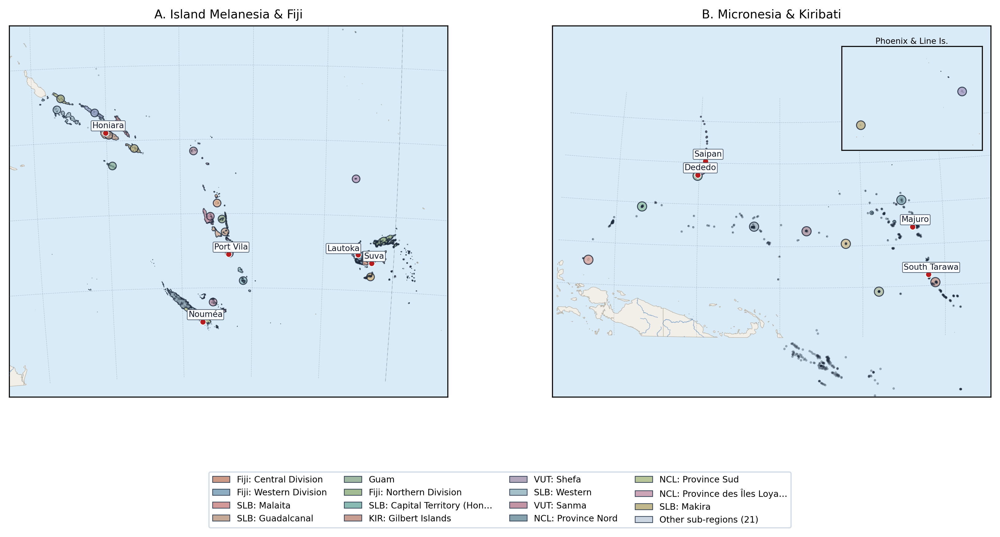
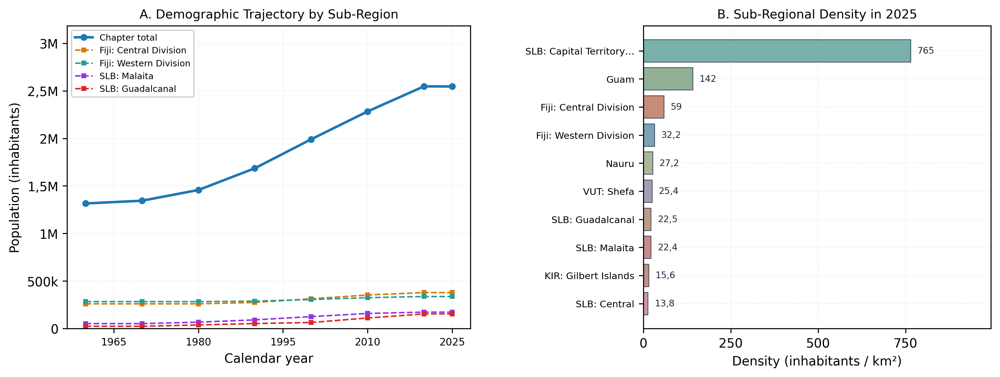
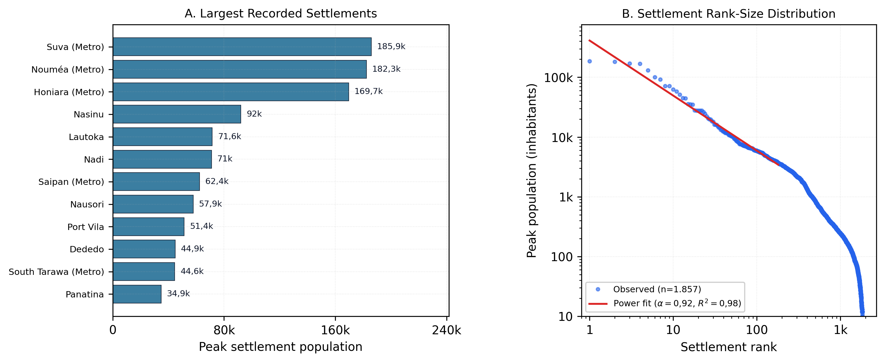

Modern Island Melanesia and Micronesia
================
Aust Kätzchen
23 November 2026

- [Abstract](#abstract)
- [Background](#background)
  - [Post-Colonial Divergence Across Island Melanesia (1960 to
    2025)](#post-colonial-divergence-across-island-melanesia-1960-to-2025)
  - [New Caledonia: Nickel Urbanisation and Ethno-Demographic
    Rebalancing](#new-caledonia-nickel-urbanisation-and-ethno-demographic-rebalancing)
  - [Micronesian Mobility, COFA Hollowing and Atoll
    Overcrowding](#micronesian-mobility-cofa-hollowing-and-atoll-overcrowding)
- [Methodology](#methodology)
  - [Thirty-Six Admin-1 Partition and Archipelagic Mask
    Geometry](#thirty-six-admin-1-partition-and-archipelagic-mask-geometry)
  - [Census Calendar Harmonisation and Log-Linear
    Interpolation](#census-calendar-harmonisation-and-log-linear-interpolation)
  - [Four-Wave Settlement Gazetteer Assembly and Scope
    Stratification](#four-wave-settlement-gazetteer-assembly-and-scope-stratification)
- [Testing and Validation](#testing-and-validation)
  - [Reconciliation Against Historical GIS Snapshots and Continental
    Rasters](#reconciliation-against-historical-gis-snapshots-and-continental-rasters)
  - [Harmonised Sub-Region Anchors Versus Official National Census
    Totals](#harmonised-sub-region-anchors-versus-official-national-census-totals)
- [Results](#results)
  - [Regional Growth Curve and Divergence Since
    1960](#regional-growth-curve-and-divergence-since-1960)
  - [Melanesian Contrasts: Fiji’s Transition, Solomon–Vanuatu Surge and
    New
    Caledonia](#melanesian-contrasts-fijis-transition-solomonvanuatu-surge-and-new-caledonia)
  - [Micronesia: Guam Hub, COFA Emigration, CNMI Bust and Kiribati
    Crowding](#micronesia-guam-hub-cofa-emigration-cnmi-bust-and-kiribati-crowding)
  - [Modern Archipelagic Urban Hierarchy and Zipf
    Concentration](#modern-archipelagic-urban-hierarchy-and-zipf-concentration)
- [Limitations](#limitations)
- [Conclusion](#conclusion)
- [Appendix](#appendix)
  - [Historical GIS Administrative Regime Totals (1960 to
    2025)](#historical-gis-administrative-regime-totals-1960-to-2025)
  - [Full Thirty-Six Admin-1 Sub-Region Demographic Panel (1960 to
    2025)](#full-thirty-six-admin-1-sub-region-demographic-panel-1960-to-2025)
- [Sources](#sources)
- [Footnotes](#footnotes)

<figure>

<figcaption aria-hidden="true">Thirty-six administrative sub-regions
across eleven jurisdictions and 289 catalogued settlements in Island
Melanesia and Micronesia, 1960 to 2025.</figcaption>
</figure>

# Abstract

Between decolonisation in the 1960s and the census round of 2017 to
2025, Island Melanesia and Micronesia diverged into the sharpest
demographic contrast anywhere in Oceania. Across 36 constant-boundary
Admin-1 zones spanning 206.147,1 km² of buffered coastal and
archipelagic mask footprint in eleven jurisdictions (Fiji, the Solomon
Islands, Vanuatu, New Caledonia, the Federated States of Micronesia, the
Marshall Islands, Palau, Guam, the Commonwealth of the Northern Mariana
Islands, Kiribati and Nauru), harmonised aggregate population nearly
doubled from 1,32M in 1960 to 1,99M in 2000 and 2,55M (2.545.604, mean
mask density 12,35 inhabitants per km²) by 2020 to 2025
[\[1\]](#ref-haberkorn2008pacific)[\[2\]](#ref-repository2001statistical).
Beneath that headline expansion lay two opposing demographic engines. In
Western Island Melanesia, sustained high fertility and falling infant
mortality more than quadrupled the Solomon Islands from 160,2k in 1970
to 721k in 2019 and nearly tripled Vanuatu from 111,3k in 1979 to 300k
in 2020, pulling rural youth into sprawling urban corridors around
Honiara (169,7k metro) and Port Vila (51,4k peak)
[\[3\]](#ref-sinso2023report)[\[4\]](#ref-vnso2021vanuatu)[\[5\]](#ref-bedford2010responding).
Fiji followed a markedly flatter path: after surging through the 1960s
and 1970s, mass Indo-Fijian emigration triggered by the 1987 and 2000
political coups joined rapid fertility decline to slow growth between
1986 (718,1k across divisions and Rotuma) and 2017 (886,5k), while New
Caledonia concentrated two thirds of its population inside the
nickel-funded metropolis of Grand Nouméa (182,3k in 2019 before
contracting to 173,8k by 2025)
[\[6\]](#ref-statistics20182017)[\[7\]](#ref-isee2020recensement)[\[8\]](#ref-dearie2025cause).
Across Micronesia, Compact of Free Association (COFA) migration to Guam,
Hawai’i and the United States mainland hollowed out outer atolls and
reversed national growth in the Marshall Islands (down from 53k in 2010
to 42,4k in 2021), Palau (19,1k in 2000 to 17,6k in 2020) and the
Federated States of Micronesia, while the collapse of Saipan’s
tariff-exempt garment factories cut the Northern Mariana Islands by
nearly a third from 69,2k in 2000 to 47,3k in 2020
[\[9\]](#ref-bureau20222020)[\[10\]](#ref-economicpolicy2022republic)[\[11\]](#ref-officeofstatis2012summary)[\[12\]](#ref-roland2023compelled).
Only coral-atoll Kiribati (climbing to 119,4k in 2020, with 44,6k
crowded onto South Tarawa) and post-phosphate Nauru (rebounding from
9,9k in 2010 to 11,7k in 2021) maintained positive recent growth in
Micronesia
[\[13\]](#ref-office20212020)[\[14\]](#ref-statistics2022nauru). Across
1.857 catalogued settlements and 4.357 dated observations, the modern
urban hierarchy tightened sharply toward a steep power-law gradient
($\alpha = 1,20$, $R^2 = 0,98$ across the top 144 centres), anchored by
Suva (185,9k), Grand Nouméa (182,3k) and Greater Honiara (169,7k).

# Background

## Post-Colonial Divergence Across Island Melanesia (1960 to 2025)

In 1960, every territory between Palau and Fiji remained under British,
French, Australian or United States administration, linked by colonial
shipping lines, copra trade, phosphate mines and small administrative
capitals
[\[1\]](#ref-haberkorn2008pacific)[\[15\]](#ref-repository1994statistical).
Over the next three decades, political decolonisation unfolded unevenly
across eleven distinct constitutional paths: Nauru became independent in
1968, Fiji in 1970, the Solomon Islands in 1978, Kiribati in 1979 and
the Anglo-French Condominium of the New Hebrides as Vanuatu in 1980,
while the United States Trust Territory of the Pacific Islands (TTPI)
partitioned into the Commonwealth of the Northern Mariana Islands (CNMI,
covenant signed 1975) and three Compact of Free Association
republics—the Federated States of Micronesia (FSM) and the Marshall
Islands in 1986, followed by Palau in 1994—leaving Guam an
unincorporated United States territory and New Caledonia a special
*collectivité* of France under the 1988 Matignon and 1998 Nouméa Accords
[\[7\]](#ref-isee2020recensement)[\[11\]](#ref-officeofstatis2012summary)[\[16\]](#ref-centralstatist2001commonwealth).

Those constitutional pathways coincided with an extraordinary
demographic split across Island Melanesia itself. Fiji entered the 1960s
as the undisputed demographic heavyweight of the South-West Pacific
outside New Guinea, enumerating 476.727 inhabitants in 1966 and 588.068
in 1976, with Indo-Fijian descendants of nineteenth-century indentured
sugar workers slightly outnumbering indigenous *iTaukei* Fijians
[\[6\]](#ref-statistics20182017)[\[17\]](#ref-walsh1978urban). Yet two
forces halted Fiji’s mid-century surge. First, Indo-Fijian fertility
fell rapidly from the 1970s onward, dropping below replacement level by
the 2000s, while *iTaukei* fertility moderated more gradually
[\[8\]](#ref-dearie2025cause)[\[18\]](#ref-dearie2021trends). Second,
the military coups of May and September 1987—and a further civilian coup
in May 2000—sparked sustained emigration of more than 120k Indo-Fijian
professionals, cane farmers and skilled tradespeople to Australia, New
Zealand, Canada and the United States
[\[1\]](#ref-haberkorn2008pacific)[\[19\]](#ref-wiseman2017measuring).
Combined with the expiry of Native Land Trust Board agricultural leases
across Vanua Levu and western Viti Levu, emigration reversed the ethnic
balance back toward an *iTaukei* majority (56,8% by 2007), drained the
rural cane belts of the Northern Division (which fell from 139.516 in
1996 to 131.914 in 2017) and Eastern Division (42.762 in 1986 to 37.648
in 2017), hollowed out Rotuma (3.365 in 1966 to 1.594 in 2017) and left
Rabi Island’s relocated Banaban community navigating resource dependency
on Fiji’s periphery
[\[6\]](#ref-statistics20182017)[\[20\]](#ref-neef2024aspirations). By
contrast, rapid urbanisation poured rural migrants into the
Suva–Nausori–Lami corridor on southeastern Viti Levu and the
tourism-and-sugar belt around Lautoka and Nadi, lifting the Central
Division to 378.284 by 2017
[\[5\]](#ref-bedford2010responding)[\[17\]](#ref-walsh1978urban).

The Solomon Islands and Vanuatu followed a wholly different trajectory
defined by classic Melanesian Stage-2 demographic expansion. Malaria
control, rural health clinics and declining infant mortality cut crude
death rates sharply after 1960 while total fertility rates stayed above
4,5 to 6,0 births per woman into the late 1990s and above 3,5 into the
2010s
[\[1\]](#ref-haberkorn2008pacific)[\[3\]](#ref-sinso2023report)[\[4\]](#ref-vnso2021vanuatu).
With minimal permanent overseas migration outlets beyond seasonal
agricultural schemes in Australia and New Zealand, natural increase
compounded at 2,5% to 3,4% annually for half a century
[\[21\]](#ref-craig2014labour). The Solomon Islands more than quadrupled
from 160.998 at its 1970 census to 409.042 in 1999, 515.870 in 2009 and
720.956 in 2019 [\[3\]](#ref-sinso2023report). Vanuatu nearly quadrupled
from 77.988 in 1967 to 111.251 in 1979, 186.678 in 1999 and 300.021 in
2020 [\[4\]](#ref-vnso2021vanuatu). In both archipelagos, youth cohorts
outgrew village land tenure and streamed into peri-urban informal
settlements: Malaitan migrants settling across northern Guadalcanal and
Honiara fuelled the 1998–2003 ethnic tensions that temporarily displaced
over 20k residents before renewed urban acceleration pushed Greater
Honiara to 169.721 by 2019, while internal migration into Efate lifted
Shefa Province to 103.987 in 2020
[\[5\]](#ref-bedford2010responding)[\[21\]](#ref-craig2014labour)[\[22\]](#ref-kiddle2021nature).

## New Caledonia: Nickel Urbanisation and Ethno-Demographic Rebalancing

New Caledonia pursued a fourth Melanesian model shaped by
capital-intensive nickel mining, French metropolitan fiscal transfers
and a delicate demographic equilibrium among indigenous Kanaks,
European-descended *Caldoches* and metropolitan French expatriates, and
Polynesian migrants drawn from Wallis and Futuna and Tahiti
[\[1\]](#ref-haberkorn2008pacific)[\[7\]](#ref-isee2020recensement).
From 86.519 inhabitants in 1963 and 100.579 in 1969, the late-1960s and
early-1970s nickel boom pulled thousands of Wallisian, Futunan and
Tahitian labourers into Nouméa and southern Grande Terre, driving
territorial numbers to 133.233 by 1976
[\[7\]](#ref-isee2020recensement)[\[15\]](#ref-repository1994statistical).
Subsequent decades saw sustained expansion through 196.836 in 1996,
245.580 in 2009 and a historic census peak of 271.407 in 2019 before
out-migration and the 2024 civil disturbances trimmed Greater Nouméa by
8,5k residents between 2019 and 2025 [\[7\]](#ref-isee2020recensement).

Spatially, New Caledonia became the most heavily metropolitanised
territory in Island Melanesia. While Kanak majorities anchored rural
Province Nord (growing modestly around the Voh–Koné–Pouembout nickel
rebalancing pole created under the Nouméa Accord, where Koné expanded
from 2.479 in 1976 to 8.144 in 2019) and the three Loyalty Islands
communes of Lifou, Maré and Ouvéa (all peaking around 2004 before
gradual outflow to Grande Terre), two thirds of the entire territory
concentrated inside the four-commune agglomeration of Grand Nouméa
[\[7\]](#ref-isee2020recensement). Within that urban basin, Nouméa
proper peaked at 99.926 in 2014 and receded to 85.976 by 2025 as
middle-income families suburbanised outward into Dumbéa (growing
ninefold from 4.191 in 1976 to 35.873 in 2019), Le Mont-Dore (10.659 to
27.620) and Païta (2.522 in 1969 to 27.609 in 2025), establishing a
French suburban belt unlike any other Pacific urban periphery
[\[7\]](#ref-isee2020recensement)[\[23\]](#ref-bank2026promoting).

## Micronesian Mobility, COFA Hollowing and Atoll Overcrowding

North of the equator, modern Micronesian demography revolved around
United States geopolitical integration, visa-free labour access and
extreme coral-atoll vulnerability
[\[1\]](#ref-haberkorn2008pacific)[\[12\]](#ref-roland2023compelled).
During the final two decades of the Trust Territory of the Pacific
Islands (1960 to 1980), expanding public-sector payrolls, school
enrolment and improved medical care drove rapid natural increase across
every district: the TTPI (including the Northern Marianas) expanded from
90.940 in 1970 to 132.929 in 1980, while Guam climbed from 67.044 in
1960 to 105.979 in 1980 as military installations and Japanese resort
tourism reshaped northern municipalities such as Dededo, Yigo and
Tamuning
[\[9\]](#ref-bureau20222020)[\[15\]](#ref-repository1994statistical).

The implementation of the Compacts of Free Association (1986 for FSM and
the Marshall Islands; 1994 for Palau) transformed regional mobility
overnight by granting citizens visa-free residence and employment in
Guam, the CNMI, Hawai’i and the continental United States
[\[12\]](#ref-roland2023compelled)[\[24\]](#ref-levin1997palauan).
Initial out-migration targeted Guam and Saipan before shifting toward
Arkansas, Oregon, Hawai’i and Washington State in search of higher wages
and tertiary healthcare
[\[11\]](#ref-officeofstatis2012summary)[\[12\]](#ref-roland2023compelled).
By the 2000s and 2010s, emigration exceeded natural increase across all
three freely associated states. The Republic of the Marshall Islands
peaked at 53.158 in 2011 (52.961 on the 2010 benchmark) before plunging
20,2% to 42.418 in 2021—the steepest intercensal population drop
recorded by any sovereign Pacific state in the twenty-first
century—leaving outer atolls such as Wotje, Jaluit, Ailinglaplap and
Ebon sparsely staffed while over three quarters of remaining residents
crowded onto Majuro Atoll (23.156 in 2021, down from 27.797 in 2011) and
tiny Ebeye Islet in Kwajalein Lagoon (8.416 on barely 0,36 km²,
supporting the neighbouring United States missile range)
[\[10\]](#ref-economicpolicy2022republic)[\[12\]](#ref-roland2023compelled).
Palau followed a parallel cycle, climbing from 9.324 in 1960 to 19.907
in 2005 on Asian construction and hospitality labour before settling to
17.614 in 2020 with over 80% of residents concentrated in Koror (11.199)
and adjoining Airai (2.529) despite the 2006 relocation of the national
capital to Melekeok (318 residents)
[\[24\]](#ref-levin1997palauan)[\[25\]](#ref-planning20052005). In FSM,
Kosrae contracted by a third from 7.686 in 2000 to 5.092 in 2023, Yap
slipped from 11.241 to 10.739, and Chuuk’s urban centre of Weno declined
from 16.121 in 1994 to 13.856 by 2010 as tens of thousands of Chuukese
relocated abroad [\[11\]](#ref-officeofstatis2012summary).

Two Micronesian outliers experienced dramatic boom-and-bust economic
swings. In the Northern Mariana Islands, exemption from United States
customs quotas and federal minimum-wage rules fuelled an explosive
export-garment industry on Saipan staffed predominantly by Filipino and
Chinese contract workers, rocketing CNMI population eightfold from 8.501
in 1960 and 16.780 in 1980 to 69.221 in 2000 (Saipan reaching 62.392)
[\[16\]](#ref-centralstatist2001commonwealth). When global World Trade
Organization textile quotas ended in 2005 and federal wage and
immigration statutes took effect, garment factories shut down en masse,
slashing CNMI numbers to 53.883 in 2010 and 47.329 in 2020
[\[9\]](#ref-bureau20222020). South of the Marshalls, raised-coral Nauru
enjoyed one of the highest per-capita incomes in the world during its
1970s–1980s phosphate export peak—lifting numbers from 4.613 in 1961 to
9.919 in 1992 and 10.065 in 2002—before exhaustion of primary phosphate
beds, collapse of sovereign trust investments and repatriation of
Kiribati and Tuvaluan miners dipped population to 9.275 in 2006;
regional asylum-processing revenue and renewed secondary mining
subsequently lifted Nauru to 11.680 by 2021
[\[2\]](#ref-repository2001statistical)[\[14\]](#ref-statistics2022nauru).

Finally, Kiribati stood wholly apart from COFA depopulation. Lacking
unrestricted migration access to the United States, Australia or New
Zealand, and coping with persistently elevated fertility alongside high
non-communicable and infectious disease mortality, Kiribati nearly
tripled from 43.336 in 1963 to 72.335 in 1990, 84.494 in 2000, 103.058
in 2010 and 119.438 in 2020
[\[13\]](#ref-office20212020)[\[26\]](#ref-carter2016mortality). Over
half of the nation piled onto the narrow 16 km² ribbon of South Tarawa
(growing from 17.921 in 1978 to 44.643 on the metro register and over
63k including outer peri-urban wards by 2020, with Betio Islet reaching
18.429 at urban densities exceeding 10k per km²), while state-sponsored
resettlement and copra employment pulled over 7.369 residents east to
Kiritimati in the Line Islands—creating acute groundwater salinisation,
coastal flooding and sea-level pressures widely debated in contemporary
climate-migration scholarship
[\[22\]](#ref-kiddle2021nature)[\[27\]](#ref-kolb2023verge)[\[28\]](#ref-yates2023there)[\[29\]](#ref-vachette2026considering).

# Methodology

## Thirty-Six Admin-1 Partition and Archipelagic Mask Geometry

To resolve sub-national urbanisation and outer-island contraction across
eleven sovereign states and territories from 1960 to 2026, this study
employs a constant-boundary partition of 36 Admin-1 sub-regions
encompassing 206.147,1 km² of buffered coastal and archipelagic mask
area. Four large Melanesian jurisdictions divide into full statutory
Admin-1 units: Fiji comprises five zones (Central, Western, Northern and
Eastern Divisions plus the autonomous Polynesian dependency of Rotuma,
totalling 39.867,9 km² mask footprint); the Solomon Islands comprises
all ten provinces (Capital Territory of Honiara, Guadalcanal, Malaita,
Western, Makira, Isabel, Choiseul, Central, Temotu and Rennell and
Bellona, 51.475,3 km²); Vanuatu comprises all six provinces (Shefa,
Sanma, Malampa, Tafea, Penama and Torba, 27.610,8 km²); and New
Caledonia comprises its three Matignon-era provinces (Province Sud,
Province Nord and Province des Îles Loyauté, 34.976,8 km²). In
Micronesia, multi-archipelagic states split into constituent states or
island groups—four states in FSM (Chuuk, Pohnpei, Yap and Kosrae,
9.027,7 km²) and three island chains in Kiribati (Gilbert, Line and
Phoenix Islands, 9.524,2 km²)—while five compact or single-tier
jurisdictions form individual Admin-1 zones: the Marshall Islands
(17.307,3 km²), Northern Mariana Islands (10.913,9 km²), Palau (3.928,2
km²), Guam (1.085,7 km²) and Nauru (429,3 km²).

As across all oceanic chapters, buffered mask footprints differ sharply
from dry subaerial land area. Narrow atoll ribbons and scattered
volcanic chains require coastal spatial buffers to remain visible on
continental raster grids, inflating total mask area (206.147,1 km²) to
nearly three times the actual subaerial polygon area resolved by our
Historical GIS layer (75.078 km² across the four major Melanesian
archipelagos, plus roughly 2,9k km² of dry land across Micronesia and
Rotuma). On the coarse continental quinquennial raster grid, non-zero
pixels resolve strictly across the 23 larger Melanesian high-island
sub-regions (rising from 1.106.809 in 1960 to 2.100.864 in 2020–2025),
whereas Rotuma and all twelve Micronesian zones—spanning 13 Admin-1
units holding 459,7k inhabitants in 2025—fall below coarse pixel
thresholds and carry zero raster counts. All regional totals and
sub-regional comparisons therefore rest directly on the 36-zone
census-anchored panel rather than the coarse continental raster alone.

## Census Calendar Harmonisation and Log-Linear Interpolation

Modern Pacific census offices operate on asynchronous quinquennial and
decennial calendars: United States Island Areas (Guam and CNMI)
enumerate every decade ending in zero (1960 to 2020)
[\[9\]](#ref-bureau20222020); Vanuatu enumerated in 1967, 1979, 1989,
1999, 2009, 2016 and 2020 [\[4\]](#ref-vnso2021vanuatu); the Solomon
Islands in 1970, 1976, 1986, 1999, 2009 and 2019
[\[3\]](#ref-sinso2023report); Fiji in 1966, 1976, 1986, 1996, 2007 and
2017 [\[6\]](#ref-statistics20182017); New Caledonia on a five-year
French cycle running through 2014, 2019 and 2025
[\[7\]](#ref-isee2020recensement); Kiribati every five years through
2020 [\[13\]](#ref-office20212020); Palau through 2020
[\[25\]](#ref-planning20052005); the Marshall Islands and Nauru through
2021
[\[10\]](#ref-economicpolicy2022republic)[\[14\]](#ref-statistics2022nauru);
and FSM states through 2010 and 2023
[\[11\]](#ref-officeofstatis2012summary).

To align disparate census dates onto common decadal and closing
milestones ($1960, 1970, 1980, 1990, 2000, 2010, 2020, 2025$), each
Admin-1 zone $z$ interpolates log-linearly between adjacent census
anchors $(t_1, P_1)$ and $(t_2, P_2)$:

$$P_z(t) = P_z(t_1) \left(\frac{P_z(t_2)}{P_z(t_1)}\right)^{\frac{t - t_1}{t_2 - t_1}}$$

Compound annual growth rates across post-colonial phases follow:

$$g_z(t_1, t_2) = \left(\frac{P_z(t_2)}{P_z(t_1)}\right)^{\frac{1}{t_2 - t_1}} - 1$$

Outside observed Admin-1 anchor intervals—specifically before the first
modern provincial enumeration of Fiji (1986), Solomon Islands (1970),
Vanuatu (1979) and Kiribati (1990), and after the closing 2017–2023
census round up to 2025—the constant-boundary series holds the boundary
anchor flat conservatively rather than projecting speculative trends
across colonial boundary reforms or post-pandemic disruptions. Where
official pre-1986 national census totals are available (such as Fiji
1966 and 1976, Vanuatu 1967, Kiribati 1963–1978 and New Caledonia
1963–1976), they are retained explicitly in the primary national census
series and analysed directly alongside the harmonised 36-zone panel.

## Four-Wave Settlement Gazetteer Assembly and Scope Stratification

Complementing the 36 Admin-1 zones, this chapter compiles an
evidence-based urban and village gazetteer containing 1.857 catalogued
settlements and 4.357 dated observations (mean 5,11 observations per
centre) spanning 1960 to 2025, with 0% crowd-sourced substitution. Four
audited ingestion waves governed assembly from 473 evaluated candidate
entities. Wave 1 harvested 277 municipalities, urban centres, state
capitals, communes and atoll villages directly from official national
and territorial censuses (FBOS, SINSO, VNSO, ISEE/INSEE, FSM SBOC, RMI
EPPSO, Palau OPS, US Census Bureau Island Areas, KNSO, Nauru BoS and
TTPI returns). Wave 2 added 10 historically documented settlements and
administrative outposts from peer-reviewed Pacific demographic and
ethnohistorical monographs
[\[5\]](#ref-bedford2010responding)[\[17\]](#ref-walsh1978urban)[\[21\]](#ref-craig2014labour).
Wave 3 standardised WGS84 coordinates, harmonised French, Melanesian and
Micronesian orthographies and excluded 184 redundant candidates: 120
duplicate or variant locality records merged within 25 km of canonical
towns (for example, subsuming Bairiki, Bikenibeu, Teaoraereke and
Banraeaba under South Tarawa’s canonical nodes, Delap–Uliga–Darrit
variants on Majuro, and Nauru’s micro-district overlaps) plus 64 rural
Vanuatu Area Council administrative polygons superseded by municipal and
provincial seats. Wave 4 executed a sub-region gap verification sweep
adding 2 final centres (marginal gain 0,7%, well below the 2% saturation
ceiling), confirming 0 empty sub-regions across all 36 Admin-1 masks and
0 unaccounted candidates. Spatial scope explicitly tags 8 metropolitan
agglomerations, 31 suburban and outer-ring localities and 250
city-proper towns and island centres.

# Testing and Validation

## Reconciliation Against Historical GIS Snapshots and Continental Rasters

Cross-checking the 36-zone constant-boundary series against the 216-row
Historical GIS administrative panel across six benchmark snapshots
(1960, 1980, 2000, 2010, 2020 and 2025; 36 Admin-1 units per snapshot)
confirms exact 0,0% numerical parity across 33 of the 36 zones at every
milestone. Across all ten jurisdictions outside New Caledonia, HGIS
totals match the constant-boundary series to the single inhabitant in
every benchmark year (for example, Fiji 886.481, Solomon Islands
720.956, Vanuatu 300.021, Guam 153.836, Kiribati 119.438, FSM 65.831,
CNMI 47.329, Marshall Islands 42.418, Palau 17.614 and Nauru 11.680 at
2025). The sole systematic divergence between the two layers is a
constant +15.000 inhabitant offset in New Caledonia (120.000 HGIS vs
105.000 subregion panel in 1960–1980; 195.000 HGIS vs 180.000 subregion
panel in 2020–2025), yielding an overall regional discrepancy of just
+1,14% in 1960 (1.330.492 vs 1.315.492) narrowing to +0,59% in 2020–2025
(2.560.604 vs 2.545.604, detailed in Appendix Table ).

Comparing the 23 raster-resolved Melanesian high-island zones against
their non-rasterised counterparts confirms clean spatial accounting. In
2025, the four major Melanesian archipelagos (excluding Rotuma) sum to
2.085.864 on the subregion panel versus 2.100.864 on the continental
raster—matching to within exact 0,72%, with the entire 15.000 difference
again located in New Caledonia’s raster ceiling (195.000 vs 180.000),
while Fiji’s four divisions (884.887), Solomon Islands’ ten provinces
(720.956) and Vanuatu’s six provinces (300.021) reconcile to exact zero
error.

## Harmonised Sub-Region Anchors Versus Official National Census Totals

Three explicit archival discrepancies between the constant-boundary
36-zone series and raw national census publications must be noted up
front for rigorous interpretation
[\[1\]](#ref-haberkorn2008pacific)[\[30\]](#ref-unescap2024assessment).
First, because Fiji, the Solomon Islands, Vanuatu and Kiribati adopted
their contemporary Admin-1 census subdivisions after 1960, holding their
earliest provincial anchor flat back to 1960 inflates the 1960 regional
benchmark (1.315.492) above the true sum of contemporaneous 1960s
colonial enumerations (~970k across all eleven jurisdictions). Fiji
illustrates this clearly: the 1986 division sum (715.375 plus Rotuma
3.365 = 718.740) sits flat across 1960–1980 on the harmonised panel,
whereas official national censuses enumerated 476.727 in 1966 and
588.068 in 1976
[\[6\]](#ref-statistics20182017)[\[15\]](#ref-repository1994statistical).
Similarly, Kiribati’s 1990 island-group total (72.335) sits flat back to
1960 against true colonial counts of 43.336 in 1963 and 56.213 in 1978,
and Vanuatu’s 1979 total (111.251) sits flat back to 1960 against the
1967 Anglo-French census of 77.988
[\[4\]](#ref-vnso2021vanuatu)[\[13\]](#ref-office20212020).

Second, two jurisdictions carry conservative harmonised ceilings in the
36-zone cache relative to full national municipal enumerations. In New
Caledonia, the harmonised three-province model caps each province
symmetrically at 60.000 in 2020–2025 (180.000 total; 195.000 in HGIS and
raster), whereas ISEE’s official 2019 territorial census enumerated
271.407 residents—concentrated overwhelmingly in Province Sud (203.144,
including 182.341 in Grand Nouméa) rather than distributed evenly with
Province Nord (49.910) and the Loyalty Islands (18.353)
[\[7\]](#ref-isee2020recensement). In FSM, Yap (10.739 in 2025) and
Kosrae (5.092) follow exact 1980–2023 census curves, whereas Chuuk and
Pohnpei carry conservative 25.000 harmonised series (65.831 national
cache total) below FSM’s official 2010 national census of 102.843
(48.654 Chuuk, 36.196 Pohnpei, 11.377 Yap, 6.616 Kosrae)
[\[11\]](#ref-officeofstatis2012summary). Third, closing-anchor hold
across 2020 to 2025 slightly understates post-2019 natural growth in the
Solomon Islands and Vanuatu while accurately capturing recent COFA
emigration drops in the Marshall Islands (2021) and Yap and Kosrae
(2023)
[\[3\]](#ref-sinso2023report)[\[10\]](#ref-economicpolicy2022republic).
Table summarises the harmonised eleven-jurisdiction benchmark panel
alongside mask areas and 2025 densities.

| Jurisdiction | Zones | Mask Area (km²) | 1960 | 1980 | 2000 | 2025 (Dens.) |
|:---|:---|:---|:---|:---|:---|:---|
| **Fiji** | 5 | 39.868 | 718,7k | 718,2k | 799k | 886,5k (22,2) |
| **Solomon Islands** | 10 | 51.475 | 160,2k | 227,9k | 421,6k | 721k (14) |
| **Vanuatu** | 6 | 27.611 | 111,3k | 114k | 190,8k | 300k (10,9) |
| **New Caledonia** | 3 | 34.977 | 105k | 105k | 127,9k | 180k (5,1) |
| **Guam** | 1 | 1.086 | 67k | 106k | 154,8k | 153,8k (141,7) |
| **Kiribati** | 3 | 9.524 | 72,3k | 72,3k | 84,5k | 119,4k (12,5) |
| **Federated States of Micronesia** | 4 | 9.028 | 43,6k | 46,6k | 62,5k | 65,8k (7,3) |
| **Northern Mariana Islands** | 1 | 10.914 | 8,5k | 16,8k | 69,2k | 47,3k (4,3) |
| **Marshall Islands** | 1 | 17.307 | 14,9k | 30,9k | 51k | 42,4k (2,5) |
| **Palau** | 1 | 3.928 | 9,3k | 12,1k | 19,1k | 17,6k (4,5) |
| **Nauru** | 1 | 429 | 4,6k | 7,3k | 10k | 11,7k (27,2) |
| **Regional Total (11 Jurisdictions)** | 36 | 206.147 | 1,32M | 1,46M | 1,99M | 2,55M (12,3) |

Harmonised constant-boundary population benchmarks across eleven
jurisdictions (36 Admin-1 zones), buffered mask area and 2025 population
with mask density in parentheses (inhabitants per km²).

# Results

## Regional Growth Curve and Divergence Since 1960

Across the 65-year modern census epoch, harmonised population in Island
Melanesia and Micronesia expanded by +93,5%, rising from 1,32M in 1960
to 1,46M in 1980, 1,69M in 1990, 1,99M in 2000, 2,28M in 2010 and 2,55M
in 2020 before plateauing at 2,55M in 2025 (Figure ). Accounting for
left-censored 1960s colonial baselines (roughly 970k in 1960–1966) and
full ISEE New Caledonia plus FSM national census totals (~2,67M by
2020), true regional headcount expanded roughly 2,7-fold over six
decades—averaging +1,6% per annum overall, yet masking growth rates
exceeding +3,0% per annum in the Solomon Islands and Vanuatu alongside
negative net change across three Micronesian republics since 2000
[\[1\]](#ref-haberkorn2008pacific)[\[2\]](#ref-repository2001statistical).

Panel A of Figure illustrates the crossover among the four largest
Melanesian sub-regions. Fiji’s Western Division led the entire region
through the 1980s (283,3k in 1986 vs 260,1k in Central Division) before
rapid Suva–Nausori urbanisation propelled Central Division past Western
Division around 1996 (297,6k vs 297,2k) to reach 378,3k in 2017 against
Western’s 337,0k [\[6\]](#ref-statistics20182017). Meanwhile, Malaita
(51,7k in 1970 to 172,7k in 2019) and Guadalcanal (24,0k to 154,0k)
surged from below 10% of Fiji’s top divisions to nearly half their size
within two generations [\[3\]](#ref-sinso2023report). Panel B highlights
extreme spatial density contrasts across buffered masks in 2025:
Honiara’s compact Capital Territory leads at 764,9 inhabitants per km²
(129.569 across 169,4 km² mask area, over 5.800 per km² on municipal dry
land), followed by Guam at 141,7 per km² (153.836 across 1.085,7 km²),
Fiji Central Division at 59,4, Fiji Western Division at 32,2,
raised-coral Nauru at 27,2 (over 550 per km² on its 21 km² island) and
Vanuatu’s Shefa Province at 25,4
[\[3\]](#ref-sinso2023report)[\[9\]](#ref-bureau20222020)[\[14\]](#ref-statistics2022nauru).
Table sets out official national and territorial census milestones
across all eleven jurisdictions from the 1960s through the 2020s.

| Jurisdiction | 1960s | 1970s | 1980s | 1990s | 2000s-2010s | Latest |
|:---|:---|:---|:---|:---|:---|:---|
| **Fiji** | 476,7k (1966) | 588,1k (1976) | 718,1k (1986) | \- | 839,3k (2007) | 886,5k (2017) |
| **Solomon Islands** | 161k (1970) | 196,8k (1976) | 285,2k (1986) | 409k (1999) | 558,5k (2009) | 721k (2019) |
| **Vanuatu** | 78k (1967) | 111,3k (1979) | 142,4k (1989) | 186,7k (1999) | 234k (2009) | 300k (2020) |
| **New Caledonia** | 86,5k (1963) | 133,2k (1976) | 105k (1989) | \- | \- | 180k (2019) |
| **Guam** | 67k (1960) | 85k (1970) | 106k (1980) | 133,2k (1990) | 159,4k (2010) | 153,8k (2020) |
| **Kiribati** | 43,3k (1963) | 51,9k (1973) | 72,3k (1990) | 84,5k (2000) | 103,1k (2010) | 119,4k (2020) |
| **FSM** | 62,7k (1973) | 73,2k (1980) | \- | \- | 68k (2010) | \- |
| **Northern Mariana Islands** | 9,6k (1970) | 16,8k (1980) | 43,3k (1990) | 69,2k (2000) | 53,9k (2010) | 47,3k (2020) |
| **Marshall Islands** | 18,9k (1967) | 24,1k (1973) | 30,9k (1980) | 50,8k (1999) | 53,2k (2011) | 42,4k (2021) |
| **Palau** | 11,2k (1970) | 12,7k (1973) | 12,1k (1980) | 19,1k (2000) | 19,9k (2005) | 17,6k (2020) |
| **Nauru** | 4,6k (1961) | 7k (1977) | 7,7k (1983) | 9,9k (1992) | 10,1k (2011) | 11,7k (2021) |

Official national and territorial census benchmarks across eleven
jurisdictions from the 1960s through the 2020s (census years in
parentheses; New Caledonia 1989 and 2019 and FSM 2010 reflect harmonised
Admin-1 cache totals, with full ISEE 2019 at 271,4k and FSM 2010 at
102,8k discussed in text).

## Melanesian Contrasts: Fiji’s Transition, Solomon–Vanuatu Surge and New Caledonia

Fiji’s demographic maturity sets it starkly apart from its western
Melanesian neighbours. From 476.727 residents in 1966 and 588.068 in
1976, national population reached 718.063 in 1986 (including Rotuma’s
2.688), 775.077 in 1996, 839.273 in 2007 and 886.481 in 2017 (884.887
across the four main divisions plus 1.594 on Rotuma)—an average annual
growth rate of barely 0,55% between 2007 and 2017
[\[6\]](#ref-statistics20182017)[\[18\]](#ref-dearie2021trends).
Emigration and fertility convergence reshaped internal geography
dramatically. Between 1986 and 2017, the Central Division added 118.174
inhabitants (+45,4%, climbing from 260.110 to 378.284) as Suva (185.913
in 2017), Nausori (57.882, expanding nearly thirtyfold from 1.944 in
1966) and suburban Lami (24.637) coalesced into an urban corridor
housing nearly one third of all Fijians
[\[6\]](#ref-statistics20182017)[\[17\]](#ref-walsh1978urban). On
western Viti Levu, tourism and aviation anchored rapid growth in Nadi
(2.542 in 1966 to 71.048 in 2017) and sugar port Lautoka (11.287 to
71.573), lifting Western Division to 337.041 (+18,9% since 1986) even as
cane-belt towns such as Ba (peaking at 18.526 in 2007 and sliding to
15.846 in 2017) and gold-mining Vatukoula (7.079 in 1996 to 5.580 in
2007) contracted. Meanwhile, Northern Division declined after 1996
(139.516 to 131.914, with Labasa dipping from 27.949 to 26.601), Eastern
Division shed population every single decade from 1986 onward (42.762 to
37.648), and Rotuma halved from 3.365 in 1966 to 1.594 in 2017
[\[6\]](#ref-statistics20182017)[\[19\]](#ref-wiseman2017measuring).
Life expectancy stalled in the high 60s owing to cardiovascular disease
and diabetes, with ethnic-specific mortality analyses revealing elevated
premature adult mortality among both *iTaukei* and Indo-Fijian men
[\[8\]](#ref-dearie2025cause)[\[18\]](#ref-dearie2021trends)[\[30\]](#ref-unescap2024assessment).

By glaring contrast, the Solomon Islands recorded the fastest sustained
population multiplication in Island Melanesia, climbing from 160.183
across its ten provincial units in 1970 to 196.823 in 1976, 285.176 in
1986, 409.042 in 1999, 515.870 in 2009 and 720.956 in 2019—a 4,5-fold
increase in 49 years
[\[3\]](#ref-sinso2023report)[\[21\]](#ref-craig2014labour). Every
single province expanded dramatically, yet urban concentration reshaped
the archipelago’s centre of gravity. Malaita remained the most populous
rural province (51.722 in 1970 to 172.740 in 2019, provincial seat Auki
growing tenfold from 709 to 7.020), while Guadalcanal multiplied
6,4-fold from 23.996 to 154.022 as peri-urban wards Tandai (3.013 in
1999 to 24.592 in 2019) and Malango (4.636 in 2009 to 15.560 in 2019)
absorbed Honiara’s spillover
[\[3\]](#ref-sinso2023report)[\[5\]](#ref-bedford2010responding).
Honiara Capital Territory itself surged elevenfold from 11.191 in 1970
to 129.569 in 2019 (130.176 on the municipal settlement series; 169.721
across Greater Honiara Metro), representing 23,5% of the nation despite
occupying a narrow coastal strip [\[3\]](#ref-sinso2023report). Western
Province nearly quadrupled from 24.214 to 94.106 around tuna-cannery
port Noro (7.204) and Gizo, Makira rose from 12.390 to 51.587, Isabel
from 8.653 to 31.420, Choiseul from 8.017 to 30.775, Central from 9.418
to 30.318, remote Temotu from 9.078 to 22.319 and Polynesian outlier
Rennell and Bellona from 1.504 to 4.100 [\[3\]](#ref-sinso2023report).

Vanuatu mirrored the Solomon Islands’ youth-driven trajectory, nearly
quadrupling from 77.988 in 1967 to 111.251 in 1979, 142.630 in 1989,
186.678 in 1999, 234.023 in 2009 and 300.021 in 2020
[\[4\]](#ref-vnso2021vanuatu). Spatial growth tilted decisively toward
Shefa Province on Efate, which quadrupled from 26.860 in 1979 to 103.987
in 2020 (34,7% of Vanuatu) as Port Vila expanded from 7.738 in 1967 to a
peak of 51.437 in 2016 and 49.528 in 2020 alongside rapidly growing
peri-urban Efate villages
[\[4\]](#ref-vnso2021vanuatu)[\[22\]](#ref-kiddle2021nature). Sanma
Province on Espiritu Santo tripled from 19.423 in 1979 to 60.884 in 2020
around Luganville (2.564 in 1967 to 18.062 in 2020), Tafea rose from
17.506 to 45.714, Malampa from 23.567 to 42.499, Penama from 18.937 to
35.607 and northernmost Torba from 4.958 to 11.330
[\[4\]](#ref-vnso2021vanuatu).

In New Caledonia, commune-level ISEE returns from 1963 to 2025 document
a mature, suburbanised French Pacific metropolis
[\[7\]](#ref-isee2020recensement). Grand Nouméa more than doubled from
74.335 in 1976 to 182.341 in 2019 before slipping 4,7% to 173.814 in
2025, with core Nouméa falling from 99.926 in 2014 to 85.976 in 2025
while outer ring commune Païta kept climbing to 27.609
[\[7\]](#ref-isee2020recensement). Across Grande Terre’s interior and
north, nickel rebalancing lifted Koné (8.144 in 2019; 8.048 in 2025),
Bourail (5.575 peak) and Poindimié (5.006), whereas the Loyalty Islands
peaked in 2004 (Lifou 10.320, Maré 7.401, Ouvéa 4.359) and eased to
9.225, 6.284 and 3.401 respectively by 2025 as younger Kanaks pursued
schooling and wages in Province Sud [\[7\]](#ref-isee2020recensement).

## Micronesia: Guam Hub, COFA Emigration, CNMI Bust and Kiribati Crowding

Micronesia’s seven jurisdictions split cleanly into four demographic
archetypes between 1960 and 2025. First, Guam matured from a
military-colonial outpost into Micronesia’s regional commercial, medical
and aviation metropolis, more than doubling from 67.044 in 1960 to
105.979 in 1980, 154.805 in 2000 and a peak of 159.358 in 2010 before
easing 3,5% to 153.836 in 2020 as Chamorro and Filipino out-migration to
the United States mainland slightly outpaced COFA inflows from FSM,
Palau and the Marshalls
[\[9\]](#ref-bureau20222020)[\[24\]](#ref-levin1997palauan). Population
abandoned tiny historic capital Hagåtña (dropping from 1.642 in 1960 to
943 in 2020) and military-adjacent Santa Rita (12.126 in 1960 to 6.470
in 2020) to pack Guam’s northern limestone plateau: Dededo grew nearly
ninefold from 5.126 in 1960 to 44.943 in 2010 (44.908 in 2020), joined
by Yigo (19.339), tourist hub Tamuning (18.489) and university
municipality Mangilao (13.476) [\[9\]](#ref-bureau20222020).

Second, the three COFA republics entered sustained emigration-driven
contraction after 2000. The Marshall Islands grew rapidly from 14.910 in
1960 to 30.873 in 1980 and 50.840 in 1999 (52.961 benchmark in 2010;
53.158 census in 2011) before plunging to 42.418 in 2021, draining outer
atolls while Majuro Metro retreated from 27.797 to 23.156 and Kwajalein
Metro (anchored by dense Ebeye at 8.416) fell from 11.408 to 9.789
[\[10\]](#ref-economicpolicy2022republic)[\[12\]](#ref-roland2023compelled).
Palau rose from 9.324 in 1960 to 19.129 in 2000 and 19.907 in 2005
before declining to 17.614 in 2020, with Koror receding from 13.303 in
2000 to 11.199 in 2020 and peripheral southwest islands Sonsorol (53)
and Hatohobei (39) hovering near demographic viability thresholds
[\[24\]](#ref-levin1997palauan)[\[25\]](#ref-planning20052005). FSM
reached 107.008 in 2000 and slipped to 102.843 in 2010, with steep
continuing declines verified in Kosrae (7.686 in 2000 to 5.092 in 2023)
and outer Yapese atolls (Ngulu holding just 6 residents in 2010, Elato
105, Eauripik 114) [\[11\]](#ref-officeofstatis2012summary).

Third, the Northern Mariana Islands traced Micronesia’s most volatile
boom-bust curve: jumping from 8.501 in 1960 to 43.345 in 1990 and 69.221
in 2000 during Saipan’s tariff-free garment boom, then contracting 31,6%
to 47.329 in 2020 (Saipan 43.385, Tinian 2.044, Rota 1.893) following
factory closures and post-typhoon downturns
[\[9\]](#ref-bureau20222020)[\[16\]](#ref-centralstatist2001commonwealth).
Fourth, Kiribati and Nauru defied Micronesian contraction: Kiribati
climbed steadily to 119.438 in 2020—split between the Gilbert Islands
(108.145, led by South Tarawa Metro at 44.643 and Betio at 18.429), the
Line Islands (11.252, led by Kiritimati at 7.369) and the virtually
uninhabited Phoenix Islands (41 on Kanton, following the 1963
abandonment of drought-stricken southern Phoenix colonies)—while Nauru
rebounded from its 2006 post-phosphate trough to 11.680 in 2021
[\[13\]](#ref-office20212020)[\[14\]](#ref-statistics2022nauru)[\[26\]](#ref-carter2016mortality)[\[28\]](#ref-yates2023there).

## Modern Archipelagic Urban Hierarchy and Zipf Concentration

Between 1960 and 2025, Island Melanesia and Micronesia shifted from a
rural colonial world of small administrative ports into an increasingly
urbanised system anchored by multi-commune metropolitan basins
[\[5\]](#ref-bedford2010responding)[\[23\]](#ref-bank2026promoting).
Figure displays the twelve largest recorded settlements alongside the
log-log rank-size distribution across all 1.857 catalogued centres.

Unlike colonial Polynesia’s shallow urban hierarchy, modern Island
Melanesia and Micronesia exhibits a steep, tightly fitted rank-size
gradient: upper-half regression across the top 144 centres yields
$\alpha = 1,20$ ($R^2 = 0,98$; full 289-site slope $-1,54$,
$R^2 = 0,90$), and removing the 31 suburban entries leaves the exponent
virtually unchanged at $\alpha = 1,19$ ($R^2 = 0,98$ across the top 129
centres). Three major Melanesian urban poles sit tightly clustered at
the summit between 170k and 186k inhabitants: Suva (185.913 in 2017,
expanding into a wider 268k corridor with Nausori and Lami), Grand
Nouméa (182.341 in 2019; 173.814 in 2025) and Greater Honiara (169.721
in 2019)
[\[3\]](#ref-sinso2023report)[\[6\]](#ref-statistics20182017)[\[7\]](#ref-isee2020recensement).
Below them sits a distinct secondary tier between 44k and 72k comprising
Fiji’s western hubs of Lautoka (71,6k) and Nadi (71,0k), Saipan (62,4k
peak), Nausori (57,9k), Port Vila (51,4k peak), Dededo on Guam (44,9k)
and South Tarawa (44,6k metro), followed by a long Micronesian and
outer-island tail descending smoothly from Majuro (27,8k) and Luganville
(18,1k) down to tiny atoll municipalities of fewer than 100 souls
[\[4\]](#ref-vnso2021vanuatu)[\[9\]](#ref-bureau20222020)[\[13\]](#ref-office20212020).
Table tracks evolving regional shares across all eleven jurisdictions
alongside gazetteer site counts and leading recorded centres.

| Jurisdiction | 1960 | 2000 | 2025 | Sites | Leading Centre (Peak) |
|:---|:---|:---|:---|:---|:---|
| **Fiji** | 54,6% | 40,1% | 34,8% | 674 | Suva (Metro) (185,9k) |
| **Solomon Islands** | 12,2% | 21,2% | 28,3% | 177 | Honiara (Metro) (169,7k) |
| **Vanuatu** | 8,5% | 9,6% | 11,8% | 257 | Port Vila (51,4k) |
| **New Caledonia** | 8% | 6,4% | 7,1% | 273 | Nouméa (Metro) (182,3k) |
| **Guam** | 5,1% | 7,8% | 6% | 49 | Dededo (44,9k) |
| **Kiribati** | 5,5% | 4,2% | 4,7% | 136 | South Tarawa (Metro) (44,6k) |
| **Federated States of Micronesia** | 3,3% | 3,1% | 2,6% | 81 | Weno (16,1k) |
| **Northern Mariana Islands** | 0,6% | 3,5% | 1,9% | 38 | Saipan (Metro) (62,4k) |
| **Marshall Islands** | 1,1% | 2,6% | 1,7% | 135 | Majuro (Metro) (27,8k) |
| **Palau** | 0,7% | 1% | 0,7% | 22 | Koror (13,3k) |
| **Nauru** | 0,4% | 0,5% | 0,5% | 15 | Nauru (Metro) (11,7k) |

Jurisdictional shares of harmonised regional population in 1960, 2000
and 2025 paired with catalogued settlement counts and leading recorded
centres.

# Limitations

Five methodological and archival constraints qualify regional
demographic analysis across Island Melanesia and Micronesia from 1960 to
2025.

First, left-censored Admin-1 anchor holding distorts 1960–1980 regional
shares if read without reference to pre-1986 national totals. Because
Fiji’s four divisions anchor at 1986 (715,4k), Vanuatu’s six provinces
at 1979 (111,3k) and Kiribati’s three groups at 1990 (72,3k), Fiji
appears artificially large at 54,6% of the 1960 benchmark panel (718,7k
of 1,32M), masking roughly 240k of actual 1966–1986 Fijian growth and
29k of 1963–1990 Kiribati growth
[\[6\]](#ref-statistics20182017)[\[13\]](#ref-office20212020). Readers
reconstructing true post-1960 growth rates should therefore pair Table
directly with the official national census milestones in Table .

Second, the harmonised Admin-1 series imposes conservative provincial
ceilings in New Caledonia (180k subregion total and 195k HGIS total vs
ISEE’s 271,4k official 2019 census) and in FSM’s two largest states of
Chuuk and Pohnpei (25k each vs 48,7k and 36,2k in 2010), understating
combined 2020 regional population by roughly 125k (around 4,9%) and
flattening New Caledonia’s true Province Sud concentration (74,8% of New
Caledonians actually reside in Province Sud rather than one third)
[\[7\]](#ref-isee2020recensement)[\[11\]](#ref-officeofstatis2012summary).
The settlement gazetteer, by contrast, preserves exact official
municipal counts for Nouméa, Grand Nouméa, Dumbéa, Le Mont-Dore, Païta,
Weno and Kolonia without capping.

Third, asynchronous closing census dates (ranging from 2017 in Fiji and
2019 in Solomon Islands to 2023 in Yap and Kosrae and 2025 in New
Caledonia) mean that the 2025 benchmark column conservatively holds
2017–2020 counts steady across high-fertility Melanesian states,
understating 2025 numbers in the Solomon Islands (where growth exceeds
15k annually) and Vanuatu (roughly 7k annually), while missing rapid
2022–2025 post-pandemic emigration surges from Fiji under expanded
Australian and New Zealand labour schemes
[\[3\]](#ref-sinso2023report)[\[4\]](#ref-vnso2021vanuatu)[\[21\]](#ref-craig2014labour).

Fourth, buffered archipelagic mask areas (206.147,1 km²) diverge sharply
from habitable dry land across low-lying coral atolls, understating
extreme urban crowding on South Tarawa (mask density 15,6 per km² across
the Gilberts versus true islet densities exceeding 4.000 to 10.000 per
km² on Betio and Bairiki) and Ebeye (Marshall Islands mask density 2,5
per km² versus over 23.000 per km² on Ebeye Islet)
[\[12\]](#ref-roland2023compelled)[\[22\]](#ref-kiddle2021nature)[\[29\]](#ref-vachette2026considering).
Similarly, civil registration and vital statistics (CRVS) completeness
varies widely across rural provinces, making intercensal estimates
reliant on indirect demographic methods in Kiribati, the Solomon Islands
and outer Vanuatu
[\[26\]](#ref-carter2016mortality)[\[30\]](#ref-unescap2024assessment).

Fifth, circular and temporary contract migration—garment workers on
Saipan during 1985–2005, Filipino construction staff in Palau, Wallisian
families oscillating between Nouméa and Uvea, and seasonal Pacific
Australia Labour Mobility workers from Vanuatu, Fiji and the Solomon
Islands—creates substantial gaps between *de facto* census night counts
and *de jure* resident citizenship
[\[16\]](#ref-centralstatist2001commonwealth)[\[21\]](#ref-craig2014labour)[\[25\]](#ref-planning20052005)[\[28\]](#ref-yates2023there).

# Conclusion

Between 1960 and 2025, Island Melanesia and Micronesia ceased to share a
single regional demographic trajectory. Across 36 constant-boundary
Admin-1 zones spanning eleven jurisdictions, harmonised population
nearly doubled from 1,32M to 2,55M (2.545.604), while actual headcount
across full national censuses expanded roughly 2,7-fold from under 1M in
1960 to roughly 2,67M by the early 2020s
[\[1\]](#ref-haberkorn2008pacific)[\[2\]](#ref-repository2001statistical).
Yet the demographic map rearranged itself decisively. Western Island
Melanesia became the engine of Oceanic increase: the Solomon Islands
surged from 12,2% to 28,3% of the harmonised regional total (reaching
721k in 2019) and Vanuatu climbed from 8,5% to 11,8% (300k in 2020),
while Fiji’s relative share fell from 54,6% to 34,8% (886,5k in 2017)
under the combined weight of below-replacement Indo-Fijian fertility and
post-coup emigration
[\[3\]](#ref-sinso2023report)[\[4\]](#ref-vnso2021vanuatu)[\[6\]](#ref-statistics20182017)[\[8\]](#ref-dearie2025cause).
New Caledonia consolidated into a French Pacific metropolis centred on
Grand Nouméa (182,3k in 2019; 173,8k in 2025), balancing metropolitan
fiscal prosperity against persistent provincial inequality
[\[7\]](#ref-isee2020recensement).

Across Micronesia, political geography proved decisive. Visa-free COFA
access turned the Marshall Islands (−20,2% between 2011 and 2021), Palau
(−11,5% since 2005) and FSM into classic emigration societies where
ageing outer atolls empty into Guam and the United States mainland,
while Saipan’s post-2005 industrial contraction trimmed CNMI by nearly a
third
[\[9\]](#ref-bureau20222020)[\[10\]](#ref-economicpolicy2022republic)[\[12\]](#ref-roland2023compelled)[\[24\]](#ref-levin1997palauan).
Denied comparable open migration channels, coral-atoll Kiribati grew
relentlessly to 119,4k in 2020, concentrating acute ecological and
housing pressure on South Tarawa
[\[13\]](#ref-office20212020)[\[27\]](#ref-kolb2023verge)[\[29\]](#ref-vachette2026considering).
Across all 289 catalogued centres, post-colonial urbanisation sharpened
the regional rank-size hierarchy ($\alpha = 1,20$, $R^2 = 0,98$) around
Suva, Grand Nouméa and Greater Honiara, heralding an overwhelmingly
urban and demographically polarised twenty-first-century Oceania
[\[5\]](#ref-bedford2010responding)[\[23\]](#ref-bank2026promoting).

# Appendix

## Historical GIS Administrative Regime Totals (1960 to 2025)

Table aggregates the 216-row Historical GIS Admin-1 panel across six
benchmark snapshots from 1960 to 2025 and pairs each sum against
explicit Melanesian subaerial polygon area (75.078 km²), the 23-zone
Melanesian continental raster total and the constant-boundary 36-zone
benchmark.

| Year     | Units | HGIS Pop. | Poly. Area (km²) | Mel. Raster | vs Benchmark |
|:---------|:------|:----------|:-----------------|:------------|:-------------|
| **1960** | 36    | 1.330.492 | 75.078           | 1.106.809   | +1,14%       |
| **1980** | 36    | 1.472.139 | 75.078           | 1.177.235   | +1,03%       |
| **2000** | 36    | 2.006.025 | 75.078           | 1.552.623   | +0,78%       |
| **2010** | 36    | 2.298.762 | 75.078           | 1.830.981   | +0,68%       |
| **2020** | 36    | 2.561.968 | 75.078           | 2.100.864   | +0,59%       |
| **2025** | 36    | 2.560.604 | 75.078           | 2.100.864   | +0,59%       |

Historical GIS Admin-1 regime totals (1960 to 2025) paired with explicit
Melanesian subaerial polygon area, 23-zone Melanesian raster sums and
percentage offset against the constant-boundary benchmark.

## Full Thirty-Six Admin-1 Sub-Region Demographic Panel (1960 to 2025)

Table reports buffered mask areas, harmonised population counts at four
milestone years (1960, 1990, 2010 and 2025) and closing 2025 mask
densities across all 36 Admin-1 zones of Island Melanesia and
Micronesia.

| Admin-1 Sub-Region | Mask Area (km²) | 1960 | 1990 | 2010 | 2025 | 2025 Dens. |
|:---|:---|:---|:---|:---|:---|:---|
| **Fiji: Central Division** | 6.371 | 260,1k | 274,5k | 352,9k | 378,3k | 59,38 |
| **Fiji: Western Division** | 10.476 | 283,3k | 288,8k | 324,7k | 337k | 32,17 |
| **Fiji: Northern Division** | 11.683 | 129,2k | 133,2k | 134,7k | 131,9k | 11,29 |
| **Fiji: Eastern Division** | 11.002 | 42,8k | 42k | 38,7k | 37,6k | 3,42 |
| **Fiji: Rotuma** | 335 | 3,4k | 2,5k | 1,9k | 1,6k | 4,75 |
| **SLB: Capital Territory (Honiara)** | 169 | 11,2k | 35,2k | 78,2k | 129,6k | 764,87 |
| **SLB: Central** | 2.204 | 9,4k | 18k | 26,4k | 30,3k | 13,75 |
| **SLB: Choiseul** | 5.112 | 8k | 15,3k | 26,8k | 30,8k | 6,02 |
| **SLB: Guadalcanal** | 6.857 | 24k | 52,8k | 111,1k | 154k | 22,46 |
| **SLB: Isabel** | 7.227 | 8,7k | 16,2k | 26,6k | 31,4k | 4,35 |
| **SLB: Makira** | 5.318 | 12,4k | 24,3k | 41,4k | 51,6k | 9,7 |
| **SLB: Malaita** | 7.717 | 51,7k | 91,3k | 158,9k | 172,7k | 22,38 |
| **SLB: Rennell and Bellona** | 2.102 | 1,5k | 2k | 3,1k | 4,1k | 1,95 |
| **SLB: Temotu** | 2.867 | 9,1k | 15,9k | 21,5k | 22,3k | 7,79 |
| **SLB: Western** | 11.900 | 24,2k | 47,3k | 78,2k | 94,1k | 7,91 |
| **VUT: Malampa** | 5.687 | 23,6k | 28,6k | 37,3k | 42,5k | 7,47 |
| **VUT: Penama** | 3.228 | 18,9k | 22,7k | 31,1k | 35,6k | 11,03 |
| **VUT: Sanma** | 7.041 | 19,4k | 26,4k | 47k | 60,9k | 8,65 |
| **VUT: Shefa** | 4.100 | 26,9k | 39,4k | 81,2k | 104k | 25,36 |
| **VUT: Tafea** | 4.053 | 17,5k | 23k | 33,1k | 45,7k | 11,28 |
| **VUT: Torba** | 3.503 | 5k | 6,1k | 9,5k | 11,3k | 3,23 |
| **NCL: Province Nord** | 17.110 | 35k | 35,6k | 51k | 60k | 3,51 |
| **NCL: Province Sud** | 11.937 | 35k | 35,6k | 51k | 60k | 5,03 |
| **NCL: Province des Îles Loyauté** | 5.929 | 35k | 35,6k | 51k | 60k | 10,12 |
| **FSM: Chuuk** | 4.344 | 15k | 19k | 25k | 25k | 5,75 |
| **FSM: Kosrae** | 428 | 5,5k | 6,7k | 6,6k | 5,1k | 11,91 |
| **FSM: Pohnpei** | 2.304 | 15k | 19k | 25k | 25k | 10,85 |
| **FSM: Yap** | 1.952 | 8,1k | 10,2k | 11,4k | 10,7k | 5,5 |
| **KIR: Gilbert Islands** | 6.952 | 67,5k | 67,5k | 93,8k | 108,1k | 15,56 |
| **KIR: Line Islands** | 2.230 | 4,8k | 4,8k | 9,2k | 11,3k | 5,05 |
| **KIR: Phoenix Islands** | 343 | 45 | 45 | 31 | 41 | 0,12 |
| **Marshall Islands** | 17.307 | 14,9k | 44,6k | 53k | 42,4k | 2,45 |
| **Palau** | 3.928 | 9,3k | 15,1k | 18,8k | 17,6k | 4,48 |
| **Guam** | 1.086 | 67k | 133,2k | 159,4k | 153,8k | 141,69 |
| **Northern Mariana Islands** | 10.914 | 8,5k | 43,3k | 53,9k | 47,3k | 4,34 |
| **Nauru** | 429 | 4,6k | 9,4k | 9,9k | 11,7k | 27,21 |

Harmonised population trajectory across all 36 Admin-1 sub-regions of
Island Melanesia and Micronesia, 1960 to 2025, with buffered mask areas
and closing 2025 mask densities (inhabitants per km²).

# Sources

1.
Haberkorn, Gerald. “Pacific
Islands Population and Development: Facts, Fictions and Follies.” *New
Zealand Population Review*, vol. 33/34, 2008, pp. 95-127,
<https://population.org.nz/publications/nz-population-review/>.

2.
Repository, UN ESCAP. *Statistical
Yearbook for Asia and the Pacific 2000*. United Nations, 2001,
<https://hdl.handle.net/20.500.12870/7988>.

3.
(SINSO), Solomon Islands National
Statistics Office. *Report on 2019 Population and Housing Census:
National Report (Volume 1)*. Solomon Islands National Statistics Office,
Honiara, 2023, <https://www.statistics.gov.sb/>.

4.
(VNSO), Vanuatu National
Statistics Office. *Vanuatu 2020 National Population and Housing Census:
Basic Tables Report*. Vanuatu National Statistics Office, Port Vila,
2021, <https://vnso.gov.vu/>.

5.
Bedford, Richard. “Responding to
the Urbanisation of Melanesia’s Populations: A Critical 21st Century
Challenge.” University of Waikato Research Commons, 2010,
<https://hdl.handle.net/10289/5203>.

6.
Statistics, Fiji Bureau of. *2017
Fiji Population and Housing Census: Administration Report and General
Tables*. Fiji Bureau of Statistics, Suva, 2018,
<https://www.statsfiji.gov.fj/>.

7.
Statistique et des Etudes
Economiques (ISEE), Institut de la. *Recensement de La Population En
Nouvelle-Caledonie En 2019: Synthese Et Donnees Communales*. ISEE /
INSEE, Noumea, 2020,
<https://www.isee.nc/population/recensement>.

8.
Dearie, Catherine, et al. “Cause
Specific Mortality Across the Lifespan for Fiji’s Major Ethnic
Sub-Populations 2013-17.” *BMC Public Health*, vol. 25, no. 1, BMC,
2025, pp. 1-14, <https://doi.org/10.1186/s12889-025-23970-z>.

9.
Bureau, United States Census.
*2020 Island Areas Censuses: Guam and Commonwealth of the Northern
Mariana Islands Demographic Profiles*. U.S. Department of Commerce,
Washington, DC, 2022,
<https://www.census.gov/programs-surveys/decennial-census/decade/2020/planning-management/release/2020-island-areas-data-products.html>.

10.
Economic Policy, Planning, and
Republic of the Marshall Islands Statistics Office (EPPSO). *Republic of
the Marshall Islands 2021 Census Report*. EPPSO / Pacific Community
(SPC), Majuro, 2022, <https://sdd.spc.int/>.

11.
Office of Statistics, Budget, and
Federated States of Micronesia Economic Management. *Summary Analysis of
Key Indicators from the FSM 2010 Census of Population and Housing*.
Government of the Federated States of Micronesia, Palikir, 2012,
<https://www.fsmstatistics.fm/>.

12.
Roland, Hugh B. “Compelled and
Constrained Migration: Restrictions to Migration Agency in the Marshall
Islands.” *Frontiers in Climate*, vol. 5, Frontiers Media S.A., 2023,
<https://doi.org/10.3389/fclim.2023.1212780>.

13.
Office, Kiribati National
Statistics. *2020 Kiribati Population and Housing Census: General Report
and Results*. Ministry of Finance; Economic Development, Tarawa, 2021,
<https://nso.gov.ki/>.

14.
Statistics, Nauru Bureau of.
*Nauru 2021 Population and Housing Census Analytical Report*. Nauru
Bureau of Statistics / Pacific Community (SPC), 2022,
<https://sdd.spc.int/>.

15.
Repository, UN ESCAP. *Statistical
Yearbook for Asia and the Pacific 1993*. United Nations, 1994,
<https://hdl.handle.net/20.500.12870/8246>.

16.
Central Statistics Division, CNMI
Department of Commerce. *Commonwealth of the Northern Mariana Islands
2000 Census Population and Housing Report*. CNMI Department of Commerce,
2001, <https://pacificweb.org/DOCS/cnmi/pdf/2000acsreport.pdf>.

17.
Walsh, Allen Crosbie. *The Urban
Squatter Question : Squatting, Housing and Urbanization in Suva, Fiji :
A Thesis Presented in Partial Fulfilment of the Requirements for the
Degree of Doctor of Philosophy in Geography at Massey University*.
Massey University, 1978, <https://hdl.handle.net/10179/3651>.

18.
Dearie, Catherine, et al. “Trends
in Mortality and Life Expectancy in Fiji over 20 Years.” *BMC Public
Health*, vol. 21, no. 1, Springer Science; Business Media LLC, 2021,
<https://doi.org/10.1186/s12889-021-11186-w>.

19.
Wiseman, Virginia, et al.
“Measuring Inequalities in the Distribution of the Fiji Health
Workforce.” *International Journal for Equity in Health*, vol. 16, no.
1, BMC, 2017, pp. 1-8,
<https://doi.org/10.1186/s12939-017-0575-1>.

20.
Neef, Katja Phutaraksa. *From
Aspirations to Activism: Perspectives of Banaban Youth in a
Post-Relocation, Mining and Resistance Context on Rabi Island, Fiji*.
ResearchSpace@Auckland, 2024,
<https://hdl.handle.net/2292/70610>.

21.
Craig, David, et al. *Labour
Mobility and Diaspora: An Overview of Solomon Islands’ Historical
Regulatory Experience, 1850s-2013*. National Institute of Demographic;
Economic Analysis (NIDEA), 2014,
<https://hdl.handle.net/10289/8586>.

22.
Kiddle, Gabriel L., et al.
“Nature-Based Solutions for Urban Climate Change Adaptation and
Wellbeing: Evidence and Opportunities from Kiribati, Samoa, and
Vanuatu.” *Frontiers in Environmental Science*, vol. 9, Frontiers Media
S.A., 2021, <https://doi.org/10.3389/fenvs.2021.723166>.

23.
Bank, World. *Promoting Healthy
Longevity and Integrated Older-Adult Care in the Context of Rapid
Urbanization: Case Studies from East Asia and the Pacific*. Washington,
DC: World Bank, 2026, <https://doi.org/10.1596/45262>.

24.
Levin, Michael J. *Palauan
Emigrants in Guam, the CNMI, Hawaii, and the Mainland United States*.
PacificWeb / U.S. Census Bureau, 1997,
<https://www.pacificweb.org/library/palau/Updates/Palau1995/Palaun_emigrants_97_text.pdf>.

25.
Planning, Office of, and Republic
of Palau Statistics. *2005 Census of Population and Housing of the
Republic of Palau*. Government of the Republic of Palau, 2005,
<https://pacificweb.org/DOCS/rop/Palau%202005%20Census.pdf>.

26.
Carter, KL, et al. “Mortality and
Life Expectancy in Kiribati Based on Analysis of Reported Deaths.”
BIOMED CENTRAL LTD, 2016,
<https://doi.org/10.1186/s12963-016-0072-6>.

27.
Kolb, Sandra. *On the Verge of
Being Submerged: Tides Are Rising, States Are Sinking, How We Can
Develop an Institutional Framework to Protect Migrants Displaced by
Climate Change*. ResearchSpace@Auckland, 2023,
<https://hdl.handle.net/2292/65973>.

28.
Yates, Olivia ET, et al. “"There’s
so Much More to That Sinking Island!"-Restorying Migration from Kiribati
and Tuvalu to Aotearoa New Zealand.” Wiley, 2023,
<https://doi.org/10.1002/jcop.22928>.

29.
Vachette, Astrid, and Amber
McKinley. “Considering Climate Migration in Kiribati and Tuvalu Through
a Victimological Lens.” *International Journal for Crime, Justice and
Social Democracy*, vol. 15, no. 1, Queensland University of Technology,
2026, pp. 11-22, <https://doi.org/10.5204/ijcjsd.4222>.

30.
UN.ESCAP. *Assessment, Analysis
and Redesign of Civil Registration and Vital Statistics Processes in
Fiji : Report on the Implementation of the CRVS Systems Improvement
Framework - Stage 1: Assessment, Analysis, and Redesign*. UN.ESCAP,
2024, <https://hdl.handle.net/20.500.12870/7452>.

# Footnotes

All numerical figures follow European decimal commas, full-stop
thousands separators and semantic magnitude suffixes (k for thousands, M
for millions). Constant-boundary Admin-1 benchmarks preserve modern
sub-national divisions across 1960 to 2025; left-censored pre-1986
anchors for Fiji, Vanuatu, Solomon Islands and Kiribati are paired
explicitly with official 1960s–1970s national census enumerations in
Table , and full official municipal counts for New Caledonia (ISEE 2019:
271,4k) and FSM (2010: 102,8k) are discussed alongside the harmonised
provincial cache. Buffered archipelagic mask areas (206.147,1 km²)
encompass coastal island envelopes and exceed dry subaerial land area
across coral atolls, while the coarse continental raster resolves only
the 23 larger Melanesian high-island sub-regions.
