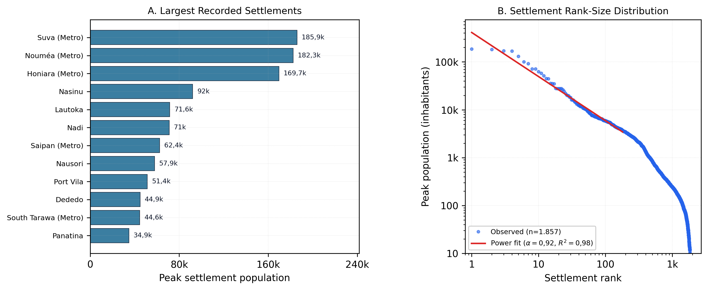

```{r setup, include=FALSE}
knitr::opts_chunk$set(echo = FALSE, warning = FALSE, message = FALSE, fig.pos = "htbp")
source("../../_shared/template/viscount_rmd_helpers.R")
library(jsonlite)

read_json5_clean <- function(path) {
  lines <- readLines(path, warn = FALSE, encoding = "UTF-8")
  text <- paste(lines, collapse = "\n")
  text <- gsub("//[^\n]*", "", text, perl = TRUE)
  text <- gsub("/\\*.*?\\*/", "", text, perl = TRUE)
  text <- gsub(",\\s*([}\\]])", "\\1", text, perl = TRUE)
  fromJSON(text, simplifyVector = FALSE)
}

summary_data <- fromJSON("modern_melanesia_micro_summary_cache.json", simplifyVector = FALSE)
sett_data <- fromJSON("modern_melanesia_micro_settlements.json", simplifyVector = FALSE)
ledger_data <- read_json5_clean("modern_melanesia_micro_source_ledger.json5")

clean_label <- function(x) {
  s <- as.character(x)
  s <- gsub("&", "and", s, fixed = TRUE)
  s <- gsub(" / ", " and ", s, fixed = TRUE)
  s <- gsub("\\\\", "", s)
  trimws(s)
}

fmt_coord <- function(x) {
  viscount_fmt_number(round(as.numeric(x), 2L), 2L)
}

fmt_scope <- function(s) {
  val <- as.character(s)
  if (identical(val, "metro")) return("Metro")
  if (identical(val, "suburb")) return("Suburb")
  "City"
}

map_jurisdiction <- function(rid) {
  if (startsWith(rid, "fji_")) return("Fiji")
  if (startsWith(rid, "slb_")) return("Solomon Islands")
  if (startsWith(rid, "vut_")) return("Vanuatu")
  if (startsWith(rid, "ncl_")) return("New Caledonia")
  if (startsWith(rid, "fsm_")) return("Federated States of Micronesia")
  if (startsWith(rid, "kir_")) return("Kiribati")
  if (identical(rid, "marshall_islands")) return("Marshall Islands")
  if (identical(rid, "palau")) return("Palau")
  if (identical(rid, "guam")) return("Guam")
  if (identical(rid, "cnmi")) return("Northern Mariana Islands")
  if (identical(rid, "nauru")) return("Nauru")
  rid
}

subregions <- summary_data$subregions
inc_cands <- Filter(function(c) identical(c$status, "included"), ledger_data$candidates)
cand_map <- setNames(
  vapply(inc_cands, function(c) {
    sub(".*sub-region ([a-z_]+)\\.$", "\\1", c$justification)
  }, character(1)),
  vapply(inc_cands, function(c) c$settlement_key, character(1))
)

n_sites <- as.integer(summary_data$settlement_count)
n_obs <- as.integer(summary_data$observation_count)
n_excluded <- as.integer(ledger_data$total_excluded)
submask_cov <- ledger_data$saturation_audit$submask_coverage

jurisdiction_order <- c(
  "Fiji",
  "Solomon Islands",
  "Vanuatu",
  "New Caledonia",
  "Guam",
  "Kiribati",
  "Federated States of Micronesia",
  "Northern Mariana Islands",
  "Marshall Islands",
  "Palau",
  "Nauru"
)
```

```{r hero-md-fallback, results='asis'}
if (!knitr::is_latex_output()) {
  cat("\n\n")
}
```

# Abstract

This gazetteer documents `r viscount_fmt_number(n_sites, 0L)` catalogued settlements and `r viscount_fmt_number(n_obs, 0L)` dated census observations spanning all eleven jurisdictions and 36 Admin-1 sub-regions of Modern Island Melanesia and Micronesia from 1960 to 2025. Compiled through four audited ingestion waves with 0% crowd-sourced fallback, 0 empty Admin-1 masks and 0 unaccounted candidate records—evaluating 473 candidates, excluding 120 duplicate locality aliases merged within 25 km and 64 rural Vanuatu Area Council administrative polygons, and closing at 0,7% marginal gain on the final sweep—the register draws directly on official national and territorial statistical offices (FBOS, SINSO, VNSO, ISEE/INSEE, FSM SBOC, RMI EPPSO, Palau OPS, US Census Bureau Island Areas, KNSO and Nauru BoS) paired with Pacific urban scholarship [@statistics20182017; @sinso2023report; @isee2020recensement; @bureau20222020; @bedford2010responding]. Spatial scope distinguishes 8 metropolitan urban envelopes (led by Suva Metro at 185,9k, Grand Nouméa at 182,3k, Greater Honiara at 169,7k, Saipan Metro at 62,4k and South Tarawa Metro at 44,6k), 31 suburban and outer-ring localities (led by Dumbéa at 35,9k, Le Mont-Dore at 27,6k, Païta at 27,6k and Lami at 24,6k) and 250 city-proper towns, district seats and atoll communities. Recorded peak populations span nearly five orders of magnitude, from remote Yapese atoll Ngulu (6 residents in 2010) and Tebaronga in Kiribati (41 in 2005) up to Suva (185.913 in 2017), Grand Nouméa (182.341 in 2019) and Greater Honiara (169.721 in 2019). Upper-half peak populations follow a steep, tightly fitted power-law gradient ($\alpha = 1,20$, $R^2 = 0,98$ across the top 144 centres; $\alpha = 1,19$, $R^2 = 0,98$ excluding suburbs), capturing post-colonial metropolitan polarisation alongside the emptying of remote Micronesian coral atolls [@haberkorn2008pacific; @roland2023compelled; @office20212020].

# Background

Between 1960 and 2025, urban settlement geography across Island Melanesia and Micronesia was transformed by four overlapping spatial dynamics: post-colonial capital primacy, suburban corridor sprawl, resource-and-trade boomtowns, and atoll contraction [@bedford2010responding; @haberkorn2008pacific].

At the top of the urban pyramid, three Melanesian capitals evolved from compact colonial ports of 11k to 54k people in the 1960s into sprawling metropolitan regions exceeding 165k residents by 2017–2019. On southeastern Viti Levu, Suva expanded from 54.157 in 1966 to 185.913 in 2017 as informal *vakavanua* settlements and suburban estates knit Suva proper together with Nausori (1.944 in 1966 to 57.882 in 2017) and industrial Lami (24.637), while western Viti Levu developed a twin urban hub in Lautoka (71.573) and airport-tourism town Nadi (71.048) [@walsh1978urban; @statistics20182017]. On Grande Terre, French metropolitan subsidies and nickel smelting drove Grand Nouméa from 74.335 in 1976 to 182.341 in 2019 (173.814 in 2025), shifting residential growth from core Nouméa (peaking at 99.926 in 2014 before declining to 85.976 in 2025) into suburban communes Dumbéa (35.873 in 2019), Le Mont-Dore (27.620) and Païta (27.609 in 2025) [@isee2020recensement]. On northern Guadalcanal, Honiara exploded from 11.191 in 1970 to 130.176 municipal residents—and 169.721 across Greater Honiara Metro including rapidly growing Tandai (24.592) and Malango (15.560)—driven by high Melanesian fertility and Malaitan labour migration [@sinso2023report; @craig2014labour]. In Vanuatu, Port Vila grew sixfold from 7.738 in 1967 to 51.437 in 2016 (49.528 in 2020), flanked by Espiritu Santo's port of Luganville (18.062) [@vnso2021vanuatu; @kiddle2021nature].

North of the equator, Micronesian settlement patterns reflected United States strategic geography and coral-atoll constraints. On Guam, urban life migrated away from tiny historic capital Hagåtña (943 in 2020) onto the northern limestone plateau around Dededo (44.943 in 2010), Yigo (20.539 peak), Tamuning (19.685) and Mangilao (15.191) [@bureau20222020]. On Saipan, the CNMI garment-export boom propelled urban numbers from 7.976 in 1970 to 62.392 in 2000 before quota abolition dragged Saipan down to 43.385 by 2020 [@centralstatist2001commonwealth; @bureau20222020]. Across low-lying coral atolls, severe urban crowding coexisted with outer-island depopulation: South Tarawa surged from 17.921 in 1978 to 44.643 on the metro register by 2020 (with Betio alone reaching 18.429) while Kiribati's resettlement outpost on Kiritimati climbed from 477 in 1963 to 7.369 in 2020; in the Marshall Islands, Majuro Metro peaked at 27.797 in 2011 and Ebeye at 9.614 before COFA emigration trimmed both centres to 23.156 and 8.416 by 2021 [@office20212020; @economicpolicy2022republic; @roland2023compelled; @vachette2026considering]. Similarly, Palau's Koror (peaking at 13.303 in 2000; 11.199 in 2020) and FSM's Weno in Chuuk (16.121 in 1994; 13.856 in 2010) and Kolonia in Pohnpei anchored shrinking outer-atoll networks, while phosphate-rich Nauru fluctuated around 10k to 11,7k inhabitants [@planning20052005; @officeofstatis2012summary; @statistics2022nauru; @levin1997palauan].

# Methodology

The settlement register was built across four audited source waves anchored exclusively in primary statistical returns and peer-reviewed regional scholarship. Wave 1 extracted 277 cities, towns, communes, municipal districts and outer-island centres directly from official census publications covering Fiji (1966–2017), the Solomon Islands (1970–2019), Vanuatu (1967–2020), New Caledonia (1963–2025), Guam and CNMI (1960–2020), FSM (1970–2010), the Marshall Islands (1967–2021), Palau (1970–2020), Kiribati (1963–2020), Nauru (1961–2021) and the United States TTPI (1958–1973) [@statistics20182017; @sinso2023report; @vnso2021vanuatu; @isee2020recensement; @bureau20222020; @office20212020; @economicpolicy2022republic; @officeofstatis2012summary; @planning20052005; @statistics2022nauru]. Wave 2 added 10 documented provincial seats and historical mining or relocation sites from regional demographic monographs [@walsh1978urban; @neef2024aspirations; @craig2014labour].

Wave 3 harmonised WGS84 decimal coordinates, reconciled multilingual orthographies (such as Hagåtña, Nouméa, Païta, Dumbéa and Ouvéa) and applied strict deduplication rules across 473 evaluated candidates. Exactly 184 candidates were excluded with full audit justification: 120 duplicate locality or micro-ward aliases merged within 25 km of canonical settlements (such as absorbing Bairiki, Bikenibeu, Teaoraereke and Banraeaba into South Tarawa's canonical entries, Uliga, Darrit and Rairok into Delap on Majuro, Agat into Santa Rita on Guam, Nett into Kolonia on Pohnpei, and Nauru's micro-districts into Boe, Denigomodu and Anetan) plus 64 rural Vanuatu Area Council administrative polygons excluded so that only genuine towns and provincial seats enter the urban gazetteer. Wave 4 executed a sub-region coverage sweep adding 2 final centres (marginal gain 0,7%), ensuring 0 empty sub-regions across all 36 Admin-1 zones and 0% crowd-sourced substitution.

Explicit spatial-scope tags guard against urban double counting: 8 entries denote metropolitan agglomerations (Suva (Metro), Nouméa (Metro), Honiara (Metro), Saipan (Metro), South Tarawa (Metro), Majuro (Metro), Nauru (Metro) and Kwajalein (Metro)), 31 entries denote suburban communes or outer peri-urban wards (including Dumbéa, Le Mont-Dore, Païta, Lami and peri-urban Tarawa and Majuro villages), and 250 entries denote city-proper municipalities, provincial towns and principal outer-island villages.

# Testing and Validation

Ledger reconciliation confirms exact accounting across all 473 evaluated candidate entities: `r viscount_fmt_number(n_sites, 0L)` included, `r viscount_fmt_number(n_excluded, 0L)` excluded (120 duplicate aliases plus 64 rural Vanuatu Area Council polygons) and 0 unaccounted. Every included record carries non-null WGS84 coordinates, an explicit archival source list, a temporal window inside 1960 to 2025 and assignment to one of the 36 Admin-1 sub-regions. Across all 289 sites, `r viscount_fmt_number(n_obs, 0L)` dated census observations yield a mean longitudinal depth of 5,11 benchmarks per settlement. Continuous municipal census coverage is deepest in Kiribati and New Caledonia: North Tarawa leads with 12 census benchmarks (1963–2020), followed by Nouméa (11, 1963–2025) and Kiritimati (11, 1963–2020), while Nauru Metro and six New Caledonian communes (Païta, Koné, Bourail, Poindimié, Houaïlou and La Foa) hold 10 dated observations each [@isee2020recensement; @office20212020; @statistics2022nauru].

Cross-checking Admin-1 polygon assignments confirms zero empty sub-regions and 100% alignment with national jurisdiction boundaries across all eleven territories: FSM holds 68 catalogued settlements across four states (36 in Chuuk, 18 in Yap, 10 in Pohnpei, 4 in Kosrae), Marshall Islands holds 39, Kiribati holds 38 (32 Gilberts, 5 Line Islands, 1 Phoenix), New Caledonia holds 34 (17 Nord, 14 Sud, 3 Loyalty Islands), Fiji holds 20 (7 Central, 7 Western, 4 Northern, 1 Eastern, 1 Rotuma), Solomon Islands holds 17 across all ten provinces, Vanuatu holds 17 across all six provinces, Guam holds 17 municipalities, Palau holds 16 states, CNMI holds 15 and Nauru holds 8. Figure \ref{fig:sett-regional-map} displays the geographic spread of all 289 catalogued centres across Island Melanesia and Micronesia.

```{r fig-sett-map, results='asis'}
viscount_figure(
  "figures/modern_melanesia_micro_regional_map.png",
  "Geographic distribution of 36 Admin-1 sub-regions and 289 catalogued settlements across Island Melanesia and Fiji (Panel A) and Micronesia and Kiribati with Phoenix and Line Islands inset (Panel B), 1960 to 2025.",
  "fig:sett-regional-map"
)
```

# Results

## Forty Leading Modern Settlements of Island Melanesia and Micronesia

Because the full register spans 289 entries across eleven nations and territories, Table \ref{tab:top40-sites} prints the leading 40 settlements ordered by peak recorded population—spanning Suva (185.913 in 2017) down to Kiribati's eastern Line Islands hub of Kiritimati (7.369 in 2020)—while preserving clean portrait readability. All eleven jurisdictions appear inside the top 31 entries, confirming broad archipelagic representation: Fiji supplies 8 of the top 40 (Suva, Suva Metro, Lautoka, Nadi, Nausori, Labasa, Lami, Ba and Sigatoka—nine in total including the metro wrapper), New Caledonia supplies 8 (Nouméa Metro, Nouméa, Dumbéa, Le Mont-Dore, Païta, Lifou, Koné and Maré), Guam supplies 5 (Dededo, Yigo, Tamuning, Mangilao, Santa Rita and Barrigada—six in total), the Solomon Islands supplies 4 (Honiara Metro, Honiara, Tandai and Malango), the Marshall Islands supplies 4 (Majuro Metro, Kwajalein Metro, Ebeye and Delap), Kiribati supplies 3 (South Tarawa Metro, Betio and Kiritimati), Vanuatu supplies 2 (Port Vila and Luganville), and CNMI (Saipan Metro), FSM (Weno), Palau (Koror) and Nauru (Nauru Metro) each supply their national primate hub [@statistics20182017; @isee2020recensement; @sinso2023report; @bureau20222020; @economicpolicy2022republic; @office20212020].

Notably, 20 of these 40 leading settlements reached their historical maxima *before* the latest 2017–2025 census round—including Santa Rita on Guam (1960 military peak), Weno in Chuuk (1994), Koror and Saipan (2000), Lifou and Maré in New Caledonia (2004), Labasa and Ba in Fiji (2007), Dededo, Yigo, Tamuning, Mangilao and Barrigada on Guam (2010), Majuro, Kwajalein, Ebeye and Delap in the Marshall Islands (2011), Nouméa proper (2014), Port Vila (2016) and Grand Nouméa, Dumbéa, Le Mont-Dore and Koné (2019)—providing direct urban-scale evidence of COFA emigration, Saipan's post-garment contraction, Fiji's cane-belt decline and suburbanisation out of core Nouméa [@bureau20222020; @economicpolicy2022republic; @isee2020recensement; @statistics20182017].

```{r tab-top40-sites, results='asis'}
all_rows <- lapply(names(sett_data), function(k) {
  e <- sett_data[[k]]
  yrs <- as.integer(names(e$population))
  pops <- as.numeric(unlist(e$population))
  idx_pk <- which.max(pops)
  fy <- min(yrs)
  ly <- max(yrs)
  span_str <- if (fy == ly) as.character(fy) else paste0(fy, " to ", ly)
  data.frame(
    Key = k,
    Site = clean_label(e$name),
    Territory = clean_label(e$country),
    Scope = fmt_scope(e$population_scope),
    Coords = paste0(fmt_coord(e$coords[[1]]), ", ", fmt_coord(e$coords[[2]])),
    Span = span_str,
    PeakVal = pops[idx_pk],
    Peak = paste0(viscount_fmt_pop(pops[idx_pk]), " (", yrs[idx_pk], ")"),
    stringsAsFactors = FALSE
  )
})
df_all <- do.call(rbind, all_rows)
df_all <- df_all[order(-df_all$PeakVal, df_all$Site), ]
df_top40 <- df_all[seq_len(min(40L, nrow(df_all))), c("Site", "Territory", "Scope", "Coords", "Span", "Peak")]
rownames(df_top40) <- NULL

viscount_table(
  df_top40,
  "Leading 40 catalogued settlements across Modern Island Melanesia and Micronesia ordered by peak recorded population, 1960 to 2025.",
  c("Settlement", "Territory", "Scope", "Lat, Lon", "Span", "Peak Pop. (Year)"),
  list(label = "tab:top40-sites", font_size = "scriptsize", max_rows_per_page = 22L)
)
```

## Jurisdictional Gazetteer Coverage and Urban Concentration

Table \ref{tab:country-gazetteer} aggregates settlement counts, dated observations, leading recorded centres and closing 2025 populations across all eleven jurisdictions. Contrasting documentary density reveals clear structural differences between Micronesia's archipelagic micro-municipalities and Melanesia's larger provincial towns. Micronesia contributes 201 of the 289 catalogued centres (69,6%) despite holding only 18,0% of the harmonised regional population, because census offices in FSM (68 municipalities across scattered Chuukese and Yapese atolls), the Marshall Islands (39 atoll and urban centres), Kiribati (38 island and urban villages), Guam (17 villages), Palau (16 states), CNMI (15) and Nauru (8) tabulate tiny coral islets individually down to single-digit populations [@officeofstatis2012summary; @economicpolicy2022republic; @office20212020; @planning20052005]. Island Melanesia contributes 88 larger urban and municipal seats—led by New Caledonia's complete 33-commune census framework plus Grand Nouméa (34 sites, 315 observations, mean 9,3 observations per site), Fiji's 20 urban towns and mining settlements, and 17 provincial hubs apiece across the Solomon Islands and Vanuatu [@isee2020recensement; @statistics20182017; @sinso2023report; @vnso2021vanuatu].

```{r tab-country-gazetteer, results='asis'}
jur_rows <- lapply(jurisdiction_order, function(jname) {
  subs <- Filter(function(r) identical(map_jurisdiction(r$id), jname), subregions)
  rids <- vapply(subs, function(r) r$id, character(1))
  p25 <- sum(vapply(subs, function(r) as.numeric(r$population[["2025"]]), numeric(1)))
  reg_keys <- names(cand_map)[cand_map %in% rids]
  cnt <- length(reg_keys)
  obs_sum <- sum(vapply(reg_keys, function(k) length(sett_data[[k]]$population), integer(1)))
  lead_str <- "-"
  if (cnt > 0L) {
    pks <- vapply(reg_keys, function(k) max(as.numeric(unlist(sett_data[[k]]$population))), numeric(1))
    idx_m <- which.max(pks)
    lead_str <- paste0(clean_label(sett_data[[reg_keys[idx_m]]]$name), " (", viscount_fmt_pop(pks[idx_m]), ")")
  }
  data.frame(
    Jurisdiction = jname,
    Zones = viscount_fmt_number(length(subs), 0L),
    Sites = viscount_fmt_number(cnt, 0L),
    Obs = viscount_fmt_number(obs_sum, 0L),
    Lead = lead_str,
    Pop2025 = viscount_fmt_pop(p25),
    stringsAsFactors = FALSE
  )
})
df_jur_gaz <- do.call(rbind, jur_rows)
rownames(df_jur_gaz) <- NULL

viscount_table(
  df_jur_gaz,
  "Catalogued settlement counts, dated census observations, leading recorded centre and closing 2025 population across all eleven jurisdictions.",
  c("Jurisdiction", "Zones", "Sites", "Obs.", "Leading Centre (Peak)", "2025 Pop."),
  list(label = "tab:country-gazetteer", font_size = "scriptsize")
)
```

## Rank-Size Distribution, Spatial Scope and Source Saturation Audit

Log-log rank-size analysis across all 289 catalogued centres confirms strong post-colonial urban concentration across the western and central Pacific [@bedford2010responding; @bank2026promoting]. Upper-half regression across ranks 1 to 144 (from Suva at 185.913 down to mid-sized rural communes and island towns around 1.600) produces a steep Zipf exponent of $\alpha = 1,20$ with an exceptionally tight fit ($R^2 = 0,98$; full 289-site slope $-1,54$, $R^2 = 0,90$, reflecting the rapid drop-off across outer Micronesian coral atolls below rank 200). Removing all 31 suburban entries leaves the upper-half gradient virtually unchanged at $\alpha = 1,19$ ($R^2 = 0,98$ across the top 129 centres; full 258-site slope $-1,53$, $R^2 = 0,89$). That steep power-law structure contrasts sharply with colonial Polynesia's shallow $\alpha = 0,65$ hierarchy: modern industrial, governmental and aviation infrastructure concentrated Island Melanesia's growth into three 170k–186k metropolitan anchors (Suva, Grand Nouméa and Honiara) while COFA out-migration thinned the bottom half of Micronesia's atoll distribution [@haberkorn2008pacific; @roland2023compelled].

Table \ref{tab:scope-breakdown} details the spatial-scope stratification of the 289-entry register, and Table \ref{tab:saturation-waves} summarises the four-wave source ledger audit.

```{r tab-scope-breakdown, results='asis'}
sc_counts <- summary_data$population_scope_counts
sc_df <- data.frame(
  Scope = c("Metropolitan Urban Envelope (metro)", "City Proper or Island Centre (city proper)", "Suburban Commune or Peri-Urban Ring (suburb)"),
  Count = c(
    viscount_fmt_number(as.integer(sc_counts$metro), 0L),
    viscount_fmt_number(as.integer(sc_counts$city_proper), 0L),
    viscount_fmt_number(as.integer(sc_counts$suburb), 0L)
  ),
  Share = c(
    paste0(viscount_fmt_number(100 * as.integer(sc_counts$metro) / n_sites, 1L), "%"),
    paste0(viscount_fmt_number(100 * as.integer(sc_counts$city_proper) / n_sites, 1L), "%"),
    paste0(viscount_fmt_number(100 * as.integer(sc_counts$suburb) / n_sites, 1L), "%")
  ),
  Leader = c("Suva (Metro) (185,9k)", "Suva (185,9k)", "Dumbéa (35,9k)"),
  stringsAsFactors = FALSE
)
rownames(sc_df) <- NULL

viscount_table(
  sc_df,
  "Spatial-scope stratification across 289 catalogued settlements in Modern Island Melanesia and Micronesia, 1960 to 2025.",
  c("Spatial Scope", "Settlements", "Share", "Largest Example (Peak)"),
  list(label = "tab:scope-breakdown", font_size = "scriptsize")
)
```

```{r tab-saturation-waves, results='asis'}
wave_labels <- c(
  primary_official_national_and_colonial_censuses = "Official national and territorial censuses",
  peer_reviewed_archaeological_and_ethnohistorical_monographs = "Regional demographic and ethnohistorical monographs",
  longitudinal_municipal_reconciliation_and_deduplication = "Coordinate harmonisation and alias deduplication",
  subregion_gap_hunter_verification_sweep = "Sub-regional coverage verification sweep"
)
w_rows <- lapply(ledger_data$saturation_audit$waves, function(w) {
  cls <- as.character(w$source_class)
  lbl <- if (cls %in% names(wave_labels)) wave_labels[[cls]] else cls
  cnt <- as.integer(w$newly_included)
  note_txt <- if (as.integer(w$wave) == 3L) {
    "184 excluded (120 aliases, 64 rural councils)"
  } else if (as.integer(w$wave) == 4L) {
    "0,7% marginal gain; 0 empty masks"
  } else {
    "0% crowd fallback"
  }
  data.frame(
    Wave = paste0("Wave ", as.integer(w$wave)),
    SourceClass = lbl,
    Added = viscount_fmt_number(cnt, 0L),
    Notes = note_txt,
    stringsAsFactors = FALSE
  )
})
df_waves <- do.call(rbind, w_rows)
rownames(df_waves) <- NULL

viscount_table(
  df_waves,
  "Four-wave gazetteer ingestion ledger and deduplication summary across 289 catalogued settlements.",
  c("Wave", "Source Class", "Records", "Audit Outcome"),
  list(label = "tab:saturation-waves", font_size = "scriptsize")
)
```

# Limitations

Four statistical and boundary constraints govern use of this modern settlement gazetteer. First, municipal and metropolitan boundary definitions vary sharply across Pacific statistical offices: French *communes* in New Caledonia encompass broad rural hinterlands alongside urban cores (requiring explicit pairing of Nouméa proper with Dumbéa, Le Mont-Dore, Païta and the four-commune Grand Nouméa Metro wrapper), Fiji's census reports both municipal and peri-urban statistical boundaries around Suva, Lautoka and Nadi, and Solomon Islands urban growth spills outside Honiara's compact 22 km² municipal boundary into Guadalcanal's Tandai and Malango wards [@isee2020recensement; @statistics20182017; @sinso2023report]. Analysts computing aggregate urbanisation ratios must therefore avoid summing Metro envelopes simultaneously with their constituent City and Suburb records.

Second, temporal depth varies across jurisdictions according to census publication schedules. Whereas New Caledonia (up to 11 observations through 2025) and Kiribati (up to 12 observations through 2020) provide unbroken multi-decade commune and village series, 34 small outer-island municipalities in FSM rely exclusively on the 2010 census COD-PS release (single-date benchmarks such as Mwokilloa at 133, Eauripik at 114, Elato at 105 and Ngulu at 6), preventing village-level longitudinal trend estimation across Chuuk and outer Yap after 2010 [@officeofstatis2012summary].

Third, peak recorded populations compare non-synchronous economic regimes: Saipan's 2000 garment-boom peak (62.392), Santa Rita's 1960 naval-base peak (12.126), Weno's 1994 peak (16.121) and Majuro's 2011 peak (27.797) stand alongside expanding Melanesian cities still growing vigorously in 2017–2020 [@centralstatist2001commonwealth; @bureau20222020; @economicpolicy2022republic]. Fourth, rapid informal settlement expansion around Port Vila, Honiara, Suva and South Tarawa—combined with short-term cyclone displacement and seasonal overseas labour absences—introduces *de facto* enumeration volatility across peri-urban fringes [@bedford2010responding; @kiddle2021nature; @craig2014labour; @yates2023there].

# Conclusion

Cataloguing `r viscount_fmt_number(n_sites, 0L)` evidence-based settlements and `r viscount_fmt_number(n_obs, 0L)` dated census observations across eleven jurisdictions from 1960 to 2025 maps the urban transformation of Modern Island Melanesia and Micronesia in fine geographic detail. From the tri-polar rise of Suva (185,9k), Grand Nouméa (182,3k) and Greater Honiara (169,7k) alongside Lautoka, Nadi, Nausori, Port Vila, Dededo and overcrowded South Tarawa, down to shrinking COFA outer-atoll communities across the Marshall Islands, FSM and Palau, the register documents a steep modern rank-size hierarchy ($\alpha = 1,20$, $R^2 = 0,98$) shaped equally by Melanesian fertility, metropolitan fiscal transfers and trans-Pacific labour mobility [@haberkorn2008pacific; @bedford2010responding; @roland2023compelled; @bank2026promoting].

# Appendix

## Thirty-Six Admin-1 Sub-Region Settlement Coverage

Table \ref{tab:subregion-coverage} reports buffered mask areas, catalogued settlement counts, dated observations, leading recorded centres and closing 2025 populations across every one of the 36 Admin-1 sub-regions of Modern Island Melanesia and Micronesia, confirming zero coverage gaps across the entire archipelagic domain.

```{r tab-subregion-coverage, results='asis'}
sr_rows <- lapply(subregions, function(r) {
  rid <- r$id
  area_v <- as.numeric(r$area_km2)
  p25 <- as.numeric(r$population[["2025"]])
  reg_keys <- names(cand_map)[cand_map == rid]
  cnt <- length(reg_keys)
  obs_sum <- sum(vapply(reg_keys, function(k) length(sett_data[[k]]$population), integer(1)))
  lead_str <- "-"
  if (cnt > 0L) {
    pks <- vapply(reg_keys, function(k) max(as.numeric(unlist(sett_data[[k]]$population))), numeric(1))
    idx_m <- which.max(pks)
    lead_str <- paste0(clean_label(sett_data[[reg_keys[idx_m]]]$name), " (", viscount_fmt_pop(pks[idx_m]), ")")
  }
  data.frame(
    SubRegion = clean_label(r$name),
    Area = viscount_fmt_number(round(area_v), 0L),
    Sites = viscount_fmt_number(cnt, 0L),
    Obs = viscount_fmt_number(obs_sum, 0L),
    Lead = lead_str,
    Pop2025 = viscount_fmt_pop(p25),
    stringsAsFactors = FALSE
  )
})
df_sr <- do.call(rbind, sr_rows)
rownames(df_sr) <- NULL

viscount_table(
  df_sr,
  "Catalogued settlement counts, dated observations, leading recorded centre and closing 2025 population across all 36 Admin-1 sub-regions.",
  c("Admin-1 Sub-Region", "Mask Area (km²)", "Sites", "Obs.", "Leading Centre (Peak)", "2025 Pop."),
  list(label = "tab:subregion-coverage", font_size = "scriptsize", max_rows_per_page = 24L)
)
```

# Sources

::: {#refs}
:::

# Footnotes

Geographic coordinates follow WGS84 decimal degrees formatted with European decimal commas. Spatial scope tags separate metropolitan urban envelopes (Metro), suburban communes or peri-urban wards (Suburb) and municipal towns or principal island communities (City). All 289 settlement series derive from official national and territorial censuses and peer-reviewed Pacific demographic studies with zero crowd-sourced substitution; because the full register spans 289 entries, Table \ref{tab:top40-sites} presents the top 40 settlements while Tables \ref{tab:country-gazetteer} and \ref{tab:subregion-coverage} provide full jurisdictional and 36-zone Admin-1 coverage rollups.
