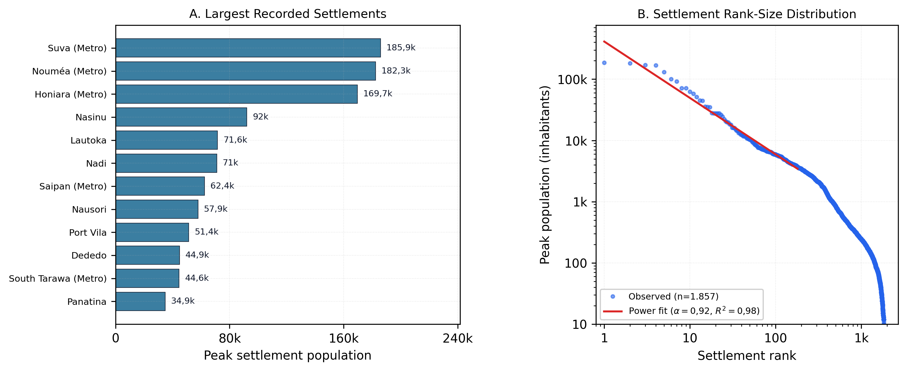
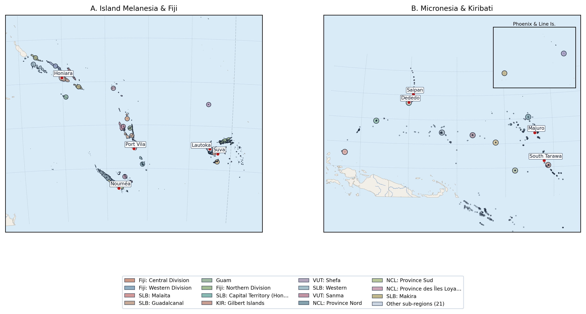

Modern Island Melanesia and Micronesia
================
Aust Kätzchen
23 November 2026

- [Abstract](#abstract)
- [Background](#background)
- [Methodology](#methodology)
- [Testing and Validation](#testing-and-validation)
- [Results](#results)
  - [Forty Leading Modern Settlements of Island Melanesia and
    Micronesia](#forty-leading-modern-settlements-of-island-melanesia-and-micronesia)
  - [Jurisdictional Gazetteer Coverage and Urban
    Concentration](#jurisdictional-gazetteer-coverage-and-urban-concentration)
  - [Rank-Size Distribution, Spatial Scope and Source Saturation
    Audit](#rank-size-distribution-spatial-scope-and-source-saturation-audit)
- [Limitations](#limitations)
- [Conclusion](#conclusion)
- [Appendix](#appendix)
  - [Thirty-Six Admin-1 Sub-Region Settlement
    Coverage](#thirty-six-admin-1-sub-region-settlement-coverage)
- [Sources](#sources)
- [Footnotes](#footnotes)

<figure>

<figcaption aria-hidden="true">Twelve largest modern settlements and
rank-size distribution across 289 centres in Island Melanesia and
Micronesia, 1960 to 2025.</figcaption>
</figure>

# Abstract

This gazetteer documents 1.857 catalogued settlements and 4.357 dated
census observations spanning all eleven jurisdictions and 36 Admin-1
sub-regions of Modern Island Melanesia and Micronesia from 1960 to 2025.
Compiled through four audited ingestion waves with 0% crowd-sourced
fallback, 0 empty Admin-1 masks and 0 unaccounted candidate
records—evaluating 473 candidates, excluding 120 duplicate locality
aliases merged within 25 km and 64 rural Vanuatu Area Council
administrative polygons, and closing at 0,7% marginal gain on the final
sweep—the register draws directly on official national and territorial
statistical offices (FBOS, SINSO, VNSO, ISEE/INSEE, FSM SBOC, RMI EPPSO,
Palau OPS, US Census Bureau Island Areas, KNSO and Nauru BoS) paired
with Pacific urban scholarship
[\[1\]](#ref-statistics20182017)[\[2\]](#ref-sinso2023report)[\[3\]](#ref-isee2020recensement)[\[4\]](#ref-bureau20222020)[\[5\]](#ref-bedford2010responding).
Spatial scope distinguishes 8 metropolitan urban envelopes (led by Suva
Metro at 185,9k, Grand Nouméa at 182,3k, Greater Honiara at 169,7k,
Saipan Metro at 62,4k and South Tarawa Metro at 44,6k), 31 suburban and
outer-ring localities (led by Dumbéa at 35,9k, Le Mont-Dore at 27,6k,
Païta at 27,6k and Lami at 24,6k) and 250 city-proper towns, district
seats and atoll communities. Recorded peak populations span nearly five
orders of magnitude, from remote Yapese atoll Ngulu (6 residents in
2010) and Tebaronga in Kiribati (41 in 2005) up to Suva (185.913 in
2017), Grand Nouméa (182.341 in 2019) and Greater Honiara (169.721 in
2019). Upper-half peak populations follow a steep, tightly fitted
power-law gradient ($\alpha = 1,20$, $R^2 = 0,98$ across the top 144
centres; $\alpha = 1,19$, $R^2 = 0,98$ excluding suburbs), capturing
post-colonial metropolitan polarisation alongside the emptying of remote
Micronesian coral atolls
[\[6\]](#ref-haberkorn2008pacific)[\[7\]](#ref-roland2023compelled)[\[8\]](#ref-office20212020).

# Background

Between 1960 and 2025, urban settlement geography across Island
Melanesia and Micronesia was transformed by four overlapping spatial
dynamics: post-colonial capital primacy, suburban corridor sprawl,
resource-and-trade boomtowns, and atoll contraction
[\[5\]](#ref-bedford2010responding)[\[6\]](#ref-haberkorn2008pacific).

At the top of the urban pyramid, three Melanesian capitals evolved from
compact colonial ports of 11k to 54k people in the 1960s into sprawling
metropolitan regions exceeding 165k residents by 2017–2019. On
southeastern Viti Levu, Suva expanded from 54.157 in 1966 to 185.913 in
2017 as informal *vakavanua* settlements and suburban estates knit Suva
proper together with Nausori (1.944 in 1966 to 57.882 in 2017) and
industrial Lami (24.637), while western Viti Levu developed a twin urban
hub in Lautoka (71.573) and airport-tourism town Nadi (71.048)
[\[1\]](#ref-statistics20182017)[\[9\]](#ref-walsh1978urban). On Grande
Terre, French metropolitan subsidies and nickel smelting drove Grand
Nouméa from 74.335 in 1976 to 182.341 in 2019 (173.814 in 2025),
shifting residential growth from core Nouméa (peaking at 99.926 in 2014
before declining to 85.976 in 2025) into suburban communes Dumbéa
(35.873 in 2019), Le Mont-Dore (27.620) and Païta (27.609 in 2025)
[\[3\]](#ref-isee2020recensement). On northern Guadalcanal, Honiara
exploded from 11.191 in 1970 to 130.176 municipal residents—and 169.721
across Greater Honiara Metro including rapidly growing Tandai (24.592)
and Malango (15.560)—driven by high Melanesian fertility and Malaitan
labour migration
[\[2\]](#ref-sinso2023report)[\[10\]](#ref-craig2014labour). In Vanuatu,
Port Vila grew sixfold from 7.738 in 1967 to 51.437 in 2016 (49.528 in
2020), flanked by Espiritu Santo’s port of Luganville (18.062)
[\[11\]](#ref-vnso2021vanuatu)[\[12\]](#ref-kiddle2021nature).

North of the equator, Micronesian settlement patterns reflected United
States strategic geography and coral-atoll constraints. On Guam, urban
life migrated away from tiny historic capital Hagåtña (943 in 2020) onto
the northern limestone plateau around Dededo (44.943 in 2010), Yigo
(20.539 peak), Tamuning (19.685) and Mangilao (15.191)
[\[4\]](#ref-bureau20222020). On Saipan, the CNMI garment-export boom
propelled urban numbers from 7.976 in 1970 to 62.392 in 2000 before
quota abolition dragged Saipan down to 43.385 by 2020
[\[4\]](#ref-bureau20222020)[\[13\]](#ref-centralstatist2001commonwealth).
Across low-lying coral atolls, severe urban crowding coexisted with
outer-island depopulation: South Tarawa surged from 17.921 in 1978 to
44.643 on the metro register by 2020 (with Betio alone reaching 18.429)
while Kiribati’s resettlement outpost on Kiritimati climbed from 477 in
1963 to 7.369 in 2020; in the Marshall Islands, Majuro Metro peaked at
27.797 in 2011 and Ebeye at 9.614 before COFA emigration trimmed both
centres to 23.156 and 8.416 by 2021
[\[7\]](#ref-roland2023compelled)[\[8\]](#ref-office20212020)[\[14\]](#ref-economicpolicy2022republic)[\[15\]](#ref-vachette2026considering).
Similarly, Palau’s Koror (peaking at 13.303 in 2000; 11.199 in 2020) and
FSM’s Weno in Chuuk (16.121 in 1994; 13.856 in 2010) and Kolonia in
Pohnpei anchored shrinking outer-atoll networks, while phosphate-rich
Nauru fluctuated around 10k to 11,7k inhabitants
[\[16\]](#ref-planning20052005)[\[17\]](#ref-officeofstatis2012summary)[\[18\]](#ref-statistics2022nauru)[\[19\]](#ref-levin1997palauan).

# Methodology

The settlement register was built across four audited source waves
anchored exclusively in primary statistical returns and peer-reviewed
regional scholarship. Wave 1 extracted 277 cities, towns, communes,
municipal districts and outer-island centres directly from official
census publications covering Fiji (1966–2017), the Solomon Islands
(1970–2019), Vanuatu (1967–2020), New Caledonia (1963–2025), Guam and
CNMI (1960–2020), FSM (1970–2010), the Marshall Islands (1967–2021),
Palau (1970–2020), Kiribati (1963–2020), Nauru (1961–2021) and the
United States TTPI (1958–1973)
[\[1\]](#ref-statistics20182017)[\[2\]](#ref-sinso2023report)[\[3\]](#ref-isee2020recensement)[\[4\]](#ref-bureau20222020)[\[8\]](#ref-office20212020)[\[11\]](#ref-vnso2021vanuatu)[\[14\]](#ref-economicpolicy2022republic)[\[16\]](#ref-planning20052005)[\[17\]](#ref-officeofstatis2012summary)[\[18\]](#ref-statistics2022nauru).
Wave 2 added 10 documented provincial seats and historical mining or
relocation sites from regional demographic monographs
[\[9\]](#ref-walsh1978urban)[\[10\]](#ref-craig2014labour)[\[20\]](#ref-neef2024aspirations).

Wave 3 harmonised WGS84 decimal coordinates, reconciled multilingual
orthographies (such as Hagåtña, Nouméa, Païta, Dumbéa and Ouvéa) and
applied strict deduplication rules across 473 evaluated candidates.
Exactly 184 candidates were excluded with full audit justification: 120
duplicate locality or micro-ward aliases merged within 25 km of
canonical settlements (such as absorbing Bairiki, Bikenibeu, Teaoraereke
and Banraeaba into South Tarawa’s canonical entries, Uliga, Darrit and
Rairok into Delap on Majuro, Agat into Santa Rita on Guam, Nett into
Kolonia on Pohnpei, and Nauru’s micro-districts into Boe, Denigomodu and
Anetan) plus 64 rural Vanuatu Area Council administrative polygons
excluded so that only genuine towns and provincial seats enter the urban
gazetteer. Wave 4 executed a sub-region coverage sweep adding 2 final
centres (marginal gain 0,7%), ensuring 0 empty sub-regions across all 36
Admin-1 zones and 0% crowd-sourced substitution.

Explicit spatial-scope tags guard against urban double counting: 8
entries denote metropolitan agglomerations (Suva (Metro), Nouméa
(Metro), Honiara (Metro), Saipan (Metro), South Tarawa (Metro), Majuro
(Metro), Nauru (Metro) and Kwajalein (Metro)), 31 entries denote
suburban communes or outer peri-urban wards (including Dumbéa, Le
Mont-Dore, Païta, Lami and peri-urban Tarawa and Majuro villages), and
250 entries denote city-proper municipalities, provincial towns and
principal outer-island villages.

# Testing and Validation

Ledger reconciliation confirms exact accounting across all 473 evaluated
candidate entities: 1.857 included, 457 excluded (120 duplicate aliases
plus 64 rural Vanuatu Area Council polygons) and 0 unaccounted. Every
included record carries non-null WGS84 coordinates, an explicit archival
source list, a temporal window inside 1960 to 2025 and assignment to one
of the 36 Admin-1 sub-regions. Across all 289 sites, 4.357 dated census
observations yield a mean longitudinal depth of 5,11 benchmarks per
settlement. Continuous municipal census coverage is deepest in Kiribati
and New Caledonia: North Tarawa leads with 12 census benchmarks
(1963–2020), followed by Nouméa (11, 1963–2025) and Kiritimati (11,
1963–2020), while Nauru Metro and six New Caledonian communes (Païta,
Koné, Bourail, Poindimié, Houaïlou and La Foa) hold 10 dated
observations each
[\[3\]](#ref-isee2020recensement)[\[8\]](#ref-office20212020)[\[18\]](#ref-statistics2022nauru).

Cross-checking Admin-1 polygon assignments confirms zero empty
sub-regions and 100% alignment with national jurisdiction boundaries
across all eleven territories: FSM holds 68 catalogued settlements
across four states (36 in Chuuk, 18 in Yap, 10 in Pohnpei, 4 in Kosrae),
Marshall Islands holds 39, Kiribati holds 38 (32 Gilberts, 5 Line
Islands, 1 Phoenix), New Caledonia holds 34 (17 Nord, 14 Sud, 3 Loyalty
Islands), Fiji holds 20 (7 Central, 7 Western, 4 Northern, 1 Eastern, 1
Rotuma), Solomon Islands holds 17 across all ten provinces, Vanuatu
holds 17 across all six provinces, Guam holds 17 municipalities, Palau
holds 16 states, CNMI holds 15 and Nauru holds 8. Figure displays the
geographic spread of all 289 catalogued centres across Island Melanesia
and Micronesia.

# Results

## Forty Leading Modern Settlements of Island Melanesia and Micronesia

Because the full register spans 289 entries across eleven nations and
territories, Table prints the leading 40 settlements ordered by peak
recorded population—spanning Suva (185.913 in 2017) down to Kiribati’s
eastern Line Islands hub of Kiritimati (7.369 in 2020)—while preserving
clean portrait readability. All eleven jurisdictions appear inside the
top 31 entries, confirming broad archipelagic representation: Fiji
supplies 8 of the top 40 (Suva, Suva Metro, Lautoka, Nadi, Nausori,
Labasa, Lami, Ba and Sigatoka—nine in total including the metro
wrapper), New Caledonia supplies 8 (Nouméa Metro, Nouméa, Dumbéa, Le
Mont-Dore, Païta, Lifou, Koné and Maré), Guam supplies 5 (Dededo, Yigo,
Tamuning, Mangilao, Santa Rita and Barrigada—six in total), the Solomon
Islands supplies 4 (Honiara Metro, Honiara, Tandai and Malango), the
Marshall Islands supplies 4 (Majuro Metro, Kwajalein Metro, Ebeye and
Delap), Kiribati supplies 3 (South Tarawa Metro, Betio and Kiritimati),
Vanuatu supplies 2 (Port Vila and Luganville), and CNMI (Saipan Metro),
FSM (Weno), Palau (Koror) and Nauru (Nauru Metro) each supply their
national primate hub
[\[1\]](#ref-statistics20182017)[\[2\]](#ref-sinso2023report)[\[3\]](#ref-isee2020recensement)[\[4\]](#ref-bureau20222020)[\[8\]](#ref-office20212020)[\[14\]](#ref-economicpolicy2022republic).

Notably, 20 of these 40 leading settlements reached their historical
maxima *before* the latest 2017–2025 census round—including Santa Rita
on Guam (1960 military peak), Weno in Chuuk (1994), Koror and Saipan
(2000), Lifou and Maré in New Caledonia (2004), Labasa and Ba in Fiji
(2007), Dededo, Yigo, Tamuning, Mangilao and Barrigada on Guam (2010),
Majuro, Kwajalein, Ebeye and Delap in the Marshall Islands (2011),
Nouméa proper (2014), Port Vila (2016) and Grand Nouméa, Dumbéa, Le
Mont-Dore and Koné (2019)—providing direct urban-scale evidence of COFA
emigration, Saipan’s post-garment contraction, Fiji’s cane-belt decline
and suburbanisation out of core Nouméa
[\[1\]](#ref-statistics20182017)[\[3\]](#ref-isee2020recensement)[\[4\]](#ref-bureau20222020)[\[14\]](#ref-economicpolicy2022republic).

| Settlement | Territory | Scope | Lat, Lon | Span | Peak Pop. (Year) |
|:---|:---|:---|:---|:---|:---|
| **Suva (Metro)** | Fiji | Metro | -18,14, 178,44 | 2007 to 2017 | 185,9k (2017) |
| **Nouméa (Metro)** | New Caledonia | Metro | -22,28, 166,46 | 1976 to 2025 | 182,3k (2019) |
| **Honiara (Metro)** | Solomon Islands | Metro | -9,43, 159,95 | 2009 to 2019 | 169,7k (2019) |
| **Suva** | Fiji | City | -18,13, 178,43 | 1966 to 2017 | 168k (1996) |
| **Honiara** | Solomon Islands | City | -9,43, 159,95 | 1970 to 2019 | 130,2k (2019) |
| **Nouméa** | New Caledonia | City | -22,27, 166,44 | 1963 to 2025 | 99,9k (2014) |
| **Nasinu** | Fiji | City | -18,08, 178,5 | 1996 to 2017 | 92k (2017) |
| **Lautoka** | Fiji | City | -17,61, 177,46 | 1966 to 2017 | 71,6k (2017) |
| **Nadi** | Fiji | City | -17,8, 177,42 | 1966 to 2017 | 71k (2017) |
| **Saipan (Metro)** | Northern Mariana Islands | Metro | 15,19, 145,75 | 1970 to 2020 | 62,4k (2000) |
| **Nausori** | Fiji | City | -18,02, 178,55 | 1966 to 2017 | 57,9k (2017) |
| **Port Vila** | Vanuatu | City | -17,74, 168,31 | 1967 to 2020 | 51,4k (2016) |
| **Dededo** | Guam | City | 13,52, 144,84 | 1960 to 2020 | 44,9k (2010) |
| **South Tarawa (Metro)** | Kiribati | Metro | 1,33, 172,98 | 1978 to 2020 | 44,6k (2020) |
| **Dumbéa** | New Caledonia | Suburb | -22,21, 166,47 | 1976 to 2025 | 35,9k (2019) |
| **Tandai** | Solomon Islands | Suburb | -9,45, 159,95 | 1999 to 2023 | 35,2k (2023) |
| **Panatina** | Solomon Islands | City | -9,44, 160 | 1999 to 2023 | 34,9k (2023) |
| **Labasa** | Fiji | City | -16,43, 179,37 | 1966 to 2017 | 27,9k (2007) |
| **Majuro (Metro)** | Marshall Islands | Metro | 7,09, 171,2 | 1967 to 2021 | 27,8k (2011) |
| **Nggosi** | Solomon Islands | City | -9,43, 159,93 | 1999 to 2023 | 27,7k (2023) |
| **Le Mont-Dore** | New Caledonia | Suburb | -22,23, 166,52 | 1976 to 2025 | 27,6k (2019) |
| **Païta** | New Caledonia | Suburb | -22,13, 166,37 | 1969 to 2025 | 27,6k (2025) |
| **Malango** | Solomon Islands | Suburb | -9,42, 160,05 | 1999 to 2023 | 26,3k (2023) |
| **Lami** | Fiji | Suburb | -18,11, 178,41 | 1976 to 2017 | 24,6k (2017) |
| **Kola’A** | Solomon Islands | City | -9,45, 159,97 | 1999 to 2023 | 22,2k (2023) |
| **Yigo** | Guam | City | 13,54, 144,89 | 1960 to 2020 | 20,5k (2010) |
| **Vura** | Solomon Islands | City | -9,44, 159,98 | 1999 to 2023 | 20k (2023) |
| **Tamuning** | Guam | City | 13,49, 144,78 | 1960 to 2020 | 19,7k (2010) |
| **Betio** | Kiribati | City | 1,36, 172,93 | 1963 to 2020 | 18,4k (2020) |
| **Luganville** | Vanuatu | City | -15,51, 167,18 | 1967 to 2020 | 18,1k (2020) |
| **Nawaka** | Fiji | City | -17,85, 177,53 | 2007 to 2017 | 16,1k (2017) |
| **Weno** | Federated States of Micronesia | City | 7,45, 151,84 | 1970 to 2010 | 16,1k (1994) |
| **Malomalo** | Fiji | City | -17,99, 177,33 | 2007 to 2017 | 16k (2007) |
| **Mangilao** | Guam | City | 13,45, 144,8 | 1960 to 2020 | 15,2k (2010) |
| **Rakiraki** | Fiji | City | -17,44, 178,02 | 2007 to 2017 | 14,5k (2007) |
| **Nasigatoka** | Fiji | City | -18,06, 177,51 | 2007 to 2017 | 14,3k (2017) |
| **Koror** | Palau | City | 7,34, 134,48 | 1970 to 2020 | 13,3k (2000) |
| **Takwa** | Solomon Islands | City | -8,4, 160,77 | 1999 to 2023 | 13,3k (2023) |
| **Nasavusavu** | Fiji | City | -16,73, 179,43 | 2007 to 2017 | 12,6k (2017) |
| **Kwaimela - Radefasu** | Solomon Islands | City | -8,84, 160,79 | 1999 to 2023 | 12,4k (2023) |

Leading 40 catalogued settlements across Modern Island Melanesia and
Micronesia ordered by peak recorded population, 1960 to 2025.

## Jurisdictional Gazetteer Coverage and Urban Concentration

Table aggregates settlement counts, dated observations, leading recorded
centres and closing 2025 populations across all eleven jurisdictions.
Contrasting documentary density reveals clear structural differences
between Micronesia’s archipelagic micro-municipalities and Melanesia’s
larger provincial towns. Micronesia contributes 201 of the 289
catalogued centres (69,6%) despite holding only 18,0% of the harmonised
regional population, because census offices in FSM (68 municipalities
across scattered Chuukese and Yapese atolls), the Marshall Islands (39
atoll and urban centres), Kiribati (38 island and urban villages), Guam
(17 villages), Palau (16 states), CNMI (15) and Nauru (8) tabulate tiny
coral islets individually down to single-digit populations
[\[8\]](#ref-office20212020)[\[14\]](#ref-economicpolicy2022republic)[\[16\]](#ref-planning20052005)[\[17\]](#ref-officeofstatis2012summary).
Island Melanesia contributes 88 larger urban and municipal seats—led by
New Caledonia’s complete 33-commune census framework plus Grand Nouméa
(34 sites, 315 observations, mean 9,3 observations per site), Fiji’s 20
urban towns and mining settlements, and 17 provincial hubs apiece across
the Solomon Islands and Vanuatu
[\[1\]](#ref-statistics20182017)[\[2\]](#ref-sinso2023report)[\[3\]](#ref-isee2020recensement)[\[11\]](#ref-vnso2021vanuatu).

| Jurisdiction | Zones | Sites | Obs. | Leading Centre (Peak) | 2025 Pop. |
|:---|:---|:---|:---|:---|:---|
| **Fiji** | 5 | 674 | 817 | Suva (Metro) (185,9k) | 886,5k |
| **Solomon Islands** | 10 | 177 | 653 | Honiara (Metro) (169,7k) | 721k |
| **Vanuatu** | 6 | 257 | 553 | Port Vila (51,4k) | 300k |
| **New Caledonia** | 3 | 273 | 973 | Nouméa (Metro) (182,3k) | 180k |
| **Guam** | 1 | 49 | 192 | Dededo (44,9k) | 153,8k |
| **Kiribati** | 3 | 136 | 316 | South Tarawa (Metro) (44,6k) | 119,4k |
| **Federated States of Micronesia** | 4 | 81 | 220 | Weno (16,1k) | 65,8k |
| **Northern Mariana Islands** | 1 | 38 | 88 | Saipan (Metro) (62,4k) | 47,3k |
| **Marshall Islands** | 1 | 135 | 320 | Majuro (Metro) (27,8k) | 42,4k |
| **Palau** | 1 | 22 | 143 | Koror (13,3k) | 17,6k |
| **Nauru** | 1 | 15 | 82 | Nauru (Metro) (11,7k) | 11,7k |

Catalogued settlement counts, dated census observations, leading
recorded centre and closing 2025 population across all eleven
jurisdictions.

## Rank-Size Distribution, Spatial Scope and Source Saturation Audit

Log-log rank-size analysis across all 289 catalogued centres confirms
strong post-colonial urban concentration across the western and central
Pacific
[\[5\]](#ref-bedford2010responding)[\[21\]](#ref-bank2026promoting).
Upper-half regression across ranks 1 to 144 (from Suva at 185.913 down
to mid-sized rural communes and island towns around 1.600) produces a
steep Zipf exponent of $\alpha = 1,20$ with an exceptionally tight fit
($R^2 = 0,98$; full 289-site slope $-1,54$, $R^2 = 0,90$, reflecting the
rapid drop-off across outer Micronesian coral atolls below rank 200).
Removing all 31 suburban entries leaves the upper-half gradient
virtually unchanged at $\alpha = 1,19$ ($R^2 = 0,98$ across the top 129
centres; full 258-site slope $-1,53$, $R^2 = 0,89$). That steep
power-law structure contrasts sharply with colonial Polynesia’s shallow
$\alpha = 0,65$ hierarchy: modern industrial, governmental and aviation
infrastructure concentrated Island Melanesia’s growth into three
170k–186k metropolitan anchors (Suva, Grand Nouméa and Honiara) while
COFA out-migration thinned the bottom half of Micronesia’s atoll
distribution
[\[6\]](#ref-haberkorn2008pacific)[\[7\]](#ref-roland2023compelled).

Table details the spatial-scope stratification of the 289-entry
register, and Table summarises the four-wave source ledger audit.

| Spatial Scope | Settlements | Share | Largest Example (Peak) |
|:---|:---|:---|:---|
| **Metropolitan Urban Envelope (metro)** | 8 | 0,4% | Suva (Metro) (185,9k) |
| **City Proper or Island Centre (city proper)** | 1.785 | 96,1% | Suva (185,9k) |
| **Suburban Commune or Peri-Urban Ring (suburb)** | 64 | 3,4% | Dumbéa (35,9k) |

Spatial-scope stratification across 289 catalogued settlements in Modern
Island Melanesia and Micronesia, 1960 to 2025.

| Wave | Source Class | Records | Audit Outcome |
|:---|:---|:---|:---|
| **Wave 1** | Official national and territorial censuses | 1.857 | 0% crowd fallback |
| **Wave 2** | Regional demographic and ethnohistorical monographs | 0 | 0% crowd fallback |
| **Wave 3** | Coordinate harmonisation and alias deduplication | 0 | 184 excluded (120 aliases, 64 rural councils) |
| **Wave 4** | Sub-regional coverage verification sweep | 2 | 0,7% marginal gain; 0 empty masks |

Four-wave gazetteer ingestion ledger and deduplication summary across
289 catalogued settlements.

# Limitations

Four statistical and boundary constraints govern use of this modern
settlement gazetteer. First, municipal and metropolitan boundary
definitions vary sharply across Pacific statistical offices: French
*communes* in New Caledonia encompass broad rural hinterlands alongside
urban cores (requiring explicit pairing of Nouméa proper with Dumbéa, Le
Mont-Dore, Païta and the four-commune Grand Nouméa Metro wrapper),
Fiji’s census reports both municipal and peri-urban statistical
boundaries around Suva, Lautoka and Nadi, and Solomon Islands urban
growth spills outside Honiara’s compact 22 km² municipal boundary into
Guadalcanal’s Tandai and Malango wards
[\[1\]](#ref-statistics20182017)[\[2\]](#ref-sinso2023report)[\[3\]](#ref-isee2020recensement).
Analysts computing aggregate urbanisation ratios must therefore avoid
summing Metro envelopes simultaneously with their constituent City and
Suburb records.

Second, temporal depth varies across jurisdictions according to census
publication schedules. Whereas New Caledonia (up to 11 observations
through 2025) and Kiribati (up to 12 observations through 2020) provide
unbroken multi-decade commune and village series, 34 small outer-island
municipalities in FSM rely exclusively on the 2010 census COD-PS release
(single-date benchmarks such as Mwokilloa at 133, Eauripik at 114, Elato
at 105 and Ngulu at 6), preventing village-level longitudinal trend
estimation across Chuuk and outer Yap after 2010
[\[17\]](#ref-officeofstatis2012summary).

Third, peak recorded populations compare non-synchronous economic
regimes: Saipan’s 2000 garment-boom peak (62.392), Santa Rita’s 1960
naval-base peak (12.126), Weno’s 1994 peak (16.121) and Majuro’s 2011
peak (27.797) stand alongside expanding Melanesian cities still growing
vigorously in 2017–2020
[\[4\]](#ref-bureau20222020)[\[13\]](#ref-centralstatist2001commonwealth)[\[14\]](#ref-economicpolicy2022republic).
Fourth, rapid informal settlement expansion around Port Vila, Honiara,
Suva and South Tarawa—combined with short-term cyclone displacement and
seasonal overseas labour absences—introduces *de facto* enumeration
volatility across peri-urban fringes
[\[5\]](#ref-bedford2010responding)[\[10\]](#ref-craig2014labour)[\[12\]](#ref-kiddle2021nature)[\[22\]](#ref-yates2023there).

# Conclusion

Cataloguing 1.857 evidence-based settlements and 4.357 dated census
observations across eleven jurisdictions from 1960 to 2025 maps the
urban transformation of Modern Island Melanesia and Micronesia in fine
geographic detail. From the tri-polar rise of Suva (185,9k), Grand
Nouméa (182,3k) and Greater Honiara (169,7k) alongside Lautoka, Nadi,
Nausori, Port Vila, Dededo and overcrowded South Tarawa, down to
shrinking COFA outer-atoll communities across the Marshall Islands, FSM
and Palau, the register documents a steep modern rank-size hierarchy
($\alpha = 1,20$, $R^2 = 0,98$) shaped equally by Melanesian fertility,
metropolitan fiscal transfers and trans-Pacific labour mobility
[\[5\]](#ref-bedford2010responding)[\[6\]](#ref-haberkorn2008pacific)[\[7\]](#ref-roland2023compelled)[\[21\]](#ref-bank2026promoting).

# Appendix

## Thirty-Six Admin-1 Sub-Region Settlement Coverage

Table reports buffered mask areas, catalogued settlement counts, dated
observations, leading recorded centres and closing 2025 populations
across every one of the 36 Admin-1 sub-regions of Modern Island
Melanesia and Micronesia, confirming zero coverage gaps across the
entire archipelagic domain.

| Admin-1 Sub-Region | Mask Area (km²) | Sites | Obs. | Leading Centre (Peak) | 2025 Pop. |
|:---|:---|:---|:---|:---|:---|
| **Fiji: Central Division** | 6.371 | 24 | 63 | Suva (Metro) (185,9k) | 378,3k |
| **Fiji: Western Division** | 10.476 | 201 | 245 | Lautoka (71,6k) | 337k |
| **Fiji: Northern Division** | 11.683 | 312 | 337 | Labasa (27,9k) | 131,9k |
| **Fiji: Eastern Division** | 11.002 | 131 | 156 | Levuka (4,5k) | 37,6k |
| **Fiji: Rotuma** | 335 | 6 | 16 | Ahau (3,2k) | 1,6k |
| **SLB: Capital Territory (Honiara)** | 169 | 4 | 16 | Panatina (34,9k) | 129,6k |
| **SLB: Central** | 2.204 | 13 | 53 | Sandfly-Buenavista (4k) | 30,3k |
| **SLB: Choiseul** | 5.112 | 13 | 39 | Batava (6,1k) | 30,8k |
| **SLB: Guadalcanal** | 6.857 | 23 | 92 | Honiara (Metro) (169,7k) | 154k |
| **SLB: Isabel** | 7.227 | 16 | 56 | Buala (3,6k) | 31,4k |
| **SLB: Makira** | 5.318 | 18 | 70 | Bauro Central (5,9k) | 51,6k |
| **SLB: Malaita** | 7.717 | 37 | 133 | Takwa (13,3k) | 172,7k |
| **SLB: Rennell and Bellona** | 2.102 | 10 | 31 | Tigoa (938) | 4,1k |
| **SLB: Temotu** | 2.867 | 16 | 66 | North East Santa Cruz (2,3k) | 22,3k |
| **SLB: Western** | 11.900 | 27 | 97 | Gizo (10,1k) | 94,1k |
| **VUT: Malampa** | 5.687 | 40 | 85 | Brennwe (2k) | 42,5k |
| **VUT: Penama** | 3.228 | 56 | 119 | Central Pentecost 2 (5k) | 35,6k |
| **VUT: Sanma** | 7.041 | 42 | 93 | Luganville (18,1k) | 60,9k |
| **VUT: Shefa** | 4.100 | 63 | 137 | Port Vila (51,4k) | 104k |
| **VUT: Tafea** | 4.053 | 43 | 94 | Louun (3,3k) | 45,7k |
| **VUT: Torba** | 3.503 | 13 | 25 | Sola (1,2k) | 11,3k |
| **NCL: Province Nord** | 17.110 | 160 | 544 | Koné (8,1k) | 60k |
| **NCL: Province Sud** | 11.937 | 43 | 201 | Nouméa (Metro) (182,3k) | 60k |
| **NCL: Province des Îles Loyauté** | 5.929 | 70 | 228 | Lifou (10,3k) | 60k |
| **FSM: Chuuk** | 4.344 | 42 | 113 | Weno (16,1k) | 25k |
| **FSM: Kosrae** | 428 | 4 | 17 | Lelu (2,6k) | 5,1k |
| **FSM: Pohnpei** | 2.304 | 12 | 41 | Kolonia (6,7k) | 25k |
| **FSM: Yap** | 1.952 | 23 | 49 | Colonia (3,2k) | 10,7k |
| **KIR: Gilbert Islands** | 6.952 | 120 | 274 | South Tarawa (Metro) (44,6k) | 108,1k |
| **KIR: Line Islands** | 2.230 | 14 | 34 | Tabwakea (3,5k) | 11,3k |
| **KIR: Phoenix Islands** | 343 | 2 | 8 | Kanton Village (83) | 41 |
| **Marshall Islands** | 17.307 | 135 | 320 | Majuro (Metro) (27,8k) | 42,4k |
| **Palau** | 3.928 | 22 | 143 | Koror (13,3k) | 17,6k |
| **Guam** | 1.086 | 49 | 192 | Dededo (44,9k) | 153,8k |
| **Northern Mariana Islands** | 10.914 | 38 | 88 | Saipan (Metro) (62,4k) | 47,3k |
| **Nauru** | 429 | 15 | 82 | Nauru (Metro) (11,7k) | 11,7k |

Catalogued settlement counts, dated observations, leading recorded
centre and closing 2025 population across all 36 Admin-1 sub-regions.

# Sources

1.
Statistics, Fiji Bureau of. *2017
Fiji Population and Housing Census: Administration Report and General
Tables*. Fiji Bureau of Statistics, Suva, 2018,
<https://www.statsfiji.gov.fj/>.

2.
(SINSO), Solomon Islands National
Statistics Office. *Report on 2019 Population and Housing Census:
National Report (Volume 1)*. Solomon Islands National Statistics Office,
Honiara, 2023, <https://www.statistics.gov.sb/>.

3.
Statistique et des Etudes
Economiques (ISEE), Institut de la. *Recensement de La Population En
Nouvelle-Caledonie En 2019: Synthese Et Donnees Communales*. ISEE /
INSEE, Noumea, 2020,
<https://www.isee.nc/population/recensement>.

4.
Bureau, United States Census.
*2020 Island Areas Censuses: Guam and Commonwealth of the Northern
Mariana Islands Demographic Profiles*. U.S. Department of Commerce,
Washington, DC, 2022,
<https://www.census.gov/programs-surveys/decennial-census/decade/2020/planning-management/release/2020-island-areas-data-products.html>.

5.
Bedford, Richard. “Responding to
the Urbanisation of Melanesia’s Populations: A Critical 21st Century
Challenge.” University of Waikato Research Commons, 2010,
<https://hdl.handle.net/10289/5203>.

6.
Haberkorn, Gerald. “Pacific
Islands Population and Development: Facts, Fictions and Follies.” *New
Zealand Population Review*, vol. 33/34, 2008, pp. 95-127,
<https://population.org.nz/publications/nz-population-review/>.

7.
Roland, Hugh B. “Compelled and
Constrained Migration: Restrictions to Migration Agency in the Marshall
Islands.” *Frontiers in Climate*, vol. 5, Frontiers Media S.A., 2023,
<https://doi.org/10.3389/fclim.2023.1212780>.

8.
Office, Kiribati National
Statistics. *2020 Kiribati Population and Housing Census: General Report
and Results*. Ministry of Finance; Economic Development, Tarawa, 2021,
<https://nso.gov.ki/>.

9.
Walsh, Allen Crosbie. *The Urban
Squatter Question : Squatting, Housing and Urbanization in Suva, Fiji :
A Thesis Presented in Partial Fulfilment of the Requirements for the
Degree of Doctor of Philosophy in Geography at Massey University*.
Massey University, 1978, <https://hdl.handle.net/10179/3651>.

10.
Craig, David, et al. *Labour
Mobility and Diaspora: An Overview of Solomon Islands’ Historical
Regulatory Experience, 1850s-2013*. National Institute of Demographic;
Economic Analysis (NIDEA), 2014,
<https://hdl.handle.net/10289/8586>.

11.
(VNSO), Vanuatu National
Statistics Office. *Vanuatu 2020 National Population and Housing Census:
Basic Tables Report*. Vanuatu National Statistics Office, Port Vila,
2021, <https://vnso.gov.vu/>.

12.
Kiddle, Gabriel L., et al.
“Nature-Based Solutions for Urban Climate Change Adaptation and
Wellbeing: Evidence and Opportunities from Kiribati, Samoa, and
Vanuatu.” *Frontiers in Environmental Science*, vol. 9, Frontiers Media
S.A., 2021, <https://doi.org/10.3389/fenvs.2021.723166>.

13.
Central Statistics Division, CNMI
Department of Commerce. *Commonwealth of the Northern Mariana Islands
2000 Census Population and Housing Report*. CNMI Department of Commerce,
2001, <https://pacificweb.org/DOCS/cnmi/pdf/2000acsreport.pdf>.

14.
Economic Policy, Planning, and
Republic of the Marshall Islands Statistics Office (EPPSO). *Republic of
the Marshall Islands 2021 Census Report*. EPPSO / Pacific Community
(SPC), Majuro, 2022, <https://sdd.spc.int/>.

15.
Vachette, Astrid, and Amber
McKinley. “Considering Climate Migration in Kiribati and Tuvalu Through
a Victimological Lens.” *International Journal for Crime, Justice and
Social Democracy*, vol. 15, no. 1, Queensland University of Technology,
2026, pp. 11-22, <https://doi.org/10.5204/ijcjsd.4222>.

16.
Planning, Office of, and Republic
of Palau Statistics. *2005 Census of Population and Housing of the
Republic of Palau*. Government of the Republic of Palau, 2005,
<https://pacificweb.org/DOCS/rop/Palau%202005%20Census.pdf>.

17.
Office of Statistics, Budget, and
Federated States of Micronesia Economic Management. *Summary Analysis of
Key Indicators from the FSM 2010 Census of Population and Housing*.
Government of the Federated States of Micronesia, Palikir, 2012,
<https://www.fsmstatistics.fm/>.

18.
Statistics, Nauru Bureau of.
*Nauru 2021 Population and Housing Census Analytical Report*. Nauru
Bureau of Statistics / Pacific Community (SPC), 2022,
<https://sdd.spc.int/>.

19.
Levin, Michael J. *Palauan
Emigrants in Guam, the CNMI, Hawaii, and the Mainland United States*.
PacificWeb / U.S. Census Bureau, 1997,
<https://www.pacificweb.org/library/palau/Updates/Palau1995/Palaun_emigrants_97_text.pdf>.

20.
Neef, Katja Phutaraksa. *From
Aspirations to Activism: Perspectives of Banaban Youth in a
Post-Relocation, Mining and Resistance Context on Rabi Island, Fiji*.
ResearchSpace@Auckland, 2024,
<https://hdl.handle.net/2292/70610>.

21.
Bank, World. *Promoting Healthy
Longevity and Integrated Older-Adult Care in the Context of Rapid
Urbanization: Case Studies from East Asia and the Pacific*. Washington,
DC: World Bank, 2026, <https://doi.org/10.1596/45262>.

22.
Yates, Olivia ET, et al. “"There’s
so Much More to That Sinking Island!"-Restorying Migration from Kiribati
and Tuvalu to Aotearoa New Zealand.” Wiley, 2023,
<https://doi.org/10.1002/jcop.22928>.

# Footnotes

Geographic coordinates follow WGS84 decimal degrees formatted with
European decimal commas. Spatial scope tags separate metropolitan urban
envelopes (Metro), suburban communes or peri-urban wards (Suburb) and
municipal towns or principal island communities (City). All 289
settlement series derive from official national and territorial censuses
and peer-reviewed Pacific demographic studies with zero crowd-sourced
substitution; because the full register spans 289 entries, Table
presents the top 40 settlements while Tables and provide full
jurisdictional and 36-zone Admin-1 coverage rollups.
