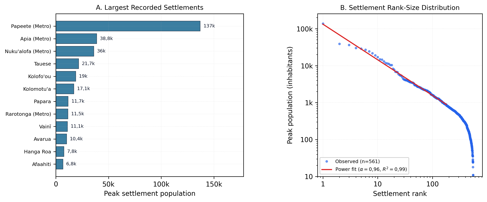

```{r setup, include=FALSE}
knitr::opts_chunk$set(echo = FALSE, warning = FALSE, message = FALSE, fig.pos = "htbp")
source("../../_shared/template/viscount_rmd_helpers.R")
library(jsonlite)

read_json5_clean <- function(path) {
  lines <- readLines(path, warn = FALSE, encoding = "UTF-8")
  text <- paste(lines, collapse = "\n")
  text <- gsub("//[^\n]*", "", text, perl = TRUE)
  text <- gsub("/\\*.*?\\*/", "", text, perl = TRUE)
  text <- gsub(",\\s*([}\\]])", "\\1", text, perl = TRUE)
  fromJSON(text, simplifyVector = FALSE)
}

summary_data <- fromJSON("modern_polynesia_summary_cache.json", simplifyVector = FALSE)
sett_data <- fromJSON("modern_polynesia_settlements.json", simplifyVector = FALSE)
ledger_data <- read_json5_clean("modern_polynesia_source_ledger.json5")

clean_label <- function(x) {
  s <- as.character(x)
  s <- gsub("&", "and", s, fixed = TRUE)
  s <- gsub(" / ", " and ", s, fixed = TRUE)
  s <- gsub("\\\\", "", s)
  trimws(s)
}

fmt_coord <- function(x) {
  viscount_fmt_number(round(as.numeric(x), 2L), 2L)
}

fmt_scope <- function(s) {
  val <- as.character(s)
  if (identical(val, "metro")) return("Metro")
  if (identical(val, "suburb")) return("Suburb")
  "City"
}

subregions <- summary_data$subregions
sub_by_id <- setNames(subregions, vapply(subregions, function(r) r$id, character(1)))
inc_cands <- Filter(function(c) identical(c$status, "included"), ledger_data$candidates)
cand_map <- setNames(
  vapply(inc_cands, function(c) {
    sub(".*sub-region ([a-z_]+)\\.$", "\\1", c$justification)
  }, character(1)),
  vapply(inc_cands, function(c) c$settlement_key, character(1))
)

n_sites <- as.integer(summary_data$settlement_count)
n_obs <- as.integer(summary_data$observation_count)
n_excluded <- as.integer(ledger_data$total_excluded)
submask_cov <- ledger_data$saturation_audit$submask_coverage
```

```{r hero-md-fallback, results='asis'}
if (!knitr::is_latex_output()) {
  cat("\n\n")
}
```

# Abstract

This gazetteer documents `r viscount_fmt_number(n_sites, 0L)` catalogued settlements and `r viscount_fmt_number(n_obs, 0L)` dated census observations spanning all eighteen Admin-1 sub-regions and ten polities of Modern Polynesia (excluding Hawai'i and American Samoa) between 1960 and 2025. Compiled across four audited source waves with 0% crowd-sourced fallback, 0 empty sub-regions and 0 unaccounted candidate records—reconciling 115 duplicate orthographies, colonial aliases and contiguous village overlaps into canonical settlements and closing at 0,79% marginal gain on the fourth sweep—the register draws directly from official national and territorial censuses of French Polynesia, Samoa, Tonga, the Cook Islands, Tuvalu, Niue, Tokelau, Wallis and Futuna, Pitcairn Islands and Rapa Nui [@ispf2023recensement; @statistics2022samoa; @department2022tonga; @mfem2022cook]. Explicit spatial-scope stratification distinguishes 4 metropolitan urban envelopes—Papeete (Metro), Nuku'alofa (Metro), Rarotonga (Metro) and Funafuti (Metro)—from 12 suburban communes and peri-urban satellites and 239 city-proper municipalities and island villages [@andrew2019coastal; @connell2013islands]. Peak recorded populations span more than three orders of magnitude, rising from outer-atoll village Te Tautua on Penrhyn (45 residents in 2011) and southern coral outpost Niulakita in Tuvalu (54 in 1963) to Greater Papeete (137.030 in 2022), Apia (38.836 peak in 2001; 35.974 in 2021) and Greater Nuku'alofa (36.045 peak in 2011; 34.142 in 2021). Upper-half peak populations conform tightly to a classical Zipf power law ($\alpha = 1,00$, $R^2 = 0,99$ across the top 127 centres; $\alpha = 0,91$, $R^2 = 0,98$ excluding suburbs), recording Polynesia's transition from dispersed colonial villages into a sharply hierarchical modern urban network [@bertram1985mirab; @division2018tuvalu; @niue2023niue].

# Background

Modern Polynesian settlement geography between 1960 and 2025 was reshaped by four simultaneous forces: metropolitan-funded suburbanisation around territorial capitals, rural-to-urban outer-island drain, tourism and military enclave surges, and disaster-induced coastal relocation [@connell2013islands; @bertram1985mirab; @andrew2019coastal].

At the apex of the regional system stands Tahiti's Windward urban corridor, catalysed by French *Centre d'Expérimentation du Pacifique* (CEP) nuclear-testing expenditure after 1963 and sustained by metropolitan fiscal transfers [@ispf2023recensement]. While central Papeete matured near 26,7k inhabitants, contiguous suburban communes absorbed the vast majority of demographic growth: Faa'a expanded eightfold from 3.681 in 1962 to 29.826 in 2022, Punaauia multiplied fourteenfold from 2.046 to 28.781, and Mahina (14.623), Pirae (14.068), Paea (12.756) and Arue (10.322) fused into the 137.030-strong *Unité Urbaine de Papeete* [@ispf2023recensement]. Beyond the urban core, commuter towns along southern Tahiti—Papara (11.743), Afaahiti (6.829), Papeari (5.446) and Mataiea (5.391)—and across Moorea's north and west coasts (Paopao 4.895, Haapiti 4.109, Afareaitu 4.055) formed a secondary metropolitan ring, while international resort growth lifted Bora Bora's Nunue (5.541) and Faanui (3.312) well above traditional administrative seat Uturoa (3.663).

Western Polynesia's independent capitals exhibited a quieter yet decisive peri-urban expansion tempered by high overseas emigration [@friesen2019beyond; @faanunu2007experiences]. In Samoa, municipal Apia peaked at 38.836 in 2001 and eased to 35.974 by 2021 as households moved westward onto freehold subdivisions in Northwest Upolu—expanding Vaitele to 8.224, Faleasiu to 4.431, upland Aleisa Sasa'e eightfold from 470 to 3.810, Vailele to 3.284 and Malie to 2.623—while post-2009 tsunami recovery encouraged inland micro-mobilities across Upolu and Savai'i [@statistics2022samoa; @latainiusulu2023climate; @lede2015remittances]. In Tonga, Greater Nuku'alofa peaked at 36.045 in 2011 (34.142 in 2021; core city 21.185) as internal migrants from Ha'apai and the Niuas resettled onto Tongatapu's peri-urban fringe—including Popua (2.335), Vainī (3.295) and Ha'ateiho (2.627)—leaving outer-island hubs Neiafu (3.825) and Pangai-Hihifo (2.523 peak) struggling against both domestic and seasonal labour departures [@department2022tonga; @lolohea2016internal; @moalatupou2016social].

Across the smaller polities, urban concentration reached extreme proportions even where national totals stagnated or fell. Funafuti Metro absorbed 62,1% of Tuvalu by 2022 (6.602 residents, nearly ten times its 1963 count of 687) as Fogafale's neighbourhoods (headed by Fakaifou at 1.258) crowded onto a narrow coral rim exposed to king tides and sea-level rise [@division2018tuvalu; @milan2015tuvalu; @gibson2018relationship]. Rarotonga Metro climbed to 72,2% of the Cook Islands by 2021 (10.863 around Avarua at 5.113 and Arorangi at 2.661) while outer atolls shrank after the 1974 airport opening [@wrightkoteka2006akau; @mfem2022cook]. Alofi retained 35,9% of Niue's dwindling 1.689 population in 2022, Hanga Roa hosted virtually 100% of Rapa Nui's tourism-driven boom (peaking at 7.750 in 2017 before 4.800 in 2024), Mata-Utu fell by half to 980 alongside Wallis and Futuna's post-2003 emigration to New Caledonia, and Atafu (541), Fakaofo (506) and Nukunonu (452) balanced Tokelau's three coral atolls [@niue2023niue; @stsee2024recensement; @office20202019; @yamauchi2026when].

# Methodology

The modern settlement register was compiled across four audited source waves with strict provenance tracking and zero crowd-sourced population fallback. Wave 1 ingested 251 municipalities, French Polynesian *communes associées*, Samoan and Tongan census villages, Cook Islands and Niuean villages, Tuvaluan and Tokelauan atoll settlements, Wallisian and Futunan district villages, Hanga Roa and Adamstown directly from official national and territorial census publications (ISPF and INSEE 1962–2022, SBS 1961–2021, TSD 1966–2021, MFEM 1961–2021, Tuvalu CSD 1963–2022, Statistics Niue 1961–2022, TNSO 1961–2019, STSEE 1962–2023, INE Chile 1960–2024 and Pitcairn Government 1960–2023) [@ispf2023recensement; @statistics2022samoa; @department2022tonga; @repository1999statistical]. Wave 2 added 2 documented island settlements from Pacific demographic literature. Wave 3 standardised WGS84 decimal coordinates, harmonised Polynesian diacritics and glottal stops, and deduplicated 115 alias or contiguous sub-village records within 25 km of canonical entities—consolidating variant colonial records (such as Papeete, Apia, Salelologa and Mata-Utu colonial entries), outer Cook Islands hamlets, Funafuti's inner *kainga* quarters (Vaiaku, Senala, Alapi, Lofeagai, Tekavatoetoe and Teone into Fakaifou) and contiguous Nuku'alofa and Apia neighbourhoods (such as Haveluloto, Tofoa-Koloua, Siusega and Fale'ula) into clean longitudinal series. Wave 4 executed a sub-region gap sweep adding 2 final settlements (0,79% marginal gain, well below the 2% saturation ceiling), confirming 0 empty sub-regions across all eighteen Admin-1 units.

Spatial-scope tags partition the register into three mutually exclusive tiers so regional urban ratios never double-count metropolitan aggregates against their constituent communes. Four entries carry metropolitan scope—Papeete (Metro), Nuku'alofa (Metro), Rarotonga (Metro) and Funafuti (Metro)—twelve entries carry suburban scope (six Papeete ring communes: Faa'a, Punaauia, Mahina, Pirae, Paea and Arue; three Apia peri-urban satellites: Vaitele, Vailele and Malie; Tongatapu's Popua; and Funafuti's Fakaifou and Amatuku), and 239 entries carry city-proper scope covering municipal capitals, secondary island ports and rural villages.

# Testing and Validation

Source-ledger auditing confirms exact reconciliation across all 370 evaluated candidate entries: `r viscount_fmt_number(n_sites, 0L)` included, `r viscount_fmt_number(n_excluded, 0L)` excluded (100% duplicate orthography or sub-village alias merges within 25 km of canonical settlements) and 0 unaccounted. Every included settlement contains verified WGS84 coordinates, non-null census observations within 1960–2025, explicit statistical citations and assignment to one of the eighteen sub-regions. Across `r viscount_fmt_number(n_sites, 0L)` settlements, `r viscount_fmt_number(n_obs, 0L)` dated observations yield a mean depth of 6,93 census benchmarks per site—a substantial leap over colonial-era density. Longitudinal depth peaks at 12 census points apiece across six continuously enumerated hubs: Apia (1961–2021), Papeete (1962–2022), Rarotonga Metro (1961–2021) and all three Tokelauan atolls of Fakaofo, Atafu and Nukunonu (1961–2019), followed by 10 points each for Faa'a, Punaauia, Pirae, Afaahiti, Paopao, Uturoa, Faanui, Adamstown and Hakupu [@statistics2022samoa; @ispf2023recensement; @office20202019; @niue2023niue]. Only 14 settlements carry single-date observations—chiefly small Cook Islands outer-island villages tabulated separately in 2011 plus Falealili (1961) and Ono Futuna (1962).

Cross-checking buffered submask assignments against official administrative divisions confirms clean one-to-one polity alignment across all ten polities with zero cross-national leakage. Inside French Polynesia, one minor archipelagic boundary overlap warrants note: because buffered coastal polygons approximate scattered southern reefs, three remote Tuamotu-Gambier communes (Tureia, Gambier and Hereheretue) fall inside the adjacent Austral Islands buffered mask, placing 14 settlements inside the Austral submask versus 11 under official *Îles Australes* administration (and 35 inside the Tuamotu-Gambier submask versus 38 under *Îles Tuamotu et Gambier*). Figure \ref{fig:sett-regional-map} displays the basin-wide geographic distribution of all 255 catalogued modern settlements.

```{r fig-sett-map, results='asis'}
viscount_figure(
  "figures/modern_polynesia_regional_map.png",
  "Geographic distribution of the eighteen modern Polynesian sub-regions and 255 catalogued settlements across Western, Central and Eastern Polynesia, 1960 to 2025.",
  "fig:sett-regional-map"
)
```

# Results

## Forty Leading Modern Polynesian Settlements

Because the full register comprises 255 entries across ten polities, Table \ref{tab:top40-sites} prints the 40 largest catalogued settlements ordered by peak recorded population, spanning Greater Papeete (137.030 in 2022) down to pearl-farming atoll centre Rangiroa (2.785 in 2022). French Polynesia supplies 25 of the top 40 settlements—reflecting both its 43,9% share of regional population and its fine-grained *commune associée* municipal structure across Tahiti, Moorea, Bora Bora, Raiatea and the Tuamotus [@ispf2023recensement]. Samoa contributes 7 entries (Apia, Vaitele, Faleasiu, Aleisa Sasa'e, Vailele, Le'auva'a and Falealili), Tonga contributes 4 (Greater Nuku'alofa, Nuku'alofa core, Neiafu and Vainī), the Cook Islands contribute 2 (Rarotonga Metro and Avarua), Tuvalu contributes 1 (Funafuti Metro) and Rapa Nui contributes 1 (Hanga Roa). Thirty-one of these 40 leading centres achieved their historic maxima between 2011 and 2022; the notable exceptions—Rarotonga Metro (peaking at 11.478 in 1971 prior to jet-age emigration), Tureia (2.934 in 1983 at the height of French nuclear-testing deployments), Neiafu (4.159 in 1996) and Apia core (38.836 in 2001 prior to Northwest Upolu suburban shift)—capture the exact turning points of modern Polynesian migration and geopolitics [@wrightkoteka2006akau; @ispf2023recensement; @statistics2022samoa; @lolohea2016internal].

```{r tab-top40-sites, results='asis'}
all_rows <- lapply(names(sett_data), function(k) {
  e <- sett_data[[k]]
  yrs <- as.integer(names(e$population))
  pops <- as.numeric(unlist(e$population))
  idx_pk <- which.max(pops)
  fy <- min(yrs)
  ly <- max(yrs)
  span_str <- if (fy == ly) as.character(fy) else paste0(fy, " to ", ly)
  data.frame(
    Site = clean_label(e$name),
    Polity = clean_label(e$country),
    Scope = fmt_scope(e$population_scope),
    Coords = paste0(fmt_coord(e$coords[[1]]), ", ", fmt_coord(e$coords[[2]])),
    Span = span_str,
    PeakVal = pops[idx_pk],
    Peak = paste0(viscount_fmt_pop(pops[idx_pk]), " (", yrs[idx_pk], ")"),
    stringsAsFactors = FALSE
  )
})
df_all <- do.call(rbind, all_rows)
df_all <- df_all[order(-df_all$PeakVal, df_all$Site), ]
df_top40 <- df_all[1:40, c("Site", "Polity", "Scope", "Coords", "Span", "Peak")]
rownames(df_top40) <- NULL

viscount_table(
  df_top40,
  "Leading 40 catalogued modern Polynesian settlements ordered by peak recorded population, 1960 to 2025 (from 255 total catalogued entries).",
  c("Settlement", "Polity", "Scope", "Lat, Lon", "Span", "Peak Pop. (Year)"),
  list(label = "tab:top40-sites", font_size = "scriptsize", max_rows_per_page = 25L)
)
```

## Polity Gazetteer Coverage and Archipelagic Concentration

Table \ref{tab:polity-gazetteer} summarises mask areas, settlement counts, dated observation depth, leading recorded centres and closing 2025 populations across all ten polities (with full eighteen-sub-region Admin-1 breakdown printed in Appendix Table \ref{tab:submask-gazetteer}). French Polynesia accounts for 113 settlements and 1.030 census observations (mean 9,12 observations per centre across its five archipelagos), followed by Samoa (40 sites, 198 observations) and Tonga (40 sites, 205 observations) [@ispf2023recensement; @statistics2022samoa; @department2022tonga]. Even micro-polities receive thorough longitudinal documentation: Niue's 13 villages average 9,08 census benchmarks each (118 observations), Tokelau's three atolls average 12,0 each (36 observations), Wallis and Futuna averages 6,67 across 9 centres (60 observations) and Pitcairn's Adamstown logs 10 observations from 1960 to 2023 [@niue2023niue; @office20202019; @stsee2024recensement].

```{r tab-polity-gazetteer, results='asis'}
polity_defs <- list(
  list(name = "French Polynesia", country = "French Polynesia", ids = c("pyf_windward_islands", "pyf_leeward_islands", "pyf_tuamotu_gambier", "pyf_marquesas_islands", "pyf_austral_islands")),
  list(name = "Samoa", country = "Samoa", ids = c("samoa")),
  list(name = "Tonga", country = "Tonga", ids = c("ton_tongatapu", "ton_vavau", "ton_haapai", "ton_eua", "ton_niuas")),
  list(name = "Cook Islands", country = "Cook Islands", ids = c("cook_islands")),
  list(name = "Wallis and Futuna", country = "Wallis and Futuna", ids = c("wallis_futuna")),
  list(name = "Tuvalu", country = "Tuvalu", ids = c("tuvalu")),
  list(name = "Rapa Nui (Easter Island)", country = "Chile", ids = c("rapa_nui")),
  list(name = "Niue", country = "Niue", ids = c("niue")),
  list(name = "Tokelau", country = "Tokelau", ids = c("tokelau")),
  list(name = "Pitcairn Islands", country = "Pitcairn Islands", ids = c("pitcairn"))
)

pol_gaz_rows <- lapply(polity_defs, function(pd) {
  area_v <- sum(vapply(pd$ids, function(id) as.numeric(sub_by_id[[id]]$area_km2), numeric(1)))
  p2025 <- sum(vapply(pd$ids, function(id) as.numeric(sub_by_id[[id]]$population[["2025"]]), numeric(1)))
  p_keys <- names(sett_data)[vapply(sett_data, function(e) identical(e$country, pd$country), logical(1))]
  cnt <- length(p_keys)
  obs_sum <- sum(vapply(p_keys, function(k) length(sett_data[[k]]$population), integer(1)))
  pks <- vapply(p_keys, function(k) max(as.numeric(unlist(sett_data[[k]]$population))), numeric(1))
  idx_m <- which.max(pks)
  lead_str <- paste0(clean_label(sett_data[[p_keys[idx_m]]]$name), " (", viscount_fmt_pop(pks[idx_m]), ")")
  data.frame(
    Polity = pd$name,
    Area = viscount_fmt_number(round(area_v), 0L),
    Sites = viscount_fmt_number(cnt, 0L),
    Obs = viscount_fmt_number(obs_sum, 0L),
    Lead = lead_str,
    Pop2025 = viscount_fmt_pop(p2025),
    stringsAsFactors = FALSE
  )
})
df_pol_gaz <- do.call(rbind, pol_gaz_rows)
rownames(df_pol_gaz) <- NULL

viscount_table(
  df_pol_gaz,
  "Catalogued settlement counts, dated observations, leading recorded centre and 2025 population across the ten polities of Modern Polynesia.",
  c("Polity", "Mask Area (km²)", "Sites", "Obs.", "Leading Centre (Peak)", "2025 Pop."),
  list(label = "tab:polity-gazetteer", font_size = "scriptsize")
)
```

## Rank-Size Consolidation, Scope Breakdown and Source Saturation

Log-log rank-size regression quantifies the tightening of Modern Polynesia's urban hierarchy over the post-1960 era [@connell2013islands; @repository2003statistical]. Across all 255 catalogued settlements, upper-half regression over ranks 1 to 127 (spanning Papeete Metro at 137.030 down to rural centres near 950 inhabitants) produces an exact unit Zipf slope of $\alpha = 1,00$ ($R^2 = 0,99$; full 255-centre slope $-1,27$, $R^2 = 0,89$). Stripping out the 12 suburban communes still preserves a steep, well-ordered regional hierarchy of $\alpha = 0,91$ ($R^2 = 0,98$ across the top 121 entries; full 243-centre slope $-1,18$, $R^2 = 0,87$). Whereas fragmented colonial rule kept regional urban slopes shallow, post-1960 bureaucratic centralisation, jet airports, resort hubs and outer-island emigration pulled population decisively into the upper tail of the settlement distribution [@bertram1985mirab; @simati2009effect; @fatupaito2021samoas].

Table \ref{tab:scope-breakdown} details the spatial-scope stratification of the 255-entry register, and Table \ref{tab:saturation-waves} summarises the four-wave source saturation audit from the chapter ledger.

```{r tab-scope-breakdown, results='asis'}
sc_counts <- summary_data$population_scope_counts
sc_df <- data.frame(
  Scope = c(
    "Metropolitan Urban Envelope (metro)",
    "Suburban Commune or Satellite (suburb)",
    "City Proper or Island Village (city proper)"
  ),
  Count = c(
    viscount_fmt_number(as.integer(sc_counts$metro), 0L),
    viscount_fmt_number(as.integer(sc_counts$suburb), 0L),
    viscount_fmt_number(as.integer(sc_counts$city_proper), 0L)
  ),
  Share = c(
    paste0(viscount_fmt_number(100 * as.integer(sc_counts$metro) / n_sites, 1L), "%"),
    paste0(viscount_fmt_number(100 * as.integer(sc_counts$suburb) / n_sites, 1L), "%"),
    paste0(viscount_fmt_number(100 * as.integer(sc_counts$city_proper) / n_sites, 1L), "%")
  ),
  Leader = c("Papeete Metro (137k)", "Faaa (29,8k)", "Apia (38,8k)"),
  stringsAsFactors = FALSE
)
rownames(sc_df) <- NULL

viscount_table(
  sc_df,
  "Spatial-scope stratification across 255 catalogued modern Polynesian settlements, 1960 to 2025.",
  c("Spatial Scope", "Settlements", "Share", "Largest Example (Peak)"),
  list(label = "tab:scope-breakdown", font_size = "scriptsize")
)
```

```{r tab-saturation-waves, results='asis'}
wave_labels <- c(
  primary_official_national_and_colonial_censuses = "Official national and territorial censuses",
  peer_reviewed_archaeological_and_ethnohistorical_monographs = "Peer-reviewed Pacific demographic studies",
  longitudinal_municipal_reconciliation_and_deduplication = "Coordinate harmonisation and alias deduplication",
  subregion_gap_hunter_verification_sweep = "Sub-regional coverage audit sweep"
)
w_rows <- lapply(ledger_data$saturation_audit$waves, function(w) {
  cls <- as.character(w$source_class)
  lbl <- if (cls %in% names(wave_labels)) wave_labels[[cls]] else cls
  cnt <- as.integer(w$newly_included)
  note <- if (as.integer(w$wave) == 3L) {
    "115 duplicate aliases merged"
  } else if (as.integer(w$wave) == 4L) {
    "0,79% marginal gain"
  } else {
    "0% crowd fallback"
  }
  data.frame(
    Wave = paste0("Wave ", as.integer(w$wave)),
    SourceClass = lbl,
    Added = viscount_fmt_number(cnt, 0L),
    Notes = note,
    stringsAsFactors = FALSE
  )
})
df_waves <- do.call(rbind, w_rows)
rownames(df_waves) <- NULL

viscount_table(
  df_waves,
  "Four-wave gazetteer ingestion ledger and reconciliation summary across 255 catalogued modern Polynesian settlements.",
  c("Wave", "Source Class", "Records", "Audit Outcome"),
  list(label = "tab:saturation-waves", font_size = "scriptsize")
)
```

# Limitations

Four methodological caveats govern interpretation of this 255-settlement modern gazetteer. First, municipal boundaries vary across statistical offices: ISPF enumerates discrete *communes associées* across French Polynesia (separating Papeete from six contiguous suburbs while simultaneously publishing the 137.030 *Unité Urbaine de Papeete*), whereas Samoa's census treats municipal Apia separately from adjoining *Tuamasaga* villages (Vaitele, Vailele and Malie), Tonga tabulates Greater Nuku'alofa alongside core Kolofo'ou and Kolomotu'a, and Cook Islands statistics report whole-island Rarotonga alongside individual traditional *tapere* villages [@ispf2023recensement; @statistics2022samoa; @department2022tonga; @mfem2022cook]. Strict adherence to spatial-scope tags is essential whenever aggregating urban shares.

Second, village-level temporal coverage is uneven before 2000 in several independent states: while French Polynesia (from 1977), Niue (from 1981) and Tokelau (from 1961) supply uninterrupted village series across virtually every census, Samoan and Tongan rural villages enter our modern series primarily from 1996–2001 onward and several small Cook Islands villages appear only in 2011–2021 [@statistics2022samoa; @department2022tonga; @mfem2022cook]. Third, peak populations combine non-synchronous eras—pairing Tureia's 1983 nuclear-garrison surge (2.934) and Rarotonga's 1971 pre-airport peak (11.478) alongside 2021–2022 urban maxima—so latest-census figures should always be consulted alongside peaks when assessing current settlement size. Fourth, abrupt disasters and border shocks—including Samoa's 2009 tsunami, Tonga's 2022 volcanic eruption and Rapa Nui's 2020–2022 pandemic air closures—create sharp intercensal shifts that five-year census snapshots smooth across intervals [@latainiusulu2023climate; @hufanga2012mortality; @l2012mortality].

# Conclusion

Cataloguing `r viscount_fmt_number(n_sites, 0L)` settlements and `r viscount_fmt_number(n_obs, 0L)` census observations across 1960–2025 documents how Modern Polynesia reorganised from dispersed island villages into a tightly stratified coastal urban system ($\alpha = 1,00$, $R^2 = 0,99$) [@andrew2019coastal; @connell2013islands]. Five metropolitan and national hubs—Greater Papeete (137,0k), Apia with its Northwest Upolu ring (36,0k core plus 14,1k in Vaitele, Vailele and Malie), Greater Nuku'alofa (34,1k), Rarotonga (10,9k) and hyper-dense Funafuti (6,6k)—now anchor every major archipelago alongside tourism-driven Hanga Roa (4,8k in 2024; 7,8k peak) and Bora Bora's Nunue (5,5k). Even as overseas diasporas across New Zealand, Australia, the United States and New Caledonia absorb a growing share of Polynesian births, domestic urban primacy continues to reshape housing, infrastructure and climate resilience across the region [@bertram1985mirab; @milan2015tuvalu; @friesen2019beyond].

# Appendix

## Admin-1 Sub-Region Gazetteer Coverage (18 Sub-Regions)

Table \ref{tab:submask-gazetteer} reports buffered mask areas, catalogued settlement counts, census observation depth, leading recorded centres and closing 2025 populations for all eighteen Admin-1 sub-regions of Modern Polynesia, confirming zero empty sub-regions across the full archipelagic mask.

```{r tab-submask-gazetteer, results='asis'}
sub_gaz_rows <- lapply(subregions, function(r) {
  rid <- r$id
  area_v <- as.numeric(r$area_km2)
  p2025 <- as.numeric(r$population[["2025"]])
  reg_keys <- names(cand_map)[cand_map == rid]
  cnt <- length(reg_keys)
  obs_sum <- sum(vapply(reg_keys, function(k) length(sett_data[[k]]$population), integer(1)))
  lead_str <- "-"
  if (cnt > 0L) {
    pks <- vapply(reg_keys, function(k) max(as.numeric(unlist(sett_data[[k]]$population))), numeric(1))
    idx_m <- which.max(pks)
    lead_str <- paste0(clean_label(sett_data[[reg_keys[idx_m]]]$name), " (", viscount_fmt_pop(pks[idx_m]), ")")
  }
  data.frame(
    SubRegion = clean_label(r$name),
    Area = viscount_fmt_number(round(area_v), 0L),
    Sites = viscount_fmt_number(cnt, 0L),
    Obs = viscount_fmt_number(obs_sum, 0L),
    Lead = lead_str,
    Pop2025 = viscount_fmt_pop(p2025),
    stringsAsFactors = FALSE
  )
})
df_sub_gaz <- do.call(rbind, sub_gaz_rows)
rownames(df_sub_gaz) <- NULL

viscount_table(
  df_sub_gaz,
  "Catalogued settlement counts, dated observations, leading centre inside each buffered submask and 2025 population across all eighteen Admin-1 sub-regions of Modern Polynesia.",
  c("Sub-Region", "Mask Area (km²)", "Sites", "Obs.", "Leading Centre (Peak)", "2025 Pop."),
  list(label = "tab:submask-gazetteer", font_size = "scriptsize")
)
```

# Sources

::: {#refs}
:::

# Footnotes

Geographic coordinates follow WGS84 decimal degrees formatted with European decimal commas. Spatial scope separates metropolitan urban envelopes (Metro), suburban communes or peri-urban satellites (Suburb) and municipal capitals or island villages (City). In Appendix Table \ref{tab:submask-gazetteer}, three southern Tuamotu-Gambier communes (Tureia, Gambier and Hereheretue) fall inside the buffered Austral Islands submask boundary; polity-level counts in Table \ref{tab:polity-gazetteer} follow official national jurisdictions directly.
