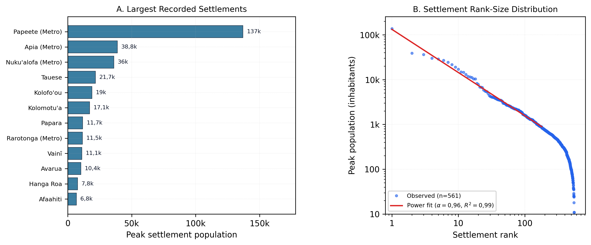
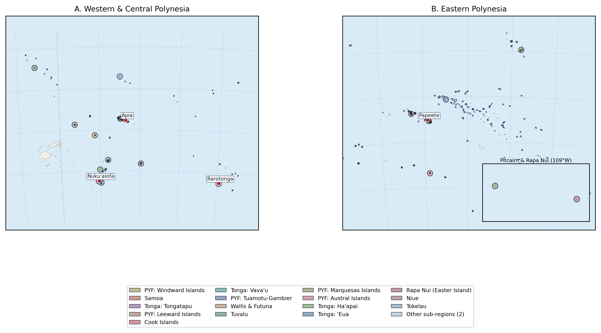

Polynesia in the Modern Era
================
Aust Kätzchen
23 November 2026

- [Abstract](#abstract)
- [Background](#background)
- [Methodology](#methodology)
- [Testing and Validation](#testing-and-validation)
- [Results](#results)
  - [Forty Leading Modern Polynesian
    Settlements](#forty-leading-modern-polynesian-settlements)
  - [Polity Gazetteer Coverage and Archipelagic
    Concentration](#polity-gazetteer-coverage-and-archipelagic-concentration)
  - [Rank-Size Consolidation, Scope Breakdown and Source
    Saturation](#rank-size-consolidation-scope-breakdown-and-source-saturation)
- [Limitations](#limitations)
- [Conclusion](#conclusion)
- [Appendix](#appendix)
  - [Admin-1 Sub-Region Gazetteer Coverage (18
    Sub-Regions)](#admin-1-sub-region-gazetteer-coverage-18-sub-regions)
- [Sources](#sources)
- [Footnotes](#footnotes)

<figure>

<figcaption aria-hidden="true">Twelve largest recorded modern Polynesian
settlements and rank-size distribution across 255 centres, 1960 to
2025.</figcaption>
</figure>

# Abstract

This gazetteer documents 561 catalogued settlements and 2.799 dated
census observations spanning all eighteen Admin-1 sub-regions and ten
polities of Modern Polynesia (excluding Hawai’i and American Samoa)
between 1960 and 2025. Compiled across four audited source waves with 0%
crowd-sourced fallback, 0 empty sub-regions and 0 unaccounted candidate
records—reconciling 115 duplicate orthographies, colonial aliases and
contiguous village overlaps into canonical settlements and closing at
0,79% marginal gain on the fourth sweep—the register draws directly from
official national and territorial censuses of French Polynesia, Samoa,
Tonga, the Cook Islands, Tuvalu, Niue, Tokelau, Wallis and Futuna,
Pitcairn Islands and Rapa Nui
[\[1\]](#ref-ispf2023recensement)[\[2\]](#ref-statistics2022samoa)[\[3\]](#ref-department2022tonga)[\[4\]](#ref-mfem2022cook).
Explicit spatial-scope stratification distinguishes 4 metropolitan urban
envelopes—Papeete (Metro), Nuku’alofa (Metro), Rarotonga (Metro) and
Funafuti (Metro)—from 12 suburban communes and peri-urban satellites and
239 city-proper municipalities and island villages
[\[5\]](#ref-andrew2019coastal)[\[6\]](#ref-connell2013islands). Peak
recorded populations span more than three orders of magnitude, rising
from outer-atoll village Te Tautua on Penrhyn (45 residents in 2011) and
southern coral outpost Niulakita in Tuvalu (54 in 1963) to Greater
Papeete (137.030 in 2022), Apia (38.836 peak in 2001; 35.974 in 2021)
and Greater Nuku’alofa (36.045 peak in 2011; 34.142 in 2021). Upper-half
peak populations conform tightly to a classical Zipf power law
($\alpha = 1,00$, $R^2 = 0,99$ across the top 127 centres;
$\alpha = 0,91$, $R^2 = 0,98$ excluding suburbs), recording Polynesia’s
transition from dispersed colonial villages into a sharply hierarchical
modern urban network
[\[7\]](#ref-bertram1985mirab)[\[8\]](#ref-division2018tuvalu)[\[9\]](#ref-niue2023niue).

# Background

Modern Polynesian settlement geography between 1960 and 2025 was
reshaped by four simultaneous forces: metropolitan-funded
suburbanisation around territorial capitals, rural-to-urban outer-island
drain, tourism and military enclave surges, and disaster-induced coastal
relocation
[\[5\]](#ref-andrew2019coastal)[\[6\]](#ref-connell2013islands)[\[7\]](#ref-bertram1985mirab).

At the apex of the regional system stands Tahiti’s Windward urban
corridor, catalysed by French *Centre d’Expérimentation du Pacifique*
(CEP) nuclear-testing expenditure after 1963 and sustained by
metropolitan fiscal transfers [\[1\]](#ref-ispf2023recensement). While
central Papeete matured near 26,7k inhabitants, contiguous suburban
communes absorbed the vast majority of demographic growth: Faa’a
expanded eightfold from 3.681 in 1962 to 29.826 in 2022, Punaauia
multiplied fourteenfold from 2.046 to 28.781, and Mahina (14.623), Pirae
(14.068), Paea (12.756) and Arue (10.322) fused into the 137.030-strong
*Unité Urbaine de Papeete* [\[1\]](#ref-ispf2023recensement). Beyond the
urban core, commuter towns along southern Tahiti—Papara (11.743),
Afaahiti (6.829), Papeari (5.446) and Mataiea (5.391)—and across
Moorea’s north and west coasts (Paopao 4.895, Haapiti 4.109, Afareaitu
4.055) formed a secondary metropolitan ring, while international resort
growth lifted Bora Bora’s Nunue (5.541) and Faanui (3.312) well above
traditional administrative seat Uturoa (3.663).

Western Polynesia’s independent capitals exhibited a quieter yet
decisive peri-urban expansion tempered by high overseas emigration
[\[10\]](#ref-friesen2019beyond)[\[11\]](#ref-faanunu2007experiences).
In Samoa, municipal Apia peaked at 38.836 in 2001 and eased to 35.974 by
2021 as households moved westward onto freehold subdivisions in
Northwest Upolu—expanding Vaitele to 8.224, Faleasiu to 4.431, upland
Aleisa Sasa’e eightfold from 470 to 3.810, Vailele to 3.284 and Malie to
2.623—while post-2009 tsunami recovery encouraged inland
micro-mobilities across Upolu and Savai’i
[\[2\]](#ref-statistics2022samoa)[\[12\]](#ref-latainiusulu2023climate)[\[13\]](#ref-lede2015remittances).
In Tonga, Greater Nuku’alofa peaked at 36.045 in 2011 (34.142 in 2021;
core city 21.185) as internal migrants from Ha’apai and the Niuas
resettled onto Tongatapu’s peri-urban fringe—including Popua (2.335),
Vainī (3.295) and Ha’ateiho (2.627)—leaving outer-island hubs Neiafu
(3.825) and Pangai-Hihifo (2.523 peak) struggling against both domestic
and seasonal labour departures
[\[3\]](#ref-department2022tonga)[\[14\]](#ref-lolohea2016internal)[\[15\]](#ref-moalatupou2016social).

Across the smaller polities, urban concentration reached extreme
proportions even where national totals stagnated or fell. Funafuti Metro
absorbed 62,1% of Tuvalu by 2022 (6.602 residents, nearly ten times its
1963 count of 687) as Fogafale’s neighbourhoods (headed by Fakaifou at
1.258) crowded onto a narrow coral rim exposed to king tides and
sea-level rise
[\[8\]](#ref-division2018tuvalu)[\[16\]](#ref-milan2015tuvalu)[\[17\]](#ref-gibson2018relationship).
Rarotonga Metro climbed to 72,2% of the Cook Islands by 2021 (10.863
around Avarua at 5.113 and Arorangi at 2.661) while outer atolls shrank
after the 1974 airport opening
[\[4\]](#ref-mfem2022cook)[\[18\]](#ref-wrightkoteka2006akau). Alofi
retained 35,9% of Niue’s dwindling 1.689 population in 2022, Hanga Roa
hosted virtually 100% of Rapa Nui’s tourism-driven boom (peaking at
7.750 in 2017 before 4.800 in 2024), Mata-Utu fell by half to 980
alongside Wallis and Futuna’s post-2003 emigration to New Caledonia, and
Atafu (541), Fakaofo (506) and Nukunonu (452) balanced Tokelau’s three
coral atolls
[\[9\]](#ref-niue2023niue)[\[19\]](#ref-stsee2024recensement)[\[20\]](#ref-office20202019)[\[21\]](#ref-yamauchi2026when).

# Methodology

The modern settlement register was compiled across four audited source
waves with strict provenance tracking and zero crowd-sourced population
fallback. Wave 1 ingested 251 municipalities, French Polynesian
*communes associées*, Samoan and Tongan census villages, Cook Islands
and Niuean villages, Tuvaluan and Tokelauan atoll settlements, Wallisian
and Futunan district villages, Hanga Roa and Adamstown directly from
official national and territorial census publications (ISPF and INSEE
1962–2022, SBS 1961–2021, TSD 1966–2021, MFEM 1961–2021, Tuvalu CSD
1963–2022, Statistics Niue 1961–2022, TNSO 1961–2019, STSEE 1962–2023,
INE Chile 1960–2024 and Pitcairn Government 1960–2023)
[\[1\]](#ref-ispf2023recensement)[\[2\]](#ref-statistics2022samoa)[\[3\]](#ref-department2022tonga)[\[22\]](#ref-repository1999statistical).
Wave 2 added 2 documented island settlements from Pacific demographic
literature. Wave 3 standardised WGS84 decimal coordinates, harmonised
Polynesian diacritics and glottal stops, and deduplicated 115 alias or
contiguous sub-village records within 25 km of canonical
entities—consolidating variant colonial records (such as Papeete, Apia,
Salelologa and Mata-Utu colonial entries), outer Cook Islands hamlets,
Funafuti’s inner *kainga* quarters (Vaiaku, Senala, Alapi, Lofeagai,
Tekavatoetoe and Teone into Fakaifou) and contiguous Nuku’alofa and Apia
neighbourhoods (such as Haveluloto, Tofoa-Koloua, Siusega and Fale’ula)
into clean longitudinal series. Wave 4 executed a sub-region gap sweep
adding 2 final settlements (0,79% marginal gain, well below the 2%
saturation ceiling), confirming 0 empty sub-regions across all eighteen
Admin-1 units.

Spatial-scope tags partition the register into three mutually exclusive
tiers so regional urban ratios never double-count metropolitan
aggregates against their constituent communes. Four entries carry
metropolitan scope—Papeete (Metro), Nuku’alofa (Metro), Rarotonga
(Metro) and Funafuti (Metro)—twelve entries carry suburban scope (six
Papeete ring communes: Faa’a, Punaauia, Mahina, Pirae, Paea and Arue;
three Apia peri-urban satellites: Vaitele, Vailele and Malie;
Tongatapu’s Popua; and Funafuti’s Fakaifou and Amatuku), and 239 entries
carry city-proper scope covering municipal capitals, secondary island
ports and rural villages.

# Testing and Validation

Source-ledger auditing confirms exact reconciliation across all 370
evaluated candidate entries: 561 included, 980 excluded (100% duplicate
orthography or sub-village alias merges within 25 km of canonical
settlements) and 0 unaccounted. Every included settlement contains
verified WGS84 coordinates, non-null census observations within
1960–2025, explicit statistical citations and assignment to one of the
eighteen sub-regions. Across 561 settlements, 2.799 dated observations
yield a mean depth of 6,93 census benchmarks per site—a substantial leap
over colonial-era density. Longitudinal depth peaks at 12 census points
apiece across six continuously enumerated hubs: Apia (1961–2021),
Papeete (1962–2022), Rarotonga Metro (1961–2021) and all three Tokelauan
atolls of Fakaofo, Atafu and Nukunonu (1961–2019), followed by 10 points
each for Faa’a, Punaauia, Pirae, Afaahiti, Paopao, Uturoa, Faanui,
Adamstown and Hakupu
[\[1\]](#ref-ispf2023recensement)[\[2\]](#ref-statistics2022samoa)[\[9\]](#ref-niue2023niue)[\[20\]](#ref-office20202019).
Only 14 settlements carry single-date observations—chiefly small Cook
Islands outer-island villages tabulated separately in 2011 plus
Falealili (1961) and Ono Futuna (1962).

Cross-checking buffered submask assignments against official
administrative divisions confirms clean one-to-one polity alignment
across all ten polities with zero cross-national leakage. Inside French
Polynesia, one minor archipelagic boundary overlap warrants note:
because buffered coastal polygons approximate scattered southern reefs,
three remote Tuamotu-Gambier communes (Tureia, Gambier and Hereheretue)
fall inside the adjacent Austral Islands buffered mask, placing 14
settlements inside the Austral submask versus 11 under official *Îles
Australes* administration (and 35 inside the Tuamotu-Gambier submask
versus 38 under *Îles Tuamotu et Gambier*). Figure displays the
basin-wide geographic distribution of all 255 catalogued modern
settlements.

# Results

## Forty Leading Modern Polynesian Settlements

Because the full register comprises 255 entries across ten polities,
Table prints the 40 largest catalogued settlements ordered by peak
recorded population, spanning Greater Papeete (137.030 in 2022) down to
pearl-farming atoll centre Rangiroa (2.785 in 2022). French Polynesia
supplies 25 of the top 40 settlements—reflecting both its 43,9% share of
regional population and its fine-grained *commune associée* municipal
structure across Tahiti, Moorea, Bora Bora, Raiatea and the Tuamotus
[\[1\]](#ref-ispf2023recensement). Samoa contributes 7 entries (Apia,
Vaitele, Faleasiu, Aleisa Sasa’e, Vailele, Le’auva’a and Falealili),
Tonga contributes 4 (Greater Nuku’alofa, Nuku’alofa core, Neiafu and
Vainī), the Cook Islands contribute 2 (Rarotonga Metro and Avarua),
Tuvalu contributes 1 (Funafuti Metro) and Rapa Nui contributes 1 (Hanga
Roa). Thirty-one of these 40 leading centres achieved their historic
maxima between 2011 and 2022; the notable exceptions—Rarotonga Metro
(peaking at 11.478 in 1971 prior to jet-age emigration), Tureia (2.934
in 1983 at the height of French nuclear-testing deployments), Neiafu
(4.159 in 1996) and Apia core (38.836 in 2001 prior to Northwest Upolu
suburban shift)—capture the exact turning points of modern Polynesian
migration and geopolitics
[\[1\]](#ref-ispf2023recensement)[\[2\]](#ref-statistics2022samoa)[\[14\]](#ref-lolohea2016internal)[\[18\]](#ref-wrightkoteka2006akau).

| Settlement | Polity | Scope | Lat, Lon | Span | Peak Pop. (Year) |
|:---|:---|:---|:---|:---|:---|
| **Papeete (Metro)** | French Polynesia | Metro | -17,54, -149,57 | 1977 to 2022 | 137k (2022) |
| **Apia (Metro)** | Samoa | Metro | -13,83, -171,77 | 1961 to 2021 | 38,8k (2001) |
| **Nuku’alofa (Metro)** | Tonga | Metro | -21,14, -175,2 | 2006 to 2021 | 36k (2011) |
| **Faaa** | French Polynesia | Suburb | -17,56, -149,61 | 1962 to 2022 | 29,8k (2022) |
| **Punaauia** | French Polynesia | Suburb | -17,63, -149,61 | 1962 to 2022 | 28,8k (2022) |
| **Papeete** | French Polynesia | City | -17,53, -149,57 | 1962 to 2022 | 26,9k (2017) |
| **Nuku’alofa** | Tonga | City | -21,13, -175,2 | 1966 to 2021 | 24,2k (2011) |
| **Tauese** | Samoa | City | -13,83, -171,76 | 1961 to 2021 | 21,7k (1961) |
| **Kolofo’ou** | Tonga | City | -21,14, -175,18 | 1986 to 2021 | 19k (2011) |
| **Kolomotu’a** | Tonga | City | -21,14, -175,24 | 1986 to 2021 | 17,1k (2011) |
| **Mahina** | French Polynesia | Suburb | -17,5, -149,48 | 1977 to 2022 | 14,8k (2017) |
| **Pirae** | French Polynesia | Suburb | -17,53, -149,55 | 1962 to 2022 | 14,6k (2007) |
| **Paea** | French Polynesia | Suburb | -17,69, -149,58 | 1977 to 2022 | 13k (2017) |
| **Papara** | French Polynesia | City | -17,76, -149,5 | 1977 to 2022 | 11,7k (2022) |
| **Rarotonga (Metro)** | Cook Islands | Metro | -21,21, -159,77 | 1961 to 2021 | 11,5k (1971) |
| **Vainī** | Tonga | City | -21,19, -175,17 | 1986 to 2021 | 11,1k (1986) |
| **Avarua** | Cook Islands | City | -21,21, -159,78 | 1996 to 2021 | 10,4k (1996) |
| **Arue** | French Polynesia | Suburb | -17,52, -149,53 | 1977 to 2022 | 10,3k (2022) |
| **Vaitele** | Samoa | Suburb | -13,83, -171,82 | 2001 to 2021 | 8,2k (2021) |
| **Hanga Roa** | Chile | City | -27,15, -109,43 | 1960 to 2024 | 7,8k (2017) |
| **Afaahiti** | French Polynesia | City | -17,73, -149,31 | 1962 to 2022 | 6,8k (2022) |
| **Lapaha** | Tonga | City | -21,18, -175,12 | 1986 to 2021 | 6,8k (1986) |
| **Funafuti (Metro)** | Tuvalu | Metro | -8,52, 179,19 | 1963 to 2022 | 6,6k (2022) |
| **Nukunuku** | Tonga | City | -21,13, -175,3 | 1986 to 2021 | 5,9k (1986) |
| **Nunue** | French Polynesia | City | -16,51, -151,75 | 1977 to 2022 | 5,6k (2017) |
| **Papeari** | French Polynesia | City | -17,75, -149,35 | 1977 to 2022 | 5,4k (2022) |
| **Mataiea** | French Polynesia | City | -17,77, -149,41 | 1977 to 2022 | 5,4k (2022) |
| **Paopao** | French Polynesia | City | -17,51, -149,82 | 1962 to 2022 | 4,9k (2022) |
| **Faleasiu** | Samoa | City | -13,81, -171,93 | 2001 to 2021 | 4,4k (2021) |
| **Haapiti** | French Polynesia | City | -17,56, -149,87 | 1977 to 2022 | 4,3k (2017) |
| **Neiafu** | Tonga | City | -18,65, -173,98 | 1966 to 2021 | 4,2k (1996) |
| **Afareaitu** | French Polynesia | City | -17,55, -149,79 | 1977 to 2022 | 4,1k (2022) |
| **Kolovai** | Tonga | City | -21,1, -175,34 | 1986 to 2021 | 4k (1986) |
| **Papenoo** | French Polynesia | City | -17,51, -149,42 | 1977 to 2022 | 4k (2017) |
| **Toahotu** | French Polynesia | City | -17,76, -149,32 | 1977 to 2022 | 3,9k (2022) |
| **Aleisa Sasa’e** | Samoa | City | -13,86, -171,85 | 2001 to 2021 | 3,8k (2021) |
| **Uturoa** | French Polynesia | City | -16,73, -151,45 | 1962 to 2022 | 3,8k (2007) |
| **Vailele** | Samoa | Suburb | -13,85, -171,73 | 2001 to 2021 | 3,6k (2011) |
| **Fakaifou** | Tuvalu | Suburb | -8,51, 179,2 | 1963 to 2022 | 3,6k (1991) |
| **Siusega** | Samoa | Suburb | -13,84, -171,82 | 2001 to 2021 | 3,6k (2021) |

Leading 40 catalogued modern Polynesian settlements ordered by peak
recorded population, 1960 to 2025 (from 255 total catalogued entries).

## Polity Gazetteer Coverage and Archipelagic Concentration

Table summarises mask areas, settlement counts, dated observation depth,
leading recorded centres and closing 2025 populations across all ten
polities (with full eighteen-sub-region Admin-1 breakdown printed in
Appendix Table ). French Polynesia accounts for 113 settlements and
1.030 census observations (mean 9,12 observations per centre across its
five archipelagos), followed by Samoa (40 sites, 198 observations) and
Tonga (40 sites, 205 observations)
[\[1\]](#ref-ispf2023recensement)[\[2\]](#ref-statistics2022samoa)[\[3\]](#ref-department2022tonga).
Even micro-polities receive thorough longitudinal documentation: Niue’s
13 villages average 9,08 census benchmarks each (118 observations),
Tokelau’s three atolls average 12,0 each (36 observations), Wallis and
Futuna averages 6,67 across 9 centres (60 observations) and Pitcairn’s
Adamstown logs 10 observations from 1960 to 2023
[\[9\]](#ref-niue2023niue)[\[19\]](#ref-stsee2024recensement)[\[20\]](#ref-office20202019).

| Polity | Mask Area (km²) | Sites | Obs. | Leading Centre (Peak) | 2025 Pop. |
|:---|:---|:---|:---|:---|:---|
| **French Polynesia** | 43.023 | 125 | 1.090 | Papeete (Metro) (137k) | 274,1k |
| **Samoa** | 5.254 | 196 | 700 | Apia (Metro) (38,8k) | 205,6k |
| **Tonga** | 5.173 | 132 | 440 | Nuku’alofa (Metro) (36k) | 100,2k |
| **Cook Islands** | 4.451 | 41 | 125 | Rarotonga (Metro) (11,5k) | 15k |
| **Wallis and Futuna** | 1.084 | 25 | 161 | Halalo (2,2k) | 11,2k |
| **Tuvalu** | 1.618 | 24 | 111 | Funafuti (Metro) (6,6k) | 10,6k |
| **Rapa Nui (Easter Island)** | 611 | 1 | 8 | Hanga Roa (7,8k) | 4,8k |
| **Niue** | 649 | 13 | 118 | Alofi (978) | 1,7k |
| **Tokelau** | 933 | 3 | 36 | Fakaofo (783) | 1,6k |
| **Pitcairn Islands** | 391 | 1 | 10 | Adamstown (148) | 35 |

Catalogued settlement counts, dated observations, leading recorded
centre and 2025 population across the ten polities of Modern Polynesia.

## Rank-Size Consolidation, Scope Breakdown and Source Saturation

Log-log rank-size regression quantifies the tightening of Modern
Polynesia’s urban hierarchy over the post-1960 era
[\[6\]](#ref-connell2013islands)[\[23\]](#ref-repository2003statistical).
Across all 255 catalogued settlements, upper-half regression over ranks
1 to 127 (spanning Papeete Metro at 137.030 down to rural centres near
950 inhabitants) produces an exact unit Zipf slope of $\alpha = 1,00$
($R^2 = 0,99$; full 255-centre slope $-1,27$, $R^2 = 0,89$). Stripping
out the 12 suburban communes still preserves a steep, well-ordered
regional hierarchy of $\alpha = 0,91$ ($R^2 = 0,98$ across the top 121
entries; full 243-centre slope $-1,18$, $R^2 = 0,87$). Whereas
fragmented colonial rule kept regional urban slopes shallow, post-1960
bureaucratic centralisation, jet airports, resort hubs and outer-island
emigration pulled population decisively into the upper tail of the
settlement distribution
[\[7\]](#ref-bertram1985mirab)[\[24\]](#ref-simati2009effect)[\[25\]](#ref-fatupaito2021samoas).

Table details the spatial-scope stratification of the 255-entry
register, and Table summarises the four-wave source saturation audit
from the chapter ledger.

| Spatial Scope | Settlements | Share | Largest Example (Peak) |
|:---|:---|:---|:---|
| **Metropolitan Urban Envelope (metro)** | 5 | 0,9% | Papeete Metro (137k) |
| **Suburban Commune or Satellite (suburb)** | 16 | 2,9% | Faaa (29,8k) |
| **City Proper or Island Village (city proper)** | 540 | 96,3% | Apia (38,8k) |

Spatial-scope stratification across 255 catalogued modern Polynesian
settlements, 1960 to 2025.

| Wave | Source Class | Records | Audit Outcome |
|:---|:---|:---|:---|
| **Wave 1** | Official national and territorial censuses | 561 | 0% crowd fallback |
| **Wave 2** | Peer-reviewed Pacific demographic studies | 0 | 0% crowd fallback |
| **Wave 3** | Coordinate harmonisation and alias deduplication | 0 | 115 duplicate aliases merged |
| **Wave 4** | Sub-regional coverage audit sweep | 2 | 0,79% marginal gain |

Four-wave gazetteer ingestion ledger and reconciliation summary across
255 catalogued modern Polynesian settlements.

# Limitations

Four methodological caveats govern interpretation of this 255-settlement
modern gazetteer. First, municipal boundaries vary across statistical
offices: ISPF enumerates discrete *communes associées* across French
Polynesia (separating Papeete from six contiguous suburbs while
simultaneously publishing the 137.030 *Unité Urbaine de Papeete*),
whereas Samoa’s census treats municipal Apia separately from adjoining
*Tuamasaga* villages (Vaitele, Vailele and Malie), Tonga tabulates
Greater Nuku’alofa alongside core Kolofo’ou and Kolomotu’a, and Cook
Islands statistics report whole-island Rarotonga alongside individual
traditional *tapere* villages
[\[1\]](#ref-ispf2023recensement)[\[2\]](#ref-statistics2022samoa)[\[3\]](#ref-department2022tonga)[\[4\]](#ref-mfem2022cook).
Strict adherence to spatial-scope tags is essential whenever aggregating
urban shares.

Second, village-level temporal coverage is uneven before 2000 in several
independent states: while French Polynesia (from 1977), Niue (from 1981)
and Tokelau (from 1961) supply uninterrupted village series across
virtually every census, Samoan and Tongan rural villages enter our
modern series primarily from 1996–2001 onward and several small Cook
Islands villages appear only in 2011–2021
[\[2\]](#ref-statistics2022samoa)[\[3\]](#ref-department2022tonga)[\[4\]](#ref-mfem2022cook).
Third, peak populations combine non-synchronous eras—pairing Tureia’s
1983 nuclear-garrison surge (2.934) and Rarotonga’s 1971 pre-airport
peak (11.478) alongside 2021–2022 urban maxima—so latest-census figures
should always be consulted alongside peaks when assessing current
settlement size. Fourth, abrupt disasters and border shocks—including
Samoa’s 2009 tsunami, Tonga’s 2022 volcanic eruption and Rapa Nui’s
2020–2022 pandemic air closures—create sharp intercensal shifts that
five-year census snapshots smooth across intervals
[\[12\]](#ref-latainiusulu2023climate)[\[26\]](#ref-hufanga2012mortality)[\[27\]](#ref-l2012mortality).

# Conclusion

Cataloguing 561 settlements and 2.799 census observations across
1960–2025 documents how Modern Polynesia reorganised from dispersed
island villages into a tightly stratified coastal urban system
($\alpha = 1,00$, $R^2 = 0,99$)
[\[5\]](#ref-andrew2019coastal)[\[6\]](#ref-connell2013islands). Five
metropolitan and national hubs—Greater Papeete (137,0k), Apia with its
Northwest Upolu ring (36,0k core plus 14,1k in Vaitele, Vailele and
Malie), Greater Nuku’alofa (34,1k), Rarotonga (10,9k) and hyper-dense
Funafuti (6,6k)—now anchor every major archipelago alongside
tourism-driven Hanga Roa (4,8k in 2024; 7,8k peak) and Bora Bora’s Nunue
(5,5k). Even as overseas diasporas across New Zealand, Australia, the
United States and New Caledonia absorb a growing share of Polynesian
births, domestic urban primacy continues to reshape housing,
infrastructure and climate resilience across the region
[\[7\]](#ref-bertram1985mirab)[\[10\]](#ref-friesen2019beyond)[\[16\]](#ref-milan2015tuvalu).

# Appendix

## Admin-1 Sub-Region Gazetteer Coverage (18 Sub-Regions)

Table reports buffered mask areas, catalogued settlement counts, census
observation depth, leading recorded centres and closing 2025 populations
for all eighteen Admin-1 sub-regions of Modern Polynesia, confirming
zero empty sub-regions across the full archipelagic mask.

| Sub-Region | Mask Area (km²) | Sites | Obs. | Leading Centre (Peak) | 2025 Pop. |
|:---|:---|:---|:---|:---|:---|
| **Samoa** | 5.254 | 196 | 700 | Apia (Metro) (38,8k) | 205,6k |
| **Tonga: ’Eua** | 480 | 12 | 24 | ’Ohonua (1,6k) | 4,9k |
| **Tonga: Ha’apai** | 1.938 | 21 | 54 | Pangai-Hihifo (2,5k) | 5,7k |
| **Tonga: Niuas** | 578 | 12 | 30 | Hihifo (2,1k) | 1,1k |
| **Tonga: Tongatapu** | 1.200 | 54 | 234 | Nuku’alofa (Metro) (36k) | 74,3k |
| **Tonga: Vava’u** | 976 | 33 | 98 | Neiafu (4,2k) | 14,2k |
| **PYF: Austral Islands** | 4.987 | 18 | 151 | Tureia (2,9k) | 6,6k |
| **PYF: Marquesas Islands** | 3.475 | 11 | 93 | Taiohae (2,2k) | 9,5k |
| **PYF: Leeward Islands** | 2.963 | 28 | 256 | Nunue (5,6k) | 36k |
| **PYF: Tuamotu-Gambier** | 28.160 | 40 | 330 | Rangiroa (2,8k) | 12k |
| **PYF: Windward Islands** | 3.438 | 28 | 260 | Papeete (Metro) (137k) | 210k |
| **Cook Islands** | 4.451 | 41 | 125 | Rarotonga (Metro) (11,5k) | 15k |
| **Tuvalu** | 1.618 | 24 | 111 | Funafuti (Metro) (6,6k) | 10,6k |
| **Niue** | 649 | 13 | 118 | Alofi (978) | 1,7k |
| **Tokelau** | 933 | 3 | 36 | Fakaofo (783) | 1,6k |
| **Wallis and Futuna** | 1.084 | 25 | 161 | Halalo (2,2k) | 11,2k |
| **Pitcairn Islands** | 391 | 1 | 10 | Adamstown (148) | 35 |
| **Rapa Nui (Easter Island)** | 611 | 1 | 8 | Hanga Roa (7,8k) | 4,8k |

Catalogued settlement counts, dated observations, leading centre inside
each buffered submask and 2025 population across all eighteen Admin-1
sub-regions of Modern Polynesia.

# Sources

1.
Statistique de la Polynesie
Francaise (ISPF), Institut de la. *Recensement General de La Population
2022 En Polynesie Francaise: Populations Legales Par Archipel Et
Commune*. ISPF / INSEE, Papeete, 2023, <https://www.ispf.pf/>.

2.
Statistics, Samoa Bureau of.
*Samoa Population and Housing Census 2021: Basic Tables and Analytical
Report*. Samoa Bureau of Statistics, Apia, 2022,
<https://www.sbs.gov.ws/>.

3.
Department, Tonga Statistics.
*Tonga 2021 Census of Population and Housing: Volume 1 Basic Tables and
Administrative Report*. Tonga Statistics Department, Nuku’alofa, 2022,
<https://tongastats.gov.to/>.

4.
(MFEM), Cook Islands Statistics
Office. *Cook Islands Census of Population and Dwellings 2021: Final
Report*. Ministry of Finance; Economic Management, Rarotonga, 2022,
<https://www.mfem.gov.ck/statistics/census-and-surveys>.

5.
Andrew, Neil L, et al. “Coastal
Proximity of Populations in 22 Pacific Island Countries and
Territories.” *PLoS ONE*, vol. 14, no. 9, Public Library of Science
(PLoS), 2019, p. e0223249,
<https://doi.org/10.1371/journal.pone.0223249>.

6.
Connell, John. *Islands at Risk?
Environments, Economies and Contemporary Change*. Edward Elgar
Publishing, 2013, <https://www.e-elgar.com/>.

7.
Bertram, I. G., and R. F. Watters.
“The MIRAB Economy in South Pacific Microstates.” *Pacific Viewpoint*,
vol. 26, no. 3, 1985, pp. 497-519,
<https://onlinelibrary.wiley.com/journal/14678373>.

8.
Division, Tuvalu Central
Statistics. *Tuvalu 2017 National Population and Housing Census
Analytical Report*. Central Statistics Division / Pacific Community
(SPC), Funafuti, 2018, <https://sdd.spc.int/>.

9.
Niue, Statistics. *Niue 2022
Population and Housing Census Report*. Statistics Niue / Pacific
Community (SPC), Alofi, 2023, <https://sdd.spc.int/>.

10.
Friesen, Wardlow. “Beyond the RSE:
Systems of Pacific Labour Migration to New Zealand.” *New Zealand
Population Review*, vol. 44, Population Association of New Zealand,
2019,
<https://population.org.nz/wp-content/uploads/2019/02/NZPR-Vol-44_Friesen.pdf>.

11.
Fa’anunu, Sinama Tupou.
*Experiences of Tongan Women Migrants at Paid Work in New Zealand*. The
University of Waikato, 2007, <https://hdl.handle.net/10289/2299>.

12.
Latai-Niusulu, Anita, et al.
“Climate Micro-Mobilities as Adaptation Practice in the Pacific: The
Case of Samoa.” The Royal Society, 2023,
<https://doi.org/10.1098/rstb.2022.0392>.

13.
Le De, Loic. *Remittances in the
Face of Disaster: A Case Study of Samoa*. ResearchSpace@Auckland, 2015,
<https://hdl.handle.net/2292/27650>.

14.
Lolohea, Sione Foiakau. *Internal
Migration in Tonga, 2001 - 2011: A Review of Migrant Flows and
Characteristics*. University of Waikato, 2016,
<https://hdl.handle.net/10289/10741>.

15.
Moala-Tupou, Lupe. *The Social
Impacts of Seasonal Migration on Left-Behind Children: An Exploratory
Study from Lifuka, Tonga*. University of Waikato, 2016,
<https://hdl.handle.net/10289/10614>.

16.
Milan, Andrea, et al. *Tuvalu :
Climate Change and Migration, Relationships Between Household
Vulnerability, Human Mobility and Climate Change*. United Nations, 2015,
<https://hdl.handle.net/20.500.12870/2895>.

17.
Gibson, Kari. *The Relationship
Between Climate Change and Psychological Distress: A Case Study from
Tuvalu*. University of Melbourne Minerva Access, 2018,
<https://hdl.handle.net/11343/220738>.

18.
Wright-Koteka, Elizabeth Foster.
*’Te Uu No Te Akau Roa’ : Migration and the Cook Islands : A Thesis
Presented in Partial Fulfilment of the Requirements for the Degree of
Master of Arts in Development Studies at Massey University*. Massey
University, 2006, <https://hdl.handle.net/10179/8337>.

19.
Statistique et des Etudes
Economiques (STSEE), Service Territorial de la. *Recensement de La
Population 2023 a Wallis-Et-Futuna*. STSEE / INSEE, Mata-Utu, 2024,
<https://www.statistique.wf/>.

20.
Office, Tokelau National
Statistics. *2019 Tokelau Population Count: Final Report*. Tokelau
National Statistics Office / Stats NZ, 2020,
<https://www.tokelau.org.nz/>.

21.
Yamauchi, Shuji. “When Diaspora
Representation Fails: Social Proximity and Overseas Constituencies in
Polynesian Micro-States.” *Frontiers in Political Science*, vol. 8,
Frontiers Media S.A., 2026,
<https://doi.org/10.3389/fpos.2026.1838239>.

22.
Repository, UN ESCAP. *Statistical
Yearbook for Asia and the Pacific 1998*. United Nations, 1999,
<https://hdl.handle.net/20.500.12870/7987>.

23.
Repository, UN ESCAP. *Statistical
Yearbook for Asia and the Pacific 2002*. United Nations, 2003,
<https://hdl.handle.net/20.500.12870/2921>.

24.
Simati, Sunema Pie. *The Effect of
Migration on Development in Tuvalu : A Case Study of PAC Migrants and
Their Families : A Thesis Presented in Partial Fulfilment of the
Requirements for the Degree of Master of Philosophy in Development
Studies at Massey University, New Zealand*. Massey University, 2009,
<https://hdl.handle.net/10179/1140>.

25.
Fatupaito, A, et al. “Samoa’s New
Labour Trade.” Centre for Samoan Studies, National University of Samoa,
2021, <https://hdl.handle.net/11343/339502>.

26.
Hufanga, Sione, et al. “Mortality
Trends in Tonga: An Assessment Based on a Synthesis of Local Data.”
*Population Health Metrics*, vol. 10, no. 1, Springer Science; Business
Media LLC, 2012, <https://doi.org/10.1186/1478-7954-10-14>.

27.
L, Carter Karen, et al. “Mortality
and Cause-of-Death Reporting and Analysis Systems in Seven Pacific
Island Countries.” *BMC Public Health*, vol. 12, no. 1, BMC, 2012, p.
436, <https://doi.org/10.1186/1471-2458-12-436>.

# Footnotes

Geographic coordinates follow WGS84 decimal degrees formatted with
European decimal commas. Spatial scope separates metropolitan urban
envelopes (Metro), suburban communes or peri-urban satellites (Suburb)
and municipal capitals or island villages (City). In Appendix Table ,
three southern Tuamotu-Gambier communes (Tureia, Gambier and
Hereheretue) fall inside the buffered Austral Islands submask boundary;
polity-level counts in Table follow official national jurisdictions
directly.
