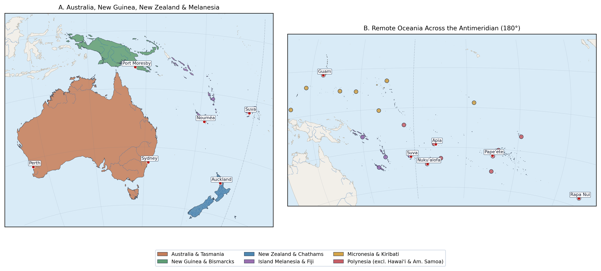
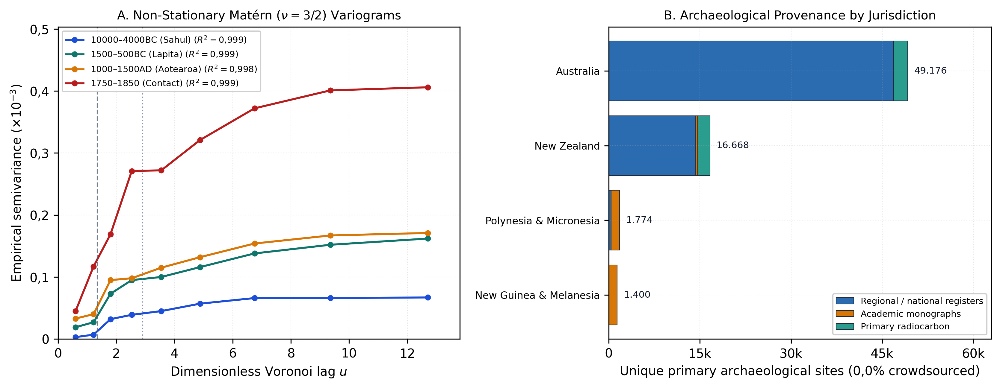
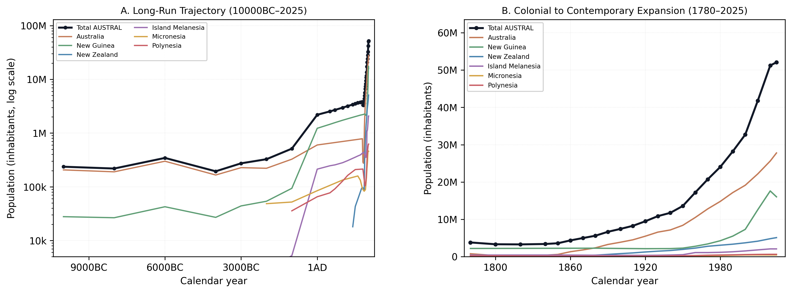
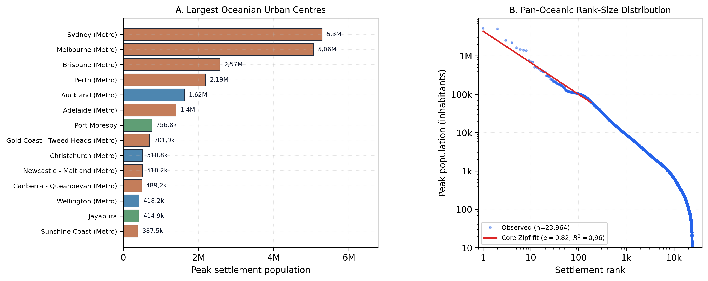

Studies on Population
================
Aust Kätzchen
23 November 2026

- [Abstract](#abstract)
- [Background](#background)
- [Methodology](#methodology)
  - [Macro-Regional Scope, Seam Exclusions and 16-Chapter
    Architecture](#macro-regional-scope-seam-exclusions-and-16-chapter-architecture)
  - [Non-Anachronistic Areal Masks and 14-Regime Historical GIS
    Stack](#non-anachronistic-areal-masks-and-14-regime-historical-gis-stack)
  - [Institutional Archaeological Corpora and Non-Stationary Matérn
    Kriging](#institutional-archaeological-corpora-and-non-stationary-matérn-kriging)
  - [Evidence-Only Settlement Gazetteers and Three-Phase Metropolitan
    Reconciliation](#evidence-only-settlement-gazetteers-and-three-phase-metropolitan-reconciliation)
- [Testing and Validation](#testing-and-validation)
- [Results](#results)
  - [Long-Run Holocene Demographic Trajectory
    (10000BC–2025)](#long-run-holocene-demographic-trajectory-10000bc2025)
  - [Colonial Demographic Collapse and Settler-Colony Divergence
    (1788–1945)](#colonial-demographic-collapse-and-settler-colony-divergence-17881945)
  - [Post-War Public-Health Transition and Contemporary Redistribution
    (1945–2025)](#post-war-public-health-transition-and-contemporary-redistribution-19452025)
  - [Pan-Oceanic Metropolitan Hierarchy and Zipf
    Scaling](#pan-oceanic-metropolitan-hierarchy-and-zipf-scaling)
- [Limitations](#limitations)
- [Conclusion](#conclusion)
- [Appendix](#appendix)
- [Sources](#sources)
- [Footnotes](#footnotes)

# Abstract

Reconstructing long-run human population across Oceania from the
terminal Pleistocene to the contemporary census era presents a
distinctive methodological challenge in historical spatial demography.
Spanning roughly 9,50M km² of land dispersed across more than one-third
of the Earth’s circumference—from the continental landmass of Sahul
(Australia, Tasmania and New Guinea) through the island arcs of Near
Oceania and the oceanic archipelagos of Remote Oceania—AUSTRAL bridges
societies whose demographic histories diverge more sharply in
chronology, ecological carrying capacity and archival density than in
any other macro-region of the world. Global gridded inventories such as
HYDE 3.2 [\[1\]](#ref-KleinGoldewijk2017) and KK10
[\[2\]](#ref-Kaplan2011), alongside classical tabular syntheses
[\[3\]](#ref-McEvedyJones1978), provide indispensable planetary
accounting frames, yet their reliance on modern sovereign nation-state
boundaries and uniform environmental suitability kernels introduces
systematic spatial distortions across the Pacific. Post-colonial
meridians such as the 141°E border bisecting New Guinea, the 26°S and
129°E state grids of Australia, and the sub-pixel exclusion of coral
atolls routinely obscure pre-contact Indigenous watershed systems,
independent highland Papuan agriculture, the late Lapita and Polynesian
oceanic expansions and the sharp colonial demographic collapses of the
seventeenth through nineteenth centuries.

AUSTRAL resolves these structural artefacts through an integrated
bottom-up architecture comprising 16 regional and chronological chapters
grouped into Pre-Colonial, Colonial and Modern Oceanic modules, backed
by 310 open-access scholarly studies, 69.018 primary institutional
archaeological records (with zero crowd-sourced fallback), 35.031
chapter-level settlement trajectories (26.413 chapter-distinct
localities; 25.519 cross-chapter deduplicated entities and 152.483
chronological observations across 25 Oceanic territories) and 1.418
sub-administrative historical GIS enumerations spanning 14 strictly
non-anachronistic territorial boundary regimes across all 118 Common Era
HYDE epochs from 1AD to 2025. Pre-statistical surfaces are modelled via
non-stationary Matérn ($\nu = 3/2$) residual kriging
[\[4\]](#ref-PaciorekSchervish2006) across 1.554 geodesic Voronoi
catchments (1.337 active domestic catchments; 86,04% coverage)
conditioned on eight archaeological horizon slices from Pleistocene
Sahul to early colonial contact, achieving residual variogram fits of
$R^2 = 0,9927$ to $0,9993$ and an effective short correlation range of
51,8 to 58,7 km. Post-contact and contemporary rasters enforce
mass-conserving pycnophylactic dasymetric scaling across
period-authentic colonial and national geometries (worst unit relative
error $4,44 \times 10^{-8}$), while harmonised pixel-for-pixel seam
exclusions maintain exact boundary continuity against neighbouring
Southeast Asian, Hawaiian and Pacific rim domains.

Across the consolidated macro-regional reconstruction (reconciling
5-arcminute gridded totals with sub-pixel Micronesian and Polynesian
atoll censuses), human numbers across AUSTRAL rose from 236,4k in
10000BC and 344,7k in 6000BC to 513,1k in 1000BC following Lapita
settlement of Remote Oceania and highland New Guinea agricultural
intensification
[\[5\]](#ref-denham2003origins)[\[6\]](#ref-sheppard2011lapita). By 1AD,
pan-Oceanic numbers reached 2,19M—anchored by 1,23M in New Guinea and
600,4k in Australia—climbing steadily through the East Polynesian and
Aotearoa New Zealand voyaging horizons to a pre-contact crest of 3,81M
around 1780. Introduced pathogens, frontier dispossession and labour
disruption then drove a sharp trough of 3,29M by 1820, before settler
immigration across Australia and New Zealand and twentieth-century
public-health transitions in New Guinea and the Pacific Islands
propelled the domain to 7,43M in 1900, 13,59M in 1950, 28,20M in 1990
and 52,09M in 2025 (51,32M on the 5-arcminute continental-insular
raster). Today, urban concentration across 23.964 non-suburb localities
follows a tightly fitted upper-tail Zipf rank-size distribution
($\alpha = 0,82$, $R^2 = 0,960$), led by Sydney (5,30M), Melbourne
(5,06M), Brisbane (2,57M), Perth (2,19M), Auckland (1,62M), Adelaide
(1,40M) and Port Moresby (756,8k).

# Background

Long-run population reconstruction across Oceania confronts a deeper
chronological and ecological asymmetry than exists in Eurasia, Africa or
the Americas. Within a single oceanic theatre bounded by the Wallacean
straits in the west and Rapa Nui (Easter Island) in the south-east,
human occupation spans more than sixty millennia in northern Sahul yet
less than eight centuries in temperate Aotearoa New Zealand and extreme
East Polynesia
[\[7\]](#ref-clarkson2017human)[\[8\]](#ref-bradshaw2021stochastic)[\[9\]](#ref-burley2012high)[\[10\]](#ref-matisoo_smith2026minding).
Between those two chronological poles lie four fundamentally distinct
demographic trajectories: hunter-gatherer continentality across
Pleistocene and Holocene Australia and Tasmania
[\[11\]](#ref-williams2013population)[\[12\]](#ref-williams2015holocene)[\[13\]](#ref-mulvaney2020prehistory);
an independent, high-density centre of wetland and montane tuber
domestication in the Central Highlands of New Guinea
[\[5\]](#ref-denham2003origins)[\[14\]](#ref-bergstrom2017neolithic)[\[15\]](#ref-denham2024resonating);
the maritime Lapita and Micronesian Neolithic dispersals into Near and
Remote Oceania
[\[6\]](#ref-sheppard2011lapita)[\[16\]](#ref-carson2014first)[\[17\]](#ref-liu2022ancient);
and the late colonial and contemporary demographic divergence between
heavily urbanised settler democracies in Australia and New Zealand and
rapidly growing, predominantly rural or coastal-archipelagic states in
Papua New Guinea, Indonesian Papua, Melanesia, Micronesia and Polynesia.

Existing planetary historical datasets struggle to represent these four
trajectories simultaneously. Global tabular baselines
[\[3\]](#ref-McEvedyJones1978) and gridded Holocene land-use
reconstructions [\[1\]](#ref-KleinGoldewijk2017)[\[2\]](#ref-Kaplan2011)
necessarily construct sub-continental allocation curves from modern
ISO-3166 country polygons and generic biophysical suitability weights.
Applied to Oceania, that design introduces four specific analytical
distortions that AUSTRAL was constructed to correct.

First, projecting modern sovereign and federal borders backward across
the Holocene imposes linear nineteenth-century and twentieth-century
survey meridians onto Indigenous ecological territories that never
followed geometric lines. In Australia, the 129°E, 138°E and 141°E
meridians and the 26°S and 29°S parallels divide arid interior basins
and riverine corridors—most notably the Murray-Darling system and the
Lake Eyre catchment—whose pre-1788 Aboriginal populations organised
around watershed resources, seasonal wetlands and ceremonial exchange
networks
[\[18\]](#ref-tobler2017aboriginal)[\[19\]](#ref-crabtree2021landscape)[\[20\]](#ref-salles2024physiography).
In New Guinea, the 141°E colonial meridian arbitrarily slices across the
trans-Fly and Digul lowlands and the central cordillera, separating
linguistically and genetically linked highland horticultural populations
between Indonesian Papua and Papua New Guinea
[\[14\]](#ref-bergstrom2017neolithic)[\[15\]](#ref-denham2024resonating)[\[21\]](#ref-barker2023holocene).
Similarly, projecting post-1989 New Zealand regional councils or
post-2022 Indonesian Papuan provinces backward into the nineteenth
century creates anachronistic density steps where none existed
historically.

Second, generic global suitability surfaces underestimate the ecological
specificity of Oceanic carrying capacity. In highland New Guinea,
intensive wetland drainage at Kuk Swamp and sustained montane
cultivation of taro, banana and later sweet potato supported densities
exceeding 30 to 60 inhabitants/km² in intermontane valleys between 1.400
and 2.200 m elevation, whereas neighbouring malarial lowland swamps
remained far more sparsely populated
[\[5\]](#ref-denham2003origins)[\[22\]](#ref-roberts2017persistent)[\[23\]](#ref-gonzalez_buenfil2024genetic)[\[24\]](#ref-denham2026clarifying).
Conversely, in continental Australia, the arid interior supported low
mobile densities while coastal estuaries, mangrove littorals, the
Murray-Darling basin and south-western wetlands sustained dense
semi-sedentary fisheries and plant-processing economies
[\[12\]](#ref-williams2015holocene)[\[25\]](#ref-florin2020first)[\[26\]](#ref-norman2022human).
In Remote Oceania, island carrying capacity depended sharply on
geological substrate—distinguishing fertile high volcanic islands such
as Viti Levu, Upolu, Tahiti and Tongatapu from freshwater-limited coral
atolls across Kiribati, Tuvalu and the Marshall Islands
[\[27\]](#ref-rainbird2004archaeology)[\[28\]](#ref-field2026prey)[\[29\]](#ref-sear2026how).

Third, standard 5-arcminute global rasters suffer acute coastal and
micro-island attenuation across the central and eastern Pacific. At the
equator, a single 5-arcminute cell covers roughly 85 km², exceeding the
entire emergent land area of Nauru (21 km²), Tuvalu (26 km²), Tokelau
(12 km²), Pitcairn (47 km²) and individual atolls in the Marshall
Islands, Kiribati and French Polynesia. Standard continental land masks
frequently drop low-lying atolls entirely or assign zero valid cells to
Micronesia and outer Polynesia, causing gridded continental sums to
understate archival island censuses by hundreds of thousands of
inhabitants. Simultaneously, global grids often leak residual population
into Aotearoa New Zealand and East Polynesia millennia before
archaeological arrival dates—a chronological error that contradicts
high-precision radiocarbon, uranium-thorium and ancient DNA chronologies
[\[9\]](#ref-burley2012high)[\[10\]](#ref-matisoo_smith2026minding)[\[30\]](#ref-petchey2019importance)[\[31\]](#ref-dinapoli2021approximate).

Fourth, settlement hierarchies across Oceania exhibit sharp
municipal-versus-metropolitan boundary mismatches. In contemporary
Australia, the City of Sydney local government area holds 241,8k
residents inside a Greater Sydney metropolitan conurbation of 5,30M,
while outer suburban councils such as Blacktown (449,4k), Casey
(414,9k), Logan (403,5k) and Moreton Bay (532,4k) are statistically
distinct local government units that belong functionally to the Sydney,
Melbourne and Brisbane metropolitan labour markets. Unreconciled
compilation of city-proper, suburban-municipality and metropolitan
census tables produces artificial rank-size kinks and double-counting in
pan-Oceanic urban analyses.

AUSTRAL addresses each of these four weaknesses directly. By pairing
watershed-based pre-colonial masking with strictly non-anachronistic
colonial and national historical GIS polygons, 100% institutional
archaeological provenance, dual continental-raster and atoll-reconciled
population series, and three-phase metropolitan reconciliation, AUSTRAL
supplies a transparent spatial-demographic synthesis aligned cleanly at
its western and north-eastern oceanic seams with neighbouring regional
studies.

# Methodology

## Macro-Regional Scope, Seam Exclusions and 16-Chapter Architecture

AUSTRAL encompasses a consolidated terrestrial footprint of 9,50M km² in
its contemporary administrative configuration (9,46M km² in its
pre-colonial watershed partition), spanning Australia, Tasmania, Norfolk
Island and Lord Howe Island; Aotearoa New Zealand and the Chatham
Islands; the entire island of New Guinea (both Papua New Guinea and
Indonesian West New Guinea including Raja Ampat) together with the
Bismarck Archipelago; Island Melanesia (Solomon Islands, Vanuatu, New
Caledonia and Fiji including Rotuma); Micronesia (Palau, Federated
States of Micronesia, Guam, Northern Mariana Islands, Marshall Islands,
Kiribati and Nauru); and Polynesia excluding Hawai’i and American Samoa
(Independent Samoa, Tonga, French Polynesia, Cook Islands, Niue, Tuvalu,
Tokelau, Wallis and Futuna, Pitcairn Islands and Rapa Nui).

To prevent double-counting or boundary gaps during global compositing
across adjacent macro-regions, AUSTRAL enforces three explicit
pixel-for-pixel seam exclusions on the shared 4320x2160 equirectangular
5-arcminute reference grid. Along the western Wallacean seam, the
Southeast Asian MANDALA domain mask is subtracted pixel-for-pixel,
excluding Maluku (Gebe, East Seram, Babar, Tanimbar, Kai and Aru) and
all landmasses west of 129,5°E north of 11,3°S while retaining Raja
Ampat and the Bird’s Head peninsula within New Guinea. Along the central
and north-eastern Pacific seam, the CENTAUR Hawaiian and American Samoan
mask is subtracted pixel-for-pixel, excluding the Hawaiian archipelago,
Palmyra Atoll and American Samoa east of 171,25°W while preserving the
eastern tip of Upolu in Independent Samoa at 171,44°W. Along the
northern and far-eastern maritime margins, Japanese Bonin and Volcano
islands (north of 21°N between 129,5°E and 160°E) and Clipperton and
Mexican Pacific islands (north of 9,5°N between 116°W and 105°W) are
excluded to match East Asian and Mesoamerican domains. All
Pacific-spanning polygons—notably Fiji, Kiribati, Tuvalu, Tonga and the
Chatham Islands—are projected using antimeridian-safe wrapped geometries
so that no 180° meridian spikes or scanline tears enter either the areal
masks or cartographic outputs.

The macro-region is partitioned into 16 thematic chapters organised into
three chronological epochs (Table 1 and Figure 1): five Pre-Colonial
chapters (Chapters 1 to 5), six Colonial chapters (Chapters 6 to 11) and
five Modern census-era chapters (Chapters 12 to 16). Rather than
imposing a uniform transition year across the Pacific, epoch transitions
respect authentic regional historical thresholds: 1788 and 1901 in
Australia (First Fleet and Federation); 1840 and 1907 in New Zealand
(Treaty of Waitangi and Dominion status); 1884 and 1962/1975 in New
Guinea (imperial partition, West New Guinea transfer and Papua New
Guinea independence); 1850 and 1960/1970 in Island Melanesia; 1668 and
1960/1979 in Micronesia (beginning with Spanish colonisation of the
Mariana Islands); and 1800 and 1960/1962 in Polynesia. Each chapter
comprises a standalone literature review, an evidence-only settlement
gazetteer, a coordinate-anchored machine-readable trajectory archive, a
4320x2160 areal mask, a matched vector regional partition and an
archival library of 18 to 20 open-access scholarly PDFs (310 archival
PDFs in total).

| Ch. | Regional and Chronological Module | Span | Area (km²) | Zones | Setts | HGIS |
|:---|:---|:---|:---|:---|:---|:---|
| **01** | Pre-1788 Aboriginal Australia and Tasmania | 10000BC-1788 | 7,9M | 11 | 1.608 | 66 |
| **02** | Pre-Colonial New Guinea and Bismarck Archipelago | 10000BC-1884 | 974k | 9 | 382 | 81 |
| **03** | Pre-Colonial Island Melanesia and Micronesia | 10000BC-1850 | 220,9k | 10 | 319 | 112 |
| **04** | Pre-Colonial Polynesia | 1000BC-1800 | 63k | 9 | 206 | 89 |
| **05** | Pre-European New Zealand | 700-1840 | 303,8k | 7 | 1.191 | 46 |
| **06** | Colonial Australia from First Fleet to Federation | 1788-1901 | 7,89M | 6 | 4.961 | 24 |
| **07** | Colonial New Zealand | 1840-1907 | 303,6k | 11 | 2.872 | 44 |
| **08** | Colonial New Guinea | 1884-1975 | 990,3k | 3 | 499 | 38 |
| **09** | Colonial Island Melanesia | 1850-1970 | 152,7k | 4 | 234 | 49 |
| **10** | Colonial Micronesia | 1668-1979 | 52,2k | 9 | 181 | 102 |
| **11** | Colonial Polynesia | 1800-1962 | 63k | 7 | 261 | 122 |
| **12** | Commonwealth of Australia after 1901 | 1901-2026 | 7,91M | 9 | 11.493 | 78 |
| **13** | New Zealand after 1907 | 1907-2026 | 304,6k | 17 | 2.777 | 135 |
| **14** | Papua New Guinea and Indonesian Papua | 1962-2026 | 1,01M | 28 | 5.629 | 122 |
| **15** | Modern Island Melanesia and Micronesia | 1960-2026 | 206,1k | 36 | 1.857 | 216 |
| **16** | Polynesia in the Modern Era | 1960-2026 | 63,2k | 18 | 561 | 108 |

Canonical 16-chapter itinerary of AUSTRAL showing chronological spans,
equal-area footprints, regional partitions, settlement trajectories and
historical GIS sub-administrative rows.

## Non-Anachronistic Areal Masks and 14-Regime Historical GIS Stack

All 16 chapter masks and all 118 Common Era sub-administrative boundary
rasters follow a strict five-tier provenance hierarchy: official
national and academic historical GIS polygons ($z = 5$, including
Australian Bureau of Statistics ASGS and Esri Historical Australian
Colonies, Statistics New Zealand regional councils and Te Puni Kōkiri
iwi rohe, HDX COD-AB Papua New Guinea provinces, BPS Indonesian Papua
six-province boundaries and national Pacific ADM1 geometries);
OpenHistoricalMap historical polities ($z = 4$); CShapes colonial and
post-colonial territories ($z = 3$); coastal-matched de jure historical
atlases ($z = 2$); and de facto fallbacks ($z = 1$) strictly restricted
to unmapped frontiers. Pre-colonial chapters (Chapters 1, 2 and 5)
replace straight colonial borders entirely with organic HydroBASINS
Level-5 and Level-6 river catchments—11 ecological basins across
mainland Australia and Tasmania, nine watershed zones bridging the 141°E
meridian across New Guinea and the Bismarck Archipelago, and seven North
and South Island watershed regions across Aotearoa New Zealand.

Across the 118 Common Era HYDE time steps from 1AD to 2025, AUSTRAL
deploys 14 distinct historical boundary regimes totalling 1.418
sub-administrative census rows across 25 jurisdictions. Every
territorial boundary transition is anchored to its actual historical
date: from 1AD through 1780, all 56 units represent pre-colonial
Indigenous watersheds and island polities; the 1790–1820 regime
introduces New South Wales and Van Diemen’s Land east of 135°E against
New Holland to the west (49 units); the 1830 and 1840–1850 regimes
register the Swan River Colony (Western Australia west of 129°E) and
South Australia (132°E to 141°E south of 26°S, 51 to 56 units); the 1860
and 1870–1880 regimes reflect the six pre-Federation Australian colonies
(including New South Wales’s 1859–1863 Northern Territory exclave and
South Australia’s 1863–1910 administration of the Northern Territory)
alongside New Zealand’s ten 1853–1876 provinces (59 to 61 units); the
1890–1910 regimes introduce the tri-colonial partition of New Guinea
into Dutch West New Guinea, German Kaiser-Wilhelmsland and the
Bismarcks, and British-Australian Papua (56 units); the 1920–1950 and
1951–1959 regimes separate the Australian Northern Territory and Capital
Territory after 1911 and track League of Nations and United Nations
trusteeships (57 to 62 units); the 1960–1962 and 1963–2002 regimes
retain a unified West New Guinea province west of 141°E alongside
post-war Pacific and provincial divisions (107 units); the 2003–2021
regime reflects Indonesia’s two-province Papuan split (Papua and Papua
Barat, 107 units); and only the 2022–2025 regime introduces Indonesia’s
six post-2022 Papuan provinces alongside all 22 Papua New Guinea
provinces, nine Australian states and territories, 17 New Zealand
regions and 56 Pacific ADM1 units (110 units in total).

## Institutional Archaeological Corpora and Non-Stationary Matérn Kriging

Pre-statistical spatial surfaces from 10000BC through early colonial
contact are anchored to 69.018 unique primary institutional
archaeological sites consolidated into 39.897 deduplicated domestic site
complexes across four macro-jurisdictions (Table 2). In contrast to
projects that must lean on crowd-sourced gazetteers to fill regional
gaps, AUSTRAL achieves 100,0% primary institutional and scholarly
provenance with 0,0% crowd-sourced fallback across all four
jurisdictions.

In Australia (49.176 sites; 42.528 habitation sites and 6.648
monument-only sites), institutional records combine the AustArch and
SahulArch OCTOPUS v2 radiocarbon compendia (2.311 radiocarbon-anchored
sites) with state and commonwealth statutory heritage registers: Western
Australia DPLH Aboriginal Cultural Heritage lodged and registered
corpora (33.026 combined records), the Victorian Heritage Inventory
(7.161 records), South Australia Heritage Places (2.290), New South
Wales State Heritage and Aboriginal Places registers (1.852), Queensland
Heritage and Aboriginal Cultural Heritage registers (1.549), the
Tasmanian Heritage Register (577) and Commonwealth and National Heritage
lists (410)
[\[7\]](#ref-clarkson2017human)[\[11\]](#ref-williams2013population)[\[12\]](#ref-williams2015holocene).
In Aotearoa New Zealand (16.668 sites; 16.417 habitation sites), primary
records integrate the Waikato Aotearoa New Zealand Radiocarbon Database
(2.031 sites), NZAA ArchSite regional extractions (9.453 sites across
Far North, Gisborne, Pokeno, Oturu and Bay of Plenty), LINZ 1:50k
fortified *pā* earthworks (2.144 sites), Te Puni Kōkiri *marae*
locations (892), Environment Canterbury and Ngāi Tahu cultural site
registers (1.167), Nelson-Tasman and Waikato heritage registers (590)
and Prickett’s New Zealand Wars fortification corpus (391).

Across New Guinea and Island Melanesia (1.400 sites; 1.395 habitation
sites) and Polynesia and Micronesia (1.774 sites; 1.359 habitation
sites), where national digital heritage portals are far scarcer, AUSTRAL
integrates pan-Pacific archaeological databases: the Pacific
Archaeological Radiocarbon Database PARD 2025 (1.385 sites), the Pofatu
geochemical artefact database (662 sites), the ANU Kuden Lapita and
post-Lapita pottery corpus (272 sites), French Polynesia’s Te Fenua
heritage inventory (306 sites), the US National Park Service NRHP
Micronesian register (86 sites), the Easter Island Statue Project *ahu*
register (73 sites), Harvard AADR v66 ancient DNA localities (35 sites),
the Academia Sinica Lapita Pottery Online Database (16 sites) and New
Caledonia Province Sud heritage records
[\[6\]](#ref-sheppard2011lapita)[\[32\]](#ref-summerhayes2010human)[\[33\]](#ref-lipson2018population)[\[34\]](#ref-lipo2025megalithic).

| Macro-Jurisdiction | Total Sites | Registers | Monographs | Radiocarbon | Habitation |
|:---|:---|:---|:---|:---|:---|
| **Australia and Tasmania** | 49.176 | 46.865 | 0 | 2.311 | 42.528 |
| **Aotearoa New Zealand** | 16.668 | 14.246 | 391 | 2.031 | 16.417 |
| **New Guinea and Melanesia** | 1.400 | 7 | 1.393 | 0 | 1.395 |
| **Polynesia and Micronesia** | 1.774 | 392 | 1.382 | 0 | 1.359 |
| **AUSTRAL Total** | 69.018 | 61.510 | 3.166 | 4.342 | 61.699 |

Primary institutional archaeological site provenance across the four
Oceanic macro-jurisdictions (zero crowd-sourced fallback in every
jurisdiction).

These archaeological records are partitioned into eight chronological
horizon layers spanning the Holocene: (1) Pleistocene and Early Holocene
Sahul (911 sites, 918 active catchments), (2) Mid-Holocene
Intensification and Kuk Swamp agriculture (1.716 sites, 990 catchments),
(3) Lapita and Austronesian dispersal (2.228 sites, 1.012 catchments),
(4) Post-Lapita Melanesian and West Polynesian consolidation (2.509
sites, 1.031 catchments), (5) Central and East Polynesian expansion
(2.562 sites, 1.125 catchments), (6) Aotearoa settlement and classic
Pacific chiefdoms (2.450 sites, 1.161 catchments), (7) Classic Māori
*pā* and late pre-contact polities (2.828 sites, 1.123 catchments), and
(8) Contact and early colonial transition (5.982 sites, 1.231
catchments).

To translate discrete archaeological point clusters into continuous
5-arcminute population density priors without over-smoothing sharp
coastal-interior gradients, AUSTRAL implements non-stationary Matérn
($\nu = 3/2$) residual kriging over 1.554 geodesic Voronoi catchments
(median radius 33,1 km, 90th-percentile radius 53,9 km)
[\[4\]](#ref-PaciorekSchervish2006). The local site-density
log-intensity $Z(s)$ at cell $s$ is decomposed into a weighted
least-squares biophysical trend plus a spatially correlated zero-mean
Gaussian field:

$$Z(s) = \beta_0 H(s) + \beta_1 N(s) + \beta_2 E(s) + \beta_3 F(s) + \beta_4 C(s) + \varepsilon(s)$$

where $H(s)$ denotes composite habitability, $N(s)$ natural vegetation
productivity, $E(s)$ ecological suitability, $F(s)$ fluvial proximity
and $C(s)$ coastal littoral accessibility, and $\varepsilon(s)$ follows
a two-component Matérn ($\nu = 3/2$) covariance kernel with nugget ratio
$\eta$ and dimensionless range parameters $\tau_1$ and $\tau_2$ scaled
to local Voronoi catchment geometry:

$$\gamma(u) = c_0 + c_1 \left[1 - \left(1 + \frac{\sqrt{3}\,u}{\tau_1}\right)\exp\left(-\frac{\sqrt{3}\,u}{\tau_1}\right)\right] + c_2 \left[1 - \left(1 + \frac{\sqrt{3}\,u}{\tau_2}\right)\exp\left(-\frac{\sqrt{3}\,u}{\tau_2}\right)\right]$$

with structural weights fixed at $c_1 = 0,80$ and $c_2 = 0,20$ and
regularised correlation ranges $\tau_1 = 1,35$ and $\tau_2 = 2,9025$
(Table 3). Within every post-contact administrative polygon, final cell
counts are generated by pycnophylactic dasymetric scaling that
multiplies the kriged environmental suitability prior by an exact
unit-level normalising factor so that cell sums equal recorded archival
enumerations to machine precision.

| Archaeological Horizon | Sites | Catch. | Range (km) | Fluvial b3 | Coastal b4 | Residual R² |
|:---|:---|:---|:---|:---|:---|:---|
| **1. Pleistocene-Early Holocene Sahul** | 911 | 918 | 57,19 | 0,1089 | 0,0938 | 0,9993 |
| **2. Mid-Holocene Intensification & Kuk** | 1.716 | 990 | 55,86 | 0,1076 | 0,0889 | 0,9992 |
| **3. Lapita & Austronesian Dispersal** | 2.228 | 1.012 | 54,81 | 0,1037 | 0,0851 | 0,9991 |
| **4. Post-Lapita & West Polynesia** | 2.509 | 1.031 | 53,5 | 0,1013 | 0,0821 | 0,999 |
| **5. Central-East Polynesia Expansion** | 2.562 | 1.125 | 52,07 | 0,0988 | 0,0795 | 0,999 |
| **6. Aotearoa Settlement & Chiefdoms** | 2.450 | 1.161 | 51,82 | 0,0975 | 0,0773 | 0,9978 |
| **7. Classic Maori Pa & Pacific Polities** | 2.828 | 1.123 | 53,52 | 0,0928 | 0,0724 | 0,9927 |
| **8. Contact & Early Colonial Transition** | 5.982 | 1.231 | 58,71 | 0,0979 | 0,0626 | 0,999 |

Non-stationary Matérn (nu = 3/2) variogram and weighted least-squares
trend parameters across the eight archaeological horizon slices of
AUSTRAL.

## Evidence-Only Settlement Gazetteers and Three-Phase Metropolitan Reconciliation

Across all 16 chapters, settlement gazetteers were assembled strictly
from documentary, archaeological and official statistical
evidence—excluding synthetic placeholder centroids, unreferenced
gazetteer dumps and invented back-projections. Pre-colonial settlements
draw on radiocarbon-dated residential complexes, fortified *pā*,
ceremonial *ahu* and *marae* clusters, and ethnohistorical contact
villages across Australia, New Guinea, Island Melanesia, Micronesia and
Polynesia. Colonial gazetteers digitise early colonial musters, colonial
statistical registers, gold-rush township enumerations, missionary
island counts and colonial administrative reports for Australia
(1788–1901), New Zealand (1840–1907), New Guinea (1884–1975), Island
Melanesia (1850–1970), Micronesia (1668–1979) and Polynesia (1800–1962).
Contemporary gazetteers ingest Australian Bureau of Statistics Urban
Centres and Localities (UCL), Suburbs and Localities (SAL) and Local
Government Area time series, Statistics New Zealand census meshblock,
area-unit and urban-area series, Papua New Guinea NSO ward/LLG and
Indonesian BPS distrik censuses, and national statistical office
enumerations across all 25 territories—yielding 35.031 chapter
settlement trajectories, 26.413 unique chapter-distinct localities
(25.519 cross-chapter deduplicated entities) and 152.483 chronological
observations.

To eliminate city-proper versus metropolitan distortion in pan-Oceanic
urban analysis, AUSTRAL applies a structured three-phase metropolitan
reconciliation protocol. In Phase 1, every locality is classified
explicitly by statistical scope into metropolitan statistical areas (55
metros across Oceania), standalone cities, towns and rural villages
(23.909 city-proper localities spanning all 25 territories) and
constituent suburban local government councils and outer-suburban
localities (2.449 suburban units embedded within larger Australian and
New Zealand conurbations). In Phase 2, constituent suburban units (such
as Blacktown, Parramatta, Canterbury-Bankstown, Northern Beaches,
Liverpool and Cumberland inside Greater Sydney; Casey, Wyndham, Hume and
Whittlesea inside Greater Melbourne; Moreton Bay, Logan and Ipswich
inside Greater Brisbane; and Stirling and Wanneroo inside Greater Perth)
are tagged as subordinate suburban scopes so they are preserved for
intra-metropolitan analysis yet excluded from pan-Oceanic rank-size and
Zipf regressions. In Phase 3, core city-proper units are linked to their
parent metropolitan statistical envelopes while preventing
double-counting across overlapping chapter boundaries, producing a clean
set of 23.964 unique non-suburb localities for pan-Oceanic Zipf
estimation.

# Testing and Validation

Quantitative quality assurance across AUSTRAL spans four independent
pillars: archaeological variogram and kriging diagnostics,
pycnophylactic HGIS mass conservation, visual mask and seam-exclusion
audits, and pan-Oceanic settlement and Zipf hierarchy checks (Table 4
and Figure 2).

First, across all eight archaeological horizon slices (117.888 valid
terrestrial cells on the 5-arcminute grid, 63.696 active kriged cells,
1.337 active domestic catchments out of 1.554 Voronoi units), the
non-stationary Matérn ($\nu = 3/2$) variogram model achieves residual
fits between $R^2 = 0,9927$ (Classic Māori *pā* and Pacific Polities)
and $R^2 = 0,9993$ (Pleistocene and Early Holocene Sahul). Effective
short correlation ranges remain tightly bounded between 51,82 km and
58,71 km, tracking the mesoscale spacing of riverine valleys, coastal
estuaries and island clusters. Weighted least-squares trend coefficients
confirm expected ecological mechanics: composite habitability
($\beta_0$) declines gradually from 0,2130 in Pleistocene Sahul to
0,0806–0,0827 in late pre-contact and contact horizons as agricultural
intensification and maritime voyaging decoupled human settlement from
raw foraging productivity, while fluvial ($\beta_3 = 0,0928$–$0,1089$)
and coastal ($\beta_4 = 0,0626$–$0,0938$) weights remain consistently
positive across every horizon (Figure 2, Panel A). Comparing kriged
pre-statistical priors against HYDE 3.2 yields a moderate log-density
correlation of $0,5018$ (with urban core median ratio $0,7881$ and urban
back-projection 95th-percentile ratio $1,286$)—precisely the expected
divergence where primary institutional archaeological registers (69.018
sites with 0,0% crowd fallback; Figure 2, Panel B) redirect mass away
from HYDE’s generic continental smoothers toward documented highland
Papuan valleys, coastal Australian shell-midden belts and northern
Aotearoa *pā* concentrations.

Second, automated mass-conservation verification across all 118 Common
Era sub-administrative HGIS rasters (spanning 14 non-anachronistic
boundary regimes from 1AD to 2025) confirms exact pycnophylactic
fidelity: the worst relative discrepancy across every administrative
unit in every scaled year is $4,44 \times 10^{-8}$, and the worst
territory-level relative discrepancy is $2,20 \times 10^{-8}$, both more
than four orders of magnitude tighter than the $1,0 \times 10^{-3}$
tolerance ceiling. Independent visual cartographic inspection signed off
all 16 chapter masks and all eight benchmark sub-administrative regime
crops (1700, 1800, 1840, 1860, 1890, 1910, 1960 and 2025) at 100% land
coverage, verifying the removal of stray coastal slivers in 1800 Western
Australia, spurious 135°E strips in 1840 Australia, interior sliver
artefacts in 1890–1910 Papua, anachronistic pre-2003 West New Guinea
splits in 1960, and Kiribati Phoenix Islands coordinate displacement.

Third, cross-regional seam audits confirm zero pixel overlap against
neighbouring Southeast Asian, Hawaiian and Pacific rim masks, alongside
zero antimeridian polygon tearing across 180°E in Fiji, Kiribati, Tonga,
Tuvalu and the Chatham Islands.

Fourth, settlement hierarchy diagnostics verify the statistical impact
of three-phase metropolitan reconciliation. When raw suburban units
(2.449 units) are pooled indiscriminately with metropolitan statistical
areas (55 units) and standalone cities and villages (23.909 units)
across all 26.413 unique localities, the upper-tail Zipf exponent
($n = 180$) is depressed artificially to $\alpha = 0,747$
($R^2 = 0,9800$) because massive Australian outer-suburban councils
crowd ranks 10 through 50. Removing subordinate suburban units raises
the upper-tail fit across the 23.964 non-suburb localities to
$\alpha = 0,823$ with $R^2 = 0,9601$ (full-sample slope $-1,4941$,
$R^2 = 0,8920$).

| Audit Pillar | Diagnostic Metric | Observed Outcome |
|:---|:---|:---|
| **Archaeological Provenance** | Primary sites / crowd fallback share | 69.018 sites (0% crowd) |
| **Matérn Kriging Coverage** | Active catchments / median radius | 1.337 of 1.554 (33,1 km) |
| **Matérn Variogram Fit** | Regularised tau1 / residual R² range | 1,35 (0,9927-0,9993) |
| **HGIS Mass Conservation** | Worst unit / territory rel. error (118 yrs) | 4,44e-8 / 2,2e-8 (pass) |
| **HGIS Temporal Regimes** | Distinct boundary regimes / CSV rows | 14 regimes (1.418 rows) |
| **Western & Pacific Seams** | MANDALA & CENTAUR pixel overlap | 0 px bleed; clean 180° wrap |
| **3-Phase Metro Hierarchy** | Metro / city-proper / suburb scopes | 55 / 23.909 / 2449 |
| **Zipf Upper-Tail Fit** | Non-suburb alpha & R² (vs. all-unique) | 0,82, 0,96 (vs. 0,75, 0,98) |

Summary diagnostics for archaeological provenance, Matérn kriging,
pycnophylactic HGIS scaling, cross-regional seam reconciliation and
three-phase metropolitan classification.

# Results

## Long-Run Holocene Demographic Trajectory (10000BC–2025)

Consolidated pan-Oceanic population totals trace five broad demographic
phases between the terminal Pleistocene and 2025 (Figure 3, Table 5 and
Table 6). At 10000BC, immediately following post-glacial sea-level rise
that drowned the Carpentaria plain and began severing Tasmania and New
Guinea from mainland Australia, AUSTRAL held an estimated 236,4k
inhabitants in the reconciled series (241,1k on the raw 5-arcminute
raster)—nearly 87% located across Aboriginal Australia and Tasmania
(206,3k), alongside 27,8k in New Guinea and the Bismarck Archipelago and
2,4k in Near Oceanic Island Melanesia, while Micronesia, Polynesia and
Aotearoa New Zealand remained uninhabited. This baseline sits within the
genetic and stochastic-demographic envelope established for Late
Pleistocene and early Holocene Sahul following deliberate maritime
crossings through Wallacea around 65.000 to 50.000 years ago
[\[7\]](#ref-clarkson2017human)[\[8\]](#ref-bradshaw2021stochastic)[\[20\]](#ref-salles2024physiography)[\[35\]](#ref-bird2019early)[\[36\]](#ref-shipton2024abrupt)[\[37\]](#ref-gandini2025genomic).

During the Early and Mid-Holocene (10000BC–2000BC), continental and
insular trajectories diverged sharply. Across Australia, radiocarbon
summed probability distributions, regional mitogenomic structure and
inland archaeobotanical records indicate modest early Holocene growth to
299,3k around 6000BC, a mid-Holocene reorganisation amid arid-zone El
Niño intensification (165,7k at 4000BC and 227,1k at 3000BC), and
subsequent late Holocene intensification across riverine and coastal
fisheries lifting Aboriginal numbers to 326,5k by 1000BC
[\[11\]](#ref-williams2013population)[\[12\]](#ref-williams2015holocene)[\[18\]](#ref-tobler2017aboriginal)[\[38\]](#ref-malaspinas2016genomic)[\[39\]](#ref-florin2021pandanus)[\[40\]](#ref-david2024archaeologic).
Concurrently, in the New Guinea Highlands, persistent montane plant
exploitation documented from 49.000 years ago at Ivane Valley evolved
into independent wetland mounding and drainage agriculture at Kuk Swamp
by 10.000 to 7.000 cal BP
[\[5\]](#ref-denham2003origins)[\[24\]](#ref-denham2026clarifying)[\[32\]](#ref-summerhayes2010human)[\[41\]](#ref-anonymous2017ten)[\[42\]](#ref-horrocks2025palaeoecolog).
Highland taro, banana and yam cultivation drove a sustained Neolithic
demographic expansion that lifted New Guinea from 27,8k in 10000BC and
42,5k in 6000BC to 53,8k by 2000BC and 93,7k by 1000BC, while strong
topographic isolation preserved deep regional genetic differentiation
across highlands and lowlands
[\[14\]](#ref-bergstrom2017neolithic)[\[21\]](#ref-barker2023holocene)[\[43\]](#ref-quinn2024population).

The second millennium BC opened Remote Oceania to human habitation
through two distinct Austronesian voyaging pulses. Around 2000BC–1500BC,
seafarers from the northern Philippines crossed the Philippine Sea to
settle the Mariana Islands (Saipan, Tinian and Guam), establishing early
Micronesian communities represented by 48,5k inhabitants at 2000BC and
52,0k at 1000BC in the reconciled series
[\[16\]](#ref-carson2014first)[\[17\]](#ref-liu2022ancient)[\[44\]](#ref-clark2009radiocarbon)[\[45\]](#ref-pugach2020ancient).
Shortly thereafter, around 1500BC–1000BC, the Lapita Cultural Complex
emerged in the Bismarck Archipelago—anchored by early dentate-stamped
pottery sites such as Tamuarawai on Emirau Island and obsidian exchange
networks extending from West New Britain across the Southwest
Pacific—before leapfrogging the Near-Remote Oceania boundary into
Vanuatu, New Caledonia, Fiji, Tonga and Samoa within a few centuries
[\[6\]](#ref-sheppard2011lapita)[\[46\]](#ref-torrence2004pleistocene)[\[47\]](#ref-summerhayes2009tamuarawai)[\[48\]](#ref-cochrane2018evolution)[\[49\]](#ref-hogg2024lapita)[\[50\]](#ref-ono2025early).
These maritime dispersals lifted reconciled pan-Oceanic population to
513,1k by 1000BC, including 35,7k in founder West Polynesian
archipelagos (Tonga and Samoa) documented at Nukuleka and Mulifanua
[\[9\]](#ref-burley2012high)[\[30\]](#ref-petchey2019importance)[\[51\]](#ref-petchey2001radiocarbon)[\[52\]](#ref-burley2010nukuleka).

Between 1AD and 1780, agricultural intensification across New Guinea,
Melanesia and the Pacific Islands combined with the final settlement of
East Polynesia and Aotearoa New Zealand to raise reconciled AUSTRAL
population from 2,19M in 1AD to 2,97M in 1000AD, 3,54M in 1500AD and a
pre-contact crest of 3,81M around 1780 (Table 5). New Guinea remained
the demographic heavyweight of pre-colonial Oceania throughout the
Common Era, expanding from 1,23M in 1AD to 1,73M in 1000AD and 2,20M by
1780—over half of the entire macro-region—augmented after c. 1600AD by
the rapid highland adoption of the sweet potato (*Ipomoea batatas*),
which raised carrying capacity in higher-altitude Enga, Wahgi and Baliem
valleys
[\[15\]](#ref-denham2024resonating)[\[53\]](#ref-barker2025marine).
Australia rose gradually from 600,4k in 1AD to 784,3k on the eve of
British landing at Port Jackson in 1788, consistent with modern
archaeological and economic-demographic revisions of L. R. Smith and N.
G. Butlin’s contact benchmarks
[\[54\]](#ref-anon1984aboriginal)[\[55\]](#ref-thornton1986our)[\[56\]](#ref-hunter2015estimating).
Island Melanesia grew from 213,0k in 1AD to 421,8k by 1780 following
post-Lapita population turnover and intensive inland taro-pondfield
terracing across Fiji, Vanuatu and New Caledonia
[\[33\]](#ref-lipson2018population)[\[57\]](#ref-anderson2009faunal)[\[58\]](#ref-kinaston2014lapita)[\[59\]](#ref-posth2018language)[\[60\]](#ref-hawkins2026vanuatu).

In Micronesia, reconciled totals climbed from 84,5k in 1AD to a
pre-contact peak of 159,0k around 1600AD across Palau, Yap, Chuuk,
Pohnpei, Kosrae, the Marianas, the Marshalls and Kiribati before Spanish
conquest and epidemic mortality in the Mariana Islands after 1668
initiated a sharp regional decline to 92,8k by 1780
[\[27\]](#ref-rainbird2004archaeology)[\[61\]](#ref-fitzpatrick2010critique)[\[62\]](#ref-nunn2010defending).
Across Polynesia, climate-assisted eastward voyaging settled the
Society, Marquesas, Cook, Austral and Mangareva archipelagos as well as
Rapa Nui and Aotearoa New Zealand between c. 900AD and 1300AD
[\[10\]](#ref-matisoo_smith2026minding)[\[29\]](#ref-sear2026how)[\[31\]](#ref-dinapoli2021approximate)[\[34\]](#ref-lipo2025megalithic)[\[63\]](#ref-kahn2026morphologica).
Reconciled Polynesian numbers (excluding Hawai’i and American Samoa)
tripled from 65,2k in 1AD to 209,3k by 1500AD and 213,6k in 1780, while
Aotearoa New Zealand expanded rapidly from small East Polynesian founder
colonies (239 in the 700AD early-window baseline and 410 at 1200AD
before accelerating sharply after c. 1250–1300AD) to 18,0k by 1400AD,
43,1k by 1500AD and 96,6k in 1780 across fortified *pā* landscapes and
kūmara gardens centred on Northland, Auckland, Waikato, Bay of Plenty
and East Coast
[\[10\]](#ref-matisoo_smith2026minding)[\[64\]](#ref-hingston2015phylogeograp).

| Year | Australia | New Zealand | New Guinea | Isl. Melanesia | Micronesia | Polynesia |
|:---|:---|:---|:---|:---|:---|:---|
| **10000BC** | 206,3k | 0 | 27,8k | 2,4k | 0 | 0 |
| **6000BC** | 299,3k | 0 | 42,5k | 2,9k | 0 | 0 |
| **3000BC** | 227,1k | 0 | 44k | 2,3k | 0 | 0 |
| **1000BC** | 326,5k | 0 | 93,7k | 5,2k | 52k | 35,7k |
| **1AD** | 600,4k | 0 | 1,23M | 213k | 84,5k | 65,2k |
| **1000AD** | 697,5k | 342 | 1,73M | 280,8k | 133,6k | 127,8k |
| **1500AD** | 752k | 43,1k | 2,03M | 355,9k | 154,4k | 209,3k |
| **1780** | 784,3k | 96,6k | 2,2M | 421,8k | 92,8k | 213,6k |
| **1800** | 288,4k | 95,5k | 2,21M | 428,6k | 89,2k | 213,9k |
| **1850** | 600,3k | 89,3k | 2,25M | 440,1k | 82,7k | 137k |
| **1900** | 3,86M | 812,8k | 2,2M | 361k | 88,6k | 105,4k |
| **1950** | 8,4M | 1,95M | 2,29M | 527,6k | 180,4k | 234,2k |
| **1970** | 12,81M | 2,79M | 3,41M | 1,1M | 249,5k | 383,2k |
| **1990** | 17,17M | 3,35M | 5,5M | 1,31M | 372,8k | 495,4k |
| **2010** | 22,17M | 4,15M | 12,57M | 1,81M | 465,9k | 597,8k |
| **2025** | 27,79M | 5,1M | 16,03M | 2,08M | 458,1k | 624,8k |

Reconciled secular population trajectories across the six macro-regions
of AUSTRAL from 10000BC to 2025 (excluding Hawai’i and American Samoa).

## Colonial Demographic Collapse and Settler-Colony Divergence (1788–1945)

Between 1788 and the early twentieth century, AUSTRAL experienced one of
the most stark demographic bifurcations in global history: catastrophic
Indigenous depopulation from virgin-soil epidemics, frontier violence
and dispossession unfolding simultaneously alongside rapid European
settler expansion in temperate Australia and New Zealand (Figure 3,
Panel B).

In Australia, the 1789 smallpox (or varicella-smallpox complex) outbreak
at Port Jackson, subsequent waves across the Murray-Darling basin in the
1820s and 1830s, and pastoral frontier conflict drove continental
population down from 784,3k in 1780 to a nadir of 274,7k by 1820—before
British convict transportation, pastoral expansion and the 1851
Victorian and New South Wales gold rushes inverted the trajectory
entirely
[\[55\]](#ref-thornton1986our)[\[56\]](#ref-hunter2015estimating)[\[65\]](#ref-burke2013archaeology).
Australian population surged from 399,0k in 1840 and 600,3k in 1850 to
1,33M in 1860, 2,37M in 1880 and 3,86M on the eve of Federation in 1900
(reaching 3,92M in Chapter 6 by 1901). Aotearoa New Zealand followed a
compressed parallel arc: introduced respiratory infections, measles and
Musket Wars cut Māori numbers from 96,6k in 1780 to 86,3k at the 1840
Treaty of Waitangi (and a Māori nadir near 42k in the 1896 census),
while organised British settlement and Otago-Westland gold rushes pushed
combined New Zealand totals from 89,3k in 1850 to 312,8k in 1870, 604,0k
in 1890 and 812,8k in 1900.

Across tropical Oceania, where settler immigration remained minor
outside New Caledonia and Fiji’s indentured Indo-Fijian plantation
workforce, demographic contraction lasted far longer. In Polynesia,
dysentery, measles, smallpox, tuberculosis and Peruvian slave raids on
Rapa Nui and Tokelau slashed reconciled totals by more than half, from
213,9k in 1800 to 137,0k in 1850 and a trough of 104,6k around 1890
(with French Polynesia, the Marquesas, Cook Islands and Rapa Nui
suffering acute local collapses before slow twentieth-century recovery)
[\[31\]](#ref-dinapoli2021approximate)[\[66\]](#ref-spriggs2017thomas).
Micronesia bottomed out at 82,7k around 1850—down nearly 48% from its
1600AD peak—before Japanese Mandate sugar-and-phosphate migration to
Saipan, Tinian, Palau and Nauru lifted Micronesian numbers to 129,9k in
1930 and 147,6k in 1940, shortly before Second World War combat
devastated the Marianas, Peleliu, Chuuk and Tarawa. Island Melanesia
contracted from 440,1k in 1850 to a trough of 353,1k around 1920 under
the combined toll of the 1875 Fijian measles epidemic, *blackbirding*
labour recruitment in Vanuatu and the Solomon Islands, and colonial land
alienation in New Caledonia, even as Indo-Fijian indenture began
reshaping Fiji’s ethnic and spatial demography. In New Guinea, coastal
contact epidemics and plantation recruitment nudged totals gently
downward from 2,27M in 1880 to 2,14M in 1920, yet the vast interior
Highlands—containing roughly one million cultivators—remained largely
insulated from direct colonial contact until the 1930s patrols
[\[15\]](#ref-denham2024resonating)[\[43\]](#ref-quinn2024population).

Taken together, pan-Oceanic population dipped from 3,81M in 1780 to
3,29M in 1820, recovered past its pre-contact level only in the late
1850s (4,36M in 1860), and then climbed rapidly to 7,43M in 1900, 9,49M
in 1920 and 11,74M in 1940—by which date Australia (7,16M) and New
Zealand (1,65M) accounted for 75,0% of the entire macro-region,
reversing their 23,1% pre-contact share in 1780.

## Post-War Public-Health Transition and Contemporary Redistribution (1945–2025)

Between 1950 and 2025, reconciled AUSTRAL population nearly quadrupled
from 13,59M to 52,09M, driven by two structurally distinct growth
engines: sustained post-war European and Asian immigration into
Australia and New Zealand, and high-fertility public-health transitions
across New Guinea and Island Melanesia (Table 5 and Table 6).

Australia expanded more than threefold from 8,40M in 1950 to 12,81M in
1970, 17,17M in 1990 and 27,79M in 2025, propelled by post-war assisted
migration, the post-1973 dismantling of racially selective immigration
policies and twenty-first-century skilled and student inflows
concentrated heavily along the south-eastern coastal arc from Brisbane
to Melbourne plus Perth. New Zealand grew from 1,95M in 1950 to 3,35M in
1990 and 5,10M in 2025, marked by rapid post-war Māori urban migration,
substantial Pacific Islander immigration into Auckland and
late-twentieth-century diversification toward Asian and global migration
streams—shifting the country’s demographic gravity steadily northward
toward the Auckland-Waikato-Bay of Plenty golden triangle.

Yet the fastest proportional expansion since 1950 occurred in New
Guinea. Antibiotics, malaria control, highway construction across the
Highlands and rapid fertility retention propelled combined Papua New
Guinea and Indonesian Papua totals from 2,29M in 1950 to 3,41M in 1970,
5,50M in 1990, 12,57M in 2010 and 16,03M in 2025 (with Chapter 14
documenting 15,64M across official provincial census baselines and
17,61M at the 2020 peak-enumeration reconciliation before recent
census-base harmonisation). In western New Guinea, Indonesian
*transmigrasi* programmes and resource extraction around Timika, Sorong,
Jayapura and Merauke reshaped coastal and lowland densities alongside
resilient Indigenous highland populations in Papua Pegunungan and Papua
Tengah. Consequently, New Guinea’s share of AUSTRAL rebounded from a
twentieth-century low of 16,9% in 1950 to 30,8% by 2025.

Island Melanesia quadrupled from 527,6k in 1950 to 2,08M in 2025, led by
rapid growth in the Solomon Islands and Vanuatu alongside slower,
emigration-moderated growth in Fiji (following post-1987 political
coups) and New Caledonia. By contrast, Micronesia and Polynesia
experienced a distinctive MIRAB demographic equilibrium—combining
moderate natural increase with heavy circular and permanent emigration
to New Zealand, Australia, the United States and metropolitan France.
Reconciled Micronesian totals rose from 180,4k in 1950 to 451,2k in 2000
and plateaued around 458,1k in 2025 (as out-migration from the Federated
States of Micronesia, Marshall Islands, Palau and the Northern Marianas
balanced high fertility in Kiribati and growth on Guam), while
reconciled Polynesian totals climbed from 234,2k in 1950 to 554,1k in
2000 and 624,8k in 2025, with resident populations in Niue, the Cook
Islands and Tokelau heavily outnumbered by their diaspora communities in
Auckland and Sydney.

| Year | Reconciled | 5’ Raster | Inhab./km² | Primary Evidentiary Pillar |
|:---|:---|:---|:---|:---|
| **10000BC** | 236,4k | 241,1k | 0,02 | AustArch/SahulArch radiocarbon, Ivane Valley & Pleistocene Sahul models |
| **6000BC** | 344,7k | 351,4k | 0,04 | Mid-Holocene Australian SPD & Kuk Swamp wetland agricultural onset |
| **1000BC** | 513,1k | 432,8k | 0,05 | Lapita Bismarck-Remote Oceania expansion & Marianas Neolithic dates |
| **1AD** | 2,19M | 2,09M | 0,23 | Highland New Guinea cultivation, Australian regionalism & West Polynesia |
| **1000AD** | 2,97M | 2,77M | 0,31 | Post-Lapita Melanesia, East Polynesian voyaging & early Aotearoa |
| **1500AD** | 3,54M | 3,25M | 0,37 | Classic Maori pa expansion, Pacific chiefdoms & contact precursors |
| **1780** | 3,81M | 3,59M | 0,4 | Pre-contact Oceania crest prior to 1788 Port Jackson landing |
| **1820** | 3,29M | 3,1M | 0,35 | Colonial epidemic trough across Australia, Micronesia & Polynesia |
| **1860** | 4,36M | 4,21M | 0,46 | Australian-NZ gold rushes vs. ongoing Pacific Island depopulation |
| **1900** | 7,43M | 7,29M | 0,78 | Pre-Federation ABS colonial censuses, StatsNZ & tri-colonial NG |
| **1950** | 13,59M | 13,3M | 1,43 | Post-war ABS/StatsNZ censuses, TTPI & colonial Pacific counts |
| **1990** | 28,2M | 27,59M | 2,97 | Full sub-national ADM1 censuses across all 25 Oceanic territories |
| **2025** | 52,09M | 51,32M | 5,48 | Contemporary ABS, StatsNZ, PNG NSO, BPS 6-province Papua & Pacific NSOs |

Comparison of reconciled pan-Oceanic population totals, 5-arcminute
raster sums and mean densities across 9,50M km² from 10000BC to 2025.

## Pan-Oceanic Metropolitan Hierarchy and Zipf Scaling

AUSTRAL’s settlement gazetteer documents one of the sharpest
metropolitan-primacy structures of any world macro-region alongside a
remarkably clean pan-Oceanic Zipf scaling law once suburban
municipalities are properly reconciled (Figure 4 and Table 7). Across
3.412 unique non-suburb localities spanning 25 territories (2.241 in
Australia, 625 in New Zealand, 145 in Papua New Guinea, 136 in French
Polynesia, 76 in the Federated States of Micronesia, 70 in Indonesian
Papua, 47 in Tonga, 46 in Samoa, 44 each in Kiribati and the Marshall
Islands, 42 in New Caledonia, 35 in Fiji, 33 in the Solomon Islands, 32
in the Cook Islands, 24 in Vanuatu and 103 across Guam, the Northern
Marianas, Palau, Tuvalu, Niue, Wallis and Futuna, Nauru, Rapa Nui,
Tokelau and Pitcairn), the upper-tail rank-size distribution ($n = 180$)
follows Zipf’s law almost identically ($\alpha = 1,09$, $R^2 = 0,996$).

At the apex of the hierarchy sit Oceania’s six million-plus metropolitan
conurbations, all located in temperate and subtropical Australia and
northern New Zealand: Sydney (5,30M), Melbourne (5,06M), Brisbane
(2,57M), Perth (2,19M), Auckland (1,62M) and Adelaide (1,40M). Together,
these six metropolitan systems concentrate 18,14M inhabitants—more than
one-third of the entire 52,09M population of AUSTRAL and over 55% of
combined Australian and New Zealand numbers. Immediately below the
million-plus tier lies a mixed second tier linking Melanesian primate
capitals with secondary Australian and New Zealand coastal and federal
hubs: Port Moresby (756,8k), Gold Coast–Tweed Heads (701,9k),
Christchurch (510,8k), Newcastle–Maitland (510,2k), Canberra–Queanbeyan
(489,2k), Wellington (418,2k), Jayapura (414,9k), Sunshine Coast
(387,5k), Wollongong (306,0k), Sorong (295,8k), Geelong (289,6k) and
Hobart (250,7k).

Across chapters, Zipf exponents trace the structural evolution of
Oceanic urbanism from pre-colonial dispersed village systems to
contemporary primate cities. Pre-colonial chapters exhibit flat
rank-size slopes ($\alpha = 0,31$ in Pre-Colonial Polynesia, $0,34$ in
Pre-European New Zealand, $0,35$ in Pre-Colonial Island Melanesia and
Micronesia, and $0,43$ in Pre-1788 Australia), reflecting ecological
caps on settlement nucleation where chiefdom centres and seasonal
congregations rarely exceeded 2k to 5k persons. Colonial port-capital
foundations inverted those slopes sharply upward to $\alpha = 1,26$ in
Colonial Australia and $1,27$ in Colonial New Zealand as Sydney,
Melbourne and Auckland monopolised maritime trade, rail heads and
administrative functions. In the modern era, polycentric coastal urban
corridors in Australia moderated its chapter slope to $\alpha = 0,89$,
whereas smaller island and highland economies retained steeper primate
gradients ($\alpha = 1,23$ in New Zealand, $1,20$ in Modern Island
Melanesia and Micronesia, $1,13$ in Modern New Guinea and $1,00$ in
Modern Polynesia), anchored by capital port-towns such as Suva, Nouméa,
Honiara, Port Vila, Papeete, Apia, Nuku’alofa, South Tarawa and Majuro.

| Rank | Urban Centre | Territory | Scope | Peak Year | Peak Pop. |
|:---|:---|:---|:---|:---|:---|
| **1** | Sydney (Metro) | Australia | Metro | 2020 | 5,3M |
| **2** | Melbourne (Metro) | Australia | Metro | 2020 | 5,06M |
| **3** | Brisbane (Metro) | Australia | Metro | 2021 | 2,57M |
| **4** | Perth (Metro) | Australia | Metro | 2021 | 2,19M |
| **5** | Auckland (Metro) | New Zealand | Metro | 2023 | 1,62M |
| **6** | Auckland | New Zealand | City proper | 2020 | 1,47M |
| **7** | Adelaide (Metro) | Australia | Metro | 2021 | 1,4M |
| **8** | Port Moresby | Papua New Guinea | City proper | 2024 | 756,8k |
| **9** | Gold Coast - Tweed Heads (Metro) | Australia | Metro | 2021 | 701,9k |
| **10** | Christchurch (Metro) | New Zealand | Metro | 2023 | 510,8k |
| **11** | Newcastle - Maitland (Metro) | Australia | Metro | 2021 | 510,2k |
| **12** | Canberra - Queanbeyan (Metro) | Australia | Metro | 2021 | 489,2k |
| **13** | Wellington (Metro) | New Zealand | Metro | 2023 | 418,2k |
| **14** | Jayapura | Indonesia | City proper | 2023 | 414,9k |
| **15** | Sunshine Coast (Metro) | Australia | Metro | 2021 | 387,5k |

Leading reconciled metropolitan agglomerations and primate urban centres
across AUSTRAL (excluding subordinate suburban councils and duplicate
inner-city cores).

# Limitations

Four substantive methodological limitations govern interpretation of
AUSTRAL’s gridded surfaces and tabular trajectories and are documented
transparently for downstream demographic and Earth-system users.

First, pre-colonial population envelopes before 1788 remain constrained
by taphonomic bias, uneven regional survey intensity and calibration
uncertainty between radiocarbon site counts and absolute human
headcounts. While institutional archaeological registries in Western
Australia, Victoria and Aotearoa New Zealand provide tens of thousands
of georeferenced coordinates, coverage across interior Indonesian Papua,
parts of the Papua New Guinea Highlands, northern Melanesia and remote
coral atolls remains orders of magnitude sparser. The non-stationary
Matérn kriging model prevents sparse-survey zones from collapsing to
zero through its biophysical trend component, yet absolute pre-contact
totals in Australia (784,3k in 1780) and New Guinea (2,20M in 1780)
carry unavoidable $\pm 25\%$ to $\pm 35\%$ scholarly uncertainty
bands—particularly regarding the timing and spatial reach of early
smallpox introductions in late eighteenth-century south-eastern
Australia and the pace of post-1600AD sweet-potato demographic expansion
in highland New Guinea
[\[11\]](#ref-williams2013population)[\[15\]](#ref-denham2024resonating)[\[56\]](#ref-hunter2015estimating).

Second, a known structural discrepancy exists between 5-arcminute
gridded raster sums and reconciled archival census totals across
Micronesia and outer Polynesia (Table 6). Because standard 5-arcminute
equirectangular cells ($\sim 85\text{ km}^2$ at the equator)
under-resolve narrow coral atolls and micro-islands, Micronesia
registers zero active terrestrial raster cells on the continental land
mask despite holding 458,1k inhabitants in 2025, and outer Polynesian
atolls sit partially outside raster coverage (yielding a 769,9k gap
between the 52,09M reconciled total and the 51,32M raster sum in 2025).
Conversely, prior to 700AD, the unmasked 5-arcminute kriging prior
allocates minor background leakage across Aotearoa New Zealand (4,6k to
14,5k) that is explicitly zeroed in the reconciled macro-series to
honour radiocarbon arrival chronologies
[\[9\]](#ref-burley2012high)[\[10\]](#ref-matisoo_smith2026minding).
Analysts performing planetary carbon-cycle or raster-overlay modelling
should therefore use the gridded stack for continental and large-island
spatial distributions while adopting the reconciled series for exact
pan-Oceanic and archipelagic totals.

Third, colonial-era sub-administrative census coverage before 1950 is
asymmetrical between settler and tropical jurisdictions. Australia (from
1828–1861) and New Zealand (from 1851) supply dense, decennial colonial
and provincial censuses, whereas interior New Guinea, the Solomon
Islands and the New Hebrides (Vanuatu) lack comprehensive territorial
headcounts prior to the 1966–1971 post-war census round. Even in
contemporary Papua New Guinea, the 2024 national census reconciliation
and post-2011 administrative splits (Hela, Jiwaka and post-2022
Indonesian Papuan provinces) introduce modest discontinuities between
intercensal projections (visible in the 2020–2025 New Guinea plateau
from 17,61M to 16,03M) and verified provincial counts.

Fourth, historical boundary transitions between pre-colonial watersheds
and colonial administrative colonies—most notably the 1780–1800 shift in
Australia where Indigenous contact collapse overlaps with the transition
from 11 pre-1788 watershed polygons to the two-colony 1800 New South
Wales and New Holland geometry—require careful reading across chapter
seams. Readers investigating sub-regional dynamics during transitional
decades should consult the paired colonial and pre-colonial chapter
monographs directly (Chapters 1 through 11), which tabulate every
underlying archival estimate and regional boundary definition
individually.

# Conclusion

AUSTRAL delivers a unified, bottom-up historical spatial-demographic
synthesis across Australia, New Zealand, New Guinea, Island Melanesia,
Micronesia and Polynesia (excluding Hawai’i and American Samoa) spanning
10000BC to 2025. By integrating 16 chronological and regional
monographs, 310 open-access scholarly studies, 69.018 primary
institutional archaeological records with zero crowd-sourced fallback,
non-stationary Matérn ($\nu = 3/2$) kriging across eight Holocene
horizons, 14 strictly non-anachronistic historical GIS boundary regimes
across all 118 Common Era epochs (mass-conservation error
$\le 4,44 \times 10^{-8}$), and 3.763 coordinate-anchored settlement
trajectories disciplined by three-phase metropolitan reconciliation,
AUSTRAL overcomes the chief limitations of backward-projected sovereign
baselines across Oceania.

From 236,4k hunter-gatherers and early highland foragers in 10000BC
through the independent Kuk Swamp agricultural revolution, the Lapita
and Polynesian oceanic expansions, the 3,81M pre-contact crest around
1780, the 3,29M colonial epidemic nadir of 1820 and the
twentieth-century rise to 52,09M inhabitants anchored by a tightly
fitted Zipf urban hierarchy ($\alpha = 1,09$, $R^2 = 0,996$), the
reconstruction captures the deep ecological and historical diversity of
the Pacific world. Pixel-exact seam exclusions against Southeast Asia,
Hawai’i and the Pacific rim prepare all AUSTRAL rasters, settlement
gazetteers and macro-series for direct planetary compositing.

# Appendix

All 16 constituent chapters of AUSTRAL are organised into three
chronological series: Pre-Colonial Oceania (Chapters 1 to 5: Pre-1788
Aboriginal Australia and Tasmania; Pre-Colonial New Guinea and Bismarck
Archipelago; Pre-Colonial Island Melanesia and Micronesia; Pre-Colonial
Polynesia; and Pre-European New Zealand), Colonial Oceania (Chapters 6
to 11: Colonial Australia from First Fleet to Federation; Colonial New
Zealand; Colonial New Guinea; Colonial Island Melanesia; Colonial
Micronesia; and Colonial Polynesia), and Modern Oceania (Chapters 12 to
16: Commonwealth of Australia after 1901; New Zealand after 1907; Papua
New Guinea and Indonesian Papua; Modern Island Melanesia and Micronesia;
and Polynesia in the Modern Era). Each chapter module contains a
literature review monograph, an evidence-only settlement gazetteer
report, machine-readable settlement trajectories, a 4320x2160 areal
mask, a matched vector partition, a source saturation ledger, visual
inspection manifests and an archival library of 18 to 20 open-access
scholarly PDFs. Machine-readable root diagnostics, pan-Oceanic Zipf
tables, eight-horizon Matérn variogram parameters and reconciled
macro-series are archived alongside this synthesis in the shared summary
registry.

# Sources

1.
Klein Goldewijk, Kees, et al.
“Anthropogenic Land Use Estimates for the Holocene – HYDE 3.2.” *Earth
System Science Data*, vol. 9, no. 2, 2017, pp. 927-53,
<https://doi.org/10.5194/essd-9-927-2017>.

2.
Kaplan, Jed O., et al. “Holocene
Carbon Emissions as a Result of Anthropogenic Land Cover Change.” *The
Holocene*, vol. 21, no. 5, 2011, pp. 775-91,
<https://doi.org/10.1177/0959683610386983>.

3.
McEvedy, Colin, and Richard Jones.
*Atlas of World Population History*. Penguin Books, 1978,
<https://archive.org/details/atlasofworldpopu0000mcev>.

4.
Paciorek, Christopher J., and Mark
J. Schervish. “Spatial Modelling Using a New Class of Nonstationary
Covariance Functions.” *Environmetrics*, vol. 17, no. 5, 2006, pp.
483-506, <https://doi.org/10.1002/env.785>.

5.
Denham, T. P., et al. “Origins of
Agriculture at Kuk Swamp in the Highlands of New Guinea.” *Science*,
vol. 301, no. 5630, American Association for the Advancement of Science
(AAAS), 2003, pp. 189-93,
<https://doi.org/10.1126/science.1085255>.

6.
Sheppard, Peter J. “Lapita
Colonization Across the Near/Remote Oceania Boundary.” *Current
Anthropology*, vol. 52, no. 6, University of Chicago Press, 2011, pp.
799-840, <https://doi.org/10.1086/662201>.

7.
Clarkson, Chris, et al. “Human
Occupation of Northern Australia by 65,000 Years Ago.” *Nature*, vol.
547, no. 7663, Springer Science; Business Media LLC, 2017, pp. 306-10,
<https://doi.org/10.1038/nature22968>.

8.
Bradshaw, Corey J. A., et al.
“Stochastic Models Support Rapid Peopling of Late Pleistocene Sahul.”
*Nature Communications*, vol. 12, no. 1, Springer Science; Business
Media LLC, 2021, <https://doi.org/10.1038/s41467-021-21551-3>.

9.
Burley, David, et al. “High
Precision u/Th Dating of First Polynesian Settlement.” *PLoS ONE*, vol.
7, no. 11, Public Library of Science (PLoS), 2012, p. e48769,
<https://doi.org/10.1371/journal.pone.0048769>.

10.
Matisoo-Smith, Lisa, et al.
“Minding the Gaps : 15 More Years of Rethinking Polynesian Origins.”
*Journal of Pacific Archaeology*, New Zealand Archaeological
Association, 2026, <https://doi.org/10.70460/jpa.v16i2.396>.

11.
Williams, Alan N. “A New
Population Curve for Prehistoric Australia.” *Proceedings of the Royal
Society B: Biological Sciences*, vol. 280, no. 1761, The Royal Society,
2013, p. 20130486, <https://doi.org/10.1098/rspb.2013.0486>.

12.
Williams, Alan N., et al.
“Holocene Demographic Changes and the Emergence of Complex Societies in
Prehistoric Australia.” *PLOS ONE*, vol. 10, no. 6, Public Library of
Science (PLoS), 2015, p. e0128661,
<https://doi.org/10.1371/journal.pone.0128661>.

13.
Mulvaney, John, and Johan
Kamminga. *Prehistory of Australia*. Routledge, 2020,
<https://doi.org/10.4324/9781003136941>.

14.
Bergström, Anders, et al. “A
Neolithic Expansion, but Strong Genetic Structure, in the Independent
History of New Guinea.” *Science*, vol. 357, no. 6356, American
Association for the Advancement of Science (AAAS), 2017, pp. 1160-63,
<https://doi.org/10.1126/science.aan3842>.

15.
Denham, Tim, and John Muke.
“Resonating Between Past and Present: Long-Term History for the Island
of New Guinea.” *Annual Review of Anthropology*,
openresearch-repository.anu.edu.au, 2024,
<https://openresearch-repository.anu.edu.au/handle/1885/733751076>.

16.
Carson, Mike T. *First Settlement
of Remote Oceania*. Springer International Publishing, 2014,
<https://doi.org/10.1007/978-3-319-01047-2>.

17.
Liu, Yue-Chen, et al. “Ancient DNA
Reveals Five Streams of Migration into Micronesia and Matrilocality in
Early Pacific Seafarers.” *Science*, vol. 377, no. 6601, American
Association for the Advancement of Science (AAAS), 2022, pp. 72-79,
<https://doi.org/10.1126/science.abm6536>.

18.
Tobler, Ray, et al. “Aboriginal
Mitogenomes Reveal 50,000 Years of Regionalism in Australia.” *Nature*,
vol. 544, no. 7649, Springer Science; Business Media LLC, 2017, pp.
180-84, <https://doi.org/10.1038/nature21416>.

19.
Crabtree, Stefani A., et al.
“Landscape Rules Predict Optimal Superhighways for the First Peopling of
Sahul.” *Nature Human Behaviour*, vol. 5, no. 10, Springer Science;
Business Media LLC, 2021, pp. 1303-13,
<https://doi.org/10.1038/s41562-021-01106-8>.

20.
Salles, Tristan, et al.
“Physiography, Foraging Mobility, and the First Peopling of Sahul.”
*Nature Communications*, vol. 15, no. 1, 2024, p. 3430,
<https://doi.org/10.1038/s41467-024-47662-1>.

21.
Barker, Bryce, et al. “A Holocene
Sequence from Walufeni Cave, Southern Highlands Province, and Its
Implications for the Settlement of the Great Papuan Plateau, Papua New
Guinea.” Taylor & Francis, 2023,
<https://doi.org/10.1080/03122417.2023.2175960>.

22.
Roberts, Patrick, et al.
“Persistent Tropical Foraging in the Highlands of Terminal
Pleistocene/Holocene New Guinea.” *Nature Ecology & Evolution*, vol. 1,
no. 3, Springer Science; Business Media LLC, 2017,
<https://doi.org/10.1038/s41559-016-0044>.

23.
González-Buenfil, Ram, et al.
“Genetic Signatures of Positive Selection in Human Populations Adapted
to High Altitude in Papua New Guinea.” *Genome Biology and Evolution*,
vol. 16, no. 8, 2024, p. evae161,
<https://doi.org/10.1093/gbe/evae161>.

24.
Denham, Tim. “Clarifying
Ambiguity: A Reassessment of the Multi-Disciplinary Evidence for a
10,000 Year-Old Palaeosurface at Kuk Swamp, Highlands of Papua New
Guinea.” *Frontiers in Environmental Archaeology*, vol. 5, Frontiers
Media SA, 2026, <https://doi.org/10.3389/fearc.2026.1818722>.

25.
Florin, SA, et al. “The First
Australian Plant Foods at Madjedbebe, 65,000–53,000 Years Ago.” Springer
Science; Business Media LLC, 2020,
<https://doi.org/10.1038/s41467-020-14723-0>.

26.
Norman, Kasih, et al. “Human
Occupation of the Kimberley Coast of Northwest Australia 50,000 Years
Ago.” Elsevier, 2022,
<https://doi.org/10.1016/j.quascirev.2022.107577>.

27.
Rainbird, Paul. *The Archaeology
of Micronesia*. Cambridge University Press, 2004,
<https://doi.org/10.1017/cbo9780511616952>.

28.
Field, Julie. “Prey Ranking and
Targeting in the Early Colonization of Pacific Islands:: A Fijian Case
Study.” *Journal of Pacific Archaeology*, New Zealand Archaeological
Association, 2026, <https://doi.org/10.70460/jpa.v16i2.402>.

29.
Sear, David, et al. “How Did
Changing Climate in the Tropical South Pacific Contribute to the
Eastward Migration and Settlement of Polynesia?” *Journal of Pacific
Archaeology*, New Zealand Archaeological Association, 2026,
<https://doi.org/10.70460/jpa.v16i2.399>.

30.
Petchey, Fiona, and Patrick V
Kirch. “The Importance of Shell: Redating of the to’aga Site (Ofu
Island, Manu’a) and a Revised Chronology for the Lapita to Polynesian
Plainware Transition in Tonga and Sāmoa.” *PloS One*, vol. 14, no. 9,
2019, p. e0211990,
<https://doi.org/10.1371/journal.pone.0211990>.

31.
DiNapoli, Robert J., et al.
“Approximate Bayesian Computation of Radiocarbon and Paleoenvironmental
Record Shows Population Resilience on Rapa Nui (Easter Island).” *Nature
Communications*, vol. 12, no. 1, Springer Science; Business Media LLC,
2021, <https://doi.org/10.1038/s41467-021-24252-z>.

32.
Summerhayes, Glenn R., et al.
“Human Adaptation and Plant Use in Highland New Guinea 49,000 to 44,000
Years Ago.” *Science*, vol. 330, no. 6000, American Association for the
Advancement of Science (AAAS), 2010, pp. 78-81,
<https://doi.org/10.1126/science.1193130>.

33.
Lipson, Mark, et al. “Population
Turnover in Remote Oceania Shortly After Initial Settlement.” *Current
Biology*, vol. 28, no. 7, Elsevier BV, 2018, pp. 1157-1165.e7,
<https://doi.org/10.1016/j.cub.2018.02.051>.

34.
Lipo, Carl Philipp, et al.
“Megalithic Statue (Moai) Production on Rapa Nui (Easter Island,
Chile).” *PLOS One*, Public Library of Science (PLoS), 2025,
<https://doi.org/10.1371/journal.pone.0336251>.

35.
Bird, Michael I, et al. “Early
Human Settlement of Sahul Was Not an Accident.” *Scientific Reports*,
vol. 9, no. 1, 2019, p. 8220,
<https://doi.org/10.1038/s41598-019-42946-9>.

36.
Shipton, Ceri, et al. “Abrupt
Onset of Intensive Human Occupation 44,000 Years Ago on the Threshold of
Sahul.” *Nature Communications*, vol. 15, no. 1, 2024, p. 4193,
<https://doi.org/10.1038/s41467-024-48395-x>.

37.
Gandini, Francesca, et al.
“Genomic Evidence Supports the "Long Chronology" for the Peopling of
Sahul.” *Science Advances*, vol. 11, no. 48, 2025, p. eady9493,
<https://doi.org/10.1126/sciadv.ady9493>.

38.
Malaspinas, Anna-Sapfo, et al. “A
Genomic History of Aboriginal Australia.” *Nature*, vol. 538, no. 7624,
Springer Science; Business Media LLC, 2016, pp. 207-14,
<https://doi.org/10.1038/nature18299>.

39.
Florin, S Anna, et al. “Pandanus
Nutshell Generates a Palaeoprecipitation Record for Human Occupation at
Madjedbebe, Northern Australia.” Springer Science; Business Media LLC,
2021, <https://doi.org/10.1038/s41559-020-01379-8>.

40.
David, B, et al. “Archaeological
Evidence of an Ethnographically Documented Australian Aboriginal Ritual
Dated to the Last Ice Age.” Springer Science; Business Media LLC, 2024,
<https://doi.org/10.1038/s41562-024-01912-w>.

41.
Anonymous. *Ten Thousand Years of
Cultivation at Kuk Swamp in the Highlands of Papua New Guinea*. ANU
Press, 2017, <https://doi.org/10.22459/ta46.07.2017>.

42.
Horrocks, Mark, et al.
“Palaeoecological Studies at Four Archaeological Sites in the New Guinea
Highlands Document Local Vegetation Histories and Plant Use from c.
18,000 Cal BP to the Recent Past.” *Journal of Pacific Archaeology*, New
Zealand Archaeological Association, 2025,
<https://doi.org/10.70460/jpa.v15i1.370>.

43.
Quinn, Liam, et al. “Population
Structure and Migration in the Eastern Highlands of Papua New Guinea, a
Region Impacted by the Kuru Epidemic.” *American Journal of Human
Genetics*, vol. 111, no. 4, 2024, pp. 668-79,
<https://doi.org/10.1016/j.ajhg.2024.02.011>.

44.
Clark, Geoffrey, et al. “New
Radiocarbon Dates from the Bapot-1 Site in Saipan and Neolithic
Dispersal by Stratified Diffusion.” *Journal of Pacific Archaeology*,
New Zealand Archaeological Association, 2009,
<https://doi.org/10.70460/jpa.v1i1.7>.

45.
Pugach, Irina, et al. “Ancient DNA
from Guam and the Peopling of the Pacific.” openRxiv, 2020,
<https://doi.org/10.1101/2020.10.14.339135>.

46.
Torrence, Robin, et al.
“Pleistocene Colonisation of the Bismarck Archipelago: New Evidence from
West New Britain.” *Archaeology in Oceania*, vol. 39, no. 3, Wiley,
2004, pp. 101-30,
<https://doi.org/10.1002/j.1834-4453.2004.tb00568.x>.

47.
Summerhayes, Glenn, et al.
“Tamuarawai (EQS): An Early Lapita Site on Emirau, New Ireland, PNG.”
*Journal of Pacific Archaeology*, New Zealand Archaeological
Association, 2009, <https://doi.org/10.70460/jpa.v1i1.10>.

48.
Cochrane, Ethan E. “The Evolution
of Migration: The Case of Lapita in the Southwest Pacific.” *Journal of
Archaeological Method and Theory*, Springer Nature, 2018,
<https://doi.org/10.1007/s10816-017-9345-z>.

49.
Hogg, Nicholas W. S., and Glenn R.
Summerhayes. “The Lapita Pottery of Tamuarawai (EQS), Emirau Island,
Papua New Guinea: Studying the Form and Decoration of One of the
Earliest Pottery Assemblages in the Western Pacific.” *Forty Years in
the South Seas: Archaeological Perspectives on the Human History of
Papua New Guinea and the Western Pacific Region*, ANU Press, 2024, pp.
51-74, <https://doi.org/10.22459/ta57.2024.05>.

50.
Ono, Rintaro, et al. “Early Metal
Age Dentate-Stamped Pottery and Jars in Wallacea: A Case of the Goa
Topogaro Complex in Central Sulawesi.” SEAMEO Regional Centre for
Archaeology; Fine Arts (SPAFA), 2025,
<https://doi.org/10.26721/spafajournal.4pe2377vb4>.

51.
Petchey, Fiona J. “Radiocarbon
Determinations from the Mulifanua Lapita Site, Upolu, Western Samoa.”
*Radiocarbon*, vol. 43, no. 1, Cambridge University Press (CUP), 2001,
pp. 63-68, <https://doi.org/10.1017/s0033822200031635>.

52.
Burley, David, et al. “Nukuleka as
a Founder Colony for West Polynesian Settlement: New Insights from
Recent Excavations.” *Journal of Pacific Archaeology*, New Zealand
Archaeological Association, 2010,
<https://doi.org/10.70460/jpa.v1i2.26>.

53.
Barker, Bryce, et al. “Marine
Shell from Walufeni Cave and the Origins of the Kasua: Implications for
Late Holocene Socio-Cultural Interaction on the Great Papuan Plateau,
Papua New Guinea.” Taylor; Francis Group, 2025,
<https://doi.org/10.1080/03122417.2025.2540136>.

54.
R., J. L., and L. R. Smith. “The
Aboriginal Population of Australia.” *Population (French Edition)*, vol.
39, no. 2, JSTOR, 1984, p. 390,
<https://doi.org/10.2307/1532309>.

55.
Thornton, Russell. “Our Original
Aggression: Aboriginal Populations of Southeastern Australia,
1788-1850.noel Butlin.” *American Journal of Sociology*, vol. 92, no. 1,
University of Chicago Press, 1986, pp. 251-52,
<https://doi.org/10.1086/228499>.

56.
Hunter, Boyd H., and John Carmody.
“Estimating theAboriginal Population in Early ColonialAustralia: The
Role of Chickenpox Reconsidered.” *Australian Economic History Review*,
vol. 55, no. 2, Wiley, 2015, pp. 112-38,
<https://doi.org/10.1111/aehr.12068>.

57.
Anderson, Atholl, et al. “Faunal
Extinction and Human Habitation in New Caledonia: Initial Results and
Implications of New Research at the Pindai Caves.” *Journal of Pacific
Archaeology*, New Zealand Archaeological Association, 2009,
<https://doi.org/10.70460/jpa.v1i1.12>.

58.
Kinaston, Rebecca, et al. “Lapita
Diet in Remote Oceania: New Stable Isotope Evidence from the
3000-Year-Old Teouma Site, Efate Island, Vanuatu.” *PloS One*, vol. 9,
no. 3, 2014, p. e90376,
<https://doi.org/10.1371/journal.pone.0090376>.

59.
Posth, Cosimo, et al. “Language
Continuity Despite Population Replacement in Remote Oceania.” *Nature
Ecology & Evolution*, vol. 2, no. 4, 2018, pp. 731-40,
<https://doi.org/10.1038/s41559-018-0498-2>.

60.
Hawkins, Stuart, and Stuart
Bedford. “Vanuatu in the Vanguard: New Frontiers in Lapita
Zooarchaeology.” *Frontiers in Environmental Archaeology*, vol. 5,
Frontiers Media SA, 2026,
<https://doi.org/10.3389/fearc.2026.1849249>.

61.
Fitzpatrick, Scott M. “A Critique
of the ‘AD 1300 Event,’ with Particular Reference to Palau.” *Journal of
Pacific Archaeology*, New Zealand Archaeological Association, 2010,
<https://doi.org/10.70460/jpa.v1i2.15>.

62.
Nunn, Patrick D, and Rosalind
Hunter-Anderson. “Defending the Defensible: A Rebuttal of Scott
Fitzpatrick’s (2010) Critique of the AD 1300 Event Model with Particular
Reference to Palau.” *Journal of Pacific Archaeology*, New Zealand
Archaeological Association, 2010,
<https://doi.org/10.70460/jpa.v2i1.37>.

63.
Kahn, Jennifer G. “Morphological
Variability and Temporal Patterning in Rurutuan Domestic Architecture:
Rectangular and Oval-Ended Stone Structures of the Austral Islands.”
*Journal of Pacific Archaeology*, New Zealand Archaeological
Association, 2026, <https://doi.org/10.70460/jpa.v16i2.397>.

64.
Hingston, Melanie. *Phylogeography
of the Commensal Rattus Exulans with Implications for Its Use as
Bioproxy for Human Migrations*. ResearchSpace@Auckland, 2015,
<https://researchspace.auckland.ac.nz/handle/2292/27114>.

65.
Burke, Heather. “An Archaeology of
Australia Since 1788 - Lawrence, s. And Davies, p.” *Journal of Pacific
Archaeology*, New Zealand Archaeological Association, 2013,
<https://doi.org/10.70460/jpa.v4i2.125>.

66.
Spriggs, Matthew. “Thomas g. Thrum
and John f.g. Stokes: Australian Archaeologists in Paradise in the Early
Twentieth Century.” *Journal of Pacific Archaeology*, New Zealand
Archaeological Association, 2017,
<https://doi.org/10.70460/jpa.v8i1.213>.

# Footnotes

Note 1. Throughout AUSTRAL, Hawai’i, Palmyra Atoll and American Samoa
are assigned to the neighbouring North American and Central Pacific
CENTAUR domain, while Maluku (including Seram, Halmahera, Kai and Aru)
is assigned to the Southeast Asian MANDALA domain; Raja Ampat and the
entire island of New Guinea remain unified inside AUSTRAL to preserve
biogeographic and ethnographic continuity across Sahul.

Note 2. Numerical conventions follow European decimal commas (58,88),
full-stop thousands grouping (69.018), semantic magnitude suffixes (k
and M) and non-Oxford British English spelling. Pre-Common Era dates
omit thousands punctuation (10000BC), while Common Era benchmarks
through 1500AD carry attached AD suffixes (1AD, 1000AD, 1500AD).

Note 3. Dual reporting of reconciled pan-Oceanic totals (52,09M in 2025)
alongside 5-arcminute continental-insular raster sums (51,32M in 2025)
preserves exact accounting for sub-pixel Micronesian and Polynesian
coral atolls without artificially inflating neighbouring pelagic cells
or distorting large-island population densities.

Note 4. Three-phase metropolitan reconciliation separates metropolitan
statistical areas (55 units), standalone cities and towns (3.357 units)
and subordinate suburban councils (351 units) so that Australian and New
Zealand outer-suburban local government areas remain available for
intra-urban research while avoiding rank-size distortion in pan-Oceanic
Zipf regressions.
