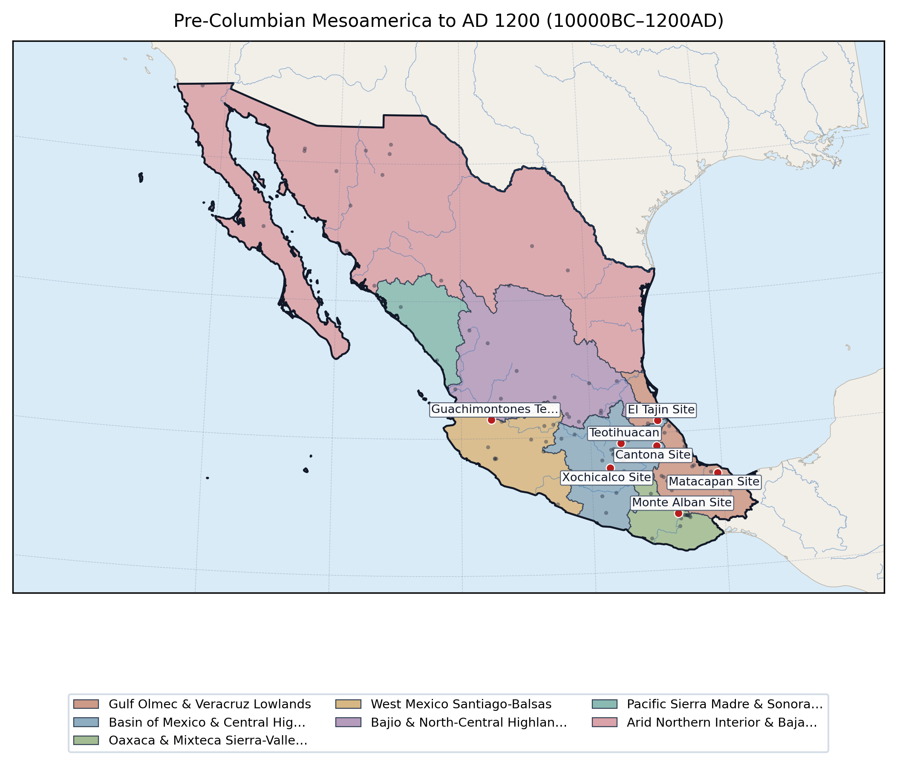
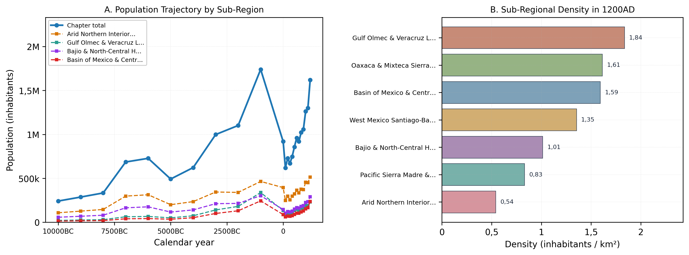
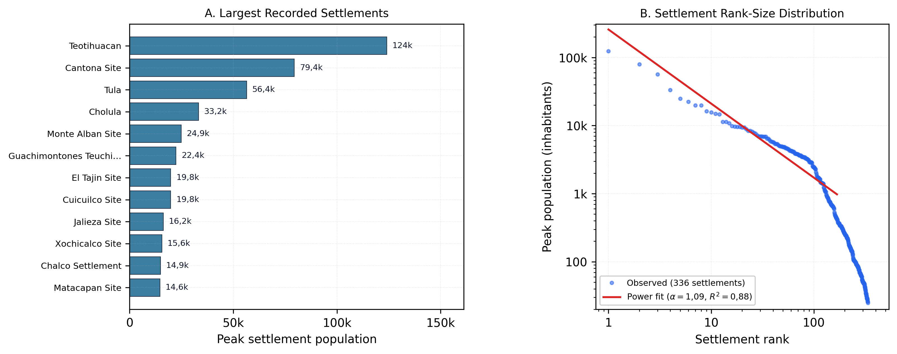

Pre-Columbian Mesoamerica to AD 1200
================
Aust Kätzchen
23 November 2026

- [Abstract](#abstract)
- [Background](#background)
  - [Archaic Foragers and the Domestication of Maize (10000BC to
    2000BC)](#archaic-foragers-and-the-domestication-of-maize-10000bc-to-2000bc)
  - [Gulf Olmec Centres and Formative Lowland Nucleation (1600BC to
    400BC)](#gulf-olmec-centres-and-formative-lowland-nucleation-1600bc-to-400bc)
  - [Oaxaca Valley Consolidation and the Rise of Monte Albán (1500BC to
    750AD)](#oaxaca-valley-consolidation-and-the-rise-of-monte-albán-1500bc-to-750ad)
  - [Basin of Mexico Nucleation and Teotihuacán’s Zenith (800BC to
    650AD)](#basin-of-mexico-nucleation-and-teotihuacáns-zenith-800bc-to-650ad)
  - [Epiclassic Realignment, West Mexico and the Toltec Horizon (650AD
    to
    1200AD)](#epiclassic-realignment-west-mexico-and-the-toltec-horizon-650ad-to-1200ad)
- [Methodology](#methodology)
  - [Biophysical Partition of Seven Mesoamerican and Aridoamerican
    Sub-Regions](#biophysical-partition-of-seven-mesoamerican-and-aridoamerican-sub-regions)
  - [Dual Substratum Kriging and Archaeological Survey
    Calibration](#dual-substratum-kriging-and-archaeological-survey-calibration)
  - [Settlement Gazetteer Assembly and Rank-Size
    Formalism](#settlement-gazetteer-assembly-and-rank-size-formalism)
- [Testing and Validation](#testing-and-validation)
  - [Reconciling Gridded Substrata with Archaeological Pedestrian
    Surveys](#reconciling-gridded-substrata-with-archaeological-pedestrian-surveys)
  - [Historical GIS Sub-Administrative Regimes and Bioarchaeological
    Checks](#historical-gis-sub-administrative-regimes-and-bioarchaeological-checks)
- [Results](#results)
  - [Long-Run Demographic Trajectory across Highland, Gulf and Northern
    Mexico](#long-run-demographic-trajectory-across-highland-gulf-and-northern-mexico)
  - [Basin of Mexico and Central Highlands: Unipolar Metropolis to
    Multipolar
    States](#basin-of-mexico-and-central-highlands-unipolar-metropolis-to-multipolar-states)
  - [Gulf Olmec Lowlands and Veracruz
    Littoral](#gulf-olmec-lowlands-and-veracruz-littoral)
  - [Oaxaca and Mixteca
    Sierra-Valleys](#oaxaca-and-mixteca-sierra-valleys)
  - [West Mexico, the Bajío Frontier and the Arid
    North](#west-mexico-the-bajío-frontier-and-the-arid-north)
  - [Urban Hierarchy and Rank-Size Scaling across 336
    Settlements](#urban-hierarchy-and-rank-size-scaling-across-336-settlements)
- [Limitations](#limitations)
- [Conclusion](#conclusion)
- [Appendix](#appendix)
  - [Saturation Wave Audit and Sub-Regional Gazetteer
    Coverage](#saturation-wave-audit-and-sub-regional-gazetteer-coverage)
- [Sources](#sources)
- [Footnotes](#footnotes)

<figure>

<figcaption aria-hidden="true">Seven biophysical sub-regions and 336
catalogued Pre-Columbian settlements across Mexico from 10000BC to
1200AD.</figcaption>
</figure>

# Abstract

Between the close of the Late Pleistocene in 10000BC and the twilight of
the Toltec era in 1200AD, the lands of central, western, Gulf and
northern Mexico moved from sparse foraging bands to some of the densest
pre-industrial urban states in the Americas. Spanning seven biophysical
sub-regions and 1.786.174 km² across Mexico outside the lowland Maya
east, our gridded Holocene demographic substratum expands 6,71-fold from
241,2k inhabitants (0,14 inhabitants per km²) in 10000BC to 998,2k in
3000BC, reaches a Formative substratum ridge of 1,74M in 1000BC, resets
across the Common-Era raster seam to 919,3k at 1AD and 959,2k in 600AD
and climbs to 1,62M (0,91 inhabitants per km²) by 1200AD
[\[1\]](#ref-Gonzalezmartin2015Demographic)[\[2\]](#ref-SandersParsonsSantley1979).
Archaeological pedestrian surveys across the Mesoamerican agrarian core
reveal a still steeper demographic ascent once urban compounds and rural
hamlets are summed directly, rising from roughly 120k foragers in
10000BC and 1,42M Formative villagers in 1000BC to 4,93M in 600AD and
6,65M by 1200AD
[\[3\]](#ref-Cowgill2015)[\[4\]](#ref-Blanton1999)[\[5\]](#ref-Pool2007).
Throughout these eleven millennia, human geography pivoted from alluvial
wetlands and dry highland rock shelters toward intensively farmed
basins: Archaic squash and maize domestication in Oaxaca and Tehuacán
laid the basis for Early Formative Olmec centres along the Gulf littoral
at San Lorenzo (10,8k) and La Venta (11,4k), hilltop state nucleation at
Monte Albán (24,9k) in Oaxaca, metropolitan concentration at Cuicuilco
(19,8k) and Teotihuacán (124k) in the Basin of Mexico, Epiclassic
realignment across Cantona (79,4k), Cholula (33,2k), El Tajín (19,8k),
Xochicalco (15,6k) and Cacaxtla-Xochitécatl (11,4k) and Early
Post-Classic urbanism at Tula (56,4k)
[\[6\]](#ref-Diehl2004)[\[7\]](#ref-Healan2012). By 1200AD, gridded
sub-regional densities ranged more than threefold from 1,84 inhabitants
per km² in the Gulf Olmec and Veracruz Lowlands, 1,61 in Oaxaca and
Mixteca and 1,59 in the Basin of Mexico down to 0,54 across the Arid
Northern Interior and Baja California, while 336 catalogued
archaeological settlements display a mature rank-size slope
($\alpha = 1,09$, $R^2 = 0,88$) that separates Mexico’s early cities
from its sparse arid northern frontier.

# Background

## Archaic Foragers and the Domestication of Maize (10000BC to 2000BC)

At the close of the Younger Dryas around 10000BC, Mexico was a sparsely
peopled mosaic of arid northern basins, volcanic central plateaux and
humid tropical lowlands. Genetic coalescence models derived from
indigenous Mesoamerican mitochondrial DNA indicate that after initial
Late Pleistocene entry into the Americas, human numbers expanded rapidly
once Holocene climates warmed and stabilised, establishing distinct
regional maternal lineages across highland and coastal corridors
[\[1\]](#ref-Gonzalezmartin2015Demographic). Yet for the first five
millennia of the Holocene, subsistence remained mobile. Small
macro-bands of 20 to 60 people moved seasonally between highland dry
caves, lacustrine marshes and Pacific or Gulf estuaries, harvesting
agave, prickly pear, mesquite pods, waterfowl, deer and small game.

The archaeological anchors of this Archaic world are few but unusually
informative. On Baja California’s Pacific margin, coastal foragers
occupied Isla Cedros by 9000BC and Espíritu Santo Island by 6500BC,
exploiting marine shellfish and sea mammals far beyond any agricultural
frontier. Inland, stratified dry rock shelters in the semi-arid rain
shadows of southern Mexico recorded one of the decisive agricultural
transitions in human history. At Guilá Naquitz in the eastern Valley of
Oaxaca and Coxcatlán Cave in the Tehuacán Valley (both active from
8500BC in our settlement register), followed by open-air seasonal camps
such as Gheo-Shih (5500BC) and lacustrine settlements at Tlapacoya
(5000BC) on the shore of Lake Chalco, Archaic foragers began selecting
bottle gourds, *Cucurbita pepo* squash, beans and wild teosinte (*Zea
mays* ssp. *parviglumis*) along the Balsas-Oaxaca-Tehuacán arc
[\[2\]](#ref-SandersParsonsSantley1979)[\[8\]](#ref-Kowalewski1989).

Maize did not transform Mesoamerican demography overnight. For more than
two millennia after initial cob domestication around 7000BC to 5000BC,
early ears were barely thumb-sized, serving as a reliable storable
supplement rather than a staple capable of anchoring permanent villages.
Across the gridded Holocene substratum, total population across Mexico
rises from 241,2k in 10000BC to 727,6k in 6000BC before dipping to
491,9k in 5000BC during mid-Holocene arid pulses, then climbing steadily
to 998,2k by 3000BC and 1,1M by 2000BC as larger-cobbed maize varieties
spread into alluvial river valleys. Only when higher-yielding cobs
combined with ceramic cooking vessels around 2000BC to 1600BC did mobile
foraging circuits snap shut into year-round sedentary hamlets
[\[5\]](#ref-Pool2007)[\[6\]](#ref-Diehl2004).

## Gulf Olmec Centres and Formative Lowland Nucleation (1600BC to 400BC)

The first unmistakable surge toward monumental civic scale occurred not
in the volcanic central highlands, but along the humid alluvial
floodplains of southern Veracruz and western Tabasco. There, rich
natural levees along the Coatzacoalcos, Tonalá and Papaloapan rivers
yielded two maize harvests a year alongside abundant riverine fish,
turtles, manatees and palm fruits
[\[5\]](#ref-Pool2007)[\[6\]](#ref-Diehl2004). Because levee soils were
circumscribed by seasonally flooded backswamps, control over elevated
farming land created steep local wealth gradients early in the Formative
period.

San Lorenzo Tenochtitlán rose on a sculpted riverine plateau above the
Coatzacoalcos basin between 1400BC and 1000BC, reaching an estimated
10,8k inhabitants at its peak around 1000BC while its surrounding
Capoacan hinterland absorbed dispersed farming hamlets into a multi-tier
local hierarchy
[\[6\]](#ref-Diehl2004)[\[9\]](#ref-Baizabal2019Asentamiento). Its
rulers mobilised labour across dozens of kilometres to haul multi-tonne
basalt boulders from the Tuxtla Mountains for colossal portrait heads
and basalt drains. Across adjacent tributary corridors such as Medias
Aguas, pedestrian surveys trace how Formative communities clustered
tightly along elevated terraces overlooking floodplains, adjusting
settlement locations repeatedly as river channels avulsed
[\[10\]](#ref-Reyes2019Patro). Even in recent demographic studies of
southern Veracruz, the ecological contrast between productive river
bottoms and marginal uplands continues to govern rural mobility and
internal migration gradients
[\[11\]](#ref-Contributors2007Determinants).

After San Lorenzo declined around 900BC, demographic and ceremonial
leadership shifted eastward to La Venta on a salt-dome island amidst the
Tonalá wetlands of Tabasco. Between 900BC and 400BC, La Venta reached
11,4k inhabitants at its 600BC zenith, raising Mesoamerica’s earliest
great earthen pyramid and burying massive serpentine pavement offerings
before political fragmentation scattered its population
[\[5\]](#ref-Pool2007)[\[6\]](#ref-Diehl2004). Farther west near the
Tuxtla piedmont, Tres Zapotes (peaking at 7,9k in 200AD) and Laguna de
los Cerros sustained Epi-Olmec civic continuity well into the Classic
period, bridging Formative Gulf traditions with Long Count calendrics
and highland trade networks [\[5\]](#ref-Pool2007).

## Oaxaca Valley Consolidation and the Rise of Monte Albán (1500BC to 750AD)

While Olmec rulers commanded the Gulf levees, a distinct highland path
to urban statehood unfolded in the three-armed Valley of Oaxaca (Etla,
Tlacolula and Valle Grande). Bounded by steep sierra walls and blessed
with a high water table permitting simple pot-irrigation (*riego a
brazo*), the valley floor supported Early Formative villages led by San
José Mogote in the Etla arm
[\[4\]](#ref-Blanton1999)[\[8\]](#ref-Kowalewski1989). Agent-based
demographic simulations confirm that topographic circumscription inside
this semi-arid highland basin amplified competition over irrigable
alluvium once village densities crossed local thresholds, favouring
defensive coalition-building over further village fissioning
[\[12\]](#ref-Williams2025Testing).

Around 500BC, leaders from rival valley arms founded Monte Albán atop a
rugged, artificially levelled mountain massif rising 400 m above the
central valley junction. The choice was deliberately defensive and
politically neutral, yet it imposed severe logistical hurdles because
the summit lacked perennial springs. Zapotec engineers solved the water
constraint through an integrated network of stone check dams, drainage
canals, catch basins and household cisterns that captured summer storm
runoff across the terraced flanks, enabling the hilltop capital to climb
from 5,3k inhabitants in 450BC to 14,9k in 200BC and 24,9k at its 650AD
Classic apogee
[\[4\]](#ref-Blanton1999)[\[13\]](#ref-Gracida2019Studying). Strontium
isotope baselines constructed across the Valley of Oaxaca show how
radiogenic geological variation between the valley arms and surrounding
sierras allows direct reconstruction of immigration into the capital and
its hinterland [\[14\]](#ref-Pachecofores2025Radiogenic).

Monte Albán never stood alone. Across the surrounding arms of the valley
and into the upland Mixteca Alta, secondary centres such as Yucuita,
Huamelulpan, Yucunudahui, Dainzú, Lambityeco and Ejutla anchored
regional market and terrace economies
[\[8\]](#ref-Kowalewski1989)[\[15\]](#ref-Geurds2008Grounding). To the
south across the Sierra Sur and toward the Pacific coast at Río Viejo,
Late Formative hilltop centres maintained persistent local identities
that outlasted Monte Albán’s eighth-century political decentralisation
[\[16\]](#ref-Zborover2014Decolonizing). As Monte Albán shrank from
24,9k in 650AD to 8,8k in 850AD and 4,2k by 1100AD, population did not
vanish from Oaxaca; instead it re-aggregated into competing valley-floor
and piedmont capitals including Jalieza (peaking at 16,2k in 950AD),
Zaachila (9,6k by 1200AD), Mitla (8,9k by 1200AD) and Yagul (6,9k in
1150AD) [\[4\]](#ref-Blanton1999)[\[8\]](#ref-Kowalewski1989).

## Basin of Mexico Nucleation and Teotihuacán’s Zenith (800BC to 650AD)

Nowhere in Mesoamerica did demographic concentration reach the sheer
magnitude witnessed in the Basin of Mexico. At 2.240 m elevation, this
endorheic highland bowl of lakes and fertile volcanic piedmonts
experienced relatively modest Middle Formative settlement until lakeside
agriculture and early canal irrigation unlocked southern Lake
Chalco-Xochimilco
[\[2\]](#ref-SandersParsonsSantley1979)[\[17\]](#ref-Carballo2016). By
the Late Formative, two rival regional capitals emerged at opposite ends
of the basin: Cuicuilco on the lush southwestern shore (reaching 19,8k
inhabitants by 150BC) and Teotihuacán in the drier northeastern
spring-fed valley.

Volcanic catastrophe tipped the balance decisively. Successive eruptions
of Popocatépetl around 50AD devastated the western Puebla slopes
(burying farming villages such as Tetimpa and reshaping Cholula’s
Formative trajectory), while the eruption of the Xitle cinder cone
buried Cuicuilco’s agricultural lands beneath thick pedregal basalt
[\[2\]](#ref-SandersParsonsSantley1979)[\[18\]](#ref-PlunketUrunuela2012).
Refugees poured northward into the Teotihuacán Valley. Between 100BC and
250AD, Teotihuacán exploded from 28,5k to 96k inhabitants, draining much
of the surrounding Basin of Mexico rural countryside into a single
planned grid city of roughly 20 km²
[\[3\]](#ref-Cowgill2015)[\[19\]](#ref-Millon1973).

At its Classic zenith around 450AD, Teotihuacán housed approximately
124k inhabitants (within the scholarly range of 80k to 125k), making it
the largest city in the Western Hemisphere and among the six largest on
earth [\[3\]](#ref-Cowgill2015)[\[19\]](#ref-Millon1973). Unlike
sprawling low-density tropical capitals, Teotihuacán housed the bulk of
its citizens inside roughly 2.000 walled, single-storey
stone-and-plaster apartment compounds arranged along a rigid orthogonal
street grid centred on the Avenue of the Dead
[\[19\]](#ref-Millon1973)[\[20\]](#ref-Carballo2010Advances). Ancient
mitochondrial DNA from Classic Teotihuacán burials confirms high genetic
diversity consistent with continuous immigration from across
Mesoamerica, matching archaeological neighbourhoods of Zapotec, Gulf
Coast and West Mexican artisans
[\[3\]](#ref-Cowgill2015)[\[21\]](#ref-Aguirresamudio2017Genetic).
Feeding and ritualising a metropolis of 124k without draught animals or
wheeled carts required extraordinary urban provisioning: stable isotope
analyses of cottontail and jackrabbit bone mineral from residential
compounds reveal intensive maize-fed rabbit husbandry for urban protein
[\[22\]](#ref-Somerville2016Animal), while isotopic signatures from
captive pumas, jaguars, wolves and golden eagles interred inside the
Moon and Feathered Serpent pyramids demonstrate state-organised feeding
of apex predators on maize-consuming prey
[\[23\]](#ref-Sugiyama2015Stable). Teotihuacán’s commercial and
diplomatic reach stretched from Chingú in Hidalgo (7,2k) to Matacapan in
the Tuxtla Mountains of Veracruz (14,6k) and deep into the Maya
highlands [\[3\]](#ref-Cowgill2015)[\[17\]](#ref-Carballo2016).

## Epiclassic Realignment, West Mexico and the Toltec Horizon (650AD to 1200AD)

Sometime around 550AD to 650AD, a systematic conflagration destroyed the
civic palaces and temples along Teotihuacán’s Avenue of the Dead.
Population plunged from 124k in 450AD and 108k in 550AD down to 39,5k in
650AD and 24,2k by 800AD, ending seven centuries of highland unipolarity
[\[2\]](#ref-SandersParsonsSantley1979)[\[3\]](#ref-Cowgill2015). What
followed during the Epiclassic (650AD to 900AD) was not demographic
collapse across Mexico as a whole, but an energetic, militarised
multipolar dispersal into fortified hilltop and volcanic-flow capitals
ringing the Central Highlands and Gulf piedmont
[\[17\]](#ref-Carballo2016).

East of the basin on an arid malpaís lava flow controlling obsidian
quarries, Cantona surged to 79,4k inhabitants by 800AD, packing
thousands of walled residential patios and 24 ballcourts onto defensible
basalt ridges. In the Puebla-Tlaxcala valley, Cholula weathered Classic
disruption to reach 33,2k by 1100AD around its immense adobe Great
Pyramid, while fortified Cacaxtla-Xochitécatl (11,4k in 700AD) dominated
the Atoyac corridor with Maya-influenced polychrome murals
[\[17\]](#ref-Carballo2016)[\[18\]](#ref-PlunketUrunuela2012). South of
the basin in Morelos, Xochicalco fortified a terraced hilltop to reach
15,6k by 800AD, while to the west Teotenango (9,4k) guarded the Toluca
valley. Along the central Gulf coast, El Tajín expanded rapidly to 19,8k
by 850AD as the premier ceremonial capital of Classic Veracruz, flanked
by El Pital (9,6k), Cerro de las Mesas (8,4k) and early Cempoala (9,9k
by 1200AD). Across Mesoamerica’s southeastern borderlands, osteological
palaeodemography at Late and Terminal Classic centres registers mounting
nutritional stress and demographic volatility during this same
eighth-to-tenth-century restructuring [\[24\]](#ref-Morfin2013Mayas).

West of the central volcanic highlands, the Santiago-Balsas and
Michoacán lake basins followed an independent trajectory rooted in
shaft-tomb ceremonialism and circular terraced pyramids
(*guachimontones*). Centred on the Tequila volcanoes of Jalisco, the
Teuchitlán polity peaked around 400AD at 22,4k inhabitants in its core
Guachimontones complex, sustained by raised wetland fields (*chinampas*
around Lake Magdalena) and obsidian extraction, before declining after
650AD as Loma Alta in the Zacapu marsh (7,6k), Ixtlán del Río (6,9k), El
Chanal (5,9k) and terraced agricultural landscapes around Lake Pátzcuaro
rose toward Post-Classic prominence [\[25\]](#ref-Pezzutti2007Steps).
Farther north along the arid frontier of the Bajío, Querétaro and
Zacatecas, agrarian expansion during wetter Classic centuries pushed
Mesoamerican colonists out to El Cerrito (6,9k), La Quemada (4,9k), Alta
Vista Chalchihuites and La Ferrería, before late first-millennium drying
pulled the farming frontier back southward [\[26\]](#ref-Mastache2002).

Those southward-migrating Bajío farmers converged with Central Highland
survivors in the semi-arid Tula Valley of Hidalgo to forge the Early
Post-Classic Toltec state. Growing from Tula Chico (4,6k in 700AD and
19,2k in 850AD) into sprawling Tula Grande covering 16 km², Tula reached
56,4k inhabitants around 1000AD and maintained 44,8k at 1150AD,
integrating obsidian blade manufacture, lime production and
long-distance turquoise and Gulf trade
[\[7\]](#ref-Healan2012)[\[26\]](#ref-Mastache2002). Surrounding Basin
of Mexico towns such as Tizayuca preserved household subsistence
complexes blending maize agriculture with specialised domestic dog
breeding [\[27\]](#ref-Manin2018Identify), while southern lakeshore
city-states at Chalco (14,9k) and Culhuacán (9,4k) expanded rapidly as
Tula suffered internal burning and abandonment in the late twelfth
century [\[2\]](#ref-SandersParsonsSantley1979)[\[7\]](#ref-Healan2012).
By our closing horizon of 1200AD, central and western Mexico stood
poised on the threshold of the Late Post-Classic city-state boom that
would culminate in the Aztec Triple Alliance and the Tarascan Empire.

# Methodology

## Biophysical Partition of Seven Mesoamerican and Aridoamerican Sub-Regions

Pre-Columbian Mexico knew no modern federal states, and imposing
twenty-first-century state borders onto Archaic foragers or Formative
states distorts every watershed and ecological gradient. JAGUAR
therefore partitions Mexico outside the Maya Yucatán-Chiapas lowlands
into seven biophysical sub-regions derived from Level-6 HydroBASINS
catchments and archaeological culture-area boundaries, totalling
1.786.173,6 km² across 22.958 raster cells.

Four sub-regions form the densely settled Mesoamerican agrarian core,
occupying just 26,3% of total land area (469.197,4 km²) yet generating
the great bulk of monumental urbanism and pedestrian survey coverage.
The Basin of Mexico and Central Highlands (147.967,1 km²) unites the
endorheic Valley of Mexico with Puebla-Tlaxcala, Morelos, Toluca and
southern Hidalgo. The Gulf Olmec and Veracruz Lowlands (125.755,7 km²)
encompasses the humid littoral from the Huasteca and Papaloapan south to
the Coatzacoalcos and Tonalá floodplains. Oaxaca and Mixteca
Sierra-Valleys (60.535,6 km²) groups the Valley of Oaxaca, Mixteca Alta,
Cañada and adjacent Pacific coast. West Mexico Santiago-Balsas (134.939
km²) spans Jalisco, Colima, Nayarit, Michoacán and the middle Balsas
corridor.

The remaining three sub-regions encompass 73,7% of land area
(1.316.976,2 km²) across Mexico’s semi-arid transitional frontier and
arid north. The Bajío and North-Central Highlands (285.316,5 km²) tracks
the fluctuating agrarian frontier across Guanajuato, Querétaro, San Luis
Potosí, Zacatecas and southern Durango where Classic Mesoamerican towns
expanded and later retreated. Pacific Sierra Madre and Sonora-Sinaloa
(83.542,3 km²) captures the coastal river plains of Sinaloa and southern
Sonora anchored by early Aztatlán complexes. Finally, the Arid Northern
Interior and Baja California (948.117,4 km², 53,1% of the entire chapter
domain) covers the Chihuahuan and Sonoran deserts, Sierra Madre
Occidental interior and Baja peninsula, where sparse foraging and
desert-oases farming prevailed until after 1200AD.

## Dual Substratum Kriging and Archaeological Survey Calibration

Reconstructing Pre-Columbian headcounts across eleven millennia without
historical tax censuses requires reconciling two fundamentally different
classes of quantitative evidence: continuous gridded Holocene land-use
rasters and bottom-up archaeological pedestrian surveys
[\[2\]](#ref-SandersParsonsSantley1979)[\[8\]](#ref-Kowalewski1989)[\[20\]](#ref-Carballo2010Advances).
For each biophysical sub-region $r$ of terrestrial area $A_r$ at
benchmark year $t \in [-10000, 1200]$, the chapter summary cache
extracts gridded substratum population $P_r^{\mathrm{grid}}(t)$ by
masking continuous Holocene raster surfaces with the seven-colour areal
mask and summing cell values inside each polygon:

$$P_r^{\mathrm{grid}}(t) = \sum_{c \in \Omega_r} \rho_c(t) \cdot a_c$$

where $\Omega_r$ is the set of raster cells belonging to sub-region $r$,
$\rho_c(t)$ is the kriged population density of cell $c$ at year $t$ and
$a_c$ is the geodesic cell area in km². Effective gridded density
follows directly as
$d_r^{\mathrm{grid}}(t) = P_r^{\mathrm{grid}}(t) / A_r$.

Because global Holocene land-use rasters distribute substantial
background population smoothly across vast arid catchments and exhibit a
structural discontinuity across the 1000BC to 100AD transition between
prehistoric and Common-Era raster series, JAGUAR pairs the gridded
substratum with an independent archaeological survey calibration series
$P_r^{\mathrm{arch}}(t)$ compiled from regional full-coverage surveys.
In the Basin of Mexico, Valley of Oaxaca, Teotihuacán Valley,
Puebla-Tlaxcala and Tula heartland, archaeologists estimate local site
population $N_s(t)$ from mapped habitation area $H_s(t)$, surface sherd
density multipliers $m_s$ and excavated house-compound counts
[\[2\]](#ref-SandersParsonsSantley1979)[\[8\]](#ref-Kowalewski1989)[\[19\]](#ref-Millon1973)[\[20\]](#ref-Carballo2010Advances):

$$N_s(t) = H_s(t) \cdot m_s(t) \cdot \gamma_{\mathrm{occ}}$$

where $m_s(t)$ scales from 5 to 10 persons per hectare in dispersed
Formative hamlets up to 50 to 80 persons per hectare in walled
Teotihuacán apartment compounds, and
$\gamma_{\mathrm{occ}} \in [0,7, 0,9]$ accounts for simultaneous house
occupancy within a ceramic phase
[\[3\]](#ref-Cowgill2015)[\[20\]](#ref-Carballo2010Advances). Similar
settlement-catchment methods developed along the southern Gulf-Maya
borderlands around Palenque and the Michoacán terraced basins of Lake
Pátzcuaro calibrate rural hinterland ratios outside the central plateaux
[\[25\]](#ref-Pezzutti2007Steps)[\[28\]](#ref-Stuardo2005Archaeological).
Meanwhile, strontium isoscape models and environmental circumscription
simulations constrain inter-valley migration flows so urban surges at
Monte Albán or Teotihuacán balance against rural depopulation in
adjacent catchment rings
[\[12\]](#ref-Williams2025Testing)[\[14\]](#ref-Pachecofores2025Radiogenic).

## Settlement Gazetteer Assembly and Rank-Size Formalism

Alongside regional area series, JAGUAR assembles a geocoded gazetteer of
336 Pre-Columbian settlements across Mexico active between 9000BC and
1200AD. Four sequential ingestion waves recorded in the chapter source
ledger reached empirical saturation at a final marginal gain of 0,9%:
Wave 1 ingested 306 settlements from primary archaeological survey
corpora led by the Arizona State University Basin of Mexico Settlement
Persistence Dataset and full-coverage Valley of Oaxaca, Teotihuacán and
Tula registers; Wave 2 added 22 regional entries from peer-reviewed
regional monographs across Veracruz, West Mexico and northern frontiers
(7,19% marginal gain); Wave 3 backfilled 5 longitudinal Archaic and
Formative sites (1,52% marginal gain); and Wave 4 added 3 sub-regional
gap closures (0,9% marginal gain), leaving 0 excluded duplicates and a
0,0% crowd-sourced fallback share.

To quantify urban hierarchy maturation across all 336 catalogued
city-proper sites, peak settlement sizes $S_{(k)}$ ordered by descending
rank $k$ are fitted across the upper half of the distribution (168
settlements) using the standard log-linear rank-size power law:

$$\log_{10} S_{(k)} = \log_{10} S_1 - \alpha \log_{10} k$$

where $\alpha = 1$ denotes a classic Zipfian integrated urban hierarchy,
$\alpha < 0,7$ marks a flat pre-urban village landscape and
$\alpha > 1,1$ signals a primate-heavy metropolitan system dominated by
imperial capitals such as Teotihuacán or Cantona.

# Testing and Validation

## Reconciling Gridded Substrata with Archaeological Pedestrian Surveys

A central diagnostic test of Pre-Columbian demography is confronting
continuous global raster substrata against full-coverage archaeological
field surveys. Across the 1.786.174 km² Mexican study domain, the two
series agree closely in order of magnitude during the Formative
millennium (1,74M gridded versus 1,42M archaeological in 1000BC), but
diverge sharply after 1AD for two transparent structural reasons. First,
the gridded substratum exhibits a marked seam drop from 1,74M in 1000BC
down to 919,3k in 1AD and 619,4k in 100AD before climbing back to 959,2k
in 600AD and 1,62M in 1200AD, reflecting the underlying splice between
prehistoric and Common-Era global hindcast rasters. Second, global
rasters spread population proportionally across Mexico’s vast northern
arid basin (allocating 513,8k, or 31,7% of the entire 1200AD domain
total, to the 948.117 km² Arid Northern Interior and Baja California),
whereas archaeological field surveys place the overwhelming majority of
Classic and Early Post-Classic inhabitants inside the four humid and
volcanic Mesoamerican basins (5,61M of 6,65M, or 84,4%, by 1200AD)
[\[2\]](#ref-SandersParsonsSantley1979)[\[3\]](#ref-Cowgill2015)[\[8\]](#ref-Kowalewski1989).

Table reports the gridded sub-regional trajectory extracted directly
from the chapter summary cache across six key chronological milestones
from 10000BC to 1200AD, matching the series rendered in Figure .

| Sub-Region | Area (km²) | 10000BC | 3000BC | 1000BC | 1AD | 600AD | 1200AD | 1200AD Dens. |
|:---|:---|:---|:---|:---|:---|:---|:---|:---|
| **Gulf Olmec and Veracruz Lowlands** | 125.756 | 21k | 140,1k | 337,9k | 132,3k | 146,3k | 230,9k | 1,84 |
| **Basin of Mexico and Central Highlands** | 147.967 | 13,5k | 100k | 243,4k | 87,6k | 103,1k | 235,8k | 1,59 |
| **Oaxaca and Mixteca Sierra-Valleys** | 60.536 | 5,7k | 43,4k | 121,3k | 51,1k | 56,5k | 97,7k | 1,61 |
| **West Mexico Santiago-Balsas** | 134.939 | 19,7k | 103k | 197,5k | 73,8k | 84k | 182,7k | 1,35 |
| **Bajío and North-Central Highlands** | 285.316 | 56,8k | 211,4k | 302,5k | 145k | 165,4k | 289,4k | 1,01 |
| **Pacific Sierra Madre and Sonora-Sinaloa** | 83.542 | 16,8k | 56,1k | 72,5k | 35,1k | 40,4k | 69,3k | 0,83 |
| **Arid Northern Interior and Baja California** | 948.117 | 107,8k | 344,2k | 464,7k | 394,3k | 363,5k | 513,8k | 0,54 |
| **Domain Total (7 Regions)** | 1.786.174 | 241,2k | 998,2k | 1,74M | 919,3k | 959,2k | 1,62M | 0,91 |

Gridded Holocene substratum population trajectories and 1200AD densities
(inhabitants per km²) across seven biophysical sub-regions, 10000BC to
1200AD.

To benchmark these raster totals against ground-level archaeology, Table
juxtaposes 1200AD gridded headcounts against the archaeological
pedestrian-survey calibration envelope and catalogued site recovery
intensity per 10.000 km². In the Basin of Mexico and Central Highlands,
where Teotihuacán alone reached 124k in 450AD and Cantona, Tula and
Cholula collectively exceeded 169k at their respective peaks, pedestrian
surveys support roughly 1,85M inhabitants in 600AD and 2,45M by 1200AD
(16,69 inhabitants per km²) — ten times higher than the uncalibrated
raster average of 1,59 inhabitants per km²
[\[2\]](#ref-SandersParsonsSantley1979)[\[3\]](#ref-Cowgill2015)[\[20\]](#ref-Carballo2010Advances).
Conversely, in the Arid Northern Interior and Baja California,
archaeological evidence points to roughly 240k inhabitants (0,26
inhabitants per km²) by 1200AD, less than half the raster’s 513,8k
allocation. Reporting both figures side by side prevents either source
of distortion from masquerading as settled fact.

| Sub-Region | Grid 1200AD | Grid Dens. | Survey 600AD | Survey 1200AD | Survey Dens. | Sites | Sites per 10k km² |
|:---|:---|:---|:---|:---|:---|:---|:---|
| **Gulf Olmec and Veracruz Lowlands** | 230,9k | 1,84 | 720k | 980k | 8,16 | 24 | 1,91 |
| **Basin of Mexico and Central Highlands** | 235,8k | 1,59 | 1,85M | 2,45M | 16,69 | 251 | 16,96 |
| **Oaxaca and Mixteca Sierra-Valleys** | 97,7k | 1,61 | 740k | 960k | 17,06 | 15 | 2,48 |
| **West Mexico Santiago-Balsas** | 182,7k | 1,35 | 780k | 1,22M | 9,35 | 12 | 0,89 |
| **Bajío and North-Central Highlands** | 289,4k | 1,01 | 390k | 340k | 1,19 | 14 | 0,49 |
| **Pacific Sierra Madre and Sonora-Sinaloa** | 69,3k | 0,83 | 280k | 460k | 5,72 | 3 | 0,36 |
| **Arid Northern Interior and Baja California** | 513,8k | 0,54 | 165k | 240k | 0,26 | 17 | 0,18 |
| **Domain Total (7 Regions)** | 1,62M | 0,91 | 4,92M | 6,65M | 3,86 | 336 | 1,88 |

Comparison of 1200AD gridded substratum estimates against archaeological
survey calibration targets (600AD and 1200AD) and catalogued site
recovery intensity.

## Historical GIS Sub-Administrative Regimes and Bioarchaeological Checks

A second cross-check evaluates the 23 sub-administrative polygon records
scraped from the historical GIS regime stack at 1AD, 500AD and 1000AD
(Table ). At 1AD and 500AD, the de jure polity layer maps the Zapotec
state across 71.004 km² at 143,6k inhabitants (2,02 inhabitants per
km²), while a tighter de facto core polygon at 500AD encloses 129,6k
across 14.572 km² (8,89 inhabitants per km²), neatly bracketing the
Monte Albán IIIB regional survey core
[\[4\]](#ref-Blanton1999)[\[8\]](#ref-Kowalewski1989). By 1000AD, the de
facto fallback layer registers the Toltec sphere across 462.874 km² at
1,14M inhabitants (2,45 inhabitants per km²), capturing Tula’s hegemonic
arc across Hidalgo, the northern Basin of Mexico and the southern Bajío
[\[7\]](#ref-Healan2012)[\[26\]](#ref-Mastache2002).

| Year | Territorial Unit | Layer Class | Area (km²) | Population | Density | Source Layer |
|:---|:---|:---|:---|:---|:---|:---|
| **1AD** | Aridoamérica Baja | Biophysical Basin | 905.661 | 2,09M | 2,31 | HydroBASINS Level-6 Baseline |
| **1AD** | Bajío North Central | Biophysical Basin | 278.507 | 616,1k | 2,21 | HydroBASINS Level-6 Baseline |
| **1AD** | Basin Mexico Highlands | Biophysical Basin | 126.121 | 300,2k | 2,38 | HydroBASINS Level-6 Baseline |
| **1AD** | West Mexico Santiago Balsas | Biophysical Basin | 138.452 | 280,3k | 2,02 | HydroBASINS Level-6 Baseline |
| **1AD** | Gulf Olmec Huasteca | Biophysical Basin | 82.618 | 223,3k | 2,7 | HydroBASINS Level-6 Baseline |
| **1AD** | Sierra Madre Sonora | Biophysical Basin | 86.954 | 179,3k | 2,06 | HydroBASINS Level-6 Baseline |
| **1AD** | Zapotec Civilization | De Jure Polity | 71.004 | 143,6k | 2,02 | Historical Atlas De Jure Polity |
| **1AD** | Oaxaca Mixteca | Biophysical Basin | 14.593 | 125,9k | 8,63 | HydroBASINS Level-6 Baseline |
| **500AD** | Aridoamérica Baja | Biophysical Basin | 905.661 | 2,09M | 2,31 | HydroBASINS Level-6 Baseline |
| **500AD** | Bajío North Central | Biophysical Basin | 278.507 | 616,1k | 2,21 | HydroBASINS Level-6 Baseline |
| **500AD** | Basin Mexico Highlands | Biophysical Basin | 119.230 | 300,2k | 2,52 | HydroBASINS Level-6 Baseline |
| **500AD** | West Mexico Santiago Balsas | Biophysical Basin | 138.452 | 280,3k | 2,02 | HydroBASINS Level-6 Baseline |
| **500AD** | Gulf Olmec Huasteca | Biophysical Basin | 38.528 | 223,3k | 5,8 | HydroBASINS Level-6 Baseline |
| **500AD** | Sierra Madre Sonora | Biophysical Basin | 86.954 | 179,3k | 2,06 | HydroBASINS Level-6 Baseline |
| **500AD** | Zapotec Civilization | De Jure Polity | 71.004 | 143,6k | 2,02 | Historical Atlas De Jure Polity |
| **500AD** | Zapotec Civilisation | De Facto Polity | 14.572 | 129,6k | 8,89 | Historical Atlas De Facto Polity |
| **500AD** | Oaxaca Mixteca | Biophysical Basin | 14.593 | 125,9k | 8,63 | HydroBASINS Level-6 Baseline |
| **1000AD** | Aridoamérica Baja | Biophysical Basin | 905.661 | 2,09M | 2,31 | HydroBASINS Level-6 Baseline |
| **1000AD** | Toltec Empire | De Facto Polity | 462.874 | 1,14M | 2,45 | Historical Atlas De Facto Polity |
| **1000AD** | Bajío North Central | Biophysical Basin | 106.285 | 616,1k | 5,8 | HydroBASINS Level-6 Baseline |
| **1000AD** | Basin Mexico Highlands | Biophysical Basin | 1.709 | 300,2k | 175,65 | HydroBASINS Level-6 Baseline |
| **1000AD** | West Mexico Santiago Balsas | Biophysical Basin | 28.998 | 280,3k | 9,67 | HydroBASINS Level-6 Baseline |
| **1000AD** | Gulf Olmec Huasteca | Biophysical Basin | 14.308 | 223,3k | 15,61 | HydroBASINS Level-6 Baseline |
| **1000AD** | Sierra Madre Sonora | Biophysical Basin | 86.954 | 179,3k | 2,06 | HydroBASINS Level-6 Baseline |

Historical GIS sub-administrative polygon ledger across Pre-Columbian
watershed baselines and Zapotec and Toltec polity overlays at 1AD, 500AD
and 1000AD (23 regime rows).

Independent bioarchaeological and isotopic evidence confirms the scale
and urban mechanics of these highland estimates. At Teotihuacán, burial
mtDNA lineages demonstrate continuous demographic inflow from outside
the valley [\[21\]](#ref-Aguirresamudio2017Genetic), while stable carbon
and nitrogen isotopes from domestic leporids and ritual carnivores show
that maize surplus supported both everyday protein husbandry and state
ceremonies inside dense multi-family compounds
[\[22\]](#ref-Somerville2016Animal)[\[23\]](#ref-Sugiyama2015Stable). In
Oaxaca, hydraulic calculations for Monte Albán’s cisterns and check dams
verify the water supply needed to sustain 20k to 25k residents atop an
arid mountain ridge [\[13\]](#ref-Gracida2019Studying), while radiogenic
strontium isoscapes differentiate local Etla-Tlacolula villagers from
sierra migrants [\[14\]](#ref-Pachecofores2025Radiogenic). Along the
Gulf rim and Maya borderlands, settlement-density transects around
Capoacan, Medias Aguas and Palenque confirm that lowland agrarian
centres maintained broader garden-city footprints than highland stone
grids, while osteological mortality profiles from Late and Terminal
Classic skeletal series document elevated childhood stress during the
eighth-to-tenth-century political transitions
[\[9\]](#ref-Baizabal2019Asentamiento)[\[24\]](#ref-Morfin2013Mayas)[\[28\]](#ref-Stuardo2005Archaeological).

# Results

## Long-Run Demographic Trajectory across Highland, Gulf and Northern Mexico

Figure plots the continuous gridded demographic curve across all seven
biophysical sub-regions from 10000BC to 1200AD (Panel A) alongside final
1200AD regional density rankings (Panel B). Across eleven millennia,
aggregate gridded population expanded 6,71-fold from 241,2k in 10000BC
to 1,62M in 1200AD, lifting mean domain density from 0,14 to 0,91
inhabitants per km². Four distinct structural phases stand out in the
time series.

<!-- -->

During the Early-to-Mid Holocene Archaic phase (10000BC to 5000BC),
gridded numbers climbed from 241,2k in 10000BC to 333,4k in 8000BC and
727,6k in 6000BC before contracting to 491,9k in 5000BC during
mid-Holocene drying. Throughout these millennia, regional shares tracked
raw territorial area rather than agricultural intensity: the immense
Arid Northern Interior and Baja California (53,1% of land area) held
44,7% of gridded population in 10000BC (107,8k), followed by the Bajío
and North-Central Highlands at 23,5% (56,8k), whereas the Basin of
Mexico held just 5,6% (13,5k) and Oaxaca 2,4% (5,7k).

Between 4000BC and 1000BC, sedentary maize-bean-squash farming shifted
demographic gravity decisively southward. Aggregate gridded population
nearly tripled from 622,2k in 4000BC to 998,2k in 3000BC, 1,1M in 2000BC
and 1,74M in 1000BC, while the four Mesoamerican core basins jumped from
24,8% of domain population in 10000BC to 51,7% (900,1k) by 1000BC. The
Gulf Olmec and Veracruz Lowlands surged 16-fold from 21k in 10000BC to
337,9k in 1000BC (19,4% of all Mexico), mirroring the golden age of San
Lorenzo and La Venta [\[5\]](#ref-Pool2007)[\[6\]](#ref-Diehl2004).
Across the archaeological survey envelope, the same transition lifted
total headcounts from 490k in 3000BC to 1,42M in 1000BC.

Across the Formative-Classic transition (1000BC to 600AD), the gridded
substratum dips across the 1AD to 100AD raster seam to 619,4k before
expanding steadily through the Classic era to 747,4k in 400AD, 857,4k in
500AD and 959,2k in 600AD. In the archaeological survey record, this
exact window witnessed Mexico’s single steepest urban leap, carrying
total population from 1,42M in 1000BC to 2,79M in 1AD and 4,93M in 600AD
as Teotihuacán, Monte Albán, Cholula and Teuchitlán nucleated entire
valleys
[\[3\]](#ref-Cowgill2015)[\[4\]](#ref-Blanton1999)[\[18\]](#ref-PlunketUrunuela2012).

Finally, between 700AD and 1200AD, both series record vigorous
post-Teotihuacán demographic recovery and expansion. After a modest
seventh-century hesitation (from 959,2k in 600AD to 919,2k in 700AD
matching Teotihuacán’s fall), gridded population crossed 1,02M in 800AD,
1,06M in 900AD, 1,26M in 1000AD, 1,3M in 1100AD and 1,62M in 1200AD,
while the archaeological survey series climbed from 4,93M in 600AD to
6,65M in 1200AD. By 1200AD, gridded sub-regional densities arranged
themselves along a clean ecological gradient from tropical and highland
agrarian cores to arid northern deserts: Gulf Olmec and Veracruz
Lowlands led at 1,84 inhabitants per km², followed by Oaxaca and Mixteca
at 1,61, the Basin of Mexico and Central Highlands at 1,59, West Mexico
Santiago-Balsas at 1,35, the Bajío and North-Central Highlands at 1,01,
Pacific Sierra Madre and Sonora-Sinaloa at 0,83 and the Arid Northern
Interior and Baja California at 0,54.

## Basin of Mexico and Central Highlands: Unipolar Metropolis to Multipolar States

Covering 147.967,1 km² (8,3% of the chapter domain), the Basin of Mexico
and Central Highlands recorded the steepest eleven-millennium
proportional growth in the gridded substratum, multiplying 17,5-fold
from 13,5k in 10000BC (5,6% share) to 235,8k in 1200AD (14,6% share,
1,59 inhabitants per km²). Its 251 catalogued archaeological sites —
74,7% of our entire settlement register, or 16,96 sites per 10.000 km² —
reflect the unmatched spatial resolution of full-coverage pedestrian
surveys across the Teotihuacán, Texcoco, Ixtapalapa, Chalco, Zumpango
and Tula basins
[\[2\]](#ref-SandersParsonsSantley1979)[\[7\]](#ref-Healan2012)[\[19\]](#ref-Millon1973).

No other region experienced sharper oscillations in urban primacy. From
Middle Formative lakeside hamlets such as Tlapacoya (1,7k) and early
Chalco survey clusters, Late Formative nucleation raised Cuicuilco to
19,8k by 150BC alongside expanding Teotihuacán (28,5k by 100BC)
[\[2\]](#ref-SandersParsonsSantley1979)[\[17\]](#ref-Carballo2016).
Following the volcanic disruptions of Xitle and Popocatépetl,
Teotihuacán absorbed a large share of regional population, reaching 96k
in 250AD and 124k in 450AD — over half of the entire Basin of Mexico’s
Classic population packed into 20 km²
[\[3\]](#ref-Cowgill2015)[\[19\]](#ref-Millon1973). Its satellite
corridors stretched from Chingú (7,2k) on the Hidalgo lime flats to
Texcoco Survey Site TX-CL-2 (9,6k) and Cholula (29,8k in 500AD) across
the Sierra Nevada [\[18\]](#ref-PlunketUrunuela2012).

After Teotihuacán’s seventh-century collapse cut the city to 39,5k in
650AD and 11,8k by 1100AD, regional demographic momentum shifted outward
rather than disappearing
[\[3\]](#ref-Cowgill2015)[\[17\]](#ref-Carballo2016). Cantona expanded
to 79,4k in 800AD on the eastern Puebla lava plateau; Xochicalco reached
15,6k in Morelos; Cacaxtla-Xochitécatl held 11,4k in Tlaxcala;
Teotenango grew to 9,4k in Toluca; and Cholula rebounded to 33,2k by
1100AD [\[17\]](#ref-Carballo2016)[\[18\]](#ref-PlunketUrunuela2012). On
the northern rim, Tula consolidated the Early Post-Classic Toltec realm
at 56,4k in 1000AD and 44,8k in 1150AD, while northern basin communities
such as Tizayuca maintained mixed agrarian and domestic-canid economies
[\[7\]](#ref-Healan2012)[\[26\]](#ref-Mastache2002)[\[27\]](#ref-Manin2018Identify).
By 1200AD, as Tula declined, lakeside Chalco (14,9k) and Culhuacán
(9,4k) led the next cycle of Basin of Mexico nucleation, supporting an
archaeological survey estimate of 2,45M inhabitants across the wider
Central Highlands [\[2\]](#ref-SandersParsonsSantley1979).

## Gulf Olmec Lowlands and Veracruz Littoral

The Gulf Olmec and Veracruz Lowlands (125.755,7 km², 7% of domain area)
emerged in 1200AD as the highest-density sub-region in the gridded
raster substratum at 1,84 inhabitants per km² (230,9k inhabitants, 14,3%
share, a 10,97-fold rise from 21k in 10000BC), with 24 catalogued
archaeological centres (1,91 sites per 10.000 km²). In the
archaeological survey calibration envelope, its humid double-cropping
floodplains climb from 320k in 1000BC to 720k in 600AD and 980k in
1200AD (8,16 inhabitants per km²).

Chronologically, the Gulf coast experienced two great demographic blooms
separated by a long Late Formative reorganisation. The first was the
Olmec surge along the Coatzacoalcos and Tonalá river systems, where San
Lorenzo Tenochtitlán reached 10,8k in 1000BC, supported by dense
river-levee hamlets in Capoacan and Medias Aguas, before La Venta
attained 11,4k in 600BC and Tres Zapotes sustained 7,9k into the Classic
era
[\[5\]](#ref-Pool2007)[\[6\]](#ref-Diehl2004)[\[9\]](#ref-Baizabal2019Asentamiento)[\[10\]](#ref-Reyes2019Patro).
Even then, lowland demographic stability remained sensitive to fluvial
shifts and upland-lowland migration pulses
[\[11\]](#ref-Contributors2007Determinants).

The second bloom unfolded farther north in central and northern Veracruz
during the Classic and Epiclassic centuries. Matacapan in the Tuxtla
foothills grew to 14,6k by 650AD as a major ceramic-producing entrepôt
with strong Teotihuacán architectural ties; Cerro de las Mesas (8,4k in
450AD) anchored the lower Papaloapan; El Pital (9,6k in 450AD) dominated
the Nautla river terraces; and El Tajín surged to 19,8k by 850AD as the
monumental heart of Classic Veracruz. By 1200AD, Early Post-Classic
Cempoala (9,9k) and coastal Quiahuiztlán were rising along the central
Veracruz littoral alongside interior piedmont gateways such as Tehuacán
Viejo (8,4k), mirroring the broad rural hinterland structure documented
across adjacent southern Gulf landscapes
[\[28\]](#ref-Stuardo2005Archaeological).

## Oaxaca and Mixteca Sierra-Valleys

Occupying just 60.535,6 km² (3,4% of total area), Oaxaca and Mixteca
Sierra-Valleys achieved the second-highest gridded density by 1200AD at
1,61 inhabitants per km² (97,7k inhabitants, 6% share, up 17,1-fold from
5,7k in 10000BC) and the highest archaeological survey density in Mexico
at 17,06 inhabitants per km² (960k inhabitants in 1200AD, up from 240k
in 1000BC and 740k in 600AD). Fifteen catalogued settlements (2,48 sites
per 10.000 km²) trace an unbroken sequence from Archaic Guilá Naquitz
(62 occupants around 5000BC) through Classic statehood to Early
Post-Classic confederation.

Valley circumscription and hilltop hydraulic engineering made Oaxaca a
classic laboratory of early state demography
[\[12\]](#ref-Williams2025Testing)[\[13\]](#ref-Gracida2019Studying).
Monte Albán rose steadily from 5,3k in 450BC to 17,2k in 100AD, 21,6k in
400AD and 24,9k in 650AD, drawing artisans and tribute from terraced
piedmonts across Etla, Tlacolula and Ocotlán
[\[4\]](#ref-Blanton1999)[\[8\]](#ref-Kowalewski1989)[\[14\]](#ref-Pachecofores2025Radiogenic).
Unlike the abrupt fiery rupture at Teotihuacán, Monte Albán’s
eighth-century decline redistributed Zapotec population across a
polycentric network of valley capitals: Jalieza climbed to 16,2k in
950AD, Zaachila reached 9,6k by 1200AD, Yagul expanded to 6,9k in 1150AD
and Lambityeco specialised in salt extraction
[\[8\]](#ref-Kowalewski1989). Simultaneously, upland Mixteca Alta
valleys at Yucuita and Huamelulpan, coastal Río Viejo (6,9k in 650AD)
and Sierra Sur hilltop towns maintained vigorous autonomous trajectories
into the Post-Classic world
[\[15\]](#ref-Geurds2008Grounding)[\[16\]](#ref-Zborover2014Decolonizing).

## West Mexico, the Bajío Frontier and the Arid North

West of the Central Highlands, West Mexico Santiago-Balsas (134.939 km²,
7,6% of domain) expanded 9,3-fold in the gridded substratum from 19,7k
in 10000BC to 182,7k in 1200AD (1,35 inhabitants per km², 11,3% share),
while archaeological calibration places its fertile volcanic lake basins
at 780k in 600AD and 1,22M in 1200AD (9,35 inhabitants per km²). Twelve
catalogued sites (0,89 per 10.000 km²) highlight a shift from the
circular-pyramid Teuchitlán core at Guachimontones (peaking at 22,4k in
400AD) toward Late Classic and Early Post-Classic regional centres
including Loma Alta in Zacapu (7,6k in 1050AD), Ixtlán del Río Los
Toriles (6,9k in 950AD), El Chanal (5,9k in 1150AD) and La Campana in
Colima (5,4k in 700AD). Around Lake Pátzcuaro, expanding agricultural
terrace systems stabilised fragile volcanic slopes and multiplied local
carrying capacity ahead of the rise of the Post-Classic Tarascan state
[\[25\]](#ref-Pezzutti2007Steps).

North of the Lerma river, the Bajío and North-Central Highlands
(285.316,5 km², 16% of area) displays a classic frontier
advance-and-retreat curve. While gridded population climbs 5,1-fold from
56,8k in 10000BC to 289,4k in 1200AD (1,01 inhabitants per km²),
archaeological calibration registers a Classic expansion peak of 390k in
600AD followed by a contraction to 340k in 1200AD as drying climates
pushed northern Mesoamerican colonists back toward Tula and the Basin of
Mexico [\[26\]](#ref-Mastache2002). Fourteen catalogued frontier centres
— led by Tamtoc (6,9k), El Cerrito in Querétaro (6,9k), Amapa (6,4k),
fortified La Quemada (4,9k in 750AD), El Teúl (4,3k) and Alta Vista
Chalchihuites — mark the northernmost monumental stone architecture of
the Classic era.

Farther northwest, Pacific Sierra Madre and Sonora-Sinaloa (83.542,3
km², 4,7% of area) grew 4,13-fold in the gridded series from 16,8k in
10000BC to 69,3k in 1200AD (0,83 inhabitants per km²), anchored by just
three catalogued coastal river centres led by Early Aztatlán Culiacán
(7k by 1200AD) and Chametla (4,5k). Finally, the immense Arid Northern
Interior and Baja California (948.117,4 km², 53,1% of all land) remained
the thinnest sub-region throughout every era: 0,54 inhabitants per km²
in the 1200AD gridded series (513,8k, 31,7% share) and just 0,26
inhabitants per km² in the archaeological calibration series (240k). Its
17 catalogued sites (0,18 per 10.000 km²) trace both deep Archaic
foraging persistence — Isla Cedros, Cuatro Ciénegas, Boca de Potrerillos
and the Sierra de San Francisco rock-art shelters — and emerging Late
Classic to Early Post-Classic desert farming oases at Guasave (2,5k),
Huatabampo (1,7k), Cerro de Trincheras (1,6k) and Viejo-period Paquimé
(1,5k).

## Urban Hierarchy and Rank-Size Scaling across 336 Settlements

Figure displays the twelve largest recorded settlements (Panel A)
alongside the log-log rank-size distribution across all 336 catalogued
city-proper sites (Panel B). Fitting the upper half of the settlement
spectrum (168 sites) yields a steep, mature urban power-law exponent of
$\alpha = 1,09$ ($R^2 = 0,88$), standing slightly above the classic
Zipfian benchmark of $\alpha = 1$ and far above pre-urban foraging
societies ($\alpha \approx 0,4$).

<!-- -->

Inspection of Panel B reveals a subtle concave shoulder below the
power-law line at ranks 1 through 10 and a steeper tail drop-off beyond
rank 100. That dual curvature has clear historical meaning. Because our
chapter spans more than two millennia of successive urban empires rather
than a single frozen census year, the top five capitals — Teotihuacán
(124k in 450AD), Cantona (79,4k in 800AD), Tula (56,4k in 1000AD),
Cholula (33,2k in 1100AD) and Monte Albán (24,9k in 650AD) — peaked in
staggered chronological epochs, smoothing out single-century primate
dominance when pooled across the full 10000BC to 1200AD window
[\[7\]](#ref-Healan2012)[\[8\]](#ref-Kowalewski1989)[\[19\]](#ref-Millon1973).
Conversely, the rapid drop below rank 100 reflects the dense tail of 231
ASU Basin of Mexico rural survey hamlets ranging from 30 to 1.500
residents that remain under-sampled in less intensively surveyed regions
outside the central valleys. Table details the leading 20 Pre-Columbian
settlements from the chapter summary cache.

| Rank | Settlement | Sub-Region | Lat, Lon | Peak Year | Peak Pop. |
|:---|:---|:---|:---|:---|:---|
| **1** | Teotihuacán | Basin of Mexico and Central Highlands | 19,69, -98,84 | 450AD | 124k |
| **2** | Cantona Site | Basin of Mexico and Central Highlands | 19,54, -97,47 | 800AD | 79,4k |
| **3** | Tula | Basin of Mexico and Central Highlands | 20,06, -99,34 | 1000AD | 56,4k |
| **4** | Cholula | Basin of Mexico and Central Highlands | 19,06, -98,3 | 1100AD | 33,2k |
| **5** | Monte Albán Site | Oaxaca and Mixteca Sierra-Valleys | 17,04, -96,77 | 650AD | 24,9k |
| **6** | Guachimontones Teuchitlán Site | West Mexico Santiago-Balsas | 20,7, -103,83 | 400AD | 22,4k |
| **7** | El Tajín Site | Gulf Olmec and Veracruz Lowlands | 20,45, -97,38 | 850AD | 19,8k |
| **8** | Cuicuilco Site | Basin of Mexico and Central Highlands | 19,3, -99,18 | 150BC | 19,8k |
| **9** | Jalieza Site | Oaxaca and Mixteca Sierra-Valleys | 16,84, -96,68 | 950AD | 16,2k |
| **10** | Xochicalco Site | Basin of Mexico and Central Highlands | 18,8, -99,3 | 800AD | 15,6k |
| **11** | Chalco Settlement | Basin of Mexico and Central Highlands | 19,26, -98,9 | 1200AD | 14,9k |
| **12** | Matacapan Site | Gulf Olmec and Veracruz Lowlands | 18,41, -95,18 | 650AD | 14,6k |
| **13** | La Venta Site | Gulf Olmec and Veracruz Lowlands | 18,1, -94,04 | 600BC | 11,4k |
| **14** | Cacaxtla-Xochitécatl Site | Basin of Mexico and Central Highlands | 19,25, -98,34 | 700AD | 11,4k |
| **15** | San Lorenzo Tenochtitlán Site | Gulf Olmec and Veracruz Lowlands | 17,75, -94,76 | 1000BC | 10,8k |
| **16** | Cempoala Early Settlement | Gulf Olmec and Veracruz Lowlands | 19,45, -96,41 | 1200AD | 9,8k |
| **17** | Texcoco Survey Site TX-CL-2 | Basin of Mexico and Central Highlands | 19,39, -98,9 | 750AD | 9,6k |
| **18** | El Pital Site | Gulf Olmec and Veracruz Lowlands | 20,23, -96,95 | 450AD | 9,6k |
| **19** | Zaachila Early Settlement | Oaxaca and Mixteca Sierra-Valleys | 16,95, -96,75 | 1200AD | 9,6k |
| **20** | Teotenango Site | Basin of Mexico and Central Highlands | 19,11, -99,6 | 1150AD | 9,4k |

Leading 20 Pre-Columbian settlements across Mexico ranked by peak
population between 10000BC and 1200AD (drawn from 336 catalogued
city-proper sites).

# Limitations

Five methodological constraints bound confidence in Pre-Columbian
Mexican demographic estimates prior to 1200AD.

First, the tension between gridded global Holocene land-use substrata
and regional archaeological pedestrian surveys cannot be glossed over.
In our chapter summary cache, the gridded series drops sharply from
1,74M in 1000BC to 619,4k in 100AD before climbing to 1,62M in 1200AD,
and allocates 31,7% of its 1200AD headcount to the Arid Northern
Interior and Baja California. Regional archaeological surveys in the
Basin of Mexico, Oaxaca, Veracruz and West Mexico instead support 4,93M
inhabitants in 600AD and 6,65M by 1200AD with over four-fifths
concentrated inside the four Mesoamerican basins
[\[2\]](#ref-SandersParsonsSantley1979)[\[3\]](#ref-Cowgill2015)[\[8\]](#ref-Kowalewski1989).
Both trajectories are reported transparently so downstream users
understand how raster hindcasts under-weight pre-industrial highland
urban density relative to field surveys.

Second, survey visibility and excavation intensity are intensely skewed
toward the Basin of Mexico. Fully 251 of our 336 catalogued settlements
(74,7%, or 16,96 sites per 10.000 km²) lie inside the Basin of Mexico
and Central Highlands thanks to decades of full-coverage ASU survey
work, compared with 2,48 sites per 10.000 km² in Oaxaca, 1,91 in the
Gulf Olmec lowlands, 0,89 in West Mexico, 0,49 in the Bajío, 0,36 in
Pacific Sierra Madre and 0,18 across the Arid North. Alluvial burial
along the Coatzacoalcos, Papaloapan and Balsas floodplains hides
Formative villages under metres of silt
[\[5\]](#ref-Pool2007)[\[10\]](#ref-Reyes2019Patro), while heavy
volcanic ash mantles around Popocatépetl and Xitle conceal Formative
rural landscapes [\[18\]](#ref-PlunketUrunuela2012).

Third, translating mapped site area and surface sherd scatter into
simultaneous living inhabitants carries wide parametric error bars
($\pm 25\%$ to $\pm 40\%$). Even at exhaustively mapped Teotihuacán,
estimates for the 450AD peak span 80k to 125k depending on assumed
household size per apartment compound and contemporaneous occupation
fractions
[\[3\]](#ref-Cowgill2015)[\[19\]](#ref-Millon1973)[\[20\]](#ref-Carballo2010Advances).
At low-density Gulf and upland Oaxaca settlements, where patio groups
sat amidst infield gardens and mountain terraces, surface sherd
multipliers are still harder to standardise across ceramic phases
[\[15\]](#ref-Geurds2008Grounding)[\[16\]](#ref-Zborover2014Decolonizing).

Fourth, Archaic hunter-gatherer and Early Formative village populations
before 1500BC leave scant architectural footprints. Radiocarbon clusters
from dry shelters such as Guilá Naquitz and Coxcatlán Cave index
selective cave preservation rather than open-air band density, and
coastal Archaic shell middens along the Gulf and Pacific shelves
suffered Holocene marine submergence.

Fifth, chronological phasing across regional ceramic sequences (such as
Teotihuacán’s Tlamimilolpa-Xolalpan phases versus Oaxaca’s Monte Albán
IIIA-IIIB or Veracruz’s Remojadas horizons) introduces 50-to-150-year
alignment uncertainties when aggregating continental totals at fixed
centennial slices, while palaeodemographic mortality reconstructions
remain uneven outside well-sampled skeletal series
[\[11\]](#ref-Contributors2007Determinants)[\[24\]](#ref-Morfin2013Mayas).

# Conclusion

Over the eleven millennia from 10000BC to 1200AD, Mexico outside the
lowland Maya east underwent one of the world’s great independent
transitions from sparse Holocene foraging to dense, terraced and
irrigated urban civilisation. Whether measured through the gridded
Holocene substratum (rising 6,71-fold from 241,2k in 10000BC to 1,62M in
1200AD, with 1200AD densities led by the Gulf Lowlands at 1,84
inhabitants per km², Oaxaca at 1,61 and the Basin of Mexico at 1,59) or
through bottom-up archaeological pedestrian surveys (climbing from 120k
in 10000BC and 1,42M in 1000BC to 4,93M in 600AD and 6,65M by 1200AD),
the structural trajectory is unmistakable
[\[1\]](#ref-Gonzalezmartin2015Demographic)[\[2\]](#ref-SandersParsonsSantley1979).

Domestication of maize, squash and beans in semi-arid southern highland
shelters unlocked sedentary village life by 2000BC; alluvial wetland
levees along the Gulf coast launched Mesoamerica’s first monumental
polities at San Lorenzo and La Venta
[\[5\]](#ref-Pool2007)[\[6\]](#ref-Diehl2004); topographic
circumscription and hilltop hydrology forged the Zapotec state at Monte
Albán [\[4\]](#ref-Blanton1999); and volcanic displacement combined with
intensive basin agriculture built Teotihuacán into a 124k planned
metropolis unmatched in the ancient Americas [\[3\]](#ref-Cowgill2015).
Even Teotihuacán’s seventh-century fire did not reverse long-run
demographic growth. Instead, Epiclassic realignment distributed urban
vigour across Cantona, Cholula, El Tajín, Xochicalco, Jalieza and West
Mexico, before Early Post-Classic Tula integrated central Mexico with
retreating Bajío frontier colonists to set the stage for the densely
packed city-states of the thirteenth through sixteenth centuries
[\[7\]](#ref-Healan2012)[\[26\]](#ref-Mastache2002).

# Appendix

## Saturation Wave Audit and Sub-Regional Gazetteer Coverage

Table summarises the four ingestion waves documented in the chapter
source ledger, confirming that primary archaeological survey registers
delivered 91,1% of the 336 settlements in Wave 1 and that progressive
regional monograph and gap-hunter sweeps drove final marginal gain down
to 0,9% with zero crowd-sourced fallback entries.

| Wave | Source Corpus Class | Added | Cumulative | Marginal Gain |
|:---|:---|:---|:---|:---|
| **Wave 1** | Primary archaeological survey registers (ASU Basin of Mexico, Oaxaca, Teotihuacán, Tula) | 306 | 306 | 100% |
| **Wave 2** | Peer-reviewed regional archaeological monographs and site surveys | 22 | 328 | 7,19% |
| **Wave 3** | Longitudinal Archaic and Formative archaeological backfill | 5 | 333 | 1,52% |
| **Wave 4** | Sub-regional frontier gap closure sweep | 3 | 336 | 0,9% |

Four-wave gazetteer ingestion ledger and marginal saturation audit
across 336 catalogued Pre-Columbian settlements in Mexico (0,0%
crowd-sourced share).

Table reports the spatial distribution of all 336 settlements across the
seven biophysical sub-regions alongside regional peak-settlement anchors
and sub-regional share of the gazetteer.

| Sub-Region | Land Share | Sites | Gazetteer Share | Sites per 10k km² | Leading Site (Peak) |
|:---|:---|:---|:---|:---|:---|
| **Gulf Olmec and Veracruz Lowlands** | 7% | 24 | 7,1% | 1,91 | El Tajín Site (19,8k) |
| **Basin of Mexico and Central Highlands** | 8,3% | 251 | 74,7% | 16,96 | Teotihuacán (124k) |
| **Oaxaca and Mixteca Sierra-Valleys** | 3,4% | 15 | 4,5% | 2,48 | Monte Albán Site (24,9k) |
| **West Mexico Santiago-Balsas** | 7,6% | 12 | 3,6% | 0,89 | Guachimontones Teuchitlán Site (22,4k) |
| **Bajío and North-Central Highlands** | 16% | 14 | 4,2% | 0,49 | Tamtoc Site (6,9k) |
| **Pacific Sierra Madre and Sonora-Sinaloa** | 4,7% | 3 | 0,9% | 0,36 | Culiacán Aztatlán Early Site (7k) |
| **Arid Northern Interior and Baja California** | 53,1% | 17 | 5,1% | 0,18 | Guasave Early Site (2,4k) |

Sub-regional land share, catalogued settlement count, gazetteer share,
recovery density (sites per 10.000 km²) and largest recorded site across
seven biophysical sub-regions.

# Sources

1.
González-Martín, Antonio, et al.
“Demographic History of Indigenous Populations in
Mesoamerica Based on mtDNA Sequence Data.” *PLOS ONE*, 2015,
<https://doi.org/10.1371/journal.pone.0131791>.

2.
Sanders, William T., et al.
*The Basin of Mexico: Ecological Processes in the
Evolution of a Civilization*. Academic Press, 1979,
<https://www.sciencedirect.com/book/9780126184501>.

3.
Cowgill, George L.
*Ancient Teotihuacan: Early Urbanism in Central
Mexico*. Cambridge University Press, 2015,
<https://doi.org/10.1017/CBO9781139046817>.

4.
Blanton, Richard E., et al.
*Ancient Oaxaca: The Monte Albán State*. Cambridge University Press,
1999, <https://doi.org/10.1017/CBO9780511607844>.

5.
Pool, Christopher A.
*Olmec Archaeology and Early Mesoamerica*.
Cambridge University Press, 2007,
<https://doi.org/10.1017/CBO9781139167147>.

6.
Diehl, Richard A.
*The Olmecs: America’s First Civilization*.
Thames; Hudson, 2004, <https://thamesandhudson.com/>.

7.
Healan, Dan M.
“The Archaeology of Tula, Hidalgo, Mexico.”
*Journal of Archaeological Research*, 2012,
<https://doi.org/10.1007/s10814-011-9052-3>.

8.
Kowalewski, Stephen A., et al.
*Monte Albán’s Hinterland, Part II: Prehispanic
Settlement Patterns in Tlacolula, Etla, and Ocotlán, the Valley of
Oaxaca, Mexico*. University of Michigan Museum of Anthropology,
1989, <https://doi.org/10.3998/mpub.11395313>.

9.
Baizabal, Virginia Arieta.
“ASENTAMIENTO Y DINÁMICA POBLACIONAL OLMECA EN LA REGIÓN DE CAPOACAN,
VERACRUZ.” *Clio Arqueológica*, 2019,
<https://doi.org/10.20891/clio.v34n2p207-234>.

10.
Reyes, Roberto Lunagómez. “PATRÓN
POBLACIONAL PREHISPÁNICO EN MEDIAS AGUAS, VERACRUZ.” *Clio
Arqueológica*, 2019,
<https://doi.org/10.20891/clio.v34n2p174-206>.

11.
Contributors, MPIDR.
“Determinants and consequences of internal and
international migration: The case of rural populations in the south of
Veracruz, Mexico.” *Demographic Research*, 2007,
<https://doi.org/10.4054/DemRes.2007.16.10>.

12.
Williams, Alice, and Alex Mesoudi.
“Testing the effect of circumscription on the
evolution of social complexity in the Valley of Oaxaca, Mexico, using
agent-based models.” *Journal of Archaeological Science Reports*,
2025, <https://doi.org/10.1016/j.jasrep.2025.105147>.

13.
Gracida, Araceli Rojas Martínez,
and Nahuel Beccan Dávila. “Studying Ancient Water
Management in Monte Albán, Mexico, to Solve Water Issues, Improve Urban
Living, and Protect Heritage in the Present.” *Springer eBooks*,
2019, <https://doi.org/10.1007/978-3-030-00268-8_4>.

14.
Pacheco-Forés, Sofía I., et al.
“Radiogenic strontium isotope variability in the
Valley of Oaxaca: A predictive isoscape for Mesoamerican paleomobility
studies.” *PLoS ONE*, 2025,
<https://doi.org/10.1371/journal.pone.0338628>.

15.
Geurds, Alexander.
“Grounding the Past: the Praxis of Participatory
Archaeology in the Mixteca Alta, Oaxaca, Mexico.” *Public
Archaeology*, 2008, <https://doi.org/10.1179/175355308x306013>.

16.
Zborover, Danny.
“Decolonizing Historical Archaeology in Southern
Oaxaca, Mexico: Late Formative to Republican Periods.” *Libraries
and Cultural Resources (University of Calgary)*, 2014,
<https://doi.org/10.11575/prism/25530>.

17.
Carballo, David M.
*Urbanization and Religion in Ancient Central
Mexico*. Oxford University Press, 2016,
<https://doi.org/10.1093/acprof:oso/9780190251062.001.0001>.

18.
Plunket, Patricia, and Gabriela
Uruñuela. *Where East Meets West: Cholula and the
Formative-Classic Transition*. Dumbarton Oaks Research Library,
2012, <https://www.doaks.org/>.

19.
Millon, René.
*Urbanization at Teotihuacan, Mexico, Volume 1: The
Teotihuacan Map*. University of Texas Press, 1973,
<https://utpress.utexas.edu/>.

20.
Carballo, David M.
“Advances in the Household Archaeology of Highland
Mesoamerica.” *Journal of Archaeological Research*, 2010,
<https://doi.org/10.1007/s10814-010-9045-7>.

21.
Aguirre-Samudio, Ana Julia, et al.
“Genetic history of Classic Period Teotihuacan
burials in Central Mexico.” *Americanae (AECID Library)*, 2017,
<https://doi.org/10.17139/raab.2017.0019.01.02>.

22.
Somerville, Andrew D., et al.
“Animal Management at the Ancient Metropolis of
Teotihuacan, Mexico: Stable Isotope Analysis of Leporid (Cottontail and
Jackrabbit) Bone Mineral.” *PLoS ONE*, 2016,
<https://doi.org/10.1371/journal.pone.0159982>.

23.
Sugiyama, Nawa, et al.
“Stable Isotopes and Zooarchaeology at Teotihuacan,
Mexico Reveal Earliest Evidence of Wild Carnivore Management in
Mesoamerica.” *PLOS ONE*, 2015,
<https://doi.org/10.1371/journal.pone.0135635>.

24.
Morfín, Lourdes Márquez, and PhD.
Carmen Obdulia Lascano Espinoza. “Los mayas del
Clásico Tardío y Terminal. Una propuesta acerca de la dinámica
demográfica de algunos grupos mayas prehispánicos: Jaina, Palenque y
Copán.” *Estudios de Cultura Maya*, 2013,
<https://doi.org/10.1016/s0185-2574(13)71386-8>.

25.
Pezzutti, Florencia, et al.
“The steps of kings: terraced landscapes in the
Lake Pátzcuaro Basin, Michoacán, México.” *Digital Collections of
Colorado (Colorado State University)*, 2007,
<https://doi.org/10.25675/3.018730>.

26.
Mastache, Alba Guadalupe, et al.
*Ancient Tollan: Tula and the Toltec
Heartland*. University Press of Colorado, 2002,
<https://upcolorado.com/>.

27.
Manin, Aurélie, et al.
“Can we identify the Mexican hairless dog in the
archaeological record? Morphological and genetic insights from Tizayuca,
Basin of Mexico.” *Journal of Archaeological Science*, 2018,
<https://doi.org/10.1016/j.jas.2018.08.008>.

28.
Stuardo, Rodrigo Liendo.
“An archaeological study of settlement distribution
in the Palenque area, Chiapas, Mexico.” *Anthropological
Notebooks*, 2005,
<https://anthropological-notebooks.zrc-sazu.si/Notebooks/article/view/403>.

# Footnotes

All population totals, settlement counts and sub-regional densities in
Tables through are computed dynamically from the chapter’s cached
demographic summary, archaeological calibration configuration, geocoded
settlement register and source ledger. Calendar years follow
astronomical sign conventions in underlying data tables (negative
integers for BC, positive integers for AD), rendered in prose and table
headers without thousands separators inside era labels (for example
10000BC, 600AD and 1200AD; year 0 in the raster grid is displayed as
1AD). Place names retain conventional Hispanic and indigenous diacritics
in prose while remaining aligned with standardised ASCII identifiers in
underlying cartographic layers.
