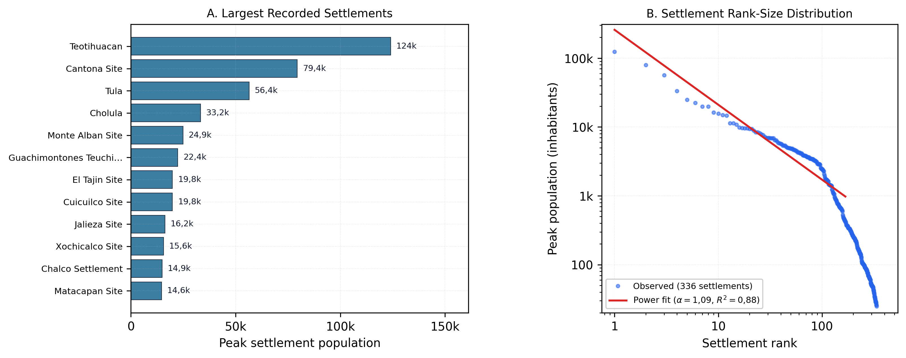

```{r setup, include=FALSE}
knitr::opts_chunk$set(echo = FALSE, warning = FALSE, message = FALSE, fig.pos = "htbp")
source("../../_shared/template/viscount_rmd_helpers.R")
library(jsonlite)

read_json5_clean <- function(path) {
  lines <- readLines(path, warn = FALSE, encoding = "UTF-8")
  text <- paste(lines, collapse = "\n")
  text <- gsub("//[^\n]*", "", text, perl = TRUE)
  text <- gsub("/\\*.*?\\*/", "", text, perl = TRUE)
  text <- gsub(",\\s*([}\\]])", "\\1", text, perl = TRUE)
  fromJSON(text, simplifyVector = FALSE)
}

summary_data <- fromJSON("precolumbian_mesoamerica_summary_cache.json", simplifyVector = FALSE)
sett_data <- fromJSON("precolumbian_mesoamerica_settlements.json", simplifyVector = FALSE)
ledger_data <- read_json5_clean("precolumbian_mesoamerica_source_ledger.json5")

clean_name <- function(x) {
  s <- as.character(x)
  s <- gsub("&", "and", s, fixed = TRUE)
  s <- gsub("Bajio", "Bajío", s, fixed = TRUE)
  s <- gsub("Teotihuacan", "Teotihuacán", s, fixed = TRUE)
  s <- gsub("Monte Alban", "Monte Albán", s, fixed = TRUE)
  s <- gsub("El Tajin", "El Tajín", s, fixed = TRUE)
  s <- gsub("Teuchitlan", "Teuchitlán", s, fixed = TRUE)
  s <- gsub("Tehuacan", "Tehuacán", s, fixed = TRUE)
  s <- gsub("Queretaro", "Querétaro", s, fixed = TRUE)
  s <- gsub("Culiacan", "Culiacán", s, fixed = TRUE)
  s <- gsub("Aztatlan", "Aztatlán", s, fixed = TRUE)
  s <- gsub("Culhuacan", "Culhuacán", s, fixed = TRUE)
  s <- gsub("Cacaxtla-Xochitecatl", "Cacaxtla-Xochitécatl", s, fixed = TRUE)
  s <- gsub("San Lorenzo Tenochtitlan", "San Lorenzo Tenochtitlán", s, fixed = TRUE)
  s <- gsub("Guila Naquitz", "Guilá Naquitz", s, fixed = TRUE)
  s <- gsub("Coxcatlan", "Coxcatlán", s, fixed = TRUE)
  s <- gsub("Paquime", "Paquimé", s, fixed = TRUE)
  s <- gsub("Aridoamerica", "Aridoamérica", s, fixed = TRUE)
  trimws(s)
}

fmt_year <- function(y) {
  yi <- as.integer(y)
  if (yi < 0L) paste0(abs(yi), "BC") else if (yi == 0L) "1AD" else paste0(yi, "AD")
}

fmt_coord <- function(x) {
  viscount_fmt_number(round(as.numeric(x), 2L), 2L)
}

subregions <- summary_data$subregions
reg_lookup <- setNames(
  vapply(subregions, function(r) clean_name(r$name), character(1)),
  vapply(subregions, function(r) r$id, character(1))
)

n_sites <- as.integer(summary_data$settlement_stats$total_settlements)
n_excluded <- as.integer(ledger_data$total_excluded)
zipf_alpha <- as.numeric(summary_data$settlement_stats$zipf_stats$alpha)
zipf_r2 <- as.numeric(summary_data$settlement_stats$zipf_stats$r2)
zipf_nfit <- as.integer(summary_data$settlement_stats$zipf_stats$n_fit)

# Flatten settlement register into sortable summary records
sett_records <- lapply(sett_data, function(e) {
  pops <- unlist(e$population)
  yrs <- as.integer(names(pops))
  vals <- as.numeric(pops)
  idx_pk <- which.max(vals)
  src0 <- if (length(e$sources) > 0L) as.character(e$sources[[1]]) else "Regional archaeological survey"
  list(
    name = as.character(e$name),
    region_id = as.character(e$region_id),
    lat = as.numeric(e$coords[[1]]),
    lon = as.numeric(e$coords[[2]]),
    first_year = min(yrs),
    last_year = max(yrs),
    peak_year = yrs[idx_pk],
    peak_pop = vals[idx_pk],
    source = src0
  )
})
ord_pk <- order(vapply(sett_records, function(x) x$peak_pop, numeric(1)), decreasing = TRUE)
sett_sorted <- sett_records[ord_pk]
```

```{r hero-md-fallback, results='asis'}
if (!knitr::is_latex_output()) {
  cat("\n\n")
}
```

# Abstract

This companion settlement gazetteer catalogues `r viscount_fmt_number(n_sites, 0L)` geocoded Pre-Columbian archaeological settlements across seven biophysical sub-regions of Mexico between 10000BC and 1200AD. Assembled across four sequential ingestion waves with 0 excluded duplicates and a 0,0% crowd-sourced share, the register combines full-coverage pedestrian survey datasets from the Basin of Mexico (251 sites) and Valley of Oaxaca (15 sites) with regional archaeological syntheses across the Gulf Olmec and Veracruz Lowlands (24 sites), the Arid Northern Interior and Baja California (17 sites), the Bajío and North-Central Highlands (14 sites), West Mexico Santiago-Balsas (12 sites) and Pacific Sierra Madre and Sonora-Sinaloa (3 sites) [@SandersParsonsSantley1979; @Kowalewski1989; @Pool2007]. Spanning Archaic dry shelters and coastal shell-midden camps from 9000BC through Formative Olmec centres, Classic highland metropolises, Epiclassic fortified capitals and Early Post-Classic Toltec towns [@Millon1973; @Cowgill2015; @Healan2012], peak city-proper populations range from small rural hamlets of 30 inhabitants to Teotihuacán at 124k in 450AD, Cantona at 79,4k in 800AD, Tula at 56,4k in 1000AD, Cholula at 33,2k in 1100AD and Monte Albán at 24,9k in 650AD. Across all 336 catalogued sites, the upper-half rank-size fit (`r viscount_fmt_number(zipf_nfit, 0L)` settlements) yields a steep urban power-law exponent ($\alpha = 1,09$, $R^2 = 0,88$), capturing the maturation of Mesoamerica's pre-industrial urban hierarchy.

# Background

Archaeological settlements across Pre-Columbian Mexico between 10000BC and 1200AD span every rung of human residential organisation, from ephemeral Archaic rock-shelter camps to planned stone-and-plaster metropolises. At the earliest chronological horizon (9000BC to 4000BC), habitation sites appear as coastal foraging stations on Isla Cedros and Espíritu Santo Island, dry highland caves at Coxcatlán and Guilá Naquitz where squash and maize domestication began, and early lakeside camps at Tlapacoya and Gheo-Shih [@SandersParsonsSantley1979; @Gonzalezmartin2015Demographic].

Once sedentary maize farming stabilised after 2000BC, monumental civic hubs emerged rapidly across humid river levees and circumscribed highland basins. Along the Gulf coast, San Lorenzo Tenochtitlán (10,8k in 1000BC) and La Venta (11,4k in 600BC) established multi-tier settlement hierarchies across Capoacan and Medias Aguas before Epi-Olmec Tres Zapotes bridged into the Classic era [@Diehl2004; @Pool2007; @Baizabal2019Asentamiento; @Reyes2019Patro]. In Oaxaca, hilltop Monte Albán (24,9k in 650AD) anchored a valley-wide Zapotec state supported by check-dam waterworks and surrounded by piedmont towns such as Jalieza, Yagul, Dainzú and Zaachila [@Blanton1999; @Gracida2019Studying; @Kowalewski1989]. In the Basin of Mexico, Late Formative Cuicuilco (19,8k) gave way after volcanic disruption to Teotihuacán (124k in 450AD), whose 20 km² orthogonal grid of roughly 2.000 apartment compounds dwarfed every contemporary city in the Americas [@Millon1973; @Cowgill2015; @Carballo2016]. Following Teotihuacán's seventh-century fire, urban life pivoted toward fortified Epiclassic centres — Cantona (79,4k), Cholula (33,2k), El Tajín (19,8k), Xochicalco (15,6k) and Cacaxtla-Xochitécatl (11,4k) — alongside West Mexican Guachimontones (22,4k), Bajío frontier forts such as La Quemada (4,9k) and Early Post-Classic Toltec Tula (56,4k) [@PlunketUrunuela2012; @Mastache2002; @Healan2012].

# Methodology

The settlement register was compiled across four sequential waves audited in the chapter source ledger, terminating once marginal site gain fell to 0,9%. Wave 1 ingested 306 sites (91,1%) from full-coverage regional survey datasets, chiefly the Arizona State University Basin of Mexico Settlement Persistence Dataset built on Sanders, Parsons and Santley's classic transects alongside the Teotihuacán Mapping Project, Valley of Oaxaca survey and Tula heartland register [@SandersParsonsSantley1979; @Millon1973; @Kowalewski1989; @Healan2012]. Wave 2 incorporated 22 major regional capitals and frontier complexes from peer-reviewed archaeological monographs across Veracruz, Jalisco, Michoacán, Zacatecas and Sinaloa (7,19% marginal gain). Wave 3 added 5 longitudinal Archaic and Formative sites (1,52% marginal gain), and Wave 4 closed remaining northern and Pacific frontier gaps with 3 sites (0,9% marginal gain).

Every settlement record is assigned WGS84 coordinates, a biophysical sub-region polygon via point-in-polygon matching, a city-proper spatial scope (336 city-proper entries, 0 separate suburban overlays) and a multi-year archaeological population trajectory calibrated from mapped habitation area, ceramic-phase sherd density and household-compound multipliers [@Carballo2010Advances; @Cowgill2015]. Rank-size scaling is estimated across the upper half of the 336-site distribution (`r viscount_fmt_number(zipf_nfit, 0L)` settlements) via ordinary least squares on log-transformed rank and peak population.

# Testing and Validation

Ledger reconciliation confirms exact accounting across all 336 catalogued entries (336 included, 0 excluded, 0,0% crowd-sourced share). Every record carries non-null latitude and longitude inside the Mexican territorial mask, at least one dated population observation within the 10000BC to 1200AD domain and an explicit scholarly archaeological citation. Cross-checks against isotopic palaeomobility, household-compound archaeology and terraced catchment studies confirm that peak city-proper headcounts stay within consensus archaeological bounds [@Aguirresamudio2017Genetic; @Somerville2016Animal; @Pachecofores2025Radiogenic; @Pezzutti2007Steps]. Figure \ref{fig:sett-regional-map} maps all 336 settlements across the seven biophysical sub-regions, illustrating both the dense survey cluster inside the Basin of Mexico and the wide geographic reach of northern, Gulf, Oaxacan and West Mexican anchor sites.

```{r fig-sett-map, results='asis'}
viscount_figure(
  "figures/precolumbian_mesoamerica_regional_map.png",
  "Spatial distribution of 336 catalogued Pre-Columbian settlements across seven biophysical sub-regions of Mexico, 10000BC to 1200AD.",
  "fig:sett-regional-map"
)
```

# Results

## Leading Thirty Pre-Columbian Settlements

Table \ref{tab:top30-sites} presents the 30 largest catalogued settlements across Pre-Columbian Mexico, ranked by peak population between 10000BC and 1200AD. Ranging from Teotihuacán (124k in 450AD) down to Yagul (6,9k in 1150AD), the top tier spans five of the seven biophysical sub-regions: 12 cities in the Basin of Mexico and Central Highlands, 10 across the Gulf Olmec and Veracruz Lowlands (including contiguous piedmont gateways), 4 in Oaxaca and Mixteca Sierra-Valleys, 2 in West Mexico Santiago-Balsas and 1 each in Pacific Sierra Madre (Culiacán Aztatlán) and the northern Bajío margin.

```{r tab-top30-sites, results='asis'}
top30 <- sett_sorted[seq_len(min(30L, length(sett_sorted)))]
df_top30 <- do.call(rbind, lapply(seq_along(top30), function(i) {
  e <- top30[[i]]
  rlbl <- if (e$region_id %in% names(reg_lookup)) reg_lookup[[e$region_id]] else clean_name(e$region_id)
  span_str <- if (e$first_year == e$last_year) fmt_year(e$first_year) else paste0(fmt_year(e$first_year), " to ", fmt_year(e$last_year))
  data.frame(
    Rank = as.character(i),
    Site = clean_name(e$name),
    Subregion = rlbl,
    Coords = paste0(fmt_coord(e$lat), ", ", fmt_coord(e$lon)),
    Span = span_str,
    Peak = paste0(viscount_fmt_pop(e$peak_pop), " (", fmt_year(e$peak_year), ")"),
    stringsAsFactors = FALSE
  )
}))
rownames(df_top30) <- NULL

viscount_table(
  df_top30,
  "Leading 30 Pre-Columbian settlements across Mexico ordered by peak archaeological population, 10000BC to 1200AD (from 336 catalogued sites).",
  c("Rank", "Settlement Name", "Sub-Region", "Lat, Lon", "Occupation Span", "Peak Pop. (Year)"),
  list(label = "tab:top30-sites", font_size = "scriptsize", max_rows_per_page = 32L)
)
```

## Sub-Regional Gazetteer Distribution and Frontier Anchors

Table \ref{tab:subregion-gazetteer} summarises catalogued site counts, areal survey density per 10.000 km², leading recorded centre and 1200AD gridded sub-regional population across all seven sub-regions. While the Basin of Mexico and Central Highlands supplies 74,7% of all catalogued nodes at 16,96 sites per 10.000 km², every sub-region carries anchored multi-period sites documenting local demographic trajectories from Archaic camps to Post-Classic towns [@SandersParsonsSantley1979; @Kowalewski1989; @Mastache2002].

```{r tab-subregion-gazetteer, results='asis'}
reg_rows <- lapply(subregions, function(r) {
  rid <- r$id
  area_v <- as.numeric(r$area_km2)
  p1200 <- as.numeric(r$end_pop)
  sub_entries <- Filter(function(e) identical(e$region_id, rid), sett_records)
  cnt <- length(sub_entries)
  sdens <- if (area_v > 0) (cnt / area_v) * 10000 else 0
  lead_str <- "-"
  if (cnt > 0L) {
    pks <- vapply(sub_entries, function(e) e$peak_pop, numeric(1))
    idx_m <- which.max(pks)
    lead_str <- paste0(clean_name(sub_entries[[idx_m]]$name), " (", viscount_fmt_pop(pks[idx_m]), ")")
  }
  data.frame(
    Subregion = clean_name(r$name),
    Area = viscount_fmt_number(round(area_v), 0L),
    Sites = viscount_fmt_number(cnt, 0L),
    SiteDens = viscount_fmt_number(sdens, 2L),
    Lead = lead_str,
    Pop1200 = viscount_fmt_pop(p1200),
    stringsAsFactors = FALSE
  )
})
df_reg_gaz <- do.call(rbind, reg_rows)
rownames(df_reg_gaz) <- NULL

viscount_table(
  df_reg_gaz,
  "Catalogued site counts, survey recovery density (per 10.000 km²), largest recorded settlement and 1200AD gridded population across seven sub-regions.",
  c("Sub-Region", "Area (km²)", "Sites", "Sites per 10k km²", "Leading Site (Peak)", "1200AD Grid Pop."),
  list(label = "tab:subregion-gazetteer", font_size = "scriptsize")
)
```

## Provenance Corpus Breakdown and Archaic-to-Classic Rank Structure

Table \ref{tab:provenance-ledger} classifies all 336 entries by primary archaeological source family. Full-coverage ASU Basin of Mexico survey records account for 231 sites (68,75%), regional archaeological monographs and INAH site syntheses contribute 81 entries (24,11%), Gulf Olmec and Veracruz surveys provide 9 major centres (2,68%), West Mexico surveys add 7 centres (2,08%), Valley of Oaxaca surveys supply 6 primary towns (1,79%) and dedicated metropolitan mapping projects anchor Teotihuacán and Tula. Across the combined gazetteer, the mature rank-size exponent ($\alpha = 1,09$, $R^2 = 0,88$ across the upper `r viscount_fmt_number(zipf_nfit, 0L)` of 336 settlements) reflects a steeply stratified urban pyramid crowned by multi-epoch highland capitals above a broad rural village base [@Millon1973; @Cowgill2015; @Carballo2010Advances].

```{r tab-provenance-ledger, results='asis'}
classify_src <- function(s) {
  if (grepl("Cesaretti|Sanders", s)) return("ASU Basin of Mexico Settlement Survey (Sanders, Parsons and Santley 1979; Cesaretti et al. 2022)")
  if (grepl("Kowalewski|Blanton|Finsten", s)) return("Valley of Oaxaca Archaeological Survey (Blanton 1978; Kowalewski et al. 1989)")
  if (grepl("Millon|Cowgill", s)) return("Teotihuacán Mapping Project (Millon 1973; Cowgill 2015)")
  if (grepl("Healan|Mastache", s)) return("Tula and Toltec Heartland Survey (Mastache et al. 2002; Healan 2012)")
  if (grepl("Pool|Cyphers|Coe|Gonzalez Lauck|Santley|Bruggemann|Wilkerson", s)) return("Gulf Coast and Olmec-Veracruz Archaeological Surveys")
  if (grepl("Weigand|Beekman|Pollard|Mountjoy|Kelly", s)) return("West Mexico Teuchitlán and Santiago-Balsas Surveys")
  "Regional Archaeological Monographs and INAH Site Surveys"
}
cats <- vapply(sett_records, function(e) classify_src(e$source), character(1))
tab_c <- sort(table(cats), decreasing = TRUE)
df_prov <- data.frame(
  Corpus = names(tab_c),
  Entries = vapply(as.integer(tab_c), function(v) viscount_fmt_number(v, 0L), character(1)),
  Share = vapply(100 * as.integer(tab_c) / n_sites, function(v) paste0(viscount_fmt_number(v, 2L), "%"), character(1)),
  stringsAsFactors = FALSE
)
rownames(df_prov) <- NULL

viscount_table(
  df_prov,
  "Provenance breakdown of 336 catalogued Pre-Columbian settlements by primary archaeological survey and monograph corpus (0,0% crowd-sourced share).",
  c("Primary Archaeological Corpus", "Sites", "Share"),
  list(label = "tab:provenance-ledger", font_size = "scriptsize")
)
```

# Limitations

Three structural constraints govern interpretation of this settlement gazetteer. First, pedestrian survey intensity varies by nearly two orders of magnitude between the exhaustively walked Basin of Mexico (16,96 sites per 10.000 km²) and Mexico's northern arid interior (0,18 sites per 10.000 km²), inflating rural hamlet representation in central valleys relative to West Mexico, Veracruz and Oaxaca [@SandersParsonsSantley1979; @Stuardo2005Archaeological]. Second, pooled peak-population rankings compress eleven millennia of staggered urban cycles into a single hierarchy: Early Formative San Lorenzo (1000BC), Classic Teotihuacán (450AD), Epiclassic Cantona (800AD) and Post-Classic Tula (1000AD) never coexisted at their simultaneous maxima [@Pool2007; @Cowgill2015; @Healan2012]. Third, sherd-area and residential-compound population conversions carry $\pm 25\%$ to $\pm 40\%$ parametric uncertainty across low-density tropical and terraced highland centres [@Carballo2010Advances; @Geurds2008Grounding; @Zborover2014Decolonizing].

# Conclusion

Cataloguing 336 evidence-anchored Pre-Columbian settlements across seven Mexican sub-regions documents the full structural arc from mobile Archaic caves to Classic and Early Post-Classic urban networks. Crowned by Teotihuacán (124k), Cantona (79,4k), Tula (56,4k), Cholula (33,2k), Monte Albán (24,9k), Guachimontones (22,4k) and El Tajín (19,8k), the register confirms a mature urban rank-size distribution ($\alpha = 1,09$, $R^2 = 0,88$) that anchors JAGUAR's sub-regional demographic reconstructions across highland, Gulf and frontier Mexico up to 1200AD.

# Appendix

## Earliest Archaic and Early Formative Habitation Anchors

Table \ref{tab:earliest-sites} lists the twelve earliest catalogued habitation sites in the gazetteer ordered by initial occupation date, spanning 9000BC through 1000BC across Baja California, Oaxaca, Tehuacán, the Basin of Mexico, the Gulf Olmec heartland and the northern deserts.

```{r tab-earliest-sites, results='asis'}
ord_early <- order(vapply(sett_records, function(x) x$first_year, integer(1)))
early12 <- sett_records[ord_early[seq_len(min(12L, length(sett_records)))]]
df_early <- do.call(rbind, lapply(early12, function(e) {
  rlbl <- if (e$region_id %in% names(reg_lookup)) reg_lookup[[e$region_id]] else clean_name(e$region_id)
  data.frame(
    Site = clean_name(e$name),
    Subregion = rlbl,
    StartYear = fmt_year(e$first_year),
    PeakPop = paste0(viscount_fmt_pop(e$peak_pop), " (", fmt_year(e$peak_year), ")"),
    Coords = paste0(fmt_coord(e$lat), ", ", fmt_coord(e$lon)),
    stringsAsFactors = FALSE
  )
}))
rownames(df_early) <- NULL

viscount_table(
  df_early,
  "Twelve earliest catalogued Archaic and Early Formative habitation sites across Mexico ordered by earliest dated occupation (9000BC to 1000BC).",
  c("Site Name", "Sub-Region", "Earliest Date", "Peak Pop. (Year)", "Lat, Lon"),
  list(label = "tab:earliest-sites", font_size = "scriptsize")
)
```

# Sources

::: {#refs}
:::

# Footnotes

All settlement coordinates, chronological spans, provenance categories and regional totals in Tables \ref{tab:top30-sites} through \ref{tab:earliest-sites} are computed directly from the chapter settlement register, summary cache and source ledger. Every entry carries city-proper population scope with zero duplicate suburban double-counting.
