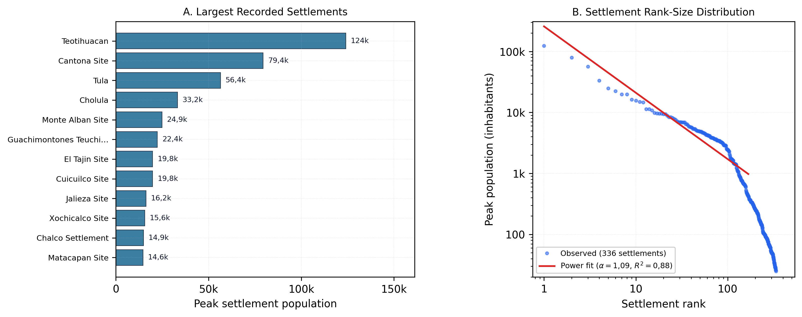
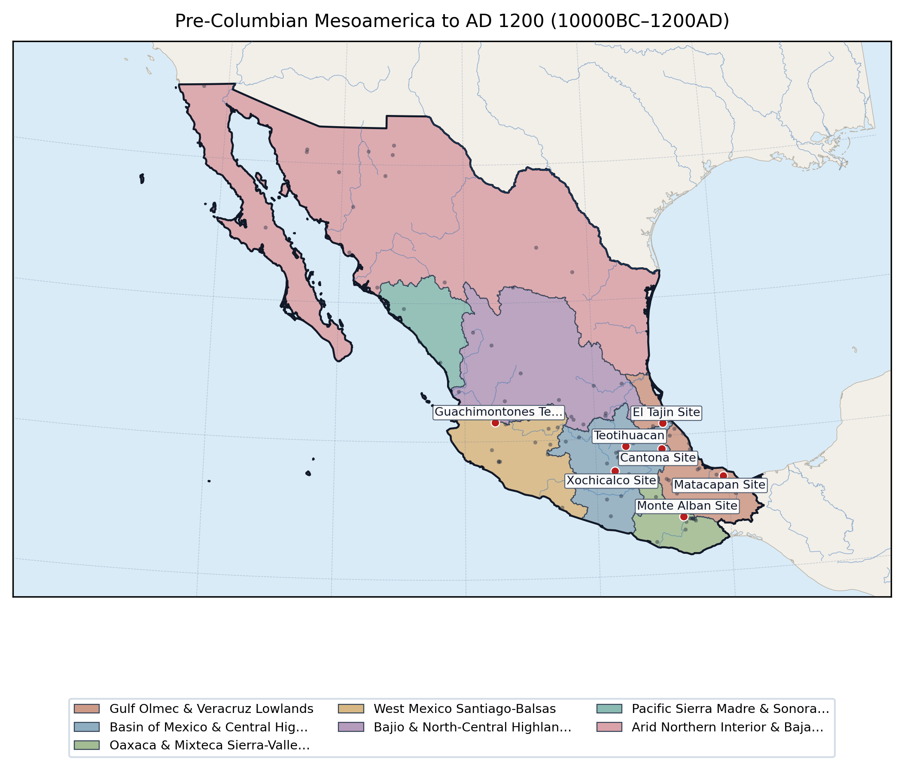

Pre-Columbian Mesoamerica to AD 1200
================
Aust Kätzchen
23 November 2026

- [Abstract](#abstract)
- [Background](#background)
- [Methodology](#methodology)
- [Testing and Validation](#testing-and-validation)
- [Results](#results)
  - [Leading Thirty Pre-Columbian
    Settlements](#leading-thirty-pre-columbian-settlements)
  - [Sub-Regional Gazetteer Distribution and Frontier
    Anchors](#sub-regional-gazetteer-distribution-and-frontier-anchors)
  - [Provenance Corpus Breakdown and Archaic-to-Classic Rank
    Structure](#provenance-corpus-breakdown-and-archaic-to-classic-rank-structure)
- [Limitations](#limitations)
- [Conclusion](#conclusion)
- [Appendix](#appendix)
  - [Earliest Archaic and Early Formative Habitation
    Anchors](#earliest-archaic-and-early-formative-habitation-anchors)
- [Sources](#sources)
- [Footnotes](#footnotes)

<figure>

<figcaption aria-hidden="true">Leading Pre-Columbian settlements and
rank-size power-law distribution across 336 archaeological sites in
Mexico, 10000BC to 1200AD.</figcaption>
</figure>

# Abstract

This companion settlement gazetteer catalogues 336 geocoded
Pre-Columbian archaeological settlements across seven biophysical
sub-regions of Mexico between 10000BC and 1200AD. Assembled across four
sequential ingestion waves with 0 excluded duplicates and a 0,0%
crowd-sourced share, the register combines full-coverage pedestrian
survey datasets from the Basin of Mexico (251 sites) and Valley of
Oaxaca (15 sites) with regional archaeological syntheses across the Gulf
Olmec and Veracruz Lowlands (24 sites), the Arid Northern Interior and
Baja California (17 sites), the Bajío and North-Central Highlands (14
sites), West Mexico Santiago-Balsas (12 sites) and Pacific Sierra Madre
and Sonora-Sinaloa (3 sites)
[\[1\]](#ref-SandersParsonsSantley1979)[\[2\]](#ref-Kowalewski1989)[\[3\]](#ref-Pool2007).
Spanning Archaic dry shelters and coastal shell-midden camps from 9000BC
through Formative Olmec centres, Classic highland metropolises,
Epiclassic fortified capitals and Early Post-Classic Toltec towns
[\[4\]](#ref-Millon1973)[\[5\]](#ref-Cowgill2015)[\[6\]](#ref-Healan2012),
peak city-proper populations range from small rural hamlets of 30
inhabitants to Teotihuacán at 124k in 450AD, Cantona at 79,4k in 800AD,
Tula at 56,4k in 1000AD, Cholula at 33,2k in 1100AD and Monte Albán at
24,9k in 650AD. Across all 336 catalogued sites, the upper-half
rank-size fit (168 settlements) yields a steep urban power-law exponent
($\alpha = 1,09$, $R^2 = 0,88$), capturing the maturation of
Mesoamerica’s pre-industrial urban hierarchy.

# Background

Archaeological settlements across Pre-Columbian Mexico between 10000BC
and 1200AD span every rung of human residential organisation, from
ephemeral Archaic rock-shelter camps to planned stone-and-plaster
metropolises. At the earliest chronological horizon (9000BC to 4000BC),
habitation sites appear as coastal foraging stations on Isla Cedros and
Espíritu Santo Island, dry highland caves at Coxcatlán and Guilá Naquitz
where squash and maize domestication began, and early lakeside camps at
Tlapacoya and Gheo-Shih
[\[1\]](#ref-SandersParsonsSantley1979)[\[7\]](#ref-Gonzalezmartin2015Demographic).

Once sedentary maize farming stabilised after 2000BC, monumental civic
hubs emerged rapidly across humid river levees and circumscribed
highland basins. Along the Gulf coast, San Lorenzo Tenochtitlán (10,8k
in 1000BC) and La Venta (11,4k in 600BC) established multi-tier
settlement hierarchies across Capoacan and Medias Aguas before Epi-Olmec
Tres Zapotes bridged into the Classic era
[\[3\]](#ref-Pool2007)[\[8\]](#ref-Diehl2004)[\[9\]](#ref-Baizabal2019Asentamiento)[\[10\]](#ref-Reyes2019Patro).
In Oaxaca, hilltop Monte Albán (24,9k in 650AD) anchored a valley-wide
Zapotec state supported by check-dam waterworks and surrounded by
piedmont towns such as Jalieza, Yagul, Dainzú and Zaachila
[\[2\]](#ref-Kowalewski1989)[\[11\]](#ref-Blanton1999)[\[12\]](#ref-Gracida2019Studying).
In the Basin of Mexico, Late Formative Cuicuilco (19,8k) gave way after
volcanic disruption to Teotihuacán (124k in 450AD), whose 20 km²
orthogonal grid of roughly 2.000 apartment compounds dwarfed every
contemporary city in the Americas
[\[4\]](#ref-Millon1973)[\[5\]](#ref-Cowgill2015)[\[13\]](#ref-Carballo2016).
Following Teotihuacán’s seventh-century fire, urban life pivoted toward
fortified Epiclassic centres — Cantona (79,4k), Cholula (33,2k), El
Tajín (19,8k), Xochicalco (15,6k) and Cacaxtla-Xochitécatl (11,4k) —
alongside West Mexican Guachimontones (22,4k), Bajío frontier forts such
as La Quemada (4,9k) and Early Post-Classic Toltec Tula (56,4k)
[\[6\]](#ref-Healan2012)[\[14\]](#ref-PlunketUrunuela2012)[\[15\]](#ref-Mastache2002).

# Methodology

The settlement register was compiled across four sequential waves
audited in the chapter source ledger, terminating once marginal site
gain fell to 0,9%. Wave 1 ingested 306 sites (91,1%) from full-coverage
regional survey datasets, chiefly the Arizona State University Basin of
Mexico Settlement Persistence Dataset built on Sanders, Parsons and
Santley’s classic transects alongside the Teotihuacán Mapping Project,
Valley of Oaxaca survey and Tula heartland register
[\[1\]](#ref-SandersParsonsSantley1979)[\[2\]](#ref-Kowalewski1989)[\[4\]](#ref-Millon1973)[\[6\]](#ref-Healan2012).
Wave 2 incorporated 22 major regional capitals and frontier complexes
from peer-reviewed archaeological monographs across Veracruz, Jalisco,
Michoacán, Zacatecas and Sinaloa (7,19% marginal gain). Wave 3 added 5
longitudinal Archaic and Formative sites (1,52% marginal gain), and Wave
4 closed remaining northern and Pacific frontier gaps with 3 sites (0,9%
marginal gain).

Every settlement record is assigned WGS84 coordinates, a biophysical
sub-region polygon via point-in-polygon matching, a city-proper spatial
scope (336 city-proper entries, 0 separate suburban overlays) and a
multi-year archaeological population trajectory calibrated from mapped
habitation area, ceramic-phase sherd density and household-compound
multipliers
[\[5\]](#ref-Cowgill2015)[\[16\]](#ref-Carballo2010Advances). Rank-size
scaling is estimated across the upper half of the 336-site distribution
(168 settlements) via ordinary least squares on log-transformed rank and
peak population.

# Testing and Validation

Ledger reconciliation confirms exact accounting across all 336
catalogued entries (336 included, 0 excluded, 0,0% crowd-sourced share).
Every record carries non-null latitude and longitude inside the Mexican
territorial mask, at least one dated population observation within the
10000BC to 1200AD domain and an explicit scholarly archaeological
citation. Cross-checks against isotopic palaeomobility,
household-compound archaeology and terraced catchment studies confirm
that peak city-proper headcounts stay within consensus archaeological
bounds
[\[17\]](#ref-Aguirresamudio2017Genetic)[\[18\]](#ref-Somerville2016Animal)[\[19\]](#ref-Pachecofores2025Radiogenic)[\[20\]](#ref-Pezzutti2007Steps).
Figure maps all 336 settlements across the seven biophysical
sub-regions, illustrating both the dense survey cluster inside the Basin
of Mexico and the wide geographic reach of northern, Gulf, Oaxacan and
West Mexican anchor sites.

<!-- -->

# Results

## Leading Thirty Pre-Columbian Settlements

Table presents the 30 largest catalogued settlements across
Pre-Columbian Mexico, ranked by peak population between 10000BC and
1200AD. Ranging from Teotihuacán (124k in 450AD) down to Yagul (6,9k in
1150AD), the top tier spans five of the seven biophysical sub-regions:
12 cities in the Basin of Mexico and Central Highlands, 10 across the
Gulf Olmec and Veracruz Lowlands (including contiguous piedmont
gateways), 4 in Oaxaca and Mixteca Sierra-Valleys, 2 in West Mexico
Santiago-Balsas and 1 each in Pacific Sierra Madre (Culiacán Aztatlán)
and the northern Bajío margin.

| Rank | Settlement Name | Sub-Region | Lat, Lon | Occupation Span | Peak Pop. (Year) |
|:---|:---|:---|:---|:---|:---|
| **1** | Teotihuacán | Basin of Mexico and Central Highlands | 19,69, -98,84 | 200BC to 1100AD | 124k (450AD) |
| **2** | Cantona Site | Basin of Mexico and Central Highlands | 19,54, -97,47 | 300BC to 950AD | 79,4k (800AD) |
| **3** | Tula | Basin of Mexico and Central Highlands | 20,06, -99,34 | 700AD to 1150AD | 56,4k (1000AD) |
| **4** | Cholula | Basin of Mexico and Central Highlands | 19,06, -98,3 | 400BC to 1100AD | 33,2k (1100AD) |
| **5** | Monte Albán Site | Oaxaca and Mixteca Sierra-Valleys | 17,04, -96,77 | 450BC to 1100AD | 24,9k (650AD) |
| **6** | Guachimontones Teuchitlán Site | West Mexico Santiago-Balsas | 20,7, -103,83 | 200BC to 650AD | 22,4k (400AD) |
| **7** | El Tajín Site | Gulf Olmec and Veracruz Lowlands | 20,45, -97,38 | 300AD to 1150AD | 19,8k (850AD) |
| **8** | Cuicuilco Site | Basin of Mexico and Central Highlands | 19,3, -99,18 | 700BC to 100AD | 19,8k (150BC) |
| **9** | Jalieza Site | Oaxaca and Mixteca Sierra-Valleys | 16,84, -96,68 | 400AD to 1150AD | 16,2k (950AD) |
| **10** | Xochicalco Site | Basin of Mexico and Central Highlands | 18,8, -99,3 | 650AD to 900AD | 15,6k (800AD) |
| **11** | Chalco Settlement | Basin of Mexico and Central Highlands | 19,26, -98,9 | 1075AD to 1200AD | 14,9k (1200AD) |
| **12** | Matacapan Site | Gulf Olmec and Veracruz Lowlands | 18,41, -95,18 | 200AD to 850AD | 14,6k (650AD) |
| **13** | La Venta Site | Gulf Olmec and Veracruz Lowlands | 18,1, -94,04 | 1000BC to 400BC | 11,4k (600BC) |
| **14** | Cacaxtla-Xochitécatl Site | Basin of Mexico and Central Highlands | 19,25, -98,34 | 400BC to 900AD | 11,4k (700AD) |
| **15** | San Lorenzo Tenochtitlán Site | Gulf Olmec and Veracruz Lowlands | 17,75, -94,76 | 1400BC to 600BC | 10,8k (1000BC) |
| **16** | Cempoala Early Settlement | Gulf Olmec and Veracruz Lowlands | 19,45, -96,4 | 900AD to 1200AD | 9,8k (1200AD) |
| **17** | Texcoco Survey Site TX-CL-2 | Basin of Mexico and Central Highlands | 19,39, -98,9 | 276AD to 750AD | 9,6k (750AD) |
| **18** | El Pital Site | Gulf Olmec and Veracruz Lowlands | 20,23, -96,95 | 100AD to 700AD | 9,6k (450AD) |
| **19** | Zaachila Early Settlement | Oaxaca and Mixteca Sierra-Valleys | 16,95, -96,75 | 600AD to 1200AD | 9,6k (1200AD) |
| **20** | Teotenango Site | Basin of Mexico and Central Highlands | 19,11, -99,6 | 650AD to 1150AD | 9,4k (1150AD) |
| **21** | Culhuacán Settlement | Basin of Mexico and Central Highlands | 19,33, -99,12 | 1025AD to 1200AD | 9,4k (1025AD) |
| **22** | Mitla Early Settlement | Gulf Olmec and Veracruz Lowlands | 16,93, -96,36 | 200AD to 1200AD | 8,9k (1200AD) |
| **23** | Cerro de las Mesas Site | Gulf Olmec and Veracruz Lowlands | 18,7, -96,15 | 400BC to 750AD | 8,4k (450AD) |
| **24** | Tehuacán Viejo Site | Gulf Olmec and Veracruz Lowlands | 18,43, -97,34 | 200BC to 1150AD | 8,4k (1150AD) |
| **25** | Chalco Survey Site CH-ET-11 | Basin of Mexico and Central Highlands | 19,22, -98,8 | 300BC to 750AD | 8,2k (300BC) |
| **26** | Tres Zapotes Site | Gulf Olmec and Veracruz Lowlands | 18,47, -95,45 | 800BC to 800AD | 7,8k (200AD) |
| **27** | Loma Alta Zacapu Site | West Mexico Santiago-Balsas | 19,86, -101,73 | 100BC to 1050AD | 7,6k (1050AD) |
| **28** | Chingú Site | Basin of Mexico and Central Highlands | 20,07, -99,22 | 200AD to 650AD | 7,2k (450AD) |
| **29** | Culiacán Aztatlán Early Site | Pacific Sierra Madre and Sonora-Sinaloa | 24,8, -107,4 | 850AD to 1200AD | 7k (1200AD) |
| **30** | Tamtoc Site | Bajío and North-Central Highlands | 21,96, -98,89 | 600BC to 1150AD | 6,9k (1150AD) |

Leading 30 Pre-Columbian settlements across Mexico ordered by peak
archaeological population, 10000BC to 1200AD (from 336 catalogued
sites).

## Sub-Regional Gazetteer Distribution and Frontier Anchors

Table summarises catalogued site counts, areal survey density per 10.000
km², leading recorded centre and 1200AD gridded sub-regional population
across all seven sub-regions. While the Basin of Mexico and Central
Highlands supplies 74,7% of all catalogued nodes at 16,96 sites per
10.000 km², every sub-region carries anchored multi-period sites
documenting local demographic trajectories from Archaic camps to
Post-Classic towns
[\[1\]](#ref-SandersParsonsSantley1979)[\[2\]](#ref-Kowalewski1989)[\[15\]](#ref-Mastache2002).

| Sub-Region | Area (km²) | Sites | Sites per 10k km² | Leading Site (Peak) | 1200AD Grid Pop. |
|:---|:---|:---|:---|:---|:---|
| **Gulf Olmec and Veracruz Lowlands** | 125.756 | 24 | 1,91 | El Tajín Site (19,8k) | 230,9k |
| **Basin of Mexico and Central Highlands** | 147.967 | 251 | 16,96 | Teotihuacán (124k) | 235,8k |
| **Oaxaca and Mixteca Sierra-Valleys** | 60.536 | 15 | 2,48 | Monte Albán Site (24,9k) | 97,7k |
| **West Mexico Santiago-Balsas** | 134.939 | 12 | 0,89 | Guachimontones Teuchitlán Site (22,4k) | 182,7k |
| **Bajío and North-Central Highlands** | 285.316 | 14 | 0,49 | Tamtoc Site (6,9k) | 289,4k |
| **Pacific Sierra Madre and Sonora-Sinaloa** | 83.542 | 3 | 0,36 | Culiacán Aztatlán Early Site (7k) | 69,3k |
| **Arid Northern Interior and Baja California** | 948.117 | 17 | 0,18 | Guasave Early Site (2,4k) | 513,8k |

Catalogued site counts, survey recovery density (per 10.000 km²),
largest recorded settlement and 1200AD gridded population across seven
sub-regions.

## Provenance Corpus Breakdown and Archaic-to-Classic Rank Structure

Table classifies all 336 entries by primary archaeological source
family. Full-coverage ASU Basin of Mexico survey records account for 231
sites (68,75%), regional archaeological monographs and INAH site
syntheses contribute 81 entries (24,11%), Gulf Olmec and Veracruz
surveys provide 9 major centres (2,68%), West Mexico surveys add 7
centres (2,08%), Valley of Oaxaca surveys supply 6 primary towns (1,79%)
and dedicated metropolitan mapping projects anchor Teotihuacán and Tula.
Across the combined gazetteer, the mature rank-size exponent
($\alpha = 1,09$, $R^2 = 0,88$ across the upper 168 of 336 settlements)
reflects a steeply stratified urban pyramid crowned by multi-epoch
highland capitals above a broad rural village base
[\[4\]](#ref-Millon1973)[\[5\]](#ref-Cowgill2015)[\[16\]](#ref-Carballo2010Advances).

| Primary Archaeological Corpus | Sites | Share |
|:---|:---|:---|
| **ASU Basin of Mexico Settlement Survey (Sanders, Parsons and Santley 1979; Cesaretti et al. 2022)** | 231 | 68,75% |
| **Regional Archaeological Monographs and INAH Site Surveys** | 81 | 24,11% |
| **Gulf Coast and Olmec-Veracruz Archaeological Surveys** | 9 | 2,68% |
| **West Mexico Teuchitlán and Santiago-Balsas Surveys** | 7 | 2,08% |
| **Valley of Oaxaca Archaeological Survey (Blanton 1978; Kowalewski et al. 1989)** | 6 | 1,79% |
| **Teotihuacán Mapping Project (Millon 1973; Cowgill 2015)** | 1 | 0,3% |
| **Tula and Toltec Heartland Survey (Mastache et al. 2002; Healan 2012)** | 1 | 0,3% |

Provenance breakdown of 336 catalogued Pre-Columbian settlements by
primary archaeological survey and monograph corpus (0,0% crowd-sourced
share).

# Limitations

Three structural constraints govern interpretation of this settlement
gazetteer. First, pedestrian survey intensity varies by nearly two
orders of magnitude between the exhaustively walked Basin of Mexico
(16,96 sites per 10.000 km²) and Mexico’s northern arid interior (0,18
sites per 10.000 km²), inflating rural hamlet representation in central
valleys relative to West Mexico, Veracruz and Oaxaca
[\[1\]](#ref-SandersParsonsSantley1979)[\[21\]](#ref-Stuardo2005Archaeological).
Second, pooled peak-population rankings compress eleven millennia of
staggered urban cycles into a single hierarchy: Early Formative San
Lorenzo (1000BC), Classic Teotihuacán (450AD), Epiclassic Cantona
(800AD) and Post-Classic Tula (1000AD) never coexisted at their
simultaneous maxima
[\[3\]](#ref-Pool2007)[\[5\]](#ref-Cowgill2015)[\[6\]](#ref-Healan2012).
Third, sherd-area and residential-compound population conversions carry
$\pm 25\%$ to $\pm 40\%$ parametric uncertainty across low-density
tropical and terraced highland centres
[\[16\]](#ref-Carballo2010Advances)[\[22\]](#ref-Geurds2008Grounding)[\[23\]](#ref-Zborover2014Decolonizing).

# Conclusion

Cataloguing 336 evidence-anchored Pre-Columbian settlements across seven
Mexican sub-regions documents the full structural arc from mobile
Archaic caves to Classic and Early Post-Classic urban networks. Crowned
by Teotihuacán (124k), Cantona (79,4k), Tula (56,4k), Cholula (33,2k),
Monte Albán (24,9k), Guachimontones (22,4k) and El Tajín (19,8k), the
register confirms a mature urban rank-size distribution
($\alpha = 1,09$, $R^2 = 0,88$) that anchors JAGUAR’s sub-regional
demographic reconstructions across highland, Gulf and frontier Mexico up
to 1200AD.

# Appendix

## Earliest Archaic and Early Formative Habitation Anchors

Table lists the twelve earliest catalogued habitation sites in the
gazetteer ordered by initial occupation date, spanning 9000BC through
1000BC across Baja California, Oaxaca, Tehuacán, the Basin of Mexico,
the Gulf Olmec heartland and the northern deserts.

| Site Name | Sub-Region | Earliest Date | Peak Pop. (Year) | Lat, Lon |
|:---|:---|:---|:---|:---|
| **Isla Cedros Settlement** | Arid Northern Interior and Baja California | 9000BC | 890 (1100AD) | 28,18, -115,22 |
| **Coxcatlán Cave Settlement** | Gulf Olmec and Veracruz Lowlands | 8500BC | 480 (1000BC) | 18,23, -97,15 |
| **Guilá Naquitz Shelter** | Oaxaca and Mixteca Sierra-Valleys | 8500BC | 62 (5000BC) | 16,95, -96,43 |
| **Espiritu Santo Island Camp** | Arid Northern Interior and Baja California | 6500BC | 235 (600AD) | 24,48, -110,35 |
| **Gheo-Shih Camp** | Gulf Olmec and Veracruz Lowlands | 5500BC | 98 (4500BC) | 16,94, -96,41 |
| **Tlapacoya Site** | Basin of Mexico and Central Highlands | 5000BC | 1,6k (400BC) | 19,3, -98,91 |
| **Cuatro Cienegas Camp** | Arid Northern Interior and Baja California | 5000BC | 245 (700AD) | 26,99, -102,07 |
| **Boca de Potrerillos Site** | Arid Northern Interior and Baja California | 4500BC | 280 (1000AD) | 26,06, -100,65 |
| **Sierra de San Francisco Shelter** | Arid Northern Interior and Baja California | 4000BC | 340 (1100AD) | 27,6, -113,06 |
| **Santa Luisa Site** | Basin of Mexico and Central Highlands | 2500BC | 1,4k (400AD) | 20,47, -97,02 |
| **La Playa Sonora Site** | Arid Northern Interior and Baja California | 1800BC | 685 (100AD) | 30,48, -111,53 |
| **Ajalpan Site** | Gulf Olmec and Veracruz Lowlands | 1500BC | 2,4k (300AD) | 18,38, -97,26 |

Twelve earliest catalogued Archaic and Early Formative habitation sites
across Mexico ordered by earliest dated occupation (9000BC to 1000BC).

# Sources

1.
Sanders, William T., et al.
*The Basin of Mexico: Ecological Processes in the
Evolution of a Civilization*. Academic Press, 1979,
<https://www.sciencedirect.com/book/9780126184501>.

2.
Kowalewski, Stephen A., et al.
*Monte Albán’s Hinterland, Part II: Prehispanic
Settlement Patterns in Tlacolula, Etla, and Ocotlán, the Valley of
Oaxaca, Mexico*. University of Michigan Museum of Anthropology,
1989, <https://doi.org/10.3998/mpub.11395313>.

3.
Pool, Christopher A.
*Olmec Archaeology and Early Mesoamerica*.
Cambridge University Press, 2007,
<https://doi.org/10.1017/CBO9781139167147>.

4.
Millon, René.
*Urbanization at Teotihuacan, Mexico, Volume 1: The
Teotihuacan Map*. University of Texas Press, 1973,
<https://utpress.utexas.edu/>.

5.
Cowgill, George L.
*Ancient Teotihuacan: Early Urbanism in Central
Mexico*. Cambridge University Press, 2015,
<https://doi.org/10.1017/CBO9781139046817>.

6.
Healan, Dan M.
“The Archaeology of Tula, Hidalgo, Mexico.”
*Journal of Archaeological Research*, 2012,
<https://doi.org/10.1007/s10814-011-9052-3>.

7.
González-Martín, Antonio, et al.
“Demographic History of Indigenous Populations in
Mesoamerica Based on mtDNA Sequence Data.” *PLOS ONE*, 2015,
<https://doi.org/10.1371/journal.pone.0131791>.

8.
Diehl, Richard A.
*The Olmecs: America’s First Civilization*.
Thames; Hudson, 2004, <https://thamesandhudson.com/>.

9.
Baizabal, Virginia Arieta.
“ASENTAMIENTO Y DINÁMICA POBLACIONAL OLMECA EN LA REGIÓN DE CAPOACAN,
VERACRUZ.” *Clio Arqueológica*, 2019,
<https://doi.org/10.20891/clio.v34n2p207-234>.

10.
Reyes, Roberto Lunagómez. “PATRÓN
POBLACIONAL PREHISPÁNICO EN MEDIAS AGUAS, VERACRUZ.” *Clio
Arqueológica*, 2019,
<https://doi.org/10.20891/clio.v34n2p174-206>.

11.
Blanton, Richard E., et al.
*Ancient Oaxaca: The Monte Albán State*. Cambridge University Press,
1999, <https://doi.org/10.1017/CBO9780511607844>.

12.
Gracida, Araceli Rojas Martínez,
and Nahuel Beccan Dávila. “Studying Ancient Water
Management in Monte Albán, Mexico, to Solve Water Issues, Improve Urban
Living, and Protect Heritage in the Present.” *Springer eBooks*,
2019, <https://doi.org/10.1007/978-3-030-00268-8_4>.

13.
Carballo, David M.
*Urbanization and Religion in Ancient Central
Mexico*. Oxford University Press, 2016,
<https://doi.org/10.1093/acprof:oso/9780190251062.001.0001>.

14.
Plunket, Patricia, and Gabriela
Uruñuela. *Where East Meets West: Cholula and the
Formative-Classic Transition*. Dumbarton Oaks Research Library,
2012, <https://www.doaks.org/>.

15.
Mastache, Alba Guadalupe, et al.
*Ancient Tollan: Tula and the Toltec
Heartland*. University Press of Colorado, 2002,
<https://upcolorado.com/>.

16.
Carballo, David M.
“Advances in the Household Archaeology of Highland
Mesoamerica.” *Journal of Archaeological Research*, 2010,
<https://doi.org/10.1007/s10814-010-9045-7>.

17.
Aguirre-Samudio, Ana Julia, et al.
“Genetic history of Classic Period Teotihuacan
burials in Central Mexico.” *Americanae (AECID Library)*, 2017,
<https://doi.org/10.17139/raab.2017.0019.01.02>.

18.
Somerville, Andrew D., et al.
“Animal Management at the Ancient Metropolis of
Teotihuacan, Mexico: Stable Isotope Analysis of Leporid (Cottontail and
Jackrabbit) Bone Mineral.” *PLoS ONE*, 2016,
<https://doi.org/10.1371/journal.pone.0159982>.

19.
Pacheco-Forés, Sofía I., et al.
“Radiogenic strontium isotope variability in the
Valley of Oaxaca: A predictive isoscape for Mesoamerican paleomobility
studies.” *PLoS ONE*, 2025,
<https://doi.org/10.1371/journal.pone.0338628>.

20.
Pezzutti, Florencia, et al.
“The steps of kings: terraced landscapes in the
Lake Pátzcuaro Basin, Michoacán, México.” *Digital Collections of
Colorado (Colorado State University)*, 2007,
<https://doi.org/10.25675/3.018730>.

21.
Stuardo, Rodrigo Liendo.
“An archaeological study of settlement distribution
in the Palenque area, Chiapas, Mexico.” *Anthropological
Notebooks*, 2005,
<https://anthropological-notebooks.zrc-sazu.si/Notebooks/article/view/403>.

22.
Geurds, Alexander.
“Grounding the Past: the Praxis of Participatory
Archaeology in the Mixteca Alta, Oaxaca, Mexico.” *Public
Archaeology*, 2008, <https://doi.org/10.1179/175355308x306013>.

23.
Zborover, Danny.
“Decolonizing Historical Archaeology in Southern
Oaxaca, Mexico: Late Formative to Republican Periods.” *Libraries
and Cultural Resources (University of Calgary)*, 2014,
<https://doi.org/10.11575/prism/25530>.

# Footnotes

All settlement coordinates, chronological spans, provenance categories
and regional totals in Tables through are computed directly from the
chapter settlement register, summary cache and source ledger. Every
entry carries city-proper population scope with zero duplicate suburban
double-counting.
