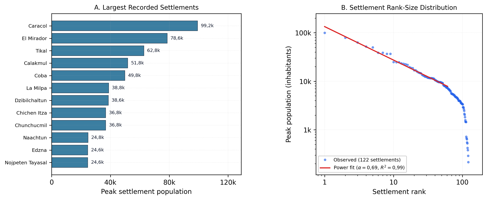

```{r setup, include=FALSE}
knitr::opts_chunk$set(echo = FALSE, warning = FALSE, message = FALSE, fig.pos = "htbp")
source("../../_shared/template/viscount_rmd_helpers.R")
library(jsonlite)

read_json5_clean <- function(path) {
  lines <- readLines(path, warn = FALSE, encoding = "UTF-8")
  text <- paste(lines, collapse = "\n")
  text <- gsub("//[^\n]*", "", text, perl = TRUE)
  text <- gsub("/\\*.*?\\*/", "", text, perl = TRUE)
  text <- gsub(",\\s*([}\\]])", "\\1", text, perl = TRUE)
  fromJSON(text, simplifyVector = FALSE)
}

summary_data <- fromJSON("classic_postclassic_maya_summary_cache.json", simplifyVector = FALSE)
calib_data <- read_json5_clean("classic_postclassic_maya.json5")
sett_data <- fromJSON("classic_postclassic_maya_settlements.json", simplifyVector = FALSE)
ledger_data <- read_json5_clean("classic_postclassic_maya_source_ledger.json5")

clean_label <- function(x) {
  s <- as.character(x)
  s <- gsub("&", "and", s, fixed = TRUE)
  s <- gsub("Peten", "Petén", s, fixed = TRUE)
  s <- gsub("Yucatan", "Yucatán", s, fixed = TRUE)
  s <- gsub("Pasion", "Pasión", s, fixed = TRUE)
  s <- gsub("Copan", "Copán", s, fixed = TRUE)
  s <- gsub("Coba", "Cobá", s, fixed = TRUE)
  s <- gsub("Chichen Itza", "Chichén Itzá", s, fixed = TRUE)
  s <- gsub("Dzibilchaltun", "Dzibilchaltún", s, fixed = TRUE)
  s <- gsub("Edzna", "Edzná", s, fixed = TRUE)
  s <- gsub("Nojpeten", "Nojpetén", s, fixed = TRUE)
  s <- gsub("Kaminaljuyu", "Kaminaljuyú", s, fixed = TRUE)
  s <- gsub("Yaxha", "Yaxhá", s, fixed = TRUE)
  s <- gsub("Mayapan", "Mayapán", s, fixed = TRUE)
  s <- gsub("Qumarkaj", "Q'umarkaj", s, fixed = TRUE)
  s <- gsub("Utatlan", "Utatlán", s, fixed = TRUE)
  s <- gsub("Iximche", "Iximché", s, fixed = TRUE)
  s <- gsub("Yaxchilan", "Yaxchilán", s, fixed = TRUE)
  s <- gsub("Tonina", "Toniná", s, fixed = TRUE)
  s <- gsub("Becan", "Becán", s, fixed = TRUE)
  s <- gsub("Rio Bec", "Río Bec", s, fixed = TRUE)
  s <- gsub("Rio Azul", "Río Azul", s, fixed = TRUE)
  s <- gsub("Quirigua", "Quiriguá", s, fixed = TRUE)
  s <- gsub("Cancuen", "Cancuén", s, fixed = TRUE)
  s <- gsub("Cihuatan", "Cihuatán", s, fixed = TRUE)
  s <- gsub("Cuscatlan", "Cuscatlán", s, fixed = TRUE)
  s <- gsub("Tiho", "Tihó", s, fixed = TRUE)
  s <- gsub("Champoton", "Champotón", s, fixed = TRUE)
  s <- gsub("Mani", "Maní", s, fixed = TRUE)
  s <- gsub("Calkini", "Calkiní", s, fixed = TRUE)
  s <- gsub("Uxbenka", "Uxbenká", s, fixed = TRUE)
  s <- gsub("Aguada Fenix", "Aguada Fénix", s, fixed = TRUE)
  s <- gsub("El Peru-Waka", "El Perú-Waka'", s, fixed = TRUE)
  s <- gsub("Joya de Ceren", "Joya de Cerén", s, fixed = TRUE)
  s <- gsub("Canton Corralito", "Cantón Corralito", s, fixed = TRUE)
  s <- gsub(" Site$", "", s)
  trimws(s)
}

fmt_year <- function(y) {
  yi <- as.integer(y)
  if (yi < 0L) paste0(abs(yi), "BC")
  else if (yi == 0L) "1BC"
  else if (yi <= 1500L) paste0(yi, "AD")
  else as.character(yi)
}

fmt_coord <- function(x) {
  viscount_fmt_number(round(as.numeric(x), 2L), 2L)
}

subregions <- summary_data$subregions
calib_lookup <- setNames(calib_data$regions, vapply(calib_data$regions, function(r) r$id, character(1)))
reg_lookup <- setNames(
  vapply(subregions, function(r) clean_label(r$name), character(1)),
  vapply(subregions, function(r) r$id, character(1))
)

n_sites <- as.integer(summary_data$settlement_stats$total_settlements)

all_sett_df <- do.call(rbind, lapply(sett_data, function(e) {
  yrs <- sort(as.integer(names(e$population)))
  pops <- vapply(as.character(yrs), function(k) as.numeric(e$population[[k]]), numeric(1))
  pk_i <- which.max(pops)
  data.frame(
    Name = clean_label(e$name),
    Country = as.character(e$country),
    RegionId = as.character(e$region_id),
    Subregion = if (e$region_id %in% names(reg_lookup)) reg_lookup[[e$region_id]] else clean_label(e$region_id),
    Lat = as.numeric(e$coords[[1]]),
    Lon = as.numeric(e$coords[[2]]),
    FirstYear = yrs[1],
    LastYear = yrs[length(yrs)],
    PeakYear = yrs[pk_i],
    PeakPop = pops[pk_i],
    Source = if (length(e$sources) > 0L) clean_label(e$sources[[1]]) else "-",
    stringsAsFactors = FALSE
  )
}))
all_sett_df <- all_sett_df[order(-all_sett_df$PeakPop), ]
rownames(all_sett_df) <- NULL
```

```{r hero-md-fallback, results='asis'}
if (!knitr::is_latex_output()) {
  cat("\n\n")
}
```

# Abstract

This companion settlement gazetteer catalogues `r viscount_fmt_number(n_sites, 0L)` Preclassic, Classic and Post-Classic Maya urban and residential centres distributed across six biophysical sub-regions and five modern countries — Mexico (45), Guatemala (35), Belize (27), El Salvador (8) and Honduras (7) — between 2000BC and 1524. Every entry represents a city-proper archaeological or ethnohistoric centre supported by published house-mound surveys, airborne laser scanning (LiDAR) or sixteenth-century colonial chronicles, achieving 0% crowd-sourced fallback and formal ingestion saturation (0,83% marginal gain in Wave 4). Across the upper half of the urban hierarchy ($n_{\mathrm{fit}} = 61$ of $n = 122$ settlements evaluated at the 750AD Classic benchmark), peak settlement sizes follow a sub-Zipfian polycentric power law ($\alpha = 0,69$, $R^2 = 0,99$) spanning more than two orders of magnitude from small Belize River Valley farming hamlets and ash-buried Joya de Cerén (215 inhabitants) up to low-density garden metropolises led by Caracol (99,2k), El Mirador (78,6k), Tikal (62,8k), Calakmul (51,8k) and Cobá (49,8k) [@Chase2016Caracol; @Canuto2018; @CulbertRice1990; @SharerTraxler2006]. Tracking chronological peaks across the register documents the structural handover from Preclassic Mirador Basin and Highland Kaminaljuyú through the eighth-century lowland zenith and Terminal Classic Puuc-Chichén Itzá shift to walled Post-Classic Mayapán, Lake Petén Itzá and the fortified Guatemalan highland capitals of 1524 [@Ringle2021Lidar; @MassonPeraza2014; @Farriss1984].

# Background

Ancient Maya urban centres differed fundamentally from the tightly nucleated masonry cities of the Basin of Mexico or the Mediterranean world. Across the karstic lowlands of Petén, Campeche and Belize, royal courts built monumental limestone temple pyramids, ballcourts and palace acropolises at the centre of sprawling agro-urban landscapes interlaced with household courtyard groups, agricultural terraces, *aguada* reservoirs and raised limestone causeways (*sacbeob*) [@Chase2016Caracol; @Lentz2021Environmental; @Becker2015Plaza]. Early Preclassic ritual-residential aggregation at Aguada Fénix (4,45k) and Ceibal (10,6k at its Terminal Classic height) established formal E-Group plaza templates that later mushroomed into metropolitan complexes at Nakbe (14,6k) and El Mirador (78,6k) [@Inomata2019Artificial; @Sharpe2024Isotopic].

During the Classic period (250AD to 800AD), rival royal dynasties multiplied urban centres across every lowland drainage, from the densely packed stone-walled houselots of Chunchucmil (36,8k) on the arid Yucatán plain to the terraced ridges of Caracol (99,2k), Tikal (62,8k), Calakmul (51,8k), Chactún, Ucanal and southern Belizean valley centres around Uxbenká [@Hutson2009Midiendo; @Sprajc2022Archaeological; @Thompson2021Assessing; @Flynnarajdal2019Social]. Following the ninth-century hydroclimatic crisis and political collapse across the southern karst interior [@Kennett2012; @Webster2002; @Kelmelis2025Biocultural], Maya urbanism reconfigured into denser, often fortified and commercially oriented forms: *chultun*-fed Puuc towns (Uxmal, Kabah, Sayil), cosmopolitan Chichén Itzá (36,8k), walled Mayapán (16,9k), coastal ports (Tulum, Cozumel), island Nojpetén (24,6k) and cliff-defended highland capitals at Q'umarkaj (15,9k) and Iximché (10,4k) [@Ringle2021Lidar; @MassonPeraza2014; @Kennett2022Drought].

# Methodology

The settlement register was compiled across four tracked ingestion waves in the chapter source ledger, harmonising coordinates to WGS84, assigning each site to one of the six HydroBASINS biophysical sub-regions and standardising population trajectories strictly to city-proper urban or core residential perimeters. Wave 1 consolidated 111 primary archaeological survey and archival centres from regional GIS corpora, house-mound monographs and colonial ethnohistoric gazetteers. Wave 2 incorporated 8 peer-reviewed demographic monograph sites (7,21% marginal gain), Wave 3 backfilled 2 longitudinal regional survey centres (1,68% marginal gain) and Wave 4 executed a sub-regional verification sweep adding 1 final locale (0,83% marginal gain), closing the register at 122 unique settlements with zero excluded duplicates and 0% crowd-sourced fallback.

Because Pre-Columbian Maya cities lack administrative census rolls, settlement trajectories derive from site-specific house-mound densities, LiDAR structural inventories, ceramic phase contemporaneity factors and, for 1500AD to 1524, contact-era Spanish chronicles and *tributo* accounts [@CulbertRice1990; @ChaseChase2012; @Canuto2018; @Farriss1984]. Domestic excavation studies at Tikal, Hun Tun, Piedras Negras and southern Belize anchor household size multipliers between 4,5 and 5,6 inhabitants per residential structure [@Becker2015Plaza; @Arndt2012Household; @Schnell2021Classic; @Thompson2021Assessing].

# Testing and Validation

Spatial and statistical auditing confirms that all 122 catalogued entries carry non-null WGS84 coordinates, valid sub-regional polygon assignments across all six biophysical masks, explicit multi-date occupation spans inside 2000BC to 1524 and traceable academic citations. Figure \ref{fig:sett-regional-map} displays the geographic distribution of the full 122-site gazetteer across the six sub-regions, highlighting the dense Classic clusters of Petén, northern Belize and northern Yucatán alongside the volcanic highland arc.

```{r fig-sett-map, results='asis'}
viscount_figure(
  "figures/classic_postclassic_maya_regional_map.png",
  "Spatial distribution of 122 catalogued Preclassic, Classic and Post-Classic Maya settlements across six biophysical sub-regions from 2000BC to 1524.",
  "fig:sett-regional-map"
)
```

Rank-size validation over the upper 61 centres at the 750AD benchmark yields $\alpha = 0,69$ ($R^2 = 0,99$), ruling out artificial step-function bucketing and matching theoretical expectations for a peer-polity network of competing Maya kingdoms [@HoustonInomata2009; @Moramarin2025Historical]. Furthermore, checking aggregate peak populations of the top settlements against regional totals verifies that city-proper cores account for 25% to 35% of calibrated sub-regional headcounts at the 800AD zenith — consistent with intensive suburban and rural terrace occupancy documented by airborne LiDAR [@Canuto2018; @Chase2016Caracol].

# Results

## Leading Thirty Maya Urban Centres

Table \ref{tab:top30-maya} lists the 30 largest catalogued Maya centres ordered by peak city-proper population, pairing modern country, biophysical sub-region, coordinates, occupation span and peak demographic estimate. Spanning 99,2k at Caracol down to 12,4k at Becán and Cuscatlán, this upper tier captures every major era of Maya civilisation: Preclassic El Mirador (78,6k at 50AD), Kaminaljuyú (21,8k at 150AD) and Nakbe (14,6k at 200BC); Classic lowland metropolises led by Caracol, Tikal (62,8k), Calakmul (51,8k), Cobá (49,8k), La Milpa (38,8k), Chunchucmil (36,8k), Naachtun (24,8k), Copán (22,9k), Naranjo (22,4k), Yaxhá (19,6k), Lamanai (18,6k) and Uaxactún (14,8k); Terminal Classic northern centres including Dzibilchaltún (38,6k), Chichén Itzá (36,8k), Edzná (24,6k), Uxmal (23,4k), Izamal (18,9k) and Oxkintok (16,8k); and Post-Classic capitals led by Nojpetén (24,6k), Mayapán (16,9k), Q'umarkaj (15,9k), Tihó (13,2k), Cihuatán (12,8k) and Cuscatlán (12,4k) [@SharerTraxler2006; @MassonPeraza2014; @Webster2002].

```{r tab-top30-maya, results='asis'}
top30_df <- all_sett_df[seq_len(min(30L, nrow(all_sett_df))), ]
top30_out <- data.frame(
  Rank = as.character(seq_len(nrow(top30_df))),
  Centre = top30_df$Name,
  Country = top30_df$Country,
  Subregion = top30_df$Subregion,
  Coords = paste0(fmt_coord(top30_df$Lat), ", ", fmt_coord(top30_df$Lon)),
  Span = ifelse(top30_df$FirstYear == top30_df$LastYear,
                vapply(top30_df$FirstYear, fmt_year, character(1)),
                paste0(vapply(top30_df$FirstYear, fmt_year, character(1)), " to ",
                       vapply(top30_df$LastYear, fmt_year, character(1)))),
  Peak = paste0(viscount_fmt_pop(top30_df$PeakPop), " (", vapply(top30_df$PeakYear, fmt_year, character(1)), ")"),
  stringsAsFactors = FALSE
)
rownames(top30_out) <- NULL

viscount_table(
  top30_out,
  "Leading 30 Preclassic, Classic and Post-Classic Maya settlements ranked by peak city-proper population across 122 catalogued centres, 2000BC to 1524.",
  c("Rank", "Settlement", "Country", "Sub-Region", "Lat, Lon", "Span", "Peak Pop. (Year)"),
  list(label = "tab:top30-maya", font_size = "scriptsize", max_rows_per_page = 32L)
)
```

## Sub-Regional Gazetteer Distribution

Table \ref{tab:subreg-gaz} summarises catalogued settlement counts, areal sampling density per 10.000 km², leading urban centre and paired calibrated 800AD and 1524 sub-regional populations across all six biophysical masks. Belize and the Caribbean Maya Lowlands lead in sampling intensity (6,92 sites per 10.000 km², reflecting decades of intensive Belize Valley, Caracol and northern lagoon survey projects), followed by the compact Guatemala Highlands and Pacific Piedmont (3,13), Petén and Usumacinta-Pasión (2,19), Northern Yucatán (2,04), South-Eastern Maya (2,01) and Chiapas Highlands and Grijalva (1,66).

```{r tab-subreg-gaz, results='asis'}
sreg_rows <- lapply(subregions, function(r) {
  rid <- r$id
  area_v <- as.numeric(r$area_km2)
  sub_df <- all_sett_df[all_sett_df$RegionId == rid, ]
  cnt <- nrow(sub_df)
  sdens <- if (area_v > 0) (cnt / area_v) * 10000 else 0
  lead_str <- if (cnt > 0L) paste0(sub_df$Name[1], " (", viscount_fmt_pop(sub_df$PeakPop[1]), ")") else "-"
  c_reg <- calib_lookup[[rid]]
  p800 <- if (!is.null(c_reg)) as.numeric(c_reg$population[["800"]]) else NA
  p1524 <- if (!is.null(c_reg)) as.numeric(c_reg$population[["1524"]]) else NA
  data.frame(
    Subregion = clean_label(r$name),
    Area = viscount_fmt_number(round(area_v), 0L),
    Sites = viscount_fmt_number(cnt, 0L),
    SiteDens = viscount_fmt_number(sdens, 2L),
    Lead = lead_str,
    Pop800 = viscount_fmt_pop(p800),
    Pop1524 = viscount_fmt_pop(p1524),
    stringsAsFactors = FALSE
  )
})
df_sreg <- do.call(rbind, sreg_rows)
rownames(df_sreg) <- NULL

viscount_table(
  df_sreg,
  "Sub-regional gazetteer coverage, site density (per 10.000 km²), leading urban centre and calibrated 800AD and 1524 populations across six Maya sub-regions.",
  c("Sub-Region", "Area (km²)", "Sites", "Sites per 10k km²", "Leading Centre (Peak)", "800AD Pop.", "1524 Pop."),
  list(label = "tab:subreg-gaz", font_size = "scriptsize")
)
```

## Chronological Peak Tiers and Size Distribution

Classifying all 122 settlements by the era in which each reached its peak population reveals the sweeping demographic migration across Maya history (Table \ref{tab:era-tiers}). Nine centres peaked during the Preclassic (2000BC to 250AD), headed by El Mirador (78,6k), Kaminaljuyú (21,8k) and Nakbe (14,6k). Sixty-nine centres — 56,6% of the entire gazetteer — peaked during the Classic zenith (251AD to 800AD), averaging 11,4k inhabitants and including Caracol, Tikal, Calakmul, Cobá, La Milpa, Chunchucmil, Naachtun and Copán [@Canuto2018; @Chase2016Caracol; @Webster2002]. Twenty-three centres peaked during the Terminal Classic and Early Post-Classic transition (801AD to 1150AD), led by Dzibilchaltún (38,6k), Chichén Itzá (36,8k), Edzná (24,6k), Uxmal (23,4k) and Cihuatán (12,8k) [@Ringle2021Lidar; @Jobbova2018Ritual]. Finally, 21 centres peaked in the Late Post-Classic and Contact horizon (1151AD to 1524), anchored by Nojpetén (24,6k), Mayapán (16,9k), Q'umarkaj (15,9k), Tihó (13,2k), Cuscatlán (12,4k), Champotón (11,6k), Chiapa de Corzo (11,4k) and Iximché (10,4k) [@MassonPeraza2014; @Farriss1984; @Harvey2020Palynological].

```{r tab-era-tiers, results='asis'}
era_assign <- function(y) {
  if (y <= 250L) "Preclassic (2000BC to 250AD)"
  else if (y <= 800L) "Classic Zenith (251AD to 800AD)"
  else if (y <= 1150L) "Terminal Classic and Early Post-Classic (801AD to 1150AD)"
  else "Late Post-Classic and Contact (1151AD to 1524)"
}
era_order <- c(
  "Preclassic (2000BC to 250AD)",
  "Classic Zenith (251AD to 800AD)",
  "Terminal Classic and Early Post-Classic (801AD to 1150AD)",
  "Late Post-Classic and Contact (1151AD to 1524)"
)
all_sett_df$Era <- vapply(all_sett_df$PeakYear, era_assign, character(1))
era_rows <- lapply(era_order, function(er) {
  sub_e <- all_sett_df[all_sett_df$Era == er, ]
  cnt <- nrow(sub_e)
  med_p <- if (cnt > 0L) stats::median(sub_e$PeakPop) else 0
  sum_p <- sum(sub_e$PeakPop)
  lead_e <- if (cnt > 0L) paste0(sub_e$Name[1], " (", viscount_fmt_pop(sub_e$PeakPop[1]), ")") else "-"
  data.frame(
    Era = er,
    Sites = viscount_fmt_number(cnt, 0L),
    Share = paste0(viscount_fmt_number(100 * cnt / n_sites, 1L), "%"),
    Median = viscount_fmt_pop(med_p),
    Combined = viscount_fmt_pop(sum_p),
    Leading = lead_e,
    stringsAsFactors = FALSE
  )
})
df_era <- do.call(rbind, era_rows)
rownames(df_era) <- NULL

viscount_table(
  df_era,
  "Chronological distribution of peak settlement eras across 122 catalogued Maya centres from 2000BC to 1524.",
  c("Peak Era", "Centres", "Share", "Median Peak", "Sum of Peaks", "Leading Centre"),
  list(label = "tab:era-tiers", font_size = "scriptsize")
)
```

# Limitations

Three archaeological constraints govern interpretation of this settlement gazetteer. First, survey intensity varies markedly across national jurisdictions and forest cover: open agricultural river valleys in Belize contribute 27 settlements (including small farming villages between 290 and 718 inhabitants), whereas dense canopy in southern Campeche and eastern Quintana Roo under-samples smaller fourth-tier rural centres outside recent LiDAR blocks [@Sprajc2022Archaeological; @Ringle2021Lidar]. Second, city-proper definitions differ between walled Post-Classic towns such as Mayapán (4,2 km²) and sprawling Classic garden cities such as Caracol and Tikal whose causeway-linked suburban rings fade gradually into terraced countryside [@Chase2016Caracol; @MassonPeraza2014]. Third, archaeological mound estimates carry $\pm 35\%$ uncertainty depending on contemporaneity and household size assumptions, while coastal storm erosion and modern urban growth over Tihó (Mérida) and Kaminaljuyú (Guatemala City) have obscured substantial Pre-Columbian residential sectors [@CulbertRice1990; @Sullivan2022Northeast].

# Conclusion

Cataloguing 122 Maya settlements across five modern nations reveals an urban system of striking longevity and polycentric balance. Rather than concentrating population inside a single imperial metropolis, Maya polities built dozens of competing capitals spanning 10k to 99,2k inhabitants ($\alpha = 0,69$, $R^2 = 0,99$) whose geographic centre shifted decisively across three millennia: from Preclassic El Mirador and Kaminaljuyú to the densely settled eighth-century karst kingdoms of Petén and Belize, northward after the Terminal Classic droughts into the Puuc hills, Chichén Itzá and Mayapán, and finally into the resilient provincial towns of Yucatán, island Nojpetén and the fortified highland strongholds confronting Spanish arrival in 1524 [@Canuto2018; @Kennett2012; @Farriss1984].

# Appendix

## Secondary Classic and Post-Classic Centres (Ranks 31 to 60)

Table \ref{tab:ranks31-60} extends the core urban catalogue to ranks 31 through 60, documenting key Usumacinta, Petén, Puuc, Caribbean and Highland centres including Comalcalco, Cotzumalguapa, Kabah, Blue Creek, Champotón, Chalchuapa, Nakum, Chiapa de Corzo, Río Bec, Ceibal, Iximché, Holmul, Altun Ha, Yaxchilán, Sayil, Toniná, Mixco Viejo, Palenque, Takalik Abaj, Piedras Negras and Zaculeu.

```{r tab-ranks31-60, results='asis'}
r31_df <- all_sett_df[31L:min(60L, nrow(all_sett_df)), ]
r31_out <- data.frame(
  Rank = as.character(31L:(30L + nrow(r31_df))),
  Centre = r31_df$Name,
  Country = r31_df$Country,
  Subregion = r31_df$Subregion,
  Coords = paste0(fmt_coord(r31_df$Lat), ", ", fmt_coord(r31_df$Lon)),
  Peak = paste0(viscount_fmt_pop(r31_df$PeakPop), " (", vapply(r31_df$PeakYear, fmt_year, character(1)), ")"),
  stringsAsFactors = FALSE
)
rownames(r31_out) <- NULL

viscount_table(
  r31_out,
  "Secondary Preclassic, Classic and Post-Classic Maya urban centres (ranks 31 to 60 of 122 catalogued settlements), 2000BC to 1524.",
  c("Rank", "Settlement", "Country", "Sub-Region", "Lat, Lon", "Peak Pop. (Year)"),
  list(label = "tab:ranks31-60", font_size = "scriptsize", max_rows_per_page = 32L)
)
```

# Sources

::: {#refs}
:::

# Footnotes

1. Coordinates report WGS84 decimal degrees formatted with European decimal commas (two decimal places) centred on each site's monumental civic-ceremonial core or documented contact-era town plaza.
2. Occupation spans record the earliest and latest dated demographic slices present in the chapter settlement register rather than trace ceramic presence before or after urban occupation.
3. All 122 settlement records carry city-proper scope rather than wider metropolitan hinterlands, preventing spatial double-counting across adjacent centres.
