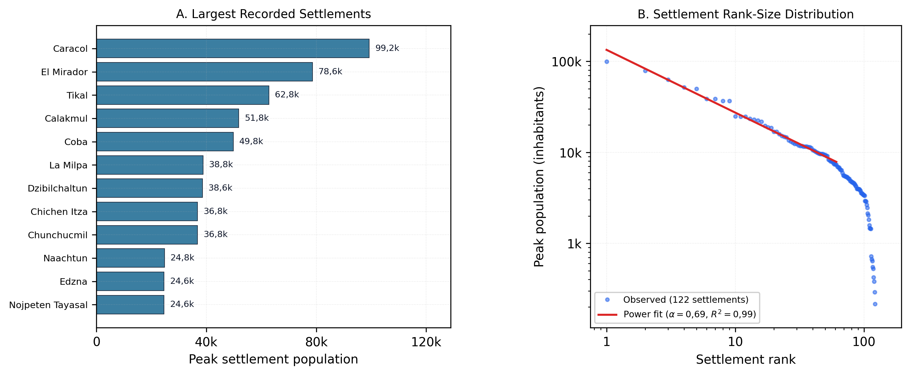
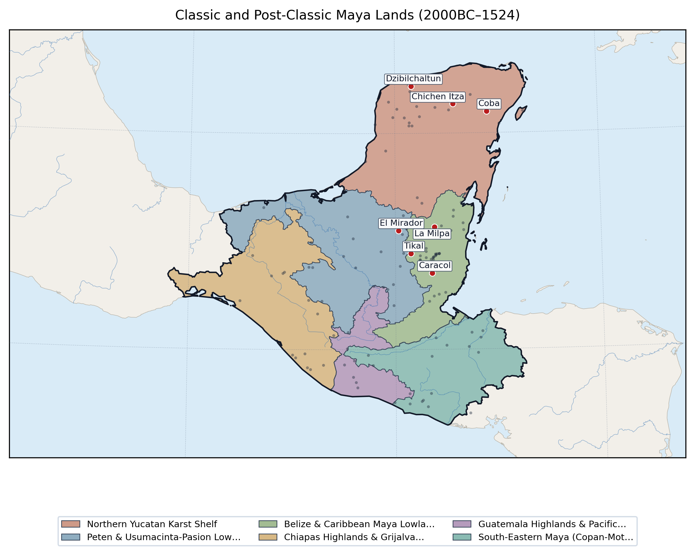

Classic and Post-Classic Maya Lands
================
Aust Kätzchen
23 November 2026

- [Abstract](#abstract)
- [Background](#background)
- [Methodology](#methodology)
- [Testing and Validation](#testing-and-validation)
- [Results](#results)
  - [Leading Thirty Maya Urban
    Centres](#leading-thirty-maya-urban-centres)
  - [Sub-Regional Gazetteer
    Distribution](#sub-regional-gazetteer-distribution)
  - [Chronological Peak Tiers and Size
    Distribution](#chronological-peak-tiers-and-size-distribution)
- [Limitations](#limitations)
- [Conclusion](#conclusion)
- [Appendix](#appendix)
  - [Secondary Classic and Post-Classic Centres (Ranks 31 to
    60)](#secondary-classic-and-post-classic-centres-ranks-31-to-60)
- [Sources](#sources)
- [Footnotes](#footnotes)

<figure>

<figcaption aria-hidden="true">Twelve largest recorded Maya centres and
rank-size distribution across 122 catalogued settlements from 2000BC to
1524.</figcaption>
</figure>

# Abstract

This companion settlement gazetteer catalogues 122 Preclassic, Classic
and Post-Classic Maya urban and residential centres distributed across
six biophysical sub-regions and five modern countries — Mexico (45),
Guatemala (35), Belize (27), El Salvador (8) and Honduras (7) — between
2000BC and 1524. Every entry represents a city-proper archaeological or
ethnohistoric centre supported by published house-mound surveys,
airborne laser scanning (LiDAR) or sixteenth-century colonial
chronicles, achieving 0% crowd-sourced fallback and formal ingestion
saturation (0,83% marginal gain in Wave 4). Across the upper half of the
urban hierarchy ($n_{\mathrm{fit}} = 61$ of $n = 122$ settlements
evaluated at the 750AD Classic benchmark), peak settlement sizes follow
a sub-Zipfian polycentric power law ($\alpha = 0,69$, $R^2 = 0,99$)
spanning more than two orders of magnitude from small Belize River
Valley farming hamlets and ash-buried Joya de Cerén (215 inhabitants) up
to low-density garden metropolises led by Caracol (99,2k), El Mirador
(78,6k), Tikal (62,8k), Calakmul (51,8k) and Cobá (49,8k)
[\[1\]](#ref-Chase2016Caracol)[\[2\]](#ref-Canuto2018)[\[3\]](#ref-CulbertRice1990)[\[4\]](#ref-SharerTraxler2006).
Tracking chronological peaks across the register documents the
structural handover from Preclassic Mirador Basin and Highland
Kaminaljuyú through the eighth-century lowland zenith and Terminal
Classic Puuc-Chichén Itzá shift to walled Post-Classic Mayapán, Lake
Petén Itzá and the fortified Guatemalan highland capitals of 1524
[\[5\]](#ref-Ringle2021Lidar)[\[6\]](#ref-MassonPeraza2014)[\[7\]](#ref-Farriss1984).

# Background

Ancient Maya urban centres differed fundamentally from the tightly
nucleated masonry cities of the Basin of Mexico or the Mediterranean
world. Across the karstic lowlands of Petén, Campeche and Belize, royal
courts built monumental limestone temple pyramids, ballcourts and palace
acropolises at the centre of sprawling agro-urban landscapes interlaced
with household courtyard groups, agricultural terraces, *aguada*
reservoirs and raised limestone causeways (*sacbeob*)
[\[1\]](#ref-Chase2016Caracol)[\[8\]](#ref-Lentz2021Environmental)[\[9\]](#ref-Becker2015Plaza).
Early Preclassic ritual-residential aggregation at Aguada Fénix (4,45k)
and Ceibal (10,6k at its Terminal Classic height) established formal
E-Group plaza templates that later mushroomed into metropolitan
complexes at Nakbe (14,6k) and El Mirador (78,6k)
[\[10\]](#ref-Inomata2019Artificial)[\[11\]](#ref-Sharpe2024Isotopic).

During the Classic period (250AD to 800AD), rival royal dynasties
multiplied urban centres across every lowland drainage, from the densely
packed stone-walled houselots of Chunchucmil (36,8k) on the arid Yucatán
plain to the terraced ridges of Caracol (99,2k), Tikal (62,8k), Calakmul
(51,8k), Chactún, Ucanal and southern Belizean valley centres around
Uxbenká
[\[12\]](#ref-Hutson2009Midiendo)[\[13\]](#ref-Sprajc2022Archaeological)[\[14\]](#ref-Thompson2021Assessing)[\[15\]](#ref-Flynnarajdal2019Social).
Following the ninth-century hydroclimatic crisis and political collapse
across the southern karst interior
[\[16\]](#ref-Kennett2012)[\[17\]](#ref-Webster2002)[\[18\]](#ref-Kelmelis2025Biocultural),
Maya urbanism reconfigured into denser, often fortified and commercially
oriented forms: *chultun*-fed Puuc towns (Uxmal, Kabah, Sayil),
cosmopolitan Chichén Itzá (36,8k), walled Mayapán (16,9k), coastal ports
(Tulum, Cozumel), island Nojpetén (24,6k) and cliff-defended highland
capitals at Q’umarkaj (15,9k) and Iximché (10,4k)
[\[5\]](#ref-Ringle2021Lidar)[\[6\]](#ref-MassonPeraza2014)[\[19\]](#ref-Kennett2022Drought).

# Methodology

The settlement register was compiled across four tracked ingestion waves
in the chapter source ledger, harmonising coordinates to WGS84,
assigning each site to one of the six HydroBASINS biophysical
sub-regions and standardising population trajectories strictly to
city-proper urban or core residential perimeters. Wave 1 consolidated
111 primary archaeological survey and archival centres from regional GIS
corpora, house-mound monographs and colonial ethnohistoric gazetteers.
Wave 2 incorporated 8 peer-reviewed demographic monograph sites (7,21%
marginal gain), Wave 3 backfilled 2 longitudinal regional survey centres
(1,68% marginal gain) and Wave 4 executed a sub-regional verification
sweep adding 1 final locale (0,83% marginal gain), closing the register
at 122 unique settlements with zero excluded duplicates and 0%
crowd-sourced fallback.

Because Pre-Columbian Maya cities lack administrative census rolls,
settlement trajectories derive from site-specific house-mound densities,
LiDAR structural inventories, ceramic phase contemporaneity factors and,
for 1500AD to 1524, contact-era Spanish chronicles and *tributo*
accounts
[\[2\]](#ref-Canuto2018)[\[3\]](#ref-CulbertRice1990)[\[7\]](#ref-Farriss1984)[\[20\]](#ref-ChaseChase2012).
Domestic excavation studies at Tikal, Hun Tun, Piedras Negras and
southern Belize anchor household size multipliers between 4,5 and 5,6
inhabitants per residential structure
[\[9\]](#ref-Becker2015Plaza)[\[14\]](#ref-Thompson2021Assessing)[\[21\]](#ref-Arndt2012Household)[\[22\]](#ref-Schnell2021Classic).

# Testing and Validation

Spatial and statistical auditing confirms that all 122 catalogued
entries carry non-null WGS84 coordinates, valid sub-regional polygon
assignments across all six biophysical masks, explicit multi-date
occupation spans inside 2000BC to 1524 and traceable academic citations.
Figure displays the geographic distribution of the full 122-site
gazetteer across the six sub-regions, highlighting the dense Classic
clusters of Petén, northern Belize and northern Yucatán alongside the
volcanic highland arc.

<!-- -->

Rank-size validation over the upper 61 centres at the 750AD benchmark
yields $\alpha = 0,69$ ($R^2 = 0,99$), ruling out artificial
step-function bucketing and matching theoretical expectations for a
peer-polity network of competing Maya kingdoms
[\[23\]](#ref-HoustonInomata2009)[\[24\]](#ref-Moramarin2025Historical).
Furthermore, checking aggregate peak populations of the top settlements
against regional totals verifies that city-proper cores account for 25%
to 35% of calibrated sub-regional headcounts at the 800AD zenith —
consistent with intensive suburban and rural terrace occupancy
documented by airborne LiDAR
[\[1\]](#ref-Chase2016Caracol)[\[2\]](#ref-Canuto2018).

# Results

## Leading Thirty Maya Urban Centres

Table lists the 30 largest catalogued Maya centres ordered by peak
city-proper population, pairing modern country, biophysical sub-region,
coordinates, occupation span and peak demographic estimate. Spanning
99,2k at Caracol down to 12,4k at Becán and Cuscatlán, this upper tier
captures every major era of Maya civilisation: Preclassic El Mirador
(78,6k at 50AD), Kaminaljuyú (21,8k at 150AD) and Nakbe (14,6k at
200BC); Classic lowland metropolises led by Caracol, Tikal (62,8k),
Calakmul (51,8k), Cobá (49,8k), La Milpa (38,8k), Chunchucmil (36,8k),
Naachtun (24,8k), Copán (22,9k), Naranjo (22,4k), Yaxhá (19,6k), Lamanai
(18,6k) and Uaxactún (14,8k); Terminal Classic northern centres
including Dzibilchaltún (38,6k), Chichén Itzá (36,8k), Edzná (24,6k),
Uxmal (23,4k), Izamal (18,9k) and Oxkintok (16,8k); and Post-Classic
capitals led by Nojpetén (24,6k), Mayapán (16,9k), Q’umarkaj (15,9k),
Tihó (13,2k), Cihuatán (12,8k) and Cuscatlán (12,4k)
[\[4\]](#ref-SharerTraxler2006)[\[6\]](#ref-MassonPeraza2014)[\[17\]](#ref-Webster2002).

| Rank | Settlement | Country | Sub-Region | Lat, Lon | Span | Peak Pop. (Year) |
|:---|:---|:---|:---|:---|:---|:---|
| **1** | Caracol | Belize | Belize and Caribbean Maya Lowlands | 16,76, -89,12 | 300AD to 850AD | 99,2k (700AD) |
| **2** | El Mirador | Guatemala | Petén and Usumacinta-Pasión Lowlands | 17,75, -89,92 | 400BC to 200AD | 78,6k (50AD) |
| **3** | Tikal | Guatemala | Petén and Usumacinta-Pasión Lowlands | 17,22, -89,62 | 300BC to 850AD | 62,8k (750AD) |
| **4** | Calakmul | Mexico | Petén and Usumacinta-Pasión Lowlands | 18,1, -89,81 | 200BC to 850AD | 51,8k (700AD) |
| **5** | Cobá | Mexico | Northern Yucatán Karst Shelf | 20,5, -87,74 | 400AD to 1300AD | 49,8k (800AD) |
| **6** | La Milpa | Belize | Belize and Caribbean Maya Lowlands | 17,83, -89,05 | 400AD to 850AD | 38,8k (750AD) |
| **7** | Dzibilchaltún | Mexico | Northern Yucatán Karst Shelf | 21,09, -89,6 | 300BC to 1200AD | 38,6k (850AD) |
| **8** | Chichén Itzá | Mexico | Northern Yucatán Karst Shelf | 20,68, -88,57 | 650AD to 1300AD | 36,8k (1000AD) |
| **9** | Chunchucmil | Mexico | Northern Yucatán Karst Shelf | 20,73, -90,16 | 350AD to 700AD | 36,8k (550AD) |
| **10** | Naachtun | Guatemala | Petén and Usumacinta-Pasión Lowlands | 17,8, -89,74 | 300AD to 850AD | 24,8k (650AD) |
| **11** | Edzná | Mexico | Northern Yucatán Karst Shelf | 19,6, -90,23 | 200BC to 1050AD | 24,6k (850AD) |
| **12** | Nojpetén Tayasal | Guatemala | Petén and Usumacinta-Pasión Lowlands | 16,93, -89,89 | 1250AD to 1524 | 24,6k (1524) |
| **13** | Uxmal | Mexico | Northern Yucatán Karst Shelf | 20,36, -89,77 | 600AD to 1000AD | 23,4k (900AD) |
| **14** | Copán | Honduras | South-Eastern Maya (Copán-Motagua-W. El Salvador) | 14,84, -89,14 | 400AD to 900AD | 22,9k (775AD) |
| **15** | Naranjo | Guatemala | Belize and Caribbean Maya Lowlands | 17,13, -89,26 | 400AD to 850AD | 22,4k (750AD) |
| **16** | Kaminaljuyú | Guatemala | Guatemala Highlands and Pacific Piedmont | 14,63, -90,55 | 700BC to 800AD | 21,8k (150AD) |
| **17** | Yaxhá | Guatemala | Belize and Caribbean Maya Lowlands | 17,08, -89,4 | 300AD to 900AD | 19,6k (750AD) |
| **18** | Izamal | Mexico | Northern Yucatán Karst Shelf | 20,93, -89,02 | 200AD to 1520 | 18,9k (900AD) |
| **19** | Lamanai | Belize | Belize and Caribbean Maya Lowlands | 17,75, -88,65 | 400BC to 1500AD | 18,6k (750AD) |
| **20** | Mayapán | Mexico | Northern Yucatán Karst Shelf | 20,63, -89,46 | 1200AD to 1445AD | 16,9k (1400AD) |
| **21** | Oxkintok | Mexico | Northern Yucatán Karst Shelf | 20,56, -89,95 | 350AD to 1000AD | 16,8k (850AD) |
| **22** | Q’umarkaj Utatlán | Guatemala | Guatemala Highlands and Pacific Piedmont | 15,02, -91,17 | 1350AD to 1524 | 15,9k (1524) |
| **23** | Ek Balam | Mexico | Northern Yucatán Karst Shelf | 20,89, -88,14 | 500AD to 1300AD | 15,2k (750AD) |
| **24** | Uaxactun | Guatemala | Belize and Caribbean Maya Lowlands | 17,39, -89,63 | 300BC to 850AD | 14,8k (700AD) |
| **25** | Nakbe | Guatemala | Petén and Usumacinta-Pasión Lowlands | 17,66, -89,83 | 800BC to 100AD | 14,6k (200BC) |
| **26** | El Perú-Waka’ | Guatemala | Petén and Usumacinta-Pasión Lowlands | 17,26, -90,35 | 300AD to 850AD | 13,6k (700AD) |
| **27** | Tihó | Mexico | Northern Yucatán Karst Shelf | 20,97, -89,62 | 600AD to 1524 | 13,2k (1400AD) |
| **28** | Cihuatán | El Salvador | South-Eastern Maya (Copán-Motagua-W. El Salvador) | 13,98, -89,17 | 950AD to 1150AD | 12,8k (1050AD) |
| **29** | Becán | Mexico | Northern Yucatán Karst Shelf | 18,52, -89,47 | 100BC to 950AD | 12,4k (750AD) |
| **30** | Cuscatlán | El Salvador | South-Eastern Maya (Copán-Motagua-W. El Salvador) | 13,68, -89,24 | 1200AD to 1524 | 12,4k (1524) |

Leading 30 Preclassic, Classic and Post-Classic Maya settlements ranked
by peak city-proper population across 122 catalogued centres, 2000BC to
1524.

## Sub-Regional Gazetteer Distribution

Table summarises catalogued settlement counts, areal sampling density
per 10.000 km², leading urban centre and paired calibrated 800AD and
1524 sub-regional populations across all six biophysical masks. Belize
and the Caribbean Maya Lowlands lead in sampling intensity (6,92 sites
per 10.000 km², reflecting decades of intensive Belize Valley, Caracol
and northern lagoon survey projects), followed by the compact Guatemala
Highlands and Pacific Piedmont (3,13), Petén and Usumacinta-Pasión
(2,19), Northern Yucatán (2,04), South-Eastern Maya (2,01) and Chiapas
Highlands and Grijalva (1,66).

| Sub-Region | Area (km²) | Sites | Sites per 10k km² | Leading Centre (Peak) | 800AD Pop. | 1524 Pop. |
|:---|:---|:---|:---|:---|:---|:---|
| **Northern Yucatán Karst Shelf** | 127.249 | 26 | 2,04 | Cobá (49,8k) | 1,35M | 820k |
| **Petén and Usumacinta-Pasión Lowlands** | 105.111 | 23 | 2,19 | El Mirador (78,6k) | 2,15M | 190k |
| **Belize and Caribbean Maya Lowlands** | 50.545 | 35 | 6,92 | Caracol (99,2k) | 720k | 140k |
| **Chiapas Highlands and Grijalva Basin** | 84.580 | 14 | 1,66 | Chiapa de Corzo (11,4k) | 480k | 390k |
| **Guatemala Highlands and Pacific Piedmont** | 28.732 | 9 | 3,13 | Kaminaljuyú (21,8k) | 650k | 1,15M |
| **South-Eastern Maya (Copán-Motagua-W. El Salvador)** | 74.802 | 15 | 2,01 | Copán (22,9k) | 620k | 460k |

Sub-regional gazetteer coverage, site density (per 10.000 km²), leading
urban centre and calibrated 800AD and 1524 populations across six Maya
sub-regions.

## Chronological Peak Tiers and Size Distribution

Classifying all 122 settlements by the era in which each reached its
peak population reveals the sweeping demographic migration across Maya
history (Table ). Nine centres peaked during the Preclassic (2000BC to
250AD), headed by El Mirador (78,6k), Kaminaljuyú (21,8k) and Nakbe
(14,6k). Sixty-nine centres — 56,6% of the entire gazetteer — peaked
during the Classic zenith (251AD to 800AD), averaging 11,4k inhabitants
and including Caracol, Tikal, Calakmul, Cobá, La Milpa, Chunchucmil,
Naachtun and Copán
[\[1\]](#ref-Chase2016Caracol)[\[2\]](#ref-Canuto2018)[\[17\]](#ref-Webster2002).
Twenty-three centres peaked during the Terminal Classic and Early
Post-Classic transition (801AD to 1150AD), led by Dzibilchaltún (38,6k),
Chichén Itzá (36,8k), Edzná (24,6k), Uxmal (23,4k) and Cihuatán (12,8k)
[\[5\]](#ref-Ringle2021Lidar)[\[25\]](#ref-Jobbova2018Ritual). Finally,
21 centres peaked in the Late Post-Classic and Contact horizon (1151AD
to 1524), anchored by Nojpetén (24,6k), Mayapán (16,9k), Q’umarkaj
(15,9k), Tihó (13,2k), Cuscatlán (12,4k), Champotón (11,6k), Chiapa de
Corzo (11,4k) and Iximché (10,4k)
[\[6\]](#ref-MassonPeraza2014)[\[7\]](#ref-Farriss1984)[\[26\]](#ref-Harvey2020Palynological).

| Peak Era | Centres | Share | Median Peak | Sum of Peaks | Leading Centre |
|:---|:---|:---|:---|:---|:---|
| **Preclassic (2000BC to 250AD)** | 15 | 12,3% | 4k | 163,5k | El Mirador (78,6k) |
| **Classic Zenith (251AD to 800AD)** | 68 | 55,7% | 5,7k | 785,4k | Caracol (99,2k) |
| **Terminal Classic and Early Post-Classic (801AD to 1150AD)** | 12 | 9,8% | 14,8k | 212,1k | Dzibilchaltún (38,6k) |
| **Late Post-Classic and Contact (1151AD to 1524)** | 27 | 22,1% | 7,4k | 235,1k | Nojpetén Tayasal (24,6k) |

Chronological distribution of peak settlement eras across 122 catalogued
Maya centres from 2000BC to 1524.

# Limitations

Three archaeological constraints govern interpretation of this
settlement gazetteer. First, survey intensity varies markedly across
national jurisdictions and forest cover: open agricultural river valleys
in Belize contribute 27 settlements (including small farming villages
between 290 and 718 inhabitants), whereas dense canopy in southern
Campeche and eastern Quintana Roo under-samples smaller fourth-tier
rural centres outside recent LiDAR blocks
[\[5\]](#ref-Ringle2021Lidar)[\[13\]](#ref-Sprajc2022Archaeological).
Second, city-proper definitions differ between walled Post-Classic towns
such as Mayapán (4,2 km²) and sprawling Classic garden cities such as
Caracol and Tikal whose causeway-linked suburban rings fade gradually
into terraced countryside
[\[1\]](#ref-Chase2016Caracol)[\[6\]](#ref-MassonPeraza2014). Third,
archaeological mound estimates carry $\pm 35\%$ uncertainty depending on
contemporaneity and household size assumptions, while coastal storm
erosion and modern urban growth over Tihó (Mérida) and Kaminaljuyú
(Guatemala City) have obscured substantial Pre-Columbian residential
sectors
[\[3\]](#ref-CulbertRice1990)[\[27\]](#ref-Sullivan2022Northeast).

# Conclusion

Cataloguing 122 Maya settlements across five modern nations reveals an
urban system of striking longevity and polycentric balance. Rather than
concentrating population inside a single imperial metropolis, Maya
polities built dozens of competing capitals spanning 10k to 99,2k
inhabitants ($\alpha = 0,69$, $R^2 = 0,99$) whose geographic centre
shifted decisively across three millennia: from Preclassic El Mirador
and Kaminaljuyú to the densely settled eighth-century karst kingdoms of
Petén and Belize, northward after the Terminal Classic droughts into the
Puuc hills, Chichén Itzá and Mayapán, and finally into the resilient
provincial towns of Yucatán, island Nojpetén and the fortified highland
strongholds confronting Spanish arrival in 1524
[\[2\]](#ref-Canuto2018)[\[7\]](#ref-Farriss1984)[\[16\]](#ref-Kennett2012).

# Appendix

## Secondary Classic and Post-Classic Centres (Ranks 31 to 60)

Table extends the core urban catalogue to ranks 31 through 60,
documenting key Usumacinta, Petén, Puuc, Caribbean and Highland centres
including Comalcalco, Cotzumalguapa, Kabah, Blue Creek, Champotón,
Chalchuapa, Nakum, Chiapa de Corzo, Río Bec, Ceibal, Iximché, Holmul,
Altun Ha, Yaxchilán, Sayil, Toniná, Mixco Viejo, Palenque, Takalik Abaj,
Piedras Negras and Zaculeu.

| Rank | Settlement | Country | Sub-Region | Lat, Lon | Peak Pop. (Year) |
|:---|:---|:---|:---|:---|:---|
| **31** | Comalcalco | Mexico | Petén and Usumacinta-Pasión Lowlands | 18,28, -93,2 | 11,9k (750AD) |
| **32** | Kabah | Mexico | Northern Yucatán Karst Shelf | 20,25, -89,65 | 11,8k (850AD) |
| **33** | Cotzumalguapa El Baul | Guatemala | Guatemala Highlands and Pacific Piedmont | 14,37, -91,02 | 11,8k (750AD) |
| **34** | Chalchuapa Tazumal | El Salvador | Guatemala Highlands and Pacific Piedmont | 13,98, -89,67 | 11,6k (650AD) |
| **35** | Champotón | Mexico | Northern Yucatán Karst Shelf | 19,36, -90,72 | 11,6k (1517) |
| **36** | Blue Creek | Belize | Belize and Caribbean Maya Lowlands | 17,86, -88,88 | 11,6k (600AD) |
| **37** | Chiapa de Corzo | Mexico | Chiapas Highlands and Grijalva Basin | 16,71, -93 | 11,4k (1450AD) |
| **38** | Nakum | Guatemala | Belize and Caribbean Maya Lowlands | 17,17, -89,4 | 11,4k (750AD) |
| **39** | Río Bec | Mexico | Northern Yucatán Karst Shelf | 18,38, -89,35 | 11,2k (800AD) |
| **40** | Ceibal | Guatemala | Petén and Usumacinta-Pasión Lowlands | 16,51, -90,06 | 10,6k (850AD) |
| **41** | Iximché | Guatemala | Guatemala Highlands and Pacific Piedmont | 14,74, -91 | 10,4k (1524) |
| **42** | Holmul | Guatemala | Belize and Caribbean Maya Lowlands | 17,27, -89,26 | 10,2k (750AD) |
| **43** | Altun Ha | Belize | Belize and Caribbean Maya Lowlands | 17,76, -88,35 | 9,9k (750AD) |
| **44** | Yaxchilán | Mexico | Petén and Usumacinta-Pasión Lowlands | 16,9, -90,97 | 9,8k (750AD) |
| **45** | Sayil | Mexico | Northern Yucatán Karst Shelf | 20,18, -89,65 | 9,6k (850AD) |
| **46** | Izapa | Mexico | Chiapas Highlands and Grijalva Basin | 14,91, -92,18 | 9,6k (100AD) |
| **47** | Itzamkanac Acalan | Mexico | Petén and Usumacinta-Pasión Lowlands | 18,08, -91,16 | 9,6k (1524) |
| **48** | Izalco | El Salvador | South-Eastern Maya (Copán-Motagua-W. El Salvador) | 13,74, -89,67 | 9,6k (1524) |
| **49** | Yaxuna | Mexico | Northern Yucatán Karst Shelf | 20,54, -88,68 | 9,4k (750AD) |
| **50** | Maní | Mexico | Northern Yucatán Karst Shelf | 20,39, -89,39 | 9,4k (1524) |
| **51** | Toniná | Mexico | Petén and Usumacinta-Pasión Lowlands | 16,9, -92,01 | 9,1k (750AD) |
| **52** | Mixco Viejo Jilotepeque | Guatemala | South-Eastern Maya (Copán-Motagua-W. El Salvador) | 14,87, -90,66 | 9,1k (1524) |
| **53** | Palenque | Mexico | Petén and Usumacinta-Pasión Lowlands | 17,48, -92,05 | 8,3k (750AD) |
| **54** | Chuitinamit Atitlan | Guatemala | Guatemala Highlands and Pacific Piedmont | 14,65, -91,24 | 8,2k (1524) |
| **55** | Takalik Abaj | Guatemala | Chiapas Highlands and Grijalva Basin | 14,64, -91,74 | 8k (150AD) |
| **56** | Piedras Negras | Guatemala | Petén and Usumacinta-Pasión Lowlands | 17,17, -91,26 | 8k (750AD) |
| **57** | El Zotz | Guatemala | Petén and Usumacinta-Pasión Lowlands | 17,23, -89,8 | 7,8k (650AD) |
| **58** | Nohmul | Belize | Belize and Caribbean Maya Lowlands | 18,22, -88,59 | 7,5k (750AD) |
| **59** | Naco Valley | Honduras | South-Eastern Maya (Copán-Motagua-W. El Salvador) | 15,39, -88,18 | 7,4k (1524) |
| **60** | Calkiní | Mexico | Northern Yucatán Karst Shelf | 20,37, -90,05 | 7,4k (1524) |

Secondary Preclassic, Classic and Post-Classic Maya urban centres (ranks
31 to 60 of 122 catalogued settlements), 2000BC to 1524.

# Sources

1.
Chase, Diane Z., and Arlen F.
Chase. “Caracol, Belize, and Changing Perceptions
of Ancient Maya Society.” *Journal of Archaeological Research*,
2016, <https://doi.org/10.1007/s10814-016-9101-z>.

2.
Canuto, Marcello A., et al.
“Ancient lowland Maya complexity as revealed by
airborne laser scanning of northern Guatemala.” *Science*, 2018,
<https://doi.org/10.1126/science.aau0137>.

3.
Culbert, T. Patrick, and Don S.
Rice. *Precolumbian Population History in the Maya
Lowlands*. University of New Mexico Press, 1990,
<https://unmpress.com/>.

4.
Sharer, Robert J., and Loa P.
Traxler. *The Ancient Maya*. Stanford University Press, 2006,
<https://www.sup.org/>.

5.
Ringle, William M., et al.
“Lidar survey of ancient Maya settlement in the
Puuc region of Yucatan, Mexico.” *PLoS ONE*, 2021,
<https://doi.org/10.1371/journal.pone.0249314>.

6.
Masson, Marilyn A., and Carlos
Peraza Lope. *Kukulcan’s Realm: Urban Life at
Ancient Mayapán*. University Press of Colorado, 2014,
<https://doi.org/10.5876/9781607323204>.

7.
Farriss, Nancy M.
*Maya Society under Colonial Rule: The Collective
Enterprise of Survival*. Princeton University Press, 1984,
<https://doi.org/10.1515/9780691235400>.

8.
Lentz, David L., et al.
“Environmental DNA reveals arboreal cityscapes at
the Ancient Maya Center of Tikal.” *Scientific Reports*, 2021,
<https://doi.org/10.1038/s41598-021-91620-6>.

9.
Becker, Marshall Joseph.
“Plaza Plans and Settlement Patterns: Regional and
Temporal Distributions as Indicators of Cultural Interactions in the
Maya Lowlands.” *Revista Española de Antropología Americana*,
2015, <https://doi.org/10.5209/rev_reaa.2014.v44.n2.50719>.

10.
Inomata, Takeshi, et al.
“Artificial plateau construction during the
Preclassic period at the Maya site of Ceibal, Guatemala.” *PLOS
ONE*, 2019, <https://doi.org/10.1371/journal.pone.0221943>.

11.
Sharpe, Ashley E., et al.
“An isotopic examination of Maya Preclassic and
Classic animal and human diets at Ceibal, Guatemala.” *Journal of
Archaeological Science Reports*, 2024,
<https://doi.org/10.1016/j.jasrep.2024.104522>.

12.
Hutson, Scott, et al.
“Midiendo una metrópoli: metodología y asentamiento
en Chunchucmil, Yucatán.” *Estudios de Cultura Maya*, 2009,
<http://www.scielo.org.mx/scielo.php?script=sci_arttext&pid=S0185-25742009000100001>.

13.
Šprajc, Ivan, et al.
“Archaeological landscape, settlement dynamics, and
sociopolitical organization in the Chactún area of the central Maya
Lowlands.” *PLoS ONE*, 2022,
<https://doi.org/10.1371/journal.pone.0262921>.

14.
Thompson, Amy E., et al.
“Assessing Classic Maya multi-scalar household
inequality in southern Belize.” *PLoS ONE*, 2021,
<https://doi.org/10.1371/journal.pone.0248169>.

15.
Flynn-Arajdal, Yasmine.
“Social identities and isotopic analyses of the
burials from the archaeological site of Ucanal, Petén,
Guatemala.” *Umontreal.scholaris.ca*, 2019,
<https://doi.org/10.71781/7422>.

16.
Kennett, Douglas J., et al.
“Development and Disintegration of Maya Political
Systems in Response to Climate Change.” *Science*, 2012,
<https://doi.org/10.1126/science.1226299>.

17.
Webster, David.
*The Fall of the Ancient Maya: Solving the Mystery
of the Maya Collapse*. Thames; Hudson, 2002,
<https://thamesandhudson.com/>.

18.
Kelmelis, Saige, et al.
“Biocultural Taphonomies and Analysis of an
Emerging Terminal Classic (750–900 CE) Maya Deathway.” *Journal
of Archaeological Method and Theory*, 2025,
<https://doi.org/10.1007/s10816-024-09689-y>.

19.
Kennett, Douglas J., et al.
“Drought-Induced Civil Conflict Among the Ancient
Maya.” *Nature Communications*, 2022,
<https://doi.org/10.1038/s41467-022-31522-x>.

20.
Chase, Arlen F., et al.
“Geospatial revolution and remote sensing LiDAR in
Mesoamerican archaeology.” *Proceedings of the National Academy
of Sciences*, 2012, <https://doi.org/10.1073/pnas.1205198109>.

21.
Arndt, Nicholas J.
“Household Archaeology in Ancient Maya Studies:
Excavations at Structure B4, Hun Tun, Belize.” *OhioLink ETD
Center (Ohio Library and Information Network)*, 2012,
<http://rave.ohiolink.edu/etdc/view?acc_num=ucin1329935833>.

22.
Schnell, Joshua T., and A.
Scherer. “Classic Maya Dental Interventions:
Evidence for Tooth Extractions at Piedras Negras, Guatemala.”
*Bioarchaeology International*, 2021,
<https://doi.org/10.5744/bi.2021.1001>.

23.
Houston, Stephen D., and Takeshi
Inomata. *The Classic Maya*. Cambridge University Press, 2009,
<https://www.cambridge.org/>.

24.
Mora-Marín, David F.
“Historical Sociolinguistics of the Classic Maya
Lowlands: The Generic Preposition Variable.” *Cadernos de
Linguística*, 2025,
<https://doi.org/10.25189/2675-4916.2025.v6.n1.id794>.

25.
Jobbová, Eva, et al.
“Ritual responses to drought: An examination of
ritual expressions in Classic Maya written sources.” *Human
Ecology*, 2018, <https://doi.org/10.1007/s10745-018-0019-6>.

26.
Harvey, William J., et al.
“A palynological perspective on the impacts of
European contact: Historic deforestation, ranching and agriculture
surrounding the Cuchumatanes Highlands, Guatemala.” *Vegetation
History and Archaeobotany*, 2020,
<https://doi.org/10.1007/s00334-020-00790-2>.

27.
Sullivan, Richard M., et al.
“Northeast Yucatan hurricane activity during the
Maya Classic and Postclassic periods.” *Scientific Reports*,
2022, <https://doi.org/10.1038/s41598-022-22756-2>.

# Footnotes

1.  Coordinates report WGS84 decimal degrees formatted with European
    decimal commas (two decimal places) centred on each site’s
    monumental civic-ceremonial core or documented contact-era town
    plaza.
2.  Occupation spans record the earliest and latest dated demographic
    slices present in the chapter settlement register rather than trace
    ceramic presence before or after urban occupation.
3.  All 122 settlement records carry city-proper scope rather than wider
    metropolitan hinterlands, preventing spatial double-counting across
    adjacent centres.
