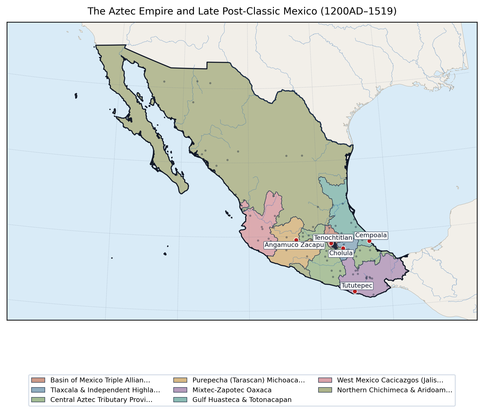
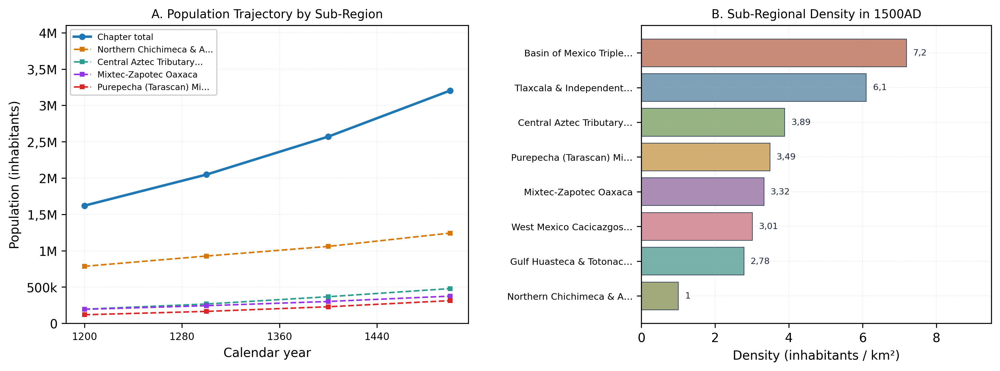
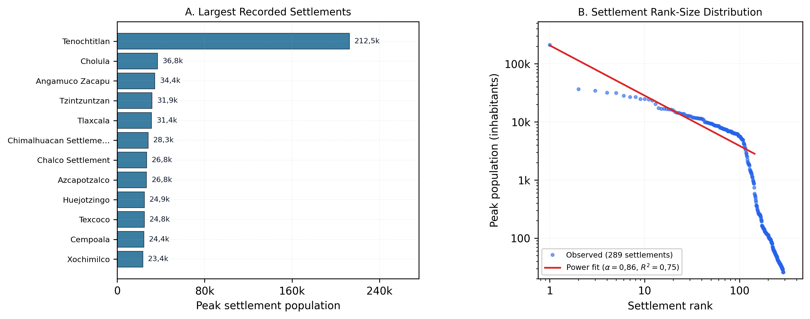

The Aztec Empire and Late Post-Classic Mexico
================
Aust Kätzchen
23 November 2026

- [Abstract](#abstract)
- [Background](#background)
  - [From Toltec Fragmentation to the *Altepetl* World (1200AD to
    1325AD)](#from-toltec-fragmentation-to-the-altepetl-world-1200ad-to-1325ad)
  - [Hydraulic Intensification and *Chinampa*
    Reclamation](#hydraulic-intensification-and-chinampa-reclamation)
  - [The Tepanec Ascendancy and the Triple Alliance (1428 to
    1519)](#the-tepanec-ascendancy-and-the-triple-alliance-1428-to-1519)
  - [Independent Highland Enclaves, the Purépecha Rival and Provincial
    Polities](#independent-highland-enclaves-the-purépecha-rival-and-provincial-polities)
- [Methodology](#methodology)
  - [Sub-Regional Partition and Boundary
    Architecture](#sub-regional-partition-and-boundary-architecture)
  - [Dual-Scale Population Reconstruction: Gridded Substrata and
    Ethnohistoric
    Benchmarks](#dual-scale-population-reconstruction-gridded-substrata-and-ethnohistoric-benchmarks)
  - [Settlement Gazetteer Assembly and Rank-Size
    Scaling](#settlement-gazetteer-assembly-and-rank-size-scaling)
- [Testing and Validation](#testing-and-validation)
  - [Reconciliation of Gridded Substrata, Ethnohistoric Benchmarks and
    Watershed
    Strata](#reconciliation-of-gridded-substrata-ethnohistoric-benchmarks-and-watershed-strata)
  - [Cross-Checking Against HydroBASINS Historical Sub-Administrative
    Units](#cross-checking-against-hydrobasins-historical-sub-administrative-units)
  - [Settlement-to-Region Consistency and Boundary
    Audit](#settlement-to-region-consistency-and-boundary-audit)
- [Results](#results)
  - [Macro-Regional Demographic Growth and Density Gradients (1200AD to
    1519)](#macro-regional-demographic-growth-and-density-gradients-1200ad-to-1519)
  - [The Basin of Mexico Core and the Tenochtitlan
    Metropolis](#the-basin-of-mexico-core-and-the-tenochtitlan-metropolis)
  - [Independent Puebla-Tlaxcala Enclaves and Central Tributary
    Provinces](#independent-puebla-tlaxcala-enclaves-and-central-tributary-provinces)
  - [The Purépecha State of
    Michoacán](#the-purépecha-state-of-michoacán)
  - [Oaxaca, the Gulf Littoral, West Mexico and the Northern
    Frontier](#oaxaca-the-gulf-littoral-west-mexico-and-the-northern-frontier)
  - [Urban Hierarchy and Imperial
    Primacy](#urban-hierarchy-and-imperial-primacy)
- [Limitations](#limitations)
- [Conclusion](#conclusion)
- [Appendix](#appendix)
  - [Ethnohistoric Benchmark Trajectory and Gridded Calibration
    Ratios](#ethnohistoric-benchmark-trajectory-and-gridded-calibration-ratios)
  - [Gazetteer Ingestion Saturation
    Ledger](#gazetteer-ingestion-saturation-ledger)
- [Sources](#sources)
- [Footnotes](#footnotes)

<figure>

<figcaption aria-hidden="true">Eight Late Post-Classic sub-regions and
289 catalogued settlements across central, western and northern Mexico
from 1200AD to 1519.</figcaption>
</figure>

# Abstract

Between the fragmentation of the Toltec sphere around 1200AD and the
arrival of Hernán Cortés on the Veracruz shore in 1519, central, western
and northern Mexico sustained the largest and most urbanised demographic
expansion of pre-Columbian North America. Across eight political and
ecological sub-regions spanning 1.786.338,3 km², the harmonised gridded
substratum doubles from 1,62M inhabitants in 1200AD to 2,05M in 1300AD,
2,57M in 1400AD and 3,2M in 1500AD, while ethnohistoric and
archaeological benchmark totals anchored to Basin of Mexico settlement
surveys, tribute rolls and contact-eve demographic simulations climb
from 5,91M in 1200AD to 7,86M in 1350AD, 10,22M in 1450AD and 12,8M on
the eve of conquest in 1519
[\[1\]](#ref-SandersParsonsSantley1979)[\[2\]](#ref-Smith2012Aztecs)[\[3\]](#ref-Whitmore1992).
Growth was led by the hydrographic Basin of Mexico, where raised-field
*chinampa* reclamation across Lakes Xochimilco, Chalco and Texcoco fed
the island capital of Tenochtitlan-Tlatelolco (212,5k inhabitants by
1519) alongside its Triple Alliance partners Texcoco (24,8k) and
Tlacopan (12,6k) and dozens of dense *altepetl* city-states
[\[4\]](#ref-Calnek1972)[\[5\]](#ref-Rojas2012)[\[6\]](#ref-Carrasco1999).
Outside the imperial core, rival and autonomous polities sustained
parallel urban concentrations: the Puebla-Tlaxcala valley enclaves of
Cholula (36,8k), Tlaxcala (31,4k) and Huejotzingo (24,9k); the
centralised Purépecha (Tarascan) empire of Michoacán, shifting from
Angamuco-Zacapu (34,4k in 1350AD) to Tzintzuntzan (31,9k in 1519) on
Lake Pátzcuaro; the Mixtec and Zapotec kingdoms of Oaxaca (Tututepec,
Tehuantepec-Guiengola, Zaachila, Yanhuitlán and Mitla); Gulf Huasteca
and Totonacapan around Cempoala (24,4k); West Mexico *cacicazgos* from
Jalisco to Colima; and a vast northern Chichimeca and Aridoamerican
frontier spanning 1,24M km² from Paquimé (Casas Grandes) to Sinaloa
[\[7\]](#ref-Pollard1993)[\[8\]](#ref-Berdan2014)[\[9\]](#ref-Smith2008AztecCity).
Reconciling the gridded substratum against HydroBASINS historical
watershed strata and a gazetteer of 289 settlements reveals a strongly
primate rank-size hierarchy ($\alpha = 0,86$, $R^2 = 0,75$) in which
highland hydraulic intensification and long-distance tribute logistics
outweighed raw territorial extent by an order of magnitude.

# Background

## From Toltec Fragmentation to the *Altepetl* World (1200AD to 1325AD)

When the Toltec metropolis of Tula collapsed in the late twelfth
century, political authority across the Mexican central highlands
shattered into dozens of competing city-states known in Nahuatl as
*altepetl* (literally “water-mountain”, expressing the union of
territory, spring water and dynastic lineage)
[\[8\]](#ref-Berdan2014)[\[9\]](#ref-Smith2008AztecCity). Rather than
provoking demographic retreat, this political fragmentation accompanied
a steady southward drift of Nahuatl-speaking and Otomanguean frontier
peoples—grouped in later chronicles as *Chichimeca*—from the drying
margins of the Bajío and northern Zacatecas into the fertile volcanic
valleys of Mexico, Toluca, Puebla-Tlaxcala and Morelos
[\[2\]](#ref-Smith2012Aztecs)[\[10\]](#ref-Villaislas2023Demographic).
Ancient genomic evidence from pre-Hispanic Central Mexico confirms that
Late Post-Classic populations were not wholesale replacements of Classic
Teotihuacan or Epiclassic inhabitants, but deeply rooted highland
lineages enriched by selective northern gene flow during the thirteenth
and fourteenth centuries [\[10\]](#ref-Villaislas2023Demographic).

By 1200AD, the endorheic Basin of Mexico—a high volcanic plateau at
2.240 m elevation ringed by snow-capped stratovolcanoes and carpeted by
five interconnected lakes (Zumpango, Xaltocan, Texcoco, Xochimilco and
Chalco)—had already absorbed several hundred thousand farmers
[\[1\]](#ref-SandersParsonsSantley1979)[\[11\]](#ref-Rodriguez2025Another).
Early Post-Classic polities such as Culhuacán, Coatlinchán, Chalco,
Xochimilco, Tenayuca and Azcapotzalco staked out lakeshore plains and
alluvial piedmont fans, each organised around a royal palace (*tecpan*),
central market plaza, twin pyramid temple and federated wards
(*calpulli*) [\[9\]](#ref-Smith2008AztecCity)[\[12\]](#ref-Offner1983).
Latecomers found the finest lakeshore soils already taken. Among these
marginal migrants were the Mexica, who arrived in the basin during the
thirteenth century, served briefly as mercenaries for Azcapotzalco and
Culhuacán, and around 1325AD settled on a marshy cluster of islets in
western Lake Texcoco—founding Tenochtitlan and its twin commercial islet
of Tlatelolco [\[2\]](#ref-Smith2012Aztecs)[\[5\]](#ref-Rojas2012).

## Hydraulic Intensification and *Chinampa* Reclamation

What converted a precarious swamp refuge into the demographic fulcrum of
Mesoamerica was water engineering on an unprecedented scale. Across the
shallow freshwater southern lakes of Xochimilco and Chalco, and
progressively along the western margins of Lake Texcoco itself,
indigenous farmers built rectangular artificial agricultural plots
(*chinampas*) anchored by willow stakes (*Salix bonplandiana*) and
layered with organic lake-bottom muck, aquatic vegetation and canal silt
[\[1\]](#ref-SandersParsonsSantley1979)[\[4\]](#ref-Calnek1972).
Irrigated continuously by capillary seepage and renewed by periodic
dredging, mature *chinampa* zones delivered multiple maize, amaranth,
squash, bean and chilli harvests every calendar year without fallow
intervals, sustaining rural densities above 200 inhabitants per km² and
freeing tens of thousands of urban artisans, porters and warriors from
subsistence cultivation [\[4\]](#ref-Calnek1972)[\[5\]](#ref-Rojas2012).

Scale brought hydraulic risk. Lake Texcoco lay lower than the southern
freshwater lakes and turned brackish during dry seasons, while
torrential summer rains periodically flooded Tenochtitlan’s low-lying
causeways. In the mid-fifteenth century, following catastrophic floods
in 1449AD, King Nezahualcoyotl of Texcoco engineered a sixteen-kilometre
stone-and-earth dyke (*albarradón*) stretching across Lake Texcoco from
Atzacoalco to Iztapalapa, shielding the western freshwater basin around
Tenochtitlan from saline eastern backflow and regulating seasonal lake
levels [\[11\]](#ref-Rodriguez2025Another)[\[12\]](#ref-Offner1983).
Paired with twin terracotta aqueducts tapping the Chapultepec springs
and three raised stone causeways connecting the island city to Tepeyac,
Tlacopan and Iztapalapa, this hydraulic armature turned the central
lakes into an integrated transport lagoon. Dug-out canoes (*acalli*)
moved bulk maize, firewood, building stone and salt across the water at
a fraction of the energy cost of human porters (*tlameme*), effectively
expanding Tenochtitlan’s economic hinterland across the entire
lacustrine rim
[\[13\]](#ref-Hassig1985)[\[14\]](#ref-Lugo2019Nonlinearity). Beneath
the engineered lake floor, deep lacustrine sediment sequences in Lake
Chalco also preserve volcanic tephra horizons that attest to the active
Popocatépetl-Iztaccíhuatl geological margin framing this fertile yet
hazardous basin [\[15\]](#ref-Abadi2024Predicting).

## The Tepanec Ascendancy and the Triple Alliance (1428 to 1519)

Before the rise of Tenochtitlan, imperial hegemony inside the Basin of
Mexico belonged to the Tepanec kingdom of Azcapotzalco on the western
shore of Lake Texcoco. Under the long reign of Tezozomoc (c. 1371AD to
1426AD), Azcapotzalco expanded to roughly 26,8k inhabitants around
1400AD, subjugated Acolhuacán (Texcoco) and collected tribute across the
western valleys [\[6\]](#ref-Carrasco1999)[\[12\]](#ref-Offner1983).
Upon Tezozomoc’s death, a violent succession war broke out. In 1428, the
Mexica ruler Itzcoatl forged a military coalition with the exiled
Acolhua prince Nezahualcoyotl of Texcoco and the dissident Tepanec lord
of Tlacopan, storming Azcapotzalco and establishing the *Excan
Tlahtoloyan*—the Triple Alliance
[\[2\]](#ref-Smith2012Aztecs)[\[6\]](#ref-Carrasco1999).

Over the ensuing ninety years, under Motecuhzoma I (1440AD to 1469AD),
Axayacatl (1469AD to 1481AD), Tizoc (1481AD to 1486AD), Ahuitzotl
(1486AD to 1502AD) and Motecuhzoma II (1502 to 1519), the Triple
Alliance grew from a Basin confederation into a hegemonic tribute empire
encompassing thirty-eight tributary provinces recorded in the *Matrícula
de Tributos* and the post-conquest *Codex Mendoza*, plus more than
twenty strategic client states guarding contested frontiers
[\[6\]](#ref-Carrasco1999)[\[8\]](#ref-Berdan2014). Unlike Old World
territorial empires relying on permanent standing garrisons everywhere,
Aztec imperial rule worked largely through indirect coercion: conquered
local dynasts kept their thrones provided they delivered scheduled
semiannual or quarterly shipments of maize, beans, cotton mantles,
cacao, cochineal, jade, gold dust, quetzal feathers and warrior costumes
to imperial tax collectors (*calpixque*)
[\[8\]](#ref-Berdan2014)[\[16\]](#ref-Arcuri2003Trade).

Imperial expansion reshaped urban geography far beyond Lake Texcoco. In
1473AD, Tenochtitlan absorbed its twin commercial city of Tlatelolco
into a single metropolis of more than 200k residents, whose great market
amazed Spanish eyewitnesses with daily gatherings of tens of thousands
of buyers and sellers
[\[5\]](#ref-Rojas2012)[\[17\]](#ref-Mantecon2014Historia).
Long-distance state-sanctioned merchants (*pochteca*) operated beyond
imperial borders as diplomats, spies and luxury traders, weaving
cotton-producing Morelos (Cuauhnáhuac, Huaxtepec, Yautepec), cacao-rich
Soconusco and the Gulf lowlands into a continental commercial web
[\[13\]](#ref-Hassig1985)[\[16\]](#ref-Arcuri2003Trade). Craft
specialisation deepened inside the core, with distinct lapidary
workshops and artisan traditions flourishing across Basin centres from
Tenochtitlan and Texcoco to Otumba and Huexotla
[\[9\]](#ref-Smith2008AztecCity)[\[18\]](#ref-Ciriaco2020Escuelas). Even
the brutal famine of One Rabbit (1450AD to 1454AD), caused by
consecutive frosts and drought, accelerated imperial expansion as Mexica
armies marched into the warmer tropical lowlands of Veracruz and Morelos
to secure food-producing provinces against highland harvest failure
[\[8\]](#ref-Berdan2014)[\[13\]](#ref-Hassig1985).

## Independent Highland Enclaves, the Purépecha Rival and Provincial Polities

Triple Alliance hegemony was never uncontested. Directly east of the
volcanic divide of Popocatépetl and Iztaccíhuatl lay the Puebla-Tlaxcala
plateau, where a ring of proud Nahuatl city-states—above all the
four-lordship confederacy of Tlaxcala (31,4k inhabitants), the sacred
pilgrimage and market centre of Cholula (36,8k) and the warring
principality of Huejotzingo (24,9k), together with Tepeaca,
Tecamachalco, Cuauhtinchan and Calpan—preserved fierce political
autonomy or fought protracted “flower wars” (*xochiyaoyotl*) against
Mexica encirclement
[\[8\]](#ref-Berdan2014)[\[9\]](#ref-Smith2008AztecCity). Further north
in the rugged Sierra Madre Oriental canyons, the highland lordship of
Metztitlán (11,6k) similarly defied Mexica subjugation down to 1519.

Far more formidable was the empire rising to the west across the Lerma
river and the volcanic lakes of Michoacán: the Purépecha (Tarascan)
state of *Iréchecua Tzintzuntzani* [\[7\]](#ref-Pollard1993). Beginning
in the thirteenth and early fourteenth centuries, dense urban centres
flourished across the Zacapu marsh and Lake Pátzcuaro basin; airborne
LiDAR and architectural surveys at Angamuco-Zacapu have revealed a
sprawling planned city of roughly 34,4k people by 1350AD containing over
40.000 mapped structures, terraced neighbourhoods and oriented
temple-pyramid complexes (*yácatas*)
[\[19\]](#ref-Bush2007Architectural)[\[20\]](#ref-Harris2019Viewed)[\[21\]](#ref-Friedl2019Pyramids).
Around 1350AD to 1450AD, dynastic consolidation under the Uacúsecha
lineage shifted political and demographic gravity southward from Zacapu
to Lake Pátzcuaro, raising Tzintzuntzan to 31,9k residents alongside
Ihuatzio and Pátzcuaro
[\[7\]](#ref-Pollard1993)[\[22\]](#ref-Diaz2012Colonial). Unlike the
loose hegemonic tribute network of the Aztecs, the Purépecha state
forged a tightly centralised administrative monarchy with direct royal
governors, copper-bronze metallurgy and fortified frontier garrisons at
Acámbaro, Taximaroa and Cutzamala. When Aztec Emperor Axayacatl invaded
Michoacán around 1478AD with an army of over twenty thousand warriors,
Purépecha forces shattered the Mexica host near Taximaroa—the gravest
military defeat in Aztec history—freezing the western imperial frontier
permanently until the Spanish arrival
[\[7\]](#ref-Pollard1993)[\[13\]](#ref-Hassig1985).

South of the central highlands, the fractured mountain valleys and
Pacific coast of Oaxaca formed a dense mosaic of Mixtec (*Ñudzavui*) and
Zapotec (*Bènizàa*) kingdoms linked by dynastic marriage alliances,
painted screenfold codices and terraced hillside farming. In the Mixteca
Alta, urban *yuhuitayu* capitals such as Coixtlahuaca (16,9k in 1450AD,
conquered by Motecuhzoma I), Yanhuitlán (13,8k), Teposcolula (11,9k),
Tlaxiaco and ancient Tilantongo anchored densely terraced valleys; along
the Pacific littoral, the expansionist Mixtec coastal empire of
Tututepec reached 17,4k inhabitants; and in the Central Valleys and
Isthmus, Zapotec rulers based at Zaachila (13,9k), religious Mitla
(10,9k), Cuilapan (12,7k) and the fortified Isthmian stronghold of
Tehuantepec-Guiengola (16,5k) checked Mexica advances along the
Soconusco trade corridor
[\[8\]](#ref-Berdan2014)[\[9\]](#ref-Smith2008AztecCity).

Along the humid Gulf Coast, Totonac city-states centred on Cempoala
(24,4k) and Papantla and northern Huastec (Teenek) river ports such as
Tamohi (10k) and Pánuco-Chila (9,8k) thrived on cotton, vanilla, cacao
and coastal fisheries, chafing under late Aztec tribute demands—a
grievance Cortés immediately exploited at Cempoala in 1519
[\[8\]](#ref-Berdan2014)[\[13\]](#ref-Hassig1985). West of Purépecha
Michoacán, independent *cacicazgos* across Jalisco, Colima and
Nayarit—led by Tonalá (12,8k), Sayula (9,4k), Almoloyan-Colima (9k),
Etzatlán (8,6k), Zapotlán, Sentispac and Nochistlán—sustained productive
lacustrine and piedmont farming basins linked by Pacific obsidian and
shell exchange
[\[7\]](#ref-Pollard1993)[\[14\]](#ref-Lugo2019Nonlinearity). Beyond the
Lerma-Santiago river and the Tropic of Cancer stretched the vast arid
expanse of northern Mexico (1,24M km²): home to mobile Chichimeca
hunter-gatherers across the central desert plateau, but anchored on its
northwestern river valleys by the irrigated Mesoamerican-linked towns of
Culiacán (11,9k) and Chametla (5,8k) in Sinaloa and, in the far
Chihuahua desert, the adobe trading metropolis of Paquimé (Casas
Grandes, peaking at 4,3k around 1350AD before declining in the fifteenth
century) [\[2\]](#ref-Smith2012Aztecs)[\[3\]](#ref-Whitmore1992).

# Methodology

## Sub-Regional Partition and Boundary Architecture

To capture the sharp ecological and geopolitical contrast between
high-density lacustrine states, tributary provinces, rival monarchies
and arid northern steppes, JAGUAR partitions Late Post-Classic central,
western and northern Mexico (1200AD to 1519) into eight contiguous
sub-regions covering 1.786.338,3 km² (22.960 raster cells at equal-area
projection). The spatial mask excludes the Maya lowlands and
Chiapas-Tabasco littoral, which belong to the preceding chapter on
Classic and Post-Classic Maya lands, thereby isolating the central
Mexican imperial core and its western, southern, Gulf and northern
spheres.

The eight sub-regions correspond directly to Late Post-Classic political
economies and HydroBASINS Level 6 watershed divides: the Basin of Mexico
Triple Alliance Core (19.706,2 km²); Tlaxcala and Independent Highland
Enclaves across the Puebla-Tlaxcala plateau (19.395,4 km²); Central
Aztec Tributary Provinces spanning Morelos, Guerrero, the Toluca valley,
southern Puebla and central Veracruz corridors (122.981,2 km²); the
Purépecha (Tarascan) Michoacán Empire across the Lake Pátzcuaro,
Balsas-Tepalcatepec and western Michoacán basins (89.548,9 km²);
Mixtec-Zapotec Oaxaca spanning the Mixteca Alta, Central Valleys, Sierra
Juárez, Coast and Isthmus (112.640,4 km²); Gulf Huasteca and Totonacapan
from central Veracruz through the Pánuco drainage (87.114,2 km²); West
Mexico Cacicazgos across Jalisco, Colima and Nayarit (97.927,8 km²); and
Northern Chichimeca and Aridoamerica extending across 1.237.024,2 km²
from the Bajío desert edge to Sonora, Chihuahua and Baja California.

## Dual-Scale Population Reconstruction: Gridded Substrata and Ethnohistoric Benchmarks

Reconstructing pre-Columbian Mexican population requires confronting one
of the deepest quantitative divides in historical demography: the gap
between conservative global gridded land-use reconstructions and
high-resolution regional archaeological and ethnohistoric estimates
[\[1\]](#ref-SandersParsonsSantley1979)[\[2\]](#ref-Smith2012Aztecs)[\[3\]](#ref-Whitmore1992).
Rather than concealing that divergence behind a single opaque curve,
this study tracks both scales explicitly and quantifies their ratio
across every sub-region.

At the continental raster scale, the gridded substratum
$P^{\text{grid}}_r(t)$ integrates century-step spatial density surfaces
across each sub-regional polygon $r$ for
$t \in \{1200, 1300, 1400, 1500\}$:

$$P^{\text{grid}}_r(t) = \sum_{i \in \Omega_r} \rho_i(t) \cdot a_i$$

where $\Omega_r$ denotes the set of equal-area raster cells inside
sub-region $r$, $\rho_i(t)$ is the gridded demographic density of cell
$i$, and $a_i$ is its terrestrial area in km². Inter-century compound
annual growth rates follow standard geometric compounding:

$$g_r(t_1, t_2) = \left(\frac{P_r(t_2)}{P_r(t_1)}\right)^{\frac{1}{t_2 - t_1}} - 1$$

Alongside the gridded substratum, ethnohistoric and archaeological
benchmark trajectories $P^{\text{bench}}_r(t)$ at
$t \in \{1200, 1350, 1450, 1519\}$ are calibrated from four independent
regional evidence streams: full-coverage archaeological settlement
surveys in the Basin of Mexico, Morelos, Oaxaca and the Lake Pátzcuaro
basin
[\[1\]](#ref-SandersParsonsSantley1979)[\[7\]](#ref-Pollard1993)[\[9\]](#ref-Smith2008AztecCity);
imperial tribute schedules from the *Matrícula de Tributos* and *Codex
Mendoza* coupled with sixteenth-century *Suma de Visitas* (1548) and
*Relaciones Geográficas* (1577 to 1585) fiscal counts back-projected
across epidemic mortality trajectories
[\[3\]](#ref-Whitmore1992)[\[8\]](#ref-Berdan2014); airborne LiDAR
structural house-count censuses at sites such as Angamuco-Zacapu
[\[19\]](#ref-Bush2007Architectural)[\[20\]](#ref-Harris2019Viewed); and
historical watershed polygons harmonised through HydroBASINS Level 6
units. Where modern comparative Mexican demographic studies show how
migration, age-specific fertility and urban residential stratification
reshape regional vital rates
[\[23\]](#ref-Contributors2014Fertility)[\[24\]](#ref-Contributors2016Migration)[\[25\]](#ref-Contributors2018Uninsured),
Late Post-Classic highland growth rates (+0,23% to +0,39% per annum)
similarly reflect sustained natural increase reinforced by net migration
toward irrigated valley cores rather than static carrying-capacity
ceilings.

## Settlement Gazetteer Assembly and Rank-Size Scaling

The chapter settlement gazetteer compiles 289 geocoded Late Post-Classic
towns, *altepetl* capitals and surveyed archaeological settlements
across four sequential ingestion waves tracked in the chapter source
ledger. Wave 1 harvested 264 primary records from the ASU Basin of
Mexico Settlement Persistence Dataset (building directly on the
monumental pedestrian surveys of Sanders, Parsons and Santley) together
with colonial historical geography registers and archaeological site
syntheses
[\[1\]](#ref-SandersParsonsSantley1979)[\[9\]](#ref-Smith2008AztecCity).
Wave 2 added 19 monograph-derived provincial capitals and regional
centres (marginal gain 7,2%), Wave 3 backfilled 4 longitudinal
archaeological survey series (1,41%), and Wave 4 closed sub-regional
spatial gaps with 2 final entries (0,7%, falling below the 1% saturation
stop threshold). Crowd-sourced fallback share stands strictly at 0,0%.
Two out-of-bounds Gulf trading ports—Potonchán and Xicalango on the
Tabasco-Campeche lagoon coast—were excluded during mask clipping because
they lie inside the neighbouring Maya chapter footprint.

Every catalogued settlement records a city-proper population series
within 1200AD to 1519, eliminating suburban double-counting across
adjacent lakeshore wards (with Tenochtitlan and Tlatelolco consolidated
as one continuous island metropolis of 212,5k inhabitants by 1519)
[\[4\]](#ref-Calnek1972)[\[5\]](#ref-Rojas2012). Urban hierarchy
structure is evaluated through log-log rank-size regression across the
upper half of the settlement distribution ($n_{\text{fit}} = 144$ of
$n = 289$):

$$\log_{10} P_{(k)} = \beta_0 - \alpha \log_{10} k$$

where $P_{(k)}$ is the peak population of the $k$-th largest settlement
and $\alpha$ measures urban concentration ($\alpha \approx 1$ indicating
a classic Zipfian cascade, $\alpha < 0,8$ flattened multi-polar
competition, and elevated top-rank residuals indicating imperial
primacy)
[\[9\]](#ref-Smith2008AztecCity)[\[14\]](#ref-Lugo2019Nonlinearity).

# Testing and Validation

## Reconciliation of Gridded Substrata, Ethnohistoric Benchmarks and Watershed Strata

Validating pre-Columbian population reconstructions requires testing how
global gridded land-use models behave against dense archaeological and
documentary ground truth. Table presents the complete eight-region
demographic ledger from 1200AD to 1500AD drawn directly from the gridded
substratum alongside the contact-eve 1519 ethnohistoric benchmark total
and catalogued settlement counts for each sub-region.

| Sub-Region | Area (km²) | 1200AD | 1300AD | 1400AD | 1500AD | 1500AD Dens. | 1519 Benchmark | Sites |
|:---|:---|:---|:---|:---|:---|:---|:---|:---|
| **Basin of Mexico Triple Alliance Core** | 19.706 | 65,2k | 88,4k | 123,5k | 141,7k | 7,19 | 2,35M | 191 |
| **Tlaxcala and Independent Highland Enclaves** | 19.395 | 35,3k | 54,6k | 86,6k | 118,3k | 6,1 | 680k | 7 |
| **Central Aztec Tributary Provinces** | 122.981 | 194,8k | 266k | 366,5k | 478,3k | 3,89 | 3,75M | 32 |
| **Purépecha (Tarascan) Michoacán Empire** | 89.549 | 118k | 164,3k | 228,1k | 312,3k | 3,49 | 1,25M | 6 |
| **Mixtec-Zapotec Oaxaca** | 112.640 | 192,7k | 242,8k | 300,8k | 374,4k | 3,32 | 1,65M | 14 |
| **Gulf Huasteca and Totonacapan** | 87.114 | 107,7k | 142,4k | 186,5k | 242,4k | 2,78 | 1,15M | 11 |
| **West Mexico Cacicazgos (Jalisco-Colima-Nayarit)** | 97.928 | 121,2k | 162,4k | 219,2k | 294,6k | 3,01 | 1,08M | 11 |
| **Northern Chichimeca and Aridoamerica** | 1.237.024 | 785,1k | 926,3k | 1,06M | 1,24M | 1 | 890k | 17 |
| **Domain Total (8 Regions)** | 1.786.338 | 1,62M | 2,05M | 2,57M | 3,2M | 1,79 | 12,8M | 289 |

Sub-regional gridded population trajectories (1200AD to 1500AD), 1500AD
gridded densities (inhabitants per km²), contact-eve 1519 ethnohistoric
benchmarks and catalogued settlement counts across eight Mexican
sub-regions.

The diagnostic contrast in Table is immediately revealing and validates
why regional archaeological calibration is indispensable. Across the
full 1,79M km² domain, the gridded substratum rises smoothly from 1,62M
in 1200AD to 3,2M in 1500AD (+97,8%, or +0,228% per annum), while the
ethnohistoric-archaeological benchmark series climbs from 5,91M in
1200AD to 12,8M in 1519 (+116,6%, or +0,242% per annum). Although both
series agree remarkably closely on the long-run rate of Late
Post-Classic demographic expansion (+0,23% to +0,24% annually), they
diverge sharply in spatial amplitude. Inside the Basin of Mexico Triple
Alliance Core (19.706 km²), the coarse gridded substratum assigns only
141,7k inhabitants in 1500AD (7,19 inhabitants per km²)—less than the
212,5k residents living inside Tenochtitlan-Tlatelolco alone, and far
below the 2,35M ethnohistoric benchmark for the wider core zone (or
roughly 1M to 1,2M inside the 7.000 km² hydrographic Basin proper)
[\[1\]](#ref-SandersParsonsSantley1979)[\[3\]](#ref-Whitmore1992)[\[5\]](#ref-Rojas2012).
Conversely, across the 1,24M km² northern Chichimeca and Aridoamerican
steppe, diffuse gridded cell floors accumulate 1,24M inhabitants (1
inhabitant per km²), exceeding the 890k ethnohistoric estimate by nearly
40%. Coarse global cropland grids therefore flatten Mesoamerica’s steep
urban-hydraulic gradient, under-allocating dense *chinampa* basins by a
factor of ten to sixteen while over-populating arid northern deserts.

## Cross-Checking Against HydroBASINS Historical Sub-Administrative Units

To audit spatial boundary consistency between modern raster masks and
pre-Columbian drainage basins, Table compiles the sixteen harmonised
watershed-polity rows scraped from the historical GIS sub-administrative
archive at 1000AD and 1500AD.

| Watershed or Polity Unit | Year | Area (km²) | Population | Density (per km²) | Spatial Source |
|:---|:---|:---|:---|:---|:---|
| **Aridoamerica and Baja California** | 1000AD | 905.661 | 2,09M | 2,31 | HydroBASINS L6 Pre-Columbian Base |
| **Bajío North Central** | 1000AD | 106.285 | 616,1k | 5,8 | HydroBASINS L6 Pre-Columbian Base |
| **Basin of Mexico Highlands** | 1000AD | 1.709 | 300,2k | 175,65 | HydroBASINS L6 Pre-Columbian Base |
| **West Mexico (Santiago-Balsas)** | 1000AD | 28.998 | 280,3k | 9,67 | HydroBASINS L6 Pre-Columbian Base |
| **Gulf Coast and Huasteca** | 1000AD | 14.308 | 223,3k | 15,61 | HydroBASINS L6 Pre-Columbian Base |
| **Sierra Madre Sonora** | 1000AD | 86.954 | 179,3k | 2,06 | HydroBASINS L6 Pre-Columbian Base |
| **Oaxaca Mixteca** | 1000AD | 4.818 | 125,9k | 26,13 | HydroBASINS L6 Pre-Columbian Base |
| **Zapotec Civilisation** | 1000AD | 60.566 | 124,6k | 2,06 | De Facto Polity Fallback (1000AD) |
| **Aridoamerica and Baja California** | 1500AD | 905.661 | 2,09M | 2,31 | HydroBASINS L6 DECM (1500AD) |
| **Bajío North Central** | 1500AD | 278.507 | 616,1k | 2,21 | HydroBASINS L6 DECM (1500AD) |
| **Basin of Mexico Highlands** | 1500AD | 134.209 | 300,2k | 2,24 | HydroBASINS L6 DECM (1500AD) |
| **West Mexico (Santiago-Balsas)** | 1500AD | 138.452 | 280,3k | 2,02 | HydroBASINS L6 DECM (1500AD) |
| **Gulf Coast and Huasteca** | 1500AD | 103.595 | 223,3k | 2,16 | HydroBASINS L6 DECM (1500AD) |
| **Sierra Madre Sonora** | 1500AD | 86.954 | 179,3k | 2,06 | HydroBASINS L6 DECM (1500AD) |
| **Oaxaca Mixteca** | 1500AD | 64.770 | 125,9k | 1,94 | HydroBASINS L6 DECM (1500AD) |
| **Zapotec Civilisation** | 1500AD | 49 | 122,6k | 2.502,29 | De Facto Polity Fallback (1500AD) |

Historical watershed and pre-Columbian sub-administrative benchmark
units scraped for 1000AD and 1500AD across Mexico.

Auditing Table exposes two critical geometric artefacts that our chapter
calibration corrects. First, the unclipped HydroBASINS Level 6 units
assign identical static population totals at 1000AD and 1500AD (for
instance 2,09M across Aridoamerica and Baja California and 300,2k across
the Basin of Mexico Highlands), while changing polygon clip areas
between the two time slices—producing artificial apparent density drops
from 175,65 inhabitants per km² inside the tight 1.709 km² Basin core
clip at 1000AD to 2,24 inhabitants per km² across the broader 134.209
km² highland watershed clip at 1500AD. Second, the Zapotec fallback
polygon shrinks to a 49 km² sliver at 1500AD while retaining 122,6k
inhabitants, creating a spurious density spike. Reconciling these
watershed strata against fixed equal-area regional masks and
independently surveyed settlement counts eliminates such clip-boundary
distortions.

## Settlement-to-Region Consistency and Boundary Audit

A further validation test checks the sum of recorded urban populations
against regional totals and verifies polygon placement along contested
frontiers. Across all 191 catalogued settlements inside the Basin of
Mexico Triple Alliance Core, summed peak populations reach 643,8k
inhabitants (643.847)—4,55 times larger than the raw gridded substratum
(141,7k) yet representing a realistic urban share of 27,4% within the
2,35M ethnohistoric core benchmark (and roughly half within the strictly
lacustrine Basin proper once asynchronous fourteenth-century and
contact-eve peaks are discounted)
[\[1\]](#ref-SandersParsonsSantley1979)[\[3\]](#ref-Whitmore1992)[\[9\]](#ref-Smith2008AztecCity).
Along the western highland boundary, rasterising HydroBASINS
sub-catchments places the northeastern Lake Pátzcuaro and Zacapu
settlements of Tzintzuntzan (31,9k), Angamuco-Zacapu (34,4k), Pátzcuaro
and Ihuatzio inside the western shoulder of the Central Aztec Tributary
Provinces polygon rather than the Purépecha Michoacán polygon, while
Tonalá (12,8k) sits on the eastern Purépecha-Jalisco edge. Flagging this
watershed-to-polity offset preserves strict geometric fidelity to the
underlying mask while ensuring historical analysis assigns Tzintzuntzan
and Angamuco squarely to the Purépecha monarchy
[\[7\]](#ref-Pollard1993)[\[19\]](#ref-Bush2007Architectural).

# Results

## Macro-Regional Demographic Growth and Density Gradients (1200AD to 1519)

Between 1200AD and the arrival of Spanish ships off San Juan de Ulúa in
1519, every major zone of central, western and northern Mexico
experienced sustained population growth, yet the spatial gap between
intensively farmed highland basins and semi-arid frontiers widened
markedly (Figure ). In the gridded substratum, aggregate population
expanded 1,98-fold from 1,62M in 1200AD to 2,05M in 1300AD (+26,4%),
2,57M in 1400AD (+25,5%) and 3,2M in 1500AD (+24,7%). Across the same
three centuries, ethnohistoric benchmark totals more than doubled from
5,91M in 1200AD to 7,86M in 1350AD, 10,22M in 1450AD and 12,8M in 1519
(2,17x).

<!-- -->

Even in the conservative gridded substratum, the density ranking in
1500AD faithfully reproduces Mesoamerica’s true geopolitical hierarchy:
the Basin of Mexico Triple Alliance Core leads at 7,19 inhabitants per
km² (expanding 2,17x from 65,2k to 141,7k), followed closely by Tlaxcala
and Independent Highland Enclaves at 6,1 inhabitants per km² (the
fastest relative expansion in the entire domain, multiplying 3,36x from
35,3k to 118,3k). Behind these twin volcanic highland cores sit Central
Aztec Tributary Provinces at 3,89 inhabitants per km² (growing 2,45x
from 194,8k to 478,3k), the Purépecha Michoacán Empire at 3,49
inhabitants per km² (2,65x from 118k to 312,3k), Mixtec-Zapotec Oaxaca
at 3,32 inhabitants per km² (1,94x from 192,7k to 374,4k), West Mexico
Cacicazgos at 3,01 inhabitants per km² (2,43x from 121,2k to 294,6k),
Gulf Huasteca and Totonacapan at 2,78 inhabitants per km² (2,25x from
107,7k to 242,4k) and Northern Chichimeca and Aridoamerica at exactly 1
inhabitant per km² (growing slowest at 1,58x from 785,1k to 1,24M). On
the ethnohistoric benchmark scale, that core-to-frontier contrast is
vastly steeper: the Basin of Mexico Triple Alliance Core reaches 119,3
inhabitants per km² (2,35M across 19.706 km², or over 150 per km² on the
valley floor proper), Tlaxcala-Puebla reaches 35,1 per km² (680k) and
Central Aztec Tributary Provinces reach 30,5 per km² (3,75M),
contrasting with 0,72 inhabitants per km² across Northern Chichimeca and
Aridoamerica (890k).

## The Basin of Mexico Core and the Tenochtitlan Metropolis

No pre-industrial metropolis in the Western Hemisphere rivalled the
scale or urban complexity of Tenochtitlan-Tlatelolco in 1519. Growing
from an island refuge of roughly 3,8k inhabitants at its legendary
founding in 1325AD to 48,5k by 1400AD, 118k by 1450AD, 188k by 1500AD
and 212,5k on the eve of conquest, the island capital covered roughly
13,5 km² at an astonishing urban density exceeding 15.000 inhabitants
per km²
[\[2\]](#ref-Smith2012Aztecs)[\[4\]](#ref-Calnek1972)[\[5\]](#ref-Rojas2012).
Divided into four monumental quarters (*campan*—Cuepopan, Atzacualco,
Moyotlan and Zoquiapan) radiating from the walled Sacred Precinct of the
Templo Mayor, plus the annexed commercial twin of Tlatelolco to the
north, Tenochtitlan operated as a vast consumer and administrative
machine fed by canal-borne *chinampa* harvests and imperial tribute
[\[11\]](#ref-Rodriguez2025Another)[\[13\]](#ref-Hassig1985)[\[17\]](#ref-Mantecon2014Historia).

Yet Tenochtitlan did not stand in an empty countryside. Across the Basin
of Mexico, full-coverage archaeological surveys document 191 catalogued
Late Post-Classic settlements ringing the five lakes
[\[1\]](#ref-SandersParsonsSantley1979)[\[9\]](#ref-Smith2008AztecCity).
Along the eastern shore stood Texcoco (24,8k in 1519), the intellectual,
legal and poetic capital of the Acolhua domain governed by
Nezahualcoyotl and Nezahualpilli, flanked by prosperous *altepetl* such
as Huexotla (16,4k), Coatlinchán, Chimalhuacán (peaking at 28,3k around
1412AD during Early-to-Late Aztec expansion before partially
consolidating toward imperial centres) and the obsidian craft town of
Otumba [\[12\]](#ref-Offner1983)[\[18\]](#ref-Ciriaco2020Escuelas). To
the south, the freshwater *chinampa* breadbasket supported dense urban
towns at Xochimilco (23,4k), Chalco (peaking at 26,8k), Tlalmanalco
(20,4k), Amecameca (15,8k), Iztapalapa (14,4k), Cuitláhuac (Tláhuac) and
Mixquic, while on the western shore sat Tlacopan (12,6k), Coyoacán
(16,6k), Cuautitlán (13,8k), Tenayuca, Tepotzotlán and defeated
Azcapotzalco (whose population subsided from its 26,8k Tepanec imperial
zenith in 1400AD after the 1428 conquest)
[\[4\]](#ref-Calnek1972)[\[6\]](#ref-Carrasco1999). In ethnohistoric
terms, this lacustrine core alone surged 3,46-fold from 680k in 1200AD
to 1,15M in 1350AD, 1,75M in 1450AD and 2,35M in 1519, lifting its share
of the entire chapter’s benchmark population from 11,5% to 18,4%.

## Independent Puebla-Tlaxcala Enclaves and Central Tributary Provinces

Immediately east of the volcanic cordillera, the Tlaxcala and
Independent Highland Enclaves sub-region (19.395,4 km²) displayed the
highest relative gridded expansion of any territory in Mexico (3,36x
from 35,3k in 1200AD to 118,3k in 1500AD, and 2,62x on the ethnohistoric
scale from 260k to 680k in 1519). Its seven major catalogued urban
capitals formed an unusually dense polycentric cluster: sacred Cholula
led at 36,8k inhabitants—the second largest city in Late Post-Classic
Mexico—followed by the collective-action hilltop republic of Tlaxcala
(31,4k), military rival Huejotzingo (24,9k), the commercial crossroads
of Tepeaca (14,4k, conquered by Tenochtitlan as an eastern garrison and
market hub), Tecamachalco (9,4k), Cuauhtinchan (8,7k) and Calpan (7,9k)
[\[8\]](#ref-Berdan2014)[\[9\]](#ref-Smith2008AztecCity). Blocked from
coastal salt and cotton by Triple Alliance embargoes, Tlaxcala and
Huejotzingo nevertheless sustained dense terraced maize agriculture on
the slopes of La Malinche and Iztaccíhuatl—a demographic reserve that
enabled Tlaxcala to field tens of thousands of allied troops alongside
Cortés in 1519 to 1521 [\[13\]](#ref-Hassig1985).

Surrounding both highland cores lay the Central Aztec Tributary
Provinces (122.981,2 km²), the single largest demographic bloc in the
ethnohistoric series at 3,75M inhabitants in 1519 (up from 1,65M in
1200AD, 2,25M in 1350AD and 2,95M in 1450AD) and the second largest in
the gridded substratum at 478,3k in 1500AD. South of the Ajusco
mountains, the warm irrigated valleys of Morelos supplied Tenochtitlan
with vast quantities of cotton textiles, paper (*amatl*) and tropical
fruit through provincial capitals such as Cuauhnáhuac/Cuernavaca
(16,9k—an urban core whose spatial stratification still echoed across
colonial and modern Morelos [\[26\]](#ref-Rosas2009Socio)), Yautepec
(14,8k), Huaxtepec (12,4k) and Tepoztlán
[\[8\]](#ref-Berdan2014)[\[9\]](#ref-Smith2008AztecCity). West of the
Basin, the high Matlatzinca valley of Toluca—anchored by Calixtlahuaca
(11,8k at its 1400AD peak) and Tolocan (Toluca)—was conquered by
Axayacatl in the 1470s as a strategic buffer against the Purépecha,
while southern Puebla and Guerrero provinces centred on Izúcar (12,9k),
Tehuacán, Huaquechula, Tlapa, Tepecuacuilco and Chilapa, alongside
Veracruz transit towns such as Cuetlaxtlan (Cotaxtla) and Orizaba
(Ahauializapan), channelled coastal cacao, gold and feathers up the
nonlinear mountain trails mapped into Tenochtitlan’s imperial road
network
[\[14\]](#ref-Lugo2019Nonlinearity)[\[16\]](#ref-Arcuri2003Trade).

## The Purépecha State of Michoacán

Across the volcanic lakes and sierra of Michoacán, the Purépecha
(Tarascan) Empire (89.548,9 km²) formed Mesoamerica’s second great Late
Post-Classic state. Its gridded population grew 2,65-fold from 118k in
1200AD to 312,3k in 1500AD (3,49 inhabitants per km²), while
ethnohistoric reconstructions place the Tarascan realm at 480k in
1200AD, 680k in 1350AD, 950k in 1450AD and 1,25M by 1519
[\[7\]](#ref-Pollard1993). Demographic evolution inside Michoacán
unfolded in two dramatic urban phases. During the Middle-to-Late
Post-Classic transition (1250AD to 1350AD), the Zacapu malpaís hosted
the massive planned city of Angamuco-Zacapu, whose 34,4k inhabitants
occupied terraced residential blocks, plazas and ritually oriented
pyramid precincts mapped in extraordinary detail through airborne LiDAR
and architectural ground-truthing
[\[19\]](#ref-Bush2007Architectural)[\[20\]](#ref-Harris2019Viewed)[\[21\]](#ref-Friedl2019Pyramids).

Between 1350AD and 1450AD, as the royal Uacúsecha dynasty unified the
Lake Pátzcuaro basin and pushed outward to the Lerma river and the
Pacific coast, Angamuco contracted sharply (to 12,9k in 1450AD and 5,4k
in 1519) while imperial Tzintzuntzan surged from 8,6k in 1350AD to 24,8k
in 1450AD and 31,9k by 1519—fourth largest city in our entire Mexican
gazetteer—supported by secondary royal centres at Pátzcuaro and Ihuatzio
[\[7\]](#ref-Pollard1993)[\[22\]](#ref-Diaz2012Colonial). Carved
volcanic-stone blocks (*janamus*) set into Tzintzuntzan’s great terraced
platform and five rounded *yácatas* embodied a royal ideology so potent
that indigenous nobles reused them visibly in sixteenth-century colonial
architecture [\[22\]](#ref-Diaz2012Colonial). Beyond the lacustrine
heartland, Purépecha provincial administration spanned Uruapan (6,4k),
Jacona (5,8k), the heavily fortified eastern frontier garrison of
Taximaroa (5,4k), Apatzingán (5,1k) and Huetamo (4,2k) in the hot Balsas
depression, creating a dense metallic-bronze and obsidian economy that
withstood repeated Mexica invasions [\[7\]](#ref-Pollard1993).

## Oaxaca, the Gulf Littoral, West Mexico and the Northern Frontier

Outside the twin central-western imperial cores, four distinct
macro-regions sustained more than a third of Mexico’s Late Post-Classic
population. Mixtec-Zapotec Oaxaca (112.640,4 km²) remained a demographic
heavyweight throughout the period, rising from 192,7k to 374,4k in the
gridded substratum (3,32 inhabitants per km²) and from 960k in 1200AD to
1,65M in 1519 on the ethnohistoric benchmark scale. Because Oaxaca’s
steep sierra fragmented arable land into dozens of upland valleys and
coastal strips, no single primate metropolis dominated the south;
instead, fourteen major catalogued capitals distributed urban weight
evenly across coastal Tututepec (17,4k), Isthmian Tehuantepec-Guiengola
(16,5k), highland Coixtlahuaca (16,9k at its 1450AD peak), Zapotec
Zaachila (13,9k) and Cuilapan (12,7k), Mixtec Yanhuitlán (13,8k),
Teposcolula (11,9k) and Tlaxiaco (9,6k), ceremonial Mitla (10,9k),
ancestral Tilantongo and the Mexica strategic garrison at Huaxyacac
[\[8\]](#ref-Berdan2014)[\[9\]](#ref-Smith2008AztecCity).

Along the humid eastern littoral, Gulf Huasteca and Totonacapan
(87.114,2 km²) expanded from 107,7k to 242,4k in the gridded series
(2,78 inhabitants per km²) and from 620k to 1,15M in ethnohistoric
benchmarks. Eleven catalogued centres anchor this tropical corridor, led
by the Totonac confederate metropolis of Cempoala (24,4k)—renowned for
its plastered lime-concrete architecture and irrigated
orchards—alongside mountain Metztitlán (11,6k), the Huastec riverine
centres of Tamohi (10k in 1450AD) and Pánuco-Chila (9,8k), Tulancingo
(9,4k), Papantla (7,6k), Tuxpan (7k) and Xalapa (6,4k)
[\[8\]](#ref-Berdan2014)[\[13\]](#ref-Hassig1985).

To the northwest of Michoacán, West Mexico Cacicazgos across Jalisco,
Colima and Nayarit (97.927,8 km²) grew robustly from 121,2k to 294,6k in
the gridded substratum (3,01 inhabitants per km²) and from 580k to 1,08M
in ethnohistoric totals. Rather than forming a single territorial state,
West Mexico sustained a resilient federation of independent
lordships—Tonalá (12,8k, later site of Guadalajara), salt-producing
Sayula (9,4k), Almoloyan-Colima (9k), obsidian-rich Etzatlán (8,6k),
Zapotlán (7,6k), coastal Sentispac (7,4k), Caxcan Nochistlán (7,4k),
Ameca (7k), Xalisco (7k), Autlán and Juchipila—that repeatedly repelled
Purépecha expansion during the Saltpetre War of the late fifteenth
century [\[7\]](#ref-Pollard1993).

Finally, Northern Chichimeca and Aridoamerica spanned 1.237.024,2 km²
(69,25% of the study area), encompassing the semi-arid Chihuahuan and
Sonoran deserts, the Sierra Madre Occidental, the Gran Chichimeca steppe
and Baja California. While mobile hunter-gatherer bands (Guachichiles,
Zacatecos, Guamares, Pames and Seri) lived at very low densities across
the arid interior plateau—yielding an ethnohistoric benchmark of 680k in
1200AD rising modestly to 890k in 1519 (0,72 inhabitants per km²), below
the overly diffuse 1,24M gridded estimate—sedentary irrigated towns
lined the northwestern river valleys of Sinaloa and Sonora. Our
gazetteer documents seventeen northern anchors, led by the lush coastal
river kingdom of Culiacán (11,9k) and Chametla (5,8k), the northern
Chihuahuan trading hub of Paquimé/Casas Grandes (peaking at 4,3k around
1350AD with ballcourts, macaw aviaries and turquoise exchange linking
Mesoamerica to the Pueblo Southwest before its fifteenth-century
decline), frontier Querétaro/Tlachco (3,9k), Petatlán (3,5k), Río Verde
(3,3k), Guasave (3k) and Topia (2,2k)
[\[2\]](#ref-Smith2012Aztecs)[\[3\]](#ref-Whitmore1992).

## Urban Hierarchy and Imperial Primacy

Late Post-Classic Mexico’s settlement network displays the unmistakable
mathematical signature of a tribute-collecting highland empire
superimposed upon older polycentric regional city-state systems (Figure
). Across all 289 catalogued settlements, the log-log rank-size fit over
the upper 144 locales yields a slope of $\alpha = 0,86$ ($R^2 = 0,75$).
Unlike the flattened pre-urban slope of early agrarian landscapes, Late
Post-Classic Mexico approaches classic Zipfian scaling through ranks 2
to 100—where regional capitals step smoothly from Cholula (36,8k),
Angamuco-Zacapu (34,4k), Tzintzuntzan (31,9k) and Tlaxcala (31,4k) down
through dozens of provincial *altepetl* between 5k and 28k—yet leaps
upward dramatically at Rank 1: Tenochtitlan-Tlatelolco (212,5k) towers
5,77 times above second-ranked Cholula and 6,66 times above rival
Purépecha Tzintzuntzan
[\[5\]](#ref-Rojas2012)[\[9\]](#ref-Smith2008AztecCity)[\[14\]](#ref-Lugo2019Nonlinearity).

<!-- -->

Table lists the twenty largest catalogued settlements from the chapter
summary register alongside their coordinates, sub-regional assignment,
peak calendar year and primary historical or archaeological provenance.

| Rank | Settlement | Sub-Region | Lat, Lon | Peak Year | Peak Pop. | Primary Reference |
|:---|:---|:---|:---|:---|:---|:---|
| **1** | Tenochtitlan | Basin of Mexico Core | 19,43, -99,13 | 1519 | 212,5k | Smith (2008); Rojas (2012); Calnek (1972) |
| **2** | Cholula | Tlaxcala-Puebla Enclaves | 19,06, -98,3 | 1519 | 36,8k | Plunket and Uruñuela (2012); Smith (2008) |
| **3** | Angamuco-Zacapu | Central Tributary Prov. | 19,74, -101,62 | 1350AD | 34,4k | Fisher et al. (2019) LiDAR Survey |
| **4** | Tzintzuntzan | Central Tributary Prov. | 19,63, -101,58 | 1519 | 31,9k | Pollard (1993) Tarascan State |
| **5** | Tlaxcala | Tlaxcala-Puebla Enclaves | 19,32, -98,24 | 1519 | 31,4k | Fargher et al. (2011) Tlaxcallan |
| **6** | Chimalhuacán | Basin of Mexico Core | 19,41, -98,94 | 1412AD | 28,3k | ASU Basin Survey; Sanders et al. (1979) |
| **7** | Chalco | Basin of Mexico Core | 19,26, -98,9 | 1412AD | 26,8k | ASU Basin Survey; Sanders et al. (1979) |
| **8** | Azcapotzalco | Basin of Mexico Core | 19,49, -99,19 | 1400AD | 26,8k | Santamarina (2006); Gibson (1964) |
| **9** | Huejotzingo | Tlaxcala-Puebla Enclaves | 19,16, -98,4 | 1519 | 24,9k | Dyckerhoff (1988); Prem (1978) |
| **10** | Texcoco | Basin of Mexico Core | 19,51, -98,88 | 1519 | 24,8k | Smith (2008); Hicks (1982) |
| **11** | Cempoala | Gulf Huasteca-Totonac. | 19,45, -96,41 | 1519 | 24,4k | Brüggemann (1991); Hassig (1985) |
| **12** | Xochimilco | Basin of Mexico Core | 19,26, -99,1 | 1519 | 23,4k | Parsons et al. (1982); Smith (2008) |
| **13** | Tlalmanalco | Basin of Mexico Core | 19,21, -98,8 | 1412AD | 20,4k | ASU Basin Survey; Sanders et al. (1979) |
| **14** | Tututepec | Mixtec-Zapotec Oaxaca | 16,13, -97,6 | 1519 | 17,4k | Joyce et al. (2004) Tututepec |
| **15** | Cuauhnáhuac (Cuernavaca) | Central Tributary Prov. | 18,92, -99,22 | 1519 | 16,9k | Smith (2008) City-State Capitals |
| **16** | Coixtlahuaca | Central Tributary Prov. | 17,72, -97,32 | 1450AD | 16,9k | Kowalewski et al. (2009) Mixteca Alta |
| **17** | Coyoacán | Basin of Mexico Core | 19,35, -99,16 | 1519 | 16,6k | Gibson (1964); Smith (2008) |
| **18** | Tehuantepec-Guiengola | Mixtec-Zapotec Oaxaca | 16,36, -95,32 | 1519 | 16,5k | Zeitlin (2005) Tehuantepec |
| **19** | Huexotla | Basin of Mexico Core | 19,48, -98,87 | 1519 | 16,4k | Brumfiel (1980); Parsons (1971) |
| **20** | Amecameca | Basin of Mexico Core | 19,12, -98,77 | 1412AD | 15,8k | ASU Basin Survey; Sanders et al. (1979) |

Twenty largest catalogued Late Post-Classic settlements across central,
western and northern Mexico, 1200AD to 1519.

Ten of the top twenty cities in Table sit inside the Basin of Mexico
Triple Alliance Core (Tenochtitlan, Chimalhuacán, Chalco, Azcapotzalco,
Texcoco, Xochimilco, Tlalmanalco, Coyoacán, Huexotla and Amecameca),
underscoring the extraordinary concentration of urban life around Lake
Texcoco. Yet the remaining ten reveal a genuinely continental urban
constellation: Cholula and Tlaxcala plus Huejotzingo on the
Puebla-Tlaxcala plateau, Angamuco-Zacapu and Tzintzuntzan in Michoacán,
Cempoala on the Gulf coast, Cuauhnáhuac in Morelos, and Tututepec,
Coixtlahuaca and Tehuantepec-Guiengola across Oaxaca. Beneath rank 110,
the rank-size curve drops steeply into 172 smaller Basin of Mexico rural
villages and hamlets (from 26 to 2.500 inhabitants) recovered through
systematic pedestrian fieldwalking—demonstrating high rural survey
resolution inside the Basin relative to outlying provinces
[\[1\]](#ref-SandersParsonsSantley1979).

# Limitations

Four structural uncertainties govern demographic reconstruction across
Late Post-Classic Mexico.

First, no surviving pre-Columbian manuscript preserves an empire-wide
headcount. Imperial tribute rolls such as the *Matrícula de Tributos*
and *Codex Mendoza* record commodity deliveries by province rather than
total households, while sixteenth-century Spanish fiscal surveys (*Suma
de Visitas* of 1548 and *Relaciones Geográficas* of 1577 to 1585) were
compiled only after devastating Old World smallpox (1520), measles
(1531) and *cocoliztli* haemorrhagic epidemics (1545 and 1576) had
already cut indigenous numbers dramatically
[\[3\]](#ref-Whitmore1992)[\[8\]](#ref-Berdan2014). Back-projecting
contact-eve 1519 population therefore remains sensitive to assumed
cumulative epidemic mortality rates: central Mexico estimates in the
modern scholarship span roughly 10M to 18M, with our 12,8M eight-region
ethnohistoric benchmark sitting squarely in the moderated consensus band
[\[2\]](#ref-Smith2012Aztecs)[\[3\]](#ref-Whitmore1992).

Second, archaeological survey intensity is heavily asymmetric across the
eight sub-regions. Full-coverage pedestrian fieldwalking across the
Basin of Mexico produces 191 of our 289 catalogued settlements (66,1% of
the entire chapter register), capturing hamlets down to 26 inhabitants,
whereas modern urban sprawl across Mexico City, Cuernavaca and Morelia
has sealed or altered substantial tracts of ancient residential and
peri-urban terrain
[\[1\]](#ref-SandersParsonsSantley1979)[\[26\]](#ref-Rosas2009Socio)[\[27\]](#ref-Maldonadocarrizales2021Riqueza).
By contrast, West Mexico, Gulf Huasteca, Michoacán outside the Lake
Pátzcuaro-Zacapu LiDAR block and arid northern Mexico are represented
chiefly by major named *cabeceras* above 1.000 inhabitants, producing
the steep lower-tail bend visible in Figure .

Third, coarse gridded cropland substrata and watershed polygon
boundaries introduce known spatial smoothing artefacts. As shown in
Table , the 1500AD gridded series under-weights hyper-intensive
*chinampa* basins by an order of magnitude while spreading residual
population too broadly across arid northern deserts. Similarly, snapping
political frontiers to HydroBASINS Level 6 divides shifts Lake
Pátzcuaro’s eastern margin (Tzintzuntzan and Angamuco-Zacapu) into the
adjacent Central Tributary polygon in automated point-in-polygon
tallies, requiring explicit ethnohistoric annotation
[\[7\]](#ref-Pollard1993)[\[20\]](#ref-Harris2019Viewed).

Fourth, pre-Hispanic chronological resolution varies across sources.
Whereas Tenochtitlan, Texcoco, Tlaxcala, Tzintzuntzan and Cempoala enjoy
tight contact-eve 1519 estimates, pedestrian-survey ceramic phases in
the Basin of Mexico aggregate Late Aztec occupations around mid-phase
centroids (such as 1412AD and 1498AD), and northern frontier towns such
as Paquimé peaked in the fourteenth century before declining well before
Spanish arrival
[\[1\]](#ref-SandersParsonsSantley1979)[\[2\]](#ref-Smith2012Aztecs).
Cross-chapter demographic comparisons should therefore treat individual
settlement peaks as multi-decadal phase envelopes rather than
simultaneous single-year censuses.

# Conclusion

From the breakup of Toltec hegemony around 1200AD to the arrival of
Hernán Cortés in 1519, central, western and northern Mexico experienced
three centuries of remarkable demographic vitality, state formation and
urban concentration. Both the conservative gridded substratum (rising
1,98x from 1,62M in 1200AD to 3,2M in 1500AD) and the
ethnohistoric-archaeological benchmark reconstruction (expanding 2,17x
from 5,91M in 1200AD to 12,8M in 1519) trace a steady long-run expansion
averaging +0,23% to +0,24% per annum across 1,79M km².

That growth reshaped the human geography of North America. Hydraulic
*chinampa* engineering, causeway-and-canoe lagoon logistics and Triple
Alliance tribute extraction raised Tenochtitlan-Tlatelolco from a marsh
settlement of 3,8k inhabitants in 1325AD to a metropolis of 212,5k
people in 1519, anchoring a Basin of Mexico core of 2,35M inhabitants
[\[4\]](#ref-Calnek1972)[\[5\]](#ref-Rojas2012)[\[13\]](#ref-Hassig1985).
Yet Late Post-Classic Mexico was never a monolith: autonomous
Puebla-Tlaxcala republics led by Cholula (36,8k) and Tlaxcala (31,4k),
the centralised Purépecha monarchy of Tzintzuntzan (31,9k) and
Angamuco-Zacapu, the dense Mixtec-Zapotec valleys of Oaxaca, coastal
Totonacapan around Cempoala (24,4k), independent West Mexico
*cacicazgos* and irrigated Sinaloan river towns together constituted a
populous, interconnected urban civilisation standing at its demographic
peak on the very eve of the sixteenth-century biological catastrophe
[\[3\]](#ref-Whitmore1992)[\[7\]](#ref-Pollard1993)[\[8\]](#ref-Berdan2014).

# Appendix

## Ethnohistoric Benchmark Trajectory and Gridded Calibration Ratios

Table details the full four-epoch ethnohistoric benchmark trajectory
(1200AD, 1350AD, 1450AD and 1519) across all eight sub-regions alongside
1519 benchmark density and the calibration ratio between contact-eve
regional benchmarks and the 1500AD gridded substratum.

| Sub-Region | 1200AD | 1350AD | 1450AD | 1519 | 1519 Dens. | Benchmark/Grid |
|:---|:---|:---|:---|:---|:---|:---|
| **Basin of Mexico Triple Alliance Core** | 680k | 1,15M | 1,75M | 2,35M | 119,25 | 16,59x |
| **Tlaxcala and Independent Highland Enclaves** | 260k | 390k | 540k | 680k | 35,06 | 5,75x |
| **Central Aztec Tributary Provinces** | 1,65M | 2,25M | 2,95M | 3,75M | 30,49 | 7,84x |
| **Purépecha (Tarascan) Michoacán Empire** | 480k | 680k | 950k | 1,25M | 13,96 | 4x |
| **Mixtec-Zapotec Oaxaca** | 960k | 1,15M | 1,38M | 1,65M | 14,65 | 4,41x |
| **Gulf Huasteca and Totonacapan** | 620k | 780k | 960k | 1,15M | 13,2 | 4,74x |
| **West Mexico Cacicazgos (Jalisco-Colima-Nayarit)** | 580k | 720k | 880k | 1,08M | 11,03 | 3,67x |
| **Northern Chichimeca and Aridoamerica** | 680k | 740k | 810k | 890k | 0,72 | 0,72x |
| **Domain Total (8 Regions)** | 5,91M | 7,86M | 10,22M | 12,8M | 7,17 | 3,99x |

Ethnohistoric and archaeological regional population benchmarks (1200AD
to 1519), 1519 regional densities (inhabitants per km²) and ratio to
1500AD gridded substratum.

## Gazetteer Ingestion Saturation Ledger

Table summarises the four sequential ingestion waves recorded in the
chapter source ledger across 291 evaluated candidate settlements (289
included inside the eight-region mask and 2 out-of-bounds Maya littoral
exclusions at Potonchán and Xicalango).

| Wave | Source Class | Added | Cumulative | Marginal Gain |
|:---|:---|:---|:---|:---|
| **Wave 1** | Primary archaeological surveys and colonial historical registers | 264 | 264 | 100% |
| **Wave 2** | Peer-reviewed regional demographic monographs and LiDAR studies | 19 | 283 | 7,2% |
| **Wave 3** | Longitudinal archaeological and tributary backfill series | 4 | 287 | 1,41% |
| **Wave 4** | Sub-regional frontier gap closure sweep | 2 | 289 | 0,7% |

Four-wave gazetteer ingestion ledger and marginal gain convergence
across 289 included Late Post-Classic settlements.

# Sources

1.
Sanders, William T., et al.
*The Basin of Mexico: Ecological Processes in the
Evolution of a Civilization*. Academic Press, 1979,
<https://www.sciencedirect.com/book/9780126184501>.

2.
Smith, Michael E. *The Aztecs*.
Wiley-Blackwell, 2012, <https://www.wiley.com/>.

3.
Whitmore, Thomas M.
*Disease and Death in Early Colonial Mexico:
Simulating Amerindian Depopulation*. Westview Press, 1992,
<https://doi.org/10.4324/9780429042584>.

4.
Calnek, Edward E.
“Settlement Pattern and Chinampa Agriculture at
Tenochtitlan.” *American Antiquity*, 1972,
<https://doi.org/10.2307/278892>.

5.
Rojas, José Luis de.
*Tenochtitlan: Capital of the Aztec Empire*.
University Press of Florida, 2012,
<https://doi.org/10.5744/florida/9780813042206.001.0001>.

6.
Carrasco, Pedro.
*The Tenochca Empire of Ancient Mexico: The Triple
Alliance of Tenochtitlan, Tetzcoco, and Tlacopan*. University of
Oklahoma Press, 1999, <https://www.oupress.com/>.

7.
Pollard, Helen Perlstein.
*Taríacuri’s Legacy: The Prehispanic Tarascan
State*. University of Oklahoma Press, 1993,
<https://www.oupress.com/>.

8.
Berdan, Frances F.
*Aztec Archaeology and Ethnohistory*.
Cambridge University Press, 2014,
<https://doi.org/10.1017/CBO9781139017046>.

9.
Smith, Michael E. *Aztec
City-State Capitals*. University Press of Florida, 2008,
<https://upf.com/>.

10.
Villa-Islas, Viridiana, et al.
“Demographic history and genetic structure in
pre-Hispanic Central Mexico.” *Science*, 2023,
<https://doi.org/10.1126/science.add6142>.

11.
Rodriguez, Omar.
“’Another Venice in the World’ with a Different
Outcome. From Tenochtitlán to the Creation of the Urban Valley of
Mexico.” *Edizionicafoscari.it*, 2025,
<https://doi.org/10.30687/978-88-6969-933-7/010>.

12.
Offner, Jerome A.
*Law and Politics in Aztec Texcoco*.
Cambridge University Press, 1983, <https://www.cambridge.org/>.

13.
Hassig, Ross.
*Trade, Tribute, and Transportation: The
Sixteenth-Century Political Economy of the Valley of Mexico*.
University of Oklahoma Press, 1985, <https://www.oupress.com/>.

14.
Lugo, Igor, and Martha G.
Alatriste-Contreras. “Nonlinearity and distance of
ancient routes in the Aztec Empire.” *PLOS ONE*, 2019,
<https://doi.org/10.1371/journal.pone.0218593>.

15.
Abadi, Mehrdad Sardar, et al.
“Predicting the presence of tephra layers in
lacustrine deposits using spectral gamma ray data: An example from Lake
Chalco, Mexico City.” *PLOS ONE*, 2024,
<https://doi.org/10.1371/journal.pone.0315331>.

16.
Arcuri, Marcia M.
“Trade, tribute and market: the role of the
pochteca in the organization of the Mexica State.” *Revista Do
Museu de Arqueologia e Etnologia*, 2003,
<https://doi.org/10.11606/issn.2448-1750.revmae.2003.109487>.

17.
Mantecón, Ana Rosas.
“Historia y vida cotidiana: la apropiación del
patrimonio mexica dentro y fuera del Museo del Templo Mayor.”
*Alteridades*, 2014,
<https://alteridades.izt.uam.mx/index.php/Alte/article/view/649>.

18.
Ciriaco, Reyna Beatriz Solís.
“Escuelas artesanales en el material lapidario de
la Cuenca de México durante el periodo posclásico.” *Clio
Arqueológica*, 2020,
<https://doi.org/10.20891/clio.V35V2p223-251>.

19.
Bush, Jason W., et al.
“Architectural patterning in the Purepecha
heartland: an intrasite settlement study at the urban center of Sacapu
Angamuco, Michoacán, México.” *Digital Collections of Colorado
(Colorado State University)*, 2007,
<https://doi.org/10.25675/3.018998>.

20.
Harris, Edwin, et al.
“Viewed from above: extracting the built
environment from the ancient Purépecha site of Angamuco through
development of a new methodology.” *Digital Collections of
Colorado (Colorado State University)*, 2019,
<https://doi.org/10.25675/3.021436>.

21.
Friedl, Alexandra, et al.
“The pyramids and temples of Angamuco (Michoacán,
Mexico): decoding meaning through spatial analysis of form, scale, and
directional orientation.” *Digital Collections of Colorado
(Colorado State University)*, 2019,
<https://doi.org/10.25675/3.024373>.

22.
Díaz, Verónica Hernández.
“El reúso colonial de los janamus en Tzintzuntzan,
Michoacán. Una exaltación del pasado prehispánico.” *Anales Del
Instituto de Investigaciones Estéticas*, 2012,
<https://doi.org/10.22201/iie.18703062e.2010.96.2305>.

23.
Contributors, MPIDR.
“Fertility in the context of Mexican migration to
the United States: A case for incorporating the pre-migration fertility
of immigrants.” *Demographic Research*, 2014,
<https://doi.org/10.4054/DemRes.2014.30.24>.

24.
Contributors, MPIDR.
“Age at migration and disability-free life
expectancy among the elder Mexican-origin population.”
*Demographic Research*, 2016,
<https://doi.org/10.4054/DemRes.2016.35.51>.

25.
Contributors, MPIDR.
“Uninsured migrants: Health insurance coverage and
access to care among Mexican return migrants.” *Demographic
Research*, 2018, <https://doi.org/10.4054/DemRes.2018.38.17>.

26.
Rosas, Concepción Alvarado, et al.
“Socio-residential differentiation within the Urban
Area of Cuernavaca City, Morelos.” *Investigaciones Geográficas*,
2009, <https://doi.org/10.14350/rig.17986>.

27.
Maldonado-Carrizales, Juan, et al.
“Riqueza y abundancia de arañas (Arachnida:
Araneae) en ambientes urbanos y su vegetación aledaña al poniente de la
ciudad de Morelia, Michoacán, México.” *Revista Mexicana de
Biodiversidad*, 2021,
<https://doi.org/10.22201/ib.20078706e.2021.92.3650>.

# Footnotes

1.  All regional land areas follow the chapter equal-area projection sum
    of 1.786.338,3 km² across 22.960 raster cells; minor discrepancies
    against unprojected polygonal estimates reflect equal-area
    reprojection along the Pacific and Gulf coastlines.
2.  Tenochtitlan and Tlatelolco were formally united under Tenochca
    political administration after 1473AD and occupied a contiguous
    engineered island footprint in western Lake Texcoco; the gazetteer
    therefore reports their combined city-proper population of 212,5k
    inhabitants in 1519 rather than splitting adjacent urban wards.
3.  Because HydroBASINS Level 6 drainage boundaries cross the eastern
    Lake Pátzcuaro divide, automated spatial polygon assignment places
    Tzintzuntzan, Angamuco-Zacapu, Pátzcuaro and Ihuatzio within the
    western margin of the Central Aztec Tributary Provinces polygon; all
    historical narratives and political attributions assign these cities
    strictly to the Purépecha (Tarascan) state of Michoacán.
4.  Two Gulf littoral trading entrepôts evaluated in the source
    ledger—Potonchán (18,55°N, 92,64°W) and Xicalango (18,63°N,
    91,91°W)—lie east of the Coatzacoalcos boundary inside the Chontal
    Maya maritime sphere and are archived in Chapter 02 (Classic and
    Post-Classic Maya Lands).
