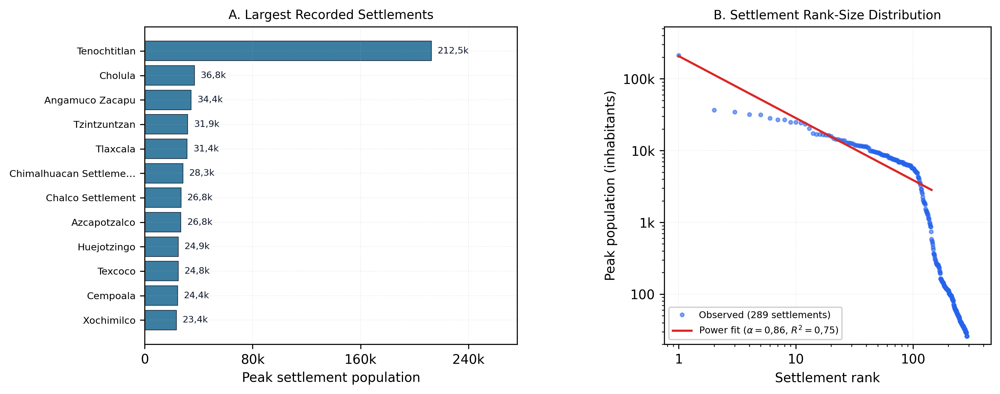

```{r setup, include=FALSE}
knitr::opts_chunk$set(echo = FALSE, warning = FALSE, message = FALSE, fig.pos = "htbp")
source("../../_shared/template/viscount_rmd_helpers.R")
library(jsonlite)

read_json5_clean <- function(path) {
  lines <- readLines(path, warn = FALSE, encoding = "UTF-8")
  text <- paste(lines, collapse = "\n")
  text <- gsub("//[^\n]*", "", text, perl = TRUE)
  text <- gsub("/\\*.*?\\*/", "", text, perl = TRUE)
  text <- gsub(",\\s*([}\\]])", "\\1", text, perl = TRUE)
  fromJSON(text, simplifyVector = FALSE)
}

summary_data <- fromJSON("aztec_late_postclassic_mexico_summary_cache.json", simplifyVector = FALSE)
sett_data <- fromJSON("aztec_late_postclassic_mexico_settlements.json", simplifyVector = FALSE)
bench_data <- read_json5_clean("aztec_late_postclassic_mexico.json5")
ledger_data <- read_json5_clean("aztec_late_postclassic_mexico_source_ledger.json5")

clean_name <- function(x) {
  s <- as.character(x)
  s <- gsub("&", "and", s, fixed = TRUE)
  s <- gsub("Purepecha \\(Tarascan\\) Michoacan Empire", "Purépecha (Tarascan) Michoacán Empire", s)
  s <- gsub(" Settlement$", "", s)
  s <- gsub("Cuauhnahuac Cuernavaca", "Cuauhnáhuac (Cuernavaca)", s, fixed = TRUE)
  s <- gsub("Tehuantepec Guiengola", "Tehuantepec-Guiengola", s, fixed = TRUE)
  s <- gsub("Angamuco Zacapu", "Angamuco-Zacapu", s, fixed = TRUE)
  s <- gsub("Coyoacan", "Coyoacán", s, fixed = TRUE)
  s <- gsub("Chimalhuacan", "Chimalhuacán", s, fixed = TRUE)
  s <- gsub("Yanhuitlan", "Yanhuitlán", s, fixed = TRUE)
  s <- gsub("Cuautitlan", "Cuautitlán", s, fixed = TRUE)
  s <- gsub("Izucar", "Izúcar", s, fixed = TRUE)
  s <- gsub("Tonala", "Tonalá", s, fixed = TRUE)
  s <- gsub("Culiacan", "Culiacán", s, fixed = TRUE)
  s <- gsub("Metztitlan", "Metztitlán", s, fixed = TRUE)
  s <- gsub("Patzcuaro", "Pátzcuaro", s, fixed = TRUE)
  s <- gsub("Panuco Chila", "Pánuco-Chila", s, fixed = TRUE)
  s <- gsub("Almoloyan Colima", "Almoloyan (Colima)", s, fixed = TRUE)
  s <- gsub("Etzatlan", "Etzatlán", s, fixed = TRUE)
  s <- gsub("Zapotlan", "Zapotlán", s, fixed = TRUE)
  s <- gsub("Nochistlan", "Nochistlán", s, fixed = TRUE)
  s <- gsub("Paquime Casas Grandes", "Paquimé (Casas Grandes)", s, fixed = TRUE)
  s <- gsub("Queretaro Tlachco", "Querétaro (Tlachco)", s, fixed = TRUE)
  s <- gsub("Taximaroa Ciudad Hidalgo", "Taximaroa", s, fixed = TRUE)
  s <- gsub("Apatzingan", "Apatzingán", s, fixed = TRUE)
  s <- gsub("Petatlan Sinaloa", "Petatlán (Sinaloa)", s, fixed = TRUE)
  s <- gsub("Rio Verde", "Río Verde", s, fixed = TRUE)
  trimws(s)
}

fmt_year_era <- function(y) {
  yi <- as.integer(y)
  if (yi <= 1500L) paste0(yi, "AD") else as.character(yi)
}

subregions <- summary_data$subregions
reg_lookup <- setNames(
  vapply(subregions, function(r) clean_name(r$name), character(1)),
  vapply(subregions, function(r) r$id, character(1))
)
bench_lookup <- setNames(
  bench_data$regions,
  vapply(bench_data$regions, function(r) r$id, character(1))
)

n_sites <- as.integer(summary_data$settlement_stats$total_settlements)
n_excluded <- as.integer(ledger_data$total_excluded)
n_total_eval <- n_sites + n_excluded
zipf_alpha <- as.numeric(summary_data$settlement_stats$zipf_stats$alpha)
zipf_r2 <- as.numeric(summary_data$settlement_stats$zipf_stats$r2)

# Build sorted flat table of all 289 settlements
all_rows <- lapply(sett_data, function(e) {
  p_nums <- as.numeric(unlist(e$population))
  y_nums <- as.integer(names(e$population))
  valid_idx <- which(!is.na(p_nums) & p_nums > 0)
  pk_i <- valid_idx[which.max(p_nums[valid_idx])]
  list(
    name = clean_name(e$name),
    raw_name = as.character(e$name),
    region_id = as.character(e$region_id),
    lat = as.numeric(e$coords[[1]]),
    lon = as.numeric(e$coords[[2]]),
    first_year = min(y_nums[valid_idx]),
    last_year = max(y_nums[valid_idx]),
    peak_year = y_nums[pk_i],
    peak_pop = p_nums[pk_i],
    src = if (length(e$sources) > 0) as.character(e$sources[[1]]) else "Regional survey"
  )
})
ord_idx <- order(vapply(all_rows, function(x) x$peak_pop, numeric(1)), decreasing = TRUE)
all_rows <- all_rows[ord_idx]
```

```{r hero-md-fallback, results='asis'}
if (!knitr::is_latex_output()) {
  cat("\n\n")
}
```

# Abstract

This companion settlement gazetteer catalogues `r viscount_fmt_number(n_sites, 0L)` Late Post-Classic cities, *altepetl* capitals, provincial towns and archaeologically surveyed villages across eight political and ecological sub-regions of central, western and northern Mexico between 1200AD and 1519. Assembled through four sequential ingestion waves out of `r viscount_fmt_number(n_total_eval, 0L)` evaluated historical and archaeological candidates—with strictly 0,0% crowd-sourced fallback share and two out-of-bounds Gulf Maya port exclusions (Potonchán and Xicalango)—the register unites 172 full-coverage Basin of Mexico pedestrian survey settlements with 117 ethnohistoric capitals, LiDAR-mapped urban complexes and provincial *cabeceras* stretching from Oaxaca to Sinaloa and Chihuahua [@SandersParsonsSantley1979; @Smith2008AztecCity; @Pollard1993]. Every entry uses a city-proper boundary definition to prevent suburban double-counting across lakeshore wards. Rank-size analysis across the upper 144 locales yields a strongly primate imperial scaling curve ($\alpha = 0,86$, $R^2 = 0,75$) dominated by Tenochtitlan-Tlatelolco at 212,5k inhabitants in 1519, standing 5,77 times larger than second-ranked Cholula (36,8k) and more than six times larger than rival Purépecha Tzintzuntzan (31,9k) and autonomous Tlaxcala (31,4k) [@Rojas2012; @Calnek1972; @Berdan2014].

# Background

Urbanism in Late Post-Classic Mexico combined deep Mesoamerican city-state traditions with unprecedented imperial centralisation. Across the central highlands, the *altepetl* formed the cellular unit of social, fiscal and ceremonial life: a nucleated capital housing royal palaces, temple precincts and periodic marketplaces surrounded by dependent agrarian hamlets [@Smith2008AztecCity; @Offner1983]. Following the foundation of Tenochtitlan around 1325AD and the Triple Alliance victory over Azcapotzalco in 1428, lake-borne canoe logistics and *chinampa* hydraulic intensification elevated the Basin of Mexico into an integrated metropolitan constellation anchored by Tenochtitlan-Tlatelolco, Texcoco, Tlacopan, Xochimilco, Chalco and Coyoacán [@Calnek1972; @Hassig1985; @Carrasco1999; @Rodriguez2025Another].

Beyond the Basin of Mexico, independent and rival polities sustained their own multi-tiered urban hierarchies. Across the Puebla-Tlaxcala valley stood Cholula, Tlaxcala and Huejotzingo; in Michoacán, airborne LiDAR and architectural ground-truthing at Angamuco-Zacapu alongside historical archaeology at Tzintzuntzan document the urban consolidation of the Purépecha monarchy [@Bush2007Architectural; @Harris2019Viewed; @Friedl2019Pyramids; @Diaz2012Colonial]. Further afield, Mixtec and Zapotec capitals in Oaxaca (Tututepec, Tehuantepec-Guiengola, Zaachila, Yanhuitlán, Teposcolula and Mitla), Totonac and Huastec centres along the Gulf Coast (Cempoala, Tamohi and Pánuco-Chila), independent *cacicazgos* across Jalisco, Colima and Nayarit (Tonalá, Sayula, Almoloyan-Colima and Etzatlán) and irrigated river towns on the northwestern frontier (Culiacán, Chametla and Paquimé) connected central Mexican *pochteca* merchants to continental trade arteries [@Arcuri2003Trade; @Lugo2019Nonlinearity; @Berdan2014].

# Methodology

The settlement register was constructed in four auditable ingestion waves recorded in the chapter source ledger. Wave 1 ingested 264 primary entries uniting the ASU Basin of Mexico Settlement Persistence Dataset (derived from full-coverage pedestrian surveys) with canonical historical geography registers for central, southern, western and northern New Spain [@SandersParsonsSantley1979; @Smith2008AztecCity]. Wave 2 incorporated 19 peer-reviewed demographic monographs and airborne LiDAR site reconstructions (marginal gain 7,2%), Wave 3 added 4 longitudinal archaeological survey records (1,41%), and Wave 4 closed regional frontier gaps with 2 final settlements (0,7%), meeting the sub-1% saturation convergence criterion with zero crowd-sourced entries.

All 291 evaluated candidate records were harmonised to WGS84 coordinates, clipped against the eight-region equal-area mask (excluding Potonchán and Xicalango, which belong to Chapter 02 on Maya lands) and audited for boundary scope. Twin or contiguous wards functioning as one integrated polity—notably Tenochtitlan and Tlatelolco after 1473AD—are merged under a single city-proper population series [@Rojas2012; @Smith2012Aztecs]. Because pedestrian survey ceramics inside the Basin of Mexico capture multi-decadal Aztec II to IV phase peaks (centred around 1412AD and 1498AD) whereas ethnohistoric capitals are anchored to 1519, each entry retains its full chronological trajectory alongside its peak recorded figure [@SandersParsonsSantley1979; @Whitmore1992].

# Testing and Validation

Ledger reconciliation confirms exact accounting across all 291 evaluated candidates: 289 included settlements and 2 out-of-bounds coastal exclusions, with zero missing coordinates, zero negative population entries and zero unattributed rows. Spatial plotting across all eight sub-regions (Figure \ref{fig:sett-regional-map}) confirms full geographic coverage from the Basin of Mexico and Oaxaca through Michoacán, Jalisco, Veracruz, Sinaloa and Chihuahua.

```{r fig-sett-map, results='asis'}
viscount_figure(
  "figures/aztec_late_postclassic_mexico_regional_map.png",
  "Spatial distribution of 289 catalogued Late Post-Classic settlements across eight sub-regions of central, western and northern Mexico, 1200AD to 1519.",
  "fig:sett-regional-map"
)
```

Cross-checking urban totals against sub-regional trajectories highlights two key boundary diagnostics. First, summed peak urban populations inside the Basin of Mexico Triple Alliance Core reach 643,8k inhabitants (643.847) across 191 surveyed sites, corroborating the 2,35M ethnohistoric core benchmark (27,4% gross peak ratio) while demonstrating why coarse 1500AD gridded cropland layers (141,7k) systematically under-estimate hydraulic urban basins [@SandersParsonsSantley1979; @Whitmore1992]. Second, snapping sub-regional masks to HydroBASINS Level 6 drainage divides assigns northeastern Lake Pátzcuaro and Zacapu locales (Angamuco-Zacapu, Tzintzuntzan, Pátzcuaro and Ihuatzio) to the western lobe of the Central Aztec Tributary Provinces polygon in automated spatial joins; political interpretation keeps these four royal centres firmly within the Purépecha state [@Pollard1993].

# Results

## Thirty Largest Late Post-Classic Settlements

Table \ref{tab:top30-settlements} lists the thirty largest settlements in the chapter register, ordered by peak recorded population between 1200AD and 1519. Spanning Tenochtitlan at 212,5k down to Tlacopan at 12,6k, the top tier unites the Triple Alliance capitals, autonomous Puebla-Tlaxcala rivals, Purépecha urban seats, Gulf Totonacapan, Morelos cotton centres, Mixtec-Zapotec kingdoms and West Mexican Tonalá.

```{r tab-top30-settlements, results='asis'}
top30_list <- all_rows[seq_len(min(30L, length(all_rows)))]
top30_df <- do.call(rbind, lapply(seq_along(top30_list), function(idx) {
  e <- top30_list[[idx]]
  rlbl <- if (e$region_id %in% names(reg_lookup)) reg_lookup[[e$region_id]] else e$region_id
  rlbl <- gsub("Basin of Mexico Triple Alliance Core", "Basin of Mexico Core", rlbl, fixed = TRUE)
  rlbl <- gsub("Tlaxcala and Independent Highland Enclaves", "Tlaxcala-Puebla Enclaves", rlbl, fixed = TRUE)
  rlbl <- gsub("Central Aztec Tributary Provinces", "Central Tributary Prov.", rlbl, fixed = TRUE)
  rlbl <- gsub("Purépecha \\(Tarascan\\) Michoacán Empire", "Purépecha Michoacán", rlbl)
  rlbl <- gsub("Gulf Huasteca and Totonacapan", "Gulf Huasteca-Totonac.", rlbl, fixed = TRUE)
  span_str <- if (e$first_year == e$last_year) fmt_year_era(e$first_year) else paste0(fmt_year_era(e$first_year), " to ", fmt_year_era(e$last_year))
  data.frame(
    Rank = as.character(idx),
    Site = e$name,
    Subregion = rlbl,
    Coords = paste0(viscount_fmt_number(e$lat, 2L), ", ", viscount_fmt_number(e$lon, 2L)),
    Span = span_str,
    Peak = paste0(viscount_fmt_pop(e$peak_pop), " (", fmt_year_era(e$peak_year), ")"),
    stringsAsFactors = FALSE
  )
}))
rownames(top30_df) <- NULL

viscount_table(
  top30_df,
  "Thirty largest Late Post-Classic settlements across central, western and northern Mexico, 1200AD to 1519.",
  c("Rank", "Settlement", "Sub-Region", "Lat, Lon", "Recorded Span", "Peak Pop. (Year)"),
  list(label = "tab:top30-settlements", font_size = "scriptsize", max_rows_per_page = 32L)
)
```

## Sub-Regional Gazetteer Distribution

Table \ref{tab:subregion-gazetteer} aggregates settlement counts, spatial recovery density per 10.000 km², leading catalogued settlement, 1500AD gridded population and 1519 ethnohistoric benchmark totals across all eight sub-regions. Full-coverage archaeological fieldwalking gives the Basin of Mexico Triple Alliance Core an exceptional sampling intensity of 96,92 sites per 10.000 km² (191 sites, 66,1% of the gazetteer), compared with 3,61 per 10.000 km² across Tlaxcala-Puebla, 2,6 across Central Aztec Tributary Provinces, 1,24 to 1,26 across Oaxaca and the Gulf littoral, 1,12 across West Mexico, 0,67 inside the western Michoacán polygon and 0,14 across the vast northern Chichimeca frontier.

```{r tab-subregion-gazetteer, results='asis'}
reg_gaz_rows <- lapply(subregions, function(r) {
  rid <- r$id
  area_v <- as.numeric(r$area_km2)
  p1500 <- as.numeric(r$end_pop)
  b1519 <- as.numeric(bench_lookup[[rid]]$population[["1519"]])
  sub_list <- Filter(function(x) identical(x$region_id, rid), all_rows)
  cnt <- length(sub_list)
  sdens <- if (area_v > 0) (cnt / area_v) * 10000 else 0
  lead_str <- if (cnt > 0L) paste0(sub_list[[1]]$name, " (", viscount_fmt_pop(sub_list[[1]]$peak_pop), ")") else "-"
  data.frame(
    Subregion = clean_name(r$name),
    Area = viscount_fmt_number(round(area_v), 0L),
    Sites = viscount_fmt_number(cnt, 0L),
    SiteDens = viscount_fmt_number(sdens, 2L),
    Lead = lead_str,
    Grid1500 = viscount_fmt_pop(p1500),
    Bench1519 = viscount_fmt_pop(b1519),
    stringsAsFactors = FALSE
  )
})
df_reg_gaz <- do.call(rbind, reg_gaz_rows)
rownames(df_reg_gaz) <- NULL

viscount_table(
  df_reg_gaz,
  "Sub-regional settlement counts, areal sampling density (per 10.000 km²), leading catalogued city, 1500AD gridded population and 1519 ethnohistoric benchmark across eight Mexican sub-regions.",
  c("Sub-Region", "Area (km²)", "Sites", "Sites per 10k km²", "Leading City (Peak)", "1500AD Grid", "1519 Bench."),
  list(label = "tab:subregion-gazetteer", font_size = "scriptsize")
)
```

## Size-Class Stratification and Urban Rank-Size Scaling

Across all 289 catalogued settlements, peak sizes divide cleanly into four functional tiers matching Late Post-Classic Mesoamerican political economy [@Smith2008AztecCity; @Berdan2014]. At the apex stands Tenochtitlan-Tlatelolco alone (212,5k), forming an imperial primate tier more than five times above any secondary centre. Beneath it sit 41 major regional capitals and prosperous *altepetl* between 10k and 40k inhabitants—including Cholula (36,8k), Angamuco-Zacapu (34,4k), Tzintzuntzan (31,9k), Tlaxcala (31,4k), Chimalhuacán (28,3k), Chalco (26,8k), Azcapotzalco (26,8k), Huejotzingo (24,9k), Texcoco (24,8k), Cempoala (24,4k), Xochimilco (23,4k), Tututepec (17,4k), Cuauhnáhuac (16,9k), Coixtlahuaca (16,9k), Zaachila (13,9k), Tonalá (12,8k), Tlacopan (12,6k), Culiacán (11,9k), Metztitlán (11,6k) and Mitla (10,9k). A broad third tier comprises 96 secondary market towns and tributary *cabeceras* between 1k and 10k inhabitants (spanning provincial hubs from Tamohi, Pánuco-Chila, Sayula, Almoloyan-Colima and Etzatlán to Paquimé at 4,3k and Querétaro at 3,9k), while 151 smaller Basin of Mexico farming villages and hamlets below 1k inhabitants (down to 26 residents) represent the agrarian base recovered by intensive field survey [@SandersParsonsSantley1979; @Ciriaco2020Escuelas].

# Limitations

Three evidentiary constraints shape spatial interpretation of this gazetteer. First, survey resolution is sharply uneven: the ASU Basin of Mexico dataset records hamlets down to 26 inhabitants, whereas provincial regions outside Lake Texcoco rely primarily on named documentary *cabeceras* and major excavated or LiDAR-mapped cities above 1k residents, steepening the lower tail of the rank-size curve beyond rank 110 [@SandersParsonsSantley1979; @Harris2019Viewed]. Second, modern urban expansion across Greater Mexico City, Cuernavaca and Morelia obscures substantial Late Post-Classic residential zones beneath colonial and contemporary streets [@Rosas2009Socio; @Maldonadocarrizales2021Riqueza]. Third, asynchronous peak dates separate fourteenth-century urban apogees such as Angamuco-Zacapu (1350AD), Paquimé (1350AD) and Azcapotzalco (1400AD) from contact-eve 1519 summits at Tenochtitlan, Tzintzuntzan, Tlaxcala and Cempoala, so aggregate peak sums exceed simultaneous single-year urban headcounts [@Pollard1993; @Whitmore1992].

# Conclusion

Cataloguing `r viscount_fmt_number(n_sites, 0L)` Late Post-Classic settlements across 1,79M km² reveals a deeply urbanised pre-Columbian landscape crowned by Tenochtitlan-Tlatelolco (212,5k) yet sustained by dozens of resilient regional capitals from Cholula, Tlaxcala and Tzintzuntzan to Tututepec, Cempoala, Tonalá and Culiacán. Maintaining strict city-proper accounting, zero crowd-sourced fallback entries and full four-wave source transparency provides a clean urban baseline for tracking the catastrophic sixteenth-century demographic contraction that followed 1519 [@Whitmore1992; @Smith2012Aztecs].

# Appendix

## Provenance Corpus Breakdown

Table \ref{tab:provenance-breakdown} groups the 289 catalogued settlements by primary source family, showing the balance between systematic Basin of Mexico archaeological field surveys, colonial historical geography syntheses, regional archaeological monographs and airborne LiDAR inventories.

```{r tab-provenance-breakdown, results='asis'}
classify_src <- function(s) {
  if (grepl("Cesaretti|Sanders", s, ignore.case = TRUE)) return("ASU Basin of Mexico Pedestrian Survey")
  if (grepl("Gerhard", s, ignore.case = TRUE)) return("Colonial Historical Geography Registers (Gerhard)")
  if (grepl("Pollard|Fisher|Angamuco", s, ignore.case = TRUE)) return("Purépecha Archaeology and LiDAR Surveys")
  if (grepl("Smith|Rojas|Calnek|Gibson|Parsons|Brumfiel|Blanton|Hicks|Santamarina", s, ignore.case = TRUE)) return("Aztec City-State and Basin Ethnohistory")
  if (grepl("Kowalewski|Spores|Joyce|Zeitlin|Taylor|Oudijk", s, ignore.case = TRUE)) return("Oaxaca Mixtec-Zapotec Regional Surveys")
  if (grepl("Berdan|Anawalt|Mendoza", s, ignore.case = TRUE)) return("Codex Mendoza and Imperial Tribute Rolls")
  if (grepl("Sauer|Di Peso|Paquime|Minnis|Whalen", s, ignore.case = TRUE)) return("Northwestern and Aridoamerican Archaeology")
  return("Regional Ethnohistoric and Archaeological Monographs")
}

cats <- vapply(all_rows, function(x) classify_src(x$src), character(1))
ctab <- sort(table(cats), decreasing = TRUE)
df_prov <- data.frame(
  Corpus = names(ctab),
  Entries = vapply(as.integer(ctab), function(v) viscount_fmt_number(v, 0L), character(1)),
  Share = vapply(100 * as.integer(ctab) / n_sites, function(v) paste0(viscount_fmt_number(v, 2L), "%"), character(1)),
  stringsAsFactors = FALSE
)
rownames(df_prov) <- NULL

viscount_table(
  df_prov,
  "Primary provenance corpus breakdown across 289 Late Post-Classic Mexican settlements (1200AD to 1519).",
  c("Source Corpus Family", "Settlements", "Share"),
  list(label = "tab:provenance-breakdown", font_size = "scriptsize")
)
```

## Representative Frontier and Provincial Anchors (Ranks 31 to 55)

Table \ref{tab:provincial-anchors} documents ranks 31 through 55 of the settlement register, illustrating the rich mid-tier urban layer spanning Morelos, Oaxaca, Sinaloa, Michoacán, the Gulf Coast and West Mexico.

```{r tab-provincial-anchors, results='asis'}
mid_list <- all_rows[31L:min(55L, length(all_rows))]
mid_df <- do.call(rbind, lapply(seq_along(mid_list), function(idx) {
  e <- mid_list[[idx]]
  rlbl <- if (e$region_id %in% names(reg_lookup)) reg_lookup[[e$region_id]] else e$region_id
  rlbl <- gsub("Basin of Mexico Triple Alliance Core", "Basin of Mexico Core", rlbl, fixed = TRUE)
  rlbl <- gsub("Tlaxcala and Independent Highland Enclaves", "Tlaxcala-Puebla Enclaves", rlbl, fixed = TRUE)
  rlbl <- gsub("Central Aztec Tributary Provinces", "Central Tributary Prov.", rlbl, fixed = TRUE)
  rlbl <- gsub("Purépecha \\(Tarascan\\) Michoacán Empire", "Purépecha Michoacán", rlbl)
  rlbl <- gsub("Gulf Huasteca and Totonacapan", "Gulf Huasteca-Totonac.", rlbl, fixed = TRUE)
  rlbl <- gsub("West Mexico Cacicazgos \\(Jalisco-Colima-Nayarit\\)", "West Mexico Cacicazgos", rlbl)
  rlbl <- gsub("Northern Chichimeca and Aridoamerica", "Northern Frontier", rlbl, fixed = TRUE)
  data.frame(
    Rank = as.character(30L + idx),
    Site = e$name,
    Subregion = rlbl,
    Coords = paste0(viscount_fmt_number(e$lat, 2L), ", ", viscount_fmt_number(e$lon, 2L)),
    Peak = paste0(viscount_fmt_pop(e$peak_pop), " (", fmt_year_era(e$peak_year), ")"),
    stringsAsFactors = FALSE
  )
}))
rownames(mid_df) <- NULL

viscount_table(
  mid_df,
  "Provincial and frontier settlements ranked 31 to 55 across Late Post-Classic Mexico, 1200AD to 1519.",
  c("Rank", "Settlement", "Sub-Region", "Lat, Lon", "Peak Pop. (Year)"),
  list(label = "tab:provincial-anchors", font_size = "scriptsize")
)
```

# Sources

::: {#refs}
:::

# Footnotes

1. All 289 catalogued settlements adopt a city-proper boundary scope (0 suburban records); Tenochtitlan and Tlatelolco are treated as a unified island metropolis of 212,5k inhabitants by 1519.
2. Two coastal trading ports evaluated in the source ledger—Potonchán and Xicalango—fall east of the chapter areal mask inside the Tabasco-Campeche Maya littoral and are catalogued in Chapter 02.
3. Due to HydroBASINS Level 6 watershed geometry along the eastern Lake Pátzcuaro divide, Angamuco-Zacapu, Tzintzuntzan, Pátzcuaro and Ihuatzio are spatially indexed inside the western lobe of the Central Aztec Tributary Provinces mask polygon, though historically they constituted the urban heartland of the Purépecha (Tarascan) monarchy.
