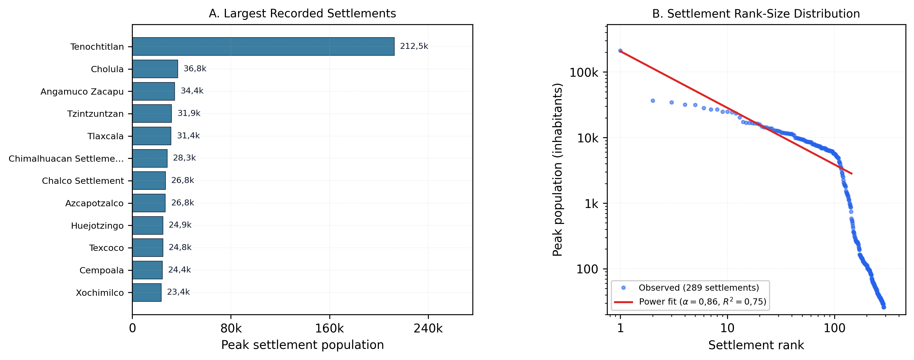
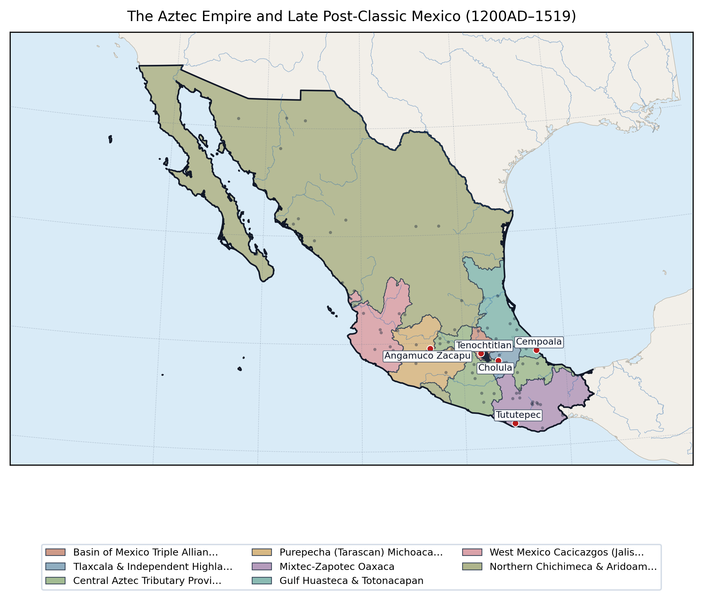

The Aztec Empire and Late Post-Classic Mexico
================
Aust Kätzchen
23 November 2026

- [Abstract](#abstract)
- [Background](#background)
- [Methodology](#methodology)
- [Testing and Validation](#testing-and-validation)
- [Results](#results)
  - [Thirty Largest Late Post-Classic
    Settlements](#thirty-largest-late-post-classic-settlements)
  - [Sub-Regional Gazetteer
    Distribution](#sub-regional-gazetteer-distribution)
  - [Size-Class Stratification and Urban Rank-Size
    Scaling](#size-class-stratification-and-urban-rank-size-scaling)
- [Limitations](#limitations)
- [Conclusion](#conclusion)
- [Appendix](#appendix)
  - [Provenance Corpus Breakdown](#provenance-corpus-breakdown)
  - [Representative Frontier and Provincial Anchors (Ranks 31 to
    55)](#representative-frontier-and-provincial-anchors-ranks-31-to-55)
- [Sources](#sources)
- [Footnotes](#footnotes)

<figure>

<figcaption aria-hidden="true">Twelve largest Late Post-Classic Mexican
settlements and log-log rank-size distribution across 289 settlements
from 1200AD to 1519.</figcaption>
</figure>

# Abstract

This companion settlement gazetteer catalogues 289 Late Post-Classic
cities, *altepetl* capitals, provincial towns and archaeologically
surveyed villages across eight political and ecological sub-regions of
central, western and northern Mexico between 1200AD and 1519. Assembled
through four sequential ingestion waves out of 291 evaluated historical
and archaeological candidates—with strictly 0,0% crowd-sourced fallback
share and two out-of-bounds Gulf Maya port exclusions (Potonchán and
Xicalango)—the register unites 172 full-coverage Basin of Mexico
pedestrian survey settlements with 117 ethnohistoric capitals,
LiDAR-mapped urban complexes and provincial *cabeceras* stretching from
Oaxaca to Sinaloa and Chihuahua
[\[1\]](#ref-SandersParsonsSantley1979)[\[2\]](#ref-Smith2008AztecCity)[\[3\]](#ref-Pollard1993).
Every entry uses a city-proper boundary definition to prevent suburban
double-counting across lakeshore wards. Rank-size analysis across the
upper 144 locales yields a strongly primate imperial scaling curve
($\alpha = 0,86$, $R^2 = 0,75$) dominated by Tenochtitlan-Tlatelolco at
212,5k inhabitants in 1519, standing 5,77 times larger than
second-ranked Cholula (36,8k) and more than six times larger than rival
Purépecha Tzintzuntzan (31,9k) and autonomous Tlaxcala (31,4k)
[\[4\]](#ref-Rojas2012)[\[5\]](#ref-Calnek1972)[\[6\]](#ref-Berdan2014).

# Background

Urbanism in Late Post-Classic Mexico combined deep Mesoamerican
city-state traditions with unprecedented imperial centralisation. Across
the central highlands, the *altepetl* formed the cellular unit of
social, fiscal and ceremonial life: a nucleated capital housing royal
palaces, temple precincts and periodic marketplaces surrounded by
dependent agrarian hamlets
[\[2\]](#ref-Smith2008AztecCity)[\[7\]](#ref-Offner1983). Following the
foundation of Tenochtitlan around 1325AD and the Triple Alliance victory
over Azcapotzalco in 1428, lake-borne canoe logistics and *chinampa*
hydraulic intensification elevated the Basin of Mexico into an
integrated metropolitan constellation anchored by
Tenochtitlan-Tlatelolco, Texcoco, Tlacopan, Xochimilco, Chalco and
Coyoacán
[\[5\]](#ref-Calnek1972)[\[8\]](#ref-Hassig1985)[\[9\]](#ref-Carrasco1999)[\[10\]](#ref-Rodriguez2025Another).

Beyond the Basin of Mexico, independent and rival polities sustained
their own multi-tiered urban hierarchies. Across the Puebla-Tlaxcala
valley stood Cholula, Tlaxcala and Huejotzingo; in Michoacán, airborne
LiDAR and architectural ground-truthing at Angamuco-Zacapu alongside
historical archaeology at Tzintzuntzan document the urban consolidation
of the Purépecha monarchy
[\[11\]](#ref-Bush2007Architectural)[\[12\]](#ref-Harris2019Viewed)[\[13\]](#ref-Friedl2019Pyramids)[\[14\]](#ref-Diaz2012Colonial).
Further afield, Mixtec and Zapotec capitals in Oaxaca (Tututepec,
Tehuantepec-Guiengola, Zaachila, Yanhuitlán, Teposcolula and Mitla),
Totonac and Huastec centres along the Gulf Coast (Cempoala, Tamohi and
Pánuco-Chila), independent *cacicazgos* across Jalisco, Colima and
Nayarit (Tonalá, Sayula, Almoloyan-Colima and Etzatlán) and irrigated
river towns on the northwestern frontier (Culiacán, Chametla and
Paquimé) connected central Mexican *pochteca* merchants to continental
trade arteries
[\[6\]](#ref-Berdan2014)[\[15\]](#ref-Arcuri2003Trade)[\[16\]](#ref-Lugo2019Nonlinearity).

# Methodology

The settlement register was constructed in four auditable ingestion
waves recorded in the chapter source ledger. Wave 1 ingested 264 primary
entries uniting the ASU Basin of Mexico Settlement Persistence Dataset
(derived from full-coverage pedestrian surveys) with canonical
historical geography registers for central, southern, western and
northern New Spain
[\[1\]](#ref-SandersParsonsSantley1979)[\[2\]](#ref-Smith2008AztecCity).
Wave 2 incorporated 19 peer-reviewed demographic monographs and airborne
LiDAR site reconstructions (marginal gain 7,2%), Wave 3 added 4
longitudinal archaeological survey records (1,41%), and Wave 4 closed
regional frontier gaps with 2 final settlements (0,7%), meeting the
sub-1% saturation convergence criterion with zero crowd-sourced entries.

All 291 evaluated candidate records were harmonised to WGS84
coordinates, clipped against the eight-region equal-area mask (excluding
Potonchán and Xicalango, which belong to Chapter 02 on Maya lands) and
audited for boundary scope. Twin or contiguous wards functioning as one
integrated polity—notably Tenochtitlan and Tlatelolco after 1473AD—are
merged under a single city-proper population series
[\[4\]](#ref-Rojas2012)[\[17\]](#ref-Smith2012Aztecs). Because
pedestrian survey ceramics inside the Basin of Mexico capture
multi-decadal Aztec II to IV phase peaks (centred around 1412AD and
1498AD) whereas ethnohistoric capitals are anchored to 1519, each entry
retains its full chronological trajectory alongside its peak recorded
figure
[\[1\]](#ref-SandersParsonsSantley1979)[\[18\]](#ref-Whitmore1992).

# Testing and Validation

Ledger reconciliation confirms exact accounting across all 291 evaluated
candidates: 289 included settlements and 2 out-of-bounds coastal
exclusions, with zero missing coordinates, zero negative population
entries and zero unattributed rows. Spatial plotting across all eight
sub-regions (Figure ) confirms full geographic coverage from the Basin
of Mexico and Oaxaca through Michoacán, Jalisco, Veracruz, Sinaloa and
Chihuahua.

<!-- -->

Cross-checking urban totals against sub-regional trajectories highlights
two key boundary diagnostics. First, summed peak urban populations
inside the Basin of Mexico Triple Alliance Core reach 643,8k inhabitants
(643.847) across 191 surveyed sites, corroborating the 2,35M
ethnohistoric core benchmark (27,4% gross peak ratio) while
demonstrating why coarse 1500AD gridded cropland layers (141,7k)
systematically under-estimate hydraulic urban basins
[\[1\]](#ref-SandersParsonsSantley1979)[\[18\]](#ref-Whitmore1992).
Second, snapping sub-regional masks to HydroBASINS Level 6 drainage
divides assigns northeastern Lake Pátzcuaro and Zacapu locales
(Angamuco-Zacapu, Tzintzuntzan, Pátzcuaro and Ihuatzio) to the western
lobe of the Central Aztec Tributary Provinces polygon in automated
spatial joins; political interpretation keeps these four royal centres
firmly within the Purépecha state [\[3\]](#ref-Pollard1993).

# Results

## Thirty Largest Late Post-Classic Settlements

Table lists the thirty largest settlements in the chapter register,
ordered by peak recorded population between 1200AD and 1519. Spanning
Tenochtitlan at 212,5k down to Tlacopan at 12,6k, the top tier unites
the Triple Alliance capitals, autonomous Puebla-Tlaxcala rivals,
Purépecha urban seats, Gulf Totonacapan, Morelos cotton centres,
Mixtec-Zapotec kingdoms and West Mexican Tonalá.

| Rank | Settlement | Sub-Region | Lat, Lon | Recorded Span | Peak Pop. (Year) |
|:---|:---|:---|:---|:---|:---|
| **1** | Tenochtitlan | Basin of Mexico Core | 19,43, -99,13 | 1325AD to 1519 | 212,5k (1519) |
| **2** | Cholula | Tlaxcala-Puebla Enclaves | 19,06, -98,3 | 1250AD to 1519 | 36,8k (1519) |
| **3** | Angamuco-Zacapu | Central Tributary Prov. | 19,74, -101,62 | 1250AD to 1519 | 34,4k (1350AD) |
| **4** | Tzintzuntzan | Central Tributary Prov. | 19,63, -101,58 | 1350AD to 1519 | 31,9k (1519) |
| **5** | Tlaxcala | Tlaxcala-Puebla Enclaves | 19,32, -98,24 | 1300AD to 1519 | 31,4k (1519) |
| **6** | Chimalhuacán | Basin of Mexico Core | 19,41, -98,94 | 1300AD to 1498AD | 28,3k (1412AD) |
| **7** | Chalco | Basin of Mexico Core | 19,26, -98,9 | 1300AD to 1498AD | 26,8k (1412AD) |
| **8** | Azcapotzalco | Basin of Mexico Core | 19,49, -99,19 | 1250AD to 1519 | 26,8k (1400AD) |
| **9** | Huejotzingo | Tlaxcala-Puebla Enclaves | 19,16, -98,4 | 1250AD to 1519 | 24,9k (1519) |
| **10** | Texcoco | Basin of Mexico Core | 19,51, -98,88 | 1250AD to 1519 | 24,8k (1519) |
| **11** | Cempoala | Gulf Huasteca-Totonac. | 19,45, -96,41 | 1250AD to 1519 | 24,4k (1519) |
| **12** | Xochimilco | Basin of Mexico Core | 19,26, -99,1 | 1250AD to 1519 | 23,4k (1519) |
| **13** | Tlalmanalco | Basin of Mexico Core | 19,21, -98,8 | 1300AD to 1498AD | 20,4k (1412AD) |
| **14** | Tututepec | Mixtec-Zapotec Oaxaca | 16,13, -97,6 | 1250AD to 1519 | 17,4k (1519) |
| **15** | Cuauhnáhuac (Cuernavaca) | Central Tributary Prov. | 18,92, -99,22 | 1250AD to 1519 | 16,9k (1519) |
| **16** | Coixtlahuaca | Central Tributary Prov. | 17,72, -97,32 | 1300AD to 1519 | 16,9k (1450AD) |
| **17** | Coyoacán | Basin of Mexico Core | 19,35, -99,16 | 1300AD to 1519 | 16,6k (1519) |
| **18** | Tehuantepec-Guiengola | Mixtec-Zapotec Oaxaca | 16,36, -95,32 | 1400AD to 1519 | 16,5k (1519) |
| **19** | Huexotla | Basin of Mexico Core | 19,48, -98,87 | 1250AD to 1519 | 16,4k (1519) |
| **20** | Amecameca | Basin of Mexico Core | 19,12, -98,77 | 1275AD to 1498AD | 15,8k (1412AD) |
| **21** | Yautepec | Central Tributary Prov. | 18,88, -99,07 | 1250AD to 1519 | 14,8k (1519) |
| **22** | Iztapalapa | Basin of Mexico Core | 19,36, -99,07 | 1350AD to 1519 | 14,4k (1519) |
| **23** | Tepeaca | Tlaxcala-Puebla Enclaves | 18,97, -97,9 | 1300AD to 1519 | 14,4k (1519) |
| **24** | Zaachila | Mixtec-Zapotec Oaxaca | 16,95, -96,75 | 1250AD to 1519 | 13,9k (1519) |
| **25** | Cuautitlán | Basin of Mexico Core | 19,67, -99,18 | 1250AD to 1519 | 13,8k (1519) |
| **26** | Yanhuitlán | Mixtec-Zapotec Oaxaca | 17,53, -97,34 | 1300AD to 1519 | 13,8k (1519) |
| **27** | Izúcar | Central Tributary Prov. | 18,6, -98,47 | 1300AD to 1519 | 12,9k (1519) |
| **28** | Tonalá | Purépecha Michoacán | 20,62, -103,24 | 1300AD to 1519 | 12,8k (1519) |
| **29** | Cuilapan | Mixtec-Zapotec Oaxaca | 16,99, -96,78 | 1350AD to 1519 | 12,7k (1519) |
| **30** | Tlacopan | Basin of Mexico Core | 19,46, -99,19 | 1350AD to 1519 | 12,6k (1519) |

Thirty largest Late Post-Classic settlements across central, western and
northern Mexico, 1200AD to 1519.

## Sub-Regional Gazetteer Distribution

Table aggregates settlement counts, spatial recovery density per 10.000
km², leading catalogued settlement, 1500AD gridded population and 1519
ethnohistoric benchmark totals across all eight sub-regions.
Full-coverage archaeological fieldwalking gives the Basin of Mexico
Triple Alliance Core an exceptional sampling intensity of 96,92 sites
per 10.000 km² (191 sites, 66,1% of the gazetteer), compared with 3,61
per 10.000 km² across Tlaxcala-Puebla, 2,6 across Central Aztec
Tributary Provinces, 1,24 to 1,26 across Oaxaca and the Gulf littoral,
1,12 across West Mexico, 0,67 inside the western Michoacán polygon and
0,14 across the vast northern Chichimeca frontier.

| Sub-Region | Area (km²) | Sites | Sites per 10k km² | Leading City (Peak) | 1500AD Grid | 1519 Bench. |
|:---|:---|:---|:---|:---|:---|:---|
| **Basin of Mexico Triple Alliance Core** | 19.706 | 191 | 96,92 | Tenochtitlan (212,5k) | 141,7k | 2,35M |
| **Tlaxcala and Independent Highland Enclaves** | 19.395 | 7 | 3,61 | Cholula (36,8k) | 118,3k | 680k |
| **Central Aztec Tributary Provinces** | 122.981 | 32 | 2,6 | Angamuco-Zacapu (34,4k) | 478,3k | 3,75M |
| **Purépecha (Tarascan) Michoacán Empire** | 89.549 | 6 | 0,67 | Tonalá (12,8k) | 312,3k | 1,25M |
| **Mixtec-Zapotec Oaxaca** | 112.640 | 14 | 1,24 | Tututepec (17,4k) | 374,4k | 1,65M |
| **Gulf Huasteca and Totonacapan** | 87.114 | 11 | 1,26 | Cempoala (24,4k) | 242,4k | 1,15M |
| **West Mexico Cacicazgos (Jalisco-Colima-Nayarit)** | 97.928 | 11 | 1,12 | Sayula (9,3k) | 294,6k | 1,08M |
| **Northern Chichimeca and Aridoamerica** | 1.237.024 | 17 | 0,14 | Culiacán (11,9k) | 1,24M | 890k |

Sub-regional settlement counts, areal sampling density (per 10.000 km²),
leading catalogued city, 1500AD gridded population and 1519
ethnohistoric benchmark across eight Mexican sub-regions.

## Size-Class Stratification and Urban Rank-Size Scaling

Across all 289 catalogued settlements, peak sizes divide cleanly into
four functional tiers matching Late Post-Classic Mesoamerican political
economy [\[2\]](#ref-Smith2008AztecCity)[\[6\]](#ref-Berdan2014). At the
apex stands Tenochtitlan-Tlatelolco alone (212,5k), forming an imperial
primate tier more than five times above any secondary centre. Beneath it
sit 41 major regional capitals and prosperous *altepetl* between 10k and
40k inhabitants—including Cholula (36,8k), Angamuco-Zacapu (34,4k),
Tzintzuntzan (31,9k), Tlaxcala (31,4k), Chimalhuacán (28,3k), Chalco
(26,8k), Azcapotzalco (26,8k), Huejotzingo (24,9k), Texcoco (24,8k),
Cempoala (24,4k), Xochimilco (23,4k), Tututepec (17,4k), Cuauhnáhuac
(16,9k), Coixtlahuaca (16,9k), Zaachila (13,9k), Tonalá (12,8k),
Tlacopan (12,6k), Culiacán (11,9k), Metztitlán (11,6k) and Mitla
(10,9k). A broad third tier comprises 96 secondary market towns and
tributary *cabeceras* between 1k and 10k inhabitants (spanning
provincial hubs from Tamohi, Pánuco-Chila, Sayula, Almoloyan-Colima and
Etzatlán to Paquimé at 4,3k and Querétaro at 3,9k), while 151 smaller
Basin of Mexico farming villages and hamlets below 1k inhabitants (down
to 26 residents) represent the agrarian base recovered by intensive
field survey
[\[1\]](#ref-SandersParsonsSantley1979)[\[19\]](#ref-Ciriaco2020Escuelas).

# Limitations

Three evidentiary constraints shape spatial interpretation of this
gazetteer. First, survey resolution is sharply uneven: the ASU Basin of
Mexico dataset records hamlets down to 26 inhabitants, whereas
provincial regions outside Lake Texcoco rely primarily on named
documentary *cabeceras* and major excavated or LiDAR-mapped cities above
1k residents, steepening the lower tail of the rank-size curve beyond
rank 110
[\[1\]](#ref-SandersParsonsSantley1979)[\[12\]](#ref-Harris2019Viewed).
Second, modern urban expansion across Greater Mexico City, Cuernavaca
and Morelia obscures substantial Late Post-Classic residential zones
beneath colonial and contemporary streets
[\[20\]](#ref-Rosas2009Socio)[\[21\]](#ref-Maldonadocarrizales2021Riqueza).
Third, asynchronous peak dates separate fourteenth-century urban apogees
such as Angamuco-Zacapu (1350AD), Paquimé (1350AD) and Azcapotzalco
(1400AD) from contact-eve 1519 summits at Tenochtitlan, Tzintzuntzan,
Tlaxcala and Cempoala, so aggregate peak sums exceed simultaneous
single-year urban headcounts
[\[3\]](#ref-Pollard1993)[\[18\]](#ref-Whitmore1992).

# Conclusion

Cataloguing 289 Late Post-Classic settlements across 1,79M km² reveals a
deeply urbanised pre-Columbian landscape crowned by
Tenochtitlan-Tlatelolco (212,5k) yet sustained by dozens of resilient
regional capitals from Cholula, Tlaxcala and Tzintzuntzan to Tututepec,
Cempoala, Tonalá and Culiacán. Maintaining strict city-proper
accounting, zero crowd-sourced fallback entries and full four-wave
source transparency provides a clean urban baseline for tracking the
catastrophic sixteenth-century demographic contraction that followed
1519 [\[17\]](#ref-Smith2012Aztecs)[\[18\]](#ref-Whitmore1992).

# Appendix

## Provenance Corpus Breakdown

Table groups the 289 catalogued settlements by primary source family,
showing the balance between systematic Basin of Mexico archaeological
field surveys, colonial historical geography syntheses, regional
archaeological monographs and airborne LiDAR inventories.

| Source Corpus Family | Settlements | Share |
|:---|:---|:---|
| **ASU Basin of Mexico Pedestrian Survey** | 177 | 61,25% |
| **Regional Ethnohistoric and Archaeological Monographs** | 30 | 10,38% |
| **Colonial Historical Geography Registers (Gerhard)** | 28 | 9,69% |
| **Aztec City-State and Basin Ethnohistory** | 19 | 6,57% |
| **Oaxaca Mixtec-Zapotec Regional Surveys** | 12 | 4,15% |
| **Purépecha Archaeology and LiDAR Surveys** | 9 | 3,11% |
| **Northwestern and Aridoamerican Archaeology** | 8 | 2,77% |
| **Codex Mendoza and Imperial Tribute Rolls** | 6 | 2,08% |

Primary provenance corpus breakdown across 289 Late Post-Classic Mexican
settlements (1200AD to 1519).

## Representative Frontier and Provincial Anchors (Ranks 31 to 55)

Table documents ranks 31 through 55 of the settlement register,
illustrating the rich mid-tier urban layer spanning Morelos, Oaxaca,
Sinaloa, Michoacán, the Gulf Coast and West Mexico.

| Rank | Settlement | Sub-Region | Lat, Lon | Peak Pop. (Year) |
|:---|:---|:---|:---|:---|
| **31** | Huaxtepec | Central Tributary Prov. | 18,91, -98,97 | 12,4k (1519) |
| **32** | Teposcolula | Mixtec-Zapotec Oaxaca | 17,51, -97,49 | 11,9k (1519) |
| **33** | Culiacán | Northern Frontier | 24,81, -107,39 | 11,9k (1519) |
| **34** | Calixtlahuaca | Central Tributary Prov. | 19,34, -99,69 | 11,8k (1400AD) |
| **35** | Metztitlán | Gulf Huasteca-Totonac. | 20,59, -98,76 | 11,6k (1519) |
| **36** | Pátzcuaro | Central Tributary Prov. | 19,51, -101,61 | 11,6k (1519) |
| **37** | Cuetlaxtlan Cotaxtla | Central Tributary Prov. | 18,84, -96,39 | 11,5k (1519) |
| **38** | Coatlinchan | Basin of Mexico Core | 19,45, -98,87 | 11,4k (1400AD) |
| **39** | Otumba | Basin of Mexico Core | 19,7, -98,76 | 11,4k (1519) |
| **40** | Tolocan Toluca | Central Tributary Prov. | 19,29, -99,66 | 11,4k (1519) |
| **41** | Culhuacan | Basin of Mexico Core | 19,33, -99,12 | 11k (1412AD) |
| **42** | Mitla | Mixtec-Zapotec Oaxaca | 16,93, -96,36 | 10,9k (1519) |
| **43** | Tehuacan | Central Tributary Prov. | 18,46, -97,39 | 9,9k (1519) |
| **44** | Tamohi | Gulf Huasteca-Totonac. | 22,01, -98,88 | 9,9k (1450AD) |
| **45** | Huaquechula | Central Tributary Prov. | 18,77, -98,54 | 9,8k (1519) |
| **46** | Pánuco-Chila | Gulf Huasteca-Totonac. | 22,05, -98,18 | 9,8k (1519) |
| **47** | Tenayuca | Basin of Mexico Core | 19,53, -99,17 | 9,6k (1350AD) |
| **48** | Tlaxiaco | Mixtec-Zapotec Oaxaca | 17,27, -97,68 | 9,6k (1519) |
| **49** | Tecamachalco | Tlaxcala-Puebla Enclaves | 18,88, -97,73 | 9,4k (1519) |
| **50** | Tulancingo | Gulf Huasteca-Totonac. | 20,08, -98,36 | 9,3k (1519) |
| **51** | Sayula | West Mexico Cacicazgos | 19,88, -103,6 | 9,3k (1519) |
| **52** | Cuitlahuac Tlahuac | Basin of Mexico Core | 19,27, -99 | 9,2k (1519) |
| **53** | Almoloyan (Colima) | West Mexico Cacicazgos | 19,24, -103,72 | 8,9k (1519) |
| **54** | Xilotepec | Basin of Mexico Core | 19,95, -99,53 | 8,8k (1519) |
| **55** | Ihuatzio | Central Tributary Prov. | 19,56, -101,61 | 8,8k (1519) |

Provincial and frontier settlements ranked 31 to 55 across Late
Post-Classic Mexico, 1200AD to 1519.

# Sources

1.
Sanders, William T., et al.
*The Basin of Mexico: Ecological Processes in the
Evolution of a Civilization*. Academic Press, 1979,
<https://www.sciencedirect.com/book/9780126184501>.

2.
Smith, Michael E. *Aztec
City-State Capitals*. University Press of Florida, 2008,
<https://upf.com/>.

3.
Pollard, Helen Perlstein.
*Taríacuri’s Legacy: The Prehispanic Tarascan
State*. University of Oklahoma Press, 1993,
<https://www.oupress.com/>.

4.
Rojas, José Luis de.
*Tenochtitlan: Capital of the Aztec Empire*.
University Press of Florida, 2012,
<https://doi.org/10.5744/florida/9780813042206.001.0001>.

5.
Calnek, Edward E.
“Settlement Pattern and Chinampa Agriculture at
Tenochtitlan.” *American Antiquity*, 1972,
<https://doi.org/10.2307/278892>.

6.
Berdan, Frances F.
*Aztec Archaeology and Ethnohistory*.
Cambridge University Press, 2014,
<https://doi.org/10.1017/CBO9781139017046>.

7.
Offner, Jerome A.
*Law and Politics in Aztec Texcoco*.
Cambridge University Press, 1983, <https://www.cambridge.org/>.

8.
Hassig, Ross.
*Trade, Tribute, and Transportation: The
Sixteenth-Century Political Economy of the Valley of Mexico*.
University of Oklahoma Press, 1985, <https://www.oupress.com/>.

9.
Carrasco, Pedro.
*The Tenochca Empire of Ancient Mexico: The Triple
Alliance of Tenochtitlan, Tetzcoco, and Tlacopan*. University of
Oklahoma Press, 1999, <https://www.oupress.com/>.

10.
Rodriguez, Omar.
“’Another Venice in the World’ with a Different
Outcome. From Tenochtitlán to the Creation of the Urban Valley of
Mexico.” *Edizionicafoscari.it*, 2025,
<https://doi.org/10.30687/978-88-6969-933-7/010>.

11.
Bush, Jason W., et al.
“Architectural patterning in the Purepecha
heartland: an intrasite settlement study at the urban center of Sacapu
Angamuco, Michoacán, México.” *Digital Collections of Colorado
(Colorado State University)*, 2007,
<https://doi.org/10.25675/3.018998>.

12.
Harris, Edwin, et al.
“Viewed from above: extracting the built
environment from the ancient Purépecha site of Angamuco through
development of a new methodology.” *Digital Collections of
Colorado (Colorado State University)*, 2019,
<https://doi.org/10.25675/3.021436>.

13.
Friedl, Alexandra, et al.
“The pyramids and temples of Angamuco (Michoacán,
Mexico): decoding meaning through spatial analysis of form, scale, and
directional orientation.” *Digital Collections of Colorado
(Colorado State University)*, 2019,
<https://doi.org/10.25675/3.024373>.

14.
Díaz, Verónica Hernández.
“El reúso colonial de los janamus en Tzintzuntzan,
Michoacán. Una exaltación del pasado prehispánico.” *Anales Del
Instituto de Investigaciones Estéticas*, 2012,
<https://doi.org/10.22201/iie.18703062e.2010.96.2305>.

15.
Arcuri, Marcia M.
“Trade, tribute and market: the role of the
pochteca in the organization of the Mexica State.” *Revista Do
Museu de Arqueologia e Etnologia*, 2003,
<https://doi.org/10.11606/issn.2448-1750.revmae.2003.109487>.

16.
Lugo, Igor, and Martha G.
Alatriste-Contreras. “Nonlinearity and distance of
ancient routes in the Aztec Empire.” *PLOS ONE*, 2019,
<https://doi.org/10.1371/journal.pone.0218593>.

17.
Smith, Michael E. *The Aztecs*.
Wiley-Blackwell, 2012, <https://www.wiley.com/>.

18.
Whitmore, Thomas M.
*Disease and Death in Early Colonial Mexico:
Simulating Amerindian Depopulation*. Westview Press, 1992,
<https://doi.org/10.4324/9780429042584>.

19.
Ciriaco, Reyna Beatriz Solís.
“Escuelas artesanales en el material lapidario de
la Cuenca de México durante el periodo posclásico.” *Clio
Arqueológica*, 2020,
<https://doi.org/10.20891/clio.V35V2p223-251>.

20.
Rosas, Concepción Alvarado, et al.
“Socio-residential differentiation within the Urban
Area of Cuernavaca City, Morelos.” *Investigaciones Geográficas*,
2009, <https://doi.org/10.14350/rig.17986>.

21.
Maldonado-Carrizales, Juan, et al.
“Riqueza y abundancia de arañas (Arachnida:
Araneae) en ambientes urbanos y su vegetación aledaña al poniente de la
ciudad de Morelia, Michoacán, México.” *Revista Mexicana de
Biodiversidad*, 2021,
<https://doi.org/10.22201/ib.20078706e.2021.92.3650>.

# Footnotes

1.  All 289 catalogued settlements adopt a city-proper boundary scope (0
    suburban records); Tenochtitlan and Tlatelolco are treated as a
    unified island metropolis of 212,5k inhabitants by 1519.
2.  Two coastal trading ports evaluated in the source ledger—Potonchán
    and Xicalango—fall east of the chapter areal mask inside the
    Tabasco-Campeche Maya littoral and are catalogued in Chapter 02.
3.  Due to HydroBASINS Level 6 watershed geometry along the eastern Lake
    Pátzcuaro divide, Angamuco-Zacapu, Tzintzuntzan, Pátzcuaro and
    Ihuatzio are spatially indexed inside the western lobe of the
    Central Aztec Tributary Provinces mask polygon, though historically
    they constituted the urban heartland of the Purépecha (Tarascan)
    monarchy.
