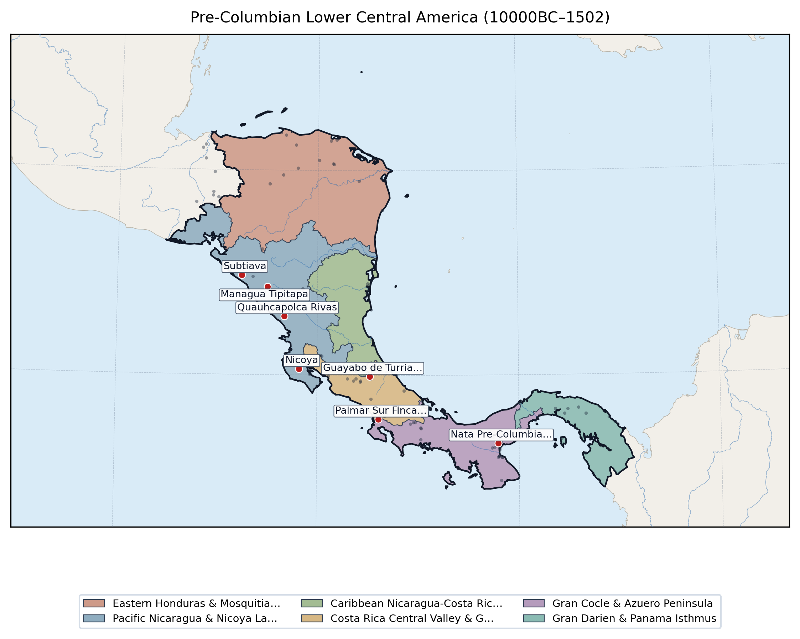

```{r setup, include=FALSE}
knitr::opts_chunk$set(echo = FALSE, warning = FALSE, message = FALSE, fig.pos = "htbp")
source("../../_shared/template/viscount_rmd_helpers.R")
library(jsonlite)

read_json5_clean <- function(path) {
  lines <- readLines(path, warn = FALSE, encoding = "UTF-8")
  text <- paste(lines, collapse = "\n")
  text <- gsub("//[^\n]*", "", text, perl = TRUE)
  text <- gsub("/\\*.*?\\*/", "", text, perl = TRUE)
  text <- gsub(",\\s*([}\\]])", "\\1", text, perl = TRUE)
  fromJSON(text, simplifyVector = FALSE)
}

summary_data <- fromJSON("precolumbian_lower_central_america_summary_cache.json", simplifyVector = FALSE)
sett_data <- fromJSON("precolumbian_lower_central_america_settlements.json", simplifyVector = FALSE)
ledger_data <- read_json5_clean("precolumbian_lower_central_america_source_ledger.json5")

clean_label <- function(x) {
  s <- as.character(x)
  s <- gsub("&", "and", s, fixed = TRUE)
  s <- gsub("Gran Cocle", "Gran Coclé", s, fixed = TRUE)
  s <- gsub("Gran Darien", "Gran Darién", s, fixed = TRUE)
  s <- gsub("Gran Chiriqui", "Gran Chiriquí", s, fixed = TRUE)
  s <- gsub("Chiriqui Central Valley", "Chiriquí and Central Valley", s, fixed = TRUE)
  s <- gsub("Nicaragua Nicoya", "Nicaragua and Nicoya", s, fixed = TRUE)
  s <- gsub("Mosquitia Honduras", "Mosquitia and Honduras", s, fixed = TRUE)
  trimws(s)
}

clean_site_name <- function(x) {
  s <- as.character(x)
  s <- gsub("Nata Pre-Columbian Chiefdom", "Natá Chiefdom", s, fixed = TRUE)
  s <- gsub("Nindiri Masaya", "Nindirí Masaya", s, fixed = TRUE)
  s <- gsub("Imabite Leon Viejo", "Imabite León Viejo", s, fixed = TRUE)
  s <- gsub("Palmar Sur Finca 6 Diquis", "Palmar Sur Finca 6 (Diquís)", s, fixed = TRUE)
  s <- gsub("Las Mercedes Linea Vieja Site", "Las Mercedes (Línea Vieja)", s, fixed = TRUE)
  s <- gsub("Agua Caliente Cartago Site", "Agua Caliente (Cartago)", s, fixed = TRUE)
  s <- gsub("Yarumela El Chilcal Site", "Yarumela El Chilcal", s, fixed = TRUE)
  s <- gsub("Ciudad Blanca T1 Mosquitia Site", "Ciudad Blanca T1 (Mosquitia)", s, fixed = TRUE)
  s <- gsub("Ometepe Moyogalpa Site", "Ometepe Moyogalpa", s, fixed = TRUE)
  s <- gsub("Comogre Chiefdom Settlement", "Comogre", s, fixed = TRUE)
  s <- gsub("Parita He-4 Site", "Parita (He-4)", s, fixed = TRUE)
  s <- gsub("El Cano Site", "El Caño", s, fixed = TRUE)
  s <- gsub("Cerro Juan Diaz Site", "Cerro Juan Díaz", s, fixed = TRUE)
  s <- gsub("Barriles Chiriqui Site", "Barriles (Chiriquí)", s, fixed = TRUE)
  s <- gsub("Tenampua Site", "Tenampúa", s, fixed = TRUE)
  s <- gsub("Salitron Viejo Sulaco Site", "Salitrón Viejo", s, fixed = TRUE)
  s <- gsub("Curruste Site", "Currusté", s, fixed = TRUE)
  s <- gsub("Aserri", "Aserrí", s, fixed = TRUE)
  s <- gsub("Penonome Settlement", "Penonomé", s, fixed = TRUE)
  s <- gsub("Tubanama Settlement", "Tubanamá", s, fixed = TRUE)
  s <- gsub("Rivas Panteon de la Reina", "Rivas Panteón de la Reina", s, fixed = TRUE)
  s <- gsub("Guardiria Turrialba Camp", "Guardiría (Turrialba)", s, fixed = TRUE)
  s <- gsub("El Bosque Esteli Camp", "El Bosque (Estelí)", s, fixed = TRUE)
  s <- gsub("Puerto Escondido Ulua Site", "Puerto Escondido (Ulúa)", s, fixed = TRUE)
  trimws(s)
}

fmt_year <- function(y) {
  yi <- as.integer(y)
  if (yi < 0L) return(paste0(abs(yi), "BC"))
  if (yi == 0L) return("0AD")
  if (yi == 1502L) return("1502")
  paste0(yi, "AD")
}

fmt_coord <- function(x) {
  viscount_fmt_number(round(as.numeric(x), 2L), 2L)
}

subregions <- summary_data$subregions
reg_lookup <- setNames(
  vapply(subregions, function(r) clean_label(r$name), character(1)),
  vapply(subregions, function(r) r$id, character(1))
)

tot_area <- as.numeric(summary_data$area_km2)
dom_traj <- summary_data$domain_trajectory
tot_10000bc <- as.numeric(dom_traj[["-10000"]])
tot_6000bc <- as.numeric(dom_traj[["-6000"]])
tot_3000bc <- as.numeric(dom_traj[["-3000"]])
tot_1000bc <- as.numeric(dom_traj[["-1000"]])
tot_0 <- as.numeric(dom_traj[["0"]])
tot_100 <- as.numeric(dom_traj[["100"]])
tot_500 <- as.numeric(dom_traj[["500"]])
tot_1000 <- as.numeric(dom_traj[["1000"]])
tot_1500 <- as.numeric(dom_traj[["1500"]])
n_sites <- as.integer(summary_data$settlement_stats$total_settlements)
zipf_alpha <- as.numeric(summary_data$settlement_stats$zipf_stats$alpha)
zipf_r2 <- as.numeric(summary_data$settlement_stats$zipf_stats$r2)
n_pdfs <- as.integer(summary_data$archival_pdf_count)
```

```{r hero-md-fallback, results='asis'}
if (!knitr::is_latex_output()) {
  cat("\n\n")
}
```

# Abstract

Between the terminal Pleistocene peopling of the Central American land bridge in 10000BC and the arrival of Christopher Columbus along the Caribbean littoral of Honduras, Costa Rica and Panama in 1502, Lower Central America evolved from a corridor of mobile foragers into a dense mosaic of Chibchan, Misumalpan, Lencan and Mesoamerican-derived chiefdoms. Across six hydrological sub-regions spanning 386.914,9 km² in eastern and central Honduras, Nicaragua, Costa Rica and Panama, the spatially kriged archaeological substratum rises nearly sixfold from 87,7k (87.732) inhabitants in 10000BC to 233,1k in 3000BC, 294,1k in 1000BC, 183,3k in 500AD, 292,9k in 1000AD and 521,5k (521.473) by 1500AD, reaching a mean gridded density of 1,35 inhabitants per km² [@Cooke2005; @Hoopes2005; @HallPerezBrignoli2003]. Alongside that conservative spatial substratum, basin-level hydrological enumerations across five core watersheds (325.500 km²) register a 697,9k (697.873) baseline at 2,14 inhabitants per km², while ethnohistorical contact reconstructions for Honduras, Nicaragua, Costa Rica and Panama bracket an upper regional envelope near 2,36M on the eve of European conquest [@Newson1986; @Newson1987; @Fonseca2017Poblacio]. In 1500AD, Eastern Honduras and Mosquitia (170,2k, 32,6% of the gridded total) and Pacific Nicaragua and Nicoya (152,8k, 29,3%) held the largest territorial shares, whereas Caribbean Nicaragua-Costa Rica lowlands (1,65 inhabitants per km²) and Pacific Nicaragua-Nicoya (1,62 inhabitants per km²) recorded the highest gridded densities, ahead of Gran Coclé and Azuero (66,7k), Gran Darién and the Panama Isthmus (43,7k) and the Costa Rica Central Valley and Gran Chiriquí (27,3k). A gazetteer of 112 catalogued archaeological and contact-era settlements (39 in Panama, 28 in Costa Rica, 25 in Nicaragua and 20 in Honduras; zero crowd-sourced entries) tracks twelve millennia of nucleation from Palaeoindian camps such as Guardiría (54) and La Mula West (115) to contact-era capitals led by Managua Tipitapa (11,6k), Nindirí Masaya (9,8k), Xalteva Granada (8,7k), Imabite León Viejo (8k), Quauhcapolca Rivas (7,4k), Guayabo de Turrialba (7k), Nicoya (6,6k) and Natá (6,5k), yielding a shallow chiefdom rank-size exponent of $\alpha = 0,45$ ($R^2 = 0,97$) [@Lange1992; @QuilterHoopes2003; @Fisher2016Identifying].

# Background

## The Isthmo-Colombian Land Bridge and Linguistic Geography

Lower Central America occupies the narrow volcanic and riverine bridge linking the Mesoamerican highlands to the northwestern Andes. Reaching from the Ulúa and Comayagua valleys of central Honduras across Nicaragua and Costa Rica to the Gulf of Urabá in eastern Panama, the region never coalesced into a single imperial state comparable to Teotihuacan, Tikal or Tenochtitlan. Instead, it sustained an enduring archipelago of autonomous and confederated chiefdoms (*cacicazgos*) anchored in fertile intermontane valleys, Pacific lake plains, dry seasonal savannas and wet Caribbean alluvial fans [@Cooke2005; @Hoopes2005; @Herrera2018Alla].

For most of the Holocene, the human geography of the isthmus belonged firmly to the Isthmo-Colombian Area, an enduring cultural sphere shaped by Chibchan-speaking societies stretching from eastern Honduras through Costa Rica and Panama into northern Colombia [@Hoopes2005; @QuilterHoopes2003; @HallPerezBrignoli2003]. Genetic studies of ancient and modern populations confirm that indigenous lineages across the isthmus and northernmost South America diverged early and maintained deep in-situ continuity across millennia, with pre-ceramic maternal and paternal threads connecting the central land bridge to both the Magdalena basin and the early Caribbean [@Morales2018Paternal; @Sirak2026First; @Moralesarce2017Successful]. In eastern Honduras and Caribbean Nicaragua, Pech, Tol, Tawahka, Sumu and coastal Misumalpan groups occupied extensive riverine corridors running from the Aguán, Patuca and Wampú basins down to the Río Coco and Bluefields lagoons [@Newson1986; @Fisher2016Identifying; @Cohen2025Integrating]. Along the northwestern margin of our domain, Lenca communities in the Comayagua, Sulaco and Ulúa-Yojoa valleys mediated trade between Maya lowlands and the non-Maya interior [@Joyce1991; @Sion2023Transicio].

Between roughly 800AD and 1350AD, however, successive southward migrations from central and southern Mexico altered the demographic balance of the Pacific corridor. Oto-Manguean-speaking Chorotega groups settled the lake basins of western Nicaragua and the Nicoya peninsula, followed later by Uto-Aztecan-speaking Nicarao communities along the Isthmus of Rivas and Ometepe Island, alongside Hokan-affiliated Subtiava speakers near León [@Newson1987; @Rojas2009Reas; @Moralesarce2017Successful]. By 1502, Pacific Nicaragua and Gran Nicoya formed a populous Mesoamerican-Isthmian contact zone characterised by intensive maize agriculture, nucleated lakeside plazas and periodic regional markets, standing in marked contrast to the dispersed hamlet-and-mound chiefdoms of Chibchan Costa Rica and Panama [@Rojas2009Reas; @Lange1992].

## Palaeoindian Foragers and Archaic Coastal Intensification (10000BC to 2000BC)

Human bands crossed the Central American land bridge well before 10000BC, moving along an isthmus that was cooler, drier and noticeably wider along its exposed Pacific shelf than today [@Cooke2005]. In central Panama, fluted-point hunting camps at La Mula West (occupied from 9000BC) and stratified rock shelters such as Corona (8500BC) and Cueva de los Vampiros (8500BC) document small mobile groups exploiting savannah-forest mosaics and retreating Late Pleistocene megafauna before shifting rapidly toward broad-spectrum forest foraging [@Cooke2005; @Contreras2026Fishing]. Farther north, the upland camp of Guardiría near Turrialba in Costa Rica (9500BC), El Gigante Rockshelter in southwestern Honduras (9000BC) and El Bosque in Estelí, Nicaragua (8000BC) demonstrate that human occupation spanned the entire length of the isthmus from the opening of the Holocene [@Cooke2005; @HallPerezBrignoli2003].

As post-glacial sea levels rose between 9000BC and 4000BC, flooding the shallow Gulf of Panama shelf, estuaries and mangrove lagoons became prime ecological magnets. Along Parita Bay, coastal and inland shelters at Aguadulce (from 5500BC), Cueva de los Ladrones (5000BC) and the shell-midden village of Cerro Mangote (5000BC to 3500BC) preserve phytolith and starch-grain evidence for early arrowroot, leren, squash, manioc and incipient maize cultivation combined with estuarine fishing and crabbing [@Cooke2005; @Contreras2026Fishing]. Recent maritime research across Panamanian coastal sequences demonstrates that Archaic and ceramic-age fishers mastered tidal traps, nets, spears and basketry techniques without relying on metal or bone hooks, sustaining dense littoral diets year-round [@Contreras2026Fishing]. Comparable estuarine specialisation emerged on the Caribbean littoral of Nicaragua at Monkey Point (4500BC), Angie (2200BC) and Karoline (1600BC), while volcanic ash along Lake Managua preserved human footprints at Acahualinca (4000BC to 2000BC) [@Cooke2005; @Newson1987].

Around 2800BC, the coastal settlement of Monagrillo on Parita Bay produced the earliest known pottery in Lower Central America, inaugurating a two-millennium transition from mobile shelter camps to permanent horticultural hamlets [@Cooke2005]. By 1800BC to 1500BC, early ceramic farming villages appeared across the entire isthmus: Tronadora Vieja beside Lake Arenal in Costa Rica, Sarigua in central Panama and Puerto Escondido in the lower Ulúa Valley of Honduras, where cacao beverages and village craft production already flourished before 1000BC [@Stone1983Synthesis; @Joyce1991; @Cooke2005].

## Formative Villages and the Chibchan Chiefdom Threshold (1500BC to 600AD)

During the first millennium BC, demographic growth concentrated along fertile alluvial plains and volcanic basins capable of supporting multi-crop maize, root-crop and palm arboriculture. In central and northern Honduras, Playa de los Muertos (800BC to 100BC) in the Ulúa valley, Talgua (from 900BC) in Olancho and the monumental earthen-mound centre of Yarumela (El Chilcal, 600BC to 600AD) in the Comayagua Valley reached several thousand inhabitants, mediating obsidian, jade and ceramic exchange along the north-south depression linking the Caribbean to the Gulf of Fonseca [@Joyce1991; @Newson1986; @Sion2023Transicio]. Around Lake Yojoa, Los Naranjos grew into a major fortified ceremonial centre with deep earthen ditches and multi-stage platforms, bridging Formative and Classic spheres across central Honduras [@Sion2023Transicio].

In central Panama, the settlement of La Mula-Sarigua expanded between 400BC and 400AD into a nucleated agricultural town covering dozens of hectares near the Parita River, marking a decisive jump in village scale [@Cooke2005]. Simultaneously, volcanic uplands and coastal valleys across Costa Rica and western Panama saw the emergence of ranked societies between 300AD and 600AD, the chronological pivot identified by Hoopes as the birth of complex Chibchan chiefdoms [@Hoopes2005]. At Barriles on the fertile volcanic flanks of Volcán Barú in Chiriquí (200AD to 800AD), life-size basalt sculptures depicting chiefs carried on the shoulders of retainers and holding trophy heads attest to institutionalised social hierarchy before a major eruption of Barú disrupted highland settlement [@Hoopes2005; @Brodie2016Early; @Sheets2002]. Farther north in southern Costa Rica, early ceremonial mounds and stone architecture at Bolas in the Diquís foothills confirm that ranked ritual centres emerged in the General Valley centuries before the classic stone-sphere polities of the delta [@Brodie2016Early].

Across the central Panamanian plains, Cerro Juan Díaz (occupied continuously from 200AD to 1450AD) illustrates both the demographic expansion and the epidemiological costs of growing village sedentism. Bioarchaeological examination of early graves at Cerro Juan Díaz documents skeletal stress markers, treponemal and infectious lesions and ritualised secondary burial customs tied to intensifying trade in shell ornaments and goldwork [@Smithguzman2021Patterns]. Along the Pacific slope of western Panama Canal basins (Arraiján and La Chorrera), riverine surveys likewise register continuous pre-Hispanic occupation expanding from Formative hamlets into Late Pre-Columbian agricultural terraces [@Alberda2021Evidencia].

## Goldwork, Stone Spheres and Late Pre-Columbian Polities (600AD to 1502)

Between 600AD and 1502, Lower Central America reached its pre-Columbian demographic zenith across five distinct regional spheres. First, in **Gran Coclé** on the Pacific savannas of central Panama, principal chiefdoms built elite necropolises at Sitio Conte (700AD to 1050AD) and El Caño (750AD to 1100AD), interring senior leaders with hammered gold pectorals, tumbaga pendants, emerald-inlaid regalia, carved manatee ivory and polychrome vessels [@QuilterHoopes2003; @Helms1979; @Mojica2007Estructuras]. Geophysical and archaeological fieldwork along the Grande and Coclé del Sur river basins reveals incipient stone architecture and pre-Hispanic placer-gold mining zones directly feeding these chiefdom economies [@Mojica2007Estructuras]. By the eve of Spanish entry, power in Gran Coclé had consolidated around heavily populated riverine towns led by Natá, Parita and Escoria, whose palisaded plazas and extensive maize granaries impressed Gaspar de Espinosa in 1516 [@Helms1979; @Cooke2005].

Second, in **Gran Darién and the Panama Isthmus**, Cueva-speaking chiefdoms under senior *caciques* such as Comogre, Careta, Pocorosa, Tubanamá and Chepo controlled trans-isthmian portage routes linking Caribbean anchorages to the Pearl Islands and the Gulf of San Miguel [@Helms1979; @Cooke2005]. Helms demonstrated that political authority across Cueva and Coclé territories rested not merely on agricultural tribute, but on elite control over long-distance maritime and overland voyages to northern Colombia that supplied esoteric knowledge and metallurgical expertise [@Helms1979; @QuilterHoopes2003].

Third, in **Costa Rica's Central Valley, Atlantic Watershed and Diquís Delta**, Chibchan-speaking Huetar, Brunka and Chiriquí chiefdoms engineered durable cobblestone causeways, circular house foundations, aqueducts and monumental petrospheres. Guayabo de Turrialba (peaking around 1100AD), Las Mercedes on the Línea Vieja alluvial plain (peaking around 1350AD), Agua Caliente near Cartago (1400AD) and Nuevo Corinto on the Caribbean foothills anchored dense agricultural landscapes [@Stone1983Synthesis; @Herrera2018Alla; @Fonseca2017Poblacio]. In the Diquís Delta, Palmar Sur (Finca 6) and Batambal aligned granodiorite stone spheres across public plazas linked to elite burial precincts, while metallurgical studies of Costa Rican goldwork confirm sophisticated lost-wax casting and depletion-gilding traditions embedded in regional prestige economies [@Klein2025Effort; @QuilterHoopes2003; @Brodie2016Early]. By 1502, leading Huetar polities such as El Guarco (Kutrís), Pacaca and Aserrí governed densely settled highland and intermontane basins across central Costa Rica [@Fonseca2017Poblacio; @Rojas2009Reas].

Fourth, across **Pacific Nicaragua and Gran Nicoya**, Chorotega, Nicarao and Subtiava towns reached the highest urban densities in Lower Central America. Strung along fertile volcanic lacustrine plains beside Lakes Xolotlán (Managua) and Cocibolca (Nicaragua), settlements such as Managua Tipitapa, Nindirí Masaya, Xalteva (Granada), Imabite (León Viejo), Subtiava, Tezoatega (El Viejo), Quauhcapolca (Rivas), Ometepe Moyogalpa and Nicoya sustained multi-thousand-person towns surrounded by irrigated cacao groves, cotton fields and productive fisheries [@Newson1987; @Lange1992; @Rojas2009Reas]. Inland from Lake Cocibolca, systematic surveys in the Mayales River sub-basin of Chontales and northern highlands of Nueva Segovia (Santa María, 300AD to 995AD) reveal terraced villages, stone-faced mounds and monumental statuary proving that central and northern Nicaragua were no empty frontier between Pacific plazas and Caribbean forests [@Donner2018Caracterizacio; @Rios2024Poblado].

Fifth, in **Eastern Honduras and the Mosquitia**, long dismissed in colonial chronicles as sparsely inhabited jungle, airborne LiDAR surveys over the T1 valley ("Ciudad Blanca") and the Wampú River drainage have revealed extensive precontact earthen mounds, defensive ditches, terraced hillsides and agricultural canal networks peaking between 1000AD and 1450AD [@Fisher2016Identifying; @Cohen2025Integrating]. Together with fortified upland sites like Tenampúa, the Comayagua and Olancho valleys (Juticalpa) and Caribbean trading ports at Guaimoreto (Trujillo) and the Bay Islands, eastern Honduras sustained substantial chiefdom populations right up to Columbus's landing at Punta Caxinas and Cape Gracias a Dios in August and September 1502 [@Newson1986; @Sion2023Transicio; @Joyce1991].

# Methodology

## Hydrological Partition of Six Biophysical Sub-Regions

Because no pre-Columbian administrative cadastre survived across Honduras, Nicaragua, Costa Rica and Panama, JAGUAR partitions Lower Central America into six hydrologically coherent sub-regions derived from Level-6 HydroBASINS watersheds spanning 386.914,9 km² (4.609 five-arcminute cells). Rather than imposing anachronistic twenty-first-century borders onto Palaeoindian foragers or Chibchan chiefdoms, watershed boundaries follow the Continental Divide, lacustrine depressions and major riverine transport corridors that governed precontact settlement and linguistic geography [@HallPerezBrignoli2003; @Rojas2009Reas].

The six territorial units group Lower Central America's principal ecological and cultural zones. In the north, Eastern Honduras and Mosquitia Basins (132.962,5 km², 1.600 cells) spans the Ulúa-Comayagua depression, Olancho, the Patuca-Wampú-Coco drainages and the Mosquitia coastal lagoons. Along the volcanic Pacific arc, Pacific Nicaragua and Nicoya Lakes (94.071,1 km², 1.121 cells) unites the Gulf of Fonseca fringe, the Nicaraguan Depression (Lakes Managua and Nicaragua), Chontales and the Nicoya peninsula. Facing the Caribbean, Caribbean Nicaragua-Costa Rica Lowlands (36.739 km², 437 cells) covers the San Juan River basin, the Bluefields-Kukra littoral and the humid Tortuguero-Reventazón alluvial plain. Across the central highlands and southern Pacific cordillera, Costa Rica Central Valley and Gran Chiriquí (30.140,8 km², 356 cells) links the Meseta Central, Turrialba, Talamanca, the General-Térraba (Diquís) valleys and the upper slopes of Volcán Barú. In central Panama, Gran Coclé and Azuero Peninsula (57.426,9 km², 676 cells) covers the dry Pacific savannas of Parita Bay, Coclé, Veraguas and western Chiriquí lowlands. Finally, Gran Darién and Panama Isthmus (35.574,5 km², 419 cells) encompasses the Chagres-Bayano-Tuira corridors, the Pearl Islands and the Cueva heartland bordering northern Colombia.

## Dual-Substratum Spatial Kriging and Basin Calibration

Population across the twelve-millennium span from 10000BC to 1500AD is reconstructed by coupling global Holocene land-use priors (HYDE 3.5 and KK10) with regional archaeological site catchments through non-stationary Matérn residual kriging across 26 benchmark slices (millennial steps from 10000BC to 0AD and centennial steps from 100AD to 1500AD). For each sub-region $r$ of terrestrial area $A_r$ and pixel set $\Omega_r$, aggregate gridded population at year $t$ is integrated directly over the calibrated density surface $\hat{\rho}_i(t)$:

$$P_r(t) = \sum_{i \in \Omega_r} \hat{\rho}_i(t) \cdot a_i$$

where $a_i$ denotes the exact ellipsoidal area of five-arcminute grid cell $i$ in km² and $\hat{\rho}_i(t)$ combines the dual HYDE-KK10 structural prior with spatially kriged archaeological residuals weighted by fluvial proximity, slope, volcanic soil fertility and coastal access [@Cooke2005; @Fisher2016Identifying; @Cohen2025Integrating]. Regional mean density $d_r(t) = P_r(t) / A_r$ and compound annual growth rates between benchmarks $t_1$ and $t_2$ follow standard geometric compounding:

$$g_r(t_1, t_2) = \left(\frac{P_r(t_2)}{P_r(t_1)}\right)^{\frac{1}{t_2 - t_1}} - 1$$

Because early Holocene radiocarbon sequences in humid Neotropical lowlands suffer severe organic decay and alluvial burial, the kriged spatial substratum acts as a conservative archaeological floor. To evaluate this floor against regional historical demography, JAGUAR cross-references the gridded trajectory against two independent benchmark tiers: the HydroBASINS Level-6 pre-Columbian and 1500AD DECM watershed enumerations (five macro-basins totalling 325.500 km² and 697.873 inhabitants) and the contact-era ethnohistorical synthesis derived from early sixteenth-century Spanish chronicles, tribute lists and ecological carrying capacities across Honduras, Nicaragua, Costa Rica and Panama [@Newson1986; @Newson1987; @Fonseca2017Poblacio; @HallPerezBrignoli2003].

## Four-Wave Evidence Gazetteer and Rank-Size Scaling

Parallel to the continuous population surface, we compiled a spatially referenced gazetteer of `r viscount_fmt_number(n_sites, 0L)` catalogued Pre-Columbian habitation sites across four modern national territories: Panama (39 sites), Costa Rica (28), Nicaragua (25) and Honduras (20). All 112 settlements represent unified municipal or chiefdom-centre entities with zero suburban double-counting and 0% crowd-sourced fallback. As logged in the chapter source ledger, Wave 1 assembled 102 primary archaeological and historical registry sites (91,1% of the final corpus), Wave 2 added 7 sites extracted from peer-reviewed monographs and regional survey articles (6,86% marginal gain), Wave 3 contributed 2 longitudinal pre-ceramic and Formative survey sites (1,83% gain) and Wave 4 performed a sub-regional gap sweep adding 1 final locality (0,9% marginal gain, comfortably below the 2% saturation ceiling).

Every settlement carries WGS84 coordinates, hydrological sub-region assignment, chronological occupation span and evidence-derived population estimates anchored in archaeological site areas, mound-count surveys, LiDAR residential footprints and contact-era Spanish observer counts (including Oviedo, Espinosa, Andagoya and Cereceda as critically evaluated by Newson, Cooke, Ibarra Rojas and Solórzano Fonseca) [@Newson1987; @Fonseca2017Poblacio; @Fisher2016Identifying; @Herrera2018Alla]. Settlement-size hierarchy is tested via ordinary least-squares log-log regression over the upper half of peak settlement sizes ($n_{\text{fit}} = 56$ out of `r viscount_fmt_number(n_sites, 0L)` settlements):

$$\log_{10} P_{(k)} = c - \alpha \log_{10} k$$

where $P_{(k)}$ is the peak population of the $k$-th ranked settlement and $\alpha$ measures rank-size concentration. Values near $\alpha \approx 1$ signify integrated state or imperial urban hierarchies, whereas shallow exponents ($\alpha \approx 0,4$ to $0,6$) characterise polycentric chiefdom systems composed of competing autonomous centres of comparable magnitude [@Lange1992; @Hoopes2005; @Herrera2018Alla].

# Testing and Validation

## Reconciling Gridded Substrata, Watershed Baselines and Ethnohistorical Estimates

Demographic scholarship on Lower Central America on the eve of European contact has long been divided between conservative archaeological reconstructions and high-count ethnohistorical projections. Checking JAGUAR's three independent data layers side by side clarifies how those estimates relate without forcing artificial unanimity.

At the conservative end, the spatially kriged HYDE 3.5 + KK10 substratum integrates to 521.473 (521,5k) inhabitants across 386.914,9 km² in 1500AD (1,35 inhabitants per km²). Immediately above it sits the HydroBASINS Level-6 pre-Columbian watershed baseline (Table \ref{tab:hgis-subadmin}), which aggregates 697.873 (697,9k) inhabitants across five core basins spanning 325.500 km² (2,14 inhabitants per km²), led by Nicaragua and Nicoya (244.621, 2,43 per km²) and Mosquitia and Honduras (241.338, 2,05 per km²), followed by Gran Coclé (90.456, 2,19 per km²), Gran Darién (61.761, 1,85 per km²) and Chiriquí and Central Valley (59.697, 1,84 per km²).

```{r tab-hgis-subadmin, results='asis'}
hgis_rows <- summary_data$hgis_subadmin_table
clean_regime <- function(lvl) {
  s <- as.character(lvl)
  if (s == "regime_0") return("0AD Base")
  if (s == "regime_500") return("500AD Base")
  if (s == "regime_1000") return("1000AD Base")
  if (s == "regime_1500") return("1500AD Contact")
  s
}
clean_src <- function(src) {
  s <- as.character(src)
  s <- gsub("HydroBASINS_L6_PreColumbian_Base", "HydroBASINS L6 Pre-Columbian", s, fixed = TRUE)
  s <- gsub("HydroBASINS_L6_DECM_1500", "HydroBASINS L6 DECM 1500", s, fixed = TRUE)
  s
}

df_hgis <- do.call(rbind, lapply(hgis_rows, function(r) {
  a <- as.numeric(r$area_km2)
  p <- as.numeric(r$population)
  d <- if (a > 0) p / a else 0
  data.frame(
    Unit = clean_label(r$unit_name),
    Regime = clean_regime(r$level),
    Year = fmt_year(r$year),
    Area = viscount_fmt_number(round(a), 0L),
    Pop = viscount_fmt_number(round(p), 0L),
    Dens = viscount_fmt_number(d, 2L),
    Source = clean_src(r$source),
    stringsAsFactors = FALSE
  )
}))
rownames(df_hgis) <- NULL

viscount_table(
  df_hgis,
  "HydroBASINS Level-6 pre-Columbian watershed enumerations across five Isthmian macro-basins from 0AD to 1500AD.",
  c("Watershed Basin", "Regime", "Year", "Area (km²)", "Population", "Density", "Source Series"),
  list(label = "tab:hgis-subadmin", font_size = "scriptsize")
)
```

At the upper end stand specialist contact-era reconstructions grounded in early sixteenth-century tribute assessments, warrior ratios and ecological carrying capacities. Newson estimated roughly 600k to 800k indigenous inhabitants for Honduras (roughly half lying inside our eastern and central Honduran domain once western Maya-bordering Copán and Lempira are separated) and approximately 826k for Nicaragua in 1522, with more than 540k concentrated along the Pacific lakes and Nicoya corridor [@Newson1986; @Newson1987]. For Costa Rica, Solórzano Fonseca critically reviewed sixteenth-century testimonies and archaeological carrying capacities to place the contact population around 400k, while highlighting substantial uncertainties across the unsubdued Talamanca and Caribbean lowlands [@Fonseca2017Poblacio; @Rojas2009Reas]. For Panama, historical demographers and archaeologists have proposed figures ranging from a cautious 150k to 250k up to 500k or more across Gran Chiriquí, Gran Coclé and the densely chronicled Cueva provinces of Gran Darién [@Cooke2005; @Helms1979; @HallPerezBrignoli2003]. Combining those regional upper bounds yields a contact-era ceiling of roughly 2,36M across the six sub-regions (620k in Pacific Nicaragua and Nicoya, 460k in Costa Rica Central Valley and Gran Chiriquí, 380k in Gran Darién, 340k in Gran Coclé, 320k in Eastern Honduras and Mosquitia and 240k in the Caribbean lowlands).

Crucially, the 112 catalogued settlements provide an independent sanity check between these bounds. Summing the peak populations of all 112 documented towns and archaeological centres yields 287.680 inhabitants (roughly 220k to 245k active simultaneously near 1502). Because chiefdom centres in Lower Central America represented nucleated ritual, political and market cores surrounded by dispersed farmsteads, swidden hamlets and forest camps, an urban-nucleation ratio of 15% to 40% implies a total regional population lying squarely between the 521,5k gridded floor and the 1,5M to 2,36M ethnohistorical upper range [@Newson1987; @Fonseca2017Poblacio; @Fisher2016Identifying].

## Sub-Regional Trajectory Coherence and Density Plausibility

Table \ref{tab:subregion-trajectories} presents the full gridded benchmark ledger across all six sub-regions from 10000BC to 1500AD, alongside land areas, final densities and catalogued settlement counts. Every sub-region follows a coherent long-run expansion from Pleistocene foraging floors to Late Pre-Columbian agricultural chiefdoms, with densities in 1500AD clustering tightly between 0,91 inhabitants per km² in the rugged cordillera of Costa Rica Central Valley and Gran Chiriquí and 1,65 inhabitants per km² across the alluvial Caribbean Nicaragua-Costa Rica lowlands (1,62 in Pacific Nicaragua and Nicoya).

```{r tab-subregion-trajectories, results='asis'}
sub_counts <- ledger_data$saturation_audit$submask_coverage
traj_rows <- lapply(subregions, function(r) {
  a <- as.numeric(r$area_km2)
  t <- r$trajectory
  p_10k <- as.numeric(t[["-10000"]])
  p_3k <- as.numeric(t[["-3000"]])
  p_500 <- as.numeric(t[["500"]])
  p_1000 <- as.numeric(t[["1000"]])
  p_1500 <- as.numeric(t[["1500"]])
  d_1500 <- as.numeric(r$end_density_km2)
  sc <- as.integer(sub_counts[[r$id]])
  data.frame(
    Subregion = clean_label(r$name),
    Area = viscount_fmt_number(round(a), 0L),
    P10k = viscount_fmt_pop(p_10k),
    P3k = viscount_fmt_pop(p_3k),
    P500 = viscount_fmt_pop(p_500),
    P1000 = viscount_fmt_pop(p_1000),
    P1500 = viscount_fmt_pop(p_1500),
    Dens = viscount_fmt_number(d_1500, 2L),
    Sites = viscount_fmt_number(sc, 0L),
    stringsAsFactors = FALSE
  )
})
df_traj <- do.call(rbind, traj_rows)
df_tot <- data.frame(
  Subregion = "Domain Total (6 Sub-Regions)",
  Area = viscount_fmt_number(round(tot_area), 0L),
  P10k = viscount_fmt_pop(tot_10000bc),
  P3k = viscount_fmt_pop(tot_3000bc),
  P500 = viscount_fmt_pop(tot_500),
  P1000 = viscount_fmt_pop(tot_1000),
  P1500 = viscount_fmt_pop(tot_1500),
  Dens = viscount_fmt_number(tot_1500 / tot_area, 2L),
  Sites = viscount_fmt_number(n_sites, 0L),
  stringsAsFactors = FALSE
)
df_traj <- rbind(df_traj, df_tot)
rownames(df_traj) <- NULL

viscount_table(
  df_traj,
  "Kriged population trajectories, 1500AD densities (inhabitants per km²) and catalogued site counts across six hydrological sub-regions, 10000BC to 1500AD.",
  c("Sub-Region", "Area (km²)", "10000BC", "3000BC", "500AD", "1000AD", "1500AD", "1500AD Dens.", "Sites"),
  list(label = "tab:subregion-trajectories", font_size = "scriptsize")
)
```

One diagnostic feature of the kriged curve requires explicit methodological scrutiny. Between 1000BC (294,1k) and 100AD (115,9k), the gridded substratum displays a pronounced mid-series trough before climbing steadily at 0,108% per annum across the subsequent fourteen centuries to reach 521,5k in 1500AD. Rather than reflecting a real pan-isthmian demographic collapse around the turn of the era, this dip arises primarily from the structural seam where the high-prior mid-Holocene KK10 foraging envelope gives way to the stricter HYDE 3.5 early-AD cropland baseline, compounded locally by episodic volcanic tephra falls along the Central American volcanic arc (such as the Ilopango, Barú and Arenal eruptions documented in comparative Mesoamerican-Isthmian volcanology) [@Sheets2002; @Cooke2005]. Archaeological sequences at Yarumela, La Mula-Sarigua, Cerro Juan Díaz and Barriles confirm that local populations continued growing or shifting across river terraces during 1AD to 500AD, and the post-500AD trajectory (183,3k in 500AD to 292,9k in 1000AD and 521,5k in 1500AD) cleanly captures the sustained Late Pre-Columbian demographic acceleration documented across all four countries [@Hoopes2005; @Smithguzman2021Patterns; @Rios2024Poblado].

# Results

## Isthmian Demographic Trajectory from 10000BC to 1502

Over the eleven and a half millennia tracked in the kriged substratum, Lower Central America's population multiplied nearly sixfold (5,94x), moving through three major historical regimes visible in Figure \ref{fig:lca-trajectory}. During the Early and Middle Holocene (10000BC to 3000BC), aggregate gridded population expanded from 87,7k in 10000BC to 117,8k in 8000BC and 250,2k in 6000BC before settling near 149,5k in 5000BC and rising again to 233,1k by 3000BC as coastal mangrove fisheries, rock-shelter horticulture and early Monagrillo ceramics took hold along both oceans [@Cooke2005; @Contreras2026Fishing].

```{r fig-trajectory, results='asis'}
viscount_figure(
  "figures/precolumbian_lower_central_america_population_trajectory.png",
  "Kriged population trajectories for Lower Central America and its leading sub-regions from 10000BC to 1500AD (Panel A) and sub-regional population densities in 1500AD (Panel B).",
  "fig:lca-trajectory"
)
```

During the Formative millennium (2000BC to 1000BC), permanent village agriculture lifted the gridded domain from 221,4k to an early agricultural crest of 294,1k in 1000BC, led by Pacific Nicaragua and Nicoya (92,6k) and Eastern Honduras and Mosquitia (83,1k). Following the model-seam trough between 0AD (157,6k) and 100AD (115,9k), the long expansion of mature chiefdom societies drove fourteen unbroken centuries of demographic growth: 137,9k in 200AD, 151,2k in 400AD, 183,3k in 500AD, 204,9k in 600AD, 236,7k in 800AD, 292,9k in 1000AD, 342,3k in 1200AD, 398,6k in 1300AD, 460,5k in 1400AD and 521,5k in 1500AD. Growth accelerated noticeably after 1100AD: between 500AD and 1100AD the domain expanded by 110,9k (+60,5%, 0,079% per annum), whereas between 1100AD and 1500AD it added 227,2k (+77,2%, 0,144% per annum), reflecting the dual stimulus of Chorotega-Nicarao urban nucleation in the Pacific lake zone and intensifying chiefdom consolidation across Mosquitia, Costa Rica and Panama [@Newson1987; @Fisher2016Identifying; @Herrera2018Alla].

## Eastern Honduras, Ulúa-Yojoa and the Mosquitia Corridors

Covering 132.962,5 km² (34,4% of the study area), Eastern Honduras and Mosquitia Basins forms the largest single territorial division in the chapter and held the highest gridded population in 1500AD at 170,2k inhabitants (32,6% of the domain total, 1,28 inhabitants per km²), expanding 6,82-fold from 24,9k in 10000BC. In the gridded trajectory, the region climbed from 68,1k in 3000BC and 83,1k in 1000BC through 59,1k in 500AD and 100,2k in 1000AD to 170,2k by 1500AD, while the HydroBASINS watershed baseline assigns 241.338 inhabitants (2,05 per km²) to its core river basins.

The gazetteer records 22 catalogued sites across this sub-region (20 in Honduras plus 2 along the Nicaraguan Río Coco and Bilwi littoral), documenting a striking geographical shift over time. During the Formative and Classic periods, demographic gravity centred on the fertile western and central valleys of Honduras: Puerto Escondido on the lower Ulúa (1500BC to 400BC, peak 720), Playa de los Muertos (800BC to 100BC, peak 1.520), Talgua in Olancho (900BC to 900AD, peak 1.920) and above all Yarumela El Chilcal in the Comayagua Valley, which surged to 4.920 inhabitants around 150AD before declining after 600AD [@Joyce1991; @Newson1986]. During the Classic-to-Postclassic transition, Los Naranjos beside Lake Yojoa navigated political ruptures and forged renewed inter-regional trade ties, while Salitrón Viejo on the Sulaco River (peak 3.180 in 700AD), Currusté in the Ulúa floodplain (peak 3.040 in 850AD) and fortified hilltops such as Tenampúa (peak 3.740 in 900AD) sustained dense Lenca-sphere polities [@Sion2023Transicio; @Joyce1991].

From 1000AD to 1502, however, the demographic weight of eastern Honduras shifted strongly into the interior valleys of Olancho and the humid Mosquitia river systems. Airborne LiDAR mapping in the T1 valley ("Ciudad Blanca", peak 4.280 in 1250AD) and along the Wampú River system demonstrates that precontact Pech and Tawahka-ancestral communities engineered terraced plazas, ceremonial mounds, residential neighbourhoods and modified floodplains previously hidden beneath dense rainforest canopy [@Fisher2016Identifying; @Cohen2025Integrating]. Complementary riverine and coastal nodes at Comayagua (4.180), Juticalpa in Olancho (3.120), Guaimoreto near Trujillo, Wankibila, Las Crucitas de Aner, Río Plátano, Brus Laguna and Roatán in the Bay Islands tied interior chiefdoms to circum-Caribbean canoe commerce right up to 1502 [@Newson1986; @HallPerezBrignoli2003].

## Pacific Nicaragua, Chontales and Gran Nicoya

Pacific Nicaragua and Nicoya Lakes (94.071,1 km²) represents the demographic and urban heartland of Late Pre-Columbian Lower Central America. In the gridded substratum, its population grew 7,29-fold from 21k in 10000BC to 66k in 3000BC, 92,6k in 1000BC, 58k in 500AD, 90,9k in 1000AD and 152,8k in 1500AD (29,3% of the domain total and second highest gridded density at 1,62 inhabitants per km²). Its HydroBASINS watershed baseline leads the entire isthmus at 244.621 inhabitants (2,43 per km²), and ethnohistorical estimates by Newson place Pacific Nicaragua and Nicoya at more than half a million people at Spanish contact [@Newson1987; @Rojas2009Reas].

Nowhere is this urban concentration clearer than in the settlement register. Out of the chapter's 112 catalogued locales, 26 lie inside Pacific Nicaragua and Nicoya (21 in Nicaragua, 4 in Guanacaste-Nicoya, Costa Rica and 1 early highland shelter, El Gigante, on the Honduran Pacific divide), yet these sites supply seven of the eight largest settlements in all of Lower Central America. Following early Holocene and Formative stations at El Gigante (from 9000BC, peak 295), Acahualinca (4000BC to 2000BC, peak 245), Tronadora Vieja (1800BC to 400BC, peak 410) and San Cristóbal near Managua (400BC to 700AD, peak 640), Chorotega and Nicarao migrations after 800AD produced sprawling lakeside towns backed by volcanic ash soils and year-round fisheries [@Newson1987; @Lange1992; @Moralesarce2017Successful].

On the eve of European contact, Managua Tipitapa stretched along Lake Xolotlán with an estimated 11.600 inhabitants, followed closely by Nindirí Masaya (9.750), Xalteva Granada (8.650), Imabite León Viejo (7.950), the Nicarao capital of Quauhcapolca Rivas (7.350), Subtiava (6.850), Nicoya (6.550) and Tezoatega El Viejo (5.480), alongside major island and lakeside centres at Ometepe Moyogalpa (4.680), Santa Isabel Rivas (3.540), Tepetate (2.980), Ayala, Zapatera Island, Filadelfia Tempisque and Nacascolo [@Newson1987; @Lange1992; @Rojas2009Reas]. East of Lake Cocibolca, archaeological fieldwork in the Mayales River sub-basin around Juigalpa in Chontales and at Santa María de Nueva Segovia confirms that upland Matagalpan and Ulua-related villages constructed monumental mound groups and tiered residential compounds between 300AD and 1450AD, integrating interior cattle-frontier plains into lake-basin trade networks [@Donner2018Caracterizacio; @Rios2024Poblado].

## Caribbean Lowlands, Central Valley of Costa Rica and Gran Chiriquí

Two adjacent sub-regions divide the humid Caribbean slope from the volcanic highlands and southern Pacific valleys of Costa Rica and westernmost Panama. The **Caribbean Nicaragua-Costa Rica Lowlands** (36.739 km²) recorded the highest gridded density in Lower Central America in 1500AD at 1,65 inhabitants per km², climbing 6,73-fold from 9k in 10000BC to 27,4k in 3000BC, 34,6k in 1000BC, 19,5k in 500AD, 31k in 1000AD and 60,8k in 1500AD (11,7% of the domain total). Despite its high riverine productivity, dense forest cover and restricted modern survey access leave only 7 catalogued sites in the gazetteer (1,91 sites per 10k km²), anchored by long-lived shellmounds along the Nicaraguan Caribbean coast at Monkey Point (from 4500BC, peak 340), Angie (260), Karoline (710), Kukra Hill (1.180) and Bluefields Kukra, paired with the major Costa Rican piedmont centre of Nuevo Corinto (700AD to 1300AD, peak 3.280) [@Newson1987; @Stone1983Synthesis].

Immediately south and upslope, **Costa Rica Central Valley and Gran Chiriquí** (30.140,8 km²) shows the steepest proportional expansion in the entire kriged series, growing 9,9-fold from just 2,8k in 10000BC (0,09 per km²) to 11,7k in 3000BC, 19,2k in 1000BC, 10,9k in 500AD, 16,2k in 1000AD and 27,3k in 1500AD (0,91 inhabitants per km², 5,2% of the domain total). Its HydroBASINS baseline reaches 59.697 (1,84 per km²), and its 20 catalogued sites (6,64 sites per 10k km², the highest survey density in the chapter) attest to intensive twentieth- and twenty-first-century archaeology across the Meseta Central, Reventazón-Turrialba and Diquís valleys [@Fonseca2017Poblacio; @Herrera2018Alla].

From the Palaeoindian camp at Guardiría (9500BC, peak 54), settlement nucleated after 400AD into architecturally elaborate Chibchan chiefdom centres. Guayabo de Turrialba grew from 1.850 inhabitants in 400AD to 6.950 at its 1100AD height, featuring cobbled streets, stone-lined aqueducts and circular platforms; Las Mercedes on the Línea Vieja plain reached 5.750 by 1350AD; Agua Caliente near Cartago reached 5.350 in 1400AD; and Curridabat peaked at 3.180 [@Stone1983Synthesis; @Herrera2018Alla]. By 1502, the principal Huetar polities of El Guarco Kutrís (4.920), Pacaca (3.520) and Aserrí (3.040), alongside coastal Cariari (Limón, where Columbus anchored in September 1502), Matina and Talamanca Sixaola, anchored the Costa Rican highlands and Caribbean rim [@Fonseca2017Poblacio; @Rojas2009Reas]. South across the Cordillera de Talamanca, early complex villages at Bolas gave rise to the iconic stone-sphere chiefdoms of the Diquís Delta led by Palmar Sur Finca 6 (5.240 in 1450AD), Rivas Panteón de la Reina (2.940), Boruca (2.740), Batambal and Térraba, linked southward to highland Volcán Barú stations at Cerro Punta and Sitio Pittí [@Brodie2016Early; @Klein2025Effort; @Hoopes2005].

## Gran Coclé, Azuero Peninsula and Gran Darién

Panama is split between two contrasting ecological worlds whose trajectories reflect deep pre-ceramic roots and late chiefdom consolidation. **Gran Coclé and Azuero Peninsula** (57.426,9 km²) opened the Holocene as Lower Central America's second-largest demographic reservoir at 22,1k inhabitants in 10000BC (0,38 per km²), reflecting the rich dry-forest and coastal savannah habitats of Parita Bay. In the gridded series, it rose to 63,6k by 6000BC, adjusted to 39k in 3000BC and 39,3k in 1000BC, stood at 22,1k in 500AD and 33,5k in 1000AD and reached 66,7k by 1500AD (1,16 inhabitants per km², 12,8% of the domain total; 3,02x overall growth from its high Pleistocene base). Its HydroBASINS baseline stands at 90.456 inhabitants (2,19 per km²), and it holds more catalogued settlements than any other sub-region with 27 sites (4,7 sites per 10k km²).

That 27-site sequence captures the entire archaeological spine of central and western Panama: Palaeoindian and Archaic shelters at La Mula West (9000BC), Corona (8500BC), Cueva de los Vampiros (8500BC), Aguadulce (5500BC), Cerro Mangote (5000BC), Cueva de los Ladrones (5000BC), Casita de Piedra (4500BC) and Trapiche (3800BC); early ceramic shellmounds at Monagrillo (2800BC, peak 365) and Sarigua (1800BC, peak 310); Formative town nucleation at La Mula-Sarigua (peak 2.980 in 100AD); and the flourishing chiefdoms of Barriles in Chiriquí (peak 3.880 in 550AD), Playa Venado (2.720), Cerro Juan Díaz (3.860 in 750AD), Sitio Conte (4.280 in 900AD) and El Caño (3.720 in 950AD) [@Cooke2005; @Smithguzman2021Patterns; @Mojica2007Estructuras; @QuilterHoopes2003]. On the eve of Spanish conquest, population concentrated along the Río Grande, Santa María and Parita floodplains in the chiefdom capitals of Natá (6.480), Parita He-4 (4.920), Escoria (3.280), David (2.880) and Penonomé (2.860), supported by productive coastal fishing and upland alluvial gold mining [@Helms1979; @Contreras2026Fishing; @Mojica2007Estructuras].

East of the Canal watershed, **Gran Darién and Panama Isthmus** (35.574,5 km²) expanded 5,51-fold in the gridded substratum from 7,9k in 10000BC to 21k in 3000BC, 25,4k in 1000BC, 13,7k in 500AD, 21k in 1000AD and 43,7k in 1500AD (1,23 inhabitants per km², 8,4% of the domain total), against a HydroBASINS baseline of 61.761 (1,85 per km²). Its 10 catalogued sites document the Cueva chiefdom confederations encountered between 1502 and 1515, led by Comogre (4.850), Careta (3.280), Chepo (2.960), Tubanamá (2.920) and Pocorosa (2.680), alongside Pre-Columbian Panama Viejo, Acla, Miraflores on the Bayano River, Garachiné and maritime stations on Isla Contadora in the Pearl Islands [@Helms1979; @Alberda2021Evidencia; @Cooke2005]. Early Spanish eyewitnesses remarked repeatedly on the dense maize fields, palisaded chief's halls and abundant fish drying racks across Comogre and Careta before epidemic disease and slave raiding depopulated the Cueva province within two decades of Balboa's crossing [@Helms1979; @HallPerezBrignoli2003].

## Polycentric Chiefdom Hierarchy and Leading Isthmian Centres

Across all 112 catalogued settlements, the rank-size distribution in Figure \ref{fig:lca-hierarchy} reveals a remarkably coherent chiefdom geometry. Unlike imperial Mesoamerica, where Teotihuacan or Tenochtitlan towered an order of magnitude above secondary cities ($\alpha \ge 1$), Lower Central America displays a gentle, polycentric power law across its upper 56 settlements ($\alpha = 0,45$, $R^2 = 0,97$), descending smoothly from Managua Tipitapa (11,6k) through nearly thirty competing chiefdom capitals in the 3k to 10k range before dropping steeply below 1k into Formative villages and Archaic camps [@Lange1992; @Hoopes2005; @Herrera2018Alla].

```{r fig-hierarchy, results='asis'}
viscount_figure(
  "figures/precolumbian_lower_central_america_urban_hierarchy.png",
  "Twelve largest catalogued Pre-Columbian settlements in Lower Central America (Panel A) and log-log rank-size distribution across 112 settlements showing a polycentric chiefdom fit ($\\alpha = 0,45$, $R^2 = 0,97$, Panel B).",
  "fig:lca-hierarchy"
)
```

Table \ref{tab:top20-centres} lists the leading 20 Pre-Columbian centres in Lower Central America from the staged chapter cache, spanning 11.600 down to 4.280 inhabitants. Eight of the top twenty lie in Nicaragua, five in Costa Rica, four in Panama and three in Honduras, reflecting both the unmatched urban density of the Chorotega-Nicarao lake plains and the vigorous independent chiefdoms of Turrialba, Cartago, Diquís, Coclé, Comogre, Comayagua and Mosquitia.

```{r tab-top20-centres, results='asis'}
top20 <- summary_data$settlement_stats$top_settlements
# Map settlement names to region_id from full sett_data
name_to_reg <- setNames(
  vapply(sett_data, function(e) as.character(e$region_id), character(1)),
  vapply(sett_data, function(e) as.character(e$name), character(1))
)

df_top20 <- do.call(rbind, lapply(seq_along(top20), function(idx) {
  e <- top20[[idx]]
  rid <- if (e$name %in% names(name_to_reg)) name_to_reg[[e$name]] else ""
  rlbl <- if (rid %in% names(reg_lookup)) reg_lookup[[rid]] else "-"
  data.frame(
    Rank = as.character(idx),
    Site = clean_site_name(e$name),
    Country = as.character(e$country),
    Subregion = rlbl,
    Coords = paste0(fmt_coord(e$lat), ", ", fmt_coord(e$lon)),
    PeakYr = fmt_year(e$peak_year),
    PeakPop = viscount_fmt_number(as.integer(e$peak_pop), 0L),
    stringsAsFactors = FALSE
  )
}))
rownames(df_top20) <- NULL

viscount_table(
  df_top20,
  "Leading 20 catalogued Pre-Columbian settlements across Lower Central America ranked by peak estimated population.",
  c("Rank", "Settlement", "Territory", "Sub-Region", "Lat, Lon", "Peak Year", "Peak Pop."),
  list(label = "tab:top20-centres", font_size = "scriptsize")
)
```

Table \ref{tab:regional-shares} compares sub-regional population shares across five key epochs alongside long-run growth multiples and archaeological site recovery intensity per 10.000 km². The contrast between gridded density and site recovery intensity is revealing: Costa Rica Central Valley and Gran Chiriquí (6,64 sites per 10k km²) and Gran Coclé and Azuero (4,7 sites per 10k km²) enjoy rich excavation coverage, whereas Eastern Honduras and Mosquitia (1,65 sites per 10k km²) and the Caribbean Nicaragua-Costa Rica lowlands (1,91 sites per 10k km²) remain under-surveyed relative to their extensive alluvial area, a visibility gap only now beginning to close through airborne LiDAR remote sensing [@Fisher2016Identifying; @Cohen2025Integrating].

```{r tab-regional-shares, results='asis'}
share_rows <- lapply(subregions, function(r) {
  a <- as.numeric(r$area_km2)
  t <- r$trajectory
  p_10k <- as.numeric(t[["-10000"]])
  p_1kbc <- as.numeric(t[["-1000"]])
  p_500 <- as.numeric(t[["500"]])
  p_1500 <- as.numeric(t[["1500"]])
  sh_10k <- 100 * p_10k / tot_10000bc
  sh_500 <- 100 * p_500 / tot_500
  sh_1500 <- 100 * p_1500 / tot_1500
  mult <- if (p_10k > 0) paste0(viscount_fmt_number(p_1500 / p_10k, 2L), "x") else "-"
  sc <- as.integer(sub_counts[[r$id]])
  sdens <- if (a > 0) (sc / a) * 10000 else 0
  data.frame(
    Subregion = clean_label(r$name),
    Sh10k = paste0(viscount_fmt_number(sh_10k, 1L), "%"),
    Sh500 = paste0(viscount_fmt_number(sh_500, 1L), "%"),
    Sh1500 = paste0(viscount_fmt_number(sh_1500, 1L), "%"),
    Growth = mult,
    Dens1500 = viscount_fmt_number(p_1500 / a, 2L),
    SiteDens = viscount_fmt_number(sdens, 2L),
    stringsAsFactors = FALSE
  )
})
df_shares <- do.call(rbind, share_rows)
rownames(df_shares) <- NULL

viscount_table(
  df_shares,
  "Sub-regional population shares (10000BC, 500AD and 1500AD), long-run growth multiples, 1500AD densities (per km²) and catalogued site recovery intensity (per 10.000 km²).",
  c("Sub-Region", "10000BC Share", "500AD Share", "1500AD Share", "Growth", "1500AD Dens.", "Sites per 10k km²"),
  list(label = "tab:regional-shares", font_size = "scriptsize")
)
```

# Limitations

Four structural uncertainties bound demographic reconstruction across Pre-Columbian Lower Central America.

First, tropical taphonomy and canopy cover create sharp regional visibility biases. Along the humid Caribbean littoral of Honduras, Nicaragua and Costa Rica and across the Darién forests of eastern Panama, acidic soils rapidly dissolve bone, dense vegetation conceals earthen mounds and active riverine meandering buries Archaic and Formative living floors beneath metres of alluvium [@Fisher2016Identifying; @Cohen2025Integrating; @Donner2018Caracterizacio]. Consequently, dry Pacific savannas in Gran Coclé, Guanacaste and the Meseta Central of Costa Rica yield two to four times more catalogued archaeological sites per 10.000 km² than the Mosquitia or Caribbean lowlands despite high prehistoric carrying capacities in both zones.

Second, post-glacial marine transgression submerged early coastal plains along the Gulf of Panama, the Gulf of Fonseca and the Mosquitia shelf between 10000BC and 4000BC [@Cooke2005]. Because coastal mangroves and shallow marine estuaries offered the richest protein resources for Palaeoindian and Archaic bands, surviving inland rock shelters such as Aguadulce, Corona and El Gigante systematically under-sample the earliest coastal settlements [@Contreras2026Fishing].

Third, the kriged spatial substratum inherits a sharp model transition between 1000BC (294,1k) and 100AD (115,9k) where high mid-Holocene KK10 foraging priors hand off to conservative HYDE 3.5 early-AD cropland priors. Users comparing long-run rates should therefore interpret the 521,5k gridded figure in 1500AD as a conservative spatial floor, the 697,9k HydroBASINS total as an intermediate watershed baseline and the 1,5M to 2,36M ethnohistorical range documented by Newson and Solórzano Fonseca as the upper contact-era demographic envelope [@Newson1986; @Newson1987; @Fonseca2017Poblacio].

Fourth, sixteenth-century Spanish chronicles describing Natá, Comogre, Managua and Nicoya were written during violent campaigns of conquest and slave raiding between 1502 and 1535, often after Old World pathogens had already preceded European armies down native trade trails [@Newson1987; @Helms1979; @HallPerezBrignoli2003]. Individual settlement headcounts in the gazetteer therefore represent peak chiefdom-centre estimates reconciled against site footprints and regional carrying capacities rather than synchronised administrative censuses.

# Conclusion

From 10000BC to 1502, Lower Central America followed a demographic path wholly its own: neither an empty tropical corridor between Mexico and Peru nor a centralised hydraulic empire, but a durable, polycentric landscape of chiefdoms adapted to steep volcanic cordilleras, inland lakes and twin ocean littorals. Across 386.914,9 km², the kriged archaeological substratum climbed nearly sixfold from 87,7k in 10000BC to 521,5k in 1500AD (1,35 inhabitants per km²), anchored by a 697,9k HydroBASINS watershed baseline and bracketed above by contact-era ethnohistorical reconstructions reaching 2,36M [@Cooke2005; @Newson1987; @Fonseca2017Poblacio].

Within that trajectory, three long-run forces shaped the human map encountered by Columbus in 1502: early maritime and horticultural domestication along Parita Bay and the Nicaraguan lagoons; the emergence after 300AD of ranked Chibchan chiefdoms trading gold, jade and polychrome wares from Mosquitia and Turrialba to Diquís, Coclé and Darién; and the late southward arrival of Chorotega and Nicarao migrants who turned the Pacific lake basins of Nicaragua and Nicoya into the most densely urbanised strip on the isthmus [@Hoopes2005; @QuilterHoopes2003; @Rojas2009Reas]. Across all 112 catalogued settlements, the shallow chiefdom rank-size exponent ($\alpha = 0,45$, $R^2 = 0,97$) captures that equilibrium directly: a dense chain of vigorous towns between 3k and 11,6k inhabitants standing on the threshold of the catastrophic sixteenth-century demographic collapse examined in subsequent chapters of JAGUAR.

# Appendix

## Territorial Breakdown and Saturation Ledger

Table \ref{tab:country-breakdown} aggregates the 112 catalogued settlements by modern national territory alongside their share of the chapter gazetteer and cumulative peak population. Panama supplies the largest share of entries (39 sites, 34,8%) owing to deep Archaic rock-shelter sequences and intensive Gran Coclé and Chiriquí survey coverage, followed by Costa Rica (28 sites, 25%), Nicaragua (25 sites, 22,3%, yet accounting for the largest cumulative urban peak population owing to its dense Pacific lakeside towns) and Honduras (20 sites, 17,9%).

```{r tab-country-breakdown, results='asis'}
c_list <- c("Panama", "Costa Rica", "Nicaragua", "Honduras")
c_rows <- lapply(c_list, function(ctry) {
  sub_s <- Filter(function(e) identical(e$country, ctry), sett_data)
  cnt <- length(sub_s)
  pks <- vapply(sub_s, function(e) max(as.numeric(unlist(e$population))), numeric(1))
  lead_i <- which.max(pks)
  lead_lbl <- paste0(clean_site_name(sub_s[[lead_i]]$name), " (", viscount_fmt_pop(pks[lead_i]), ")")
  data.frame(
    Territory = ctry,
    Sites = viscount_fmt_number(cnt, 0L),
    Share = paste0(viscount_fmt_number(100 * cnt / n_sites, 1L), "%"),
    SumPeak = viscount_fmt_number(round(sum(pks)), 0L),
    Lead = lead_lbl,
    stringsAsFactors = FALSE
  )
})
df_ctry <- do.call(rbind, c_rows)
rownames(df_ctry) <- NULL

viscount_table(
  df_ctry,
  "Distribution of 112 catalogued Pre-Columbian settlements across four modern Central American national territories.",
  c("National Territory", "Catalogued Sites", "Share", "Sum of Peak Pops.", "Leading Settlement (Peak)"),
  list(label = "tab:country-breakdown", font_size = "scriptsize")
)
```

Table \ref{tab:wave-saturation} summarises the four-wave gazetteer saturation ledger, confirming asymptotic convergence at a final marginal gain of 0,9% (well below the 2% stopping floor) with zero excluded duplicates and 0% crowd-sourced fallback, supported by `r viscount_fmt_number(n_pdfs, 0L)` archived peer-reviewed PDFs in the chapter literature repository.

```{r tab-wave-saturation, results='asis'}
wave_labels <- c(
  primary_official_national_censuses_and_archival_registers = "Primary archaeological and archival registers",
  verified_peer_reviewed_demographic_papers_and_monographs = "Peer-reviewed regional papers and monographs",
  longitudinal_census_and_archaeological_survey_backfill = "Longitudinal pre-ceramic and Formative survey backfill",
  subregion_gap_hunter_verification_sweep = "Sub-regional coverage gap sweep"
)
waves <- ledger_data$saturation_audit$waves
df_waves <- do.call(rbind, lapply(waves, function(w) {
  sc_key <- as.character(w$source_class)
  sc_lbl <- if (sc_key %in% names(wave_labels)) wave_labels[[sc_key]] else sc_key
  data.frame(
    Wave = paste("Wave", as.integer(w$wave)),
    SourceClass = sc_lbl,
    Prior = viscount_fmt_number(as.integer(w$prior_cumulative_included), 0L),
    Added = viscount_fmt_number(as.integer(w$newly_included), 0L),
    MargGain = paste0(viscount_fmt_number(as.numeric(w$marginal_gain_pct), 2L), "%"),
    stringsAsFactors = FALSE
  )
}))
rownames(df_waves) <- NULL

viscount_table(
  df_waves,
  "Four-wave gazetteer ingestion and saturation progression across 112 catalogued Lower Central American settlements.",
  c("Wave", "Evidence Tier", "Prior Total", "Newly Added", "Marginal Gain"),
  list(label = "tab:wave-saturation", font_size = "scriptsize")
)
```

# Sources

::: {#refs}
:::

# Footnotes

1. All gridded regional totals in Tables \ref{tab:subregion-trajectories} and \ref{tab:regional-shares} integrate five-arcminute JAGUAR population rasters masked strictly to the six HydroBASINS Level-6 sub-regional polygons spanning 386.914,9 km². The 1500AD raster slice serves as the terminal pre-contact grid horizon prior to Columbus's Fourth Voyage along the Caribbean coast of Honduras, Costa Rica and Panama in 1502.
2. In Table \ref{tab:hgis-subadmin}, the HydroBASINS Level-6 Pre-Columbian Base holds steady watershed carrying-capacity baselines across 0AD, 500AD and 1000AD before linking to the 1500AD DECM pre-contact basin series across the five core riverine macro-basins (325.500 km²).
3. Settlement peak populations in Table \ref{tab:top20-centres} and the companion gazetteer reflect peak occupational phases rather than a single simultaneous census year: Formative and Classic centres such as Yarumela (150AD), Sitio Conte (900AD) and Guayabo de Turrialba (1100AD) peaked centuries before contact-era lakeside capitals such as Managua Tipitapa and Natá (1502).
