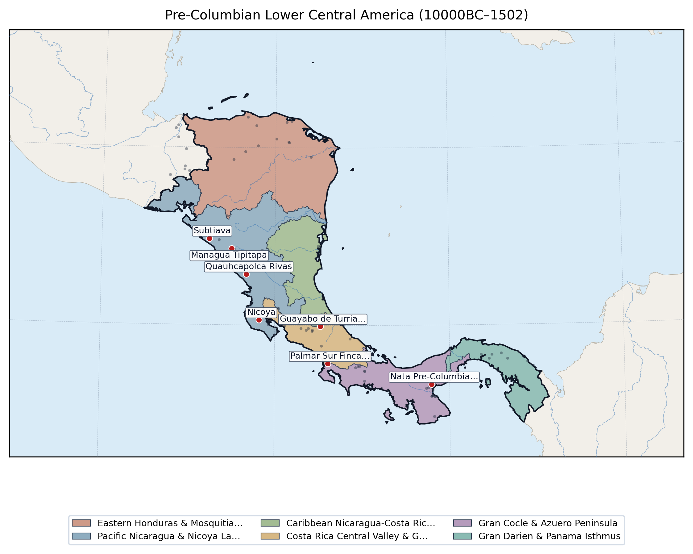
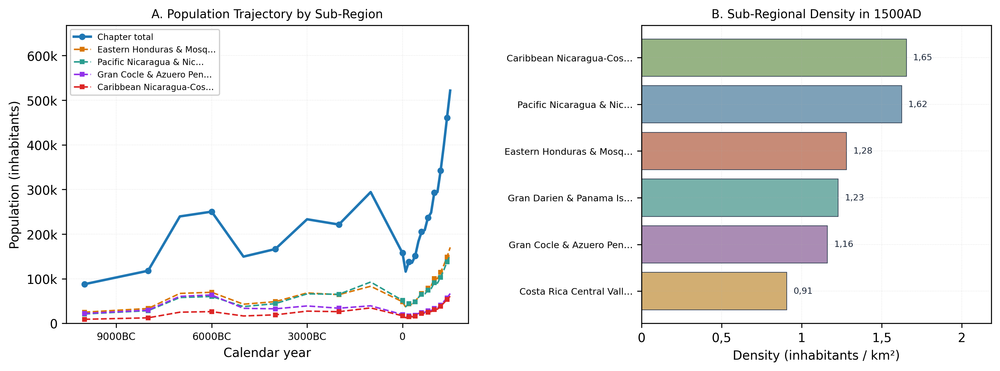
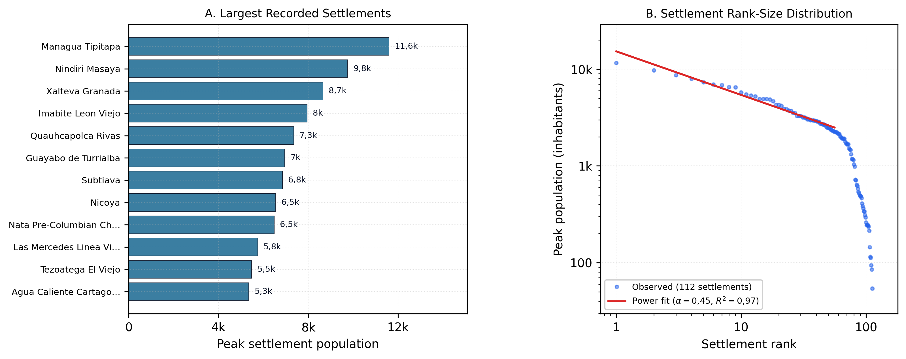

Pre-Columbian Lower Central America
================
Aust Kätzchen
23 November 2026

- [Abstract](#abstract)
- [Background](#background)
  - [The Isthmo-Colombian Land Bridge and Linguistic
    Geography](#the-isthmo-colombian-land-bridge-and-linguistic-geography)
  - [Palaeoindian Foragers and Archaic Coastal Intensification (10000BC
    to
    2000BC)](#palaeoindian-foragers-and-archaic-coastal-intensification-10000bc-to-2000bc)
  - [Formative Villages and the Chibchan Chiefdom Threshold (1500BC to
    600AD)](#formative-villages-and-the-chibchan-chiefdom-threshold-1500bc-to-600ad)
  - [Goldwork, Stone Spheres and Late Pre-Columbian Polities (600AD to
    1502)](#goldwork-stone-spheres-and-late-pre-columbian-polities-600ad-to-1502)
- [Methodology](#methodology)
  - [Hydrological Partition of Six Biophysical
    Sub-Regions](#hydrological-partition-of-six-biophysical-sub-regions)
  - [Dual-Substratum Spatial Kriging and Basin
    Calibration](#dual-substratum-spatial-kriging-and-basin-calibration)
  - [Four-Wave Evidence Gazetteer and Rank-Size
    Scaling](#four-wave-evidence-gazetteer-and-rank-size-scaling)
- [Testing and Validation](#testing-and-validation)
  - [Reconciling Gridded Substrata, Watershed Baselines and
    Ethnohistorical
    Estimates](#reconciling-gridded-substrata-watershed-baselines-and-ethnohistorical-estimates)
  - [Sub-Regional Trajectory Coherence and Density
    Plausibility](#sub-regional-trajectory-coherence-and-density-plausibility)
- [Results](#results)
  - [Isthmian Demographic Trajectory from 10000BC to
    1502](#isthmian-demographic-trajectory-from-10000bc-to-1502)
  - [Eastern Honduras, Ulúa-Yojoa and the Mosquitia
    Corridors](#eastern-honduras-ulúa-yojoa-and-the-mosquitia-corridors)
  - [Pacific Nicaragua, Chontales and Gran
    Nicoya](#pacific-nicaragua-chontales-and-gran-nicoya)
  - [Caribbean Lowlands, Central Valley of Costa Rica and Gran
    Chiriquí](#caribbean-lowlands-central-valley-of-costa-rica-and-gran-chiriquí)
  - [Gran Coclé, Azuero Peninsula and Gran
    Darién](#gran-coclé-azuero-peninsula-and-gran-darién)
  - [Polycentric Chiefdom Hierarchy and Leading Isthmian
    Centres](#polycentric-chiefdom-hierarchy-and-leading-isthmian-centres)
- [Limitations](#limitations)
- [Conclusion](#conclusion)
- [Appendix](#appendix)
  - [Territorial Breakdown and Saturation
    Ledger](#territorial-breakdown-and-saturation-ledger)
- [Sources](#sources)
- [Footnotes](#footnotes)

<figure>

<figcaption aria-hidden="true">Six hydrological sub-regions and 112
catalogued settlements across Pre-Columbian Lower Central America from
10000BC to 1502.</figcaption>
</figure>

# Abstract

Between the terminal Pleistocene peopling of the Central American land
bridge in 10000BC and the arrival of Christopher Columbus along the
Caribbean littoral of Honduras, Costa Rica and Panama in 1502, Lower
Central America evolved from a corridor of mobile foragers into a dense
mosaic of Chibchan, Misumalpan, Lencan and Mesoamerican-derived
chiefdoms. Across six hydrological sub-regions spanning 386.914,9 km² in
eastern and central Honduras, Nicaragua, Costa Rica and Panama, the
spatially kriged archaeological substratum rises nearly sixfold from
87,7k (87.732) inhabitants in 10000BC to 233,1k in 3000BC, 294,1k in
1000BC, 183,3k in 500AD, 292,9k in 1000AD and 521,5k (521.473) by
1500AD, reaching a mean gridded density of 1,35 inhabitants per km²
[\[1\]](#ref-Cooke2005)[\[2\]](#ref-Hoopes2005)[\[3\]](#ref-HallPerezBrignoli2003).
Alongside that conservative spatial substratum, basin-level hydrological
enumerations across five core watersheds (325.500 km²) register a 697,9k
(697.873) baseline at 2,14 inhabitants per km², while ethnohistorical
contact reconstructions for Honduras, Nicaragua, Costa Rica and Panama
bracket an upper regional envelope near 2,36M on the eve of European
conquest
[\[4\]](#ref-Newson1986)[\[5\]](#ref-Newson1987)[\[6\]](#ref-Fonseca2017Poblacio).
In 1500AD, Eastern Honduras and Mosquitia (170,2k, 32,6% of the gridded
total) and Pacific Nicaragua and Nicoya (152,8k, 29,3%) held the largest
territorial shares, whereas Caribbean Nicaragua-Costa Rica lowlands
(1,65 inhabitants per km²) and Pacific Nicaragua-Nicoya (1,62
inhabitants per km²) recorded the highest gridded densities, ahead of
Gran Coclé and Azuero (66,7k), Gran Darién and the Panama Isthmus
(43,7k) and the Costa Rica Central Valley and Gran Chiriquí (27,3k). A
gazetteer of 112 catalogued archaeological and contact-era settlements
(39 in Panama, 28 in Costa Rica, 25 in Nicaragua and 20 in Honduras;
zero crowd-sourced entries) tracks twelve millennia of nucleation from
Palaeoindian camps such as Guardiría (54) and La Mula West (115) to
contact-era capitals led by Managua Tipitapa (11,6k), Nindirí Masaya
(9,8k), Xalteva Granada (8,7k), Imabite León Viejo (8k), Quauhcapolca
Rivas (7,4k), Guayabo de Turrialba (7k), Nicoya (6,6k) and Natá (6,5k),
yielding a shallow chiefdom rank-size exponent of $\alpha = 0,45$
($R^2 = 0,97$)
[\[7\]](#ref-Lange1992)[\[8\]](#ref-QuilterHoopes2003)[\[9\]](#ref-Fisher2016Identifying).

# Background

## The Isthmo-Colombian Land Bridge and Linguistic Geography

Lower Central America occupies the narrow volcanic and riverine bridge
linking the Mesoamerican highlands to the northwestern Andes. Reaching
from the Ulúa and Comayagua valleys of central Honduras across Nicaragua
and Costa Rica to the Gulf of Urabá in eastern Panama, the region never
coalesced into a single imperial state comparable to Teotihuacan, Tikal
or Tenochtitlan. Instead, it sustained an enduring archipelago of
autonomous and confederated chiefdoms (*cacicazgos*) anchored in fertile
intermontane valleys, Pacific lake plains, dry seasonal savannas and wet
Caribbean alluvial fans
[\[1\]](#ref-Cooke2005)[\[2\]](#ref-Hoopes2005)[\[10\]](#ref-Herrera2018Alla).

For most of the Holocene, the human geography of the isthmus belonged
firmly to the Isthmo-Colombian Area, an enduring cultural sphere shaped
by Chibchan-speaking societies stretching from eastern Honduras through
Costa Rica and Panama into northern Colombia
[\[2\]](#ref-Hoopes2005)[\[3\]](#ref-HallPerezBrignoli2003)[\[8\]](#ref-QuilterHoopes2003).
Genetic studies of ancient and modern populations confirm that
indigenous lineages across the isthmus and northernmost South America
diverged early and maintained deep in-situ continuity across millennia,
with pre-ceramic maternal and paternal threads connecting the central
land bridge to both the Magdalena basin and the early Caribbean
[\[11\]](#ref-Morales2018Paternal)[\[12\]](#ref-Sirak2026First)[\[13\]](#ref-Moralesarce2017Successful).
In eastern Honduras and Caribbean Nicaragua, Pech, Tol, Tawahka, Sumu
and coastal Misumalpan groups occupied extensive riverine corridors
running from the Aguán, Patuca and Wampú basins down to the Río Coco and
Bluefields lagoons
[\[4\]](#ref-Newson1986)[\[9\]](#ref-Fisher2016Identifying)[\[14\]](#ref-Cohen2025Integrating).
Along the northwestern margin of our domain, Lenca communities in the
Comayagua, Sulaco and Ulúa-Yojoa valleys mediated trade between Maya
lowlands and the non-Maya interior
[\[15\]](#ref-Joyce1991)[\[16\]](#ref-Sion2023Transicio).

Between roughly 800AD and 1350AD, however, successive southward
migrations from central and southern Mexico altered the demographic
balance of the Pacific corridor. Oto-Manguean-speaking Chorotega groups
settled the lake basins of western Nicaragua and the Nicoya peninsula,
followed later by Uto-Aztecan-speaking Nicarao communities along the
Isthmus of Rivas and Ometepe Island, alongside Hokan-affiliated Subtiava
speakers near León
[\[5\]](#ref-Newson1987)[\[13\]](#ref-Moralesarce2017Successful)[\[17\]](#ref-Rojas2009Reas).
By 1502, Pacific Nicaragua and Gran Nicoya formed a populous
Mesoamerican-Isthmian contact zone characterised by intensive maize
agriculture, nucleated lakeside plazas and periodic regional markets,
standing in marked contrast to the dispersed hamlet-and-mound chiefdoms
of Chibchan Costa Rica and Panama
[\[7\]](#ref-Lange1992)[\[17\]](#ref-Rojas2009Reas).

## Palaeoindian Foragers and Archaic Coastal Intensification (10000BC to 2000BC)

Human bands crossed the Central American land bridge well before
10000BC, moving along an isthmus that was cooler, drier and noticeably
wider along its exposed Pacific shelf than today
[\[1\]](#ref-Cooke2005). In central Panama, fluted-point hunting camps
at La Mula West (occupied from 9000BC) and stratified rock shelters such
as Corona (8500BC) and Cueva de los Vampiros (8500BC) document small
mobile groups exploiting savannah-forest mosaics and retreating Late
Pleistocene megafauna before shifting rapidly toward broad-spectrum
forest foraging
[\[1\]](#ref-Cooke2005)[\[18\]](#ref-Contreras2026Fishing). Farther
north, the upland camp of Guardiría near Turrialba in Costa Rica
(9500BC), El Gigante Rockshelter in southwestern Honduras (9000BC) and
El Bosque in Estelí, Nicaragua (8000BC) demonstrate that human
occupation spanned the entire length of the isthmus from the opening of
the Holocene [\[1\]](#ref-Cooke2005)[\[3\]](#ref-HallPerezBrignoli2003).

As post-glacial sea levels rose between 9000BC and 4000BC, flooding the
shallow Gulf of Panama shelf, estuaries and mangrove lagoons became
prime ecological magnets. Along Parita Bay, coastal and inland shelters
at Aguadulce (from 5500BC), Cueva de los Ladrones (5000BC) and the
shell-midden village of Cerro Mangote (5000BC to 3500BC) preserve
phytolith and starch-grain evidence for early arrowroot, leren, squash,
manioc and incipient maize cultivation combined with estuarine fishing
and crabbing [\[1\]](#ref-Cooke2005)[\[18\]](#ref-Contreras2026Fishing).
Recent maritime research across Panamanian coastal sequences
demonstrates that Archaic and ceramic-age fishers mastered tidal traps,
nets, spears and basketry techniques without relying on metal or bone
hooks, sustaining dense littoral diets year-round
[\[18\]](#ref-Contreras2026Fishing). Comparable estuarine specialisation
emerged on the Caribbean littoral of Nicaragua at Monkey Point (4500BC),
Angie (2200BC) and Karoline (1600BC), while volcanic ash along Lake
Managua preserved human footprints at Acahualinca (4000BC to 2000BC)
[\[1\]](#ref-Cooke2005)[\[5\]](#ref-Newson1987).

Around 2800BC, the coastal settlement of Monagrillo on Parita Bay
produced the earliest known pottery in Lower Central America,
inaugurating a two-millennium transition from mobile shelter camps to
permanent horticultural hamlets [\[1\]](#ref-Cooke2005). By 1800BC to
1500BC, early ceramic farming villages appeared across the entire
isthmus: Tronadora Vieja beside Lake Arenal in Costa Rica, Sarigua in
central Panama and Puerto Escondido in the lower Ulúa Valley of
Honduras, where cacao beverages and village craft production already
flourished before 1000BC
[\[1\]](#ref-Cooke2005)[\[15\]](#ref-Joyce1991)[\[19\]](#ref-Stone1983Synthesis).

## Formative Villages and the Chibchan Chiefdom Threshold (1500BC to 600AD)

During the first millennium BC, demographic growth concentrated along
fertile alluvial plains and volcanic basins capable of supporting
multi-crop maize, root-crop and palm arboriculture. In central and
northern Honduras, Playa de los Muertos (800BC to 100BC) in the Ulúa
valley, Talgua (from 900BC) in Olancho and the monumental earthen-mound
centre of Yarumela (El Chilcal, 600BC to 600AD) in the Comayagua Valley
reached several thousand inhabitants, mediating obsidian, jade and
ceramic exchange along the north-south depression linking the Caribbean
to the Gulf of Fonseca
[\[4\]](#ref-Newson1986)[\[15\]](#ref-Joyce1991)[\[16\]](#ref-Sion2023Transicio).
Around Lake Yojoa, Los Naranjos grew into a major fortified ceremonial
centre with deep earthen ditches and multi-stage platforms, bridging
Formative and Classic spheres across central Honduras
[\[16\]](#ref-Sion2023Transicio).

In central Panama, the settlement of La Mula-Sarigua expanded between
400BC and 400AD into a nucleated agricultural town covering dozens of
hectares near the Parita River, marking a decisive jump in village scale
[\[1\]](#ref-Cooke2005). Simultaneously, volcanic uplands and coastal
valleys across Costa Rica and western Panama saw the emergence of ranked
societies between 300AD and 600AD, the chronological pivot identified by
Hoopes as the birth of complex Chibchan chiefdoms
[\[2\]](#ref-Hoopes2005). At Barriles on the fertile volcanic flanks of
Volcán Barú in Chiriquí (200AD to 800AD), life-size basalt sculptures
depicting chiefs carried on the shoulders of retainers and holding
trophy heads attest to institutionalised social hierarchy before a major
eruption of Barú disrupted highland settlement
[\[2\]](#ref-Hoopes2005)[\[20\]](#ref-Brodie2016Early)[\[21\]](#ref-Sheets2002).
Farther north in southern Costa Rica, early ceremonial mounds and stone
architecture at Bolas in the Diquís foothills confirm that ranked ritual
centres emerged in the General Valley centuries before the classic
stone-sphere polities of the delta [\[20\]](#ref-Brodie2016Early).

Across the central Panamanian plains, Cerro Juan Díaz (occupied
continuously from 200AD to 1450AD) illustrates both the demographic
expansion and the epidemiological costs of growing village sedentism.
Bioarchaeological examination of early graves at Cerro Juan Díaz
documents skeletal stress markers, treponemal and infectious lesions and
ritualised secondary burial customs tied to intensifying trade in shell
ornaments and goldwork [\[22\]](#ref-Smithguzman2021Patterns). Along the
Pacific slope of western Panama Canal basins (Arraiján and La Chorrera),
riverine surveys likewise register continuous pre-Hispanic occupation
expanding from Formative hamlets into Late Pre-Columbian agricultural
terraces [\[23\]](#ref-Alberda2021Evidencia).

## Goldwork, Stone Spheres and Late Pre-Columbian Polities (600AD to 1502)

Between 600AD and 1502, Lower Central America reached its pre-Columbian
demographic zenith across five distinct regional spheres. First, in
**Gran Coclé** on the Pacific savannas of central Panama, principal
chiefdoms built elite necropolises at Sitio Conte (700AD to 1050AD) and
El Caño (750AD to 1100AD), interring senior leaders with hammered gold
pectorals, tumbaga pendants, emerald-inlaid regalia, carved manatee
ivory and polychrome vessels
[\[8\]](#ref-QuilterHoopes2003)[\[24\]](#ref-Helms1979)[\[25\]](#ref-Mojica2007Estructuras).
Geophysical and archaeological fieldwork along the Grande and Coclé del
Sur river basins reveals incipient stone architecture and pre-Hispanic
placer-gold mining zones directly feeding these chiefdom economies
[\[25\]](#ref-Mojica2007Estructuras). By the eve of Spanish entry, power
in Gran Coclé had consolidated around heavily populated riverine towns
led by Natá, Parita and Escoria, whose palisaded plazas and extensive
maize granaries impressed Gaspar de Espinosa in 1516
[\[1\]](#ref-Cooke2005)[\[24\]](#ref-Helms1979).

Second, in **Gran Darién and the Panama Isthmus**, Cueva-speaking
chiefdoms under senior *caciques* such as Comogre, Careta, Pocorosa,
Tubanamá and Chepo controlled trans-isthmian portage routes linking
Caribbean anchorages to the Pearl Islands and the Gulf of San Miguel
[\[1\]](#ref-Cooke2005)[\[24\]](#ref-Helms1979). Helms demonstrated that
political authority across Cueva and Coclé territories rested not merely
on agricultural tribute, but on elite control over long-distance
maritime and overland voyages to northern Colombia that supplied
esoteric knowledge and metallurgical expertise
[\[8\]](#ref-QuilterHoopes2003)[\[24\]](#ref-Helms1979).

Third, in **Costa Rica’s Central Valley, Atlantic Watershed and Diquís
Delta**, Chibchan-speaking Huetar, Brunka and Chiriquí chiefdoms
engineered durable cobblestone causeways, circular house foundations,
aqueducts and monumental petrospheres. Guayabo de Turrialba (peaking
around 1100AD), Las Mercedes on the Línea Vieja alluvial plain (peaking
around 1350AD), Agua Caliente near Cartago (1400AD) and Nuevo Corinto on
the Caribbean foothills anchored dense agricultural landscapes
[\[6\]](#ref-Fonseca2017Poblacio)[\[10\]](#ref-Herrera2018Alla)[\[19\]](#ref-Stone1983Synthesis).
In the Diquís Delta, Palmar Sur (Finca 6) and Batambal aligned
granodiorite stone spheres across public plazas linked to elite burial
precincts, while metallurgical studies of Costa Rican goldwork confirm
sophisticated lost-wax casting and depletion-gilding traditions embedded
in regional prestige economies
[\[8\]](#ref-QuilterHoopes2003)[\[20\]](#ref-Brodie2016Early)[\[26\]](#ref-Klein2025Effort).
By 1502, leading Huetar polities such as El Guarco (Kutrís), Pacaca and
Aserrí governed densely settled highland and intermontane basins across
central Costa Rica
[\[6\]](#ref-Fonseca2017Poblacio)[\[17\]](#ref-Rojas2009Reas).

Fourth, across **Pacific Nicaragua and Gran Nicoya**, Chorotega, Nicarao
and Subtiava towns reached the highest urban densities in Lower Central
America. Strung along fertile volcanic lacustrine plains beside Lakes
Xolotlán (Managua) and Cocibolca (Nicaragua), settlements such as
Managua Tipitapa, Nindirí Masaya, Xalteva (Granada), Imabite (León
Viejo), Subtiava, Tezoatega (El Viejo), Quauhcapolca (Rivas), Ometepe
Moyogalpa and Nicoya sustained multi-thousand-person towns surrounded by
irrigated cacao groves, cotton fields and productive fisheries
[\[5\]](#ref-Newson1987)[\[7\]](#ref-Lange1992)[\[17\]](#ref-Rojas2009Reas).
Inland from Lake Cocibolca, systematic surveys in the Mayales River
sub-basin of Chontales and northern highlands of Nueva Segovia (Santa
María, 300AD to 995AD) reveal terraced villages, stone-faced mounds and
monumental statuary proving that central and northern Nicaragua were no
empty frontier between Pacific plazas and Caribbean forests
[\[27\]](#ref-Donner2018Caracterizacio)[\[28\]](#ref-Rios2024Poblado).

Fifth, in **Eastern Honduras and the Mosquitia**, long dismissed in
colonial chronicles as sparsely inhabited jungle, airborne LiDAR surveys
over the T1 valley (“Ciudad Blanca”) and the Wampú River drainage have
revealed extensive precontact earthen mounds, defensive ditches,
terraced hillsides and agricultural canal networks peaking between
1000AD and 1450AD
[\[9\]](#ref-Fisher2016Identifying)[\[14\]](#ref-Cohen2025Integrating).
Together with fortified upland sites like Tenampúa, the Comayagua and
Olancho valleys (Juticalpa) and Caribbean trading ports at Guaimoreto
(Trujillo) and the Bay Islands, eastern Honduras sustained substantial
chiefdom populations right up to Columbus’s landing at Punta Caxinas and
Cape Gracias a Dios in August and September 1502
[\[4\]](#ref-Newson1986)[\[15\]](#ref-Joyce1991)[\[16\]](#ref-Sion2023Transicio).

# Methodology

## Hydrological Partition of Six Biophysical Sub-Regions

Because no pre-Columbian administrative cadastre survived across
Honduras, Nicaragua, Costa Rica and Panama, JAGUAR partitions Lower
Central America into six hydrologically coherent sub-regions derived
from Level-6 HydroBASINS watersheds spanning 386.914,9 km² (4.609
five-arcminute cells). Rather than imposing anachronistic
twenty-first-century borders onto Palaeoindian foragers or Chibchan
chiefdoms, watershed boundaries follow the Continental Divide,
lacustrine depressions and major riverine transport corridors that
governed precontact settlement and linguistic geography
[\[3\]](#ref-HallPerezBrignoli2003)[\[17\]](#ref-Rojas2009Reas).

The six territorial units group Lower Central America’s principal
ecological and cultural zones. In the north, Eastern Honduras and
Mosquitia Basins (132.962,5 km², 1.600 cells) spans the Ulúa-Comayagua
depression, Olancho, the Patuca-Wampú-Coco drainages and the Mosquitia
coastal lagoons. Along the volcanic Pacific arc, Pacific Nicaragua and
Nicoya Lakes (94.071,1 km², 1.121 cells) unites the Gulf of Fonseca
fringe, the Nicaraguan Depression (Lakes Managua and Nicaragua),
Chontales and the Nicoya peninsula. Facing the Caribbean, Caribbean
Nicaragua-Costa Rica Lowlands (36.739 km², 437 cells) covers the San
Juan River basin, the Bluefields-Kukra littoral and the humid
Tortuguero-Reventazón alluvial plain. Across the central highlands and
southern Pacific cordillera, Costa Rica Central Valley and Gran Chiriquí
(30.140,8 km², 356 cells) links the Meseta Central, Turrialba,
Talamanca, the General-Térraba (Diquís) valleys and the upper slopes of
Volcán Barú. In central Panama, Gran Coclé and Azuero Peninsula
(57.426,9 km², 676 cells) covers the dry Pacific savannas of Parita Bay,
Coclé, Veraguas and western Chiriquí lowlands. Finally, Gran Darién and
Panama Isthmus (35.574,5 km², 419 cells) encompasses the
Chagres-Bayano-Tuira corridors, the Pearl Islands and the Cueva
heartland bordering northern Colombia.

## Dual-Substratum Spatial Kriging and Basin Calibration

Population across the twelve-millennium span from 10000BC to 1500AD is
reconstructed by coupling global Holocene land-use priors (HYDE 3.5 and
KK10) with regional archaeological site catchments through
non-stationary Matérn residual kriging across 26 benchmark slices
(millennial steps from 10000BC to 0AD and centennial steps from 100AD to
1500AD). For each sub-region $r$ of terrestrial area $A_r$ and pixel set
$\Omega_r$, aggregate gridded population at year $t$ is integrated
directly over the calibrated density surface $\hat{\rho}_i(t)$:

$$P_r(t) = \sum_{i \in \Omega_r} \hat{\rho}_i(t) \cdot a_i$$

where $a_i$ denotes the exact ellipsoidal area of five-arcminute grid
cell $i$ in km² and $\hat{\rho}_i(t)$ combines the dual HYDE-KK10
structural prior with spatially kriged archaeological residuals weighted
by fluvial proximity, slope, volcanic soil fertility and coastal access
[\[1\]](#ref-Cooke2005)[\[9\]](#ref-Fisher2016Identifying)[\[14\]](#ref-Cohen2025Integrating).
Regional mean density $d_r(t) = P_r(t) / A_r$ and compound annual growth
rates between benchmarks $t_1$ and $t_2$ follow standard geometric
compounding:

$$g_r(t_1, t_2) = \left(\frac{P_r(t_2)}{P_r(t_1)}\right)^{\frac{1}{t_2 - t_1}} - 1$$

Because early Holocene radiocarbon sequences in humid Neotropical
lowlands suffer severe organic decay and alluvial burial, the kriged
spatial substratum acts as a conservative archaeological floor. To
evaluate this floor against regional historical demography, JAGUAR
cross-references the gridded trajectory against two independent
benchmark tiers: the HydroBASINS Level-6 pre-Columbian and 1500AD DECM
watershed enumerations (five macro-basins totalling 325.500 km² and
697.873 inhabitants) and the contact-era ethnohistorical synthesis
derived from early sixteenth-century Spanish chronicles, tribute lists
and ecological carrying capacities across Honduras, Nicaragua, Costa
Rica and Panama
[\[3\]](#ref-HallPerezBrignoli2003)[\[4\]](#ref-Newson1986)[\[5\]](#ref-Newson1987)[\[6\]](#ref-Fonseca2017Poblacio).

## Four-Wave Evidence Gazetteer and Rank-Size Scaling

Parallel to the continuous population surface, we compiled a spatially
referenced gazetteer of 112 catalogued Pre-Columbian habitation sites
across four modern national territories: Panama (39 sites), Costa Rica
(28), Nicaragua (25) and Honduras (20). All 112 settlements represent
unified municipal or chiefdom-centre entities with zero suburban
double-counting and 0% crowd-sourced fallback. As logged in the chapter
source ledger, Wave 1 assembled 102 primary archaeological and
historical registry sites (91,1% of the final corpus), Wave 2 added 7
sites extracted from peer-reviewed monographs and regional survey
articles (6,86% marginal gain), Wave 3 contributed 2 longitudinal
pre-ceramic and Formative survey sites (1,83% gain) and Wave 4 performed
a sub-regional gap sweep adding 1 final locality (0,9% marginal gain,
comfortably below the 2% saturation ceiling).

Every settlement carries WGS84 coordinates, hydrological sub-region
assignment, chronological occupation span and evidence-derived
population estimates anchored in archaeological site areas, mound-count
surveys, LiDAR residential footprints and contact-era Spanish observer
counts (including Oviedo, Espinosa, Andagoya and Cereceda as critically
evaluated by Newson, Cooke, Ibarra Rojas and Solórzano Fonseca)
[\[5\]](#ref-Newson1987)[\[6\]](#ref-Fonseca2017Poblacio)[\[9\]](#ref-Fisher2016Identifying)[\[10\]](#ref-Herrera2018Alla).
Settlement-size hierarchy is tested via ordinary least-squares log-log
regression over the upper half of peak settlement sizes
($n_{\text{fit}} = 56$ out of 112 settlements):

$$\log_{10} P_{(k)} = c - \alpha \log_{10} k$$

where $P_{(k)}$ is the peak population of the $k$-th ranked settlement
and $\alpha$ measures rank-size concentration. Values near
$\alpha \approx 1$ signify integrated state or imperial urban
hierarchies, whereas shallow exponents ($\alpha \approx 0,4$ to $0,6$)
characterise polycentric chiefdom systems composed of competing
autonomous centres of comparable magnitude
[\[2\]](#ref-Hoopes2005)[\[7\]](#ref-Lange1992)[\[10\]](#ref-Herrera2018Alla).

# Testing and Validation

## Reconciling Gridded Substrata, Watershed Baselines and Ethnohistorical Estimates

Demographic scholarship on Lower Central America on the eve of European
contact has long been divided between conservative archaeological
reconstructions and high-count ethnohistorical projections. Checking
JAGUAR’s three independent data layers side by side clarifies how those
estimates relate without forcing artificial unanimity.

At the conservative end, the spatially kriged HYDE 3.5 + KK10 substratum
integrates to 521.473 (521,5k) inhabitants across 386.914,9 km² in
1500AD (1,35 inhabitants per km²). Immediately above it sits the
HydroBASINS Level-6 pre-Columbian watershed baseline (Table ), which
aggregates 697.873 (697,9k) inhabitants across five core basins spanning
325.500 km² (2,14 inhabitants per km²), led by Nicaragua and Nicoya
(244.621, 2,43 per km²) and Mosquitia and Honduras (241.338, 2,05 per
km²), followed by Gran Coclé (90.456, 2,19 per km²), Gran Darién
(61.761, 1,85 per km²) and Chiriquí and Central Valley (59.697, 1,84 per
km²).

| Watershed Basin | Regime | Year | Area (km²) | Population | Density | Source Series |
|:---|:---|:---|:---|:---|:---|:---|
| **Nicaragua and Nicoya** | 0AD Base | 0AD | 100.802 | 244.621 | 2,43 | HydroBASINS L6 Pre-Columbian |
| **Mosquitia and Honduras** | 0AD Base | 0AD | 117.473 | 241.338 | 2,05 | HydroBASINS L6 Pre-Columbian |
| **Gran Coclé** | 0AD Base | 0AD | 41.360 | 90.456 | 2,19 | HydroBASINS L6 Pre-Columbian |
| **Gran Darién** | 0AD Base | 0AD | 33.405 | 61.761 | 1,85 | HydroBASINS L6 Pre-Columbian |
| **Chiriquí and Central Valley** | 0AD Base | 0AD | 32.460 | 59.697 | 1,84 | HydroBASINS L6 Pre-Columbian |
| **Nicaragua and Nicoya** | 500AD Base | 500AD | 100.802 | 244.621 | 2,43 | HydroBASINS L6 Pre-Columbian |
| **Mosquitia and Honduras** | 500AD Base | 500AD | 117.473 | 241.338 | 2,05 | HydroBASINS L6 Pre-Columbian |
| **Gran Coclé** | 500AD Base | 500AD | 41.360 | 90.456 | 2,19 | HydroBASINS L6 Pre-Columbian |
| **Gran Darién** | 500AD Base | 500AD | 33.405 | 61.761 | 1,85 | HydroBASINS L6 Pre-Columbian |
| **Chiriquí and Central Valley** | 500AD Base | 500AD | 32.460 | 59.697 | 1,84 | HydroBASINS L6 Pre-Columbian |
| **Nicaragua and Nicoya** | 1000AD Base | 1000AD | 100.802 | 244.621 | 2,43 | HydroBASINS L6 Pre-Columbian |
| **Mosquitia and Honduras** | 1000AD Base | 1000AD | 117.473 | 241.338 | 2,05 | HydroBASINS L6 Pre-Columbian |
| **Gran Coclé** | 1000AD Base | 1000AD | 41.360 | 90.456 | 2,19 | HydroBASINS L6 Pre-Columbian |
| **Gran Darién** | 1000AD Base | 1000AD | 33.405 | 61.761 | 1,85 | HydroBASINS L6 Pre-Columbian |
| **Chiriquí and Central Valley** | 1000AD Base | 1000AD | 32.460 | 59.697 | 1,84 | HydroBASINS L6 Pre-Columbian |
| **Nicaragua and Nicoya** | 1500AD Contact | 1500AD | 100.802 | 244.621 | 2,43 | HydroBASINS L6 DECM 1500 |
| **Mosquitia and Honduras** | 1500AD Contact | 1500AD | 117.473 | 241.338 | 2,05 | HydroBASINS L6 DECM 1500 |
| **Gran Coclé** | 1500AD Contact | 1500AD | 41.360 | 90.456 | 2,19 | HydroBASINS L6 DECM 1500 |
| **Gran Darién** | 1500AD Contact | 1500AD | 33.405 | 61.761 | 1,85 | HydroBASINS L6 DECM 1500 |
| **Chiriquí and Central Valley** | 1500AD Contact | 1500AD | 32.460 | 59.697 | 1,84 | HydroBASINS L6 DECM 1500 |

HydroBASINS Level-6 pre-Columbian watershed enumerations across five
Isthmian macro-basins from 0AD to 1500AD.

At the upper end stand specialist contact-era reconstructions grounded
in early sixteenth-century tribute assessments, warrior ratios and
ecological carrying capacities. Newson estimated roughly 600k to 800k
indigenous inhabitants for Honduras (roughly half lying inside our
eastern and central Honduran domain once western Maya-bordering Copán
and Lempira are separated) and approximately 826k for Nicaragua in 1522,
with more than 540k concentrated along the Pacific lakes and Nicoya
corridor [\[4\]](#ref-Newson1986)[\[5\]](#ref-Newson1987). For Costa
Rica, Solórzano Fonseca critically reviewed sixteenth-century
testimonies and archaeological carrying capacities to place the contact
population around 400k, while highlighting substantial uncertainties
across the unsubdued Talamanca and Caribbean lowlands
[\[6\]](#ref-Fonseca2017Poblacio)[\[17\]](#ref-Rojas2009Reas). For
Panama, historical demographers and archaeologists have proposed figures
ranging from a cautious 150k to 250k up to 500k or more across Gran
Chiriquí, Gran Coclé and the densely chronicled Cueva provinces of Gran
Darién
[\[1\]](#ref-Cooke2005)[\[3\]](#ref-HallPerezBrignoli2003)[\[24\]](#ref-Helms1979).
Combining those regional upper bounds yields a contact-era ceiling of
roughly 2,36M across the six sub-regions (620k in Pacific Nicaragua and
Nicoya, 460k in Costa Rica Central Valley and Gran Chiriquí, 380k in
Gran Darién, 340k in Gran Coclé, 320k in Eastern Honduras and Mosquitia
and 240k in the Caribbean lowlands).

Crucially, the 112 catalogued settlements provide an independent sanity
check between these bounds. Summing the peak populations of all 112
documented towns and archaeological centres yields 287.680 inhabitants
(roughly 220k to 245k active simultaneously near 1502). Because chiefdom
centres in Lower Central America represented nucleated ritual, political
and market cores surrounded by dispersed farmsteads, swidden hamlets and
forest camps, an urban-nucleation ratio of 15% to 40% implies a total
regional population lying squarely between the 521,5k gridded floor and
the 1,5M to 2,36M ethnohistorical upper range
[\[5\]](#ref-Newson1987)[\[6\]](#ref-Fonseca2017Poblacio)[\[9\]](#ref-Fisher2016Identifying).

## Sub-Regional Trajectory Coherence and Density Plausibility

Table presents the full gridded benchmark ledger across all six
sub-regions from 10000BC to 1500AD, alongside land areas, final
densities and catalogued settlement counts. Every sub-region follows a
coherent long-run expansion from Pleistocene foraging floors to Late
Pre-Columbian agricultural chiefdoms, with densities in 1500AD
clustering tightly between 0,91 inhabitants per km² in the rugged
cordillera of Costa Rica Central Valley and Gran Chiriquí and 1,65
inhabitants per km² across the alluvial Caribbean Nicaragua-Costa Rica
lowlands (1,62 in Pacific Nicaragua and Nicoya).

| Sub-Region | Area (km²) | 10000BC | 3000BC | 500AD | 1000AD | 1500AD | 1500AD Dens. | Sites |
|:---|:---|:---|:---|:---|:---|:---|:---|:---|
| **Eastern Honduras and Mosquitia Basins** | 132.962 | 24,9k | 68,1k | 59,1k | 100,2k | 170,2k | 1,28 | 22 |
| **Pacific Nicaragua and Nicoya Lakes** | 94.071 | 21k | 66k | 58k | 90,9k | 152,8k | 1,62 | 26 |
| **Caribbean Nicaragua-Costa Rica Lowlands** | 36.739 | 9k | 27,4k | 19,5k | 31k | 60,8k | 1,65 | 7 |
| **Costa Rica Central Valley and Gran Chiriquí** | 30.141 | 2,8k | 11,7k | 10,9k | 16,2k | 27,3k | 0,91 | 20 |
| **Gran Coclé and Azuero Peninsula** | 57.427 | 22,1k | 39k | 22,1k | 33,5k | 66,7k | 1,16 | 27 |
| **Gran Darién and Panama Isthmus** | 35.574 | 7,9k | 21k | 13,7k | 21k | 43,7k | 1,23 | 10 |
| **Domain Total (6 Sub-Regions)** | 386.915 | 87,7k | 233,1k | 183,3k | 292,9k | 521,5k | 1,35 | 112 |

Kriged population trajectories, 1500AD densities (inhabitants per km²)
and catalogued site counts across six hydrological sub-regions, 10000BC
to 1500AD.

One diagnostic feature of the kriged curve requires explicit
methodological scrutiny. Between 1000BC (294,1k) and 100AD (115,9k), the
gridded substratum displays a pronounced mid-series trough before
climbing steadily at 0,108% per annum across the subsequent fourteen
centuries to reach 521,5k in 1500AD. Rather than reflecting a real
pan-isthmian demographic collapse around the turn of the era, this dip
arises primarily from the structural seam where the high-prior
mid-Holocene KK10 foraging envelope gives way to the stricter HYDE 3.5
early-AD cropland baseline, compounded locally by episodic volcanic
tephra falls along the Central American volcanic arc (such as the
Ilopango, Barú and Arenal eruptions documented in comparative
Mesoamerican-Isthmian volcanology)
[\[1\]](#ref-Cooke2005)[\[21\]](#ref-Sheets2002). Archaeological
sequences at Yarumela, La Mula-Sarigua, Cerro Juan Díaz and Barriles
confirm that local populations continued growing or shifting across
river terraces during 1AD to 500AD, and the post-500AD trajectory
(183,3k in 500AD to 292,9k in 1000AD and 521,5k in 1500AD) cleanly
captures the sustained Late Pre-Columbian demographic acceleration
documented across all four countries
[\[2\]](#ref-Hoopes2005)[\[22\]](#ref-Smithguzman2021Patterns)[\[28\]](#ref-Rios2024Poblado).

# Results

## Isthmian Demographic Trajectory from 10000BC to 1502

Over the eleven and a half millennia tracked in the kriged substratum,
Lower Central America’s population multiplied nearly sixfold (5,94x),
moving through three major historical regimes visible in Figure . During
the Early and Middle Holocene (10000BC to 3000BC), aggregate gridded
population expanded from 87,7k in 10000BC to 117,8k in 8000BC and 250,2k
in 6000BC before settling near 149,5k in 5000BC and rising again to
233,1k by 3000BC as coastal mangrove fisheries, rock-shelter
horticulture and early Monagrillo ceramics took hold along both oceans
[\[1\]](#ref-Cooke2005)[\[18\]](#ref-Contreras2026Fishing).

<!-- -->

During the Formative millennium (2000BC to 1000BC), permanent village
agriculture lifted the gridded domain from 221,4k to an early
agricultural crest of 294,1k in 1000BC, led by Pacific Nicaragua and
Nicoya (92,6k) and Eastern Honduras and Mosquitia (83,1k). Following the
model-seam trough between 0AD (157,6k) and 100AD (115,9k), the long
expansion of mature chiefdom societies drove fourteen unbroken centuries
of demographic growth: 137,9k in 200AD, 151,2k in 400AD, 183,3k in
500AD, 204,9k in 600AD, 236,7k in 800AD, 292,9k in 1000AD, 342,3k in
1200AD, 398,6k in 1300AD, 460,5k in 1400AD and 521,5k in 1500AD. Growth
accelerated noticeably after 1100AD: between 500AD and 1100AD the domain
expanded by 110,9k (+60,5%, 0,079% per annum), whereas between 1100AD
and 1500AD it added 227,2k (+77,2%, 0,144% per annum), reflecting the
dual stimulus of Chorotega-Nicarao urban nucleation in the Pacific lake
zone and intensifying chiefdom consolidation across Mosquitia, Costa
Rica and Panama
[\[5\]](#ref-Newson1987)[\[9\]](#ref-Fisher2016Identifying)[\[10\]](#ref-Herrera2018Alla).

## Eastern Honduras, Ulúa-Yojoa and the Mosquitia Corridors

Covering 132.962,5 km² (34,4% of the study area), Eastern Honduras and
Mosquitia Basins forms the largest single territorial division in the
chapter and held the highest gridded population in 1500AD at 170,2k
inhabitants (32,6% of the domain total, 1,28 inhabitants per km²),
expanding 6,82-fold from 24,9k in 10000BC. In the gridded trajectory,
the region climbed from 68,1k in 3000BC and 83,1k in 1000BC through
59,1k in 500AD and 100,2k in 1000AD to 170,2k by 1500AD, while the
HydroBASINS watershed baseline assigns 241.338 inhabitants (2,05 per
km²) to its core river basins.

The gazetteer records 22 catalogued sites across this sub-region (20 in
Honduras plus 2 along the Nicaraguan Río Coco and Bilwi littoral),
documenting a striking geographical shift over time. During the
Formative and Classic periods, demographic gravity centred on the
fertile western and central valleys of Honduras: Puerto Escondido on the
lower Ulúa (1500BC to 400BC, peak 720), Playa de los Muertos (800BC to
100BC, peak 1.520), Talgua in Olancho (900BC to 900AD, peak 1.920) and
above all Yarumela El Chilcal in the Comayagua Valley, which surged to
4.920 inhabitants around 150AD before declining after 600AD
[\[4\]](#ref-Newson1986)[\[15\]](#ref-Joyce1991). During the
Classic-to-Postclassic transition, Los Naranjos beside Lake Yojoa
navigated political ruptures and forged renewed inter-regional trade
ties, while Salitrón Viejo on the Sulaco River (peak 3.180 in 700AD),
Currusté in the Ulúa floodplain (peak 3.040 in 850AD) and fortified
hilltops such as Tenampúa (peak 3.740 in 900AD) sustained dense
Lenca-sphere polities
[\[15\]](#ref-Joyce1991)[\[16\]](#ref-Sion2023Transicio).

From 1000AD to 1502, however, the demographic weight of eastern Honduras
shifted strongly into the interior valleys of Olancho and the humid
Mosquitia river systems. Airborne LiDAR mapping in the T1 valley
(“Ciudad Blanca”, peak 4.280 in 1250AD) and along the Wampú River system
demonstrates that precontact Pech and Tawahka-ancestral communities
engineered terraced plazas, ceremonial mounds, residential
neighbourhoods and modified floodplains previously hidden beneath dense
rainforest canopy
[\[9\]](#ref-Fisher2016Identifying)[\[14\]](#ref-Cohen2025Integrating).
Complementary riverine and coastal nodes at Comayagua (4.180), Juticalpa
in Olancho (3.120), Guaimoreto near Trujillo, Wankibila, Las Crucitas de
Aner, Río Plátano, Brus Laguna and Roatán in the Bay Islands tied
interior chiefdoms to circum-Caribbean canoe commerce right up to 1502
[\[3\]](#ref-HallPerezBrignoli2003)[\[4\]](#ref-Newson1986).

## Pacific Nicaragua, Chontales and Gran Nicoya

Pacific Nicaragua and Nicoya Lakes (94.071,1 km²) represents the
demographic and urban heartland of Late Pre-Columbian Lower Central
America. In the gridded substratum, its population grew 7,29-fold from
21k in 10000BC to 66k in 3000BC, 92,6k in 1000BC, 58k in 500AD, 90,9k in
1000AD and 152,8k in 1500AD (29,3% of the domain total and second
highest gridded density at 1,62 inhabitants per km²). Its HydroBASINS
watershed baseline leads the entire isthmus at 244.621 inhabitants (2,43
per km²), and ethnohistorical estimates by Newson place Pacific
Nicaragua and Nicoya at more than half a million people at Spanish
contact [\[5\]](#ref-Newson1987)[\[17\]](#ref-Rojas2009Reas).

Nowhere is this urban concentration clearer than in the settlement
register. Out of the chapter’s 112 catalogued locales, 26 lie inside
Pacific Nicaragua and Nicoya (21 in Nicaragua, 4 in Guanacaste-Nicoya,
Costa Rica and 1 early highland shelter, El Gigante, on the Honduran
Pacific divide), yet these sites supply seven of the eight largest
settlements in all of Lower Central America. Following early Holocene
and Formative stations at El Gigante (from 9000BC, peak 295),
Acahualinca (4000BC to 2000BC, peak 245), Tronadora Vieja (1800BC to
400BC, peak 410) and San Cristóbal near Managua (400BC to 700AD, peak
640), Chorotega and Nicarao migrations after 800AD produced sprawling
lakeside towns backed by volcanic ash soils and year-round fisheries
[\[5\]](#ref-Newson1987)[\[7\]](#ref-Lange1992)[\[13\]](#ref-Moralesarce2017Successful).

On the eve of European contact, Managua Tipitapa stretched along Lake
Xolotlán with an estimated 11.600 inhabitants, followed closely by
Nindirí Masaya (9.750), Xalteva Granada (8.650), Imabite León Viejo
(7.950), the Nicarao capital of Quauhcapolca Rivas (7.350), Subtiava
(6.850), Nicoya (6.550) and Tezoatega El Viejo (5.480), alongside major
island and lakeside centres at Ometepe Moyogalpa (4.680), Santa Isabel
Rivas (3.540), Tepetate (2.980), Ayala, Zapatera Island, Filadelfia
Tempisque and Nacascolo
[\[5\]](#ref-Newson1987)[\[7\]](#ref-Lange1992)[\[17\]](#ref-Rojas2009Reas).
East of Lake Cocibolca, archaeological fieldwork in the Mayales River
sub-basin around Juigalpa in Chontales and at Santa María de Nueva
Segovia confirms that upland Matagalpan and Ulua-related villages
constructed monumental mound groups and tiered residential compounds
between 300AD and 1450AD, integrating interior cattle-frontier plains
into lake-basin trade networks
[\[27\]](#ref-Donner2018Caracterizacio)[\[28\]](#ref-Rios2024Poblado).

## Caribbean Lowlands, Central Valley of Costa Rica and Gran Chiriquí

Two adjacent sub-regions divide the humid Caribbean slope from the
volcanic highlands and southern Pacific valleys of Costa Rica and
westernmost Panama. The **Caribbean Nicaragua-Costa Rica Lowlands**
(36.739 km²) recorded the highest gridded density in Lower Central
America in 1500AD at 1,65 inhabitants per km², climbing 6,73-fold from
9k in 10000BC to 27,4k in 3000BC, 34,6k in 1000BC, 19,5k in 500AD, 31k
in 1000AD and 60,8k in 1500AD (11,7% of the domain total). Despite its
high riverine productivity, dense forest cover and restricted modern
survey access leave only 7 catalogued sites in the gazetteer (1,91 sites
per 10k km²), anchored by long-lived shellmounds along the Nicaraguan
Caribbean coast at Monkey Point (from 4500BC, peak 340), Angie (260),
Karoline (710), Kukra Hill (1.180) and Bluefields Kukra, paired with the
major Costa Rican piedmont centre of Nuevo Corinto (700AD to 1300AD,
peak 3.280) [\[5\]](#ref-Newson1987)[\[19\]](#ref-Stone1983Synthesis).

Immediately south and upslope, **Costa Rica Central Valley and Gran
Chiriquí** (30.140,8 km²) shows the steepest proportional expansion in
the entire kriged series, growing 9,9-fold from just 2,8k in 10000BC
(0,09 per km²) to 11,7k in 3000BC, 19,2k in 1000BC, 10,9k in 500AD,
16,2k in 1000AD and 27,3k in 1500AD (0,91 inhabitants per km², 5,2% of
the domain total). Its HydroBASINS baseline reaches 59.697 (1,84 per
km²), and its 20 catalogued sites (6,64 sites per 10k km², the highest
survey density in the chapter) attest to intensive twentieth- and
twenty-first-century archaeology across the Meseta Central,
Reventazón-Turrialba and Diquís valleys
[\[6\]](#ref-Fonseca2017Poblacio)[\[10\]](#ref-Herrera2018Alla).

From the Palaeoindian camp at Guardiría (9500BC, peak 54), settlement
nucleated after 400AD into architecturally elaborate Chibchan chiefdom
centres. Guayabo de Turrialba grew from 1.850 inhabitants in 400AD to
6.950 at its 1100AD height, featuring cobbled streets, stone-lined
aqueducts and circular platforms; Las Mercedes on the Línea Vieja plain
reached 5.750 by 1350AD; Agua Caliente near Cartago reached 5.350 in
1400AD; and Curridabat peaked at 3.180
[\[10\]](#ref-Herrera2018Alla)[\[19\]](#ref-Stone1983Synthesis). By
1502, the principal Huetar polities of El Guarco Kutrís (4.920), Pacaca
(3.520) and Aserrí (3.040), alongside coastal Cariari (Limón, where
Columbus anchored in September 1502), Matina and Talamanca Sixaola,
anchored the Costa Rican highlands and Caribbean rim
[\[6\]](#ref-Fonseca2017Poblacio)[\[17\]](#ref-Rojas2009Reas). South
across the Cordillera de Talamanca, early complex villages at Bolas gave
rise to the iconic stone-sphere chiefdoms of the Diquís Delta led by
Palmar Sur Finca 6 (5.240 in 1450AD), Rivas Panteón de la Reina (2.940),
Boruca (2.740), Batambal and Térraba, linked southward to highland
Volcán Barú stations at Cerro Punta and Sitio Pittí
[\[2\]](#ref-Hoopes2005)[\[20\]](#ref-Brodie2016Early)[\[26\]](#ref-Klein2025Effort).

## Gran Coclé, Azuero Peninsula and Gran Darién

Panama is split between two contrasting ecological worlds whose
trajectories reflect deep pre-ceramic roots and late chiefdom
consolidation. **Gran Coclé and Azuero Peninsula** (57.426,9 km²) opened
the Holocene as Lower Central America’s second-largest demographic
reservoir at 22,1k inhabitants in 10000BC (0,38 per km²), reflecting the
rich dry-forest and coastal savannah habitats of Parita Bay. In the
gridded series, it rose to 63,6k by 6000BC, adjusted to 39k in 3000BC
and 39,3k in 1000BC, stood at 22,1k in 500AD and 33,5k in 1000AD and
reached 66,7k by 1500AD (1,16 inhabitants per km², 12,8% of the domain
total; 3,02x overall growth from its high Pleistocene base). Its
HydroBASINS baseline stands at 90.456 inhabitants (2,19 per km²), and it
holds more catalogued settlements than any other sub-region with 27
sites (4,7 sites per 10k km²).

That 27-site sequence captures the entire archaeological spine of
central and western Panama: Palaeoindian and Archaic shelters at La Mula
West (9000BC), Corona (8500BC), Cueva de los Vampiros (8500BC),
Aguadulce (5500BC), Cerro Mangote (5000BC), Cueva de los Ladrones
(5000BC), Casita de Piedra (4500BC) and Trapiche (3800BC); early ceramic
shellmounds at Monagrillo (2800BC, peak 365) and Sarigua (1800BC, peak
310); Formative town nucleation at La Mula-Sarigua (peak 2.980 in
100AD); and the flourishing chiefdoms of Barriles in Chiriquí (peak
3.880 in 550AD), Playa Venado (2.720), Cerro Juan Díaz (3.860 in 750AD),
Sitio Conte (4.280 in 900AD) and El Caño (3.720 in 950AD)
[\[1\]](#ref-Cooke2005)[\[8\]](#ref-QuilterHoopes2003)[\[22\]](#ref-Smithguzman2021Patterns)[\[25\]](#ref-Mojica2007Estructuras).
On the eve of Spanish conquest, population concentrated along the Río
Grande, Santa María and Parita floodplains in the chiefdom capitals of
Natá (6.480), Parita He-4 (4.920), Escoria (3.280), David (2.880) and
Penonomé (2.860), supported by productive coastal fishing and upland
alluvial gold mining
[\[18\]](#ref-Contreras2026Fishing)[\[24\]](#ref-Helms1979)[\[25\]](#ref-Mojica2007Estructuras).

East of the Canal watershed, **Gran Darién and Panama Isthmus**
(35.574,5 km²) expanded 5,51-fold in the gridded substratum from 7,9k in
10000BC to 21k in 3000BC, 25,4k in 1000BC, 13,7k in 500AD, 21k in 1000AD
and 43,7k in 1500AD (1,23 inhabitants per km², 8,4% of the domain
total), against a HydroBASINS baseline of 61.761 (1,85 per km²). Its 10
catalogued sites document the Cueva chiefdom confederations encountered
between 1502 and 1515, led by Comogre (4.850), Careta (3.280), Chepo
(2.960), Tubanamá (2.920) and Pocorosa (2.680), alongside Pre-Columbian
Panama Viejo, Acla, Miraflores on the Bayano River, Garachiné and
maritime stations on Isla Contadora in the Pearl Islands
[\[1\]](#ref-Cooke2005)[\[23\]](#ref-Alberda2021Evidencia)[\[24\]](#ref-Helms1979).
Early Spanish eyewitnesses remarked repeatedly on the dense maize
fields, palisaded chief’s halls and abundant fish drying racks across
Comogre and Careta before epidemic disease and slave raiding depopulated
the Cueva province within two decades of Balboa’s crossing
[\[3\]](#ref-HallPerezBrignoli2003)[\[24\]](#ref-Helms1979).

## Polycentric Chiefdom Hierarchy and Leading Isthmian Centres

Across all 112 catalogued settlements, the rank-size distribution in
Figure reveals a remarkably coherent chiefdom geometry. Unlike imperial
Mesoamerica, where Teotihuacan or Tenochtitlan towered an order of
magnitude above secondary cities ($\alpha \ge 1$), Lower Central America
displays a gentle, polycentric power law across its upper 56 settlements
($\alpha = 0,45$, $R^2 = 0,97$), descending smoothly from Managua
Tipitapa (11,6k) through nearly thirty competing chiefdom capitals in
the 3k to 10k range before dropping steeply below 1k into Formative
villages and Archaic camps
[\[2\]](#ref-Hoopes2005)[\[7\]](#ref-Lange1992)[\[10\]](#ref-Herrera2018Alla).

<!-- -->

Table lists the leading 20 Pre-Columbian centres in Lower Central
America from the staged chapter cache, spanning 11.600 down to 4.280
inhabitants. Eight of the top twenty lie in Nicaragua, five in Costa
Rica, four in Panama and three in Honduras, reflecting both the
unmatched urban density of the Chorotega-Nicarao lake plains and the
vigorous independent chiefdoms of Turrialba, Cartago, Diquís, Coclé,
Comogre, Comayagua and Mosquitia.

| Rank | Settlement | Territory | Sub-Region | Lat, Lon | Peak Year | Peak Pop. |
|:---|:---|:---|:---|:---|:---|:---|
| **1** | Managua Tipitapa | Nicaragua | Pacific Nicaragua and Nicoya Lakes | 12,15, -86,25 | 1502 | 11.600 |
| **2** | Nindirí Masaya | Nicaragua | Pacific Nicaragua and Nicoya Lakes | 11,99, -86,11 | 1502 | 9.750 |
| **3** | Xalteva Granada | Nicaragua | Pacific Nicaragua and Nicoya Lakes | 11,93, -85,96 | 1502 | 8.650 |
| **4** | Imabite León Viejo | Nicaragua | Pacific Nicaragua and Nicoya Lakes | 12,4, -86,61 | 1502 | 7.950 |
| **5** | Quauhcapolca Rivas | Nicaragua | Pacific Nicaragua and Nicoya Lakes | 11,44, -85,83 | 1502 | 7.350 |
| **6** | Guayabo de Turrialba | Costa Rica | Costa Rica Central Valley and Gran Chiriquí | 9,97, -83,69 | 1100AD | 6.950 |
| **7** | Subtiava | Nicaragua | Pacific Nicaragua and Nicoya Lakes | 12,43, -86,89 | 1450AD | 6.850 |
| **8** | Nicoya | Costa Rica | Pacific Nicaragua and Nicoya Lakes | 10,15, -85,45 | 1502 | 6.550 |
| **9** | Natá Chiefdom | Panama | Gran Coclé and Azuero Peninsula | 8,33, -80,52 | 1502 | 6.480 |
| **10** | Las Mercedes (Línea Vieja) | Costa Rica | Costa Rica Central Valley and Gran Chiriquí | 10,18, -83,59 | 1350AD | 5.750 |
| **11** | Tezoatega El Viejo | Nicaragua | Pacific Nicaragua and Nicoya Lakes | 12,66, -87,17 | 1450AD | 5.480 |
| **12** | Agua Caliente (Cartago) | Costa Rica | Costa Rica Central Valley and Gran Chiriquí | 9,84, -83,92 | 1400AD | 5.350 |
| **13** | Palmar Sur Finca 6 (Diquís) | Costa Rica | Costa Rica Central Valley and Gran Chiriquí | 8,93, -83,48 | 1450AD | 5.240 |
| **14** | Yarumela El Chilcal | Honduras | Eastern Honduras and Mosquitia Basins | 14,38, -87,65 | 150AD | 4.920 |
| **15** | Parita (He-4) | Panama | Gran Coclé and Azuero Peninsula | 7,99, -80,52 | 1502 | 4.920 |
| **16** | El Guarco Kutris | Costa Rica | Costa Rica Central Valley and Gran Chiriquí | 9,86, -83,92 | 1502 | 4.920 |
| **17** | Comogre | Panama | Gran Darién and Panama Isthmus | 9,05, -78,34 | 1502 | 4.850 |
| **18** | Ometepe Moyogalpa | Nicaragua | Pacific Nicaragua and Nicoya Lakes | 11,54, -85,7 | 1450AD | 4.680 |
| **19** | Ciudad Blanca T1 (Mosquitia) | Honduras | Eastern Honduras and Mosquitia Basins | 15,25, -84,97 | 1250AD | 4.280 |
| **20** | Sitio Conte | Panama | Gran Coclé and Azuero Peninsula | 8,35, -80,43 | 900AD | 4.280 |

Leading 20 catalogued Pre-Columbian settlements across Lower Central
America ranked by peak estimated population.

Table compares sub-regional population shares across five key epochs
alongside long-run growth multiples and archaeological site recovery
intensity per 10.000 km². The contrast between gridded density and site
recovery intensity is revealing: Costa Rica Central Valley and Gran
Chiriquí (6,64 sites per 10k km²) and Gran Coclé and Azuero (4,7 sites
per 10k km²) enjoy rich excavation coverage, whereas Eastern Honduras
and Mosquitia (1,65 sites per 10k km²) and the Caribbean Nicaragua-Costa
Rica lowlands (1,91 sites per 10k km²) remain under-surveyed relative to
their extensive alluvial area, a visibility gap only now beginning to
close through airborne LiDAR remote sensing
[\[9\]](#ref-Fisher2016Identifying)[\[14\]](#ref-Cohen2025Integrating).

| Sub-Region | 10000BC Share | 500AD Share | 1500AD Share | Growth | 1500AD Dens. | Sites per 10k km² |
|:---|:---|:---|:---|:---|:---|:---|
| **Eastern Honduras and Mosquitia Basins** | 28,4% | 32,2% | 32,6% | 6,82x | 1,28 | 1,65 |
| **Pacific Nicaragua and Nicoya Lakes** | 23,9% | 31,6% | 29,3% | 7,29x | 1,62 | 2,76 |
| **Caribbean Nicaragua-Costa Rica Lowlands** | 10,3% | 10,7% | 11,7% | 6,73x | 1,65 | 1,91 |
| **Costa Rica Central Valley and Gran Chiriquí** | 3,1% | 6% | 5,2% | 9,9x | 0,91 | 6,64 |
| **Gran Coclé and Azuero Peninsula** | 25,2% | 12,1% | 12,8% | 3,02x | 1,16 | 4,7 |
| **Gran Darién and Panama Isthmus** | 9% | 7,4% | 8,4% | 5,51x | 1,23 | 2,81 |

Sub-regional population shares (10000BC, 500AD and 1500AD), long-run
growth multiples, 1500AD densities (per km²) and catalogued site
recovery intensity (per 10.000 km²).

# Limitations

Four structural uncertainties bound demographic reconstruction across
Pre-Columbian Lower Central America.

First, tropical taphonomy and canopy cover create sharp regional
visibility biases. Along the humid Caribbean littoral of Honduras,
Nicaragua and Costa Rica and across the Darién forests of eastern
Panama, acidic soils rapidly dissolve bone, dense vegetation conceals
earthen mounds and active riverine meandering buries Archaic and
Formative living floors beneath metres of alluvium
[\[9\]](#ref-Fisher2016Identifying)[\[14\]](#ref-Cohen2025Integrating)[\[27\]](#ref-Donner2018Caracterizacio).
Consequently, dry Pacific savannas in Gran Coclé, Guanacaste and the
Meseta Central of Costa Rica yield two to four times more catalogued
archaeological sites per 10.000 km² than the Mosquitia or Caribbean
lowlands despite high prehistoric carrying capacities in both zones.

Second, post-glacial marine transgression submerged early coastal plains
along the Gulf of Panama, the Gulf of Fonseca and the Mosquitia shelf
between 10000BC and 4000BC [\[1\]](#ref-Cooke2005). Because coastal
mangroves and shallow marine estuaries offered the richest protein
resources for Palaeoindian and Archaic bands, surviving inland rock
shelters such as Aguadulce, Corona and El Gigante systematically
under-sample the earliest coastal settlements
[\[18\]](#ref-Contreras2026Fishing).

Third, the kriged spatial substratum inherits a sharp model transition
between 1000BC (294,1k) and 100AD (115,9k) where high mid-Holocene KK10
foraging priors hand off to conservative HYDE 3.5 early-AD cropland
priors. Users comparing long-run rates should therefore interpret the
521,5k gridded figure in 1500AD as a conservative spatial floor, the
697,9k HydroBASINS total as an intermediate watershed baseline and the
1,5M to 2,36M ethnohistorical range documented by Newson and Solórzano
Fonseca as the upper contact-era demographic envelope
[\[4\]](#ref-Newson1986)[\[5\]](#ref-Newson1987)[\[6\]](#ref-Fonseca2017Poblacio).

Fourth, sixteenth-century Spanish chronicles describing Natá, Comogre,
Managua and Nicoya were written during violent campaigns of conquest and
slave raiding between 1502 and 1535, often after Old World pathogens had
already preceded European armies down native trade trails
[\[3\]](#ref-HallPerezBrignoli2003)[\[5\]](#ref-Newson1987)[\[24\]](#ref-Helms1979).
Individual settlement headcounts in the gazetteer therefore represent
peak chiefdom-centre estimates reconciled against site footprints and
regional carrying capacities rather than synchronised administrative
censuses.

# Conclusion

From 10000BC to 1502, Lower Central America followed a demographic path
wholly its own: neither an empty tropical corridor between Mexico and
Peru nor a centralised hydraulic empire, but a durable, polycentric
landscape of chiefdoms adapted to steep volcanic cordilleras, inland
lakes and twin ocean littorals. Across 386.914,9 km², the kriged
archaeological substratum climbed nearly sixfold from 87,7k in 10000BC
to 521,5k in 1500AD (1,35 inhabitants per km²), anchored by a 697,9k
HydroBASINS watershed baseline and bracketed above by contact-era
ethnohistorical reconstructions reaching 2,36M
[\[1\]](#ref-Cooke2005)[\[5\]](#ref-Newson1987)[\[6\]](#ref-Fonseca2017Poblacio).

Within that trajectory, three long-run forces shaped the human map
encountered by Columbus in 1502: early maritime and horticultural
domestication along Parita Bay and the Nicaraguan lagoons; the emergence
after 300AD of ranked Chibchan chiefdoms trading gold, jade and
polychrome wares from Mosquitia and Turrialba to Diquís, Coclé and
Darién; and the late southward arrival of Chorotega and Nicarao migrants
who turned the Pacific lake basins of Nicaragua and Nicoya into the most
densely urbanised strip on the isthmus
[\[2\]](#ref-Hoopes2005)[\[8\]](#ref-QuilterHoopes2003)[\[17\]](#ref-Rojas2009Reas).
Across all 112 catalogued settlements, the shallow chiefdom rank-size
exponent ($\alpha = 0,45$, $R^2 = 0,97$) captures that equilibrium
directly: a dense chain of vigorous towns between 3k and 11,6k
inhabitants standing on the threshold of the catastrophic
sixteenth-century demographic collapse examined in subsequent chapters
of JAGUAR.

# Appendix

## Territorial Breakdown and Saturation Ledger

Table aggregates the 112 catalogued settlements by modern national
territory alongside their share of the chapter gazetteer and cumulative
peak population. Panama supplies the largest share of entries (39 sites,
34,8%) owing to deep Archaic rock-shelter sequences and intensive Gran
Coclé and Chiriquí survey coverage, followed by Costa Rica (28 sites,
25%), Nicaragua (25 sites, 22,3%, yet accounting for the largest
cumulative urban peak population owing to its dense Pacific lakeside
towns) and Honduras (20 sites, 17,9%).

| National Territory | Catalogued Sites | Share | Sum of Peak Pops. | Leading Settlement (Peak) |
|:---|:---|:---|:---|:---|
| **Panama** | 39 | 34,8% | 83.981 | Natá Chiefdom (6,5k) |
| **Costa Rica** | 28 | 25% | 75.929 | Guayabo de Turrialba (7k) |
| **Nicaragua** | 25 | 22,3% | 83.680 | Managua Tipitapa (11,6k) |
| **Honduras** | 20 | 17,9% | 44.090 | Yarumela El Chilcal (4,9k) |

Distribution of 112 catalogued Pre-Columbian settlements across four
modern Central American national territories.

Table summarises the four-wave gazetteer saturation ledger, confirming
asymptotic convergence at a final marginal gain of 0,9% (well below the
2% stopping floor) with zero excluded duplicates and 0% crowd-sourced
fallback, supported by 18 archived peer-reviewed PDFs in the chapter
literature repository.

| Wave | Evidence Tier | Prior Total | Newly Added | Marginal Gain |
|:---|:---|:---|:---|:---|
| **Wave 1** | Primary archaeological and archival registers | 0 | 102 | 100% |
| **Wave 2** | Peer-reviewed regional papers and monographs | 102 | 7 | 6,86% |
| **Wave 3** | Longitudinal pre-ceramic and Formative survey backfill | 109 | 2 | 1,83% |
| **Wave 4** | Sub-regional coverage gap sweep | 111 | 1 | 0,9% |

Four-wave gazetteer ingestion and saturation progression across 112
catalogued Lower Central American settlements.

# Sources

1.
Cooke, Richard.
“Prehistory of Native Americans on the Central
American Land Bridge: Colonization, Dispersal, and Divergence.”
*Journal of Archaeological Research*, 2005,
<https://doi.org/10.1007/s10804-005-2486-4>.

2.
Hoopes, John W.
“The Emergence of Social Complexity in the Chibchan
World of Southern Central America and Northern Colombia, AD
300-600.” *Journal of Archaeological Research*, 2005,
<https://doi.org/10.1007/s10814-005-0809-4>.

3.
Hall, Carolyn, and Héctor Pérez
Brignoli (cartography by John V. Cotter).
*Historical Atlas of Central America*.
University of Oklahoma Press, Norman, 2003,
<https://www.oupress.com/9780806130385/historical-atlas-of-central-america/>.

4.
Newson, Linda A.
*The Cost of Conquest: Indian Decline in Honduras
under Spanish Rule*. Westview Press, 1986,
<https://doi.org/10.4324/9780429309823>.

5.
Newson, Linda A.
*Indian Survival in Colonial Nicaragua*.
University of Oklahoma Press, 1987, <https://www.oupress.com/>.

6.
Fonseca, Juan Carlos Solórzano.
“La población indígena de Costa Rica en el siglo
XVI al momento del contacto con los europeos.” *Anuario de
Estudios Centroamericanos*, 2017,
<https://doi.org/10.15517/aeca.v43i0.31561>.

7.
Lange, Frederick W.
*Wealth and Hierarchy in the Intermediate
Area*. Dumbarton Oaks Research Library, 1992,
<https://www.doaks.org/>.

8.
Quilter, Jeffrey, and John W.
Hoopes. *Gold and Power in Ancient Costa Rica,
Panama, and Colombia*. Dumbarton Oaks Research Library, 2003,
<https://www.doaks.org/>.

9.
Fisher, Christopher T., et al.
“Identifying Ancient Settlement Patterns through
LiDAR in the Mosquitia Region of Honduras.” *PLoS ONE*, 2016,
<https://doi.org/10.1371/journal.pone.0159890>.

10.
Herrera, Mauricio Murillo.
“Más allá de los peregrinos y el oro: el desarrollo
social precolombino en Costa Rica, Panamá y el norte de
Colombia.” *Revista Do Museu de Arqueologia e Etnologia*, 2018,
<https://doi.org/10.11606/issn.2448-1750.revmae.2018.151522>.

11.
Morales, Luz Angela Alonso, et al.
“Paternal portrait of populations of the middle
Magdalena River region (Tolima and Huila, Colombia): New insights on the
peopling of Central America and northernmost South America.”
*PLoS ONE*, 2018, <https://doi.org/10.1371/journal.pone.0207130>.

12.
Sirak, Kendra A., et al.
“First Lithic Age Caribbean genomes document
pre-Ceramic genetic continuity and affinities to Central America and
northern South America.” *bioRxiv (Cold Spring Harbor
Laboratory)*, 2026, <https://doi.org/10.64898/2026.05.12.724636>.

13.
Morales-Arce, Ana Y., et al.
“Successful reconstruction of whole mitochondrial
genomes from ancient Central America and Mexico.” *Scientific
Reports*, 2017, <https://doi.org/10.1038/s41598-017-18356-0>.

14.
Cohen, Anna S., et al.
“Integrating remote datasets to identify precontact
architecture and settlement patterns along the Wampu River system,
Eastern Honduras.” *PLOS One*, 2025,
<https://doi.org/10.1371/journal.pone.0335239>.

15.
Joyce, Rosemary A.
*Cerro Palenque: Power and Identity on the Maya
Periphery*. University of Texas Press, 1991,
<https://doi.org/10.7560/711402>.

16.
Sion, Julien.
“La transición Clásico/Posclásico en Los Naranjos
(Honduras): Entre rupturas y nuevas interacciones / Classic/Posclassic
transition in Los Naranjos (Honduras): Between ruptures and new
interactions.” *Revista Trace*, 2023,
<https://doi.org/10.22134/trace.84.2023.851>.

17.
Rojas, Eugenia Ibarra, and Silvia
Salgado González. “Áreas culturales o regiones
históricas en la explicación de relaciones sociales de pueblos indígenas
de Nicaragua y Costa Rica de los siglos XV y XVI.” *Anuario de
Estudios Centroamericanos*, 2009,
<https://doi.org/10.15517/aeca.v35i1-2.1338>.

18.
Contreras, Diana Rocío Carvajal.
“Fishing without Hooks: Archaeological Evidence of
Maritime Technologies in Panama.” *Research Square*, 2026,
<https://doi.org/10.21203/rs.3.rs-8745380/v1>.

19.
Stone, Doris.
“A Synthesis of Pre-Columbian Ceramics from Costa
Rica.” *INDIANA - Estudios Antropológicos Sobre América Latina y
El Caribe*, 1983, <https://doi.org/10.18441/ind.v8i0.201-221>.

20.
Brodie, Laura, et al.
“Early social complexity at Bolas, Costa Rica:
First year southern Costa Rica archaeological project (Scrap)
results.” *Arqueología*, 2016,
<https://doi.org/10.34096/arqueologia.t22.n2.3237>.

21.
Sheets, Payson.
*Before the Volcano Erupted: The Ancient Cerén
Village in Central America*. University of Texas Press, 2002,
<https://doi.org/10.7560/777613>.

22.
Smith-Guzmán, Nicole E., et al.
“Patterns of Disease and Culture in Ancient Panama:
A Bioarchaeological Analysis of the Early Graves at Cerro Juan
Díaz.” *Bioarchaeology International*, 2021,
<https://doi.org/10.5744/bi.2021.1004>.

23.
Alberda, Abner.
“Evidencia arqueológica de Época Prehispánica en
las cuencas de los principales ríos de Arraiján y La Chorrera,
Panamá.” *Revista Contacto*, 2021,
<https://revistas.up.ac.pa/index.php/contacto/article/view/2211>.

24.
Helms, Mary W.
*Ancient Panama: Chiefs in Search of Power*.
University of Texas Press, 1979,
<https://doi.org/10.7560/738171>.

25.
Mojica, Alexis O., et al.
“Estructuras arquitectónicas incipientes y áreas de
explotación minera prehispánica de las cuencas de los ríos Grande y
Coclé del Sur, Panamá.” *Hispana*, 2007,
<https://doi.org/10.5209/rev_reaa.2007.v37.n1.24318>.

26.
Klein, Sabine, et al.
“Effort and Value: The Production Practices of
Pre-Columbian Gold Objects of Costa Rica in Cultural and Technological
Context.” *Metallography Microstructure and Analysis*, 2025,
<https://doi.org/10.1007/s13632-025-01230-1>.

27.
Donner, Natalia R., et al.
“Caracterización inicial de los sitios
arqueológicos en la subcuenca del río Mayales, Departamento de
Chontales, Nicaragua.” *Cuadernos de Antropología*, 2018,
<https://doi.org/10.15517/cat.v28i1.32358>.

28.
Ríos, Leonardo Daniel Lechado, et
al. “Un poblado prehispánico jerarquizado en Santa
María de Nueva Segovia, Nicaragua, 300 al 995dc.” *Revista
Científica Estelí*, 2024,
<https://doi.org/10.5377/esteli.v13i51.18998>.

# Footnotes

1.  All gridded regional totals in Tables and integrate five-arcminute
    JAGUAR population rasters masked strictly to the six HydroBASINS
    Level-6 sub-regional polygons spanning 386.914,9 km². The 1500AD
    raster slice serves as the terminal pre-contact grid horizon prior
    to Columbus’s Fourth Voyage along the Caribbean coast of Honduras,
    Costa Rica and Panama in 1502.
2.  In Table , the HydroBASINS Level-6 Pre-Columbian Base holds steady
    watershed carrying-capacity baselines across 0AD, 500AD and 1000AD
    before linking to the 1500AD DECM pre-contact basin series across
    the five core riverine macro-basins (325.500 km²).
3.  Settlement peak populations in Table and the companion gazetteer
    reflect peak occupational phases rather than a single simultaneous
    census year: Formative and Classic centres such as Yarumela (150AD),
    Sitio Conte (900AD) and Guayabo de Turrialba (1100AD) peaked
    centuries before contact-era lakeside capitals such as Managua
    Tipitapa and Natá (1502).
