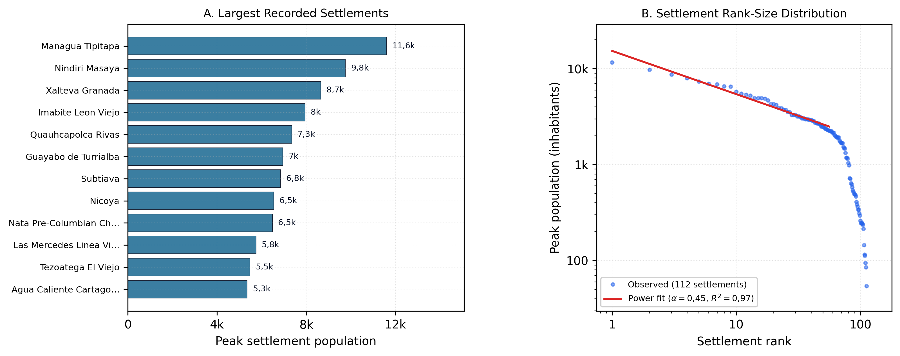

```{r setup, include=FALSE}
knitr::opts_chunk$set(echo = FALSE, warning = FALSE, message = FALSE, fig.pos = "htbp")
source("../../_shared/template/viscount_rmd_helpers.R")
library(jsonlite)

read_json5_clean <- function(path) {
  lines <- readLines(path, warn = FALSE, encoding = "UTF-8")
  text <- paste(lines, collapse = "\n")
  text <- gsub("//[^\n]*", "", text, perl = TRUE)
  text <- gsub("/\\*.*?\\*/", "", text, perl = TRUE)
  text <- gsub(",\\s*([}\\]])", "\\1", text, perl = TRUE)
  fromJSON(text, simplifyVector = FALSE)
}

summary_data <- fromJSON("precolumbian_lower_central_america_summary_cache.json", simplifyVector = FALSE)
sett_data <- fromJSON("precolumbian_lower_central_america_settlements.json", simplifyVector = FALSE)
ledger_data <- read_json5_clean("precolumbian_lower_central_america_source_ledger.json5")

clean_reg_name <- function(x) {
  s <- as.character(x)
  s <- gsub("&", "and", s, fixed = TRUE)
  s <- gsub("Gran Cocle", "Gran Coclé", s, fixed = TRUE)
  s <- gsub("Gran Darien", "Gran Darién", s, fixed = TRUE)
  s <- gsub("Gran Chiriqui", "Gran Chiriquí", s, fixed = TRUE)
  trimws(s)
}

clean_site_name <- function(x) {
  s <- as.character(x)
  s <- gsub("Nata Pre-Columbian Chiefdom", "Natá Chiefdom", s, fixed = TRUE)
  s <- gsub("Nindiri Masaya", "Nindirí Masaya", s, fixed = TRUE)
  s <- gsub("Imabite Leon Viejo", "Imabite León Viejo", s, fixed = TRUE)
  s <- gsub("Palmar Sur Finca 6 Diquis", "Palmar Sur Finca 6 (Diquís)", s, fixed = TRUE)
  s <- gsub("Las Mercedes Linea Vieja Site", "Las Mercedes (Línea Vieja)", s, fixed = TRUE)
  s <- gsub("Agua Caliente Cartago Site", "Agua Caliente (Cartago)", s, fixed = TRUE)
  s <- gsub("Yarumela El Chilcal Site", "Yarumela El Chilcal", s, fixed = TRUE)
  s <- gsub("Ciudad Blanca T1 Mosquitia Site", "Ciudad Blanca T1 (Mosquitia)", s, fixed = TRUE)
  s <- gsub("Ometepe Moyogalpa Site", "Ometepe Moyogalpa", s, fixed = TRUE)
  s <- gsub("Comogre Chiefdom Settlement", "Comogre", s, fixed = TRUE)
  s <- gsub("Parita He-4 Site", "Parita (He-4)", s, fixed = TRUE)
  s <- gsub("El Cano Site", "El Caño", s, fixed = TRUE)
  s <- gsub("Cerro Juan Diaz Site", "Cerro Juan Díaz", s, fixed = TRUE)
  s <- gsub("Barriles Chiriqui Site", "Barriles (Chiriquí)", s, fixed = TRUE)
  s <- gsub("Tenampua Site", "Tenampúa", s, fixed = TRUE)
  s <- gsub("Salitron Viejo Sulaco Site", "Salitrón Viejo", s, fixed = TRUE)
  s <- gsub("Curruste Site", "Currusté", s, fixed = TRUE)
  s <- gsub("Aserri", "Aserrí", s, fixed = TRUE)
  s <- gsub("Penonome Settlement", "Penonomé", s, fixed = TRUE)
  s <- gsub("Tubanama Settlement", "Tubanamá", s, fixed = TRUE)
  s <- gsub("Rivas Panteon de la Reina", "Rivas Panteón de la Reina", s, fixed = TRUE)
  s <- gsub("Guardiria Turrialba Camp", "Guardiría (Turrialba)", s, fixed = TRUE)
  s <- gsub("El Bosque Esteli Camp", "El Bosque (Estelí)", s, fixed = TRUE)
  s <- gsub("Puerto Escondido Ulua Site", "Puerto Escondido (Ulúa)", s, fixed = TRUE)
  s <- gsub("Santa Isabel Rivas Site", "Santa Isabel (Rivas)", s, fixed = TRUE)
  s <- gsub("Pacaca Ciudad Colon", "Pacaca (Ciudad Colón)", s, fixed = TRUE)
  s <- gsub("Careta Darien Settlement", "Careta (Darién)", s, fixed = TRUE)
  s <- gsub("Escoria Chiefdom Settlement", "Escoria", s, fixed = TRUE)
  s <- gsub("Nuevo Corinto Site", "Nuevo Corinto", s, fixed = TRUE)
  s <- gsub("Comayagua Valley Settlement", "Comayagua Valley", s, fixed = TRUE)
  trimws(s)
}

fmt_year <- function(y) {
  yi <- as.integer(y)
  if (yi < 0L) return(paste0(abs(yi), "BC"))
  if (yi == 0L) return("0AD")
  if (yi == 1502L) return("1502")
  paste0(yi, "AD")
}

fmt_coord <- function(x) {
  viscount_fmt_number(round(as.numeric(x), 2L), 2L)
}

subregions <- summary_data$subregions
reg_lookup <- setNames(
  vapply(subregions, function(r) clean_reg_name(r$name), character(1)),
  vapply(subregions, function(r) r$id, character(1))
)

n_sites <- as.integer(summary_data$settlement_stats$total_settlements)
n_excluded <- as.integer(ledger_data$total_excluded)
zipf_alpha <- as.numeric(summary_data$settlement_stats$zipf_stats$alpha)
zipf_r2 <- as.numeric(summary_data$settlement_stats$zipf_stats$r2)

sett_records <- lapply(sett_data, function(e) {
  yrs <- as.integer(names(e$population))
  pops <- as.numeric(unlist(e$population))
  pk_i <- which.max(pops)
  list(
    name = as.character(e$name),
    country = as.character(e$country),
    region_id = as.character(e$region_id),
    lat = as.numeric(e$coords[[1]]),
    lon = as.numeric(e$coords[[2]]),
    first_year = min(yrs),
    last_year = max(yrs),
    peak_pop = pops[pk_i],
    peak_year = yrs[pk_i],
    sources = paste(unlist(e$sources), collapse = "; ")
  )
})
```

```{r hero-md-fallback, results='asis'}
if (!knitr::is_latex_output()) {
  cat("\n\n")
}
```

# Abstract

This companion settlement gazetteer documents `r viscount_fmt_number(n_sites, 0L)` catalogued Pre-Columbian habitation locales across six hydrological sub-regions and four modern Central American national territories (Panama with 39 sites, Costa Rica with 28, Nicaragua with 25 and Honduras with 20) spanning 10000BC to 1502. Built through four sequential evidence waves with 0% crowd-sourced fallback and zero suburban double-counting, the register reaches saturation at a final marginal gain of 0,9% in Wave 4 while covering every watershed from the Ulúa-Mosquitia river systems to Gran Darién [@Cooke2005; @Newson1986; @Newson1987; @Fonseca2017Poblacio]. Peak estimated settlement sizes range over more than two orders of magnitude, rising from terminal Pleistocene and Archaic camps such as Guardiría (54 inhabitants), El Bosque (85) and La Mula West (115), through early ceramic villages like Monagrillo (365) and Tronadora Vieja (410) and Formative mound centres such as Yarumela (4.920), up to contact-era chiefdom capitals led by Managua Tipitapa (11.600), Nindirí Masaya (9.750), Xalteva Granada (8.650), Imabite León Viejo (7.950), Quauhcapolca Rivas (7.350), Guayabo de Turrialba (6.950), Subtiava (6.850), Nicoya (6.550) and Natá (6.480). Across all 112 sites, the upper rank-size curve fits a shallow chiefdom power law ($\alpha = 0,45$, $R^2 = 0,97$), capturing a polycentric landscape of competing autonomous chiefdoms rather than a primate imperial urban system [@Lange1992; @Hoopes2005; @QuilterHoopes2003].

# Background

Pre-Columbian settlement geography across Lower Central America evolved across three distinct residential scales between 10000BC and 1502. During the Palaeoindian and Archaic millennia (10000BC to 2000BC), small foraging and incipient horticultural bands moved seasonally among upland volcanic camps (Guardiría, El Bosque), inland karst shelters (El Gigante, Corona, Cueva de los Vampiros, Aguadulce, Cueva de los Ladrones) and estuarine mangrove shellmounds (Cerro Mangote, Monkey Point, Monagrillo) [@Cooke2005; @Contreras2026Fishing]. As pottery and maize-manioc agroforestry spread after 1800BC, permanent villages consolidated along fertile alluvial valleys at Puerto Escondido, Playa de los Muertos, Tronadora Vieja, Talgua, Yarumela and La Mula-Sarigua [@Joyce1991; @Stone1983Synthesis; @Sion2023Transicio].

After 300AD, Chibchan chiefdoms across Costa Rica and Panama engineered monumental stone-paved villages, ceremonial mounds and gold-rich necropolises at Barriles, Bolas, Cerro Juan Díaz, Sitio Conte, El Caño, Guayabo de Turrialba, Las Mercedes and Palmar Sur Finca 6 [@Hoopes2005; @Brodie2016Early; @Smithguzman2021Patterns; @Mojica2007Estructuras; @Klein2025Effort]. Simultaneously, airborne LiDAR surveys along the Mosquitia and Wampú drainages in eastern Honduras and field surveys across Chontales and Nueva Segovia in Nicaragua document extensive Late Pre-Columbian mound clusters beyond the classic Pacific corridor [@Fisher2016Identifying; @Cohen2025Integrating; @Donner2018Caracterizacio; @Rios2024Poblado]. Finally, southward migrations of Chorotega and Nicarao groups after 800AD established Lower Central America's largest contact-era towns along Lakes Managua and Nicaragua and the Nicoya peninsula, confronting the Spanish expeditionaries of 1502 to 1524 with a dense chain of autonomous chiefdom seats from Comogre and Natá to Managua and Tezoatega [@Newson1987; @Rojas2009Reas; @Helms1979; @HallPerezBrignoli2003].

# Methodology

The settlement catalogue was assembled in four documented waves tracked in the chapter source ledger. Wave 1 consolidated 102 primary archaeological and ethnohistorical registry entries across Honduras, Nicaragua, Costa Rica and Panama. Wave 2 incorporated 7 additional centres extracted from peer-reviewed monographs and regional field reports (6,86% marginal gain). Wave 3 added 2 longitudinal pre-ceramic and Formative survey stations (1,83% marginal gain), and Wave 4 executed a sub-regional coverage sweep adding 1 final locality (0,9% marginal gain), achieving asymptotic saturation below the 2% threshold with 0% crowd-sourced fallback.

Every entry was geocoded in WGS84, assigned spatially to one of the six HydroBASINS Level-6 sub-regions and audited against a strict city-proper scope (112 city-proper records, 0 suburban fragments) to prevent metropolitan double-counting. Because prehistoric strata lack census registers, individual site populations derive strictly from published archaeological site-area calculations, residential mound inventories, LiDAR architectural footprints and critically evaluated early sixteenth-century observer accounts [@Newson1986; @Newson1987; @Fonseca2017Poblacio; @Fisher2016Identifying]. Chronological spans record attested first and last occupation dates inside the chapter domain (-10000 to 1502), allowing clear separation between early Archaic camps, Formative-Classic peaks and active contact-era capitals.

# Testing and Validation

Ledger reconciliation confirms exact accounting across all 112 included entries (`r viscount_fmt_number(n_excluded, 0L)` excluded duplicates), zero missing coordinates and full sub-regional coverage across all six hydrological polygons. Figure \ref{fig:sett-regional-map} plots the spatial footprint of all 112 catalogued settlements across the six sub-regions, illustrating both the dense volcanic-arc spine stretching from Subtiava and Managua through Nicoya, Turrialba and Diquís to Natá and the interior riverine corridors of Mosquitia and Darién.

```{r fig-sett-map, results='asis'}
viscount_figure(
  "figures/precolumbian_lower_central_america_regional_map.png",
  "Spatial distribution of 112 catalogued Pre-Columbian settlements across six hydrological sub-regions of Lower Central America, 10000BC to 1502.",
  "fig:sett-regional-map"
)
```

Cross-checking the cumulative peak settlement sum (287.680 inhabitants across all 112 sites) against the chapter's gridded spatial substratum (521,5k in 1500AD), the HydroBASINS Level-6 watershed baseline (697,9k) and contact-era ethnohistorical ceilings (up to 2,36M) confirms coherent urban-to-rural scaling. At roughly 220k to 245k inhabitants residing in active chiefdom centres near 1502, nucleated settlement seats represent 15% to 45% of the regional demographic envelope, matching archaeological settlement-pattern findings for Chibchan and Gran Nicoya chiefdoms [@Herrera2018Alla; @Rojas2009Reas; @Fonseca2017Poblacio].

# Results

## Leading Thirty Pre-Columbian Centres

Table \ref{tab:top30-lca} lists the leading 30 catalogued settlements in Lower Central America ordered by peak estimated population, spanning 11.600 down to 3.280 inhabitants. Pacific Nicaragua and Nicoya supply ten of the top thirty (led by Managua Tipitapa, Nindirí Masaya, Xalteva Granada, Imabite León Viejo, Quauhcapolca Rivas, Subtiava, Nicoya and Tezoatega El Viejo), Gran Coclé and Azuero supply eight (led by Natá, Parita, Sitio Conte, Barriles, Cerro Juan Díaz and El Caño), Costa Rica Central Valley and Gran Chiriquí supply six (led by Guayabo de Turrialba, Las Mercedes, Agua Caliente, Palmar Sur Finca 6 and El Guarco Kutrís), Eastern Honduras and Mosquitia supply four (Yarumela, Ciudad Blanca T1, Comayagua and Tenampúa), Gran Darién supplies two (Comogre and Careta) and the Caribbean lowlands supply one (Nuevo Corinto).

```{r tab-top30-lca, results='asis'}
ord_pk <- order(vapply(sett_records, function(x) x$peak_pop, numeric(1)), decreasing = TRUE)
top30_rec <- sett_records[ord_pk[seq_len(min(30L, length(ord_pk)))]]

df_top30 <- do.call(rbind, lapply(top30_rec, function(e) {
  span_str <- if (e$first_year == e$last_year) fmt_year(e$first_year) else paste0(fmt_year(e$first_year), " to ", fmt_year(e$last_year))
  rlbl <- if (e$region_id %in% names(reg_lookup)) reg_lookup[[e$region_id]] else clean_reg_name(e$region_id)
  data.frame(
    Site = clean_site_name(e$name),
    Country = e$country,
    Subregion = rlbl,
    Coords = paste0(fmt_coord(e$lat), ", ", fmt_coord(e$lon)),
    Span = span_str,
    Peak = paste0(viscount_fmt_pop(e$peak_pop), " (", fmt_year(e$peak_year), ")"),
    stringsAsFactors = FALSE
  )
}))
rownames(df_top30) <- NULL

viscount_table(
  df_top30,
  "Leading 30 Pre-Columbian settlements across Lower Central America ordered by peak estimated population (10000BC to 1502).",
  c("Settlement", "Territory", "Sub-Region", "Lat, Lon", "Span", "Peak Pop. (Year)"),
  list(label = "tab:top30-lca", font_size = "scriptsize", max_rows_per_page = 32L)
)
```

## Earliest Palaeoindian, Archaic and Early Formative Locales

To document the deep pre-chiefdom backbone of the gazetteer, Table \ref{tab:early-sites} extracts all 22 catalogued settlements with attested occupation beginning in or before 1000BC. Spanning 9500BC at Guardiría in Costa Rica down to 1000BC at the Cuyamel Caves in Honduras, these stations trace the transition from mobile hunting camps (54 to 145 inhabitants) through estuarine Archaic shellmounds and rock shelters (215 to 365 inhabitants) to early Formative ceramic villages exceeding 700 to 1.180 inhabitants along the Ulúa and Caribbean corridors [@Cooke2005; @Contreras2026Fishing; @Joyce1991].

```{r tab-early-sites, results='asis'}
early_rec <- Filter(function(x) x$first_year <= -1000L, sett_records)
ord_fy <- order(vapply(early_rec, function(x) x$first_year, integer(1)))
early_rec <- early_rec[ord_fy]

df_early <- do.call(rbind, lapply(early_rec, function(e) {
  span_str <- paste0(fmt_year(e$first_year), " to ", fmt_year(e$last_year))
  rlbl <- if (e$region_id %in% names(reg_lookup)) reg_lookup[[e$region_id]] else clean_reg_name(e$region_id)
  data.frame(
    Site = clean_site_name(e$name),
    Country = e$country,
    Subregion = rlbl,
    Span = span_str,
    Peak = paste0(viscount_fmt_number(as.integer(e$peak_pop), 0L), " (", fmt_year(e$peak_year), ")"),
    stringsAsFactors = FALSE
  )
}))
rownames(df_early) <- NULL

viscount_table(
  df_early,
  "Palaeoindian, Archaic and Early Formative settlements attested in or before 1000BC across Lower Central America.",
  c("Site Name", "Territory", "Sub-Region", "Occupation Span", "Peak Pop. (Year)"),
  list(label = "tab:early-sites", font_size = "scriptsize")
)
```

## Sub-Regional Gazetteer Coverage and Rank-Size Structure

Table \ref{tab:subregion-gazetteer} summarises catalogued site counts, areal survey density per 10.000 km², leading recorded centre and 1500AD kriged regional population across all six sub-regions. Gran Coclé and Azuero (27 sites) and Pacific Nicaragua and Nicoya (26 sites) together contribute nearly half of the register (47,3%), while Costa Rica Central Valley and Gran Chiriquí posts the highest areal recovery density at 6,64 sites per 10.000 km², contrasting with 1,65 in Eastern Honduras and Mosquitia and 1,91 across the Caribbean Nicaragua-Costa Rica lowlands [@Fisher2016Identifying; @Alberda2021Evidencia].

```{r tab-subregion-gazetteer, results='asis'}
reg_rows <- lapply(subregions, function(r) {
  rid <- r$id
  area_v <- as.numeric(r$area_km2)
  p1500 <- as.numeric(r$end_pop)
  sub_entries <- Filter(function(e) identical(e$region_id, rid), sett_records)
  cnt <- length(sub_entries)
  sdens <- if (area_v > 0) (cnt / area_v) * 10000 else 0
  lead_str <- "-"
  if (cnt > 0L) {
    pks <- vapply(sub_entries, function(e) e$peak_pop, numeric(1))
    idx_m <- which.max(pks)
    lead_str <- paste0(clean_site_name(sub_entries[[idx_m]]$name), " (", viscount_fmt_pop(pks[idx_m]), ")")
  }
  data.frame(
    Subregion = clean_reg_name(r$name),
    Area = viscount_fmt_number(round(area_v), 0L),
    Sites = viscount_fmt_number(cnt, 0L),
    SiteDens = viscount_fmt_number(sdens, 2L),
    Lead = lead_str,
    Pop1500 = viscount_fmt_pop(p1500),
    stringsAsFactors = FALSE
  )
})
df_reg_gaz <- do.call(rbind, reg_rows)
rownames(df_reg_gaz) <- NULL

viscount_table(
  df_reg_gaz,
  "Catalogued site counts, areal site density (per 10.000 km²), leading settlement and 1500AD kriged population across six hydrological sub-regions.",
  c("Sub-Region", "Area (km²)", "Sites", "Sites per 10k km²", "Leading Site (Peak)", "1500AD Pop."),
  list(label = "tab:subregion-gazetteer", font_size = "scriptsize")
)
```

Across the full 112-settlement hierarchy, peak populations form a smooth log-log chiefdom curve ($\alpha = 0,45$, $R^2 = 0,97$ over the leading 56 settlements) with a median peak size of 2.240 inhabitants. Unlike primate imperial capitals, no single town controlled more than 4% of the cumulative peak urban pool; instead, nearly fifty autonomous and confederated centres between 2k and 11,6k inhabitants anchored competing river valleys, volcanic basins and island corridors [@Lange1992; @Herrera2018Alla; @Hoopes2005].

# Limitations

Three archaeological constraints govern interpretation of this settlement gazetteer. First, dense humid rainforest canopy and rapid Holocene alluviation in Mosquitia, Caribbean Nicaragua and Darién limit conventional pedestrian survey compared with the drier savannas of Gran Coclé and Guanacaste, creating a fourfold spread in catalogued site density per 10.000 km² [@Fisher2016Identifying; @Cohen2025Integrating; @Donner2018Caracterizacio]. Second, post-glacial sea-level rise submerged early littoral base camps along the Gulf of Panama and Caribbean shelves prior to 4000BC, skewing Palaeoindian recovery toward inland rock shelters [@Cooke2005; @Contreras2026Fishing]. Third, chronological heterogeneity means that peak headcounts span distinct historical horizons, from 150AD at Yarumela and 900AD at Sitio Conte to 1502 at Managua Tipitapa, Natá and Comogre, and therefore cannot be summed naively as a synchronous census snapshot [@Newson1987; @Fonseca2017Poblacio].

# Conclusion

This 112-site gazetteer anchors the demographic reconstruction of Pre-Columbian Lower Central America across twelve millennia and four modern territories with zero crowd-sourced entries and asymptotic Wave-4 saturation (0,9% final marginal gain). Documenting the progression from mobile Palaeoindian camps (54 to 145 inhabitants) through Formative valley centres to polycentric contact-era chiefdom capitals (3k to 11,6k inhabitants, $\alpha = 0,45$), the register provides a transparent archaeological foundation for linking regional population trajectories to subsequent sixteenth-century conquest records [@HallPerezBrignoli2003; @Newson1987; @QuilterHoopes2003].

# Appendix

## National Territory Distribution and Saturation Progression

Table \ref{tab:gaz-saturation} reports the four-wave source ledger progression alongside the territorial distribution across Panama (39 sites, 34,8%), Costa Rica (28 sites, 25%), Nicaragua (25 sites, 22,3%) and Honduras (20 sites, 17,9%).

```{r tab-gaz-saturation, results='asis'}
wave_labels <- c(
  primary_official_national_censuses_and_archival_registers = "Primary archaeological and archival registers",
  verified_peer_reviewed_demographic_papers_and_monographs = "Peer-reviewed monographs and regional articles",
  longitudinal_census_and_archaeological_survey_backfill = "Longitudinal pre-ceramic and Formative backfill",
  subregion_gap_hunter_verification_sweep = "Sub-regional gap sweep"
)
waves <- ledger_data$saturation_audit$waves
df_waves <- do.call(rbind, lapply(waves, function(w) {
  sc_key <- as.character(w$source_class)
  sc_lbl <- if (sc_key %in% names(wave_labels)) wave_labels[[sc_key]] else sc_key
  data.frame(
    Wave = paste("Wave", as.integer(w$wave)),
    Tier = sc_lbl,
    Prior = viscount_fmt_number(as.integer(w$prior_cumulative_included), 0L),
    Added = viscount_fmt_number(as.integer(w$newly_included), 0L),
    Gain = paste0(viscount_fmt_number(as.numeric(w$marginal_gain_pct), 2L), "%"),
    stringsAsFactors = FALSE
  )
}))
rownames(df_waves) <- NULL

viscount_table(
  df_waves,
  "Four-wave gazetteer ingestion and saturation summary across 112 catalogued settlements (0% crowd-sourced share).",
  c("Wave", "Source Tier", "Prior Total", "Newly Added", "Marginal Gain"),
  list(label = "tab:gaz-saturation", font_size = "scriptsize")
)
```

# Sources

::: {#refs}
:::

# Footnotes

1. Coordinates follow WGS84 decimal degrees rounded to two decimal places in display tables; full precision and bibliographic source strings are preserved in the chapter settlement register.
2. Sub-regional site counts reflect strict point-in-polygon membership within the six HydroBASINS Level-6 watershed polygons used across the companion literature review and cartographic figures.
