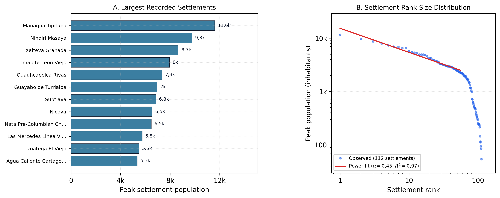
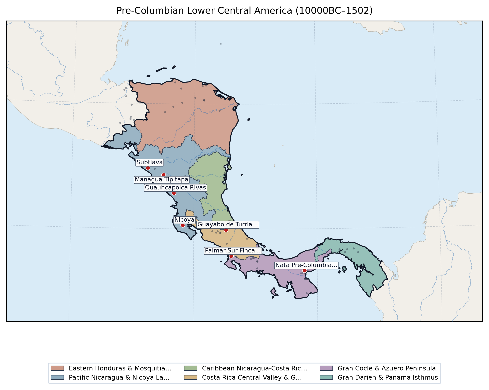

Pre-Columbian Lower Central America
================
Aust Kätzchen
23 November 2026

- [Abstract](#abstract)
- [Background](#background)
- [Methodology](#methodology)
- [Testing and Validation](#testing-and-validation)
- [Results](#results)
  - [Leading Thirty Pre-Columbian
    Centres](#leading-thirty-pre-columbian-centres)
  - [Earliest Palaeoindian, Archaic and Early Formative
    Locales](#earliest-palaeoindian-archaic-and-early-formative-locales)
  - [Sub-Regional Gazetteer Coverage and Rank-Size
    Structure](#sub-regional-gazetteer-coverage-and-rank-size-structure)
- [Limitations](#limitations)
- [Conclusion](#conclusion)
- [Appendix](#appendix)
  - [National Territory Distribution and Saturation
    Progression](#national-territory-distribution-and-saturation-progression)
- [Sources](#sources)
- [Footnotes](#footnotes)

<figure>

<figcaption aria-hidden="true">Leading catalogued settlements and
rank-size distribution across 112 Pre-Columbian sites in Lower Central
America, 10000BC to 1502.</figcaption>
</figure>

# Abstract

This companion settlement gazetteer documents 112 catalogued
Pre-Columbian habitation locales across six hydrological sub-regions and
four modern Central American national territories (Panama with 39 sites,
Costa Rica with 28, Nicaragua with 25 and Honduras with 20) spanning
10000BC to 1502. Built through four sequential evidence waves with 0%
crowd-sourced fallback and zero suburban double-counting, the register
reaches saturation at a final marginal gain of 0,9% in Wave 4 while
covering every watershed from the Ulúa-Mosquitia river systems to Gran
Darién
[\[1\]](#ref-Cooke2005)[\[2\]](#ref-Newson1986)[\[3\]](#ref-Newson1987)[\[4\]](#ref-Fonseca2017Poblacio).
Peak estimated settlement sizes range over more than two orders of
magnitude, rising from terminal Pleistocene and Archaic camps such as
Guardiría (54 inhabitants), El Bosque (85) and La Mula West (115),
through early ceramic villages like Monagrillo (365) and Tronadora Vieja
(410) and Formative mound centres such as Yarumela (4.920), up to
contact-era chiefdom capitals led by Managua Tipitapa (11.600), Nindirí
Masaya (9.750), Xalteva Granada (8.650), Imabite León Viejo (7.950),
Quauhcapolca Rivas (7.350), Guayabo de Turrialba (6.950), Subtiava
(6.850), Nicoya (6.550) and Natá (6.480). Across all 112 sites, the
upper rank-size curve fits a shallow chiefdom power law
($\alpha = 0,45$, $R^2 = 0,97$), capturing a polycentric landscape of
competing autonomous chiefdoms rather than a primate imperial urban
system
[\[5\]](#ref-Lange1992)[\[6\]](#ref-Hoopes2005)[\[7\]](#ref-QuilterHoopes2003).

# Background

Pre-Columbian settlement geography across Lower Central America evolved
across three distinct residential scales between 10000BC and 1502.
During the Palaeoindian and Archaic millennia (10000BC to 2000BC), small
foraging and incipient horticultural bands moved seasonally among upland
volcanic camps (Guardiría, El Bosque), inland karst shelters (El
Gigante, Corona, Cueva de los Vampiros, Aguadulce, Cueva de los
Ladrones) and estuarine mangrove shellmounds (Cerro Mangote, Monkey
Point, Monagrillo)
[\[1\]](#ref-Cooke2005)[\[8\]](#ref-Contreras2026Fishing). As pottery
and maize-manioc agroforestry spread after 1800BC, permanent villages
consolidated along fertile alluvial valleys at Puerto Escondido, Playa
de los Muertos, Tronadora Vieja, Talgua, Yarumela and La Mula-Sarigua
[\[9\]](#ref-Joyce1991)[\[10\]](#ref-Stone1983Synthesis)[\[11\]](#ref-Sion2023Transicio).

After 300AD, Chibchan chiefdoms across Costa Rica and Panama engineered
monumental stone-paved villages, ceremonial mounds and gold-rich
necropolises at Barriles, Bolas, Cerro Juan Díaz, Sitio Conte, El Caño,
Guayabo de Turrialba, Las Mercedes and Palmar Sur Finca 6
[\[6\]](#ref-Hoopes2005)[\[12\]](#ref-Brodie2016Early)[\[13\]](#ref-Smithguzman2021Patterns)[\[14\]](#ref-Mojica2007Estructuras)[\[15\]](#ref-Klein2025Effort).
Simultaneously, airborne LiDAR surveys along the Mosquitia and Wampú
drainages in eastern Honduras and field surveys across Chontales and
Nueva Segovia in Nicaragua document extensive Late Pre-Columbian mound
clusters beyond the classic Pacific corridor
[\[16\]](#ref-Fisher2016Identifying)[\[17\]](#ref-Cohen2025Integrating)[\[18\]](#ref-Donner2018Caracterizacio)[\[19\]](#ref-Rios2024Poblado).
Finally, southward migrations of Chorotega and Nicarao groups after
800AD established Lower Central America’s largest contact-era towns
along Lakes Managua and Nicaragua and the Nicoya peninsula, confronting
the Spanish expeditionaries of 1502 to 1524 with a dense chain of
autonomous chiefdom seats from Comogre and Natá to Managua and Tezoatega
[\[3\]](#ref-Newson1987)[\[20\]](#ref-Rojas2009Reas)[\[21\]](#ref-Helms1979)[\[22\]](#ref-HallPerezBrignoli2003).

# Methodology

The settlement catalogue was assembled in four documented waves tracked
in the chapter source ledger. Wave 1 consolidated 102 primary
archaeological and ethnohistorical registry entries across Honduras,
Nicaragua, Costa Rica and Panama. Wave 2 incorporated 7 additional
centres extracted from peer-reviewed monographs and regional field
reports (6,86% marginal gain). Wave 3 added 2 longitudinal pre-ceramic
and Formative survey stations (1,83% marginal gain), and Wave 4 executed
a sub-regional coverage sweep adding 1 final locality (0,9% marginal
gain), achieving asymptotic saturation below the 2% threshold with 0%
crowd-sourced fallback.

Every entry was geocoded in WGS84, assigned spatially to one of the six
HydroBASINS Level-6 sub-regions and audited against a strict city-proper
scope (112 city-proper records, 0 suburban fragments) to prevent
metropolitan double-counting. Because prehistoric strata lack census
registers, individual site populations derive strictly from published
archaeological site-area calculations, residential mound inventories,
LiDAR architectural footprints and critically evaluated early
sixteenth-century observer accounts
[\[2\]](#ref-Newson1986)[\[3\]](#ref-Newson1987)[\[4\]](#ref-Fonseca2017Poblacio)[\[16\]](#ref-Fisher2016Identifying).
Chronological spans record attested first and last occupation dates
inside the chapter domain (-10000 to 1502), allowing clear separation
between early Archaic camps, Formative-Classic peaks and active
contact-era capitals.

# Testing and Validation

Ledger reconciliation confirms exact accounting across all 112 included
entries (0 excluded duplicates), zero missing coordinates and full
sub-regional coverage across all six hydrological polygons. Figure plots
the spatial footprint of all 112 catalogued settlements across the six
sub-regions, illustrating both the dense volcanic-arc spine stretching
from Subtiava and Managua through Nicoya, Turrialba and Diquís to Natá
and the interior riverine corridors of Mosquitia and Darién.

<!-- -->

Cross-checking the cumulative peak settlement sum (287.680 inhabitants
across all 112 sites) against the chapter’s gridded spatial substratum
(521,5k in 1500AD), the HydroBASINS Level-6 watershed baseline (697,9k)
and contact-era ethnohistorical ceilings (up to 2,36M) confirms coherent
urban-to-rural scaling. At roughly 220k to 245k inhabitants residing in
active chiefdom centres near 1502, nucleated settlement seats represent
15% to 45% of the regional demographic envelope, matching archaeological
settlement-pattern findings for Chibchan and Gran Nicoya chiefdoms
[\[4\]](#ref-Fonseca2017Poblacio)[\[20\]](#ref-Rojas2009Reas)[\[23\]](#ref-Herrera2018Alla).

# Results

## Leading Thirty Pre-Columbian Centres

Table lists the leading 30 catalogued settlements in Lower Central
America ordered by peak estimated population, spanning 11.600 down to
3.280 inhabitants. Pacific Nicaragua and Nicoya supply ten of the top
thirty (led by Managua Tipitapa, Nindirí Masaya, Xalteva Granada,
Imabite León Viejo, Quauhcapolca Rivas, Subtiava, Nicoya and Tezoatega
El Viejo), Gran Coclé and Azuero supply eight (led by Natá, Parita,
Sitio Conte, Barriles, Cerro Juan Díaz and El Caño), Costa Rica Central
Valley and Gran Chiriquí supply six (led by Guayabo de Turrialba, Las
Mercedes, Agua Caliente, Palmar Sur Finca 6 and El Guarco Kutrís),
Eastern Honduras and Mosquitia supply four (Yarumela, Ciudad Blanca T1,
Comayagua and Tenampúa), Gran Darién supplies two (Comogre and Careta)
and the Caribbean lowlands supply one (Nuevo Corinto).

| Settlement | Territory | Sub-Region | Lat, Lon | Span | Peak Pop. (Year) |
|:---|:---|:---|:---|:---|:---|
| **Managua Tipitapa** | Nicaragua | Pacific Nicaragua and Nicoya Lakes | 12,15, -86,25 | 1000AD to 1502 | 11,6k (1502) |
| **Nindirí Masaya** | Nicaragua | Pacific Nicaragua and Nicoya Lakes | 11,99, -86,11 | 1000AD to 1502 | 9,8k (1502) |
| **Xalteva Granada** | Nicaragua | Pacific Nicaragua and Nicoya Lakes | 11,93, -85,96 | 1000AD to 1502 | 8,6k (1502) |
| **Imabite León Viejo** | Nicaragua | Pacific Nicaragua and Nicoya Lakes | 12,4, -86,61 | 1100AD to 1502 | 8k (1502) |
| **Quauhcapolca Rivas** | Nicaragua | Pacific Nicaragua and Nicoya Lakes | 11,44, -85,83 | 1000AD to 1502 | 7,3k (1502) |
| **Guayabo de Turrialba** | Costa Rica | Costa Rica Central Valley and Gran Chiriquí | 9,97, -83,69 | 400AD to 1300AD | 7k (1100AD) |
| **Subtiava** | Nicaragua | Pacific Nicaragua and Nicoya Lakes | 12,43, -86,89 | 1100AD to 1450AD | 6,8k (1450AD) |
| **Nicoya** | Costa Rica | Pacific Nicaragua and Nicoya Lakes | 10,15, -85,45 | 1000AD to 1502 | 6,5k (1502) |
| **Natá Chiefdom** | Panama | Gran Coclé and Azuero Peninsula | 8,33, -80,52 | 1000AD to 1502 | 6,5k (1502) |
| **Las Mercedes (Línea Vieja)** | Costa Rica | Costa Rica Central Valley and Gran Chiriquí | 10,18, -83,59 | 600AD to 1350AD | 5,8k (1350AD) |
| **Tezoatega El Viejo** | Nicaragua | Pacific Nicaragua and Nicoya Lakes | 12,66, -87,17 | 1100AD to 1450AD | 5,5k (1450AD) |
| **Agua Caliente (Cartago)** | Costa Rica | Costa Rica Central Valley and Gran Chiriquí | 9,84, -83,92 | 500AD to 1400AD | 5,3k (1400AD) |
| **Palmar Sur Finca 6 (Diquís)** | Costa Rica | Costa Rica Central Valley and Gran Chiriquí | 8,93, -83,48 | 800AD to 1450AD | 5,2k (1450AD) |
| **Yarumela El Chilcal** | Honduras | Eastern Honduras and Mosquitia Basins | 14,38, -87,65 | 600BC to 600AD | 4,9k (150AD) |
| **Parita (He-4)** | Panama | Gran Coclé and Azuero Peninsula | 7,99, -80,52 | 1100AD to 1502 | 4,9k (1502) |
| **El Guarco Kutris** | Costa Rica | Costa Rica Central Valley and Gran Chiriquí | 9,86, -83,92 | 1200AD to 1502 | 4,9k (1502) |
| **Comogre** | Panama | Gran Darién and Panama Isthmus | 9,05, -78,34 | 1300AD to 1502 | 4,8k (1502) |
| **Ometepe Moyogalpa** | Nicaragua | Pacific Nicaragua and Nicoya Lakes | 11,54, -85,7 | 400AD to 1450AD | 4,7k (1450AD) |
| **Ciudad Blanca T1 (Mosquitia)** | Honduras | Eastern Honduras and Mosquitia Basins | 15,25, -84,97 | 1050AD to 1450AD | 4,3k (1250AD) |
| **Sitio Conte** | Panama | Gran Coclé and Azuero Peninsula | 8,35, -80,43 | 700AD to 1050AD | 4,3k (900AD) |
| **Comayagua Valley** | Honduras | Eastern Honduras and Mosquitia Basins | 14,46, -87,64 | 900AD to 1450AD | 4,2k (1450AD) |
| **Barriles (Chiriquí)** | Panama | Gran Coclé and Azuero Peninsula | 8,81, -82,68 | 200AD to 800AD | 3,9k (550AD) |
| **Cerro Juan Díaz** | Panama | Gran Coclé and Azuero Peninsula | 7,98, -80,42 | 200AD to 1450AD | 3,9k (750AD) |
| **Tenampúa** | Honduras | Eastern Honduras and Mosquitia Basins | 14,33, -87,51 | 700AD to 1100AD | 3,7k (900AD) |
| **El Caño** | Panama | Gran Coclé and Azuero Peninsula | 8,39, -80,53 | 750AD to 1100AD | 3,7k (950AD) |
| **Santa Isabel (Rivas)** | Nicaragua | Pacific Nicaragua and Nicoya Lakes | 11,48, -85,8 | 800AD to 1250AD | 3,5k (1100AD) |
| **Pacaca (Ciudad Colón)** | Costa Rica | Costa Rica Central Valley and Gran Chiriquí | 9,91, -84,24 | 1200AD to 1502 | 3,5k (1502) |
| **Nuevo Corinto** | Costa Rica | Caribbean Nicaragua-Costa Rica Lowlands | 10,21, -83,86 | 700AD to 1300AD | 3,3k (1050AD) |
| **Escoria** | Panama | Gran Coclé and Azuero Peninsula | 8,22, -80,66 | 1250AD to 1502 | 3,3k (1502) |
| **Careta (Darién)** | Panama | Gran Darién and Panama Isthmus | 8,95, -77,77 | 1300AD to 1502 | 3,3k (1502) |

Leading 30 Pre-Columbian settlements across Lower Central America
ordered by peak estimated population (10000BC to 1502).

## Earliest Palaeoindian, Archaic and Early Formative Locales

To document the deep pre-chiefdom backbone of the gazetteer, Table
extracts all 22 catalogued settlements with attested occupation
beginning in or before 1000BC. Spanning 9500BC at Guardiría in Costa
Rica down to 1000BC at the Cuyamel Caves in Honduras, these stations
trace the transition from mobile hunting camps (54 to 145 inhabitants)
through estuarine Archaic shellmounds and rock shelters (215 to 365
inhabitants) to early Formative ceramic villages exceeding 700 to 1.180
inhabitants along the Ulúa and Caribbean corridors
[\[1\]](#ref-Cooke2005)[\[8\]](#ref-Contreras2026Fishing)[\[9\]](#ref-Joyce1991).

| Site Name | Territory | Sub-Region | Occupation Span | Peak Pop. (Year) |
|:---|:---|:---|:---|:---|
| **Guardiría (Turrialba)** | Costa Rica | Costa Rica Central Valley and Gran Chiriquí | 9500BC to 7500BC | 54 (7500BC) |
| **El Gigante Rockshelter** | Honduras | Pacific Nicaragua and Nicoya Lakes | 9000BC to 500BC | 295 (500BC) |
| **La Mula West Preceramic Camp** | Panama | Gran Coclé and Azuero Peninsula | 9000BC to 4500BC | 115 (4500BC) |
| **Corona Rockshelter** | Panama | Gran Coclé and Azuero Peninsula | 8500BC to 3000BC | 145 (3000BC) |
| **Cueva de los Vampiros Shelter** | Panama | Gran Coclé and Azuero Peninsula | 8500BC to 3500BC | 112 (3500BC) |
| **El Bosque (Estelí)** | Nicaragua | Eastern Honduras and Mosquitia Basins | 8000BC to 4500BC | 85 (4500BC) |
| **Vampiros Coastal Camp** | Panama | Gran Coclé and Azuero Peninsula | 6500BC to 4000BC | 94 (4000BC) |
| **Aguadulce Rock Shelter** | Panama | Gran Coclé and Azuero Peninsula | 5500BC to 1500BC | 240 (1500BC) |
| **Cerro Mangote Site** | Panama | Gran Coclé and Azuero Peninsula | 5000BC to 3500BC | 245 (3500BC) |
| **Cueva de los Ladrones Shelter** | Panama | Gran Coclé and Azuero Peninsula | 5000BC to 1200BC | 215 (1200BC) |
| **Monkey Point Shellmound** | Nicaragua | Caribbean Nicaragua-Costa Rica Lowlands | 4500BC to 500BC | 340 (500BC) |
| **Casita de Piedra Shelter** | Panama | Gran Coclé and Azuero Peninsula | 4500BC to 500BC | 235 (500BC) |
| **Acahualinca Site** | Nicaragua | Pacific Nicaragua and Nicoya Lakes | 4000BC to 2000BC | 245 (2000BC) |
| **Trapiche Shelter Chiriqui** | Panama | Gran Coclé and Azuero Peninsula | 3800BC to 200AD | 245 (200AD) |
| **Monagrillo Shellmound** | Panama | Gran Coclé and Azuero Peninsula | 2800BC to 1400BC | 365 (2000BC) |
| **Angie Shellmound** | Nicaragua | Caribbean Nicaragua-Costa Rica Lowlands | 2200BC to 800BC | 260 (800BC) |
| **Tronadora Vieja Site** | Costa Rica | Pacific Nicaragua and Nicoya Lakes | 1800BC to 400BC | 410 (400BC) |
| **Sarigua Shellmound** | Panama | Gran Coclé and Azuero Peninsula | 1800BC to 900BC | 310 (900BC) |
| **Karoline Shellmound** | Nicaragua | Caribbean Nicaragua-Costa Rica Lowlands | 1600BC to 400AD | 710 (400AD) |
| **Puerto Escondido (Ulúa)** | Honduras | Eastern Honduras and Mosquitia Basins | 1500BC to 400BC | 720 (400BC) |
| **Kukra Hill Site** | Nicaragua | Caribbean Nicaragua-Costa Rica Lowlands | 1200BC to 1050AD | 1.180 (1050AD) |
| **Cuyamel Caves Settlement** | Honduras | Eastern Honduras and Mosquitia Basins | 1000BC to 600BC | 340 (600BC) |

Palaeoindian, Archaic and Early Formative settlements attested in or
before 1000BC across Lower Central America.

## Sub-Regional Gazetteer Coverage and Rank-Size Structure

Table summarises catalogued site counts, areal survey density per 10.000
km², leading recorded centre and 1500AD kriged regional population
across all six sub-regions. Gran Coclé and Azuero (27 sites) and Pacific
Nicaragua and Nicoya (26 sites) together contribute nearly half of the
register (47,3%), while Costa Rica Central Valley and Gran Chiriquí
posts the highest areal recovery density at 6,64 sites per 10.000 km²,
contrasting with 1,65 in Eastern Honduras and Mosquitia and 1,91 across
the Caribbean Nicaragua-Costa Rica lowlands
[\[16\]](#ref-Fisher2016Identifying)[\[24\]](#ref-Alberda2021Evidencia).

| Sub-Region | Area (km²) | Sites | Sites per 10k km² | Leading Site (Peak) | 1500AD Pop. |
|:---|:---|:---|:---|:---|:---|
| **Eastern Honduras and Mosquitia Basins** | 132.962 | 22 | 1,65 | Yarumela El Chilcal (4,9k) | 170,2k |
| **Pacific Nicaragua and Nicoya Lakes** | 94.071 | 26 | 2,76 | Managua Tipitapa (11,6k) | 152,8k |
| **Caribbean Nicaragua-Costa Rica Lowlands** | 36.739 | 7 | 1,91 | Nuevo Corinto (3,3k) | 60,8k |
| **Costa Rica Central Valley and Gran Chiriquí** | 30.141 | 20 | 6,64 | Guayabo de Turrialba (7k) | 27,3k |
| **Gran Coclé and Azuero Peninsula** | 57.427 | 27 | 4,7 | Natá Chiefdom (6,5k) | 66,7k |
| **Gran Darién and Panama Isthmus** | 35.574 | 10 | 2,81 | Comogre (4,8k) | 43,7k |

Catalogued site counts, areal site density (per 10.000 km²), leading
settlement and 1500AD kriged population across six hydrological
sub-regions.

Across the full 112-settlement hierarchy, peak populations form a smooth
log-log chiefdom curve ($\alpha = 0,45$, $R^2 = 0,97$ over the leading
56 settlements) with a median peak size of 2.240 inhabitants. Unlike
primate imperial capitals, no single town controlled more than 4% of the
cumulative peak urban pool; instead, nearly fifty autonomous and
confederated centres between 2k and 11,6k inhabitants anchored competing
river valleys, volcanic basins and island corridors
[\[5\]](#ref-Lange1992)[\[6\]](#ref-Hoopes2005)[\[23\]](#ref-Herrera2018Alla).

# Limitations

Three archaeological constraints govern interpretation of this
settlement gazetteer. First, dense humid rainforest canopy and rapid
Holocene alluviation in Mosquitia, Caribbean Nicaragua and Darién limit
conventional pedestrian survey compared with the drier savannas of Gran
Coclé and Guanacaste, creating a fourfold spread in catalogued site
density per 10.000 km²
[\[16\]](#ref-Fisher2016Identifying)[\[17\]](#ref-Cohen2025Integrating)[\[18\]](#ref-Donner2018Caracterizacio).
Second, post-glacial sea-level rise submerged early littoral base camps
along the Gulf of Panama and Caribbean shelves prior to 4000BC, skewing
Palaeoindian recovery toward inland rock shelters
[\[1\]](#ref-Cooke2005)[\[8\]](#ref-Contreras2026Fishing). Third,
chronological heterogeneity means that peak headcounts span distinct
historical horizons, from 150AD at Yarumela and 900AD at Sitio Conte to
1502 at Managua Tipitapa, Natá and Comogre, and therefore cannot be
summed naively as a synchronous census snapshot
[\[3\]](#ref-Newson1987)[\[4\]](#ref-Fonseca2017Poblacio).

# Conclusion

This 112-site gazetteer anchors the demographic reconstruction of
Pre-Columbian Lower Central America across twelve millennia and four
modern territories with zero crowd-sourced entries and asymptotic Wave-4
saturation (0,9% final marginal gain). Documenting the progression from
mobile Palaeoindian camps (54 to 145 inhabitants) through Formative
valley centres to polycentric contact-era chiefdom capitals (3k to 11,6k
inhabitants, $\alpha = 0,45$), the register provides a transparent
archaeological foundation for linking regional population trajectories
to subsequent sixteenth-century conquest records
[\[3\]](#ref-Newson1987)[\[7\]](#ref-QuilterHoopes2003)[\[22\]](#ref-HallPerezBrignoli2003).

# Appendix

## National Territory Distribution and Saturation Progression

Table reports the four-wave source ledger progression alongside the
territorial distribution across Panama (39 sites, 34,8%), Costa Rica (28
sites, 25%), Nicaragua (25 sites, 22,3%) and Honduras (20 sites, 17,9%).

| Wave | Source Tier | Prior Total | Newly Added | Marginal Gain |
|:---|:---|:---|:---|:---|
| **Wave 1** | Primary archaeological and archival registers | 0 | 102 | 100% |
| **Wave 2** | Peer-reviewed monographs and regional articles | 102 | 7 | 6,86% |
| **Wave 3** | Longitudinal pre-ceramic and Formative backfill | 109 | 2 | 1,83% |
| **Wave 4** | Sub-regional gap sweep | 111 | 1 | 0,9% |

Four-wave gazetteer ingestion and saturation summary across 112
catalogued settlements (0% crowd-sourced share).

# Sources

1.
Cooke, Richard.
“Prehistory of Native Americans on the Central
American Land Bridge: Colonization, Dispersal, and Divergence.”
*Journal of Archaeological Research*, 2005,
<https://doi.org/10.1007/s10804-005-2486-4>.

2.
Newson, Linda A.
*The Cost of Conquest: Indian Decline in Honduras
under Spanish Rule*. Westview Press, 1986,
<https://doi.org/10.4324/9780429309823>.

3.
Newson, Linda A.
*Indian Survival in Colonial Nicaragua*.
University of Oklahoma Press, 1987, <https://www.oupress.com/>.

4.
Fonseca, Juan Carlos Solórzano.
“La población indígena de Costa Rica en el siglo
XVI al momento del contacto con los europeos.” *Anuario de
Estudios Centroamericanos*, 2017,
<https://doi.org/10.15517/aeca.v43i0.31561>.

5.
Lange, Frederick W.
*Wealth and Hierarchy in the Intermediate
Area*. Dumbarton Oaks Research Library, 1992,
<https://www.doaks.org/>.

6.
Hoopes, John W.
“The Emergence of Social Complexity in the Chibchan
World of Southern Central America and Northern Colombia, AD
300-600.” *Journal of Archaeological Research*, 2005,
<https://doi.org/10.1007/s10814-005-0809-4>.

7.
Quilter, Jeffrey, and John W.
Hoopes. *Gold and Power in Ancient Costa Rica,
Panama, and Colombia*. Dumbarton Oaks Research Library, 2003,
<https://www.doaks.org/>.

8.
Contreras, Diana Rocío Carvajal.
“Fishing without Hooks: Archaeological Evidence of
Maritime Technologies in Panama.” *Research Square*, 2026,
<https://doi.org/10.21203/rs.3.rs-8745380/v1>.

9.
Joyce, Rosemary A.
*Cerro Palenque: Power and Identity on the Maya
Periphery*. University of Texas Press, 1991,
<https://doi.org/10.7560/711402>.

10.
Stone, Doris.
“A Synthesis of Pre-Columbian Ceramics from Costa
Rica.” *INDIANA - Estudios Antropológicos Sobre América Latina y
El Caribe*, 1983, <https://doi.org/10.18441/ind.v8i0.201-221>.

11.
Sion, Julien.
“La transición Clásico/Posclásico en Los Naranjos
(Honduras): Entre rupturas y nuevas interacciones / Classic/Posclassic
transition in Los Naranjos (Honduras): Between ruptures and new
interactions.” *Revista Trace*, 2023,
<https://doi.org/10.22134/trace.84.2023.851>.

12.
Brodie, Laura, et al.
“Early social complexity at Bolas, Costa Rica:
First year southern Costa Rica archaeological project (Scrap)
results.” *Arqueología*, 2016,
<https://doi.org/10.34096/arqueologia.t22.n2.3237>.

13.
Smith-Guzmán, Nicole E., et al.
“Patterns of Disease and Culture in Ancient Panama:
A Bioarchaeological Analysis of the Early Graves at Cerro Juan
Díaz.” *Bioarchaeology International*, 2021,
<https://doi.org/10.5744/bi.2021.1004>.

14.
Mojica, Alexis O., et al.
“Estructuras arquitectónicas incipientes y áreas de
explotación minera prehispánica de las cuencas de los ríos Grande y
Coclé del Sur, Panamá.” *Hispana*, 2007,
<https://doi.org/10.5209/rev_reaa.2007.v37.n1.24318>.

15.
Klein, Sabine, et al.
“Effort and Value: The Production Practices of
Pre-Columbian Gold Objects of Costa Rica in Cultural and Technological
Context.” *Metallography Microstructure and Analysis*, 2025,
<https://doi.org/10.1007/s13632-025-01230-1>.

16.
Fisher, Christopher T., et al.
“Identifying Ancient Settlement Patterns through
LiDAR in the Mosquitia Region of Honduras.” *PLoS ONE*, 2016,
<https://doi.org/10.1371/journal.pone.0159890>.

17.
Cohen, Anna S., et al.
“Integrating remote datasets to identify precontact
architecture and settlement patterns along the Wampu River system,
Eastern Honduras.” *PLOS One*, 2025,
<https://doi.org/10.1371/journal.pone.0335239>.

18.
Donner, Natalia R., et al.
“Caracterización inicial de los sitios
arqueológicos en la subcuenca del río Mayales, Departamento de
Chontales, Nicaragua.” *Cuadernos de Antropología*, 2018,
<https://doi.org/10.15517/cat.v28i1.32358>.

19.
Ríos, Leonardo Daniel Lechado, et
al. “Un poblado prehispánico jerarquizado en Santa
María de Nueva Segovia, Nicaragua, 300 al 995dc.” *Revista
Científica Estelí*, 2024,
<https://doi.org/10.5377/esteli.v13i51.18998>.

20.
Rojas, Eugenia Ibarra, and Silvia
Salgado González. “Áreas culturales o regiones
históricas en la explicación de relaciones sociales de pueblos indígenas
de Nicaragua y Costa Rica de los siglos XV y XVI.” *Anuario de
Estudios Centroamericanos*, 2009,
<https://doi.org/10.15517/aeca.v35i1-2.1338>.

21.
Helms, Mary W.
*Ancient Panama: Chiefs in Search of Power*.
University of Texas Press, 1979,
<https://doi.org/10.7560/738171>.

22.
Hall, Carolyn, and Héctor Pérez
Brignoli (cartography by John V. Cotter).
*Historical Atlas of Central America*.
University of Oklahoma Press, Norman, 2003,
<https://www.oupress.com/9780806130385/historical-atlas-of-central-america/>.

23.
Herrera, Mauricio Murillo.
“Más allá de los peregrinos y el oro: el desarrollo
social precolombino en Costa Rica, Panamá y el norte de
Colombia.” *Revista Do Museu de Arqueologia e Etnologia*, 2018,
<https://doi.org/10.11606/issn.2448-1750.revmae.2018.151522>.

24.
Alberda, Abner.
“Evidencia arqueológica de Época Prehispánica en
las cuencas de los principales ríos de Arraiján y La Chorrera,
Panamá.” *Revista Contacto*, 2021,
<https://revistas.up.ac.pa/index.php/contacto/article/view/2211>.

# Footnotes

1.  Coordinates follow WGS84 decimal degrees rounded to two decimal
    places in display tables; full precision and bibliographic source
    strings are preserved in the chapter settlement register.
2.  Sub-regional site counts reflect strict point-in-polygon membership
    within the six HydroBASINS Level-6 watershed polygons used across
    the companion literature review and cartographic figures.
