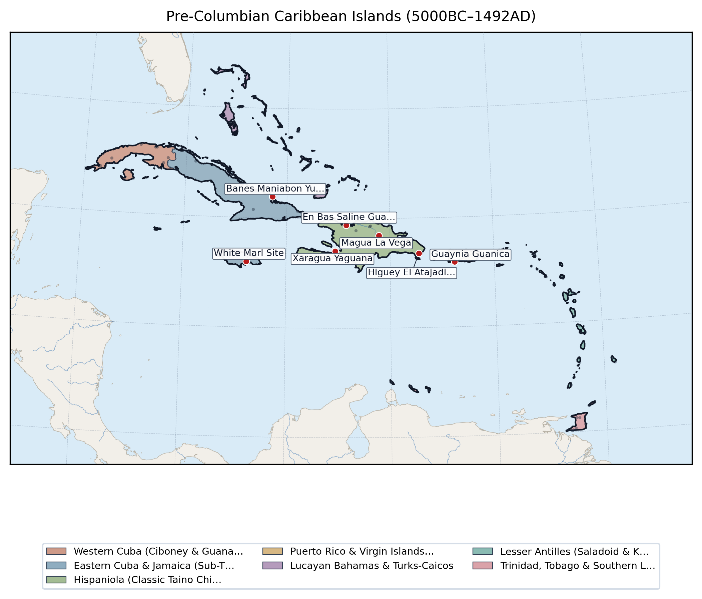

```{r setup, include=FALSE}
knitr::opts_chunk$set(echo = FALSE, warning = FALSE, message = FALSE, fig.pos = "htbp")
source("../../_shared/template/viscount_rmd_helpers.R")
library(jsonlite)

read_json5_clean <- function(path) {
  lines <- readLines(path, warn = FALSE, encoding = "UTF-8")
  text <- paste(lines, collapse = "\n")
  text <- gsub("//[^\n]*", "", text, perl = TRUE)
  text <- gsub("/\\*.*?\\*/", "", text, perl = TRUE)
  text <- gsub(",\\s*([}\\]])", "\\1", text, perl = TRUE)
  fromJSON(text, simplifyVector = FALSE)
}

summary_data <- fromJSON("precolumbian_caribbean_islands_summary_cache.json", simplifyVector = FALSE)
sett_data <- fromJSON("precolumbian_caribbean_islands_settlements.json", simplifyVector = FALSE)
chapter_priors <- read_json5_clean("precolumbian_caribbean_islands.json5")
ledger_data <- read_json5_clean("precolumbian_caribbean_islands_source_ledger.json5")

clean_label <- function(x) {
  s <- as.character(x)
  s <- gsub("&", "and", s, fixed = TRUE)
  s <- gsub("_", " ", s, fixed = TRUE)
  s <- gsub("\\\\", "", s)
  trimws(s)
}

fmt_year_era <- function(y) {
  yi <- as.integer(y)
  if (yi < 0L) paste0(abs(yi), "BC")
  else if (yi == 0L) "0AD"
  else paste0(yi, "AD")
}

subregions <- summary_data$subregions
prior_regions <- chapter_priors$regions
prior_by_id <- setNames(prior_regions, vapply(prior_regions, function(r) r$id, character(1)))

reg_lookup <- setNames(
  vapply(subregions, function(r) clean_label(r$name), character(1)),
  vapply(subregions, function(r) r$id, character(1))
)

tot_raster_area <- as.numeric(summary_data$area_km2)
tot_vector_area <- sum(vapply(prior_regions, function(r) as.numeric(r$area_km2), numeric(1)))
tot_5000bc_ras <- as.numeric(summary_data$domain_trajectory[["-5000"]])
tot_1000bc_ras <- as.numeric(summary_data$domain_trajectory[["-1000"]])
tot_100ad_ras <- as.numeric(summary_data$domain_trajectory[["100"]])
tot_1000ad_ras <- as.numeric(summary_data$domain_trajectory[["1000"]])
tot_1400ad_ras <- as.numeric(summary_data$domain_trajectory[["1400"]])

tot_5000bc_pri <- sum(vapply(prior_regions, function(r) as.numeric(r$population[["-5000"]]), numeric(1)))
tot_1000bc_pri <- sum(vapply(prior_regions, function(r) as.numeric(r$population[["-1000"]]), numeric(1)))
tot_0ad_pri <- sum(vapply(prior_regions, function(r) as.numeric(r$population[["0"]]), numeric(1)))
tot_1000ad_pri <- sum(vapply(prior_regions, function(r) as.numeric(r$population[["1000"]]), numeric(1)))
tot_1492_pri <- sum(vapply(prior_regions, function(r) as.numeric(r$population[["1492"]]), numeric(1)))

n_sites <- as.integer(summary_data$settlement_stats$total_settlements)
submask_cov <- ledger_data$saturation_audit$submask_coverage
```

```{r hero-md-fallback, results='asis'}
if (!knitr::is_latex_output()) {
  cat("\n\n")
}
```

# Abstract

Between the earliest mid-Holocene landfalls on Trinidad around 5000BC and the arrival of Castilian caravels in October 1492, the Caribbean archipelago was settled by successive seafaring waves that transformed scattered foraging camps into densely cultivated chiefdom landscapes [@Rouse1992; @KeeganHofman2017; @Fitzpatrick2015]. Across seven island sub-regions covering 221.996 km² of terrestrial landmass (320.989,1 km² inside the five-arcminute coastal raster mask), demographic reconstruction must reconcile three sharply diverging scales of evidence. Global raster substrata extracted from gridded Holocene models trace an aggregate trajectory from 76,4k inhabitants in 5000BC through a 130,8k Late Archaic crest in 1000BC and a sharp methodological trough of 42,1k in 100AD before climbing 5,66-fold to 238,3k in 1400AD (0,74 inhabitants per km² across the raster footprint), led by Eastern Cuba and Jamaica at 90,8k (0,82 per km²) and Hispaniola at 90,5k (1,02 per km²). HydroBASINS Level-6 historical GIS units register 488,7k inhabitants across the six main island chains outside Trinidad (2,26 per km²), whereas scholarly archaeological benchmark priors scale smoothly from 21k in 5000BC and 216,5k in 0AD to 626k in 1000AD and 1,11M in 1492 (5 inhabitants per km²), with Hispaniola alone holding 520k (46,8% of the regional total) [@Wilson2007; @Curet2005; @Sauer1966]. Recent palaeogenomic analyses of 267 pre-contact genomes revise maximalist multi-million ethnohistorical claims sharply downward, estimating effective breeding populations of 10k to 50k on Hispaniola and Puerto Rico combined—equivalent to roughly 100k to 500k census inhabitants in the Greater Antillean core and placing the historical 1492 island total squarely between the 238,3k raster substratum, the 488,7k watershed baseline and the 1,11M archaeological ceiling [@Fernandes2021; @Nagele2020; @Schroeder2018Origins]. Anchored by a gazetteer of 102 catalogued archaeological sites across 25 modern territories—from Banwari Trace (5000BC, peak 108) to the Classic Taíno seats of Maguá (5.680), Xaraguá (5.280) and En Bas Saline (4.720)—pre-contact settlement followed a shallow chiefdom rank-size curve ($\alpha = 0,46$, $R^2 = 0,97$) sustained by mounded *conuco* manioc farming and canoe-borne inter-island exchange [@Samson2015Resilience; @Laffoon2018Data].

# Background

## Mid-Holocene Maritime Pioneers: Casimiroid and Ortoiroid Archipelagos

The Caribbean was the last major tropical island realm of the Americas to be settled by humans, yet its colonisation required sustained open-water navigation across shifting currents and hurricane belts [@Fitzpatrick2015; @Rocca2025Mapping]. Unlike mainland Mesoamerica or South America, where Pleistocene hunters walked overland down the isthmus, the West Indies remained empty until sea-level stabilisation and dugout canoe technology brought continental foragers across the Gulf of Paria and the Yucatan Channel around 5000BC to 4000BC [@KeeganHofman2017; @Fitzpatrick2025Highlights].

The earliest firm archaeological benchmark lies on Trinidad, which had only recently separated from the Venezuelan littoral as post-glacial sea levels flooded the Serpent's Mouth. At Banwari Trace in southwestern Trinidad (occupied from 5000BC to 3800BC), shell-midden layers yield conical pestles, notched stone net-sinkers, bone projectile points and dense freshwater-to-brackish shellfish assemblages left by bands of 70 to 110 foragers exploiting swamp forests and mangroves [@Boomert2016]. Sediment cores from Trinidad, Grenada, Martinique, Marie-Galante, Barbuda and Puerto Rico confirm this early pioneer horizon: sudden spikes in microscopic charcoal and disturbance pollen register human landscape burning along the southern and eastern Caribbean arc between 5000BC and 3000BC, centuries before permanent villages appear in surface excavations [@Siegel2015].

Over the fourth and third millennia BC, two broad Archaic traditions—labelled Casimiroid in the Greater Antilles and Ortoiroid from Trinidad up through the Lesser Antilles and Puerto Rico—established durable littoral and estuarine footholds [@Rouse1992; @Wilson2007]. Along the northern and southern coasts of Hispaniola and Puerto Rico, sites such as Barrera-Mordán (3500BC to 2000BC), Vignier (3200BC to 1800BC), Angostura (3500BC to 2000BC) and Maruca (2500BC to 1200BC) document blade-core stoneworking, ground-stone woodworking tools and deliberate transport of wild and managed plants including *zamia*, wild avocado and sapodilla [@KeeganHofman2017; @Fitzpatrick2025Highlights]. Further east, Jolly Beach on Antigua (1800BC to 1200BC) tapped the fine-grained flint beds of Long Island, distributing chert blades across the northern Leeward Islands, while Ortoire on Trinidad (1000BC to 600BC) anchored southern maritime foraging [@Boomert2016; @Fitzpatrick2015].

In western and central Cuba, Archaic coastal societies achieved remarkable longevity. Stratified cemeteries and shell middens at Canímar Abajo (3000BC to 700AD), Guayabo Blanco (1800BC to 600AD) and Cayo Redondo (1200BC to 1100AD) reveal semi-sedentary fishing and collecting populations managing coastal swamps, manatees, sea turtles and wild tubers over more than three millennia [@Rouse1992; @Author2021Intragroup]. Ancient nuclear DNA confirms that these Cuban Archaic groups derived from at least two distinct early dispersals related to Central and South American populations rather than a single linear wave, and that their genetic lineages persisted in western Cuba—historically known as the Guanahatabey or Ciboney—right down to European contact [@Nagele2020; @Fernandes2021; @Morenoestrada2013Reconstructing].

## The Ceramic-Age Expansion: Saladoid and Huecoid Seafarers

Around 800BC to 500BC, the demographic rhythm of the archipelago changed decisively. Arawakan-speaking horticulturalists originating in the Lower Orinoco basin pushed past Trinidad and Tobago into the Lesser Antilles, Puerto Rico and eastern Hispaniola, carrying thin-walled white-on-red and zone-incised crosshatched pottery (the Saladoid and enigmatic Huecoid complexes), stone manioc griddles (*burenes*), domestic dogs and a full tropical root-crop package [@Rouse1992; @Boomert2016; @KeeganHofman2017].

Rather than hopping mechanically from one island to the next in slow sequential order, radiocarbon chronologies and horizon-visibility modelling show that pioneer Ceramic-Age voyagers executed rapid long-distance leaps directly across the Caribbean Sea to Puerto Rico and the northern Leeward Islands, establishing early nodes at La Hueca-Sorcé on Vieques, Punta Candelero and Maisabel on Puerto Rico, Trants on Montserrat, Hope Estate on Saint Martin, Golden Rock on Saint Eustatius, Morel on Guadeloupe, Vivé on Martinique and Pearls on Grenada [@Fitzpatrick2015; @Rocca2025Mapping; @Curet2005]. On Trinidad itself, Cedros, Palo Seco and Erin maintained unbroken ceramic and ceremonial links with the Venezuelan mainland [@Boomert2016].

Coprolite DNA and microbotanical analyses from Huecoid and Saladoid strata on Vieques and Puerto Rico demonstrate a broad, resilient diet blending bitter manioc (*Manihot esculenta*), sweet potato (*Ipomoea batatas*), tannia, arrowroot, maize (*Zea mays*), chilli peppers, guava and soursop with reef fish, hutia and land crabs [@Reynosogarcia2023Edible; @Bedoya2017Genetic]. Strontium, oxygen and carbon isotopes from human and canine teeth show high rates of non-local migration during this early colonisation era: people and domestic dogs moved briskly between mainland South America, the Lesser Antilles and Puerto Rico, maintaining wide exogamous marriage and kin webs before residence mobility gradually declined as island populations filled in [@Laffoon2017Multi; @Laffoon2018Data].

Genomic sequencing resolves a long-standing archaeological debate over what happened when Ceramic-Age farmers met Archaic foragers. Across Puerto Rico, Hispaniola and the Lesser Antilles, Ceramic-Age arrivals largely replaced earlier Archaic lineages after roughly 500BC, leaving only minor Archaic admixture in most Greater Antillean skeletons outside western Cuba [@Nagele2020; @Fernandes2021]. Yet cultural exchange was real: Ceramic-Age newcomers absorbed local lithic knowledge, marine navigation lore and endemic plant management from surviving Archaic pockets along the Mona Passage and southern Hispaniola [@KeeganHofman2017; @Fitzpatrick2025Highlights].

## Ostionoid Intensification, *Conuco* Farming and the Classic Taíno Chiefdoms

Between 600AD and 1200AD, the Caribbean entered its most vigorous phase of indigenous demographic growth. Across Puerto Rico, Hispaniola, Jamaica, eastern Cuba and the Bahamas, Saladoid ceramic uniformity fragmented into regional Ostionoid, Meillacoid and eventually Chicoid traditions [@Rouse1992; @Wilson2007]. Settlement pushed decisively inland from coastal bays onto fertile alluvial valleys, piedmont terraces and limestone karst plateaus, multiplying village numbers across Borikén (Puerto Rico) and Quisqueya (Hispaniola) [@Curet2005; @KeeganHofman2017].

The economic engine of this expansion was the *conuco*: knee-high circular earthen mounds roughly one to three metres across, heaped with loose topsoil, ash and organic mulch and planted with bitter manioc, sweet potatoes, beans, squash and supplementary Caribbean maize landraces [@Sauer1966; @Bedoya2017Genetic]. *Conuco* mounds aerated heavy tropical clays, resisted sheet erosion during cyclonic downpours, extended tuber storage underground for up to two years and required little weeding once leaf canopies closed. Combined with coastal fish weirs, shellfishing and hurricane-resilient circular timber *bohío* dwellings documented at El Cabo in eastern Hispaniola, *conuco* agriculture lifted carrying capacity several times above Archaic foraging levels [@Samson2015Resilience; @Sauer1966].

Rising density fostered political hierarchy and monumental ritual spaces. On Puerto Rico, the ceremonial centre at Tibes (peaking around 950AD at roughly 1.980 inhabitants) erected stone-lined plazas and ball courts (*bateyes*), before political gravity shifted into the central highlands at Caguana (peaking around 1350AD at 2.480 inhabitants) with its twelve megalithic courts carved with ancestral *cemí* petroglyphs [@Curet2005; @Wilson2007]. By the fourteenth and fifteenth centuries, Hispaniola stood as the demographic and political heartland of the Classic Taíno world, organised into five regional chiefdom confederacies (*cacicazgos*) recorded at contact: Marién in the northwest (anchored by En Bas Saline and Puerto Real), Maguá in the fertile Cibao valley (La Vega), Maguana in the central San Juan valley (Corral de los Indios), Xaraguá around the Gulf of Gonâve (Yaguana and Jacmel-Yáquimo) and Higüey in the southeast (El Atajadizo and El Cabo), supplemented by interior nodes such as El Flaco, El Carril, Chacuey and Playa Grande [@Wilson2007; @Samson2015Resilience]. Rock art inside Borbón Cave No. 1 and finely drilled shell and greenstone *cibas* (beads) circulated across inter-island exchange networks linking *caciques* from Puerto Rico to eastern Cuba and the Turks and Caicos [@Diez2022Radiocarbon; @Ostapkowicz2018Produce].

## Peripheral Frontiers: Sub-Taíno Cuba and Jamaica, the Lucayan Archipelago and the Kalinago Arc

Beyond the Classic Taíno core of Hispaniola and Puerto Rico, pre-Columbian demographic patterns diverged across distinct ecological and cultural frontiers. Eastern and central Cuba—together with Jamaica, settled relatively late by Ostionoid/Meillacoid horticulturalists around 600AD to 800AD—supported populous Sub-Taíno agricultural *yucayeques* such as Banes-Maniabón, El Chorro de Maíta, Camagüey-Ornofay, Baracoa, Bayamo and Jagua in Cuba, alongside White Marl, Maima-Sevilla, Bellevue and Green Castle in Jamaica [@Rouse1992; @KeeganHofman2017]. Cranial and dental morphology demonstrates clear biological differentiation between eastern Cuban Ceramic-Age farmers and western Cuban Guanahatabey foragers, while skeletal pathology from Bull Savannah in Jamaica records endemic pre-contact treponematosis prior to European arrival [@Author2021Intragroup; @Lischka2025Bite; @Santos2012Treponematosis]. Further west, anthropogenic ecological traces even reached remote stepping-stone cays such as the Swan Islands, underscoring Indigenous maritime reach across the Western Caribbean [@Mladenov2026Historical].

To the north, Arawakan-speaking Lucayans colonised the limestone Bahamian archipelago and Turks and Caicos from northern Hispaniola and eastern Cuba starting around 700AD—documented earliest at Coralie on Grand Turk (750AD)—and rapidly populated San Salvador (Long Bay and Pigeon Creek), Eleuthera (Preacher's Cave), Long Island (Rolling Town), Crooked Island, Acklins, Andros, New Providence and Great Inagua [@KeeganHofman2017; @Schroeder2018Origins]. At MC-6 on Middle Caicos (peaking at 1.340 inhabitants by 1492), a stone-lined plaza aligned to astronomical solstices anchored salt-panning and dried-conch trade directly into the northern Hispaniolan chiefdoms, while ancient DNA from Preacher's Cave confirms close genetic continuity with Classic Taíno populations [@Schroeder2018Origins; @Ostapkowicz2018Produce].

Along the eastern volcanic arc of the Lesser Antilles, late pre-contact demography took a different turn. After 1000AD, Troumassoid and Suazoid village communities—exemplified by Lavoutte on Saint Lucia, Anse à la Gourde on Guadeloupe, Heywoods and Chancery Lane on Barbados, Indian Creek on Antigua and Argyle on Saint Vincent—maintained dense coastal economies with active social links north to Borikén (even establishing Taíno-style outposts such as Kelbey's Ridge on Saba) and south to the Guianas [@Hofman2012Life; @KeeganHofman2017]. By the fourteenth and fifteenth centuries, Cariban-speaking Kalinago (Island Carib) seafarers and allied mainland groups reshaped the Windward Islands from Dominica (Soufrière-Waitukubuli) to Saint Vincent and Grenada, creating bilingual maritime polities whose genetic legacy persists among modern Kalinago, Garifuna and Trinidadian First Peoples [@Torres2015Genetic; @Boomert2016]. Within two decades of 1492, Spanish colonisation—marked biologically even by the introduction of Iberian Creole cattle at Maima-Sevilla in Jamaica—shattered this six-millennium indigenous equilibrium [@Speller2013Ancient; @Sauer1966].

# Methodology

## Seven-Sub-Region Archipelagic Partition

To capture sharp biogeographical and cultural boundaries without forcing pre-contact island polities into modern colonial borders, JAGUAR partitions the Caribbean archipelago into seven sub-regions. A critical geometric distinction governs all density calculations in insular studies: the five-arcminute gridded raster mask used to extract global Holocene population surfaces encompasses 320.989,1 km² (3.987 raster cells) because coastal cells along narrow cays, coral banks and volcanic arcs include partial marine area, whereas exact Natural Earth terrestrial coastlines for the same seven sub-regions total 221.996 km² (and 216.286 km² inside the six HydroBASINS Level-6 island polygons excluding Trinidad).

The seven territorial units reflect pre-Columbian linguistic, ecological and cultural divisions across the basin:

1. Western Cuba (Ciboney and Guanahatabey): 30.959 km² terrestrial area (42.613,4 km² raster footprint), tracing persistent Archaic foragers and late frontier *yucayeques* west of the Cienfuegos–Matanzas divide [@Author2021Intragroup; @Nagele2020].
2. Eastern Cuba and Jamaica (Sub-Taíno): 85.985 km² terrestrial area (111.116,6 km² raster footprint), uniting the Oriente and Camagüey chiefdom basins of Cuba with Meillacoid and White Marl Jamaica [@Rouse1992; @Lischka2025Bite].
3. Hispaniola (Classic Taíno Chiefdoms): 74.886 km² terrestrial area (88.806,1 km² raster footprint), encompassing the five unified island *cacicazgos* across modern Haiti and the Dominican Republic [@Wilson2007; @Samson2015Resilience].
4. Puerto Rico and Virgin Islands (Borikén Taíno): 8.719 km² terrestrial area (15.254,2 km² raster footprint), linking Borikén with Vieques, Culebra, Saint Croix, Saint Thomas, Saint John and Tortola [@Curet2005; @Reynosogarcia2023Edible].
5. Lucayan Bahamas and Turks-Caicos: 9.782 km² terrestrial area (35.358,5 km² raster footprint), capturing the late-colonised coral-limestone archipelago stretching from Grand Turk to Grand Bahama [@Schroeder2018Origins; @KeeganHofman2017].
6. Lesser Antilles (Saladoid and Kalinago Arc): 5.683 km² terrestrial area (16.798,2 km² raster footprint), spanning Anguilla and Saba down through the Leeward and Windward chains to Grenada and Barbados [@Hofman2012Life; @Torres2015Genetic].
7. Trinidad, Tobago and Southern Littoral Islands: 5.982 km² terrestrial area (11.041,9 km² raster footprint), combining the Orinoco gateway islands of Trinidad and Tobago with Aruba, Curaçao and Bonaire [@Boomert2016; @Siegel2015].

## Multi-Stratum Demographic Reconstruction and Genomic Scaling

Pre-contact Caribbean societies kept no written censuses, and early Castilian estimates drafted between 1492 and 1542 diverge by nearly two orders of magnitude [@Sauer1966; @Curet2005]. Rather than concealing this divergence behind a single unexamined curve, JAGUAR triangulates three quantitative strata alongside palaeogenomic effective-size bounds.

First, for every sub-region $r$ and benchmark century $t \in \{-5000, \dots, 1400\}$, gridded Holocene population surfaces yield a spatially explicit raster substratum $P_r^{\text{ras}}(t)$ integrated over mask cells $c \in M_r$:

$$P_r^{\text{ras}}(t) = \sum_{c \in M_r} \rho_c(t) \cdot a_c$$

where $\rho_c(t)$ is the interpolated cell density and $a_c$ is the WGS84 ellipsoidal cell area. Second, watershed-aggregated HydroBASINS Level-6 units establish a pre-Columbian HGIS sub-administrative control series $P_u^{\text{HGIS}}(t)$ across six major island groupings at 0AD, 500AD, 1000AD and 1500AD. Third, scholarly archaeological benchmark priors $P_r^{\text{arch}}(t)$ calibrate sub-regional growth across five milestone horizons ($t \in \{-5000, -1000, 0, 1000, 1492\}$) against site-survey density, *conuco* carrying capacity and island-specific radiocarbon chronologies [@Curet2005; @Wilson2007; @Fitzpatrick2015].

Crucially, ancient DNA provides an independent demographic boundary via identical-by-descent (IBD) sharing and runs of homozygosity across 174 pre-contact Antillean genomes [@Fernandes2021]. If $N_e$ denotes genetic effective population size over the final pre-contact generations, census headcount $N_c$ obeys:

$$N_c = \kappa \cdot N_e$$

where empirical human anthropological multipliers typically fall in $\kappa \in [3, 10]$ depending on mating structure, generational overlap and inter-island gene flow [@Fernandes2021; @Laffoon2018Data]. Because Fernandes and colleagues estimate $N_e \approx 10\text{k to }50\text{k}$ for Hispaniola and Puerto Rico combined—and considerably lower figures for smaller islands—the resulting genomic census corridor of roughly 100k to 500k across the Greater Antillean core supplies a decisive external check against multi-million colonial extrapolations while quantifying why moderate archaeological priors sit near the upper envelope of genetic plausibility [@Fernandes2021; @Nagele2020; @Morenoestrada2013Reconstructing]. Compound annual growth rates between benchmarks follow standard geometric compounding:

$$g_r(t_1, t_2) = \left(\frac{P_r(t_2)}{P_r(t_1)}\right)^{\frac{1}{t_2 - t_1}} - 1$$

## Evidence-Only Archaeological Gazetteer and Saturation Protocol

Alongside areal series, JAGUAR compiles a geocoded archaeological gazetteer of `r viscount_fmt_number(n_sites, 0L)` individual settlements distributed across 25 modern Caribbean states and dependencies, achieving 0% crowd-sourced fallback and zero duplicate exclusions after harmonisation. Assembly proceeded across four documented saturation waves in the chapter ledger: Wave 1 ingested 92 primary archaeological and ethnohistorical locales from national inventories, monographic site surveys and early colonial tribute registers; Wave 2 added 7 peer-reviewed regional settlement benchmarks (marginal gain 7,61%); Wave 3 backfilled 2 longitudinal Archaic and early Ceramic sites (marginal gain 2,02%); and Wave 4 executed a sub-regional gap sweep adding 1 final node (marginal gain 0,99%, crossing below the 1% saturation stop criterion with every sub-region holding between 8 and 20 sites).

Individual settlement populations are reconstructed from excavated house-floor counts (*bohíos* and *caneyes*), midden surface area, burial-ground chronology and early contact descriptions where sites persisted into 1492, keeping every settlement strictly at nucleated village or campsite scale without inflated metropolitan rings [@Curet2005; @Wilson2007; @Samson2015Resilience; @Hofman2012Life]. Rank-size scaling across the gazetteer evaluates log-log power-law decay across all 102 catalogued locales (fitted across the upper 51 sites), distinguishing horizontally networked chiefdom villages ($\alpha < 0,6$) from primate state capitals ($\alpha \approx 1$).

# Testing and Validation

## Reconciling Gridded Substrata, HGIS Watersheds, Archaeological Priors and Ancient DNA

Testing pre-Columbian Caribbean population totals exposes two profound diagnostic findings that would remain invisible in a single-model study. Table \ref{tab:raster-trajectory} presents the raw gridded raster substratum across all seven sub-regions from 5000BC to 1400AD alongside catalogued site counts, while Table \ref{tab:triangulation} places the 1400AD raster totals directly beside the HydroBASINS Level-6 HGIS series and the 1492 scholarly archaeological priors.

```{r tab-raster-trajectory, results='asis'}
rows_ras <- lapply(subregions, function(r) {
  tr <- r$trajectory
  rid <- r$id
  sc <- submask_cov[[rid]]
  sc_val <- if (is.null(sc)) 0L else as.integer(sc)
  p_start <- as.numeric(tr[["-5000"]])
  p_end <- as.numeric(tr[["1400"]])
  mult <- if (p_start > 0) paste0(viscount_fmt_number(p_end / p_start, 2L), "x") else "-"
  data.frame(
    Subregion = clean_label(r$name),
    Area = viscount_fmt_number(round(as.numeric(r$area_km2)), 0L),
    P5000BC = viscount_fmt_pop(tr[["-5000"]]),
    P1000BC = viscount_fmt_pop(tr[["-1000"]]),
    P100AD = viscount_fmt_pop(tr[["100"]]),
    P1000AD = viscount_fmt_pop(tr[["1000"]]),
    P1400AD = viscount_fmt_pop(tr[["1400"]]),
    Dens1400 = viscount_fmt_number(as.numeric(r$end_density_km2), 2L),
    Sites = viscount_fmt_number(sc_val, 0L),
    stringsAsFactors = FALSE
  )
})
df_ras <- do.call(rbind, rows_ras)
df_ras_tot <- data.frame(
  Subregion = "Archipelago Total (7 Sub-Regions)",
  Area = viscount_fmt_number(round(tot_raster_area), 0L),
  P5000BC = viscount_fmt_pop(tot_5000bc_ras),
  P1000BC = viscount_fmt_pop(tot_1000bc_ras),
  P100AD = viscount_fmt_pop(tot_100ad_ras),
  P1000AD = viscount_fmt_pop(tot_1000ad_ras),
  P1400AD = viscount_fmt_pop(tot_1400ad_ras),
  Dens1400 = viscount_fmt_number(tot_1400ad_ras / tot_raster_area, 2L),
  Sites = viscount_fmt_number(n_sites, 0L),
  stringsAsFactors = FALSE
)
df_ras <- rbind(df_ras, df_ras_tot)
rownames(df_ras) <- NULL

viscount_table(
  df_ras,
  "Gridded Holocene raster substratum trajectories, 1400AD density (inhabitants per km²) and catalogued archaeological site counts across seven Caribbean sub-regions, 5000BC to 1400AD.",
  c("Sub-Region", "Mask km²", "5000BC", "1000BC", "100AD", "1000AD", "1400AD", "1400AD Dens.", "Sites"),
  list(label = "tab:raster-trajectory", font_size = "scriptsize")
)
```

First, the gridded Holocene raster displays a pronounced structural break between 1000BC (130,8k) and 100AD (42,1k). Rather than reflecting an actual Antillean demographic collapse during the exact centuries when Saladoid farmers were colonising the archipelago, that step drop arises from the underlying global-model splice where pre-0AD Holocene land-use hindcasts hand over to historical-era density surfaces. Second, coarse five-arcminute cells severely distort small, steep or linear islands: Puerto Rico and the Virgin Islands drop to just 1.413 inhabitants (0,09 inhabitants per km²) in the 1400AD raster because marine-dominant boundary cells dilute interior coastal basins, whereas the Bahamas receive a phantom 2k raster allocation at 5000BC despite unambiguous archaeological proof that Lucayan settlement began only around 700AD [@Curet2005; @KeeganHofman2017].

```{r tab-triangulation, results='asis'}
rows_tri <- lapply(prior_regions, function(pr) {
  rid <- pr$id
  ras_match <- Filter(function(x) identical(x$id, rid), subregions)[[1]]
  vec_a <- as.numeric(pr$area_km2)
  p1492 <- as.numeric(pr$population[["1492"]])
  d1492 <- if (vec_a > 0) p1492 / vec_a else 0
  data.frame(
    Subregion = clean_label(pr$name),
    LandArea = viscount_fmt_number(round(vec_a), 0L),
    P5000BC = viscount_fmt_pop(pr$population[["-5000"]]),
    P0AD = viscount_fmt_pop(pr$population[["0"]]),
    P1000AD = viscount_fmt_pop(pr$population[["1000"]]),
    P1492 = viscount_fmt_pop(p1492),
    Dens1492 = viscount_fmt_number(d1492, 2L),
    Ras1400 = viscount_fmt_pop(ras_match$end_pop),
    stringsAsFactors = FALSE
  )
})
df_tri <- do.call(rbind, rows_tri)
df_tri_tot <- data.frame(
  Subregion = "Archipelago Total (7 Sub-Regions)",
  LandArea = viscount_fmt_number(round(tot_vector_area), 0L),
  P5000BC = viscount_fmt_pop(tot_5000bc_pri),
  P0AD = viscount_fmt_pop(tot_0ad_pri),
  P1000AD = viscount_fmt_pop(tot_1000ad_pri),
  P1492 = viscount_fmt_pop(tot_1492_pri),
  Dens1492 = viscount_fmt_number(tot_1492_pri / tot_vector_area, 2L),
  Ras1400 = viscount_fmt_pop(tot_1400ad_ras),
  stringsAsFactors = FALSE
)
df_tri <- rbind(df_tri, df_tri_tot)
rownames(df_tri) <- NULL

viscount_table(
  df_tri,
  "Archaeological regional benchmark priors (5000BC to 1492) on terrestrial land area compared against 1400AD gridded raster substratum totals across seven Caribbean sub-regions.",
  c("Sub-Region", "Land km²", "5000BC", "0AD", "1000AD", "1492 Prior", "1492 Dens.", "1400AD Raster"),
  list(label = "tab:triangulation", font_size = "scriptsize")
)
```

Cross-checking Table \ref{tab:triangulation} against modern ancient DNA and palaeodemography validates the upper and lower envelopes with striking clarity. Traditional maximalist readings of Bartolomé de las Casas and early *Repartimiento* extrapolations placed Hispaniola alone between 1M and 8M people, implying agrarian densities of 13 to 107 inhabitants per km²—far above tropical root-crop systems lacking draught animals, irrigation canals or state grain granaries [@Sauer1966; @Curet2005]. At the opposite extreme, the raw 1400AD raster total of 238,3k understates Borikén and Hispaniola because of coarse marine-cell dilution. Between them sits a coherent consensus corridor: the HydroBASINS pre-Columbian baseline of 488,7k (Table \ref{tab:hgis-subadmin}) aligns directly with the genomic census range inferred by Fernandes and colleagues (roughly 100k to 500k across Hispaniola and Puerto Rico combined, scaling to 350k to 750k across the entire West Indies once Cuba, Jamaica, the Bahamas, the Lesser Antilles and Trinidad are added), while the scholarly archaeological prior of 1,11M (520k on Hispaniola, 225k on Eastern Cuba and Jamaica, 135k on Puerto Rico and the Virgin Islands) defines a realistic upper archaeological ceiling consistent with dense coastal *yucayeques* and *conuco* valleys [@Fernandes2021; @Wilson2007; @Curet2005].

## Watershed HGIS Sub-Administrative Reconciliation

Table \ref{tab:hgis-subadmin} audits the HydroBASINS Level-6 pre-Columbian HGIS sub-administrative units scraped into the chapter register across four canonical time slices (0AD, 500AD, 1000AD and 1500AD). Because these units serve as time-invariant carrying-capacity controls prior to colonial administrative partitioning, their population figures remain constant at 488.725 across the six island groups (Cuba 239.910, Hispaniola 161.508, Lucayan Bahamas 28.991, Jamaica and Cayman Islands 24.216, Puerto Rico and Virgin Islands 20.299 and Lesser Antilles 13.801), with minor coastal area refinements between the pre-Columbian base and 1500AD polygons (totalling 216.286 km² in 1500AD).

```{r tab-hgis-subadmin, results='asis'}
hgis_raw <- summary_data$hgis_subadmin_table
clean_hgis_unit <- function(u) {
  s <- as.character(u)
  s <- gsub("^Puerto Rico Vi$", "Puerto Rico and Virgin Islands", s)
  s <- gsub("^Jamaica Cayman$", "Jamaica and Cayman Islands", s)
  s
}
clean_hgis_src <- function(src) {
  s <- as.character(src)
  s <- gsub("HydroBASINS_L6_PreColumbian_Base", "HydroBASINS L6 Pre-Columbian Base", s, fixed = TRUE)
  s <- gsub("HydroBASINS_L6_DECM_1500", "HydroBASINS L6 DECM 1500", s, fixed = TRUE)
  gsub("_", " ", s, fixed = TRUE)
}

hgis_1500 <- Filter(function(e) as.integer(e$year) == 1500L, hgis_raw)
hgis_0 <- Filter(function(e) as.integer(e$year) == 0L, hgis_raw)
area_0_map <- setNames(
  vapply(hgis_0, function(e) as.numeric(e$area_km2), numeric(1)),
  vapply(hgis_0, function(e) clean_hgis_unit(e$unit_name), character(1))
)

rows_hgis <- lapply(hgis_1500, function(e) {
  uname <- clean_hgis_unit(e$unit_name)
  pop_v <- as.numeric(e$population)
  a1500 <- as.numeric(e$area_km2)
  a0 <- if (uname %in% names(area_0_map)) area_0_map[[uname]] else a1500
  dens_v <- if (a1500 > 0) pop_v / a1500 else 0
  data.frame(
    Unit = uname,
    Area0 = viscount_fmt_number(round(a0), 0L),
    Area1500 = viscount_fmt_number(round(a1500), 0L),
    Pop = viscount_fmt_number(round(pop_v), 0L),
    Dens = viscount_fmt_number(dens_v, 2L),
    Slices = "0AD, 500AD, 1000AD, 1500AD",
    Source = clean_hgis_src(e$source),
    stringsAsFactors = FALSE
  )
})
df_hgis <- do.call(rbind, rows_hgis)
tot_hgis_pop <- sum(vapply(hgis_1500, function(e) as.numeric(e$population), numeric(1)))
tot_hgis_a0 <- sum(vapply(hgis_0, function(e) as.numeric(e$area_km2), numeric(1)))
tot_hgis_a1500 <- sum(vapply(hgis_1500, function(e) as.numeric(e$area_km2), numeric(1)))
df_hgis_tot <- data.frame(
  Unit = "Six-Group HGIS Total (Excl. Trinidad)",
  Area0 = viscount_fmt_number(round(tot_hgis_a0), 0L),
  Area1500 = viscount_fmt_number(round(tot_hgis_a1500), 0L),
  Pop = viscount_fmt_number(round(tot_hgis_pop), 0L),
  Dens = viscount_fmt_number(tot_hgis_pop / tot_hgis_a1500, 2L),
  Slices = "24 unit-year records",
  Source = "HydroBASINS L6 Harmonised",
  stringsAsFactors = FALSE
)
df_hgis <- rbind(df_hgis, df_hgis_tot)
rownames(df_hgis) <- NULL

viscount_table(
  df_hgis,
  "HydroBASINS Level-6 pre-Columbian HGIS sub-administrative units reconciled across four benchmark horizons (0AD, 500AD, 1000AD and 1500AD; 24 unit-year records).",
  c("HGIS Island Unit", "0AD km²", "1500AD km²", "Population", "Dens. (km²)", "Benchmark Slices", "Source Series"),
  list(label = "tab:hgis-subadmin", font_size = "scriptsize")
)
```

Comparing Table \ref{tab:hgis-subadmin} with the archaeological distribution reveals an important spatial contrast: HydroBASINS weights Cuba heavily by total watershed area (239.910 on 106.195 km², or 2,26 inhabitants per km²), placing it ahead of Hispaniola (161.508 on 74.886 km², or 2,16 per km²). Archaeology and ethnohistory prove the opposite gradient by 1492: intensive Classic Taíno *conuco* farming and political centralisation lifted Hispaniola's real density roughly two to three times above western Cuba, where Guanahatabey bands still practised coastal foraging [@Wilson2007; @Author2021Intragroup; @Sauer1966]. Combining the HydroBASINS macro-scale with the archaeological spatial weighting thus corrects both the marine-cell undercount of the coarse raster and the area-proportional flattening of watershed baselines.

# Results

## Long-Run Archipelagic Trajectory (5000BC to 1492)

Figure \ref{fig:caribbean-trajectory} charts the gridded Holocene substratum across the full six-and-a-half-millennium span (Panel A) alongside 1400AD sub-regional density rankings (Panel B). Across the gridded surface, aggregate population rose from 76,4k in 5000BC to 105,4k in 3000BC and 130,8k in 1000BC, dipped artificially to 58,1k in 0AD and 42,1k in 100AD at the model transition boundary and then surged uninterruptedly across the Ceramic and Ostionoid centuries: 65,6k in 500AD, 90,9k in 800AD, 122,6k in 1000AD, 158,2k in 1200AD, 196k in 1300AD and 238,3k in 1400AD (+466,1% from 100AD to 1400AD, an annualised growth rate of 0,133% per annum).

```{r fig-trajectory, results='asis'}
viscount_figure(
  "figures/precolumbian_caribbean_islands_population_trajectory.png",
  "Gridded Holocene population trajectory for the Caribbean archipelago and its four largest sub-regions from 5000BC to 1400AD (Panel A) and sub-regional raster density rankings in 1400AD (Panel B).",
  "fig:caribbean-trajectory"
)
```

In the archaeologically calibrated regional benchmark series (Table \ref{tab:triangulation}), growth follows a continuous three-stage sigmoid free of model-splice artefacts. During the long Archaic foraging era (5000BC to 1000BC), aggregate island population quadrupled slowly from 21k to 87k (0,036% per annum) as Casimiroid and Ortoiroid bands spread thinly across coastal lagoons and chert-rich beaches [@Siegel2015; @Fitzpatrick2015]. Following Saladoid and Huecoid horticultural colonisation after 800BC, island totals more than doubled to 216,5k by 0AD (0,091% per annum) and nearly tripled again across the first millennium AD to 626k by 1000AD (0,106% per annum) as Ostionoid populations pushed inland and colonised Jamaica and the Bahamas [@KeeganHofman2017; @Curet2005]. In the final five centuries before European contact (1000AD to 1492), *conuco* intensification lifted the archaeological ceiling to 1,11M (0,117% per annum), while the genomic-calibrated core estimate places true 1492 archipelagic population between roughly 400k and 750k—still an extraordinary twentyfold to thirty-fivefold expansion over the 5000BC pioneer floor [@Fernandes2021; @Nagele2020].

## The Classic Taíno Core: Hispaniola and Borikén

Hispaniola stood unchallenged at the demographic apex of the pre-Columbian West Indies. In the 1400AD gridded substratum, Hispaniola leads all seven sub-regions in density at 1,02 inhabitants per km² (90,5k inhabitants, 38% of the archipelago raster total), while in the archaeological benchmark prior it reaches 520k inhabitants by 1492 (6,94 per km², 46,8% of the 1,11M prior). Its sixteen catalogued sites include the six largest recorded indigenous settlements anywhere in the Caribbean: Maguá-La Vega in the Cibao basin (5.680 inhabitants in 1492), Xaraguá-Yaguana on the Cul-de-Sac littoral (5.280), En Bas Saline-Guárico on the northern Haitian plain (4.720), Maguana-Corral de los Indios in the San Juan valley (4.280), Higüey-El Atajadizo in the southeastern limestone plain (3.480) and Marién-Puerto Real near the northern coast (3.020), supported by populous secondary towns such as Jacmel-Yáquimo (2.420), Boca Chica-Andrés (2.320), Playa Grande (2.040), Chacuey (1.920), El Cabo (1.820), El Carril (1.740), Samaná (1.720) and El Flaco [@Wilson2007; @Samson2015Resilience; @Diez2022Radiocarbon].

Excavations at El Cabo, En Bas Saline and El Flaco explain how these numbers were sustained. Villages clustered on fertile alluvial fans or elevated coastal terraces overlooking coral reefs and freshwater springs, arranging circular timber *bohíos* around swept communal plazas (*bateyes*) that hosted *areíto* dances, ballgames and diplomatic feasts [@Samson2015Resilience; @Wilson2007]. Strontium isotope profiles from Greater Antillean cemeteries show declining post-juvenile migration over time as local lineages rooted into ancestral territories, yet inter-island movement never ceased: high-status brides, skilled lapidary artisans and prestige *cibas* moved constantly across the Mona and Windward Passages [@Laffoon2018Data; @Ostapkowicz2018Produce; @Laffoon2017Multi].

Immediately east across the Mona Passage, Puerto Rico and the Virgin Islands (Borikén) formed the second pillar of Classic Taíno society. Although coarse five-arcminute raster cells compress the sub-region to 1.413 inhabitants (0,09 per km²) in 1400AD, the HydroBASINS watershed baseline records 20.299 (2,33 per km²) and Puerto Rican archaeological surveys calibrate 135k inhabitants across 8.719 km² by 1492 (15,48 per km²—the highest terrestrial density anywhere in the pre-contact archipelago) [@Curet2005; @KeeganHofman2017]. Sixteen catalogued sites trace the full six-millennium sequence: Archaic Angostura (3500BC, peak 162) and Maruca (2500BC, peak 188); early Huecoid and Saladoid benchmarks at La Hueca-Sorcé, Punta Candelero and Maisabel; early civic-ceremonial fluorescence at Tibes (peaking at 1.980 in 950AD) and highland Caguana (peaking at 2.480 in 1350AD); and contact-era chiefdom capitals led by Guaynía-Guánica (2.720), Loíza-Jaymanío (1.960), Guayama-Coamo (1.890) and Abacoa-Arecibo (1.760), extending eastward across Salt River Bay (Ayay) on Saint Croix, Tutu on Saint Thomas, Cinnamon Bay on Saint John and Belmont on Tortola [@Curet2005; @Reynosogarcia2023Edible].

## Cuba, Jamaica and the Western Archaic Frontier

Cuba divided sharply along an ecological and cultural frontier running roughly from Cienfuegos to Matanzas. Eastern Cuba and Jamaica together form the largest single territorial block in the archipelago (85.985 km² terrestrial area; 111.116,6 km² raster footprint), topping the 1400AD gridded substratum at 90,8k inhabitants (0,82 per km², 38,1% of the archipelago raster total) and reaching 225k in the 1492 archaeological prior (2,62 per km²). Sixteen catalogued Sub-Taíno centres anchor this zone. In eastern and central Cuba, Banes-Maniabón (2.880), El Chorro de Maíta (2.740), Camagüey-Ornofay (2.640), Baracoa (2.460), Bayamo (2.280), Jagua-Cienfuegos (1.880), Pueblo Viejo-Maisí (1.720) and Sabaneque (1.680) occupied rich intermontane basins and coastal plains overlooking the Windward Passage [@Rouse1992; @Lischka2025Bite]. On Jamaica, settled by Ostionoid horticulturalists around 600AD to 800AD, dense Meillacoid and White Marl villages multiplied along southern plains and northern bays, led by White Marl (2.920 inhabitants by 1492—the largest recorded site outside Hispaniola), Maima-Sevilla (2.440), Bellevue, Green Castle, Montego Bay, Rodney's House and Paradise Park [@Santos2012Treponematosis; @Speller2013Ancient].

West of Matanzas and the Zapata marshes, demographic density stepped down markedly. Western Cuba (30.959 km² terrestrial area; 42.613,4 km² raster footprint) registers 32,9k in the 1400AD raster (0,77 per km²) and 65k in the 1492 archaeological prior (2,1 per km²), anchored by eight catalogued sites. While late Sub-Taíno agricultural *yucayeques* pushed as far west as Guanabacoa (1.480) and Matanzas along the northern littoral, the westernmost peninsula of Guanahacabibes and the Isla de la Juventud (Punta del Este, peak 350) remained the domain of Guanahatabey/Ciboney coastal foragers descended directly from the deep Archaic lineages of Canímar Abajo (3000BC), Guayabo Blanco (1800BC) and Cayo Redondo (1200BC) [@Nagele2020; @Author2021Intragroup; @Morenoestrada2013Reconstructing].

## Lucayan Bahamas, the Kalinago Arc and the Trinidad–Orinoco Gateway

Three maritime corridors framed the northern, eastern and southern rims of the Caribbean Sea. In the Lucayan Bahamas and Turks-Caicos (9.782 km² terrestrial area; 35.358,5 km² raster footprint), human occupation began late—only around 600AD to 750AD—yet expanded briskly across coral islands poor in surface rivers but rich in freshwater lenses, queen conch, green turtles and bonefish [@KeeganHofman2017; @Schroeder2018Origins]. The 1400AD gridded substratum records 7,4k (0,21 per km² on the marine-inflated mask), the HydroBASINS unit records 28.991 (2,96 per km²) and the 1492 archaeological prior stands at 42k (4,29 per km²), squarely matching ethnohistorical counts of roughly 40k Lucayans raided into extinction by Spanish slavers within twenty-five years of 1492 [@Sauer1966; @KeeganHofman2017]. Twelve catalogued sites trace the Lucayan spine from Coralie on Grand Turk (750AD) and the trade hub of MC-6 on Middle Caicos (1.340) northward through Great Inagua, Acklins, Crooked Island, Long Island (Rolling Town), San Salvador (Long Bay-Guanahaní and Pigeon Creek), Eleuthera (Preacher's Cave), New Providence and Andros [@Schroeder2018Origins; @Ostapkowicz2018Produce].

Down the volcanic chain of the Lesser Antilles (5.683 km² terrestrial area; 16.798,2 km² raster footprint), steep mountainous islands and coralline satellites sustained twenty catalogued sites—the highest site count of any sub-region. Gridded totals climb from 4,8k in 5000BC to 11,5k in 1400AD (0,68 per km²), HydroBASINS records 13.801 (2,32 per km²) and the 1492 archaeological prior reaches 72k (12,67 per km²). Across two millennia of Saladoid, Troumassoid, Suazoid and Kalinago occupation, villages such as Soufrière-Waitukubuli on Dominica (1.380), Argyle on Saint Vincent, Anse à la Gourde and Morel on Guadeloupe, Lavoutte on Saint Lucia, Heywoods and Chancery Lane on Barbados, Pearls on Grenada, Indian Creek on Antigua, Macabou, Diamant and Vivé on Martinique and Trants on Montserrat operated as nodes in a fluid canoe-linked interaction sphere rather than isolated micro-worlds [@Hofman2012Life; @Torres2015Genetic; @Rocca2025Mapping].

At the southern threshold, Trinidad, Tobago and the Dutch Leeward Islands (5.982 km² terrestrial area; 11.041,9 km² raster footprint) linked the archipelago directly to the Orinoco delta and the Venezuelan coast. Gridded totals peak early at 8,4k in 3000BC before settling at 3,9k in 1400AD (0,35 per km²), whereas the 1492 archaeological prior reaches 52k (8,69 per km²), documented across fourteen catalogued sites: Archaic Banwari Trace (5000BC) and Ortoire (1000BC), Saladoid-Barrancoid hubs at Cedros, Palo Seco and Erin, contact-era Nepoyo and Arawak towns at Saint Joseph-Cumucurapo (1.680) and Arima, Tobagonian coastal stations at Mount Irvine and Golden Grove and Caquetío settlements at Tanki Flip and Santa Cruz on Aruba, De Savaan and Knip on Curaçao and Wanapa on Bonaire [@Boomert2016; @Siegel2015; @Torres2015Genetic].

## Settlement Hierarchy and Chiefdom Rank-Size Structure

Figure \ref{fig:caribbean-hierarchy} and Table \ref{tab:top20-sites} summarise the spatial hierarchy across all 102 catalogued archaeological locales. Unlike highland Mesoamerica, where imperial capitals such as Tenochtitlan and Teotihuacan towered ten to fifty times above provincial towns, pre-Columbian Caribbean chiefdoms exhibited a flat, polycentric distribution of agricultural *yucayeques*. Fitted across the upper half of the gazetteer (51 settlements), peak settlement sizes obey a remarkably regular power law with a shallow exponent ($\alpha = 0,46$, $R^2 = 0,97$): the largest recorded seat, Maguá-La Vega (5.680), stood only slightly ahead of Xaraguá-Yaguana (5.280), En Bas Saline-Guárico (4.720) and Maguana-Corral de los Indios (4.280), reflecting the multi-polar balance of five autonomous Hispaniolan *cacicazgos* and numerous independent island chiefs across Cuba, Jamaica and Puerto Rico [@Wilson2007; @Curet2005].

```{r fig-hierarchy, results='asis'}
viscount_figure(
  "figures/precolumbian_caribbean_islands_urban_hierarchy.png",
  "Twelve largest catalogued pre-Columbian settlements across the Caribbean archipelago (Panel A) and rank-size distribution across 102 settlements showing a shallow chiefdom power-law fit ($\\alpha = 0,46$, $R^2 = 0,97$, Panel B).",
  "fig:caribbean-hierarchy"
)
```

Across all 102 catalogued sites, six major Hispaniolan chiefdom capitals exceeded 3.000 inhabitants, 27 regional towns and ceremonial hubs sat between 1.500 and 2.999 inhabitants, 52 medium coastal and valley villages spanned 500 to 1.499 inhabitants and 17 smaller Ceramic outposts and Archaic foraging camps ranged from 108 to 499 inhabitants. The 42 catalogued settlements explicitly active in 1492 sum to 84.405 inhabitants (84,4k)—representing 35,4% of the 1400AD gridded substratum, 17,3% of the HydroBASINS baseline and 7,6% of the 1492 archaeological prior—confirming that the overwhelming majority of pre-contact islanders lived in dispersed rural *conuco* hamlets and coastal fishing clusters too small to enter historical chronicles [@Sauer1966; @KeeganHofman2017].

```{r tab-top20-sites, results='asis'}
top20 <- summary_data$settlement_stats$top_settlements
sett_by_name <- setNames(sett_data, vapply(sett_data, function(e) paste0(e$name, "-", e$country), character(1)))

rows_top <- lapply(top20, function(e) {
  k <- paste0(e$name, "-", e$country)
  full_e <- sett_by_name[[k]]
  yrs <- sort(as.integer(names(full_e$population)))
  span_str <- if (length(yrs) >= 2L) paste0(fmt_year_era(yrs[1]), " to ", fmt_year_era(yrs[length(yrs)])) else fmt_year_era(yrs[1])
  rid <- full_e$region_id
  reg_lbl <- if (!is.null(rid) && rid %in% names(reg_lookup)) reg_lookup[[rid]] else clean_label(rid)
  reg_short <- sub("\\s*\\(.*\\)$", "", reg_lbl)
  data.frame(
    Site = clean_label(e$name),
    Territory = as.character(e$country),
    Subregion = reg_short,
    Coords = paste0(viscount_fmt_number(e$lat, 2L), ", ", viscount_fmt_number(e$lon, 2L)),
    Span = span_str,
    Peak = paste0(viscount_fmt_number(e$peak_pop, 0L), " (", fmt_year_era(e$peak_year), ")"),
    stringsAsFactors = FALSE
  )
})
df_top20 <- do.call(rbind, rows_top)
rownames(df_top20) <- NULL

viscount_table(
  df_top20,
  "Top 20 catalogued pre-Columbian archaeological centres and chiefdom seats across the Caribbean archipelago, 5000BC to 1492 (from 102 catalogued locales).",
  c("Site Name", "Territory", "Sub-Region", "Lat, Lon", "Span", "Peak Pop. (Year)"),
  list(label = "tab:top20-sites", font_size = "scriptsize", max_rows_per_page = 24L)
)
```

# Limitations

Five structural constraints qualify demographic inference for the pre-Columbian Caribbean.

First, the magnitude gap between archaeological carrying-capacity priors (1,11M in 1492), watershed baselines (488,7k), gridded Holocene substrata (238,3k in 1400AD) and ancient DNA effective-population bounds (10k to 50k $N_e$ for Hispaniola and Puerto Rico combined) remains an active scientific frontier rather than a closed ledger [@Fernandes2021; @Curet2005]. Converting genetic $N_e$ into historical census totals depends heavily on mating structure, marital migration rates between islands and the true ratio $\kappa = N_c / N_e$, which can vary by a factor of three across structured chiefdom networks [@Laffoon2018Data; @Morenoestrada2013Reconstructing].

Second, mid-Holocene marine transgression drowned low-lying Archaic coastlines across Trinidad, the Bahama Banks, western Cuba and the Antigua–Barbuda shelf [@Siegel2015; @Fitzpatrick2015]. Early foraging sites such as Banwari Trace and Barrera-Mordán therefore represent surviving elevated margins of a larger submerged littoral settlement network, making 5000BC to 2000BC estimates inherently conservative.

Third, five-arcminute global raster grids suffer severe coastal discretisation error across narrow island arcs. As demonstrated directly in Puerto Rico and the Virgin Islands (0,09 inhabitants per km² in the 1400AD raster versus 15,48 per km² in the archaeological prior) and the Bahamas (35.358,5 km² raster mask versus 9.782 km² true dry land), coarse global grids cannot substitute for vector-polygon and island-level archaeological demography.

Fourth, archaeological visibility varies unevenly across modern Caribbean jurisdictions. Puerto Rico, the Dominican Republic, Cuba, Trinidad and Tobago and the Dutch and French Antilles enjoy decades of systematic salvage archaeology, whereas Haiti, interior Jamaica and several Windward Islands remain under-surveyed relative to their probable pre-contact density [@Wilson2007; @Fitzpatrick2025Highlights; @Hofman2012Life].

Fifth, organic tropical soils and recurrent hurricanes rapidly decay timber *bohíos*, leaving household-count reconstructions dependent on post-hole palimpsests where simultaneous occupation versus multi-generational house rebuilding cannot always be separated cleanly without dense Bayesian radiocarbon dating [@Samson2015Resilience; @Curet2005].

# Conclusion

Over six and a half millennia between 5000BC and 1492, Indigenous mariners turned the Caribbean archipelago from an uninhabited tropical island arc into one of the most densely settled maritime worlds of the pre-Columbian Americas. Starting from sparse mid-Holocene foragers at Banwari Trace, Barrera-Mordán and Canímar Abajo, successive Casimiroid, Ortoiroid, Saladoid, Huecoid, Ostionoid and Kalinago movements wove the islands together through canoe navigation, inter-island exchange and resilient *conuco* root-crop agriculture [@Rouse1992; @KeeganHofman2017; @Boomert2016; @Reynosogarcia2023Edible].

Triangulating global raster substrata (238,3k in 1400AD), HydroBASINS watershed baselines (488,7k across six island groups), scholarly archaeological benchmark priors (1,11M in 1492) and ancient DNA effective-population bounds (pointing toward roughly 400k to 750k total islanders at contact) resolves the decades-old clash between multi-million colonial rhetoric and minimalist scepticism [@Fernandes2021; @Nagele2020; @Sauer1966]. On the eve of Columbus's landfall at Guanahaní, nearly half of the archipelago's inhabitants lived on Hispaniola, flanked by densely farmed chiefdoms on Puerto Rico, populous Sub-Taíno valleys across eastern Cuba and Jamaica, thriving Lucayan trade villages in the Bahamas, enduring Guanahatabey foragers in western Cuba and fiercely independent Kalinago communities along the Lesser Antilles. Within half a century of 1492, epidemic disease, forced labour and colonial disruption collapsed that millennia-old demographic edifice, leaving its enduring biological and cultural legacy embedded in modern Caribbean populations [@Morenoestrada2013Reconstructing; @Schroeder2018Origins; @Speller2013Ancient].

# Appendix

## Territorial Distribution of Catalogued Archaeological Sites

Table \ref{tab:territory-sites} aggregates all 102 catalogued pre-Columbian settlements across 25 modern Caribbean states and territories, highlighting broad archaeological sampling across both the Greater Antilles (62 sites across Cuba, Puerto Rico, the Dominican Republic, Jamaica, Haiti and the Virgin Islands) and the Bahamian, Lesser Antillean and southern littoral chains (40 sites).

```{r tab-territory-sites, results='asis'}
cc <- unlist(summary_data$settlement_stats$country_counts)
cc_ord <- sort(cc, decreasing = TRUE)
top_k <- 16L
top_c <- cc_ord[seq_len(top_k)]
rem_c <- cc_ord[(top_k + 1L):length(cc_ord)]

df_cc <- data.frame(
  Territory = c(names(top_c), paste0("Remaining ", length(rem_c), " island territories (1 site each)")),
  Sites = c(as.integer(top_c), sum(as.integer(rem_c))),
  stringsAsFactors = FALSE
)
df_cc$Share <- vapply(100 * df_cc$Sites / n_sites, function(v) paste0(viscount_fmt_number(v, 1L), "%"), character(1))
df_cc$SitesFmt <- vapply(df_cc$Sites, function(v) viscount_fmt_number(v, 0L), character(1))
df_cc_out <- df_cc[, c("Territory", "SitesFmt", "Share")]
rownames(df_cc_out) <- NULL

viscount_table(
  df_cc_out,
  "Distribution of 102 catalogued pre-Columbian archaeological settlements across 25 modern Caribbean nations and territories.",
  c("Nation or Territory", "Catalogued Sites", "Share of Gazetteer"),
  list(label = "tab:territory-sites", font_size = "scriptsize")
)
```

## Saturation-Wave Source Audit

Table \ref{tab:saturation-audit} summarises the four-wave gazetteer saturation ledger, confirming zero crowd-sourced entries, complete coverage across all seven sub-regions (8 to 20 sites per sub-region) and convergence to 0,99% marginal gain in Wave 4.

```{r tab-saturation-audit, results='asis'}
waves <- ledger_data$saturation_audit$waves
clean_wave_class <- function(cls) {
  s <- as.character(cls)
  s <- gsub("primary_official_national_censuses_and_archival_registers", "Primary archaeological inventories and archival registers", s, fixed = TRUE)
  s <- gsub("verified_peer_reviewed_demographic_papers_and_monographs", "Peer-reviewed regional monographs and papers", s, fixed = TRUE)
  s <- gsub("longitudinal_census_and_archaeological_survey_backfill", "Longitudinal Archaic and Ceramic survey backfill", s, fixed = TRUE)
  s <- gsub("subregion_gap_hunter_verification_sweep", "Sub-regional gap sweep", s, fixed = TRUE)
  gsub("_", " ", s, fixed = TRUE)
}

rows_w <- lapply(waves, function(w) {
  cum_after <- as.integer(w$prior_cumulative_included) + as.integer(w$newly_included)
  data.frame(
    Wave = paste0("Wave ", as.integer(w$wave)),
    SourceClass = clean_wave_class(w$source_class),
    Prior = viscount_fmt_number(as.integer(w$prior_cumulative_included), 0L),
    Added = viscount_fmt_number(as.integer(w$newly_included), 0L),
    Cumulative = viscount_fmt_number(cum_after, 0L),
    Marginal = paste0(viscount_fmt_number(as.numeric(w$marginal_gain_pct), 2L), "%"),
    stringsAsFactors = FALSE
  )
})
df_w <- do.call(rbind, rows_w)
rownames(df_w) <- NULL

viscount_table(
  df_w,
  "Four-wave gazetteer saturation audit across 102 pre-Columbian Caribbean archaeological settlements (0% crowd-sourced share; 0 excluded duplicates).",
  c("Wave", "Source Tier", "Prior", "Added", "Cumulative", "Marginal Gain"),
  list(label = "tab:saturation-audit", font_size = "scriptsize")
)
```

# Sources

::: {#refs}
:::

# Footnotes

**Note 1 (Raster Mask Area versus Terrestrial Coastline Area).** All five-arcminute gridded raster sums report densities over the projected mask footprint (320.989,1 km², 3.987 cells), which includes marine edge fractions along coral cays and volcanic islands. Archaeological benchmark densities and HydroBASINS Level-6 watershed controls use exact terrestrial land areas (221.996 km² across all seven sub-regions; 216.286 km² across the six non-Trinidadian HGIS units).

**Note 2 (Chronological Convention and the 0AD Boundary).** Pre-contact dates follow astronomical year numbering inside source tables, where year 0 corresponds to the 1BC to 1AD boundary rendered in prose and tables as 0AD. The steep discontinuity in the gridded Holocene raster between 1000BC (130,8k) and 100AD (42,1k) marks the global-model transition from prehistoric land-use hindcasts to historical-era density rasters rather than an actual Saladoid demographic contraction.

**Note 3 (Genetic Effective Population Size versus Census Headcount).** Palaeogenomic estimates of $N_e \approx 10\text{k to }50\text{k}$ for pre-contact Hispaniola and Puerto Rico combined reflect effective breeding population derived from identical-by-descent sharing and runs of homozygosity. Translating $N_e$ into historical census totals requires multiplying by an anthropological scaling factor $\kappa \in [3, 10]$ alongside regional additions for Cuba, Jamaica, the Bahamas, the Lesser Antilles and Trinidad, yielding a reconciled 1492 archipelagic range of roughly 400k to 750k between the 238,3k raster floor and the 1,11M archaeological ceiling.
