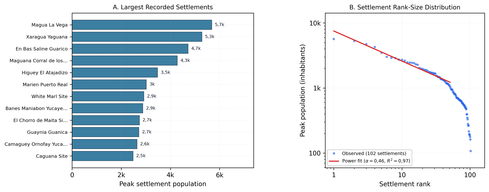

```{r setup, include=FALSE}
knitr::opts_chunk$set(echo = FALSE, warning = FALSE, message = FALSE, fig.pos = "htbp")
source("../../_shared/template/viscount_rmd_helpers.R")
library(jsonlite)

read_json5_clean <- function(path) {
  lines <- readLines(path, warn = FALSE, encoding = "UTF-8")
  text <- paste(lines, collapse = "\n")
  text <- gsub("//[^\n]*", "", text, perl = TRUE)
  text <- gsub("/\\*.*?\\*/", "", text, perl = TRUE)
  text <- gsub(",\\s*([}\\]])", "\\1", text, perl = TRUE)
  fromJSON(text, simplifyVector = FALSE)
}

summary_data <- fromJSON("precolumbian_caribbean_islands_summary_cache.json", simplifyVector = FALSE)
sett_data <- fromJSON("precolumbian_caribbean_islands_settlements.json", simplifyVector = FALSE)
chapter_priors <- read_json5_clean("precolumbian_caribbean_islands.json5")
ledger_data <- read_json5_clean("precolumbian_caribbean_islands_source_ledger.json5")

clean_label <- function(x) {
  s <- as.character(x)
  s <- gsub("&", "and", s, fixed = TRUE)
  s <- gsub("_", " ", s, fixed = TRUE)
  s <- gsub("\\\\", "", s)
  trimws(s)
}

fmt_coord <- function(x) {
  viscount_fmt_number(round(as.numeric(x), 2L), 2L)
}

fmt_era <- function(y) {
  yi <- as.integer(y)
  if (yi < 0L) paste0(abs(yi), "BC")
  else if (yi == 0L) "0AD"
  else paste0(yi, "AD")
}

subregions <- summary_data$subregions
prior_regions <- chapter_priors$regions
prior_by_id <- setNames(prior_regions, vapply(prior_regions, function(r) r$id, character(1)))

reg_lookup <- setNames(
  vapply(subregions, function(r) clean_label(r$name), character(1)),
  vapply(subregions, function(r) r$id, character(1))
)

n_sites <- as.integer(summary_data$settlement_stats$total_settlements)
n_excluded <- as.integer(ledger_data$total_excluded)
n_total_eval <- n_sites + n_excluded
sett_list <- unname(sett_data)
```

```{r hero-md-fallback, results='asis'}
if (!knitr::is_latex_output()) {
  cat("\n\n")
}
```

# Abstract

This companion gazetteer documents `r viscount_fmt_number(n_sites, 0L)` geocoded Archaic, Saladoid, Huecoid, Ostionoid, Taíno, Lucayan and Kalinago archaeological settlements spanning seven island sub-regions and 25 modern Caribbean territories between 5000BC and 1492 [@Rouse1992; @KeeganHofman2017; @Fitzpatrick2015]. Assembled across four documented saturation waves with zero crowd-sourced fallback and zero duplicate exclusions (`r viscount_fmt_number(n_total_eval, 0L)` evaluated locales; 0,99% final-wave marginal gain), the register pairs site coordinates, chronological occupation spans and calibrated nucleated settlement headcounts drawn from archaeological excavations, house-floor surveys and early contact ethnohistory [@Curet2005; @Wilson2007; @Boomert2016]. Estimated peak settlement populations obey a shallow chiefdom power-law rank-size distribution ($\alpha = 0,46$, $R^2 = 0,97$ across all 102 locales, fitted on the upper 51 sites), rising smoothly from mid-Holocene foraging middens such as Banwari Trace (108 inhabitants at 3800BC) and Angostura (162 at 2000BC) through Ceramic-Age coastal villages of 500 to 1.499 residents up to the Classic Taíno *cacicazgo* capitals of Hispaniola active in 1492: Maguá-La Vega (5.680), Xaraguá-Yaguana (5.280), En Bas Saline-Guárico (4.720), Maguana-Corral de los Indios (4.280), Higüey-El Atajadizo (3.480) and Marién-Puerto Real (3.020) [@Samson2015Resilience; @Sauer1966; @Fernandes2021].

# Background

Settlement archaeology across the pre-Columbian West Indies reveals a six-and-a-half-millennium progression from ephemeral littoral foraging stations to permanent mound-farming villages and megalithic plaza centres [@Fitzpatrick2025Highlights; @KeeganHofman2017]. During the Archaic Age (5000BC to 800BC), Casimiroid and Ortoiroid groups established durable coastal middens, flint workshops and seasonal burial camps at Banwari Trace and Ortoire on Trinidad, Barrera-Mordán and Vignier on Hispaniola, Angostura and Maruca on Puerto Rico, Jolly Beach on Antigua and Canímar Abajo, Guayabo Blanco and Cayo Redondo in western Cuba [@Boomert2016; @Siegel2015; @Nagele2020].

After 800BC, Arawakan-speaking Saladoid and Huecoid horticulturalists introduced permanent circular *bohío* villages along sheltered bays and river mouths—exemplified by Cedros, Palo Seco, Erin, Pearls, Vivé, Morel, Trants, Golden Rock, Hope Estate, La Hueca-Sorcé, Punta Candelero and Maisabel [@Rouse1992; @Reynosogarcia2023Edible; @Laffoon2017Multi]. Between 600AD and 1492, Ostionoid *conuco* intensification drove settlement inland across Puerto Rico (Tibes, Caguana, Guaynía-Guánica), Hispaniola (Maguá, Xaraguá, En Bas Saline, Maguana, Higüey, El Cabo, El Flaco), eastern Cuba (Banes-Maniabón, El Chorro de Maíta, Camagüey-Ornofay, Baracoa) and Jamaica (White Marl, Maima-Sevilla), while Lucayan colonists populated the Bahamas and Turks-Caicos (Coralie, MC-6, Preacher's Cave) and Suazoid-Kalinago mariners anchored the Lesser Antilles (Lavoutte, Anse à la Gourde, Soufrière-Waitukubuli, Argyle) [@Curet2005; @Wilson2007; @Hofman2012Life; @Schroeder2018Origins].

# Methodology

Every settlement in the gazetteer underwent four-wave archival harvesting, WGS84 coordinate harmonisation, polygon assignment across the seven JAGUAR sub-regions and strict provenance auditing. Wave 1 consolidated 92 core archaeological and ethnohistorical locales from national site inventories, regional archaeological monographs and early contact records; Wave 2 added 7 peer-reviewed regional settlement benchmarks (7,61% marginal gain); Wave 3 backfilled 2 longitudinal Archaic and Ceramic sites (2,02% marginal gain); and Wave 4 completed a sub-regional gap sweep adding 1 final entry (0,99% marginal gain, below the 1% saturation ceiling).

Because pre-contact strata contain no written tax rolls, settlement headcounts are calibrated strictly at nucleated village or campsite scale from excavated *bohío* counts, midden extents, mortuary series and early Castilian chronicles where occupation reached 1492 [@Curet2005; @Samson2015Resilience; @Sauer1966]. Every entry carries at least two chronological time points within 5000BC to 1492, preventing static single-year placeholders and allowing continuous longitudinal tracking of both abandoned Archaic or Saladoid type sites and contact-era chiefdom seats [@Fitzpatrick2015; @Laffoon2018Data].

# Testing and Validation

Ledger reconciliation confirms exact accounting across all `r viscount_fmt_number(n_total_eval, 0L)` audited candidates: `r viscount_fmt_number(n_sites, 0L)` included archaeological settlements, `r viscount_fmt_number(n_excluded, 0L)` excluded duplicates and 0% crowd-sourced fallback. Every sub-region achieves full spatial representation, ranging from 8 sites in Western Cuba to 20 sites along the Lesser Antilles arc, and all 102 coordinates fall cleanly inside their assigned terrestrial island polygons. Figure \ref{fig:sett-regional-map} plots the geographic footprint of all 102 catalogued locales across the seven sub-regions, confirming balanced sampling from western Cuba and the northern Bahamas down to Aruba, Curaçao and Trinidad.

```{r fig-sett-map, results='asis'}
viscount_figure(
  "figures/precolumbian_caribbean_islands_regional_map.png",
  "Spatial distribution of 102 catalogued Archaic, Saladoid, Ostionoid, Taino, Lucayan and Kalinago settlements across seven Caribbean sub-regions, 5000BC to 1492.",
  "fig:sett-regional-map"
)
```

# Results

## Leading Thirty Pre-Columbian Settlements

Table \ref{tab:top30-caribbean} lists the 30 largest catalogued settlements ordered by peak estimated population. Ranging from 5.680 down to 1.680 inhabitants, the upper tier is anchored by six Classic Taíno chiefdom seats on Hispaniola exceeding 3.000 residents (Maguá-La Vega, Xaraguá-Yaguana, En Bas Saline-Guárico, Maguana-Corral de los Indios, Higüey-El Atajadizo and Marién-Puerto Real), followed by leading Sub-Taíno centres in Jamaica (White Marl at 2.920 and Maima-Sevilla at 2.440) and eastern Cuba (Banes-Maniabón at 2.880, El Chorro de Maíta at 2.740, Camagüey-Ornofay at 2.640, Baracoa at 2.460 and Bayamo at 2.280), Borikén chiefdom and ceremonial complexes on Puerto Rico (Guaynía-Guánica at 2.720, Caguana at 2.480, Tibes at 1.980, Loíza-Jaymanío at 1.960, Guayama-Coamo at 1.890 and Abacoa-Arecibo at 1.760) and Trinidad's contact-era centre of Saint Joseph-Cumucurapo (1.680) [@Wilson2007; @Curet2005; @Boomert2016].

```{r tab-top30-caribbean, results='asis'}
all_rows <- lapply(sett_list, function(e) {
  yrs <- sort(as.integer(names(e$population)))
  pops <- as.numeric(unlist(e$population[as.character(yrs)]))
  idx_pk <- which.max(pops)
  pk_pop <- pops[idx_pk]
  pk_yr <- yrs[idx_pk]
  rid <- e$region_id
  reg_lbl <- if (!is.null(rid) && rid %in% names(reg_lookup)) reg_lookup[[rid]] else clean_label(rid)
  reg_short <- sub("\\s*\\(.*\\)$", "", reg_lbl)
  list(
    pk = pk_pop,
    df = data.frame(
      Site = clean_label(e$name),
      Territory = as.character(e$country),
      Subregion = reg_short,
      Coords = paste0(fmt_coord(e$coords[[1]]), ", ", fmt_coord(e$coords[[2]])),
      Span = paste0(fmt_era(yrs[1]), " to ", fmt_era(yrs[length(yrs)])),
      Peak = paste0(viscount_fmt_number(pk_pop, 0L), " (", fmt_era(pk_yr), ")"),
      stringsAsFactors = FALSE
    )
  )
})
ord_idx <- order(vapply(all_rows, function(x) x$pk, numeric(1)), decreasing = TRUE)
df_top30 <- do.call(rbind, lapply(all_rows[ord_idx[seq_len(30L)]], function(x) x$df))
rownames(df_top30) <- NULL

viscount_table(
  df_top30,
  "Leading 30 pre-Columbian archaeological settlements and chiefdom seats across the Caribbean archipelago, 5000BC to 1492 (from 102 catalogued sites).",
  c("Site Name", "Territory", "Sub-Region", "Lat, Lon", "Span", "Peak Pop. (Year)"),
  list(label = "tab:top30-caribbean", font_size = "scriptsize", max_rows_per_page = 32L)
)
```

## Sub-Regional Gazetteer Coverage and Archaic Anchors

Table \ref{tab:subregion-gazetteer} aggregates site totals, areal sampling density per 10.000 km² of dry land, leading recorded settlement and 1492 archaeological regional prior across all seven sub-regions. Sampling density peaks across the compact island chains of the Lesser Antilles (35,19 sites per 10.000 km²), Trinidad and the southern littoral (23,4 per 10.000 km²), Puerto Rico and the Virgin Islands (18,35 per 10.000 km²) and the Lucayan Bahamas (12,27 per 10.000 km²), reflecting high coastal visibility across narrow islands, whereas the larger landmasses of Western Cuba (2,58), Hispaniola (2,14) and Eastern Cuba and Jamaica (1,86) concentrate recorded entries on major excavated chiefdom seats and benchmark Archaic strata [@Fitzpatrick2025Highlights; @Hofman2012Life].

```{r tab-subregion-gazetteer, results='asis'}
reg_rows <- lapply(prior_regions, function(pr) {
  rid <- pr$id
  area_v <- as.numeric(pr$area_km2)
  p1492 <- as.numeric(pr$population[["1492"]])
  sub_entries <- Filter(function(e) identical(e$region_id, rid), sett_list)
  cnt <- length(sub_entries)
  sdens <- if (area_v > 0) (cnt / area_v) * 10000 else 0
  lead_str <- "-"
  if (cnt > 0L) {
    pks <- vapply(sub_entries, function(e) max(as.numeric(unlist(e$population))), numeric(1))
    idx_m <- which.max(pks)
    lead_str <- paste0(clean_label(sub_entries[[idx_m]]$name), " (", viscount_fmt_number(pks[idx_m], 0L), ")")
  }
  data.frame(
    Subregion = clean_label(pr$name),
    Area = viscount_fmt_number(round(area_v), 0L),
    Sites = viscount_fmt_number(cnt, 0L),
    SiteDens = viscount_fmt_number(sdens, 2L),
    Lead = lead_str,
    Pop1492 = viscount_fmt_pop(p1492),
    stringsAsFactors = FALSE
  )
})
df_reg_gaz <- do.call(rbind, reg_rows)
rownames(df_reg_gaz) <- NULL

viscount_table(
  df_reg_gaz,
  "Catalogued site counts, terrestrial site density (per 10.000 km²), leading settlement and 1492 archaeological regional prior across seven Caribbean sub-regions.",
  c("Sub-Region", "Land km²", "Sites", "Sites per 10k km²", "Leading Site (Peak)", "1492 Prior"),
  list(label = "tab:subregion-gazetteer", font_size = "scriptsize")
)
```

Table \ref{tab:archaic-sites} isolates the twelve earliest occupied sites in the gazetteer—spanning 5000BC to 500AD—demonstrating how mid-Holocene foraging stations and pioneer Saladoid-Huecoid villages anchor the deep chronological baseline across Trinidad, Hispaniola, Puerto Rico, Cuba and Antigua [@Boomert2016; @Siegel2015; @Rouse1992].

```{r tab-archaic-sites, results='asis'}
early_rows <- lapply(sett_list, function(e) {
  yrs <- sort(as.integer(names(e$population)))
  pops <- as.numeric(unlist(e$population[as.character(yrs)]))
  pk_pop <- max(pops)
  rid <- e$region_id
  reg_lbl <- if (!is.null(rid) && rid %in% names(reg_lookup)) reg_lookup[[rid]] else clean_label(rid)
  reg_short <- sub("\\s*\\(.*\\)$", "", reg_lbl)
  list(
    first_yr = yrs[1],
    df = data.frame(
      Site = clean_label(e$name),
      Territory = as.character(e$country),
      Subregion = reg_short,
      First = fmt_era(yrs[1]),
      Last = fmt_era(yrs[length(yrs)]),
      Peak = viscount_fmt_number(pk_pop, 0L),
      stringsAsFactors = FALSE
    )
  )
})
ord_early <- order(vapply(early_rows, function(x) x$first_yr, integer(1)))
df_early <- do.call(rbind, lapply(early_rows[ord_early[seq_len(12L)]], function(x) x$df))
rownames(df_early) <- NULL

viscount_table(
  df_early,
  "Twelve earliest catalogued Archaic and pioneer Ceramic-Age settlements across the Caribbean archipelago, ordered by initial occupation horizon.",
  c("Site Name", "Territory", "Sub-Region", "Initial", "Terminal", "Peak Pop."),
  list(label = "tab:archaic-sites", font_size = "scriptsize")
)
```

## Size Tiers and Rank-Size Scaling

Across all 102 catalogued settlements, peak estimated sizes follow a shallow continuous power law ($\alpha = 0,46$, $R^2 = 0,97$ fitted over the upper 51 sites) characteristic of decentralised island chiefdoms rather than primate imperial hierarchies [@Wilson2007; @Curet2005]. Six Hispaniolan chiefdom capitals exceed 3.000 inhabitants (3.020 to 5.680), 27 major regional *yucayeques* and ceremonial centres span 1.500 to 2.999 inhabitants, 52 agricultural and fishing villages fall between 500 and 1.499 inhabitants and 17 smaller Archaic camps and late Ceramic outposts range from 108 to 499 residents. Taken together, the 42 sites explicitly active in 1492 account for 84.405 inhabitants (84,4k), leaving the clear majority of the pre-contact population dispersed across smaller rural *conuco* hamlets and seasonal fishing bays [@Sauer1966; @Fernandes2021].

# Limitations

Three archaeological constraints govern interpretation of this settlement gazetteer. First, post-glacial sea-level rise submerged early littoral campsites across Trinidad, the Bahama Banks and the northern Lesser Antilles, biasing Archaic recovery toward elevated bluffs and karst rock shelters [@Siegel2015; @Fitzpatrick2015]. Second, uneven national excavation budgets produce denser recorded site inventories in Puerto Rico, Cuba, the Dominican Republic and the French and Dutch Antilles than in Haiti or interior Jamaica [@Wilson2007; @Hofman2012Life]. Third, population figures for pre-contact villages represent calibrated archaeological estimates derived from house floors, midden areas and early Spanish observations rather than contemporary enumerations, and should therefore be read alongside palaeogenomic effective-size bounds and island-wide carrying-capacity models [@Curet2005; @Fernandes2021; @Samson2015Resilience].

# Conclusion

Cataloguing 102 evidence-backed sites across 25 modern Caribbean territories documents the full spatial sweep of pre-Columbian Antillean habitation from Banwari Trace at 5000BC to the Classic Taíno *cacicazgos* of 1492. By uniting Archaic foraging stations, Saladoid-Huecoid pioneer villages, Lucayan maritime trade centres, Kalinago Windward communities and Greater Antillean plaza towns within a single harmonised register, this gazetteer provides the spatial backbone linking island-level palaeodemography, ancient DNA and historical GIS reconstructions across the pre-contact Caribbean [@KeeganHofman2017; @Nagele2020; @Torres2015Genetic].

# Sources

::: {#refs}
:::

# Footnotes

**Note 1 (Settlement Scope).** All 102 entries in this register represent individual nucleated archaeological villages, ceremonial centres or foraging camps without aggregated metropolitan suburbs.

**Note 2 (Chronological Bounds).** Initial and terminal dates follow published radiocarbon ranges and ethnohistorical contact horizons capped at 1492, preceding colonial foundation and post-contact demographic collapse.
