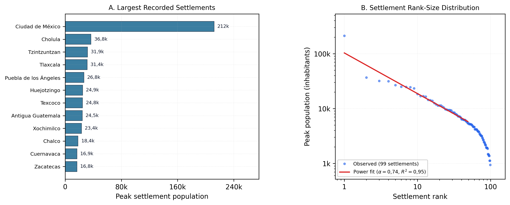

```{r setup, include=FALSE}
knitr::opts_chunk$set(echo = FALSE, warning = FALSE, message = FALSE, fig.pos = "htbp")
source("../../_shared/template/viscount_rmd_helpers.R")
library(jsonlite)

read_json5_clean <- function(path) {
  lines <- readLines(path, warn = FALSE, encoding = "UTF-8")
  text <- paste(lines, collapse = "\n")
  text <- gsub("//[^\n]*", "", text, perl = TRUE)
  text <- gsub("/\\*.*?\\*/", "", text, perl = TRUE)
  text <- gsub(",\\s*([}\\]])", "\\1", text, perl = TRUE)
  fromJSON(text, simplifyVector = FALSE)
}

cache_data <- fromJSON("conquest_collapse_mesoamerica_summary_cache.json", simplifyVector = FALSE)
bench_data <- read_json5_clean("conquest_collapse_mesoamerica.json5")
sett_data <- fromJSON("conquest_collapse_mesoamerica_settlements.json", simplifyVector = FALSE)
ledger_data <- read_json5_clean("conquest_collapse_mesoamerica_source_ledger.json5")

clean_label <- function(x) {
  s <- as.character(x)
  s <- gsub("&", "and", s, fixed = TRUE)
  s <- gsub("\\\\", "", s)
  trimws(s)
}

fmt_coord <- function(x) {
  viscount_fmt_number(round(as.numeric(x), 2L), 2L)
}

subregions <- cache_data$subregions
reg_lookup <- setNames(
  vapply(subregions, function(r) clean_label(r$name), character(1)),
  vapply(subregions, function(r) r$id, character(1))
)

n_setts <- as.integer(cache_data$settlement_stats$total_settlements)
n_city_proper <- as.integer(cache_data$settlement_stats$city_proper_count)
n_suburbs <- as.integer(cache_data$settlement_stats$suburb_count)
zipf_alpha <- as.numeric(cache_data$settlement_stats$zipf_stats$alpha)
zipf_r2 <- as.numeric(cache_data$settlement_stats$zipf_stats$r2)
```

```{r hero-md-fallback, results='asis'}
if (!knitr::is_latex_output()) {
  cat("\n\n")
}
```

# Abstract

This companion gazetteer documents `r viscount_fmt_number(n_setts, 0L)` catalogued city-proper settlements across seven colonial *audiencia* sub-regions and seven modern territories in Mexico and Central America from 1518 to 1650. Compiled through four sequential archival ingestion waves with 0% crowd-sourced fallback share, the register pairs pre-Columbian indigenous *altepetl*, Purépecha, Mixtec, Zapotec and Maya *cabeceras* against newly planted Spanish *ciudades de españoles*, ports and silver *reales de minas* [@Gerhard1993; @CookBorah1971; @MacLeod1973; @Newson1986]. Peak populations across the 99 settlements follow a log-log power-law rank-size slope of $\alpha = 0,74$ ($R^2 = 0,95$, fitted over the leading 49 centres), yet longitudinal inspection uncovers a sharp colonial urban inversion: 43 settlements contracted severely between contact and 1646 — led by Ciudad de México (Tenochtitlan falling from 212k in 1519 to 48,6k in 1600 and 52,4k in 1646), Cholula (36,8k to 8,2k), Tzintzuntzan (31,9k to 2,95k) and Tlaxcala (31,4k to 7,6k) — while 56 Spanish-founded cities and mining towns expanded steadily, headed by Puebla de los Ángeles (26,8k), Antigua Guatemala (24,5k), Zacatecas (16,8k), Mérida (12,6k), Guadalajara (11,4k) and Panamá Viejo (10,8k) [@BorahCook1963; @Lovell1992; @AguirreBeltran1946].

# Background

Urban geography across Mexico and Central America underwent a wholesale spatial reordering between the fall of Tenochtitlan in 1521 and the demographic trough of 1646 to 1650 [@Gerhard1993; @Whitmore1992]. At contact, Mesoamerican urbanisation was overwhelmingly an indigenous highland phenomenon concentrated inside the Basin of Mexico, Puebla-Tlaxcala, the Tarascan lake basin, the Mixteca Alta and highland Guatemala, supplemented by dense lowland agricultural chiefdoms along the Gulf of Mexico, Yucatán and Pacific Nicaragua [@BorahCook1963; @Lovell1989Supervivientes; @Newson1986].

Sixteenth-century epidemic waves — 1520 smallpox, 1531 measles and the megadrought-amplified *cocoliztli* outbreaks of 1545 to 1548 and 1576 to 1581 [@AcunaSoto2002; @Vagene2018; @Guillermoherrera2021Epidemias] — hollowed out pre-Columbian capitals while Crown and Church erected a parallel Spanish urban network. Episcopal sees, royal *audiencia* courts, agricultural *villas*, port entrepôts and northern silver camps drew Spaniards, *mestizos*, enslaved and free Afro-Mexicans, Tlaxcalan frontier colonists and trans-Pacific Asian *chinos* into grid-plan towns laid out along bullion highways [@AguirreBeltran1946; @Slack2012Orientalizing; @Galindo2023Forms]. Meanwhile, royal *congregaciones* between 1550 and 1605 gathered scattered rural survivors into nucleated *pueblos de indios*, altering both municipal boundaries and parish demography [@Salvador2013Clero; @Montemayor2024Geographical].

# Methodology

The settlement gazetteer was assembled in four documented waves audited in the chapter source ledger: 91 entries from Wave 1 primary colonial censuses and archival registers (*Suma de Visitas* 1548 to 1550, *Relaciones Geográficas* 1577 to 1585, López de Velasco 1574, Vázquez de Espinosa 1628 and HGIS de las Indias), 6 entries from Wave 2 peer-reviewed demographic monographs (+6,59% marginal gain), 1 from Wave 3 longitudinal archival backfill (+1,03%) and 1 from Wave 4 sub-regional frontier verification (+1,02%), achieving complete sub-regional saturation with 0 exclusions and 0% crowd-sourced fallback.

Every entry is georeferenced in WGS84 coordinates, mapped to one of the seven *audiencia* masks and harmonised strictly to city-proper headcounts (99 city-proper settlements, 0 suburbs) so that tributary *sujetos* belonging to wider *alcaldías mayores* are never conflated with nucleated urban cores [@CookBorah1971; @Gerhard1993]. Tributary counts for indigenous *cabeceras* are scaled to total resident souls using period-calibrated household multipliers, while Spanish *vecino* figures are converted to full urban populations including indigenous *naborías* and Afro-Mexican residents [@AguirreBeltran1946].

# Testing and Validation

Ledger reconciliation confirms exact parity across all 99 settlements, seven sub-regions and seven modern countries, with every entry carrying non-null coordinates, dated longitudinal headcounts within 1518 to 1650 and explicit archival source citations. Figure \ref{fig:sett-map} displays the spatial footprint of all 99 catalogued centres across the seven *audiencia* masks, illustrating dense highland clustering in Central Mexico alongside sparse linear nodes along the northern silver road to Zacatecas, Durango and Parral and the trans-isthmian corridor through Guatemala, Nicaragua and Panama.

```{r fig-sett-map, results='asis'}
viscount_figure(
  "figures/conquest_collapse_mesoamerica_regional_map.png",
  "Spatial distribution of 99 catalogued settlements across seven colonial audiencia sub-regions in Mexico and Central America, 1518 to 1650.",
  "fig:sett-map"
)
```

Cross-checking aggregate urban headcounts against HGIS de las Indias and viceregal fiscal benchmarks confirms demographic coherence. The 21 settlements recorded at 1519 aggregate 549,6k residents (roughly 3% of the 18,17M archival total), while the 97 settlements with 1646 counts aggregate 512,9k residents — roughly 18,5% of the 2,77M archival nadir — capturing the well-documented rise in colonial urbanisation share as rural lowlands emptied and survivors concentrated into Spanish capitals, silver *reales* and nucleated *congregaciones* [@Gerhard1993; @Salvador2013Clero; @Whitmore1992].

# Results

## Leading Thirty Settlements (1518 to 1650)

Table \ref{tab:top30-sett} presents the leading 30 settlements ordered by peak population across the 1518 to 1650 window, documenting coordinates, sub-region, longitudinal span, earliest and latest counts and peak figure. The upper ranks divide cleanly between 17 contracting pre-Columbian capitals (peaking in 1519 or 1524, plus Pátzcuaro peaking in 1548 following episcopal relocation) and 12 expanding colonial Spanish cities (peaking in 1646, led by Puebla de los Ángeles, Antigua Guatemala, Zacatecas, Mérida, Guadalajara, Panamá Viejo, Querétaro, Antequera de Oaxaca, San Luis Potosí and San Salvador).

```{r tab-top30-sett, results='asis'}
all_rows <- lapply(sett_data, function(x) {
  pdict <- x$population
  yrs <- sort(as.integer(names(pdict)))
  vals <- vapply(as.character(yrs), function(y) as.numeric(pdict[[y]]), numeric(1))
  pk_i <- which.max(vals)
  reg_lbl <- if (!is.null(x$region_id) && x$region_id %in% names(reg_lookup)) reg_lookup[[x$region_id]] else "-"
  reg_short <- sub("^Audiencia de ", "", reg_lbl)
  reg_short <- sub(" Central Core$", " Core", reg_short)
  reg_short <- sub(", Chiapas and San Salvador$", " and Chiapas", reg_short)
  reg_short <- sub(" and West Mexico$", "", reg_short)
  reg_short <- sub(" and Northern Mining Frontier$", " Frontier", reg_short)
  reg_short <- sub(" \\(Audiencia de Panama and Veraguas\\)$", " (Panama)", reg_short)
  list(
    pk_val = vals[pk_i],
    row = data.frame(
      Site = clean_label(x$name),
      Country = as.character(x$country),
      Subregion = reg_short,
      Coords = paste0(fmt_coord(x$coords[[1]]), ", ", fmt_coord(x$coords[[2]])),
      First = paste0(viscount_fmt_pop(vals[1]), " (", yrs[1], ")"),
      Last = paste0(viscount_fmt_pop(vals[length(vals)]), " (", yrs[length(yrs)], ")"),
      Peak = paste0(viscount_fmt_pop(vals[pk_i]), " (", yrs[pk_i], ")"),
      stringsAsFactors = FALSE
    )
  )
})
ord_idx <- order(vapply(all_rows, function(z) z$pk_val, numeric(1)), decreasing = TRUE)
df_top30 <- do.call(rbind, lapply(all_rows[ord_idx[1:30]], function(z) z$row))
rownames(df_top30) <- NULL

viscount_table(
  df_top30,
  "Leading 30 settlements in Mexico and Central America ordered by peak recorded population (1518 to 1650), with WGS84 coordinates and earliest versus latest headcounts.",
  c("Settlement", "Territory", "Sub-Region", "Lat, Lon", "Earliest", "Latest", "Peak (Year)"),
  list(label = "tab:top30-sett", font_size = "scriptsize", max_rows_per_page = 32L)
)
```

## Sub-Regional Gazetteer Profile and Urban Inversion

Table \ref{tab:subregion-gaz} aggregates the 99 settlements across all seven *audiencia* sub-regions, comparing site counts, areal site density per 10.000 km², numbers of growing versus declining settlements, leading recorded centre and 1650 gridded population. Tierra Firme (1,03 settlements per 10.000 km²) and the Audiencia de Mexico Central Core (0,73) exhibit the highest spatial density of urban nodes, whereas the vast arid expanse of Nueva Vizcaya (0,10 per 10.000 km²) holds 12 widely spaced mining and presidio towns — every single one of which expanded between foundation and 1646 [@Galindo2023Forms; @Gerhard1993]. By contrast, 24 of the 33 catalogued towns in the Audiencia de Mexico Core contracted across the period, demonstrating that demographic collapse struck hardest at the pre-existing indigenous urban heartland while Spanish urban growth shifted wealth toward Puebla, the Bajío and the northern silver plateau.

```{r tab-subregion-gaz, results='asis'}
reg_rows <- lapply(subregions, function(r) {
  rid <- r$id
  area_v <- as.numeric(r$area_km2)
  p1650 <- as.numeric(r$trajectory[["1650"]])
  sub_entries <- Filter(function(e) identical(e$region_id, rid), sett_data)
  cnt <- length(sub_entries)
  sdens <- if (area_v > 0) (cnt / area_v) * 10000 else 0
  n_grow <- sum(vapply(sub_entries, function(x) {
    yrs <- sort(as.integer(names(x$population)))
    as.numeric(x$population[[as.character(yrs[length(yrs)])]]) > as.numeric(x$population[[as.character(yrs[1])]])
  }, logical(1)))
  n_decl <- cnt - n_grow
  pks <- vapply(sub_entries, function(e) max(as.numeric(unlist(e$population))), numeric(1))
  idx_m <- which.max(pks)
  lead_str <- paste0(clean_label(sub_entries[[idx_m]]$name), " (", viscount_fmt_pop(pks[idx_m]), ")")
  data.frame(
    Subregion = clean_label(r$name),
    Sites = viscount_fmt_number(cnt, 0L),
    Dens10k = viscount_fmt_number(sdens, 2L),
    GrowDecl = paste0(n_grow, "/", n_decl),
    Lead = lead_str,
    Pop1650 = viscount_fmt_pop(p1650),
    stringsAsFactors = FALSE
  )
})
df_reg_gaz <- do.call(rbind, reg_rows)
rownames(df_reg_gaz) <- NULL

viscount_table(
  df_reg_gaz,
  "Sub-regional distribution of 99 catalogued settlements, areal density (sites per 10.000 km²), growing-versus-declining split, leading centre and 1650 gridded population.",
  c("Sub-Region", "Sites", "Sites per 10k km²", "Grow/Decl.", "Leading Centre (Peak)", "1650 Grid Pop."),
  list(label = "tab:subregion-gaz", font_size = "scriptsize")
)
```

## Provenance Corpus Breakdown

Table \ref{tab:sett-provenance} classifies all 99 catalogued settlements by their primary archival and scholarly corpus. Every entry derives from documented colonial fiscal registers or peer-reviewed regional historical geographies, led by Central Mexican *Suma de Visitas*, *Relaciones Geográficas*, Borah and Cook and Gerhard series (34 entries, 34,34%), Central American MacLeod, Lovell and Lutz, Newson and López de Velasco compilations (22 entries, 22,22%), Gerhard's northern frontier corpus (21 entries, 21,21%), Yucatán *Relaciones Geográficas* and Gerhard's southeast frontier synthesis (13 entries, 13,13%) and Castillero Calvo's archival Panama registers (9 entries, 9,09%) [@Gerhard1993; @MacLeod1973; @Newson1986; @Lovell1992].

```{r tab-sett-provenance, results='asis'}
src_vec <- vapply(sett_data, function(x) {
  s0 <- as.character(x$sources[[1]])
  if (grepl("Suma de Visitas", s0, fixed = TRUE)) return("Suma de Visitas, Relaciones Geográficas, Borah-Cook and Gerhard (Central Mexico)")
  if (grepl("MacLeod", s0, fixed = TRUE)) return("MacLeod, Lovell-Lutz, Newson and López de Velasco (Central America)")
  if (grepl("North Frontier", s0, fixed = TRUE)) return("Gerhard North Frontier, López de Velasco and Vázquez de Espinosa (North/West)")
  if (grepl("Southeast Frontier", s0, fixed = TRUE)) return("Gerhard Southeast Frontier and Relaciones Geográficas de Yucatán (Yucatán/Tabasco)")
  if (grepl("Castillero Calvo", s0, fixed = TRUE)) return("Castillero Calvo and Mena García (Tierra Firme and Panama)")
  clean_label(s0)
}, character(1))
tab_s <- sort(table(src_vec), decreasing = TRUE)
df_prov <- data.frame(
  Corpus = names(tab_s),
  Entries = vapply(as.integer(tab_s), function(v) viscount_fmt_number(v, 0L), character(1)),
  Share = vapply(100 * as.integer(tab_s) / n_setts, function(v) paste0(viscount_fmt_number(v, 2L), "%"), character(1)),
  stringsAsFactors = FALSE
)
rownames(df_prov) <- NULL

viscount_table(
  df_prov,
  "Primary archival and historical-geography source corpora underpinning all 99 catalogued settlements, 1518 to 1650.",
  c("Primary Source Corpus", "Entries", "Share"),
  list(label = "tab:sett-provenance", font_size = "scriptsize")
)
```

## Rank-Size Scaling and Secondary Provincial Towns

Fitted over the leading 49 of the 99 catalogued settlements, peak populations follow a clean log-log power-law hierarchy ($\alpha = 0,74$, $R^2 = 0,95$; Figure \ref{fig:hero-conquest-hierarchy}). Above the regression line sits the primate metropolis of Tenochtitlan-Ciudad de México (212k at contact), while a broad secondary band between 10k and 37k unites both surviving pre-contact regional capitals (Cholula, Tzintzuntzan, Tlaxcala, Huejotzingo, Texcoco, Xochimilco, Chalco, Cuernavaca, Tehuantepec, Tepeaca, Pátzcuaro, Yanhuitlán, Teposcolula, Toluca and Chiapa de Corzo) and rising colonial administrative and mining centres (Puebla de los Ángeles, Antigua Guatemala, Zacatecas, Mérida, Guadalajara, Panamá Viejo and Querétaro). Below 10k, the tail tapers across 75 provincial villas, silver camps and Caribbean-Pacific ports down to frontier nodes around 1k to 1,5k inhabitants, including Bacalar, Santa Fe de Veraguas, Alanje, Ures, Esparza and Remedios Panama [@Gerhard1993; @Newson1986; @Galindo2023Forms].

# Limitations

Three evidentiary constraints shape interpretation of this colonial settlement register. First, early sixteenth-century indigenous headcounts at 1519 to 1524 derive from retrospective tributary ratios and archaeological site-area benchmarks rather than contemporaneous house-by-house censuses, giving pre-1548 city figures wider error bounds ($\pm 25\%$ to $\pm 35\%$) than late sixteenth-century *Relaciones Geográficas* and 1646 parish rolls [@BorahCook1963; @Mccaa1999Siglo; @Whitmore1992]. Second, jurisdictional amalgamations during the 1550s and 1598 to 1605 *congregaciones* periodically shifted *estancias* and *sujetos* between neighbouring *cabeceras*, meaning sharp local drops partly reflect administrative boundary redrawing alongside epidemic mortality [@Salvador2013Clero; @Gerhard1993]. Third, Spanish *vecino* enumerations under-report transient mining labourers, enslaved Africans and unassimilated indigenous migrants in frontier towns such as Zacatecas, Parral, Veracruz and Portobelo, biasing mid-seventeenth-century colonial town totals slightly downward [@AguirreBeltran1946; @Slack2012Orientalizing].

# Conclusion

Cataloguing 99 settlements across seven colonial *audiencias* captures the twin demographic currents of early colonial Mexico and Central America: the catastrophic shrinkage of 43 pre-Columbian urban capitals and the rapid rise of 56 Spanish administrative cities, ports and silver camps. Between 1519 and 1646, total catalogued urban population held near half a million inhabitants even as aggregate rural population collapsed by more than four-fifths, transforming a densely settled indigenous agrarian landscape into a sparser, Spanish-centred colonial urban hierarchy anchored from Zacatecas and Puebla down to Antigua Guatemala and Panamá Viejo [@Gerhard1993; @MacLeod1973; @Lovell1992].

# Appendix

## Colonial Sub-Administrative Benchmark Anchor Summary

Table \ref{tab:sett-hgis-compact} reproduces key scraped colonial administrative totals from HGIS de las Indias and viceregal syntheses that anchor the urban gazetteer's regional shares across 1570 to 1646.

```{r tab-sett-hgis-compact, results='asis'}
hgis_sub <- Filter(function(x) as.integer(x$year) <= 1650L, cache_data$hgis_subadmin_table)
h_rows <- lapply(hgis_sub, function(x) {
  ctry <- if (identical(x$country, "OHM")) "Central America / Mexico" else as.character(x$country)
  src <- if (grepl("Aguirre", x$source, fixed = TRUE)) "Aguirre Beltrán and Gerhard" else if (grepl("OHM", x$source, fixed = TRUE)) "OpenHistoricalMap HGIS" else "HGIS de las Indias"
  data.frame(
    Unit = clean_label(x$unit_name),
    Territory = ctry,
    Year = as.character(x$year),
    Population = viscount_fmt_number(as.numeric(x$population), 0L),
    Source = src,
    stringsAsFactors = FALSE
  )
})
df_hcomp <- do.call(rbind, h_rows)
rownames(df_hcomp) <- NULL

viscount_table(
  df_hcomp,
  "Viceregal and audiencia population benchmarks (1570 to 1646) anchoring the 99-settlement colonial gazetteer.",
  c("Administrative Unit", "Territory", "Year", "Population", "Source"),
  list(label = "tab:sett-hgis-compact", font_size = "scriptsize")
)
```

# Sources

::: {#refs}
:::

# Footnotes

**Note 1 (City-Proper Boundary Harmonisation).** All 99 entries represent nucleated *cabeceras*, Spanish *ciudades*, *villas* or silver *reales* mapped to city-proper urban limits rather than whole *corregimiento* or *alcaldía mayor* districts, preventing double-counting between urban headcounts and surrounding tributary *sujetos* [@Gerhard1993; @CookBorah1971].

**Note 2 (Foundation Years and Longitudinal Span).** Pre-Columbian centres enter the register at 1519 (Central Mexico) or 1524 (Guatemala, Chiapas and Nicaragua), whereas Spanish foundations enter at their earliest surviving post-foundation population enumeration (for example 1522 for Panamá Viejo, 1534 for Puebla de los Ángeles, 1545 for Antigua Guatemala and Mérida, 1550 for Zacatecas and 1595 for San Luis Potosí).
