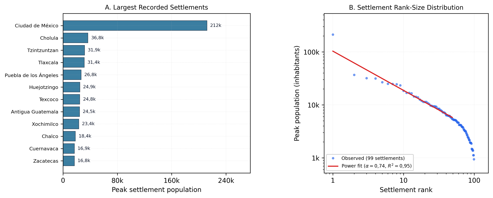
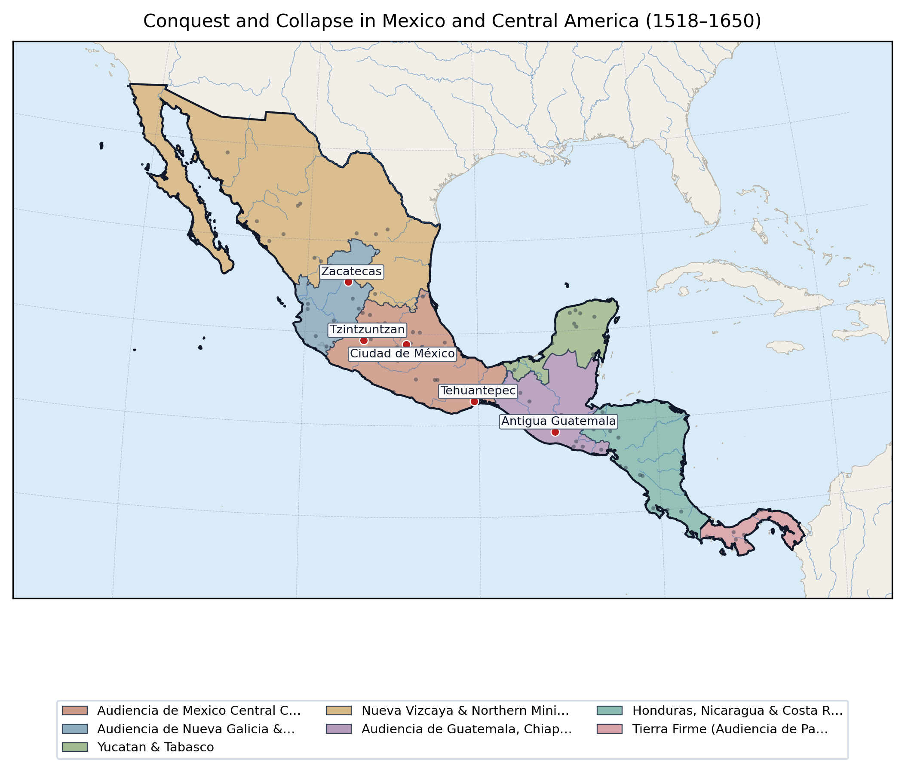

Conquest and Collapse in Mexico and Central America
================
Aust Kätzchen
23 November 2026

- [Abstract](#abstract)
- [Background](#background)
- [Methodology](#methodology)
- [Testing and Validation](#testing-and-validation)
- [Results](#results)
  - [Leading Thirty Settlements (1518 to
    1650)](#leading-thirty-settlements-1518-to-1650)
  - [Sub-Regional Gazetteer Profile and Urban
    Inversion](#sub-regional-gazetteer-profile-and-urban-inversion)
  - [Provenance Corpus Breakdown](#provenance-corpus-breakdown)
  - [Rank-Size Scaling and Secondary Provincial
    Towns](#rank-size-scaling-and-secondary-provincial-towns)
- [Limitations](#limitations)
- [Conclusion](#conclusion)
- [Appendix](#appendix)
  - [Colonial Sub-Administrative Benchmark Anchor
    Summary](#colonial-sub-administrative-benchmark-anchor-summary)
- [Sources](#sources)
- [Footnotes](#footnotes)

<figure>

<figcaption aria-hidden="true">Twelve largest catalogued settlements and
log-log rank-size distribution across 99 settlements in Mexico and
Central America, 1518 to 1650.</figcaption>
</figure>

# Abstract

This companion gazetteer documents 99 catalogued city-proper settlements
across seven colonial *audiencia* sub-regions and seven modern
territories in Mexico and Central America from 1518 to 1650. Compiled
through four sequential archival ingestion waves with 0% crowd-sourced
fallback share, the register pairs pre-Columbian indigenous *altepetl*,
Purépecha, Mixtec, Zapotec and Maya *cabeceras* against newly planted
Spanish *ciudades de españoles*, ports and silver *reales de minas*
[\[1\]](#ref-Gerhard1993)[\[2\]](#ref-CookBorah1971)[\[3\]](#ref-MacLeod1973)[\[4\]](#ref-Newson1986).
Peak populations across the 99 settlements follow a log-log power-law
rank-size slope of $\alpha = 0,74$ ($R^2 = 0,95$, fitted over the
leading 49 centres), yet longitudinal inspection uncovers a sharp
colonial urban inversion: 43 settlements contracted severely between
contact and 1646 — led by Ciudad de México (Tenochtitlan falling from
212k in 1519 to 48,6k in 1600 and 52,4k in 1646), Cholula (36,8k to
8,2k), Tzintzuntzan (31,9k to 2,95k) and Tlaxcala (31,4k to 7,6k) —
while 56 Spanish-founded cities and mining towns expanded steadily,
headed by Puebla de los Ángeles (26,8k), Antigua Guatemala (24,5k),
Zacatecas (16,8k), Mérida (12,6k), Guadalajara (11,4k) and Panamá Viejo
(10,8k)
[\[5\]](#ref-BorahCook1963)[\[6\]](#ref-Lovell1992)[\[7\]](#ref-AguirreBeltran1946).

# Background

Urban geography across Mexico and Central America underwent a wholesale
spatial reordering between the fall of Tenochtitlan in 1521 and the
demographic trough of 1646 to 1650
[\[1\]](#ref-Gerhard1993)[\[8\]](#ref-Whitmore1992). At contact,
Mesoamerican urbanisation was overwhelmingly an indigenous highland
phenomenon concentrated inside the Basin of Mexico, Puebla-Tlaxcala, the
Tarascan lake basin, the Mixteca Alta and highland Guatemala,
supplemented by dense lowland agricultural chiefdoms along the Gulf of
Mexico, Yucatán and Pacific Nicaragua
[\[4\]](#ref-Newson1986)[\[5\]](#ref-BorahCook1963)[\[9\]](#ref-Lovell1989Supervivientes).

Sixteenth-century epidemic waves — 1520 smallpox, 1531 measles and the
megadrought-amplified *cocoliztli* outbreaks of 1545 to 1548 and 1576 to
1581
[\[10\]](#ref-AcunaSoto2002)[\[11\]](#ref-Vagene2018)[\[12\]](#ref-Guillermoherrera2021Epidemias)
— hollowed out pre-Columbian capitals while Crown and Church erected a
parallel Spanish urban network. Episcopal sees, royal *audiencia*
courts, agricultural *villas*, port entrepôts and northern silver camps
drew Spaniards, *mestizos*, enslaved and free Afro-Mexicans, Tlaxcalan
frontier colonists and trans-Pacific Asian *chinos* into grid-plan towns
laid out along bullion highways
[\[7\]](#ref-AguirreBeltran1946)[\[13\]](#ref-Slack2012Orientalizing)[\[14\]](#ref-Galindo2023Forms).
Meanwhile, royal *congregaciones* between 1550 and 1605 gathered
scattered rural survivors into nucleated *pueblos de indios*, altering
both municipal boundaries and parish demography
[\[15\]](#ref-Salvador2013Clero)[\[16\]](#ref-Montemayor2024Geographical).

# Methodology

The settlement gazetteer was assembled in four documented waves audited
in the chapter source ledger: 91 entries from Wave 1 primary colonial
censuses and archival registers (*Suma de Visitas* 1548 to 1550,
*Relaciones Geográficas* 1577 to 1585, López de Velasco 1574, Vázquez de
Espinosa 1628 and HGIS de las Indias), 6 entries from Wave 2
peer-reviewed demographic monographs (+6,59% marginal gain), 1 from Wave
3 longitudinal archival backfill (+1,03%) and 1 from Wave 4 sub-regional
frontier verification (+1,02%), achieving complete sub-regional
saturation with 0 exclusions and 0% crowd-sourced fallback.

Every entry is georeferenced in WGS84 coordinates, mapped to one of the
seven *audiencia* masks and harmonised strictly to city-proper
headcounts (99 city-proper settlements, 0 suburbs) so that tributary
*sujetos* belonging to wider *alcaldías mayores* are never conflated
with nucleated urban cores
[\[1\]](#ref-Gerhard1993)[\[2\]](#ref-CookBorah1971). Tributary counts
for indigenous *cabeceras* are scaled to total resident souls using
period-calibrated household multipliers, while Spanish *vecino* figures
are converted to full urban populations including indigenous *naborías*
and Afro-Mexican residents [\[7\]](#ref-AguirreBeltran1946).

# Testing and Validation

Ledger reconciliation confirms exact parity across all 99 settlements,
seven sub-regions and seven modern countries, with every entry carrying
non-null coordinates, dated longitudinal headcounts within 1518 to 1650
and explicit archival source citations. Figure displays the spatial
footprint of all 99 catalogued centres across the seven *audiencia*
masks, illustrating dense highland clustering in Central Mexico
alongside sparse linear nodes along the northern silver road to
Zacatecas, Durango and Parral and the trans-isthmian corridor through
Guatemala, Nicaragua and Panama.

<!-- -->

Cross-checking aggregate urban headcounts against HGIS de las Indias and
viceregal fiscal benchmarks confirms demographic coherence. The 21
settlements recorded at 1519 aggregate 549,6k residents (roughly 3% of
the 18,17M archival total), while the 97 settlements with 1646 counts
aggregate 512,9k residents — roughly 18,5% of the 2,77M archival nadir —
capturing the well-documented rise in colonial urbanisation share as
rural lowlands emptied and survivors concentrated into Spanish capitals,
silver *reales* and nucleated *congregaciones*
[\[1\]](#ref-Gerhard1993)[\[8\]](#ref-Whitmore1992)[\[15\]](#ref-Salvador2013Clero).

# Results

## Leading Thirty Settlements (1518 to 1650)

Table presents the leading 30 settlements ordered by peak population
across the 1518 to 1650 window, documenting coordinates, sub-region,
longitudinal span, earliest and latest counts and peak figure. The upper
ranks divide cleanly between 17 contracting pre-Columbian capitals
(peaking in 1519 or 1524, plus Pátzcuaro peaking in 1548 following
episcopal relocation) and 12 expanding colonial Spanish cities (peaking
in 1646, led by Puebla de los Ángeles, Antigua Guatemala, Zacatecas,
Mérida, Guadalajara, Panamá Viejo, Querétaro, Antequera de Oaxaca, San
Luis Potosí and San Salvador).

| Settlement | Territory | Sub-Region | Lat, Lon | Earliest | Latest | Peak (Year) |
|:---|:---|:---|:---|:---|:---|:---|
| **Ciudad de México** | Mexico | Mexico Core | 19,43, -99,13 | 212k (1519) | 52,4k (1646) | 212k (1519) |
| **Cholula** | Mexico | Mexico Core | 19,06, -98,3 | 36,8k (1519) | 8,2k (1646) | 36,8k (1519) |
| **Tzintzuntzan** | Mexico | Mexico Core | 19,63, -101,58 | 31,9k (1519) | 3k (1646) | 31,9k (1519) |
| **Tlaxcala** | Mexico | Mexico Core | 19,32, -98,24 | 31,4k (1519) | 7,6k (1646) | 31,4k (1519) |
| **Puebla de los Ángeles** | Mexico | Mexico Core | 19,04, -98,21 | 1,8k (1534) | 26,8k (1646) | 26,8k (1646) |
| **Huejotzingo** | Mexico | Mexico Core | 19,16, -98,4 | 24,9k (1519) | 5,2k (1646) | 24,9k (1519) |
| **Texcoco** | Mexico | Mexico Core | 19,51, -98,88 | 24,8k (1519) | 5,8k (1646) | 24,8k (1519) |
| **Antigua Guatemala** | Guatemala | Guatemala and Chiapas | 14,56, -90,73 | 4,8k (1545) | 24,5k (1646) | 24,5k (1646) |
| **Xochimilco** | Mexico | Mexico Core | 19,26, -99,1 | 23,4k (1519) | 5,4k (1646) | 23,4k (1519) |
| **Chalco** | Mexico | Mexico Core | 19,26, -98,9 | 18,4k (1519) | 5,1k (1646) | 18,4k (1519) |
| **Cuernavaca** | Mexico | Mexico Core | 18,92, -99,22 | 16,9k (1519) | 4,8k (1646) | 16,9k (1519) |
| **Zacatecas** | Mexico | Nueva Galicia | 22,77, -102,58 | 4,2k (1550) | 16,8k (1646) | 16,8k (1646) |
| **Tehuantepec** | Mexico | Mexico Core | 16,32, -95,24 | 16,5k (1519) | 5,1k (1646) | 16,5k (1519) |
| **Tepeaca** | Mexico | Mexico Core | 18,97, -97,9 | 14,4k (1519) | 4,9k (1646) | 14,4k (1519) |
| **Pátzcuaro** | Mexico | Mexico Core | 19,51, -101,61 | 11,6k (1519) | 5,4k (1646) | 14,2k (1548) |
| **Yanhuitlán** | Mexico | Mexico Core | 17,53, -97,34 | 13,8k (1519) | 3,4k (1646) | 13,8k (1519) |
| **Mérida** | Mexico | Yucatan and Tabasco | 20,97, -89,62 | 4,2k (1545) | 12,6k (1646) | 12,6k (1646) |
| **Teposcolula** | Mexico | Mexico Core | 17,51, -97,49 | 11,9k (1519) | 3,1k (1646) | 11,9k (1519) |
| **Toluca** | Mexico | Mexico Core | 19,29, -99,66 | 11,4k (1519) | 6,4k (1646) | 11,4k (1519) |
| **Guadalajara** | Mexico | Nueva Galicia | 20,66, -103,35 | 2,1k (1548) | 11,4k (1646) | 11,4k (1646) |
| **Chiapa de Corzo** | Mexico | Guatemala and Chiapas | 16,71, -93 | 11,4k (1524) | 4,2k (1646) | 11,4k (1524) |
| **Panamá Viejo** | Panama | Tierra Firme (Panama) | 9,01, -79,48 | 1,8k (1522) | 10,8k (1646) | 10,8k (1646) |
| **Querétaro** | Mexico | Mexico Core | 20,59, -100,39 | 2,8k (1535) | 10,4k (1646) | 10,4k (1646) |
| **Pánuco** | Mexico | Mexico Core | 22,05, -98,18 | 9,8k (1519) | 1,3k (1646) | 9,8k (1519) |
| **Masaya** | Nicaragua | Honduras, Nicaragua and Costa Rica | 11,97, -86,09 | 9,6k (1524) | 4,8k (1646) | 9,6k (1524) |
| **Antequera de Oaxaca** | Mexico | Mexico Core | 17,07, -96,72 | 2,4k (1532) | 9,4k (1646) | 9,4k (1646) |
| **San Luis Potosí** | Mexico | Nueva Vizcaya Frontier | 22,16, -100,99 | 3,8k (1595) | 9,4k (1646) | 9,4k (1646) |
| **Tulancingo** | Mexico | Mexico Core | 20,08, -98,36 | 9,3k (1519) | 3,8k (1646) | 9,3k (1519) |
| **San Salvador** | El Salvador | Guatemala and Chiapas | 13,69, -89,22 | 2,2k (1528) | 9,2k (1646) | 9,2k (1646) |
| **Tlapa** | Mexico | Mexico Core | 17,55, -98,58 | 8,6k (1519) | 2,9k (1646) | 8,6k (1519) |

Leading 30 settlements in Mexico and Central America ordered by peak
recorded population (1518 to 1650), with WGS84 coordinates and earliest
versus latest headcounts.

## Sub-Regional Gazetteer Profile and Urban Inversion

Table aggregates the 99 settlements across all seven *audiencia*
sub-regions, comparing site counts, areal site density per 10.000 km²,
numbers of growing versus declining settlements, leading recorded centre
and 1650 gridded population. Tierra Firme (1,03 settlements per 10.000
km²) and the Audiencia de Mexico Central Core (0,73) exhibit the highest
spatial density of urban nodes, whereas the vast arid expanse of Nueva
Vizcaya (0,10 per 10.000 km²) holds 12 widely spaced mining and presidio
towns — every single one of which expanded between foundation and 1646
[\[1\]](#ref-Gerhard1993)[\[14\]](#ref-Galindo2023Forms). By contrast,
24 of the 33 catalogued towns in the Audiencia de Mexico Core contracted
across the period, demonstrating that demographic collapse struck
hardest at the pre-existing indigenous urban heartland while Spanish
urban growth shifted wealth toward Puebla, the Bajío and the northern
silver plateau.

| Sub-Region | Sites | Sites per 10k km² | Grow/Decl. | Leading Centre (Peak) | 1650 Grid Pop. |
|:---|:---|:---|:---|:---|:---|
| **Audiencia de Mexico Central Core** | 33 | 0,73 | 10/23 | Ciudad de México (212k) | 1,2M |
| **Audiencia de Nueva Galicia and West Mexico** | 10 | 0,51 | 7/3 | Zacatecas (16,8k) | 299k |
| **Yucatan and Tabasco** | 10 | 0,66 | 4/6 | Mérida (12,6k) | 281,9k |
| **Nueva Vizcaya and Northern Mining Frontier** | 12 | 0,1 | 11/1 | San Luis Potosí (9,4k) | 542k |
| **Audiencia de Guatemala, Chiapas and San Salvador** | 13 | 0,52 | 7/6 | Antigua Guatemala (24,5k) | 257,7k |
| **Honduras, Nicaragua and Costa Rica** | 12 | 0,39 | 9/3 | Masaya (9,6k) | 328,4k |
| **Tierra Firme (Audiencia de Panama and Veraguas)** | 9 | 1,03 | 8/1 | Panamá Viejo (10,8k) | 87,5k |

Sub-regional distribution of 99 catalogued settlements, areal density
(sites per 10.000 km²), growing-versus-declining split, leading centre
and 1650 gridded population.

## Provenance Corpus Breakdown

Table classifies all 99 catalogued settlements by their primary archival
and scholarly corpus. Every entry derives from documented colonial
fiscal registers or peer-reviewed regional historical geographies, led
by Central Mexican *Suma de Visitas*, *Relaciones Geográficas*, Borah
and Cook and Gerhard series (34 entries, 34,34%), Central American
MacLeod, Lovell and Lutz, Newson and López de Velasco compilations (22
entries, 22,22%), Gerhard’s northern frontier corpus (21 entries,
21,21%), Yucatán *Relaciones Geográficas* and Gerhard’s southeast
frontier synthesis (13 entries, 13,13%) and Castillero Calvo’s archival
Panama registers (9 entries, 9,09%)
[\[1\]](#ref-Gerhard1993)[\[3\]](#ref-MacLeod1973)[\[4\]](#ref-Newson1986)[\[6\]](#ref-Lovell1992).

| Primary Source Corpus | Entries | Share |
|:---|:---|:---|
| **Suma de Visitas, Relaciones Geográficas, Borah-Cook and Gerhard (Central Mexico)** | 34 | 34,34% |
| **MacLeod, Lovell-Lutz, Newson and López de Velasco (Central America)** | 22 | 22,22% |
| **Gerhard North Frontier, López de Velasco and Vázquez de Espinosa (North/West)** | 21 | 21,21% |
| **Gerhard Southeast Frontier and Relaciones Geográficas de Yucatán (Yucatán/Tabasco)** | 13 | 13,13% |
| **Castillero Calvo and Mena García (Tierra Firme and Panama)** | 9 | 9,09% |

Primary archival and historical-geography source corpora underpinning
all 99 catalogued settlements, 1518 to 1650.

## Rank-Size Scaling and Secondary Provincial Towns

Fitted over the leading 49 of the 99 catalogued settlements, peak
populations follow a clean log-log power-law hierarchy ($\alpha = 0,74$,
$R^2 = 0,95$; Figure ). Above the regression line sits the primate
metropolis of Tenochtitlan-Ciudad de México (212k at contact), while a
broad secondary band between 10k and 37k unites both surviving
pre-contact regional capitals (Cholula, Tzintzuntzan, Tlaxcala,
Huejotzingo, Texcoco, Xochimilco, Chalco, Cuernavaca, Tehuantepec,
Tepeaca, Pátzcuaro, Yanhuitlán, Teposcolula, Toluca and Chiapa de Corzo)
and rising colonial administrative and mining centres (Puebla de los
Ángeles, Antigua Guatemala, Zacatecas, Mérida, Guadalajara, Panamá Viejo
and Querétaro). Below 10k, the tail tapers across 75 provincial villas,
silver camps and Caribbean-Pacific ports down to frontier nodes around
1k to 1,5k inhabitants, including Bacalar, Santa Fe de Veraguas, Alanje,
Ures, Esparza and Remedios Panama
[\[1\]](#ref-Gerhard1993)[\[4\]](#ref-Newson1986)[\[14\]](#ref-Galindo2023Forms).

# Limitations

Three evidentiary constraints shape interpretation of this colonial
settlement register. First, early sixteenth-century indigenous
headcounts at 1519 to 1524 derive from retrospective tributary ratios
and archaeological site-area benchmarks rather than contemporaneous
house-by-house censuses, giving pre-1548 city figures wider error bounds
($\pm 25\%$ to $\pm 35\%$) than late sixteenth-century *Relaciones
Geográficas* and 1646 parish rolls
[\[5\]](#ref-BorahCook1963)[\[8\]](#ref-Whitmore1992)[\[17\]](#ref-Mccaa1999Siglo).
Second, jurisdictional amalgamations during the 1550s and 1598 to 1605
*congregaciones* periodically shifted *estancias* and *sujetos* between
neighbouring *cabeceras*, meaning sharp local drops partly reflect
administrative boundary redrawing alongside epidemic mortality
[\[1\]](#ref-Gerhard1993)[\[15\]](#ref-Salvador2013Clero). Third,
Spanish *vecino* enumerations under-report transient mining labourers,
enslaved Africans and unassimilated indigenous migrants in frontier
towns such as Zacatecas, Parral, Veracruz and Portobelo, biasing
mid-seventeenth-century colonial town totals slightly downward
[\[7\]](#ref-AguirreBeltran1946)[\[13\]](#ref-Slack2012Orientalizing).

# Conclusion

Cataloguing 99 settlements across seven colonial *audiencias* captures
the twin demographic currents of early colonial Mexico and Central
America: the catastrophic shrinkage of 43 pre-Columbian urban capitals
and the rapid rise of 56 Spanish administrative cities, ports and silver
camps. Between 1519 and 1646, total catalogued urban population held
near half a million inhabitants even as aggregate rural population
collapsed by more than four-fifths, transforming a densely settled
indigenous agrarian landscape into a sparser, Spanish-centred colonial
urban hierarchy anchored from Zacatecas and Puebla down to Antigua
Guatemala and Panamá Viejo
[\[1\]](#ref-Gerhard1993)[\[3\]](#ref-MacLeod1973)[\[6\]](#ref-Lovell1992).

# Appendix

## Colonial Sub-Administrative Benchmark Anchor Summary

Table reproduces key scraped colonial administrative totals from HGIS de
las Indias and viceregal syntheses that anchor the urban gazetteer’s
regional shares across 1570 to 1646.

| Administrative Unit | Territory | Year | Population | Source |
|:---|:---|:---|:---|:---|
| **Viceroyalty of New Spain (Colonial Aggregate)** | Mexico | 1570 | 3.380.012 | Aguirre Beltrán and Gerhard |
| **Audiencia de Mexico (Central New Spain)** | Mexico | 1600 | 1.550.000 | HGIS de las Indias |
| **Capitanía General de Guatemala** | Central America / Mexico | 1600 | 868.645 | OpenHistoricalMap HGIS |
| **Audiencia de Guatemala, Chiapas, Peten and San Salvador** | Guatemala | 1600 | 460.000 | HGIS de las Indias |
| **Nueva Vizcaya, Sonora and Northern Frontier** | Mexico | 1600 | 270.000 | HGIS de las Indias |
| **Reino de Nueva Galicia (Guadalajara and Zacatecas)** | Mexico | 1600 | 260.000 | HGIS de las Indias |
| **Mexico** | Central America / Mexico | 1600 | 223.105 | OpenHistoricalMap HGIS |
| **Gobernacion de Yucatan and Tabasco** | Mexico | 1600 | 215.000 | HGIS de las Indias |
| **Viceroyalty of New Spain (Colonial Aggregate)** | Mexico | 1646 | 1.712.615 | Aguirre Beltrán and Gerhard |

Viceregal and audiencia population benchmarks (1570 to 1646) anchoring
the 99-settlement colonial gazetteer.

# Sources

1.
Gerhard, Peter.
*A Guide to the Historical Geography of New
Spain*. University of Oklahoma Press, 1993,
<https://www.oupress.com/>.

2.
Cook, Sherburne F., and Woodrow
Borah. *Essays in Population History: Mexico and
the Caribbean, Volume I*. University of California Press, 1971,
<https://www.ucpress.edu/>.

3.
MacLeod, Murdo J. *Spanish Central
America: A Socioeconomic History, 1520-1720*. University of California
Press, 1973, <https://www.ucpress.edu/>.

4.
Newson, Linda A.
*The Cost of Conquest: Indian Decline in Honduras
under Spanish Rule*. Westview Press, 1986,
<https://doi.org/10.4324/9780429309823>.

5.
Borah, Woodrow, and Sherburne F.
Cook. *The Aboriginal Population of Central Mexico
on the Eve of the Spanish Conquest*. University of California
Press, 1963, <https://www.ucpress.edu/>.

6.
Lovell, W. George.
*Conquest and Survival in Colonial Guatemala: A
Historical Geography of the Cuchumatán Highlands, 1500-1821*.
McGill-Queen’s University Press, 1992, <https://www.mqup.ca/>.

7.
Aguirre Beltrán, Gonzalo.
*La población negra de México, 1519-1810: Estudio
etnohistórico*. Ediciones Fuente Cultural (reprinted Fondo de
Cultura Económica, 1972), 1946,
<https://www.fondodeculturaeconomica.com/>.

8.
Whitmore, Thomas M.
*Disease and Death in Early Colonial Mexico:
Simulating Amerindian Depopulation*. Westview Press, 1992,
<https://doi.org/10.4324/9780429042584>.

9.
Lovell, W. George. “SUPERVIVIENTES
DE LA CONQUISTA. LOS MAYAS DE GUATEMALA EN PERSPECTIVA HISTORICA.”
*Anuario de Estudios Centroamericanos*, 1989,
<https://doi.org/10.15517/aeca.v15i1.3236>.

10.
Acuna-Soto, Rodolfo, et al.
“Megadrought and Megadeath in 16th Century
Mexico.” *Emerging Infectious Diseases*, 2002,
<https://doi.org/10.3201/eid0804.010175>.

11.
Vågene, Åshild J., et al.
“Salmonella enterica genomes from victims of a
major sixteenth-century epidemic in Mexico.” *Nature Ecology &
Evolution*, 2018, <https://doi.org/10.1038/s41559-017-0446-6>.

12.
Guillermo-Herrera, Jorge C., et
al. “Epidemias en México. Una síntesis de lo
ocurrido en los últimos 500 años.” *Hospital Medicine and
Clinical Management*, 2021,
<https://doi.org/10.24875/hmcm.20000031>.

13.
Slack, Edward R.
“Orientalizing New Spain: Perspectives on Asian
Influence in Colonial Mexico.” *México y La Cuenca Del Pacífico*,
2012, <https://doi.org/10.32870/mycp.v15i43.380>.

14.
Galindo, David Rex.
“Forms of Indigenous Labor on New Spain’s Northern
Frontiers: The Cases of New Mexico and California (17th–18th
Centuries).” *Rechtsgeschichte - Legal History*, 2023,
<https://doi.org/10.12946/rg31/146-159>.

15.
Salvador, Rodolfo Aguirre.
“El clero de Nueva España y las congregaciones de
indios: de la evangelización inicial al III Concilio Provincial mexicano
de 1585.” *Revista Complutense de Historia de América*, 2013,
<https://doi.org/10.5209/rev_rcha.2013.v39.42681>.

16.
Montemayor, Julián.
“The Geographical relations in the 16th century.
Changes in agriculture in New Spain half a century after the
conquest.” *Anuario Histórico Ibérico Anuário Histórico Ibérico*,
2024, <https://doi.org/10.31338/ahi.2024.3.10>.

17.
McCaa, Robert.
“¿Fue el siglo XVI una catástrofe demográfica para
México? Una respuesta basada en la demografía histórica no
cuantitativa.” *Papeles de Población*, 1999,
<http://www.redalyc.org/articulo.oa?id=11202108>.

# Footnotes

**Note 1 (City-Proper Boundary Harmonisation).** All 99 entries
represent nucleated *cabeceras*, Spanish *ciudades*, *villas* or silver
*reales* mapped to city-proper urban limits rather than whole
*corregimiento* or *alcaldía mayor* districts, preventing
double-counting between urban headcounts and surrounding tributary
*sujetos* [\[1\]](#ref-Gerhard1993)[\[2\]](#ref-CookBorah1971).

**Note 2 (Foundation Years and Longitudinal Span).** Pre-Columbian
centres enter the register at 1519 (Central Mexico) or 1524 (Guatemala,
Chiapas and Nicaragua), whereas Spanish foundations enter at their
earliest surviving post-foundation population enumeration (for example
1522 for Panamá Viejo, 1534 for Puebla de los Ángeles, 1545 for Antigua
Guatemala and Mérida, 1550 for Zacatecas and 1595 for San Luis Potosí).
