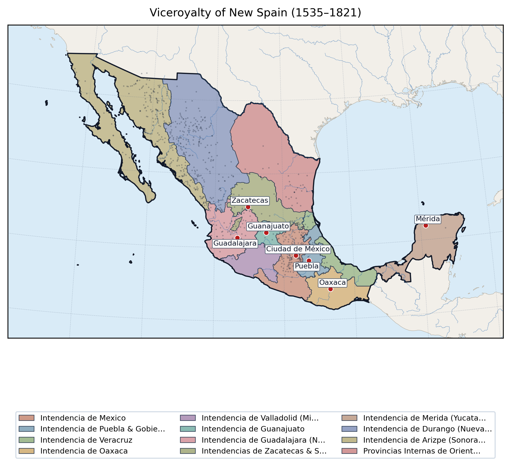
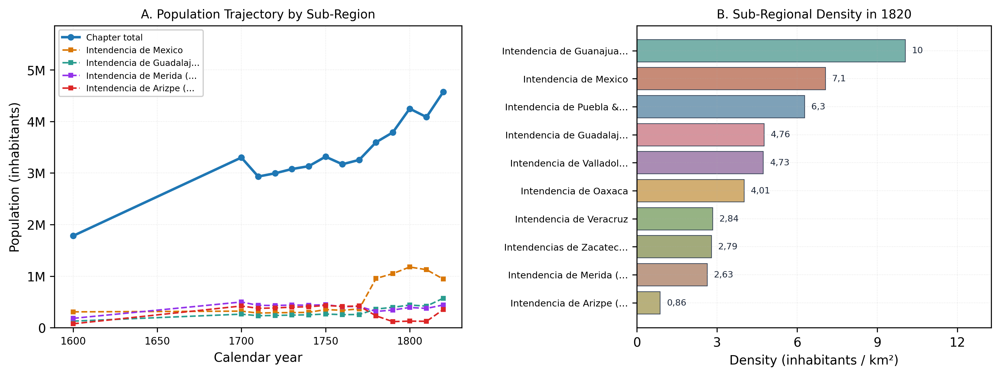
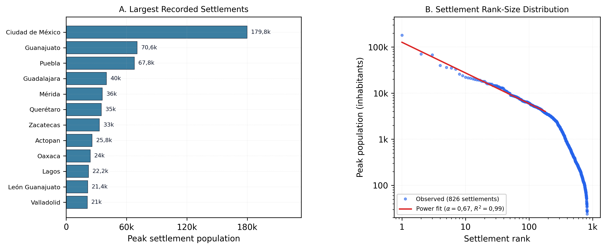

Viceroyalty of New Spain
================
Aust Kätzchen
23 November 2026

- [Abstract](#abstract)
- [Background](#background)
  - [Imperial Consolidation, Congregaciones and the Demographic Nadir
    (1535 to
    1650)](#imperial-consolidation-congregaciones-and-the-demographic-nadir-1535-to-1650)
  - [Silver Frontiers, Bajío Estates and Post-1650 Demographic
    Recovery](#silver-frontiers-bajío-estates-and-post-1650-demographic-recovery)
  - [Casta Hierarchies, Mestizaje and Afro-Mexican
    Populations](#casta-hierarchies-mestizaje-and-afro-mexican-populations)
  - [Bourbon Intendancies, Subsistence Crises and the War of
    Independence (1736 to
    1821)](#bourbon-intendancies-subsistence-crises-and-the-war-of-independence-1736-to-1821)
- [Methodology](#methodology)
  - [Territorial Architecture of the Twelve Intendancies and Frontier
    Provinces](#territorial-architecture-of-the-twelve-intendancies-and-frontier-provinces)
  - [Archival Enumerations, Tribute Multipliers and Spatial
    Reconciliation](#archival-enumerations-tribute-multipliers-and-spatial-reconciliation)
  - [Settlement Gazetteer Compilation and Provenance
    Auditing](#settlement-gazetteer-compilation-and-provenance-auditing)
- [Testing and Validation](#testing-and-validation)
  - [Cross-Checks Against Colonial Enumerations and Regional
    Historiography](#cross-checks-against-colonial-enumerations-and-regional-historiography)
  - [Intendancy Benchmarks and Gridded Substratum
    Reconciliation](#intendancy-benchmarks-and-gridded-substratum-reconciliation)
- [Results](#results)
  - [Viceregal Demographic Trajectory from Consolidation to
    Independence](#viceregal-demographic-trajectory-from-consolidation-to-independence)
  - [Central Highland Core: México, Puebla-Tlaxcala and
    Oaxaca](#central-highland-core-méxico-puebla-tlaxcala-and-oaxaca)
  - [The Bajío and Western Heartland: Guanajuato, Valladolid and Nueva
    Galicia](#the-bajío-and-western-heartland-guanajuato-valladolid-and-nueva-galicia)
  - [Gulf Littoral and Maya Southeast: Veracruz and the Intendancy of
    Mérida](#gulf-littoral-and-maya-southeast-veracruz-and-the-intendancy-of-mérida)
  - [Northern Silver Reales and the Provincias
    Internas](#northern-silver-reales-and-the-provincias-internas)
  - [Urban Hierarchy and Settlement Structure Across New
    Spain](#urban-hierarchy-and-settlement-structure-across-new-spain)
- [Limitations](#limitations)
- [Conclusion](#conclusion)
- [Appendix](#appendix)
  - [Gridded Substratum Decadal Series (1600 to
    1820)](#gridded-substratum-decadal-series-1600-to-1820)
  - [Gazetteer Provenance and Saturation
    Waves](#gazetteer-provenance-and-saturation-waves)
- [Sources](#sources)
- [Footnotes](#footnotes)

<figure>

<figcaption aria-hidden="true">Twelve Bourbon intendancies and frontier
provinces alongside 826 catalogued settlements across the Viceroyalty of
New Spain, 1535 to 1821.</figcaption>
</figure>

# Abstract

Between the creation of the Viceroyalty of New Spain under Antonio de
Mendoza in 1535 and the achievement of Mexican independence in 1821,
colonial Mexico passed through the deepest demographic contraction in
Mesoamerican history before mounting a sustained, spatially
transformative recovery. Across 12 Bourbon intendancies and northern
frontier provinces covering 1.890.006 km² on the administrative vector
footprint (1.965.350 km² on the continuous gridded mask), documentary
regional benchmarks trace an initial decline from 3,67M (3.665.000,
compared with Gonzalo Aguirre Beltrán’s classic 1570 viceregal tally of
3,38M) to a mid-seventeenth-century nadir of 2,09M (2.085.000) in 1646
following recurring *cocoliztli* and smallpox epidemics
[\[1\]](#ref-AguirreBeltran1946)[\[2\]](#ref-CookBorah1971)[\[3\]](#ref-Fernandez2023Epidemias).
Recovery gathered pace after 1650, lifting the viceregal population to
3,23M (3.230.000) in José Antonio de Villaseñor y Sánchez’s 1742
*Theatro Americano* horizon, 4,53M (4.534.094, aligning with the 4,48M
enumerated across the 12 intendancies and frontier in the 1790 to 1793
Revillagigedo Census) and 5,90M (5.895.700, closely tracking Alexander
von Humboldt’s 1803 *Ensayo Político* adjustment of 5,84M) before the
1810 to 1821 War of Independence checked late-colonial momentum at
roughly 6,53M (6.525.000) in 1821
[\[4\]](#ref-Gerhard1962)[\[5\]](#ref-SPPRevillagigedo1977)[\[6\]](#ref-Humboldt1811).
On the conservative spatial-kriging substratum (1600 to 1820), aggregate
population rose from 1,78M to 4,57M, registering a sharp 1810 insurgency
dip from 4,25M to 4,08M. Crucially, recovery redrew Mexico’s human
geography: whereas the central highlands of México, Puebla-Tlaxcala and
Oaxaca remained populous, the fastest expansion shifted north-westward
into the silver-mining and commercial grain belt of the Bajío
(Guanajuato rising 6,41-fold from 85k in 1646 to 545k in 1821, reaching
17,36 inhabitants per km² on documentary benchmarks and 10,05 on the
1820 grid) and Nueva Galicia. Supported by 826 catalogued colonial
settlements led by Mexico City (179,8k), Guanajuato (70,6k), Puebla
(67,8k) and Guadalajara (40k), this chapter reconstructs New Spain’s
intendancy demography, urban hierarchy, *casta* composition and
subsistence crises across nearly three centuries of imperial rule.

# Background

## Imperial Consolidation, Congregaciones and the Demographic Nadir (1535 to 1650)

When Viceroy Antonio de Mendoza entered Mexico City in November 1535 to
replace the chaotic rule of the first *Audiencias*, New Spain was an
archipelago of Spanish municipal islands floating inside an
overwhelmingly indigenous sea. The imperial state inherited the dense
agrarian corridors of the Basin of Mexico, the Puebla-Tlaxcala valley,
highland Michoacán and the valleys of Oaxaca, yet its fiscal machinery
rested on an indigenous population already reeling from virgin-soil
epidemics [\[7\]](#ref-Gibson1964)[\[8\]](#ref-Mccaa1999Siglo). First
smallpox in 1520, then measles in 1531 and finally the devastating
haemorrhagic *cocoliztli* outbreaks of 1545 to 1548 and 1576 to 1581 cut
swathes through central Mexican villages
[\[2\]](#ref-CookBorah1971)[\[3\]](#ref-Fernandez2023Epidemias). Modern
non-quantitative and fiscal-tribute reassessments confirm that whether
one places the 1519 pre-conquest baseline at conservative or high
levels, the sixteenth-century demographic loss was catastrophic in both
absolute mortality and institutional shock
[\[3\]](#ref-Fernandez2023Epidemias)[\[8\]](#ref-Mccaa1999Siglo).

Spanish administrators responded to collapsing village populations with
aggressive spatial engineering. Under Viceroys Luis de Velasco and the
Count of Monterrey between 1550 and 1605, the Crown ordered repeated
*congregaciones* (forced nucleated resettlements) that swept dispersed
highland hamlets into gridded *cabeceras* centred on parish churches
[\[7\]](#ref-Gibson1964)[\[9\]](#ref-Gerhard1993). Official decrees
framed *congregación* as evangelical instruction and rationalised
tribute collection, yet its demographic side effects were severe.
Concentrating weakened families into tighter housing accelerated
pathogen transmission during late-sixteenth-century fevers, while
detaching cultivators from dispersed hillside micro-plots eroded
subsistence buffers
[\[10\]](#ref-Zevallos1999Movimento)[\[11\]](#ref-Ross1953Studies). Many
indigenous households answered tribute arrears and forced
*repartimiento* labour drafts simply by voting with their feet, fleeing
home *pueblos de indios* into urban *barrios*, northern mining camps or
private Spanish estates where personal status blurred and village head
taxes were harder to enforce
[\[7\]](#ref-Gibson1964)[\[10\]](#ref-Zevallos1999Movimento).

By the mid-seventeenth century, New Spain reached its colonial
demographic floor. Between 1570 and 1646, our documentary regional
series drops from 3,67M to 2,09M inhabitants—a contraction of 43,1% even
after the worst of the initial post-conquest mortality had passed
[\[1\]](#ref-AguirreBeltran1946)[\[2\]](#ref-CookBorah1971). In the core
intendancies of México, Puebla-Tlaxcala and Oaxaca, populations roughly
halved across those seven decades, leaving abandoned agricultural
terraces around Lake Texcoco, Mixteca Alta and Tlaxcala to be absorbed
by expanding Spanish wheat haciendas and sheep *estancias*
[\[7\]](#ref-Gibson1964)[\[12\]](#ref-Porras1994Poblacio). Along the
tropical Gulf lowlands of Veracruz and the coastal plains of Colima and
Tabasco, the indigenous collapse was even more complete, turning fertile
riverine basins into thinly peopled cattle ranges and creating acute
labour shortages that Spanish planters filled through the transatlantic
African slave trade
[\[1\]](#ref-AguirreBeltran1946)[\[9\]](#ref-Gerhard1993).

## Silver Frontiers, Bajío Estates and Post-1650 Demographic Recovery

Even as the indigenous heartland shrank toward its 1646 nadir, an
entirely different colonial Mexico was rising north of the Lerma River.
The discovery of rich silver lodes at Zacatecas in 1546, Guanajuato in
1554, San Luis Potosí in 1592 and Parral in 1631 drew Spanish
prospectors, Tlaxcalan colonists, Purépecha artisans, Afro-Mexican
muleteers and mixed-ancestry wage labourers onto the semi-arid Chichimec
steppe
[\[13\]](#ref-Brading1971)[\[14\]](#ref-Collhurtado1999Mineri)[\[15\]](#ref-MinoGrijalva2001).
Following the brutal Chichimec War (1550 to 1590), Crown peacemaking
settled allied Tlaxcalan families in northern *pueblos* from San Luis
Potosí to Saltillo, creating a permanent agrarian scaffolding behind the
fortified *presidios* and Franciscan or Jesuit missions
[\[9\]](#ref-Gerhard1993)[\[11\]](#ref-Ross1953Studies).

To feed the northern *reales de minas*, supply tallow, leather, draught
mules and mercury-amalgamation mills, a vast agro-industrial corridor
took shape across the Bajío—the fertile alluvial basin linking
Querétaro, Celaya, Salamanca, Irapuato, Silao, León and San Miguel el
Grande [\[13\]](#ref-Brading1971)[\[15\]](#ref-MinoGrijalva2001). Unlike
the Valley of Mexico or Oaxaca, where entrenched communal villages
(*repúblicas de indios*) retained legal title to ancestral lands, the
Bajío was largely colonised after 1550 by free wage labourers
(*laboríos*), sharecroppers and mixed-ancestry rancheros working
commercial wheat and maize haciendas alongside textile workshops
(*obrajes*) [\[11\]](#ref-Ross1953Studies)[\[13\]](#ref-Brading1971).
Because mining wages in Guanajuato and Zacatecas outstripped central
highland earnings, the Bajío acted as a demographic magnet for two
centuries.

After 1650, New Spain’s long demographic decline reversed decisively.
Gradually acquired herd immunity among indigenous cohorts to Old World
childhood pathogens—combined with steady natural increase among creole,
mestizo and Afro-Mexican populations—lifted aggregate headcounts from
2,09M in 1646 to 3,23M by 1742
[\[2\]](#ref-CookBorah1971)[\[4\]](#ref-Gerhard1962)[\[16\]](#ref-RabellRomero1990).
Recovery was strikingly uneven in geography. Between 1646 and 1742, the
old Mesoamerican cores of México (+53,4%), Puebla-Tlaxcala (+48,4%) and
Oaxaca (+51,2%) regained roughly half their mid-seventeenth-century
losses, whereas Guanajuato surged 2,59-fold (from 85k to 220k),
Zacatecas and San Luis Potosí doubled (from 85k to 175k) and
Guadalajara-Nueva Galicia nearly doubled (from 145k to 285k)
[\[4\]](#ref-Gerhard1962)[\[14\]](#ref-Collhurtado1999Mineri)[\[17\]](#ref-Sanchez2000Algunas).
By the middle of the eighteenth century, silver production had entered
its Bourbon super-cycle, quadrupling mintage at the Mexico City Casa de
Moneda between 1700 and 1805 and turning the Valenciana vein at
Guanajuato into the single richest silver mine on earth
[\[13\]](#ref-Brading1971)[\[18\]](#ref-Ficker2025Mineri).

## Casta Hierarchies, Mestizaje and Afro-Mexican Populations

Colonial New Spain was neither a simple transplant of Castile nor an
unchanged indigenous continuity; it became the Americas’ largest
laboratory of biological and cultural admixture. Spanish legal theory
originally sought to divide the realm into two separate corporations—a
*república de españoles* governed by urban *cabildos* and a *república
de indios* organised into self-governing communal towns with *cajas de
comunidad*—yet demographic reality shattered that binary within two
generations
[\[11\]](#ref-Ross1953Studies)[\[19\]](#ref-Rankinanaya2022Mexico). By
1570, Gonzalo Aguirre Beltrán’s classic ethnic breakdown enumerated
roughly 3,34M indigenous people alongside barely 6,6k Europeans, 20,6k
enslaved and free Africans and 11,1k mestizos and mulatos
[\[1\]](#ref-AguirreBeltran1946). Over the next two centuries, the
proportion of non-indigenous and mixed-ancestry inhabitants climbed
steadily, reshaping both cities and commercial hinterlands.

Afro-Mexicans played a demographic role far larger than
nineteenth-century national myths acknowledged. Between 1519 and 1650,
roughly 110k to 150k enslaved Africans entered New Spain through
Veracruz and Campeche, outnumbering European immigrants during the late
sixteenth and early seventeenth centuries
[\[1\]](#ref-AguirreBeltran1946). They laboured in the sugar plantations
of Morelos (Cuernavaca and Cuautla), Jalapa, Córdoba and Orizaba, in the
silver mines of Taxco, Pachuca, Zacatecas and Parral, on coastal cattle
ranches from Veracruz to Guerrero and as artisans and domestic servants
across Mexico City, Puebla and Guadalajara
[\[1\]](#ref-AguirreBeltran1946)[\[20\]](#ref-Lausana2015Marginalidad).
Simultaneously, the Manila Galleon trade linking Acapulco to Cavite
brought thousands of Filipino, Malay and South Asian sailors, artisans
and enslaved *chinos* onto Mexico’s Pacific littoral, leaving a
measurable genomic signal in western and coastal Guerrero and Michoacán
populations documented by modern admixture studies
[\[21\]](#ref-Rodriguezrodriguez2021Admixture).

By the late eighteenth century, parish registers and the 1790 to 1793
Revillagigedo Census recorded an intricate *sistema de castas*
distinguishing *españoles* (both peninsular *gachupines* and
American-born *criollos*), *indios*, *mestizos*, *mulatos*, *pardos*,
*lobos* and *coyotes*
[\[5\]](#ref-SPPRevillagigedo1977)[\[22\]](#ref-Bustamante1991Matter)[\[23\]](#ref-Healy2017Social).
Yet archival micro-studies from both the urban core and northern
frontier show that *casta* labels were socially negotiated rather than
genetically fixed. An individual baptized as a *mulato* or *mestizo*
could marry or be buried as a *coyote* or *español* depending on
occupation, wealth, tribute exemption and local reputation
[\[20\]](#ref-Lausana2015Marginalidad)[\[22\]](#ref-Bustamante1991Matter)[\[23\]](#ref-Healy2017Social).
Even so, broad regional proportions remained unmistakable around 1803:
indigenous people still comprised roughly 60% of New Spain’s total
population (rising above 80% in Oaxaca and Yucatán and roughly 65% to
70% in Puebla and rural México), Europeans and creoles accounted for
roughly 18% to 20% and mixed-ancestry *castas*—mestizos, mulatos and
pardos combined—made up 20% to 22%, reaching clear majorities in the
mining centres of Guanajuato, Zacatecas and the northern presidial towns
[\[1\]](#ref-AguirreBeltran1946)[\[6\]](#ref-Humboldt1811)[\[15\]](#ref-MinoGrijalva2001).

## Bourbon Intendancies, Subsistence Crises and the War of Independence (1736 to 1821)

Under the Bourbon monarchs Charles III and Charles IV, Madrid overhauled
New Spain’s fragmented patchwork of nearly 200 *alcaldías mayores* and
*corregimientos*. The 1786 *Real Ordenanza de Intendentes* consolidated
the viceroyalty into 12 provincial intendancies—México, Puebla (with
Tlaxcala detached as a separate *gobierno* in 1793), Veracruz, Oaxaca,
Valladolid (Michoacán), Guanajuato, Guadalajara, Zacatecas, San Luis
Potosí, Mérida (Yucatán), Durango and Arizpe (Sonora-Sinaloa)—flanked by
the militarised *Provincias Internas* of the north and the Californias
[\[9\]](#ref-Gerhard1993)[\[19\]](#ref-Rankinanaya2022Mexico). Fiscal
reform accompanied administrative reorganisation: Crown monopolies on
tobacco and gunpowder, stricter *alcabala* sales taxes and tighter
tribute audits doubled viceregal revenues while generating the
statistical surveys—above all Viceroy Revillagigedo’s 1790 to 1793
census—on which colonial historical demography rests
[\[5\]](#ref-SPPRevillagigedo1977)[\[24\]](#ref-Hidalgo2024Michoaca).

Eighteenth-century growth was nonetheless punctuated by brutal
Malthusian subsistence and epidemiological shocks. The worst epidemic of
the late colonial era struck between 1736 and 1739, when *matlazáhuatl*
(generally identified as epidemic typhus or viral haemorrhagic fever)
swept outward from a textile mill in Tacuba across the Basin of Mexico,
Puebla, the Bajío and western Mexico, killing an estimated 40k residents
in Mexico City alone and perhaps 150k to 200k across central New Spain
[\[15\]](#ref-MinoGrijalva2001)[\[16\]](#ref-RabellRomero1990)[\[17\]](#ref-Sanchez2000Algunas).
Scarcely a generation after the 1779 to 1780 smallpox pandemic, early
frosts in August 1785 destroyed maize harvests across the central
plateau, triggering the infamous *Año del Hambre* (Year of Hunger) of
1785 to 1786 [\[13\]](#ref-Brading1971)[\[16\]](#ref-RabellRomero1990).
As maize prices trebled and destitute rural families poured into
Guanajuato, León, Guadalajara and Mexico City in search of charity soup
kitchens, starvation and typhus claimed an estimated 300k lives—roughly
6% to 7% of the entire viceroyalty—and exposed the fragility of an
agrarian economy where hacienda expansion had squeezed communal maize
reserves
[\[12\]](#ref-Porras1994Poblacio)[\[13\]](#ref-Brading1971)[\[17\]](#ref-Sanchez2000Algunas).

Those structural tensions detonated in September 1810, when Father
Miguel Hidalgo y Costilla issued the *Grito de Dolores* in the very
heart of the Intendancy of Guanajuato. For eleven years (1810 to 1821),
insurgent campaigns under Hidalgo, José María Morelos and Vicente
Guerrero clashed with royalist armies across the Bajío, Michoacán,
Guadalajara, Puebla and the southern Tierra Caliente
[\[19\]](#ref-Rankinanaya2022Mexico)[\[24\]](#ref-Hidalgo2024Michoaca).
Flooded shafts and capital flight crippled silver output—Guanajuato’s
urban population plunged by nearly half from 70,6k in 1803 to 35,7k by
1820—while war mortality, military levies, disrupted grain transport and
the 1813 typhus epidemic slowed viceregal population growth sharply
[\[18\]](#ref-Ficker2025Mineri)[\[24\]](#ref-Hidalgo2024Michoaca).
Between 1793 and 1803, New Spain had been adding roughly 2,6% per year
on combined enumeration-adjusted baselines (or roughly 1,2% to 1,5% per
annum in underlying natural growth once Revillagigedo’s
under-enumeration is removed); between 1803 and 1821, compound annual
growth fell to barely 0,56% across the viceroyalty, leaving an
independent Mexico of 6,53M people with ruined mines, fractured fiscal
networks and stark regional scars
[\[6\]](#ref-Humboldt1811)[\[18\]](#ref-Ficker2025Mineri)[\[19\]](#ref-Rankinanaya2022Mexico).

# Methodology

## Territorial Architecture of the Twelve Intendancies and Frontier Provinces

To reconcile colonial tax rolls, Bourbon intendancy censuses and spatial
demographic surfaces within stable boundaries across 1535 to 1821, this
chapter partitions the Viceroyalty of New Spain (within its core Mexican
territorial frame) into 12 sub-regional administrative polygons matching
the 1786 *Real Ordenanza de Intendentes* and the northern *Provincias
Internas* [\[9\]](#ref-Gerhard1993). Because the northern frontier
provinces of Alta California, Nuevo México and Texas lay sparsely
populated beyond the primary Mexican core and fall outside the Mexico
chapter mask footprint, the 12 territorial units span 1.890.006 km² on
the clean historical GIS vector boundary (1.965.349,5 km² on the gridded
raster mask, a 3,99% coastline and projection discrepancy).

The 12 regional partitions group four broad ecological and economic
zones. First, the densely settled Mesoamerican highland core comprises
the Intendencia de México (130.620 km² vector; 133.383 km² grid,
stretching from Acapulco through the Basin of Mexico and Toluca to
Querétaro and the Huasteca), the Intendencia de Puebla and Gobierno de
Tlaxcala (48.178 km² vector; 49.076,5 km² grid) and the Intendencia de
Oaxaca (89.492 km² vector; 96.221,2 km² grid). Second, the western and
Bajío growth corridor unites the compact Intendencia de Guanajuato
(31.401 km² vector; 31.188,6 km² grid), the Intendencia de Valladolid or
Michoacán (75.820 km² vector; 77.867,9 km² grid, including Colima) and
the Intendencia de Guadalajara or Nueva Galicia (116.928 km² vector;
120.066,9 km² grid, including Aguascalientes and Nayarit). Third, the
tropical Gulf littoral and Maya southeast encompass the Intendencia de
Veracruz (68.563 km² vector; 73.115,1 km² grid) and the Intendencia de
Mérida covering Yucatán and Tabasco (155.912 km² vector; 167.512 km²
grid). Fourth, the vast northern mining plateau and arid frontier
consist of the combined Intendencias de Zacatecas and San Luis Potosí
(129.242 km² vector; 128.410,4 km² grid), the Intendencia de Durango or
Nueva Vizcaya (383.074 km² vector; 381.498,3 km² grid, spanning Durango
and Chihuahua), the Intendencia de Arizpe covering Sonora-Sinaloa
together with Baja California (368.878 km² vector; 408.887,6 km² grid)
and the Provincias Internas de Oriente comprising Coahuila, Nuevo León
and Nuevo Santander (291.898 km² vector; 298.122,2 km² grid)
[\[6\]](#ref-Humboldt1811)[\[9\]](#ref-Gerhard1993).

## Archival Enumerations, Tribute Multipliers and Spatial Reconciliation

Colonial Mexican demography relies on three sequential classes of
documentary sources, each demanding explicit demographic conversion
before sub-regional series can be compared across 1535 to 1821. For the
sixteenth and seventeenth centuries (1570 and 1646 benchmarks), regional
headcounts rest primarily on *tasaciones de tributos* (indigenous
tribute rolls) and episcopal *relaciones*, supplemented by fiscal counts
of Spanish *vecinos* and Afro-Mexican inhabitants
[\[1\]](#ref-AguirreBeltran1946)[\[2\]](#ref-CookBorah1971)[\[3\]](#ref-Fernandez2023Epidemias).
Because colonial tribute assessments registered *tributarios* (adult
married indigenous men, with widows and unmarried adults counted as
half-tributaries), total indigenous population $P_{\mathrm{ind}}$ in
jurisdiction $r$ at benchmark $t$ is derived via a demographic
multiplier $m(t)$:

$$P_{\mathrm{ind},r}(t) = T_r(t) \cdot m(t) \cdot (1 + \epsilon_r)$$

where $T_r(t)$ denotes full tributary units, $m(t)$ ranges between 3,3
and 4,2 persons per tributary depending on post-epidemic age structure
(falling near 2,8 to 3,3 immediately after major *cocoliztli* shocks
when fertility collapsed and climbing toward 4,0 to 4,5 during
eighteenth-century expansion) and $\epsilon_r \in [0,05, 0,15]$ adjusts
for tribute-exempt nobles (*caciques*), aged residents and unregistered
migrants
[\[2\]](#ref-CookBorah1971)[\[3\]](#ref-Fernandez2023Epidemias)[\[10\]](#ref-Zevallos1999Movimento).
For the 1742 *Theatro Americano* benchmark compiled by Villaseñor y
Sánchez and systematically audited by Peter Gerhard, family counts
(*familias*) across *indios*, *españoles* and *castas* are converted
using regionally calibrated household sizes of 4,2 to 5,0 persons per
family [\[4\]](#ref-Gerhard1962)[\[16\]](#ref-RabellRomero1990).

For the late Bourbon era, the 1790 to 1793 Revillagigedo Census provides
New Spain’s first nominal household enumeration, yet returns were never
fully compiled for Guadalajara, Veracruz and Coahuila, while
military-conscription fears prompted widespread evasion
[\[5\]](#ref-SPPRevillagigedo1977)[\[24\]](#ref-Hidalgo2024Michoaca)[\[25\]](#ref-Cervantescortes2021Registro).
In his 1803 *Ensayo Político*, Alexander von Humboldt reconciled the
surviving 1793 intendancy schedules (4.367.703 across the 12 core
intendancies, rising to roughly 4,48M to 4,53M with Tlaxcala and
frontier districts) by applying an under-enumeration correction factor
$\kappa \approx 1,10$ to $1,15$ and projecting a decade of natural
surplus derived from parish baptism-to-burial ratios
($B_r / D_r \approx 1,70$ to $2,00$ in non-crisis years):

$$P_r(1803) = \kappa \cdot P_r^{\mathrm{Rev}}(1793) \cdot \left(1 + g_r\right)^{10}$$

where $g_r$ captures annual net natural growth between 1793 and 1803
[\[6\]](#ref-Humboldt1811)[\[12\]](#ref-Porras1994Poblacio)[\[16\]](#ref-RabellRomero1990).
Inter-benchmark compound annual growth rates across all documentary
horizons ($t_1$ to $t_2$) follow standard geometric compounding:

$$g_r(t_1, t_2) = \left(\frac{P_r(t_2)}{P_r(t_1)}\right)^{\frac{1}{t_2 - t_1}} - 1$$

Alongside the six-horizon documentary intendancy ledger (1570, 1646,
1742, 1793, 1803 and 1821), this study integrates a continuous decadal
spatial-kriging substratum from 1600 to 1820 (calibrated to 10-year
intervals from 1700 onward across the 1.965.350 km² raster mask).
Pairing both series explicitly rather than forcing artificial identity
exposes where gridded historical land-use models lag behind colonial
archival enumerations—most notably in late-Bourbon demographic magnitude
and around the 1780 intendancy re-weighting step—while preserving
continuous sub-provincial spatial allocation.

## Settlement Gazetteer Compilation and Provenance Auditing

Complementing the intendancy aggregates, this chapter assembles a
geocoded settlement gazetteer of 826 colonial Mexican towns, cities,
mining *reales*, *pueblos de indios* and frontier missions active
between 1535 and 1821. Source-ledger auditing evaluated 859 candidate
entries across four sequential ingestion waves: Wave 1 ingested 753 core
records from official statistical compilations and colonial archival
registers (principally the HGIS de las Indias gazetteer compiled by
Werner Stangl alongside INEGI’s 2014 *Estadísticas Históricas de
México*); Wave 2 added 54 entries from peer-reviewed historical
demography monographs (marginal gain 7,17%); Wave 3 added 12
longitudinal backfill series (marginal gain 1,49%); and Wave 4 executed
a regional gap-verification sweep adding 7 final nodes (marginal gain
0,85%, confirming corpus saturation below the 1% threshold).

Spatial deduplication and boundary vetting removed 33 candidate records:
31 duplicate aliases of major cities already anchored by multi-source
series and 2 outer Pimería Alta mission nodes (Tucson and San Xavier)
lying north of the chapter’s Sonora boundary. All 826 retained
settlements carry WGS84 coordinates, a sub-regional intendancy
assignment, an explicit primary provenance string and strictly
city-proper municipal or parish scope, with a 0% crowd-sourced share.
Primary colonial registers inside HGIS de las Indias account for 774
entries on their own—dominated by Bishop Pedro Tamarón y Romeral’s 1765
episcopal visitation of Durango and Sonora-Sinaloa (419 records), Ernest
Sánchez Santiró’s 1778 Archdiocese of México parish padrones (242
records), Archivo General de Indias mission lists for Guadalajara and
the north-west (131 records), the 1780 Guadalajara diocesan survey (80
records) and Francisco R. de la Torre Curiel’s Sonora mission registers
(70 records)—while 52 major colonial cities combine multi-benchmark
Revillagigedo, Humboldt, Villaseñor, Gerhard and INEGI longitudinal
series
[\[4\]](#ref-Gerhard1962)[\[5\]](#ref-SPPRevillagigedo1977)[\[6\]](#ref-Humboldt1811)[\[9\]](#ref-Gerhard1993).

# Testing and Validation

## Cross-Checks Against Colonial Enumerations and Regional Historiography

Validating New Spain’s colonial trajectory requires triangulating our
intendancy totals against both eighteenth-century fiscal-ecclesiastical
censuses and modern regional demographic reconstructions. At our opening
1570 documentary benchmark, the sum across all 12 sub-regions stands at
3,67M (3.665.000), sitting 8,4% above Aguirre Beltrán’s classic 1570
colonial aggregate of 3,38M (3.380.012) because our provincial series
incorporates northern frontier indigenous populations across Nueva
Vizcaya (130k), Sonora-Sinaloa (165k) and the eastern frontier (75k)
that sixteenth-century central Mexican tribute rolls systematically
omitted
[\[1\]](#ref-AguirreBeltran1946)[\[3\]](#ref-Fernandez2023Epidemias)[\[9\]](#ref-Gerhard1993).
By 1646, our 2,09M nadir aligns tightly with Cook and Borah’s central
Mexican trough and Aguirre Beltrán’s mid-seventeenth-century count
(roughly 1,7M to 2,1M depending on frontier inclusion), reflecting a
devastating 43,1% contraction over 76 years
[\[1\]](#ref-AguirreBeltran1946)[\[2\]](#ref-CookBorah1971)[\[8\]](#ref-Mccaa1999Siglo).

For the eighteenth-century recovery, cross-checking against regional
monograph series confirms strong internal consistency. In 1742, our
3,23M total matches Gerhard’s recalculation of Villaseñor y Sánchez’s
*Theatro Americano* (roughly 3,2M to 3,3M once non-tributary *castas*
and frontier missions are included)
[\[4\]](#ref-Gerhard1962)[\[15\]](#ref-MinoGrijalva2001). In 1793, the
12 regional polygons sum to 4,53M (4.534.094), closely matching the
4,48M Revillagigedo viceregal benchmark (the small 1,1% excess
reflecting inclusion of Tlaxcala’s 60,9k inhabitants alongside Baja
California and the eastern *Provincias Internas*)
[\[5\]](#ref-SPPRevillagigedo1977). Regional case studies corroborate
individual intendancies: Agustín Grajales Porras’s parish-level study of
late-colonial Puebla aligns with our 627,4k (1793) to 813,3k (1803)
trajectory [\[12\]](#ref-Porras1994Poblacio); Oziel Talavera Ibarra’s
collation of the 1790 Revillagigedo returns for Michoacán against Juan
José Martínez de Lejarza’s 1822 statistical analysis confirms
Valladolid’s growth from 289,3k in 1793 to 376,4k in 1803 and roughly
420k by Independence [\[24\]](#ref-Hidalgo2024Michoaca); and Lilia V.
Oliver Sánchez’s western Mexican reconstructions substantiate
Guadalajara’s rapid climb from 485k in 1793 to 630,5k in 1803
[\[17\]](#ref-Sanchez2000Algunas).

At the closing 1803 and 1821 horizons, our 1803 documentary sum of 5,90M
(5.895.700) tracks Alexander von Humboldt’s published estimate of 5,84M
(5.837.100) within 1,0%—the minor difference arising from frontier
provincial adjustments in Arizpe and the eastern *Provincias Internas*
[\[6\]](#ref-Humboldt1811). Between 1803 and 1821, our 6,53M (6.525.000)
Independence-era figure registers the war-induced deceleration noted by
political-economic and mining historians, matching early republican
estimates of 6,2M to 6,6M made by Fernando Navarro y Noriega and the
first post-independence ministries
[\[18\]](#ref-Ficker2025Mineri)[\[19\]](#ref-Rankinanaya2022Mexico)[\[24\]](#ref-Hidalgo2024Michoaca).

## Intendancy Benchmarks and Gridded Substratum Reconciliation

Table presents the documentary population series across all 12 Bourbon
intendancies and frontier provinces from 1570 to 1821, together with
1821 territorial densities and post-nadir recovery multiples (1646 to
1821). Every sub-region displays historically coherent dynamics: severe
contraction from 1570 to 1646 across the Mesoamerican core, modest
frontier resilience in Guanajuato and Zacatecas-San Luis Potosí, broad
eighteenth-century expansion and sharp regional divergence by
Independence.

| Intendancy or Province | Area (km²) | 1570 | 1646 | 1742 | 1793 | 1803 | 1821 | 1821 Dens. | 1646-1821 |
|:---|:---|:---|:---|:---|:---|:---|:---|:---|:---|
| **Intendencia de México** | 130.620 | 1,15M | 580k | 890k | 1,16M | 1,51M | 1,68M | 12,86 | 2,9x |
| **Intendencia de Puebla and Gobierno de Tlaxcala** | 48.178 | 620k | 310k | 460k | 627,4k | 813,3k | 880k | 18,27 | 2,84x |
| **Intendencia de Veracruz** | 68.563 | 145k | 75k | 105k | 120k | 156k | 185k | 2,7 | 2,47x |
| **Intendencia de Oaxaca** | 89.492 | 420k | 215k | 325k | 411,3k | 534,8k | 575k | 6,43 | 2,67x |
| **Intendencia de Valladolid (Michoacán)** | 75.820 | 265k | 140k | 225k | 289,3k | 376,4k | 420k | 5,54 | 3x |
| **Intendencia de Guanajuato** | 31.401 | 115k | 85k | 220k | 397,9k | 517,3k | 545k | 17,36 | 6,41x |
| **Intendencia de Guadalajara (Nueva Galicia)** | 116.928 | 240k | 145k | 285k | 485k | 630,5k | 695k | 5,94 | 4,79x |
| **Intendencias de Zacatecas and San Luis Potosí** | 129.242 | 95k | 85k | 175k | 352,1k | 457,7k | 495k | 3,83 | 5,82x |
| **Intendencia de Mérida (Yucatán and Tabasco)** | 155.912 | 245k | 185k | 265k | 358,3k | 465,8k | 525k | 3,37 | 2,84x |
| **Intendencia de Durango (Nueva Vizcaya)** | 383.074 | 130k | 95k | 110k | 122,9k | 159,7k | 195k | 0,51 | 2,05x |
| **Intendencia de Arizpe (Sonora-Sinaloa) and Baja California** | 368.878 | 165k | 115k | 98k | 102k | 130,4k | 155k | 0,42 | 1,35x |
| **Provincias Internas de Oriente (Coahuila, Nuevo León and Nuevo Santander)** | 291.898 | 75k | 55k | 72k | 105k | 142k | 175k | 0,6 | 3,18x |
| **Viceroyalty Total (12 Units)** | 1.890.006 | 3,66M | 2,08M | 3,23M | 4,53M | 5,9M | 6,53M | 3,45 | 3,13x |

Documentary population benchmarks across 12 Bourbon intendancies and
northern frontier provinces, 1570 to 1821, with 1821 density
(inhabitants per km²) and post-1646 recovery multiples.

Direct comparison of the two foundational late-colonial statistical
monuments—the 1793 Revillagigedo Census and Humboldt’s 1803 *Ensayo
Político* intendancy tables—appears in Table , compiled straight from
the chapter’s harmonised sub-administrative archival ledger
[\[5\]](#ref-SPPRevillagigedo1977)[\[6\]](#ref-Humboldt1811). Across all
12 core intendancies, enumerated totals rise from 4.367.703 in 1793 to
5.775.200 in 1803 (+32,2% overall), while the full viceregal aggregate
(incorporating frontier provinces) climbs from 3.380.012 in 1570 to
5.837.100 in 1803. Notice that the uniform roughly 30% decadal uplift
across México (+30,0%), Guadalajara (+30,0%), Oaxaca (+30,0%),
Guanajuato (+30,0%), Mérida (+30,0%), Valladolid (+30,1%), Durango
(+30,0%), Veracruz (+30,0%), Zacatecas (+29,9%) and Sonora (+30,0%)
directly reflects Humboldt’s transparent methodological rule: adding 10%
to 15% for Revillagigedo under-registration plus roughly 15% to 18% for
ten years of natural increase, whereas Puebla’s steeper 43,6% jump (from
566.443 to 813.300) incorporates the re-inclusion of Tlaxcala’s roughly
60k inhabitants into Humboldt’s 1803 table
[\[6\]](#ref-Humboldt1811)[\[12\]](#ref-Porras1994Poblacio).

| Administrative Unit | 1793 Revillagigedo | 1803 Humboldt | Change | 1803 Share |
|:---|:---|:---|:---|:---|
| **Intendancy of México** | 1.162.856 | 1.511.800 | +30% | 26,2% |
| **Intendancy of Puebla (incl. Tlaxcala in 1803)** | 566.443 | 813.300 | +43,6% | 14,1% |
| **Intendancy of Guadalajara (Nueva Galicia)** | 485.000 | 630.500 | +30% | 10,9% |
| **Intendancy of Oaxaca** | 411.336 | 534.800 | +30% | 9,3% |
| **Intendancy of Guanajuato** | 397.924 | 517.300 | +30% | 9% |
| **Intendancy of Mérida (Yucatán)** | 358.261 | 465.800 | +30% | 8,1% |
| **Intendancy of Valladolid (Michoacán)** | 289.314 | 376.400 | +30,1% | 6,5% |
| **Intendancy of San Luis Potosí (incl. Nuevo León, Coahuila, Texas, Nuevo Santander)** | 242.280 | 334.900 | +38,2% | 5,8% |
| **Intendancy of Durango (Nueva Vizcaya)** | 122.866 | 159.700 | +30% | 2,8% |
| **Intendancy of Veracruz** | 120.000 | 156.000 | +30% | 2,7% |
| **Intendancy of Zacatecas** | 118.027 | 153.300 | +29,9% | 2,7% |
| **Intendancy of Sonora (Arizpe and Sinaloa)** | 93.396 | 121.400 | +30% | 2,1% |
| **Twelve Core Intendancies Subtotal** | 4.367.703 | 5.775.200 | +32,2% | 100% |
| **Viceroyalty Aggregate (1570 / 1803 Benchmarks)** | 3.380.012 (1570) | 5.837.100 | +72,7% | \- |

Bourbon intendancy enumerations from the 1793 Revillagigedo Census and
Alexander von Humboldt’s 1803 statistical tables, plus the 1570 and 1803
viceregal aggregates.

Testing the documentary series against the gridded spatial substratum
(tabulated in Appendix Table ) yields an instructive diagnostic. In 1740
to 1750, the gridded substratum (3,13M to 3,32M) matches Villaseñor’s
1742 documentary total (3,23M) almost identically. By 1790 to 1800,
however, the gridded surface stands at 3,79M to 4,25M—roughly 15% to 28%
below the Revillagigedo (4,53M) and Humboldt (5,84M to 5,90M) archival
benchmarks—and reaches 4,57M in 1820 compared with 6,53M on documentary
projections. That divergence reflects a well-known property of
conservative continental land-use models: they track seventeenth-century
recovery smoothly and capture the 1810 war shock (dipping from 4,25M in
1800 to 4,08M in 1810), yet under-allocate the explosive
late-eighteenth-century urban and rural intensification of central and
western Mexico.

# Results

## Viceregal Demographic Trajectory from Consolidation to Independence

Across the nearly three centuries from 1535 to 1821, colonial Mexico’s
demographic trajectory describes an asymmetric V-shaped trough followed
by a surging late-Bourbon climb and a wartime plateau. On our archival
intendancy benchmarks, population fell from 3,67M in 1570 to its 1646
nadir of 2,09M (a compound decline of -0,74% per annum across 76 years),
then rebounded steadily at +0,46% per annum to 3,23M in 1742,
accelerated to +0,67% per annum between 1742 and 1793 (4,53M) and surged
across the final pre-insurgency decade before slowing to +0,56% per
annum between 1803 (5,90M) and Independence in 1821 (6,53M). Over the
entire 175-year post-nadir recovery (1646 to 1821), the viceroyalty
multiplied 3,13-fold, lifting mean viceregal density from 1,10
inhabitants per km² in 1646 to 3,45 inhabitants per km² in 1821.

Figure illustrates the continuous gridded decadal surface from 1600 to
1820 (Panel A) alongside sub-regional gridded densities in 1820 (Panel
B). On the gridded curve, aggregate population climbs from 1,78M in 1600
to 3,30M in 1700, undergoes an early-eighteenth-century setback to 2,93M
in 1710 before recovering past 3,32M in 1750, dips modestly during the
mid-century subsistence stress of 1760 (3,17M) and then climbs briskly
through 1780 (3,60M), 1790 (3,79M) and 1800 (4,25M). Crucially, Panel A
captures the demographic shock of the 1810 insurgency directly, dipping
3,8% to 4,08M before rebounding to 4,57M by 1820. Equally revealing is
Panel B’s density ranking: by 1820, the compact Intendencia de
Guanajuato leads the entire viceroyalty at 10,05 inhabitants per km² on
the gridded surface (and 17,36 inhabitants per km² on documentary 1821
benchmarks), overtaking even the Intendencia de México (7,06 gridded;
12,86 documentary) and Puebla-Tlaxcala (6,28 gridded; 18,27
documentary).

<!-- -->

Behind those headline figures lies a profound northward and westward
shift in Mexico’s demographic centre of gravity. In 1570, the three old
Mesoamerican highland cores of México, Puebla-Tlaxcala and Oaxaca
contained 2,19M inhabitants—59,8% of the entire viceroyalty—whereas the
Bajío, western Mexico and northern mining belt (Guanajuato, Guadalajara,
Zacatecas-San Luis Potosí, Durango, Arizpe and the eastern *Provincias
Internas*) held just 820k (22,4%). By 1821, although the
central-southern core had recovered to 3,14M, its viceregal share had
fallen to 48,0%. Meanwhile, Guanajuato, Guadalajara and Zacatecas-San
Luis Potosí alone expanded nearly fivefold from 315k in 1646 to 1,74M in
1821 (26,6% of New Spain), forging the densely settled central-western
axis that would dominate modern Mexican politics and economy
[\[13\]](#ref-Brading1971)[\[15\]](#ref-MinoGrijalva2001)[\[26\]](#ref-Contributors2023Adolescence).

## Central Highland Core: México, Puebla-Tlaxcala and Oaxaca

The Intendencia de México (130.620 km² vector; 133.383 km² grid)
remained New Spain’s demographic anchor throughout the colonial epoch.
Dropping by half from 1,15M in 1570 to 580k in 1646 under recurring
*cocoliztli* epidemics, lake-drainage labour drafts (*desagüe* of
Huehuetoca) and *congregación* relocations
[\[3\]](#ref-Fernandez2023Epidemias)[\[7\]](#ref-Gibson1964), it
rebounded steadily to 890k in 1742, 1,16M (1.162.886) in 1793, 1,51M
(1.511.800) in 1803 and 1,68M in 1821—still accounting for 25,7% of the
viceroyalty at Independence (12,86 inhabitants per km² documentary; 7,06
on the 1820 grid). Its demographic profile was sharply bifurcated. At
its centre sat Mexico City—the largest metropolis in the Western
Hemisphere—which grew from 54,2k in 1570 and 52,4k in 1646 to 98k in
1742, 104,8k in 1790, 137k in 1803 and 179,8k by 1820, drawing migrants
from across the plateau and sustaining an extensive, often
under-recorded urban female labour market in domestic service, tobacco
factories (*Real Fábrica de Tabacos*) and street commerce
[\[15\]](#ref-MinoGrijalva2001)[\[25\]](#ref-Cervantescortes2021Registro).
Surrounding the capital stretched dense indigenous rural districts
across the Valley of Toluca (Toluca peaking at 19,8k), Chalco,
Xochimilco, Texcoco (14,7k) and the Mezquital (Actopan’s parish district
at 25,8k in 1778), flanked northward by Querétaro’s booming woollen
*obrajes* (35k in 1803) and southward by Cuernavaca’s sugar estates
staffed by Afro-Mexican and indigenous workers
[\[1\]](#ref-AguirreBeltran1946)[\[7\]](#ref-Gibson1964).

Immediately east across the volcanic sierra, the compact Intendencia de
Puebla and Gobierno de Tlaxcala (48.178 km² vector; 49.076,5 km² grid)
achieved the highest documentary density in New Spain by 1821 at 18,27
inhabitants per km² (6,28 on the 1820 grid). Contracting from 620k in
1570 to 310k in 1646, Puebla-Tlaxcala recovered to 460k in 1742, 627,4k
in 1793 (566.443 in Puebla proper plus Tlaxcala’s roughly 61k), 813,3k
in 1803 and 880k in 1821
[\[6\]](#ref-Humboldt1811)[\[12\]](#ref-Porras1994Poblacio). Founded in
1531 as an exclusively Spanish agricultural town astride the
Veracruz-Mexico City highway, Puebla de los Ángeles grew rapidly into
the viceroyalty’s premier manufacturing hub for cotton and woollen
cloth, soap, glass and Talavera ceramics, reaching 26,8k in 1646, 50,4k
in 1742, 56,9k in 1790 and 67,8k in 1803 before royalist-insurgent
disruptions and competing European textile imports trimmed it to 60k by
1820 [\[12\]](#ref-Porras1994Poblacio)[\[15\]](#ref-MinoGrijalva2001).
Outside the capital, Cholula, Tepeaca, Huejotzingo and autonomous
Tlaxcala maintained dense Nahuatl-speaking agricultural communities,
while Orizaba (15,8k in 1820) thrived on the Bourbon tobacco monopoly
along the temperate eastern escarpment.

South of Puebla, the mountainous Intendencia de Oaxaca (89.492 km²
vector; 96.221,2 km² grid) preserved the most overwhelmingly indigenous
demography in colonial Mexico. After falling from 420k in 1570 to 215k
in 1646, Oaxaca recovered steadily to 325k in 1742, 411,3k in 1793,
534,8k in 1803 and 575k in 1821 (6,43 inhabitants per km² documentary;
4,01 gridded). Unlike central or northern Mexico, where Spanish
haciendas alienated large tracts of arable land, Zapotec and Mixtec
*repúblicas de indios* retained control of the vast majority of communal
valleys and mountain *pueblos*, anchored economically by cochineal dye
(*grana cochinilla*)—New Spain’s second most valuable export after
silver—and hand-woven cotton textiles
[\[9\]](#ref-Gerhard1993)[\[11\]](#ref-Ross1953Studies). Because
population remained dispersed across hundreds of nucleated rural
*pueblos* rather than Spanish cities, Antequera (Oaxaca City, 24k in
1803) stood as the intendancy’s sole major urban centre, accounting for
less than 5% of provincial population.

## The Bajío and Western Heartland: Guanajuato, Valladolid and Nueva Galicia

No part of New Spain matched the demographic dynamism of the Bajío. The
Intendencia de Guanajuato (31.401 km² vector; 31.188,6 km² grid)—the
smallest of the 12 provinces in territory—transformed from a contested
frontier buffer of 115k in 1570 and 85k in 1646 into the most densely
settled industrial-agrarian province of Bourbon Mexico, surging
6,41-fold to 220k in 1742, 397,9k in 1793, 517,3k in 1803 and 545k in
1821 (17,36 inhabitants per km² documentary; 10,05 gridded, first on the
1820 grid) [\[6\]](#ref-Humboldt1811)[\[13\]](#ref-Brading1971). Its
silver capital, Guanajuato, expanded from 5,6k in 1600 and 27,5k in 1742
to 70,6k in 1803 (including surrounding mining *reales* along the Veta
Madre), overtaking Puebla as New Spain’s second city before insurgent
warfare and flooded shafts halved it to 35,7k by 1820
[\[13\]](#ref-Brading1971)[\[18\]](#ref-Ficker2025Mineri). Equally
important, Guanajuato did not rely on a single primate city: a tight
urban constellation of León (21,4k in 1810), San Miguel el Grande
(18,2k), Celaya (16,8k) and Irapuato (14,6k) linked irrigated wheat
estates, cattle ranches and artisan workshops into a polycentric
regional market
[\[13\]](#ref-Brading1971)[\[15\]](#ref-MinoGrijalva2001).

South-west of the Bajío, the Intendencia de Valladolid or Michoacán
(75.820 km² vector; 77.867,9 km² grid) combined the cool Purépecha lake
basins around Pátzcuaro and Tzintzuntzan with the hot sugar and indigo
valleys of the Balsas Tierra Caliente and Pacific Colima. Declining from
265k in 1570 to 140k in 1646, Michoacán recovered to 225k in 1742,
289,3k in 1793, 376,4k in 1803 and 420k in 1821 (5,54 inhabitants per
km² documentary; 4,73 gridded)
[\[14\]](#ref-Collhurtado1999Mineri)[\[24\]](#ref-Hidalgo2024Michoaca).
Mid-eighteenth-century mining revivals at Tlalpujahua, Angangueo,
Ozumatlán and Inguarán stimulated provincial silver and copper
extraction across the Bishopric of Michoacán, while Valladolid (modern
Morelia) grew modestly to 18k to 21k by 1803 to 1805 as an
ecclesiastical, administrative and agrarian capital
[\[14\]](#ref-Collhurtado1999Mineri)[\[24\]](#ref-Hidalgo2024Michoaca).
Because Michoacán straddled both the Bajío insurgency theatre and
Morelos’s southern campaigns, Talavera Ibarra’s comparison of 1790
Revillagigedo returns against Martínez de Lejarza’s 1822 statistical
survey highlights severe parish-level disruption in the Tierra Caliente
alongside enduring highland resilience
[\[24\]](#ref-Hidalgo2024Michoaca).

Further west, the Intendencia de Guadalajara or Nueva Galicia (116.928
km² vector; 120.066,9 km² grid) underwent a sustained 4,79-fold
expansion from its 1646 low of 145k to 285k in 1742, 485k in 1793,
630,5k in 1803 and 695k in 1821 (5,94 inhabitants per km² documentary;
4,76 gridded)
[\[6\]](#ref-Humboldt1811)[\[17\]](#ref-Sanchez2000Algunas). Founded in
1542 as the seat of its own *Audiencia* and bishopric, Guadalajara
evolved from a modest provincial capital of 4,6k in 1570 and 14,5k in
1742 into western Mexico’s undisputed commercial metropolis: 24,2k in
1789 to 1793, 32k in 1803 and 40k in 1820, actually gaining migrants
during the War of Independence as merchants relocated away from
devastated Guanajuato
[\[15\]](#ref-MinoGrijalva2001)[\[17\]](#ref-Sanchez2000Algunas). Across
the Los Altos plateau northeast of Guadalajara, mixed creole-mestizo
ranching parishes such as Lagos (22,2k parish district in 1780),
Aguascalientes (20,5k) and Encarnación (19,2k) recorded some of the
highest natural fertility rates in late-colonial New Spain
[\[16\]](#ref-RabellRomero1990)[\[17\]](#ref-Sanchez2000Algunas).

## Gulf Littoral and Maya Southeast: Veracruz and the Intendancy of Mérida

Along the humid Gulf of Mexico coast, the Intendencia de Veracruz
(68.563 km² vector; 73.115,1 km² grid) presented a stark epidemiological
contrast to the cool central plateau. Because yellow fever (*vómito
negro*) and endemic malaria devastated both indigenous lowlands and
unacclimatised European arrivals, Veracruz dropped from 145k in 1570 to
75k in 1646 and recovered only slowly to 105k in 1742, 120k in 1793,
156k in 1803 and 185k in 1821 (2,70 inhabitants per km² documentary;
2,84 gridded) [\[1\]](#ref-AguirreBeltran1946)[\[9\]](#ref-Gerhard1993).
The walled port of Veracruz—sole Atlantic gateway for the Spanish silver
fleets and European merchandise—never exceeded 16k permanent residents
in 1803, as wealthy merchants preferred the healthier upland climate of
Xalapa (home to the eighteenth-century Atlantic trade fairs) and
Córdoba, where Afro-Mexican and *pardo* populations formed a major share
of both plantation labour and coastal militia companies
[\[1\]](#ref-AguirreBeltran1946)[\[20\]](#ref-Lausana2015Marginalidad).

Across the Isthmus of Tehuantepec, the Intendencia de Mérida covering
Yucatán and Tabasco (155.912 km² vector; 167.512 km² grid) followed a
distinct Maya demographic rhythm. Lacking silver mines and rich volcanic
soils, colonial Yucatán drew relatively few European settlers; its
economy rested on indigenous tribute in cotton cloth (*mantas*), beeswax
and maize alongside coastal logwood (*palo de tinte*) and cattle estates
[\[27\]](#ref-Farriss1984). As Nancy Farriss demonstrated, Maya
communities cushioned colonial demands through periodic mobility between
Spanish-controlled *pueblos* in the north-west and unreduced forest
*montaña* refuges in the south-east
[\[10\]](#ref-Zevallos1999Movimento)[\[27\]](#ref-Farriss1984). Falling
from 245k in 1570 to 185k in 1646—a shallower proportional decline
(-24,5%) than central Mexico—Yucatán rebounded steadily to 265k in 1742,
358,3k in 1793, 465,8k in 1803 and 525k in 1821 (3,37 inhabitants per
km² documentary; 2,63 gridded), largely spared the direct military
devastation of the 1810 to 1821 insurgency. Urban life centred on Mérida
(36k in 1820, fifth in the viceroyalty), the fortified port of Campeche
(19,5k) and eastern Valladolid Yucatán
[\[6\]](#ref-Humboldt1811)[\[27\]](#ref-Farriss1984).

## Northern Silver Reales and the Provincias Internas

North of the Tropic of Cancer, arid steppes, desert basins and mobile
Apache and Comanche raiding zones held population densities an order of
magnitude below central Mexico, yet silver wealth and frontier
colonisation drove dramatic proportional growth. Closest to the Bajío,
the combined Intendencias de Zacatecas and San Luis Potosí (129.242 km²
vector; 128.410,4 km² grid) multiplied 5,82-fold from their 1646 low of
85k to 175k in 1742, 352,1k in 1793, 457,7k in 1803 and 495k in 1821
(3,83 inhabitants per km² documentary; 2,79 gridded)
[\[6\]](#ref-Humboldt1811)[\[13\]](#ref-Brading1971). Zacatecas—pioneer
silver metropolis of the sixteenth-century north—revived strongly during
the late Bourbon boom to reach 33k in 1803 (seventh in New Spain),
complemented by San Luis Potosí (19k in 1820), Sierra de Pinos (18,1k
district in 1780) and the booming Real de Catorce silver camp discovered
in 1778 [\[13\]](#ref-Brading1971)[\[18\]](#ref-Ficker2025Mineri).

Beyond Zacatecas stretched the three immense frontier jurisdictions
covering over 1,04M km²—more than half of New Spain’s land area yet
under 8,5% of its 1821 population. The Intendencia de Durango or Nueva
Vizcaya (383.074 km² vector; 381.498,3 km² grid) fell from 130k in 1570
to 95k in 1646 before doubling to 110k in 1742, 122,9k in 1793, 159,7k
in 1803 and 195k in 1821 (0,51 inhabitants per km² documentary; 0,46
gridded), anchored by Durango (14k), Chihuahua (11,6k, born from the
Santa Eulalia silver strikes of 1707) and Parral
[\[6\]](#ref-Humboldt1811)[\[9\]](#ref-Gerhard1993). Across the Sierra
Madre Occidental, the Intendencia de Arizpe (Sonora-Sinaloa) and Baja
California (368.878 km² vector; 408.887,6 km² grid) experienced
protracted indigenous contraction across its Jesuit and post-1767
Franciscan mission chains—falling from 165k in 1570 to 115k in 1646 and
98k in 1742—before silver mining at Álamos, Rosario and Copala (6,5k)
and agricultural settlement around Culiacán (10,8k) lifted it to 102k in
1793, 130,4k in 1803 and 155k in 1821 (0,42 inhabitants per km²
documentary; 0,86 gridded) [\[9\]](#ref-Gerhard1993). Finally, the
Provincias Internas de Oriente—Coahuila, Nuevo León and José de
Escandón’s post-1748 colonisation of Nuevo Santander (Tamaulipas),
covering 291.898 km² vector (298.122,2 km² grid)—more than trebled after
1646 from 55k to 72k in 1742, 105k in 1793, 142k in 1803 and 175k in
1821 (0,60 inhabitants per km² documentary; 0,51 gridded), anchored by
Saltillo (14,5k) and Monterrey (11k)
[\[9\]](#ref-Gerhard1993)[\[22\]](#ref-Bustamante1991Matter).

## Urban Hierarchy and Settlement Structure Across New Spain

Unlike pre-urban Mesoamerican frontiers or rural agrarian empires with a
single capital and few intermediate towns, late-colonial New Spain
possessed a mature, well-integrated urban hierarchy spanning silver
*reales*, textile cities, regional *audiencia* capitals, Atlantic ports
and hundreds of parish towns
[\[13\]](#ref-Brading1971)[\[15\]](#ref-MinoGrijalva2001). Figure plots
the 12 largest recorded settlements (Panel A) alongside the log-log
rank-size curve across all 826 catalogued settlements (Panel B). Fitting
a power-law regression to the upper 180 settlements yields a Zipf
exponent of $\alpha = 0,67$ ($R^2 = 0,99$). That moderately shallow
slope—well below unity—reflects New Spain’s dual urban architecture:
towering administrative primacy in Mexico City (179,8k, roughly 2,55
times larger than Guanajuato at 70,6k and 2,65 times Puebla at 67,8k),
balanced by an exceptionally broad second and third tier of commercial,
mining and diocesan centres between 15k and 40k inhabitants (Guadalajara
at 40k, Mérida at 36k, Querétaro at 35k, Zacatecas at 33k, Oaxaca at
24k, León at 21,4k, Valladolid at 21k, Campeche at 19,5k, San Luis
Potosí at 19k and San Miguel el Grande at 18,2k)
[\[6\]](#ref-Humboldt1811)[\[15\]](#ref-MinoGrijalva2001).

<!-- -->

Table tabulates the top 20 settlements recorded in the chapter summary
register, pairing peak population and year with geographic coordinates,
intendancy assignment and multi-year observation depth. A sharp
structural distinction emerges between multi-census urban cores—such as
Mexico City (9 observations from 1570 to 1820), Guadalajara (10), Oaxaca
(10), Puebla (7), Querétaro (7), Zacatecas (7) and Guanajuato (6)—and
single-year 1778 or 1780 ecclesiastical *curato* (parish jurisdiction)
counts from the archdioceses of México and Guadalajara, such as Actopan
(25,8k in 1778), Lagos (22,2k in 1780), Encarnación (19,2k in 1780) and
Sierra de Pinos (18,1k in 1780), whose totals encompass both the parish
seat and surrounding dependent *haciendas* and *ranchos*
[\[5\]](#ref-SPPRevillagigedo1977)[\[17\]](#ref-Sanchez2000Algunas).

| Settlement | Intendancy or Province | Lat, Lon | Peak Year | Peak Pop. | Obs. |
|:---|:---|:---|:---|:---|:---|
| **Ciudad de México** | Intendencia de México | 19,43, -99,13 | 1820 | 179.830 | 9 |
| **Guanajuato** | Intendencia de Guanajuato | 21,02, -101,26 | 1803 | 70.600 | 6 |
| **Puebla** | Intendencia de Puebla and Gobierno de Tlaxcala | 19,04, -98,21 | 1803 | 67.800 | 7 |
| **Guadalajara** | Intendencia de Guadalajara (Nueva Galicia) | 20,66, -103,35 | 1820 | 40.000 | 10 |
| **Mérida** | Intendencia de Mérida (Yucatán and Tabasco) | 20,97, -89,62 | 1820 | 36.000 | 6 |
| **Querétaro** | Intendencia de México | 20,59, -100,39 | 1803 | 35.000 | 7 |
| **Zacatecas** | Intendencias de Zacatecas and San Luis Potosí | 22,77, -102,58 | 1803 | 33.000 | 7 |
| **Actopan** | Intendencia de México | 20,27, -98,94 | 1778 | 25.811 | 1 |
| **Oaxaca** | Intendencia de Oaxaca | 17,07, -96,73 | 1803 | 24.000 | 10 |
| **Lagos** | Intendencia de Guadalajara (Nueva Galicia) | 21,36, -101,93 | 1780 | 22.184 | 1 |
| **León Guanajuato** | Intendencia de Guanajuato | 21,12, -101,68 | 1810 | 21.400 | 4 |
| **Valladolid** | Intendencia de Valladolid (Michoacán) | 19,71, -101,19 | 1805 | 21.000 | 3 |
| **Aguas Calientes** | Intendencia de Guadalajara (Nueva Galicia) | 21,88, -102,29 | 1780 | 20.532 | 5 |
| **Toluca** | Intendencia de México | 19,29, -99,65 | 1778 | 19.772 | 6 |
| **Campeche** | Intendencia de Mérida (Yucatán and Tabasco) | 19,84, -90,53 | 1820 | 19.500 | 6 |
| **Encarnación** | Intendencia de Guadalajara (Nueva Galicia) | 21,53, -102,24 | 1780 | 19.200 | 1 |
| **San Luis Potosí** | Intendencias de Zacatecas and San Luis Potosí | 22,16, -100,99 | 1820 | 19.000 | 6 |
| **San Miguel el Grande** | Intendencia de Guanajuato | 20,91, -100,74 | 1810 | 18.200 | 4 |
| **Sierra de Pinos** | Intendencias de Zacatecas and San Luis Potosí | 22,3, -101,58 | 1780 | 18.062 | 1 |
| **Valladolid Michoacán** | Intendencia de Valladolid (Michoacán) | 19,71, -101,19 | 1803 | 18.000 | 6 |

Top 20 settlements and parish centres in the Viceroyalty of New Spain
ordered by peak recorded population, 1535 to 1821.

# Limitations

Four archival and methodological constraints qualify demographic
reconstruction across colonial New Spain.

First, every colonial enumeration suffered from structural
under-registration and fiscal evasion. Sixteenth- and
seventeenth-century *tasaciones de tributos* omitted exempt *caciques*,
young adults and mobile *indios laboríos* who fled home villages onto
haciendas and mining camps
[\[3\]](#ref-Fernandez2023Epidemias)[\[10\]](#ref-Zevallos1999Movimento).
Even the landmark 1790 to 1793 Revillagigedo Census went unfinished in
Guadalajara, Veracruz and Coahuila, provoked widespread hiding by
families fearing Bourbon militia conscription and routinely
under-counted female employment and single-headed households in urban
tenements
[\[5\]](#ref-SPPRevillagigedo1977)[\[24\]](#ref-Hidalgo2024Michoaca)[\[25\]](#ref-Cervantescortes2021Registro).
While Humboldt’s 1803 upward adjustment of 10% to 15% corrects the gross
bias, province-level margins of error remain roughly $\pm 10\%$ for 1793
to 1821 and $\pm 15\%$ to $\pm 20\%$ for 1570 to 1742
[\[2\]](#ref-CookBorah1971)[\[6\]](#ref-Humboldt1811).

Second, spatial coverage inside the 826-site settlement gazetteer
reflects the uneven survival of regional colonial padrones rather than
uniform historical urbanisation. Because Stangl’s HGIS de las Indias
incorporates Bishop Tamarón y Romeral’s exhaustive 1765 northern
visitation (419 records) and Sánchez Santiró’s 1778 Archdiocese of
México padrones (242 records), the frontier provinces of Arizpe (230
catalogued sites) and Durango (214) together with México (205) account
for 78,6% of all settlement entries. By contrast, Oaxaca—home to over
534k people in 1803—registers just 1 urban entry (Antequera) because its
overwhelmingly rural indigenous *pueblos* were tallied by administrative
*partido* rather than nucleated city censuses. Furthermore, several 1778
and 1780 parish entries (such as Actopan, Lagos and Encarnación) combine
town cores with rural parish *haciendas*, while two overlapping census
syntheses list Michoacán’s capital under both Valladolid (21k in 1805)
and Valladolid Michoacán (18k in 1803) at identical coordinates, and
boundary-edge alignment places Tuxtla Gutiérrez inside the Veracruz
isthmian polygon rather than Guatemala’s Chiapas jurisdiction.

Third, reconciling documentary intendancy aggregates (6,53M in 1821)
against the continuous spatial-kriging substratum (4,57M in 1820)
exposes an appreciable late-colonial scale gap of roughly 25% to 30%. On
the gridded surface, a discrete administrative-weight shift between 1770
and 1780 also transfers apparent density sharply into México, Puebla and
Guanajuato while reducing northern frontier gridded cells. Readers
interpreting long-run growth rates should therefore anchor macroeconomic
and provincial ratios to the documentary intendancy ledger (Tables and
), using the gridded surface (Figure and Table ) strictly for
intra-provincial spatial allocation and decadal shock timing.

Fourth, *casta* categories and northern frontier indigenous populations
defy rigid retrospective tabulation. Archival and bio-anthropological
research confirms that colonial ethnic labels shifted across a person’s
life course and masked extensive tri-continental—and on the Pacific
coast, Asian—admixture
[\[21\]](#ref-Rodriguezrodriguez2021Admixture)[\[22\]](#ref-Bustamante1991Matter)[\[23\]](#ref-Healy2017Social).
Likewise, autonomous Apache, Comanche, Seri and Yaqui bands living
beyond Spanish *presidios* and missions in Sonora, Chihuahua and
Coahuila remained outside parish registers throughout 1535 to 1821,
ensuring that northern frontier benchmarks represent conservative floors
of true human occupancy
[\[9\]](#ref-Gerhard1993)[\[28\]](#ref-Contributors2018High).

# Conclusion

Across the 286 years between the establishment of the Viceroyalty of New
Spain in 1535 and Mexican Independence in 1821, colonial Mexico
underwent one of the earliest and most consequential demographic
recoveries in the post-contact Americas. Rebounding from a
mid-seventeenth-century nadir of 2,09M in 1646 after the catastrophic
epidemics of the sixteenth century, the viceroyalty expanded more than
threefold to 3,23M in 1742, 4,53M in the 1790 to 1793 Revillagigedo
horizon, 5,84M to 5,90M in Humboldt’s 1803 tables and 6,53M at
Independence in 1821
[\[2\]](#ref-CookBorah1971)[\[4\]](#ref-Gerhard1962)[\[5\]](#ref-SPPRevillagigedo1977)[\[6\]](#ref-Humboldt1811).
Even severe late-colonial Malthusian shocks—the 1736 to 1739
*matlazáhuatl* pandemic, the 1785 to 1786 Year of Hunger and eleven
years of destructive insurgency between 1810 and 1821—checked rather
than reversed that long-run upward trajectory
[\[13\]](#ref-Brading1971)[\[16\]](#ref-RabellRomero1990)[\[18\]](#ref-Ficker2025Mineri).

Just as enduring as the aggregate recovery was the geographic and social
transformation it forged. While the Mesoamerican core of México,
Puebla-Tlaxcala and Oaxaca remained populous and culturally resilient,
sustained migration, silver mining and commercial estate agriculture
propelled the Bajío and Nueva Galicia to the forefront of colonial
growth, lifting Guanajuato to the highest provincial density in New
Spain and embedding an urban network of 826 catalogued towns led by
Mexico City (179,8k), Guanajuato (70,6k), Puebla (67,8k) and Guadalajara
(40k)
[\[13\]](#ref-Brading1971)[\[15\]](#ref-MinoGrijalva2001)[\[17\]](#ref-Sanchez2000Algunas).
Out of the interplay of indigenous communal survival, European
settlement, African plantation and urban labour and Pacific admixture
emerged the regional demographic architecture—sharp contrasts between
dense central-western corridors, indigenous southern highlands and
sparsely peopled northern steppes—that independent Mexico inherited in
1821 and that continues to shape national sub-regional fertility and
mortality patterns into the twenty-first century
[\[1\]](#ref-AguirreBeltran1946)[\[21\]](#ref-Rodriguezrodriguez2021Admixture)[\[26\]](#ref-Contributors2023Adolescence)[\[28\]](#ref-Contributors2018High).

# Appendix

## Gridded Substratum Decadal Series (1600 to 1820)

Table compiles the continuous spatial-kriging substratum across all 12
sub-regions from 1600 to 1820 (total raster footprint 1.965.350 km²),
paired with 1820 gridded densities and catalogued settlement counts per
polygon. Comparing this table with the documentary intendancy ledger in
Table illustrates both the 1770 to 1780 Bourbon boundary re-weighting
step and the 1810 insurgency contraction from 4,25M to 4,08M.

| Sub-Region | 1600 | 1700 | 1740 | 1780 | 1800 | 1810 | 1820 | 1820 Dens. | Sites |
|:---|:---|:---|:---|:---|:---|:---|:---|:---|:---|
| **Intendencia de México** | 306,9k | 320,9k | 297,6k | 954,2k | 1,18M | 1,12M | 941,6k | 7,06 | 205 |
| **Intendencia de Puebla and Gobierno de Tlaxcala** | 133,2k | 141k | 130k | 327,8k | 425,2k | 417k | 308,2k | 6,28 | 10 |
| **Intendencia de Veracruz** | 223,3k | 266,6k | 245,3k | 94,6k | 120,5k | 115,3k | 207,5k | 2,84 | 12 |
| **Intendencia de Oaxaca** | 236,1k | 273,3k | 257,5k | 282k | 345,7k | 329,8k | 386k | 4,01 | 1 |
| **Intendencia de Valladolid (Michoacán)** | 174,9k | 207,3k | 192,9k | 228k | 274,8k | 261,5k | 368,6k | 4,73 | 4 |
| **Intendencia de Guanajuato** | 58k | 93,5k | 101,4k | 233,1k | 283,8k | 270,9k | 313,4k | 10,05 | 8 |
| **Intendencia de Guadalajara (Nueva Galicia)** | 127,2k | 262,5k | 249,6k | 360,8k | 439,3k | 418,7k | 571,3k | 4,76 | 63 |
| **Intendencias de Zacatecas and San Luis Potosí** | 151,6k | 280,2k | 282,5k | 208,8k | 259,9k | 251,5k | 358,3k | 2,79 | 39 |
| **Intendencia de Mérida (Yucatán and Tabasco)** | 181k | 498,2k | 435,6k | 314,4k | 391,9k | 373,7k | 440,9k | 2,63 | 5 |
| **Intendencia de Durango (Nueva Vizcaya)** | 65,3k | 328,5k | 328k | 142,4k | 161,7k | 159,3k | 175,1k | 0,46 | 214 |
| **Intendencia de Arizpe (Sonora-Sinaloa) and Baja California** | 75,8k | 420,6k | 406,7k | 230,1k | 127,2k | 123,7k | 352,1k | 0,86 | 230 |
| **Provincias Internas de Oriente (Coahuila, Nuevo León and Nuevo Santander)** | 46,9k | 206,6k | 203,5k | 218,9k | 240,4k | 237,7k | 150,7k | 0,51 | 35 |
| **Gridded Domain Total** | 1,78M | 3,3M | 3,13M | 3,6M | 4,25M | 4,08M | 4,57M | 2,33 | 826 |

Gridded spatial-kriging population trajectories (1600 to 1820), 1820
gridded densities (inhabitants per km²) and catalogued settlement counts
across 12 sub-regions.

## Gazetteer Provenance and Saturation Waves

Table summarises the four-wave source-ledger saturation audit alongside
the primary source classes underpinning all 826 catalogued settlements
(with 0% crowd-sourced fallback).

| Wave | Source Corpus Class | Prior Total | Newly Included | Marginal Gain |
|:---|:---|:---|:---|:---|
| **Wave 1** | Official Censuses and Archival Registers | 0 | 753 | 100% |
| **Wave 2** | Peer-Reviewed Historical Demography Monographs | 753 | 54 | 7,17% |
| **Wave 3** | Longitudinal Census Backfill | 807 | 12 | 1,49% |
| **Wave 4** | Sub-Regional Gap Audit Sweep | 819 | 7 | 0,85% |

Four-wave gazetteer saturation ledger across 826 included colonial
Mexican settlements (33 duplicate or out-of-bounds candidates excluded;
0% crowd share).

# Sources

1.
Aguirre Beltrán, Gonzalo.
*La población negra de México, 1519-1810: Estudio
etnohistórico*. Ediciones Fuente Cultural (reprinted Fondo de
Cultura Económica, 1972), 1946,
<https://www.fondodeculturaeconomica.com/>.

2.
Cook, Sherburne F., and Woodrow
Borah. *Essays in Population History: Mexico and
the Caribbean, Volume I*. University of California Press, 1971,
<https://www.ucpress.edu/>.

3.
Fernández, Andrés Calderón, and
Ernest Sánchez Santiró. “Epidemias, población y
tributo en Nueva España en el siglo XVI.” *Tzintzun. Revista de
Estudios Históricos*, 2023,
<https://doi.org/10.35830/treh.vi78.1688>.

4.
Gerhard, Peter.
*México en 1742*. Editorial José Porrúa e
Hijos, México, 1962, <https://openlibrary.org/works/OL1802685W>.

5.
Secretaría de Programación y
Presupuesto (SPP) / Dirección General de Estadística.
*Primer Censo de Población de la Nueva España,
1790. Censo de Revillagigedo, ’Un censo condenado’*. Secretaría
de Programación y Presupuesto, México, 1977,
<https://www.inegi.org.mx/>.

6.
Humboldt, Alexander von.
*Essai politique sur le royaume de la
Nouvelle-Espagne (Book III, Chapter VIII: Statistical Tables of
Intendancies, 1803)*. F. Schoell, Paris, 1811,
<https://archive.org/details/essaipolitiquesu01humb>.

7.
Gibson, Charles.
*The Aztecs Under Spanish Rule: A History of the
Indians of the Valley of Mexico, 1519-1810*. Stanford University
Press, 1964, <https://www.sup.org/>.

8.
McCaa, Robert.
“¿Fue el siglo XVI una catástrofe demográfica para
México? Una respuesta basada en la demografía histórica no
cuantitativa.” *Papeles de Población*, 1999,
<https://rppoblacion.uaemex.mx/article/view/17836>.

9.
Gerhard, Peter.
*A Guide to the Historical Geography of New
Spain*. University of Oklahoma Press, 1993,
<https://www.oupress.com/>.

10.
Perez Zevallos, Juan Manuel.
“El movimento de poblacion como estrategia de
sobrevivencia de los indios en la Nueva España.” *Estudos Ibero
Americanos*, 1999,
<https://revistaseletronicas.pucrs.br/ojs/index.php/iberoamericana/article/view/25505/14902>.

11.
Ross, Oliver dell.
“Studies of selected Mexican communal institutions
: colonial period /.” *OhioLink ETD Center (Ohio Library and
Information Network)*, 1953,
<http://rave.ohiolink.edu/etdc/view?acc_num=osu1486467544554499>.

12.
Porras, Agustín Grajales.
“La población de la Intendencia de Puebla en las
postrimerías del régimen colonial.” *Secuencia*, 1994,
<https://doi.org/10.18234/secuencia.v0i29.466>.

13.
Brading, D. A.
*Miners and Merchants in Bourbon Mexico,
1763-1810*. Cambridge University Press, 1971,
<https://www.cambridge.org/>.

14.
Coll-Hurtado, Atlántida, and María
Teresa Sánchez Salazar. “La minería en el Obispado
de Michoacán a mediados del siglo XVIII.” *Investigaciones
Geográficas*, 1999, <https://doi.org/10.14350/rig.59087>.

15.
Miño Grijalva, Manuel.
*El mundo novohispano: Población, ciudades y
economía, siglos XVII y XVIII*. El Colegio de México / Fondo de
Cultura Económica, 2001, <https://www.colmex.mx/>.

16.
Rabell Romero, Cecilia Andrea.
*La población novohispana a la luz de los registros
parroquiales: Avances y perspectivas de investigación*.
Universidad Nacional Autónoma de México, 1990,
<https://www.iis.unam.mx/>.

17.
Sánchez, Lilia V. Oliver.
“Algunas aportaciones de la demografía histórica en
el occidente de México. Siglos XVIII y XIX.” *Papeles de
Población*, 2000,
<http://www.redalyc.org/articulo.oa?id=11202608>.

18.
Ficker, Sandra Kuntz, and Javier
Encabo González. “¿La minería condujo a una
maldición o dependencia de los recursos? Algunos efectos económicos de
la producción de plata en México, 1821-1870.” *Revista de
Historia Industrial*, 2025,
<https://doi.org/10.1344/rhiihr.41550>.

19.
Rankin-Anaya, Armando Van.
“Mexico’s colonial and early postcolonial
state-formation: A political-Marxist account.” *América Latina En
La Historia Económica*, 2022,
<https://doi.org/10.18232/20073496.1301>.

20.
Universidad de Lausana, Culturas,
Instituto Religiones, and Sara Sánchez.
“Marginalidad, brujería y etnicidad en Nueva
España: Mariana de la Candelaria, una maléfica mulata del siglo
XVIII.” *Letras Históricas*, 2015,
<https://doi.org/10.31836/lh.13.3004>.

21.
Rodríguez-Rodríguez, Juan Esteban,
et al. “Admixture dynamics in colonial Mexico and
the genetic legacy of the Manila Galleon.” *bioRxiv (Cold Spring
Harbor Laboratory)*, 2021,
<https://doi.org/10.1101/2021.10.09.463780>.

22.
Bustamante, Adrián P.
“The Matter Was Never Resolved: The Casta System in
Colonial New Mexico, 1693-1823.” *New Mexico Historical Review*,
1991, <https://digitalrepository.unm.edu/nmhr/vol66/iss2/2>.

23.
Healy, Meghan E., et al.
“Social-group identity and population substructure
in admixed populations in New Mexico and Latin America.” *PLOS
ONE*, 2017, <https://doi.org/10.1371/journal.pone.0185503>.

24.
San Nicolás de Hidalgo,
Universidad Michoacana de, and Oziel Talavera Ibarra.
“Michoacán en el Censo de Revillagigedo de 1790.
Cotejo con los datos de Martínez de Lejarza de 1822.” *Letras
Históricas*, 2024, <https://doi.org/10.31836/lh.30.7445>.

25.
Cervantes-Cortés, José-Luis.
“Sin registro de ocupación: la omisión de empleo de
las mujeres solteras en la Ciudad de México, 1790.” *Historia y
Sociedad*, 2021, <https://doi.org/10.15446/hys.n41.87226>.

26.
Contributors, MPIDR.
“Adolescence in flux: Unmasking 30 years of change
in subnational parity-specific adolescent fertility in Mexico.”
*Demographic Research*, 2023,
<https://doi.org/10.4054/DemRes.2023.49.15>.

27.
Farriss, Nancy M.
*Maya Society under Colonial Rule: The Collective
Enterprise of Survival*. Princeton University Press, 1984,
<https://doi.org/10.1515/9780691235400>.

28.
Contributors, MPIDR.
“High life expectancy and reversed socioeconomic
gradients of elderly people in Mexico and Costa Rica.”
*Demographic Research*, 2018,
<https://doi.org/10.4054/DemRes.2018.38.3>.

# Footnotes

1.  **Villaseñor y Sánchez’s 1742 *familias* conversion:** In *Theatro
    Americano* (1746 to 1748), José Antonio de Villaseñor y Sánchez
    reported provincial populations in *familias* (households) rather
    than individual heads. Following Peter Gerhard’s parish-by-parish
    audit in *México en 1742*, multipliers of 4,2 to 5,0 persons per
    household yield a viceregal total of roughly 3,23M inhabitants
    across the 12 intendancies and frontier provinces
    [\[4\]](#ref-Gerhard1962).
2.  **Revillagigedo Census under-enumeration and Humboldt’s 1803
    adjustment:** The 1790 to 1793 Revillagigedo Census left returns
    unfinished for Guadalajara, Veracruz and Coahuila and suffered
    widespread evasion linked to military militia levies. Alexander von
    Humboldt applied a 10% to 15% under-registration correction plus ten
    years of natural increase to raise the 1793 twelve-intendancy
    subtotal of 4.367.703 (4,48M to 4,53M with frontier provinces) to
    5.837.100 (5,84M) in 1803
    [\[5\]](#ref-SPPRevillagigedo1977)[\[6\]](#ref-Humboldt1811).
3.  **Eighteenth-century mortality shocks:** Parish burial series
    compiled by Cecilia Rabell Romero, David Brading and Lilia Oliver
    Sánchez confirm two viceroyalty-wide demographic crises during the
    eighteenth century: the 1736 to 1739 *matlazáhuatl* pandemic
    (roughly 150k to 200k deaths) and the 1785 to 1786 *Año del Hambre*
    harvest failure and typhus outbreak (roughly 300k deaths)
    [\[13\]](#ref-Brading1971)[\[16\]](#ref-RabellRomero1990)[\[17\]](#ref-Sanchez2000Algunas).
4.  **Gazetteer parish-vs-city scope notes:** Within the 826-entry
    colonial settlement register, several 1778 Archdiocese of México and
    1780 Bishopric of Guadalajara entries (notably Actopan at 25.811,
    Lagos at 22.184, Encarnación at 19.200 and Sierra de Pinos at
    18.062) report *curato* (parish jurisdiction) headcounts including
    dependent *haciendas* and *ranchos*. Two separate archival series
    for Michoacán’s capital—Valladolid (21.000 in 1805) and Valladolid
    Michoacán (18.000 in 1803)—remain preserved distinctly in the source
    register to maintain strict provenance traceability.
