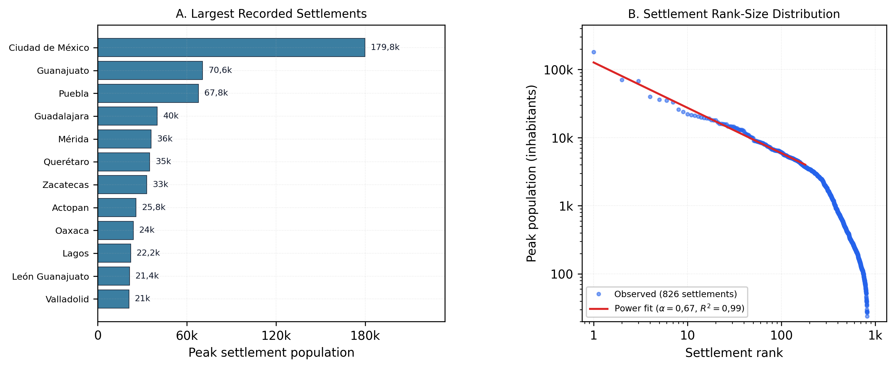

```{r setup, include=FALSE}
knitr::opts_chunk$set(echo = FALSE, warning = FALSE, message = FALSE, fig.pos = "htbp")
source("../../_shared/template/viscount_rmd_helpers.R")
library(jsonlite)

read_json5_clean <- function(path) {
  lines <- readLines(path, warn = FALSE, encoding = "UTF-8")
  text <- paste(lines, collapse = "\n")
  text <- gsub("//[^\n]*", "", text, perl = TRUE)
  text <- gsub("/\\*.*?\\*/", "", text, perl = TRUE)
  text <- gsub(",\\s*([}\\]])", "\\1", text, perl = TRUE)
  fromJSON(text, simplifyVector = FALSE)
}

summary_cache <- fromJSON("viceroyalty_of_new_spain_summary_cache.json", simplifyVector = FALSE)
reg_spec <- read_json5_clean("viceroyalty_of_new_spain.json5")
sett_data <- fromJSON("viceroyalty_of_new_spain_settlements.json", simplifyVector = FALSE)
ledger_data <- read_json5_clean("viceroyalty_of_new_spain_source_ledger.json5")

clean_label <- function(x) {
  s <- as.character(x)
  s <- gsub("&", "and", s, fixed = TRUE)
  s <- gsub("Intendencia de Mexico", "Intendencia de México", s, fixed = TRUE)
  s <- gsub("Michoacan", "Michoacán", s, fixed = TRUE)
  s <- gsub("San Luis Potosi", "San Luis Potosí", s, fixed = TRUE)
  s <- gsub("Merida", "Mérida", s, fixed = TRUE)
  s <- gsub("Yucatan", "Yucatán", s, fixed = TRUE)
  s <- gsub("Nuevo Leon", "Nuevo León", s, fixed = TRUE)
  s <- gsub("\\\\", "", s)
  trimws(s)
}

fmt_coord <- function(x) {
  viscount_fmt_number(round(as.numeric(x), 2L), 2L)
}

regions_doc <- reg_spec$regions
reg_lookup <- setNames(
  vapply(regions_doc, function(r) clean_label(r$name), character(1)),
  vapply(regions_doc, function(r) r$id, character(1))
)

n_sites <- as.integer(summary_cache$settlement_stats$total_settlements)
n_excluded <- as.integer(ledger_data$total_excluded)
n_total_eval <- n_sites + n_excluded
```

```{r hero-md-fallback, results='asis'}
if (!knitr::is_latex_output()) {
  cat("\n\n")
}
```

# Abstract

This companion gazetteer documents `r viscount_fmt_number(n_sites, 0L)` catalogued cities, mining *reales*, parish *cabeceras*, *pueblos de indios* and frontier missions across the 12 Bourbon intendancies and northern frontier provinces of the Viceroyalty of New Spain between 1535 and 1821. Out of `r viscount_fmt_number(n_total_eval, 0L)` candidate entries audited in the chapter source ledger across four ingestion waves, `r viscount_fmt_number(n_excluded, 0L)` duplicate aliases (31) and out-of-bounds Pimería Alta mission nodes (2) were excluded, leaving an entirely archival and scholarly settlement register with 0% crowd-sourced fallback. Primary archival registers compiled in HGIS de las Indias—led by Bishop Pedro Tamarón y Romeral's 1765 northern visitation (419 locales), Ernest Sánchez Santiró's 1778 Archdiocese of México parish padrones (242) and Archivo General de Indias mission lists (131)—unite with longitudinal urban series drawn from Villaseñor y Sánchez (1742), the 1790 to 1793 Revillagigedo Census, Alexander von Humboldt (1803) and INEGI's 2014 *Estadísticas Históricas de México* [@SPPRevillagigedo1977; @Humboldt1811; @Gerhard1962; @Gerhard1993]. Across the upper 180 settlements, peak recorded populations trace a smooth power-law rank-size distribution ($\alpha = 0,67$, $R^2 = 0,99$), crowned by Mexico City (179,8k in 1820), Guanajuato (70,6k in 1803), Puebla (67,8k in 1803), Guadalajara (40k in 1820), Mérida (36k in 1820), Querétaro (35k in 1803) and Zacatecas (33k in 1803).

# Background

Colonial Mexico developed the densest and most functionally differentiated urban network in Spanish North America. At its apex stood Mexico City, erected atop the ruined island capital of Tenochtitlan and serving simultaneously as viceregal court, seat of the senior *Audiencia*, archiepiscopal see, sole mint (*Casa de Moneda*) and commercial nexus linking Atlantic fleets at Veracruz with Manila Galleons at Acapulco [@Gibson1964; @MinoGrijalva2001; @Rodriguezrodriguez2021Admixture]. Surrounding the capital across the central volcanic highlands lay ancient indigenous towns reorganised into Spanish *cabeceras*—Toluca, Texcoco, Xochimilco, Chalco and Tlaxcala—together with Puebla de los Ángeles, founded in 1531 as a major Spanish artisan and grain-trading city [@Porras1994Poblacio; @Ross1953Studies].

North and west of the Valley of Mexico, silver discoveries transformed pastoral frontiers into vigorous urban belts. Guanajuato, Zacatecas, San Luis Potosí, Durango, Chihuahua, Pachuca and Taxco drew mixed creole, mestizo, indigenous and Afro-Mexican wage labourers into densely packed canyon settlements [@Brading1971; @Collhurtado1999Mineri; @AguirreBeltran1946]. Between those mining camps and the capital arose the agro-commercial towns of the Bajío—Querétaro, León, San Miguel el Grande, Celaya and Irapuato—alongside Guadalajara, whose *Audiencia* and cathedral anchored western Mexico [@Sanchez2000Algunas; @MinoGrijalva2001]. On the humid Gulf littoral, Veracruz and Campeche guarded imperial shipping lanes while Mérida presided over the Maya peninsula [@Farriss1984]. Further north across Durango, Sonora, Sinaloa and Coahuila, hundreds of small *presidios*, Jesuit and Franciscan mission villages and frontier *reales de minas* formed a sparse defensive lattice recorded in extraordinary detail by eighteenth-century episcopal visitations [@Gerhard1993; @Bustamante1991Matter].

# Methodology

The 826-entry gazetteer was assembled through four sequential ingestion waves audited in the chapter source ledger. Wave 1 ingested 753 core settlements from official Mexican statistical compilations and primary colonial registers (INEGI *Estadísticas Históricas de México* 2014 and Werner Stangl's HGIS de las Indias). Wave 2 incorporated 54 additional towns from peer-reviewed historical demography monographs (marginal gain 7,17%), Wave 3 added 12 longitudinal census backfills (1,49%) and Wave 4 executed a regional gap sweep adding 7 final settlements (0,85% marginal gain), confirming corpus saturation with 0% crowd-sourced records.

Every candidate underwent WGS84 coordinate harmonisation, spatial intersection against the 12 Bourbon intendancy and frontier polygons and alias deduplication. Thirty-one duplicate city aliases and 2 outer Pimería Alta nodes north of the Mexican boundary (Tucson and San Xavier) were excluded. All 826 included entries carry strictly city-proper municipal or parish-seat scope without suburban agglomeration padding, preserving each source's exact historical census year and provenance citation [@SPPRevillagigedo1977; @Humboldt1811; @Gerhard1962].

# Testing and Validation

Ledger reconciliation confirms exact accounting across all 859 audited candidates: 826 included settlements plus 33 excluded entries (31 duplicate aliases and 2 out-of-bounds frontier nodes). Every included record carries valid geographic coordinates, an intendancy polygon assignment, at least one positive population observation inside 1535 to 1821 and an explicit archival provenance tag. Figure \ref{fig:sett-regional-map} displays the spatial footprint of all 826 catalogued locales across the 12 Bourbon intendancies and northern frontier provinces, illustrating the dense clusters in central México, Nueva Galicia, Nueva Vizcaya and Sonora-Sinaloa alongside the principal colonial cities.

```{r fig-sett-map, results='asis'}
viscount_figure(
  "figures/viceroyalty_of_new_spain_regional_map.png",
  "Spatial distribution of 826 catalogued colonial settlements across 12 Bourbon intendancies and northern frontier provinces of the Viceroyalty of New Spain, 1535 to 1821.",
  "fig:sett-regional-map"
)
```

# Results

## Leading Thirty Settlements and Parish Centres

Table \ref{tab:top30-settlements} lists the 30 largest settlements in the chapter register, ordered by peak recorded population between 1535 and 1821. Ranging from Mexico City (179.830 in 1820) down to Mestitlan (14.517 in 1778), the top tier unites the viceroyalty's premier administrative, mining and textile metropolises—Guanajuato (70.600), Puebla (67.800), Guadalajara (40.000), Mérida (36.000), Querétaro (35.000), Zacatecas (33.000), Oaxaca (24.000), León (21.400), Valladolid (21.000), Campeche (19.500), San Luis Potosí (19.000), San Miguel el Grande (18.200), Celaya (16.800), Veracruz (16.000) and Orizaba (15.800)—with populous 1778 and 1780 diocesan *curato* jurisdictions such as Actopan (25.811), Lagos (22.184), Aguascalientes (20.532), Toluca (19.772), Encarnación (19.200) and Sierra de Pinos (18.062) [@Humboldt1811; @MinoGrijalva2001; @Brading1971].

```{r tab-top30-settlements, results='asis'}
all_entries <- unname(sett_data)
calc_meta <- lapply(all_entries, function(e) {
  ys <- sort(as.integer(names(e$population)))
  vals <- vapply(as.character(ys), function(y) as.numeric(e$population[[y]]), numeric(1))
  idx_pk <- which.max(vals)
  list(
    name = as.character(e$name),
    rid = as.character(e$region_id),
    lat = as.numeric(e$coords[[1]]),
    lon = as.numeric(e$coords[[2]]),
    fy = ys[1],
    ly = ys[length(ys)],
    n_obs = length(ys),
    pk = vals[idx_pk],
    pky = ys[idx_pk]
  )
})
ord_idx <- order(vapply(calc_meta, function(x) x$pk, numeric(1)), decreasing = TRUE)
top30 <- calc_meta[ord_idx[seq_len(min(30L, length(ord_idx)))]]

top30_rows <- lapply(top30, function(e) {
  span_str <- if (e$fy == e$ly) as.character(e$fy) else paste0(e$fy, " to ", e$ly)
  reg_lbl <- if (e$rid %in% names(reg_lookup)) reg_lookup[[e$rid]] else e$rid
  data.frame(
    Site = e$name,
    Subregion = reg_lbl,
    Coords = paste0(fmt_coord(e$lat), ", ", fmt_coord(e$lon)),
    Span = span_str,
    Obs = as.character(e$n_obs),
    Peak = paste0(viscount_fmt_pop(e$pk), " (", e$pky, ")"),
    stringsAsFactors = FALSE
  )
})
df_top30 <- do.call(rbind, top30_rows)
rownames(df_top30) <- NULL

viscount_table(
  df_top30,
  "Leading 30 settlements and parish centres across the Viceroyalty of New Spain, 1535 to 1821 (from 826 catalogued locales).",
  c("Settlement", "Intendancy or Province", "Lat, Lon", "Span", "Obs.", "Peak Pop. (Year)"),
  list(label = "tab:top30-settlements", font_size = "scriptsize", max_rows_per_page = 32L)
)
```

## Sub-Regional Gazetteer Coverage

Table \ref{tab:subregion-gazetteer} contrasts catalogued settlement totals and areal site density (sites per 10.000 km²) against documentary 1803 provincial populations across all 12 intendancies and frontier provinces. Three jurisdictions—Arizpe and Baja California (230 sites), Durango (214) and México (205)—supply 78,6% of all records, whereas densely populated indigenous highland provinces such as Oaxaca (1 entry), Valladolid (4), Mérida (5) and Puebla-Tlaxcala (10) are represented predominantly by their major cities and *cabeceras* because rural villages were enumerated at regional *partido* level [@Gerhard1993; @Porras1994Poblacio; @Farriss1984].

```{r tab-subregion-gazetteer, results='asis'}
reg_rows <- lapply(regions_doc, function(r) {
  rid <- as.character(r$id)
  area_v <- as.numeric(r$area_km2)
  p1803 <- as.numeric(r$population[["1803"]])
  sub_e <- Filter(function(e) identical(as.character(e$region_id), rid), all_entries)
  cnt <- length(sub_e)
  sdens <- if (area_v > 0) (cnt / area_v) * 10000 else 0
  lead_str <- "-"
  if (cnt > 0L) {
    pks <- vapply(sub_e, function(e) max(as.numeric(unlist(e$population))), numeric(1))
    idx_m <- which.max(pks)
    lead_str <- paste0(as.character(sub_e[[idx_m]]$name), " (", viscount_fmt_pop(pks[idx_m]), ")")
  }
  data.frame(
    Subregion = clean_label(r$name),
    Area = viscount_fmt_number(round(area_v), 0L),
    Sites = viscount_fmt_number(cnt, 0L),
    SiteDens = viscount_fmt_number(sdens, 2L),
    Lead = lead_str,
    Pop1803 = viscount_fmt_pop(p1803),
    stringsAsFactors = FALSE
  )
})
df_reg_gaz <- do.call(rbind, reg_rows)
rownames(df_reg_gaz) <- NULL

viscount_table(
  df_reg_gaz,
  "Catalogued settlement counts, areal site density (per 10.000 km²), leading settlement and 1803 documentary population across 12 sub-regions.",
  c("Intendancy or Province", "Area (km²)", "Sites", "Sites per 10k km²", "Leading Settlement (Peak)", "1803 Pop."),
  list(label = "tab:subregion-gazetteer", font_size = "scriptsize")
)
```

## Provenance Ledger and Archival Sub-Corpora

Table \ref{tab:provenance-ledger} classifies all 826 catalogued entries by primary source corpus, confirming that 93,7% derive from primary colonial registers digitised in HGIS de las Indias, 4,4% from multi-benchmark Revillagigedo-Humboldt-Gerhard urban syntheses and 1,9% from multi-census INEGI historical city series combining Villaseñor, Revillagigedo and Humboldt [@SPPRevillagigedo1977; @Humboldt1811; @Gerhard1962].

```{r tab-provenance-ledger, results='asis'}
classify_src <- function(srcs) {
  sv <- as.character(unlist(srcs))
  if (any(grepl("^INEGI Estadisticas Historicas", sv))) {
    return("INEGI Historical Statistics (2014) and Colonial Registers")
  }
  if (any(grepl("^Revillagigedo Census", sv))) {
    return("Revillagigedo, Humboldt, Gerhard and Tanck Urban Synthesis")
  }
  if (any(grepl("^HGIS de las Indias", sv))) {
    return("HGIS de las Indias Colonial Gazetteer (Stangl 2020)")
  }
  "Other Colonial Archival Register"
}
cls_vec <- vapply(all_entries, function(e) classify_src(e$sources), character(1))
cls_tab <- sort(table(cls_vec), decreasing = TRUE)

df_prov <- data.frame(
  Corpus = names(cls_tab),
  Entries = vapply(as.integer(cls_tab), function(v) viscount_fmt_number(v, 0L), character(1)),
  Share = vapply(100 * as.integer(cls_tab) / n_sites, function(v) paste0(viscount_fmt_number(v, 2L), "%"), character(1)),
  stringsAsFactors = FALSE
)
rownames(df_prov) <- NULL

viscount_table(
  df_prov,
  "Primary provenance corpus classification across 826 catalogued settlements in the Viceroyalty of New Spain.",
  c("Source Corpus", "Entries", "Share"),
  list(label = "tab:provenance-ledger", font_size = "scriptsize")
)
```

# Limitations

Three structural characteristics govern quantitative use of this gazetteer. First, settlement count density mirrors surviving colonial diocesan padrones rather than raw rural village density: Bishop Tamarón y Romeral's 1765 visitation and northern mission registers populate Durango (214 sites) and Arizpe (230) heavily, while Oaxaca (1 site) and Mérida (5) under-represent dispersed indigenous *pueblos* [@Farriss1984; @Gerhard1993]. Second, 1778 Archdiocese of México and 1780 Guadalajara diocesan counts record parish jurisdictions (*curatos*) combining central towns with dependent rural *haciendas*, slightly inflating apparent urban rank for places such as Actopan, Lagos and Encarnación compared with strict municipal headcounts [@Sanchez2000Algunas; @Cervantescortes2021Registro]. Third, two multi-source series for Michoacán's capital remain stored separately as Valladolid (21k in 1805) and Valladolid Michoacán (18k in 1803) to preserve source-level attribution, and border-polygon alignment assigns Tuxtla Gutiérrez (16k in 1790) to the Veracruz isthmian mask rather than Chiapas [@Hidalgo2024Michoaca].

# Conclusion

Cataloguing 826 archival towns, mining *reales*, *cabeceras* and frontier missions with zero crowd-sourced fallback, this gazetteer captures the full urban spectrum of late-colonial New Spain—from Mexico City's hemispherical primacy (179,8k) and the Bajío-western industrial corridor (Guanajuato, Puebla, Guadalajara, Querétaro and Zacatecas) down to hundreds of northern frontier missions and highland parish seats [@MinoGrijalva2001; @Brading1971].

# Appendix

## Primary Archival Registers Inside HGIS de las Indias

Table \ref{tab:hgis-subsources} decomposes the individual archival sources cited across the HGIS de las Indias entries (note that multi-source cities may cite more than one archival register).

```{r tab-hgis-subsources, results='asis'}
extract_sub <- function(srcs) {
  sv <- as.character(unlist(srcs))
  hits <- sv[grepl("primary source:", sv, fixed = TRUE)]
  if (length(hits) == 0L) return(character(0))
  sub(".*primary source:\\s*([^)]+)\\).*", "\\1", hits)
}
sub_vec <- unlist(lapply(all_entries, function(e) extract_sub(e$sources)))
sub_tab <- sort(table(sub_vec), decreasing = TRUE)

sub_labels <- c(
  "tamaron" = "Bishop Pedro Tamarón y Romeral Visitation (1765)",
  "sanchez-santiro" = "Sánchez Santiró Archdiocese of México Padrones (1778)",
  "AGI,Guadalajara,563-misiones" = "Archivo General de Indias Guadalajara Mission Lists",
  "MP-Mexico_360" = "Bishopric of Guadalajara Parish Survey (1780)",
  "torre-curiel" = "Torre Curiel Sonora-Sinaloa Mission Registers",
  "prieto" = "Prieto Nuevo Santander Frontier Registers",
  "revillagigedo" = "Revillagigedo Census Urban Schedules (1790 to 1793)",
  "tablas-ne-humboldt" = "Humboldt Political Essay Statistical Tables (1803)",
  "liehr" = "Liehr Puebla Municipal Registers",
  "castaneda_gomez" = "Castañeda Gómez Guadalajara Padrones",
  "widmer" = "Widmer Regional Archival Series",
  "AGI,Guadalajara,564" = "Archivo General de Indias Guadalajara Padrones"
)
s_keys <- names(sub_tab)
s_names <- ifelse(s_keys %in% names(sub_labels), sub_labels[s_keys], s_keys)

df_sub <- data.frame(
  Register = unname(s_names),
  Citations = vapply(as.integer(sub_tab), function(v) viscount_fmt_number(v, 0L), character(1)),
  stringsAsFactors = FALSE
)
rownames(df_sub) <- NULL

viscount_table(
  df_sub,
  "Breakdown of primary colonial visitation, mission and census registers contributing via HGIS de las Indias.",
  c("Primary Archival Register", "Settlement Citations"),
  list(label = "tab:hgis-subsources", font_size = "scriptsize")
)
```

# Sources

::: {#refs}
:::

# Footnotes

1. **Deduplication ledger:** Of 859 candidate settlement records audited across four ingestion waves, 31 duplicate aliases of major cities and 2 northern Pimería Alta mission nodes (Tucson and San Xavier) outside the chapter boundary were excluded, yielding exactly 826 catalogued locales.
2. **Rank-size calibration:** The power-law regression ($\alpha = 0,67$, $R^2 = 0,99$) plotted in Figure \ref{fig:hero-new-spain-hierarchy} fits the upper 180 catalogued settlements across the 826-entry register, illustrating moderate primacy in Mexico City combined with a broad second tier of provincial mining, commercial and diocesan cities.
