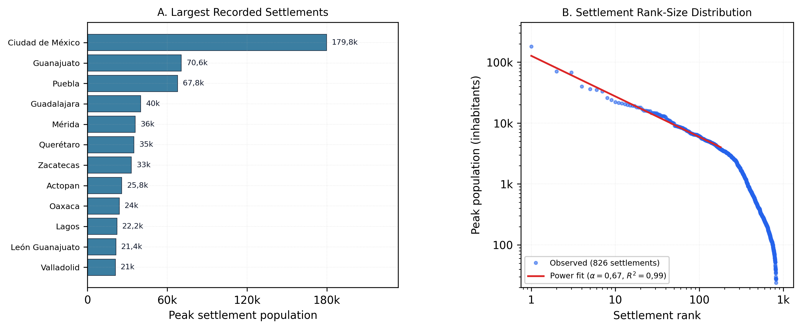
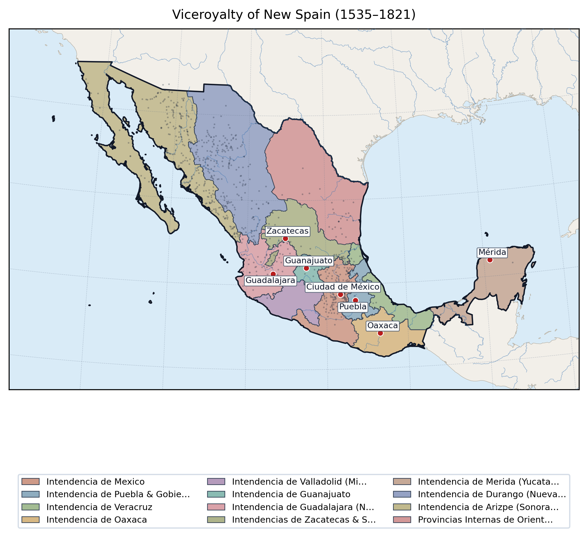

Viceroyalty of New Spain
================
Aust Kätzchen
23 November 2026

- [Abstract](#abstract)
- [Background](#background)
- [Methodology](#methodology)
- [Testing and Validation](#testing-and-validation)
- [Results](#results)
  - [Leading Thirty Settlements and Parish
    Centres](#leading-thirty-settlements-and-parish-centres)
  - [Sub-Regional Gazetteer Coverage](#sub-regional-gazetteer-coverage)
  - [Provenance Ledger and Archival
    Sub-Corpora](#provenance-ledger-and-archival-sub-corpora)
- [Limitations](#limitations)
- [Conclusion](#conclusion)
- [Appendix](#appendix)
  - [Primary Archival Registers Inside HGIS de las
    Indias](#primary-archival-registers-inside-hgis-de-las-indias)
- [Sources](#sources)
- [Footnotes](#footnotes)

<figure>

<figcaption aria-hidden="true">Leading urban centres and rank-size
distribution across 826 catalogued settlements in the Viceroyalty of New
Spain, 1535 to 1821.</figcaption>
</figure>

# Abstract

This companion gazetteer documents 826 catalogued cities, mining
*reales*, parish *cabeceras*, *pueblos de indios* and frontier missions
across the 12 Bourbon intendancies and northern frontier provinces of
the Viceroyalty of New Spain between 1535 and 1821. Out of 859 candidate
entries audited in the chapter source ledger across four ingestion
waves, 33 duplicate aliases (31) and out-of-bounds Pimería Alta mission
nodes (2) were excluded, leaving an entirely archival and scholarly
settlement register with 0% crowd-sourced fallback. Primary archival
registers compiled in HGIS de las Indias—led by Bishop Pedro Tamarón y
Romeral’s 1765 northern visitation (419 locales), Ernest Sánchez
Santiró’s 1778 Archdiocese of México parish padrones (242) and Archivo
General de Indias mission lists (131)—unite with longitudinal urban
series drawn from Villaseñor y Sánchez (1742), the 1790 to 1793
Revillagigedo Census, Alexander von Humboldt (1803) and INEGI’s 2014
*Estadísticas Históricas de México*
[\[1\]](#ref-SPPRevillagigedo1977)[\[2\]](#ref-Humboldt1811)[\[3\]](#ref-Gerhard1962)[\[4\]](#ref-Gerhard1993).
Across the upper 180 settlements, peak recorded populations trace a
smooth power-law rank-size distribution ($\alpha = 0,67$, $R^2 = 0,99$),
crowned by Mexico City (179,8k in 1820), Guanajuato (70,6k in 1803),
Puebla (67,8k in 1803), Guadalajara (40k in 1820), Mérida (36k in 1820),
Querétaro (35k in 1803) and Zacatecas (33k in 1803).

# Background

Colonial Mexico developed the densest and most functionally
differentiated urban network in Spanish North America. At its apex stood
Mexico City, erected atop the ruined island capital of Tenochtitlan and
serving simultaneously as viceregal court, seat of the senior
*Audiencia*, archiepiscopal see, sole mint (*Casa de Moneda*) and
commercial nexus linking Atlantic fleets at Veracruz with Manila
Galleons at Acapulco
[\[5\]](#ref-Gibson1964)[\[6\]](#ref-MinoGrijalva2001)[\[7\]](#ref-Rodriguezrodriguez2021Admixture).
Surrounding the capital across the central volcanic highlands lay
ancient indigenous towns reorganised into Spanish *cabeceras*—Toluca,
Texcoco, Xochimilco, Chalco and Tlaxcala—together with Puebla de los
Ángeles, founded in 1531 as a major Spanish artisan and grain-trading
city [\[8\]](#ref-Porras1994Poblacio)[\[9\]](#ref-Ross1953Studies).

North and west of the Valley of Mexico, silver discoveries transformed
pastoral frontiers into vigorous urban belts. Guanajuato, Zacatecas, San
Luis Potosí, Durango, Chihuahua, Pachuca and Taxco drew mixed creole,
mestizo, indigenous and Afro-Mexican wage labourers into densely packed
canyon settlements
[\[10\]](#ref-Brading1971)[\[11\]](#ref-Collhurtado1999Mineri)[\[12\]](#ref-AguirreBeltran1946).
Between those mining camps and the capital arose the agro-commercial
towns of the Bajío—Querétaro, León, San Miguel el Grande, Celaya and
Irapuato—alongside Guadalajara, whose *Audiencia* and cathedral anchored
western Mexico
[\[6\]](#ref-MinoGrijalva2001)[\[13\]](#ref-Sanchez2000Algunas). On the
humid Gulf littoral, Veracruz and Campeche guarded imperial shipping
lanes while Mérida presided over the Maya peninsula
[\[14\]](#ref-Farriss1984). Further north across Durango, Sonora,
Sinaloa and Coahuila, hundreds of small *presidios*, Jesuit and
Franciscan mission villages and frontier *reales de minas* formed a
sparse defensive lattice recorded in extraordinary detail by
eighteenth-century episcopal visitations
[\[4\]](#ref-Gerhard1993)[\[15\]](#ref-Bustamante1991Matter).

# Methodology

The 826-entry gazetteer was assembled through four sequential ingestion
waves audited in the chapter source ledger. Wave 1 ingested 753 core
settlements from official Mexican statistical compilations and primary
colonial registers (INEGI *Estadísticas Históricas de México* 2014 and
Werner Stangl’s HGIS de las Indias). Wave 2 incorporated 54 additional
towns from peer-reviewed historical demography monographs (marginal gain
7,17%), Wave 3 added 12 longitudinal census backfills (1,49%) and Wave 4
executed a regional gap sweep adding 7 final settlements (0,85% marginal
gain), confirming corpus saturation with 0% crowd-sourced records.

Every candidate underwent WGS84 coordinate harmonisation, spatial
intersection against the 12 Bourbon intendancy and frontier polygons and
alias deduplication. Thirty-one duplicate city aliases and 2 outer
Pimería Alta nodes north of the Mexican boundary (Tucson and San Xavier)
were excluded. All 826 included entries carry strictly city-proper
municipal or parish-seat scope without suburban agglomeration padding,
preserving each source’s exact historical census year and provenance
citation
[\[1\]](#ref-SPPRevillagigedo1977)[\[2\]](#ref-Humboldt1811)[\[3\]](#ref-Gerhard1962).

# Testing and Validation

Ledger reconciliation confirms exact accounting across all 859 audited
candidates: 826 included settlements plus 33 excluded entries (31
duplicate aliases and 2 out-of-bounds frontier nodes). Every included
record carries valid geographic coordinates, an intendancy polygon
assignment, at least one positive population observation inside 1535 to
1821 and an explicit archival provenance tag. Figure displays the
spatial footprint of all 826 catalogued locales across the 12 Bourbon
intendancies and northern frontier provinces, illustrating the dense
clusters in central México, Nueva Galicia, Nueva Vizcaya and
Sonora-Sinaloa alongside the principal colonial cities.

<!-- -->

# Results

## Leading Thirty Settlements and Parish Centres

Table lists the 30 largest settlements in the chapter register, ordered
by peak recorded population between 1535 and 1821. Ranging from Mexico
City (179.830 in 1820) down to Mestitlan (14.517 in 1778), the top tier
unites the viceroyalty’s premier administrative, mining and textile
metropolises—Guanajuato (70.600), Puebla (67.800), Guadalajara (40.000),
Mérida (36.000), Querétaro (35.000), Zacatecas (33.000), Oaxaca
(24.000), León (21.400), Valladolid (21.000), Campeche (19.500), San
Luis Potosí (19.000), San Miguel el Grande (18.200), Celaya (16.800),
Veracruz (16.000) and Orizaba (15.800)—with populous 1778 and 1780
diocesan *curato* jurisdictions such as Actopan (25.811), Lagos
(22.184), Aguascalientes (20.532), Toluca (19.772), Encarnación (19.200)
and Sierra de Pinos (18.062)
[\[2\]](#ref-Humboldt1811)[\[6\]](#ref-MinoGrijalva2001)[\[10\]](#ref-Brading1971).

| Settlement | Intendancy or Province | Lat, Lon | Span | Obs. | Peak Pop. (Year) |
|:---|:---|:---|:---|:---|:---|
| **Ciudad de México** | Intendencia de México | 19,43, -99,13 | 1570 to 1820 | 9 | 179,8k (1820) |
| **Guanajuato** | Intendencia de Guanajuato | 21,02, -101,26 | 1600 to 1820 | 6 | 70,6k (1803) |
| **Puebla** | Intendencia de Puebla and Gobierno de Tlaxcala | 19,04, -98,21 | 1570 to 1820 | 7 | 67,8k (1803) |
| **Guadalajara** | Intendencia de Guadalajara (Nueva Galicia) | 20,66, -103,35 | 1570 to 1820 | 10 | 40k (1820) |
| **Mérida** | Intendencia de Mérida (Yucatán and Tabasco) | 20,97, -89,62 | 1574 to 1820 | 6 | 36k (1820) |
| **Querétaro** | Intendencia de México | 20,59, -100,39 | 1582 to 1820 | 7 | 35k (1803) |
| **Zacatecas** | Intendencias de Zacatecas and San Luis Potosí | 22,77, -102,58 | 1574 to 1820 | 7 | 33k (1803) |
| **Actopan** | Intendencia de México | 20,27, -98,94 | 1778 | 1 | 25,8k (1778) |
| **Oaxaca** | Intendencia de Oaxaca | 17,07, -96,73 | 1570 to 1820 | 10 | 24k (1803) |
| **Lagos** | Intendencia de Guadalajara (Nueva Galicia) | 21,36, -101,93 | 1780 | 1 | 22,2k (1780) |
| **León Guanajuato** | Intendencia de Guanajuato | 21,12, -101,68 | 1646 to 1810 | 4 | 21,4k (1810) |
| **Valladolid** | Intendencia de Valladolid (Michoacán) | 19,71, -101,19 | 1790 to 1805 | 3 | 21k (1805) |
| **Aguas Calientes** | Intendencia de Guadalajara (Nueva Galicia) | 21,88, -102,29 | 1646 to 1810 | 5 | 20,5k (1780) |
| **Toluca** | Intendencia de México | 19,29, -99,65 | 1570 to 1820 | 6 | 19,8k (1778) |
| **Campeche** | Intendencia de Mérida (Yucatán and Tabasco) | 19,84, -90,53 | 1574 to 1820 | 6 | 19,5k (1820) |
| **Encarnación** | Intendencia de Guadalajara (Nueva Galicia) | 21,53, -102,24 | 1780 | 1 | 19,2k (1780) |
| **San Luis Potosí** | Intendencias de Zacatecas and San Luis Potosí | 22,16, -100,99 | 1600 to 1820 | 6 | 19k (1820) |
| **San Miguel el Grande** | Intendencia de Guanajuato | 20,91, -100,74 | 1646 to 1810 | 4 | 18,2k (1810) |
| **Sierra de Pinos** | Intendencias de Zacatecas and San Luis Potosí | 22,3, -101,57 | 1780 | 1 | 18,1k (1780) |
| **Valladolid Michoacán** | Intendencia de Valladolid (Michoacán) | 19,71, -101,19 | 1570 to 1820 | 6 | 18k (1803) |
| **Celaya** | Intendencia de Guanajuato | 20,52, -100,82 | 1646 to 1810 | 4 | 16,8k (1810) |
| **Veracruz** | Intendencia de Veracruz | 19,17, -96,13 | 1574 to 1820 | 7 | 16k (1803) |
| **Tuxtla Gutiérrez** | Intendencia de Veracruz | 16,75, -93,1 | 1790 to 1820 | 4 | 16k (1790) |
| **Orizaba** | Intendencia de Puebla and Gobierno de Tlaxcala | 18,85, -97,1 | 1580 to 1820 | 6 | 15,8k (1820) |
| **San Juan del Rio** | Intendencia de México | 20,39, -99,99 | 1778 | 1 | 15,7k (1778) |
| **San Felipe del Obraje** | Intendencia de México | 19,71, -99,95 | 1778 | 1 | 15,6k (1778) |
| **Zultepec** | Intendencia de México | 18,86, -99,98 | 1778 | 1 | 14,7k (1778) |
| **Texcoco con Calpulalpa** | Intendencia de México | 19,51, -98,88 | 1778 | 1 | 14,7k (1778) |
| **Irapuato** | Intendencia de Guanajuato | 20,68, -101,36 | 1650 to 1810 | 4 | 14,6k (1810) |
| **Mestitlan** | Intendencia de México | 20,59, -98,76 | 1778 | 1 | 14,5k (1778) |

Leading 30 settlements and parish centres across the Viceroyalty of New
Spain, 1535 to 1821 (from 826 catalogued locales).

## Sub-Regional Gazetteer Coverage

Table contrasts catalogued settlement totals and areal site density
(sites per 10.000 km²) against documentary 1803 provincial populations
across all 12 intendancies and frontier provinces. Three
jurisdictions—Arizpe and Baja California (230 sites), Durango (214) and
México (205)—supply 78,6% of all records, whereas densely populated
indigenous highland provinces such as Oaxaca (1 entry), Valladolid (4),
Mérida (5) and Puebla-Tlaxcala (10) are represented predominantly by
their major cities and *cabeceras* because rural villages were
enumerated at regional *partido* level
[\[4\]](#ref-Gerhard1993)[\[8\]](#ref-Porras1994Poblacio)[\[14\]](#ref-Farriss1984).

| Intendancy or Province | Area (km²) | Sites | Sites per 10k km² | Leading Settlement (Peak) | 1803 Pop. |
|:---|:---|:---|:---|:---|:---|
| **Intendencia de México** | 130.620 | 205 | 15,69 | Ciudad de México (179,8k) | 1,51M |
| **Intendencia de Puebla and Gobierno de Tlaxcala** | 48.178 | 10 | 2,08 | Puebla (67,8k) | 813,3k |
| **Intendencia de Veracruz** | 68.563 | 12 | 1,75 | Veracruz (16k) | 156k |
| **Intendencia de Oaxaca** | 89.492 | 1 | 0,11 | Oaxaca (24k) | 534,8k |
| **Intendencia de Valladolid (Michoacán)** | 75.820 | 4 | 0,53 | Valladolid (21k) | 376,4k |
| **Intendencia de Guanajuato** | 31.401 | 8 | 2,55 | Guanajuato (70,6k) | 517,3k |
| **Intendencia de Guadalajara (Nueva Galicia)** | 116.928 | 63 | 5,39 | Guadalajara (40k) | 630,5k |
| **Intendencias de Zacatecas and San Luis Potosí** | 129.242 | 39 | 3,02 | Zacatecas (33k) | 457,7k |
| **Intendencia de Mérida (Yucatán and Tabasco)** | 155.912 | 5 | 0,32 | Mérida (36k) | 465,8k |
| **Intendencia de Durango (Nueva Vizcaya)** | 383.074 | 214 | 5,59 | Durango (14k) | 159,7k |
| **Intendencia de Arizpe (Sonora-Sinaloa) and Baja California** | 368.878 | 230 | 6,24 | Culiacán (10,8k) | 130,4k |
| **Provincias Internas de Oriente (Coahuila, Nuevo León and Nuevo Santander)** | 291.898 | 35 | 1,2 | Saltillo (14,5k) | 142k |

Catalogued settlement counts, areal site density (per 10.000 km²),
leading settlement and 1803 documentary population across 12
sub-regions.

## Provenance Ledger and Archival Sub-Corpora

Table classifies all 826 catalogued entries by primary source corpus,
confirming that 93,7% derive from primary colonial registers digitised
in HGIS de las Indias, 4,4% from multi-benchmark
Revillagigedo-Humboldt-Gerhard urban syntheses and 1,9% from
multi-census INEGI historical city series combining Villaseñor,
Revillagigedo and Humboldt
[\[1\]](#ref-SPPRevillagigedo1977)[\[2\]](#ref-Humboldt1811)[\[3\]](#ref-Gerhard1962).

| Source Corpus | Entries | Share |
|:---|:---|:---|
| **HGIS de las Indias Colonial Gazetteer (Stangl 2020)** | 774 | 93,7% |
| **Revillagigedo, Humboldt, Gerhard and Tanck Urban Synthesis** | 36 | 4,36% |
| **INEGI Historical Statistics (2014) and Colonial Registers** | 16 | 1,94% |

Primary provenance corpus classification across 826 catalogued
settlements in the Viceroyalty of New Spain.

# Limitations

Three structural characteristics govern quantitative use of this
gazetteer. First, settlement count density mirrors surviving colonial
diocesan padrones rather than raw rural village density: Bishop Tamarón
y Romeral’s 1765 visitation and northern mission registers populate
Durango (214 sites) and Arizpe (230) heavily, while Oaxaca (1 site) and
Mérida (5) under-represent dispersed indigenous *pueblos*
[\[4\]](#ref-Gerhard1993)[\[14\]](#ref-Farriss1984). Second, 1778
Archdiocese of México and 1780 Guadalajara diocesan counts record parish
jurisdictions (*curatos*) combining central towns with dependent rural
*haciendas*, slightly inflating apparent urban rank for places such as
Actopan, Lagos and Encarnación compared with strict municipal headcounts
[\[13\]](#ref-Sanchez2000Algunas)[\[16\]](#ref-Cervantescortes2021Registro).
Third, two multi-source series for Michoacán’s capital remain stored
separately as Valladolid (21k in 1805) and Valladolid Michoacán (18k in
1803) to preserve source-level attribution, and border-polygon alignment
assigns Tuxtla Gutiérrez (16k in 1790) to the Veracruz isthmian mask
rather than Chiapas [\[17\]](#ref-Hidalgo2024Michoaca).

# Conclusion

Cataloguing 826 archival towns, mining *reales*, *cabeceras* and
frontier missions with zero crowd-sourced fallback, this gazetteer
captures the full urban spectrum of late-colonial New Spain—from Mexico
City’s hemispherical primacy (179,8k) and the Bajío-western industrial
corridor (Guanajuato, Puebla, Guadalajara, Querétaro and Zacatecas) down
to hundreds of northern frontier missions and highland parish seats
[\[6\]](#ref-MinoGrijalva2001)[\[10\]](#ref-Brading1971).

# Appendix

## Primary Archival Registers Inside HGIS de las Indias

Table decomposes the individual archival sources cited across the HGIS
de las Indias entries (note that multi-source cities may cite more than
one archival register).

| Primary Archival Register | Settlement Citations |
|:---|:---|
| **Bishop Pedro Tamarón y Romeral Visitation (1765)** | 419 |
| **Sánchez Santiró Archdiocese of México Padrones (1778)** | 242 |
| **Archivo General de Indias Guadalajara Mission Lists** | 131 |
| **Bishopric of Guadalajara Parish Survey (1780)** | 80 |
| **Torre Curiel Sonora-Sinaloa Mission Registers** | 70 |
| **Prieto Nuevo Santander Frontier Registers** | 24 |
| **Revillagigedo Census Urban Schedules (1790 to 1793)** | 7 |
| **Humboldt Political Essay Statistical Tables (1803)** | 2 |
| **Archivo General de Indias Guadalajara Padrones** | 1 |
| **Castañeda Gómez Guadalajara Padrones** | 1 |
| **Liehr Puebla Municipal Registers** | 1 |
| **Widmer Regional Archival Series** | 1 |

Breakdown of primary colonial visitation, mission and census registers
contributing via HGIS de las Indias.

# Sources

1.
Secretaría de Programación y
Presupuesto (SPP) / Dirección General de Estadística.
*Primer Censo de Población de la Nueva España,
1790. Censo de Revillagigedo, ’Un censo condenado’*. Secretaría
de Programación y Presupuesto, México, 1977,
<https://www.inegi.org.mx/>.

2.
Humboldt, Alexander von.
*Essai politique sur le royaume de la
Nouvelle-Espagne (Book III, Chapter VIII: Statistical Tables of
Intendancies, 1803)*. F. Schoell, Paris, 1811,
<https://archive.org/details/essaipolitiquesu01humb>.

3.
Gerhard, Peter.
*México en 1742*. Editorial José Porrúa e
Hijos, México, 1962, <https://openlibrary.org/works/OL1802685W>.

4.
Gerhard, Peter.
*A Guide to the Historical Geography of New
Spain*. University of Oklahoma Press, 1993,
<https://www.oupress.com/>.

5.
Gibson, Charles.
*The Aztecs Under Spanish Rule: A History of the
Indians of the Valley of Mexico, 1519-1810*. Stanford University
Press, 1964, <https://www.sup.org/>.

6.
Miño Grijalva, Manuel.
*El mundo novohispano: Población, ciudades y
economía, siglos XVII y XVIII*. El Colegio de México / Fondo de
Cultura Económica, 2001, <https://www.colmex.mx/>.

7.
Rodríguez-Rodríguez, Juan Esteban,
et al. “Admixture dynamics in colonial Mexico and
the genetic legacy of the Manila Galleon.” *bioRxiv (Cold Spring
Harbor Laboratory)*, 2021,
<https://doi.org/10.1101/2021.10.09.463780>.

8.
Porras, Agustín Grajales.
“La población de la Intendencia de Puebla en las
postrimerías del régimen colonial.” *Secuencia*, 1994,
<https://doi.org/10.18234/secuencia.v0i29.466>.

9.
Ross, Oliver dell.
“Studies of selected Mexican communal institutions
: colonial period /.” *OhioLink ETD Center (Ohio Library and
Information Network)*, 1953,
<http://rave.ohiolink.edu/etdc/view?acc_num=osu1486467544554499>.

10.
Brading, D. A.
*Miners and Merchants in Bourbon Mexico,
1763-1810*. Cambridge University Press, 1971,
<https://www.cambridge.org/>.

11.
Coll-Hurtado, Atlántida, and María
Teresa Sánchez Salazar. “La minería en el Obispado
de Michoacán a mediados del siglo XVIII.” *Investigaciones
Geográficas*, 1999, <https://doi.org/10.14350/rig.59087>.

12.
Aguirre Beltrán, Gonzalo.
*La población negra de México, 1519-1810: Estudio
etnohistórico*. Ediciones Fuente Cultural (reprinted Fondo de
Cultura Económica, 1972), 1946,
<https://www.fondodeculturaeconomica.com/>.

13.
Sánchez, Lilia V. Oliver.
“Algunas aportaciones de la demografía histórica en
el occidente de México. Siglos XVIII y XIX.” *Papeles de
Población*, 2000,
<http://www.redalyc.org/articulo.oa?id=11202608>.

14.
Farriss, Nancy M.
*Maya Society under Colonial Rule: The Collective
Enterprise of Survival*. Princeton University Press, 1984,
<https://doi.org/10.1515/9780691235400>.

15.
Bustamante, Adrián P.
“The Matter Was Never Resolved: The Casta System in
Colonial New Mexico, 1693-1823.” *New Mexico Historical Review*,
1991, <https://digitalrepository.unm.edu/nmhr/vol66/iss2/2>.

16.
Cervantes-Cortés, José-Luis.
“Sin registro de ocupación: la omisión de empleo de
las mujeres solteras en la Ciudad de México, 1790.” *Historia y
Sociedad*, 2021, <https://doi.org/10.15446/hys.n41.87226>.

17.
San Nicolás de Hidalgo,
Universidad Michoacana de, and Oziel Talavera Ibarra.
“Michoacán en el Censo de Revillagigedo de 1790.
Cotejo con los datos de Martínez de Lejarza de 1822.” *Letras
Históricas*, 2024, <https://doi.org/10.31836/lh.30.7445>.

# Footnotes

1.  **Deduplication ledger:** Of 859 candidate settlement records
    audited across four ingestion waves, 31 duplicate aliases of major
    cities and 2 northern Pimería Alta mission nodes (Tucson and San
    Xavier) outside the chapter boundary were excluded, yielding exactly
    826 catalogued locales.
2.  **Rank-size calibration:** The power-law regression
    ($\alpha = 0,67$, $R^2 = 0,99$) plotted in Figure fits the upper 180
    catalogued settlements across the 826-entry register, illustrating
    moderate primacy in Mexico City combined with a broad second tier of
    provincial mining, commercial and diocesan cities.
