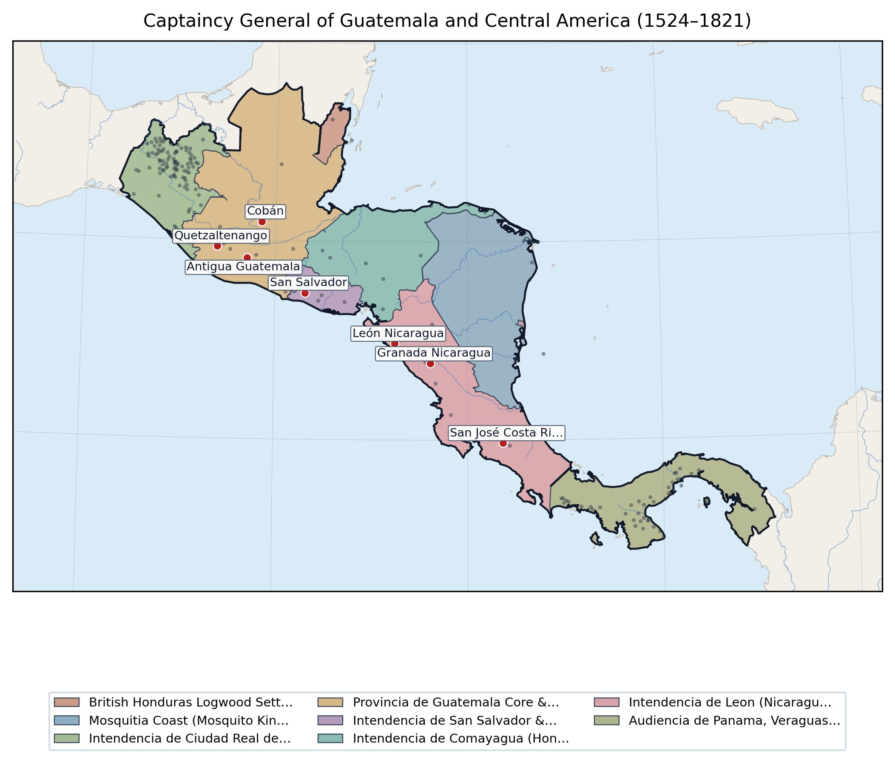
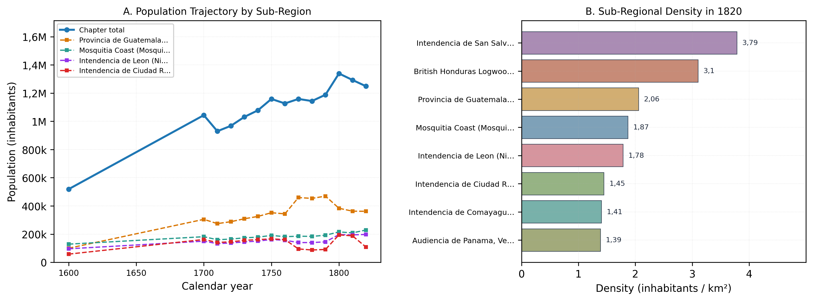
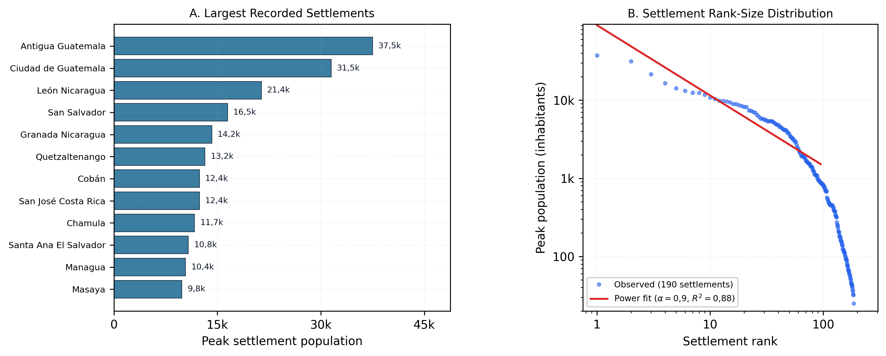

Captaincy General of Guatemala and Central America
================
Aust Kätzchen
23 November 2026

- [Abstract](#abstract)
- [Background](#background)
  - [Conquest, Epidemiological Shock and the Creation of the
    Audiencia](#conquest-epidemiological-shock-and-the-creation-of-the-audiencia)
  - [Cacao Booms, Indigo Cycles and Highland
    Congregaciones](#cacao-booms-indigo-cycles-and-highland-congregaciones)
  - [Capital Earthquakes, Ladinoisation and Bourbon
    Reforms](#capital-earthquakes-ladinoisation-and-bourbon-reforms)
  - [Unreduced Atlantic Frontiers, British Honduras and the Isthmus of
    Panamá](#unreduced-atlantic-frontiers-british-honduras-and-the-isthmus-of-panamá)
- [Methodology](#methodology)
  - [Jurisdictional Partition of the Eight Colonial
    Sub-Regions](#jurisdictional-partition-of-the-eight-colonial-sub-regions)
  - [Dual Calibration: Archival Benchmarks and Raster-Kriged
    Substrata](#dual-calibration-archival-benchmarks-and-raster-kriged-substrata)
  - [Sub-Administrative Census Ingestion and Settlement Gazetteer
    Assembly](#sub-administrative-census-ingestion-and-settlement-gazetteer-assembly)
- [Testing and Validation](#testing-and-validation)
  - [Reconciliation of Archival Provincial Anchors Against Raster-Kriged
    Surfaces](#reconciliation-of-archival-provincial-anchors-against-raster-kriged-surfaces)
  - [Cross-Checks Against Colonial Demographic
    Historiography](#cross-checks-against-colonial-demographic-historiography)
- [Results](#results)
  - [Isthmian Demographic Trajectory: Collapse, Trough and Bourbon
    Recovery](#isthmian-demographic-trajectory-collapse-trough-and-bourbon-recovery)
  - [The 1778 to 1816 Bourbon and Colonial Census
    Architecture](#the-1778-to-1816-bourbon-and-colonial-census-architecture)
  - [Highland Maya Core: Guatemala and Ciudad Real de
    Chiapas](#highland-maya-core-guatemala-and-ciudad-real-de-chiapas)
  - [Indigo Heartlands, Silver Uplands and Pastoral
    Frontiers](#indigo-heartlands-silver-uplands-and-pastoral-frontiers)
  - [Caribbean Enclaves and the Trans-Isthmian Corridor of
    Panamá](#caribbean-enclaves-and-the-trans-isthmian-corridor-of-panamá)
  - [Colonial Urban Hierarchy and Rank-Size
    Scaling](#colonial-urban-hierarchy-and-rank-size-scaling)
- [Limitations](#limitations)
- [Conclusion](#conclusion)
- [Appendix](#appendix)
  - [Decadal Raster-Integrated Population Evolution (1600 to
    1820)](#decadal-raster-integrated-population-evolution-1600-to-1820)
  - [Territorial Distribution of the 190 Catalogued Colonial
    Settlements](#territorial-distribution-of-the-190-catalogued-colonial-settlements)
- [Sources](#sources)
- [Footnotes](#footnotes)

<figure>

<figcaption aria-hidden="true">Eight colonial isthmian jurisdictions and
190 catalogued settlements across the Captaincy General of Guatemala,
British Honduras and Panama from 1524 to 1821.</figcaption>
</figure>

# Abstract

Between Pedro de Alvarado’s invasion of highland Guatemala in 1524 and
the proclamation of Central American independence in 1821, the isthmian
lands stretching from Chiapas to the Darién passed through one of the
steepest demographic contractions and most uneven recoveries in the
early modern Americas. Across eight territorial jurisdictions covering
682.861 km² (comprising the five core provinces of the Captaincy General
of Guatemala, Ciudad Real de Chiapas, the unreduced Mosquitia Coast, the
British Honduras logwood settlement and the trans-isthmian Audiencia of
Panamá), archival demographic anchors place contact-era population at
roughly 4,13M (4.125.000) in 1524 before epidemic waves, forced
*encomienda* labour and the Nicaraguan-Honduran Indian slave trade drove
aggregate numbers down by roughly 82% to a mid-seventeenth-century nadir
near 742k in 1650
[\[1\]](#ref-MacLeod1973)[\[2\]](#ref-Newson1986)[\[3\]](#ref-Newson1987)[\[4\]](#ref-Lovell1992).
Subsequent biological adaptation, highland *pueblo de indios*
resilience, *mestizo* and *mulato* admixture (ladinoisation) and
late-colonial export cycles in indigo, cattle, silver and mahogany
lifted the archival provincial sum to 1,42M (1.420.200) by 1821, broadly
matching the raster-integrated kriged substratum trajectory that rises
from 519k in 1600 to 1,04M in 1700, peaks at 1,34M in 1800 and stands at
1,25M (1,83 inhabitants per km²) in 1820
[\[5\]](#ref-HallPerezBrignoli2003)[\[6\]](#ref-Juarros1808)[\[7\]](#ref-JaenSuarez1978).
Yet growth remained profoundly asymmetric across altitude and coast: by
the 1778 Bourbon census, the volcanic uplands and Pacific corridor from
Chiapas through Guatemala and San Salvador to western Nicaragua held
over four-fifths of the isthmus’s Spanish-administered population,
whereas the Caribbean lowlands of Petén (2.555), Portobelo (1.762),
Darién (1.266) and British Honduras (3.824 in 1816) remained sparsely
peopled maritime and forest frontiers
[\[6\]](#ref-Juarros1808)[\[7\]](#ref-JaenSuarez1978)[\[8\]](#ref-SIBBelize2024).
Integrating 21 provincial and sub-provincial Bourbon-era enumerations
with a gazetteer of 190 geocoded settlements exhibiting a steep urban
rank-size slope ($\alpha = 0,90$, $R^2 = 0,88$), this study reconciles
archival headcounts, parish visitations and spatial kriging across three
centuries of colonial isthmian history.

# Background

## Conquest, Epidemiological Shock and the Creation of the Audiencia

When Spanish expeditions converged on the Central American isthmus from
both Mexico and Tierra Firme during the 1520s, they entered an
ecologically fractured bridge linking Mesoamerican agrarian states to
the circum-Caribbean chiefdoms of Lower Central America
[\[1\]](#ref-MacLeod1973)[\[5\]](#ref-HallPerezBrignoli2003). From the
north, Pedro de Alvarado marched south through Soconusco in early 1524
to break the K’iche’ and Kaqchikel polities of highland Guatemala before
pushing into Pipil Cuscatlán (El Salvador), while Cristóbal de Olid,
Hernán Cortés and rivals dispatched from Panamá contested Honduras and
Nicaragua [\[2\]](#ref-Newson1986)[\[4\]](#ref-Lovell1992). From the
south, Pedrarias Dávila had already founded Panamá on the Pacific coast
in 1519 and dispatched Gil González Dávila and Francisco Hernández de
Córdoba into the lake basins of Nicaragua, where León and Granada were
established in 1524
[\[3\]](#ref-Newson1987)[\[7\]](#ref-JaenSuarez1978).

The demographic catastrophe that followed was neither uniform nor purely
military. Old World pathogens—above all smallpox (*viruela*), measles
(*sarampión*), pneumonic plague, influenza and epidemic typhus
(*matlazáhuatl* or *tabardillo*)—preceded Alvarado’s columns into
highland Guatemala around 1519–1521 and returned in punishing waves
across the sixteenth century
[\[4\]](#ref-Lovell1992)[\[9\]](#ref-Medenou2025Mundo). Mortality struck
hardest in the hot, humid coastal lowlands of Soconusco, Pacific
Guatemala, Fonseca, Nicaragua and Panamá, where malaria and yellow fever
soon compounded respiratory epidemics
[\[1\]](#ref-MacLeod1973)[\[3\]](#ref-Newson1987). In Nicaragua and
southern Honduras, commercial slaving multiplied the biological toll:
between 1524 and the enforcement of the New Laws in 1548–1550, Spanish
merchants shipped tens of thousands of Chorotega, Nicarao and Lenca
captives through Realejo and Nicoya to labour in the mines and estates
of Peru and Panamá
[\[2\]](#ref-Newson1986)[\[3\]](#ref-Newson1987)[\[10\]](#ref-Newson2021Supervivencia).

Imperial administration struggled to impose order across these dispersed
conquests. After an aborted beginning at Gracias a Dios in western
Honduras in 1544—whose early urban grid still reflects its brief tenure
as the first judicial seat of Central America
[\[11\]](#ref-Vinals2020Outstanding)—the Crown relocated the Audiencia
de los Confines to Santiago de Guatemala in 1549. Renamed the Audiencia
and Captaincy General of Guatemala, its jurisdiction stretched from the
Alcaldía Mayor of Ciudad Real de Chiapas (which remained tied to
Guatemala until 1824) southward to Costa Rica, while Panamá, Veraguas
and Darién formed a separate Audiencia of Panamá attached first to the
Viceroyalty of Peru and after 1739 to New Granada
[\[5\]](#ref-HallPerezBrignoli2003)[\[7\]](#ref-JaenSuarez1978). In
administrative reality, however, Spanish authority hugged the Pacific
volcanic chain and cool intermontane basins; nearly the entire Caribbean
littoral from Belize to eastern Nicaragua and Darién remained an
unreduced zone of indigenous autonomy, runaway enslaved Africans
(*cimarrones*) and English privateers
[\[2\]](#ref-Newson1986)[\[12\]](#ref-Wainwright2020Colonial).

## Cacao Booms, Indigo Cycles and Highland Congregaciones

Over the two centuries following conquest, Central America’s population
geography was reshaped by two opposing forces: forced resettlement of
surviving indigenous communities in the highlands and sequential export
booms along the Pacific piedmont
[\[1\]](#ref-MacLeod1973)[\[4\]](#ref-Lovell1992). Beginning in the
1540s and accelerating through the 1570s, Dominican, Franciscan and
Mercedarian friars gathered scattered Maya hamlets (*parcialidades*)
into nucleated *pueblos de indios* laid out around a church plaza. In
the Cuchumatán highlands of Huehuetenango, the K’iche’ and Kaqchikel
basins of Totonicapán, Sololá and Chimaltenango, the Q’eqchi’ valleys of
Verapaz and the Tzotzil-Tzeltal uplands of Chiapas, *congregación*
initially exposed concentrated villagers to fresh typhus and measles
outbreaks [\[4\]](#ref-Lovell1992)[\[9\]](#ref-Medenou2025Mundo). Over
the longer run, however, corporate village charters, communal *ejidos*
and indigenous *cabildos* led by hereditary *principales* provided an
institutional shield against total land dispossession and sustained Maya
demographic persistence—and linguistic continuity—into the nineteenth
century
[\[13\]](#ref-Cruz1999Lite)[\[14\]](#ref-Sanchez2015Tedras)[\[15\]](#ref-Quijas2012Interpretaciones).

Down on the warm Pacific littoral, commercial agriculture followed a
harsher boom-and-bust rhythm. From the 1540s through the 1580s,
Soconusco, Suchitepéquez and Izalco (Sonsonate) supplied Mexico City
with prized cacao beans grown on indigenous orchards and tapped through
heavy tribute assessments [\[1\]](#ref-MacLeod1973). As coastal
labourers died out faster than highland migrants could replace them, the
cacao boom collapsed after 1600, giving way to a century-long depression
across much of the Captaincy General. Spanish landowners turned instead
to cattle ranching in Choluteca, Olancho, Nicaragua and Guanacaste,
small-scale silver extraction around Tegucigalpa and Comayagua, and
above all the cultivation of *añil* (indigo) across the volcanic
foothills of San Salvador, San Vicente and San Miguel
[\[1\]](#ref-MacLeod1973)[\[16\]](#ref-Wortman1982). Because indigo
processing required intense seasonal labour during the August-to-October
harvest (*obrajes*), royal prohibitions against forced indigenous
dye-work encouraged planters to recruit *ladino*, *mestizo* and *mulato*
wage labourers and sharecroppers, transforming El Salvador into the most
densely settled mixed-race province of colonial Central America
[\[5\]](#ref-HallPerezBrignoli2003)[\[17\]](#ref-Osegueda2024Migrar).

## Capital Earthquakes, Ladinoisation and Bourbon Reforms

At the centre of this colonial hierarchy stood Santiago de Guatemala
(modern Antigua Guatemala), rebuilt in the Panchoy Valley after the 1541
lahar destroyed the earlier capital at Ciudad Vieja. Across two
centuries, Santiago grew into the undisputed metropolis of the isthmus,
climbing from 9,4k inhabitants in 1574 to 24,5k in 1646, 34,2k in 1700
and a pre-catastrophe peak of 37,5k in 1768
[\[6\]](#ref-Juarros1808)[\[18\]](#ref-Lutz1994). As Christopher Lutz
demonstrated from parish marriage and baptismal registers, Santiago
functioned as a demographic crucible in which urban Spaniards, highland
Maya *naborías*, enslaved and free Africans and *castas* intermarried
across parish boundaries, driving steady *ladinoisation* long before the
late-colonial census era
[\[18\]](#ref-Lutz1994)[\[19\]](#ref-Contributors2014Pathways). That
urban primacy suffered a dramatic rupture on 29 July 1773, when the
Santa Marta earthquake levelled Santiago’s churches, convents and royal
palaces. Despite fierce opposition from entrenched landowners and
clergy, Captain General Martín de Mayorga forced the relocation of the
capital to the Ermita Valley, formally founding Nueva Guatemala de la
Asunción (Ciudad de Guatemala) in January 1776
[\[16\]](#ref-Wortman1982)[\[18\]](#ref-Lutz1994). By 1778 the new
capital already held 23.434 residents, expanding to 31,5k by 1820, while
battered Antigua retained roughly 11,2k inhabitants by 1808.

The relocation coincided with the peak of Bourbon administrative and
statistical reform. Between 1768 and 1770, Archbishop Pedro Cortés y
Larraz conducted an exhaustive parish-by-parish *visita* of the
Archdiocese of Guatemala (encompassing Guatemala and El Salvador),
documenting scattered *valles* of unregulated *ladino* squatters
alongside traditional Maya parishes
[\[5\]](#ref-HallPerezBrignoli2003)[\[17\]](#ref-Osegueda2024Migrar). In
1778 the Crown ordered the first empire-wide population census, whose
Central American returns were later preserved and refined by Domingo
Juarros in his 1808 *Compendio* [\[6\]](#ref-Juarros1808), and in
1785–1787 Madrid reorganised the provinces outside core Guatemala into
four *intendencias*: Ciudad Real de Chiapas, San Salvador, Comayagua
(Honduras) and León (Nicaragua, with Costa Rica remaining a subordinate
governorship) [\[16\]](#ref-Wortman1982). Yet Bourbon fiscal
centralisation and the wartime disruption of Atlantic indigo shipping
after 1796 strained provincial loyalties, setting the economic stage for
the peaceful separation from Spain in September 1821 and the subsequent
break-up of the Kingdom of Guatemala
[\[16\]](#ref-Wortman1982)[\[17\]](#ref-Osegueda2024Migrar).

## Unreduced Atlantic Frontiers, British Honduras and the Isthmus of Panamá

Outside the Spanish Pacific spine, three distinctive colonial frontiers
followed divergent demographic trajectories. Along the humid Caribbean
coast from Trujillo and Black River (Palacios) past Cabo Gracias a Dios
to Bluefields and Pearl Lagoon, indigenous Sumu, Pech, Rama and coastal
Miskitu communities remained outside Spanish tribute rolls throughout
the colonial era [\[2\]](#ref-Newson1986)[\[3\]](#ref-Newson1987).
Beginning in the mid-seventeenth century, intermarriage between coastal
Miskitu bands and shipwrecked or escaped enslaved Africans produced the
*Zambo-Miskitu* polity, whose leaders forged an enduring commercial and
military alliance with British Jamaica. Armed with English muskets,
Miskitu raiders extracted tribute from interior riverine groups, raided
Spanish cacao estates in Matina (Costa Rica) and sustained an autonomous
Mosquito Kingdom whose diplomatic authority outlasted Spanish rule into
the nineteenth century
[\[10\]](#ref-Newson2021Supervivencia)[\[20\]](#ref-Clavel2026King).

Immediately northwest along the Bay of Honduras, English buccaneers and
woodcutters established seasonal logwood (*Haematoxylum campechianum*)
camps at the mouth of the Belize River during the mid-seventeenth
century, shifting to mahogany extraction after the 1763 Treaty of Paris
and the 1786 Convention of London
[\[12\]](#ref-Wainwright2020Colonial)[\[21\]](#ref-Gali2026Historical).
Although Spanish authorities repeatedly expelled the Baymen—most
destructively in 1779 before the decisive British naval defence at
St. George’s Caye in 1798—the settlement consolidated around Belize
Town, Corozal and Orange Walk using a predominantly enslaved African
timber workforce documented in British muster rolls from 1790 onward
(2.656 in Belize Town in 1790, rising to 3.824 across the colony in 1816
and 4.163 in Belize Town by 1820) [\[8\]](#ref-SIBBelize2024). Between
1797 and 1802, a new maritime people reshaped the southern coast of
Honduras and Belize: following Britain’s deportation of roughly 2.000
Black Caribs (Garifuna) from St. Vincent to Roatán in 1797, Garifuna
families settled Trujillo, coastal Honduras and Stann Creek (Dangriga)
in southern Belize, laying the demographic foundation of the modern Gulf
of Honduras littoral
[\[8\]](#ref-SIBBelize2024)[\[12\]](#ref-Wainwright2020Colonial).

At the southeastern neck of the isthmus, the Audiencia of Panamá
operated under an altogether different imperial logic. Rather than
highland tribute or export crops, Panamá lived off silver transit
between Peru and Seville via the *Camino Real* and the Chagres River to
Portobelo [\[7\]](#ref-JaenSuarez1978). Because transit commerce
depended on urban merchants, muleteers, free *pardos* and enslaved
Africans—supported by rice and cattle provisioning from Natá, Los
Santos, Penonomé and Veraguas [\[22\]](#ref-Aram2021Rice)—Panamá’s
population fluctuated sharply with imperial trade cycles. Henry Morgan’s
sack of Panamá Viejo in 1671 forced the city’s relocation to the
fortified Casco Antiguo peninsula in 1673, while Admiral Edward Vernon’s
destruction of Portobelo in 1739 and the Crown’s abolition of the Tierra
Firme galleon fleet ended the *ferias*, plunging the trans-isthmian
corridor into protracted stagnation until late-eighteenth-century
agricultural growth in the Azuero Peninsula and Chiriquí lifted the
Panamanian provinces toward 92k inhabitants by 1821
[\[7\]](#ref-JaenSuarez1978).

# Methodology

## Jurisdictional Partition of the Eight Colonial Sub-Regions

To reconcile Spanish colonial administrative enumerations with
trans-border ecological continuity across 1524 to 1821, our spatial mask
partitions Central America, Chiapas, Belize and Panamá into eight
contiguous jurisdictions totalling 682.861,1 km² on the equal-area
projection. Rather than imposing twentieth-century national boundaries
backward onto the colonial era, the polygons align directly with
late-eighteenth-century *intendencias*, *gobernaciones* and unreduced
frontier zones preserved in the Historical GIS of the Indies and
historical atlases
[\[5\]](#ref-HallPerezBrignoli2003)[\[16\]](#ref-Wortman1982).

The northern tier comprises two highland-and-lowland Maya complexes
alongside the Caribbean timber enclave: the Intendencia de Ciudad Real
de Chiapas (74.626,2 km², administratively subordinate to Guatemala
until 1824), the Provincia de Guatemala Core and Verapaz (175.682 km²,
uniting the central highlands, Pacific piedmont, Chiquimula, Verapaz and
the frontier *partido* of Petén) and the British Honduras Logwood
Settlement (13.975,3 km², covering the Belize, New and Hondo river
catchments). The central isthmus separates the compact Pacific indigo
belt of the Intendencia de San Salvador and Sonsonate (20.857 km²) and
the silver-and-cattle interior of the Intendencia de Comayagua in
Honduras (77.147,6 km²) from the vast, unreduced Caribbean watershed of
the Mosquitia Coast (122.699,3 km², spanning historical Taguzgalpa and
Tologalpa from eastern Honduras through eastern Nicaragua). The southern
tier pairs the Pacific volcanic-and-central-valley corridor of the
Intendencia de León (Nicaragua) and Costa Rica (110.817,3 km²) with the
trans-isthmian Audiencia de Panamá, Veraguas and Darién (87.056,4 km²).

## Dual Calibration: Archival Benchmarks and Raster-Kriged Substrata

Colonial Central American demography presents a classic archival
asymmetry: tribute counts (*tasaciones*) survive sporadically for the
sixteenth century, parish visitations and ecclesiastical counts thicken
after 1680, and near-universal Bourbon provincial censuses arrive only
in 1778–1796
[\[4\]](#ref-Lovell1992)[\[6\]](#ref-Juarros1808)[\[7\]](#ref-JaenSuarez1978).
To track both the sixteenth-century demographic collapse and the
continuous decadal trajectory from 1600 to 1820 without obscuring
uncertainty, this study integrates two complementary series.

First, an archival historical-demography anchor table specifies
point-in-time population totals $P^{\text{arch}}_r(t)$ across all eight
jurisdictions at 1524 (conquest contact), 1650 (colonial demographic
trough), 1778 or 1790 (Bourbon and British muster censuses), 1800 and
1821 (independence eve). These anchors synthesise regional
historical-demographic monographs for Guatemala
[\[4\]](#ref-Lovell1992)[\[18\]](#ref-Lutz1994), Honduras
[\[2\]](#ref-Newson1986), Nicaragua
[\[3\]](#ref-Newson1987)[\[10\]](#ref-Newson2021Supervivencia), Costa
Rica [\[23\]](#ref-PerezBrignoli2010)[\[24\]](#ref-Leon2003Cata), Panamá
[\[7\]](#ref-JaenSuarez1978), Chiapas [\[13\]](#ref-Cruz1999Lite) and
British Honduras [\[8\]](#ref-SIBBelize2024), cross-checked against
Juarros’s 1778 provincial returns [\[6\]](#ref-Juarros1808) and Hall and
Pérez Brignoli’s isthmian synthesis [\[5\]](#ref-HallPerezBrignoli2003).

Second, for continuous decadal mapping from 1600 to 1820, gridded
regional population surfaces are integrated across each jurisdictional
mask polygon $r$ of pixel-measured area $A_r$ using Matérn spatial
kriging conditioned on historical land-use and settlement priors:

$$P^{\text{krig}}_r(t) = \sum_{j \in \Omega_r} \hat{\rho}_j(t) \cdot a_j, \qquad d^{\text{krig}}_r(t) = \frac{P^{\text{krig}}_r(t)}{A_r}$$

where $\Omega_r$ denotes the set of equal-area raster cells inside
jurisdiction $r$, $a_j$ is cell area in km² and $\hat{\rho}_j(t)$ is the
estimated local population density at decadal step
$t \in \{1600, 1700, 1710, \dots, 1820\}$. Inter-benchmark compound
annual growth rates follow standard geometric compounding:

$$g_r(t_1, t_2) = \left(\frac{P_r(t_2)}{P_r(t_1)}\right)^{\frac{1}{t_2 - t_1}} - 1$$

Explicitly tabulating both $P^{\text{arch}}_r(t)$ and
$P^{\text{krig}}_r(t)$ allows quantitative evaluation of where smooth
gridded priors accurately capture aggregate isthmian growth and where
coarse raster smoothing leaks population from compact highland valleys
into adjacent low-density Caribbean lowlands.

## Sub-Administrative Census Ingestion and Settlement Gazetteer Assembly

To anchor sub-provincial demography beyond aggregate regional polygons,
we compiled 21 primary Bourbon-era and British colonial administrative
counts spanning 1778 to 1816. These records preserve the five main
Audiencia provincial totals of 1778 (Guatemala, San Salvador and
Sonsonate, León, Comayagua and Costa Rica), eleven constituent
*alcaldías mayores*, *corregimientos* and *partidos* of core Guatemala
(from Chiquimula and Totonicapán down to Petén), four colonial
governorships of Panamá (Panamá, Veraguas, Portobelo and Darién) and the
1816 colonial muster of British Honduras
[\[5\]](#ref-HallPerezBrignoli2003)[\[6\]](#ref-Juarros1808)[\[7\]](#ref-JaenSuarez1978)[\[8\]](#ref-SIBBelize2024).

At the town and parish scale, our settlement gazetteer catalogues 190
geocoded places spanning 1574 to 1820 across all eight modern national
territories (95 in Chiapas/Mexico, 43 in Panamá, 13 in Nicaragua, 11 in
Guatemala, 10 in Honduras, 7 in El Salvador, 6 in Costa Rica and 5 in
Belize). Source-ledger auditing tracked four sequential ingestion waves:
Wave 1 assembled 173 primary official and archival town records from the
Historical GIS of the Indies (drawing directly on the 1774–1796 Chiapas
parish reports, 1778 Panamanian and Veraguas censuses, Cortés y Larraz’s
1770 *visita* and Juarros’s 1808 *Compendio*); Wave 2 added 12
peer-reviewed demographic monograph series covering Nicaragua, Honduras,
Panamá and British Honduras; Wave 3 backfilled 3 longitudinal colonial
series; and Wave 4 executed a sub-regional gap-verification sweep adding
2 frontier settlements (marginal gain 1,06%, confirming source
saturation with a 0% crowd-sourced share). Spatial deduplication across
196 candidate records merged 6 duplicate alias records within 25 km
buffers (Antigua Guatemala, Panamá, Tuxtla, Tapachula, Ciudad Real de
Chiapas and David).

To test urban primacy and spatial integration across the isthmus, we fit
an ordinary least-squares Zipf rank-size regression on log-transformed
settlement populations across the top 95 ranked towns of the
190-settlement register (using the 1774 cross-section):

$$\log_{10} P_{(k)} = c - \alpha \log_{10} k$$

where $P_{(k)}$ is the population of the $k$-th largest town and
$\alpha$ measures hierarchy steepness.

# Testing and Validation

## Reconciliation of Archival Provincial Anchors Against Raster-Kriged Surfaces

Table juxtaposes the archival historical-demography trajectory (1524,
1650, 1778 or 1790 and 1821) against the raster-integrated kriged 1820
population and catalogued settlement counts across all eight
jurisdictions. On the aggregate isthmian scale, the two independent
reconstructions converge tightly at the end of the colonial era: the
archival provincial sum stands at 1,42M (1.420.200) in 1821, whereas the
raster-kriged domain total reaches 1,34M in 1800 and 1,25M (1.248.656)
in 1820—an aggregate difference of 12,1% well within colonial
enumeration error bounds
[\[5\]](#ref-HallPerezBrignoli2003)[\[16\]](#ref-Wortman1982).

| Colonial Jurisdiction | Area (km²) | 1524 Arch. | 1650 Nadir | 1778/90 Arch. | 1821 Arch. | 1820 Raster | Sites |
|:---|:---|:---|:---|:---|:---|:---|:---|
| **British Honduras Logwood Settlement** | 13.975 | 15k | 8k | 3,8k | 5,2k | 43,4k | 4 |
| **Mosquitia Coast (Mosquito Kingdom)** | 122.699 | 160k | 48k | 46k | 52k | 229,3k | 6 |
| **Intendencia de Ciudad Real de Chiapas (Guatemala until 1824)** | 74.626 | 390k | 92k | 69,3k | 118k | 108,2k | 95 |
| **Provincia de Guatemala Core and Verapaz** | 175.682 | 1,25M | 260k | 366k | 535k | 361,7k | 14 |
| **Intendencia de San Salvador and Sonsonate** | 20.857 | 460k | 85k | 146,7k | 248k | 79k | 5 |
| **Intendencia de Comayagua (Honduras)** | 77.148 | 420k | 72k | 87,7k | 135k | 108,5k | 10 |
| **Intendencia de León (Nicaragua) and Costa Rica** | 110.817 | 890k | 95k | 131,2k | 235k | 197,8k | 13 |
| **Audiencia de Panamá, Veraguas and Darién** | 87.056 | 540k | 82k | 68k | 92k | 120,8k | 43 |
| **Isthmian Domain Total (8 Jurisdictions)** | 682.861 | 4,12M | 742k | 918,7k | 1,42M | 1,25M | 190 |

Archival demographic anchors (1524, 1650, 1778 or 1790 and 1821),
raster-kriged 1820 totals and catalogued settlement counts across eight
colonial isthmian jurisdictions.

Closer sub-regional testing, however, uncovers an instructive
spatial-allocation divergence between the archival census anchors and
the raster-kriged surface. In four jurisdictions—Ciudad Real de Chiapas
(118k archival in 1821 vs. 108,2k raster in 1820), Comayagua in Honduras
(135k vs. 108,5k), León and Costa Rica (235k vs. 197,8k) and Panamá,
Veraguas and Darién (92k vs. 120,8k)—the two series sit within a modest
8% to 31% band. By contrast, along the sharp topographic divide
separating the Pacific volcanic highlands from the Caribbean rainforest,
coarse global raster interpolation visibly bleeds population eastward.
Specifically, the raster surface assigns 229,3k to the Mosquitia Coast
and 43,4k to British Honduras in 1820, whereas colonial musters,
missionary accounts and ethnohistorical reconstructions place Mosquitia
near 52k and British Honduras at 5,2k (3.824 enumerated in 1816)
[\[2\]](#ref-Newson1986)[\[3\]](#ref-Newson1987)[\[8\]](#ref-SIBBelize2024).
Symmetrically, the raster surface under-allocates the hyper-compact
volcanic corridor of San Salvador and Sonsonate (79k raster in 1820
vs. 248k archival in 1821) and core Guatemala (361,7k raster vs. 535k
archival).

This cross-check confirms an essential rule for colonial Central
American historical geography: while the raster-kriged substratum
faithfully tracks long-run macro-isthmian recovery between 1600 and
1820, sub-provincial density gradients across steep cordilleran divides
must be anchored directly to Bourbon census rolls, ecclesiastical
*visitas* and local archival registers
[\[5\]](#ref-HallPerezBrignoli2003)[\[6\]](#ref-Juarros1808)[\[7\]](#ref-JaenSuarez1978).

## Cross-Checks Against Colonial Demographic Historiography

Our archival 1524–1821 envelope aligns closely with regional demographic
scholarship while avoiding both the extreme low counts of
mid-twentieth-century skeptics and speculative ultra-high projections.
For Honduras, Linda Newson estimated an aboriginal contact population of
roughly 800k (split between western chiefdoms and eastern Taguzgalpa)
collapsing by more than 90% into the seventeenth century before
recovering toward 130k–140k by independence; our partitioned
anchors—420k for Intendencia de Comayagua plus a substantial fraction of
the 160k assigned to the Mosquitia Coast in 1524, rebounding to 135k in
Comayagua by 1821—track that trajectory closely
[\[2\]](#ref-Newson1986). For Nicaragua, Newson’s detailed reassessment
placed contact population above 800k across the densely farmed Pacific
lakes and Nicoya, falling below 100k in the seventeenth century due to
combined slave exports and epidemics before climbing back toward
180k–200k by 1821; combining Nicaragua with Costa Rica yields our 890k
contact benchmark, 95k nadir in 1650, 131,2k in 1778 and 235k in 1821
[\[3\]](#ref-Newson1987)[\[10\]](#ref-Newson2021Supervivencia)[\[23\]](#ref-PerezBrignoli2010).

In highland Guatemala, W. George Lovell documented an indigenous
collapse of roughly 85% to 90% in the Cuchumatán Sierra between 1520 and
1670 followed by sustained eighteenth-century recovery that restored
highland densities despite recurring typhus and smallpox shocks in 1733,
1780 and 1802 [\[4\]](#ref-Lovell1992)[\[9\]](#ref-Medenou2025Mundo).
Our core Guatemala trajectory—1,25M in 1524 to 260k in 1650 (-79,2%),
recovering to 366k–398,6k in 1778 and 535k by 1821 (+0,42% per annum
from 1650 to 1821)—fits securely within Lovell and Lutz’s consensus
bounds [\[4\]](#ref-Lovell1992)[\[18\]](#ref-Lutz1994). In Panamá, Omar
Jaén Suárez reconstructed an early-sixteenth-century population of
roughly 400k–500k devastated by Pedrarias Dávila’s *entradas* and
tropical disease, sinking to barely 59k enumerated colonial residents
across the four governorships in 1778 (68k including unreduced Darién
and coastal indigenous groups) and rising to roughly 92k by 1821
[\[7\]](#ref-JaenSuarez1978).

# Results

## Isthmian Demographic Trajectory: Collapse, Trough and Bourbon Recovery

Taken across the full three-century span from 1524 to 1821, Central
American demographic history falls into three starkly contrasting
epochs. First came the sixteenth-century catastrophe (1524 to 1650),
during which the archival isthmian total plunged from 4,13M to 742k—a
net loss of 3,38M inhabitants (-82,0%, or -1,35% per annum over 126
years)
[\[1\]](#ref-MacLeod1973)[\[4\]](#ref-Lovell1992)[\[9\]](#ref-Medenou2025Mundo).
Lowland provinces suffered the deepest contraction: León and Costa Rica
dropped 89,3% (from 890k to 95k), Panamá fell 84,8% (from 540k to 82k),
Comayagua fell 82,9% (from 420k to 72k) and San Salvador fell 81,5%
(from 460k to 85k), whereas highland Guatemala retained a slightly
larger surviving base (-79,2%, from 1,25M to 260k) and the remote
Mosquitia Coast experienced a gentler initial drop (-70,0%, from 160k to
48k) owing to sparse Spanish penetration
[\[2\]](#ref-Newson1986)[\[3\]](#ref-Newson1987).

Second came a century of tentative biological stabilisation and uneven
demographic rebound from 1650 to 1760. Figure illustrates the continuous
raster-integrated trajectory from 1600 to 1820 alongside sub-regional
1820 raster densities. Across the seventeenth century, aggregate raster
totals climbed from 519k in 1600 to 1,04M in 1700, dipped sharply to
929,7k in 1710 during early-eighteenth-century epidemic and
cacao-depression shocks, and then climbed steadily through 1,03M (1730)
and 1,16M (1750) before plateauing around 1,13M to 1,16M between 1760
and 1780 [\[1\]](#ref-MacLeod1973)[\[16\]](#ref-Wortman1982).

<!-- -->

Third came the late-colonial Bourbon acceleration (1778 to 1821).
Archival provincial sums rose from 918,7k in 1778–1790 to 1,42M in
1821—a gain of +54,6% in barely four decades (+1,02% per annum, more
than triple the 1650–1778 recovery rate of +0,17% per annum). San
Salvador and Sonsonate led that surge at +1,23% per annum (146,7k in
1778 to 248k in 1821), followed closely by León and Costa Rica at +1,36%
per annum (131,2k to 235k), Ciudad Real de Chiapas at +1,25% per annum
(69,3k to 118k), Comayagua at +1,01% per annum (87,7k to 135k) and core
Guatemala at +0,89% per annum (366k to 535k)
[\[5\]](#ref-HallPerezBrignoli2003)[\[16\]](#ref-Wortman1982)[\[23\]](#ref-PerezBrignoli2010).
Across the entire domain, the raster surface confirms a late-colonial
peak of 1,34M in 1800 before late-colonial locust plagues, indigo trade
collapse during the Napoleonic Wars and smallpox outbreaks trimmed
growth between 1800 and 1820
[\[16\]](#ref-Wortman1982)[\[17\]](#ref-Osegueda2024Migrar).

## The 1778 to 1816 Bourbon and Colonial Census Architecture

The documentary bedrock of late-colonial Central American demography is
the 1778 imperial census—supplemented by Panamanian governorship counts
of the same year and the 1816 British Honduras muster. Table prints all
21 administrative enumerations compiled in the chapter’s
sub-administrative census register, exposing the fine-grained spatial
distribution of the isthmian population inside the Kingdom of Guatemala
and its bordering colonies
[\[5\]](#ref-HallPerezBrignoli2003)[\[6\]](#ref-Juarros1808)[\[7\]](#ref-JaenSuarez1978)[\[8\]](#ref-SIBBelize2024).

| Administrative Unit | Modern Territory | Jurisdiction Level | Year | Population | Primary Source |
|:---|:---|:---|:---|:---|:---|
| **Province of Guatemala (Captaincy General core)** | Guatemala | Colonial Province | 1778 | 398.575 | Hall, Carolyn and Héctor Pérez Brignoli, Juarros, Domingo |
| **Intendancy of San Salvador and Sonsonate** | El Salvador | Colonial Province | 1778 | 117.436 | Hall, Carolyn and Héctor Pérez Brignoli, Juarros, Domingo |
| **Intendancy of León (Nicaragua and Nicoya)** | Nicaragua | Colonial Province | 1778 | 117.396 | Hall, Carolyn and Héctor Pérez Brignoli, Juarros, Domingo |
| **Intendancy of Comayagua (Honduras)** | Honduras | Colonial Province | 1778 | 88.143 | Hall, Carolyn and Héctor Pérez Brignoli, Juarros, Domingo |
| **Corregimiento de Chiquimula** | Guatemala | Alcaldía Mayor or Corregimiento | 1778 | 52.423 | Juarros, Domingo, Hall, Carolyn and Héctor Pérez Brign |
| **Alcaldía Mayor de Totonicapán** | Guatemala | Alcaldía Mayor or Corregimiento | 1778 | 51.272 | Juarros, Domingo, Hall, Carolyn and Héctor Pérez Brign |
| **Alcaldía Mayor de Sacatepéquez** | Guatemala | Alcaldía Mayor or Corregimiento | 1778 | 50.786 | Juarros, Domingo, Hall, Carolyn and Héctor Pérez Brign |
| **Alcaldía Mayor de la Verapaz** | Guatemala | Alcaldía Mayor or Corregimiento | 1778 | 49.583 | Juarros, Domingo, Hall, Carolyn and Héctor Pérez Brign |
| **Alcaldía Mayor de Chimaltenango** | Guatemala | Alcaldía Mayor or Corregimiento | 1778 | 40.082 | Juarros, Domingo, Hall, Carolyn and Héctor Pérez Brign |
| **Gobernación de Panamá (incl. Natá and Los Santos)** | Panama | Colonial Governorship | 1778 | 35.955 | Jaén Suárez, Omar |
| **Corregimiento de Quezaltenango** | Guatemala | Alcaldía Mayor or Corregimiento | 1778 | 28.563 | Juarros, Domingo, Hall, Carolyn and Héctor Pérez Brign |
| **Alcaldía Mayor de Sololá (Atitlán)** | Guatemala | Alcaldía Mayor or Corregimiento | 1778 | 27.953 | Juarros, Domingo, Hall, Carolyn and Héctor Pérez Brign |
| **Alcaldía Mayor de Escuintla** | Guatemala | Alcaldía Mayor or Corregimiento | 1778 | 24.978 | Juarros, Domingo, Hall, Carolyn and Héctor Pérez Brign |
| **Governorship of Costa Rica** | Costa Rica | Colonial Province | 1778 | 24.536 | Hall, Carolyn and Héctor Pérez Brignoli, Juarros, Domingo |
| **Ciudad de Guatemala** | Guatemala | Alcaldía Mayor or Corregimiento | 1778 | 23.434 | Juarros, Domingo, Hall, Carolyn and Héctor Pérez Brign |
| **Gobernación de Veraguas (incl. Alanje/Chiriquí)** | Panama | Colonial Governorship | 1778 | 20.061 | Jaén Suárez, Omar |
| **Alcaldía Mayor de Suchitepéquez** | Guatemala | Alcaldía Mayor or Corregimiento | 1778 | 17.535 | Juarros, Domingo, Hall, Carolyn and Héctor Pérez Brign |
| **Partido del Petén** | Guatemala | Alcaldía Mayor or Corregimiento | 1778 | 2.555 | Juarros, Domingo, Hall, Carolyn and Héctor Pérez Brign |
| **Gobernación de Portobelo** | Panama | Colonial Governorship | 1778 | 1.762 | Jaén Suárez, Omar |
| **Gobernación del Darién (colonial settled population)** | Panama | Colonial Governorship | 1778 | 1.266 | Jaén Suárez, Omar |
| **British Honduras (Belize Settlement)** | Belize | British Settlement | 1816 | 3.824 | Statistical Institute of Belize |

Bourbon provincial, sub-provincial and British colonial census
enumerations across Central America, Panama and Belize, 1778 to 1816 (21
administrative units).

Disaggregating the 1778 Kingdom of Guatemala returns reveals a striking
geographical concentration. Across the five core Central American
provinces enumerated in 1778 (excluding Chiapas), the Province of
Guatemala alone held 398.575 inhabitants—53,4% of the 746.086-person
five-province total—followed almost neck-and-neck by San Salvador and
Sonsonate (117.436; rising to 146.684 once full Sonsonate and scattered
*valles* are reconciled in the archival anchor) and the Intendancy of
León covering Nicaragua and Nicoya (117.396), ahead of Comayagua in
Honduras (88.143) and the thinly settled Governorship of Costa Rica
(24.536) [\[5\]](#ref-HallPerezBrignoli2003)[\[6\]](#ref-Juarros1808).

Inside Guatemala proper, eleven constituent *alcaldías mayores* and
*corregimientos* account for 369.164 inhabitants in Table , pinpointing
the demographic heartland of colonial Mesoamerica south of Oaxaca. Five
densely peopled highland and eastern districts each surpassed 40k
residents: the eastern *ladino* and Ch’orti’ Corregimiento de Chiquimula
(52.423), the K’iche’ highland Alcaldía Mayor de Totonicapán (51.272),
the metropolitan peri-urban valleys of Sacatepéquez (50.786), the
Q’eqchi’ and Poqomchi’ Alcaldía Mayor de la Verapaz (49.583) and the
Kaqchikel plateau of Chimaltenango (40.082). A second tier between 17k
and 29k encompassed Quezaltenango (28.563), Sololá around Lake Atitlán
(27.953), coastal Escuintla (24.978), newly founded Ciudad de Guatemala
(23.434) and cacao-producing Suchitepéquez (17.535). By contrast, the
vast northern rainforest of Partido del Petén—finally conquered from the
Itza Maya at Nojpetén (Flores) only in 1697—held barely 2.555
Spanish-administered inhabitants in 1778, less than 0,7% of Guatemala’s
population across nearly a third of its territory
[\[4\]](#ref-Lovell1992)[\[6\]](#ref-Juarros1808).

## Highland Maya Core: Guatemala and Ciudad Real de Chiapas

Throughout the colonial centuries, the highland corridor running from
San Cristóbal (Ciudad Real de Chiapas) through Huehuetenango,
Totonicapán, Quetzaltenango, Sololá and Chimaltenango to Cobán remained
the demographic anchor of Central America. Unlike the Caribbean coast or
the Pacific sugar and cacao plains, elevations between 1.500 m and 2.500
m excluded endemic *falciparum* malaria and yellow fever, allowing
highland Maya villages to absorb periodic typhus and smallpox losses and
rebound naturally
[\[4\]](#ref-Lovell1992)[\[9\]](#ref-Medenou2025Mundo). In the Western
Highlands and Verapaz, *pueblos de indios* retained corporate land
titles, cofradía treasuries and bilingual ecclesiastical administration;
chairs of Kaqchikel and K’iche’ established at the University of San
Carlos in Guatemala during the seventeenth and eighteenth centuries
reflected the enduring demographic weight of indigenous-speaking
parishes
[\[14\]](#ref-Sanchez2015Tedras)[\[15\]](#ref-Quijas2012Interpretaciones).

A parallel structure operated in the Intendencia de Ciudad Real de
Chiapas, which remained judicially and commercially bound to Guatemala
throughout the colonial era before opting for union with Mexico in 1824.
Although Chiapas’s contact population of roughly 390k collapsed to 92k
by 1650 and sank further to 69.253 in the 1778 census following the 1712
Tzeltal Rebellion and mid-century famine, late-colonial recovery carried
the intendancy to 98k by 1800 and 118k by 1821
[\[5\]](#ref-HallPerezBrignoli2003)[\[13\]](#ref-Cruz1999Lite).
Remarkably, Chiapas’s urban network remained overwhelmingly indigenous
and rural in character: whereas the Spanish capital of Ciudad Real de
Chiapas held 5,8k inhabitants in 1814 and lowland Tuxtla held 5,4k, the
surrounding Tzotzil and Tzeltal *pueblos* governed by indigenous
*principales*—led by Chamula (11.695 in 1796), Comitán (8.174), San
Bartolomé (7.410) and Santo Domingo Oxchuc (7.314)—outnumbered the
provincial Spanish seat [\[13\]](#ref-Cruz1999Lite).

## Indigo Heartlands, Silver Uplands and Pastoral Frontiers

South and east of Guatemala, colonial demography shifted rapidly from
highland Maya majorities toward *mestizo*, *mulato* and *ladino*
populations shaped by export commodities and mobility
[\[17\]](#ref-Osegueda2024Migrar). Compact San Salvador and Sonsonate
(only 20.857 km² on the regional mask) emerged by 1821 as the most
densely settled province of Central America: its archival density
reached 13,46 inhabitants per km² on its 18.430 km² administrative area
(and even on the smoothed raster surface in Figure Panel B, San Salvador
led all eight sub-regions at 3,79 inhabitants per km²). Centred on San
Salvador (16,5k in 1820), Santa Ana (10,8k), San Miguel (8,9k), San
Vicente (7,1k) and Sonsonate (6,9k), the province’s dense belt of indigo
estates, maize smallholdings and commercial fairs drew constant migrant
streams from neighbouring Guatemala and Honduras
[\[1\]](#ref-MacLeod1973)[\[16\]](#ref-Wortman1982)[\[17\]](#ref-Osegueda2024Migrar).

To the north, the Intendencia de Comayagua (Honduras) remained far more
dispersed across rugged pine-oak mountains and intermontane basins.
Following the sixteenth-century gold-washing frenzy and Indian slave
exports, Spanish Honduras stalled near 72k in 1650 before growing
modestly to 87.730 in 1778 and 135k by 1821 [\[2\]](#ref-Newson1986).
Two rival poles anchored the province: the conservative ecclesiastical
and administrative capital of Comayagua (8,9k in 1820) and the livelier
silver-mining centre of Tegucigalpa (8,65k), complemented by western
tobacco and cattle districts around Santa Rosa de Copán and Gracias,
cattle plains in Choluteca and Olancho (Juticalpa) and vulnerable
Caribbean ports at Trujillo and Fort San Fernando de Omoa
[\[2\]](#ref-Newson1986)[\[11\]](#ref-Vinals2020Outstanding).

Further south, Nicaragua and Costa Rica displayed two sharply
contrasting late-colonial trajectories inside a single ecclesiastical
and administrative corridor. In Pacific Nicaragua, recovery from
sixteenth-century depopulation was anchored by the rival urban axis of
administrative León (21,4k in 1820, third-largest city in the entire
isthmus) and mercantile Granada (14,2k), flanked by densely populated
indigenous and *mestizo* towns across the volcanic plain—Managua
(10,4k), Masaya (9,85k), Rivas (8,2k), Chinandega (6,45k) and upland
Matagalpa (5,6k)
[\[3\]](#ref-Newson1987)[\[10\]](#ref-Newson2021Supervivencia). In Costa
Rica, by contrast, the seventeenth-century colonial presence remained
tiny, isolated in the eastern Central Valley around Cartago (9,8k by
1820) and coastal Esparza, with enslaved and free Afro-descended workers
forming a visible minority on Matina’s cacao estates and in Cartago’s
artisan quarters [\[24\]](#ref-Leon2003Cata). Only after 1750 did rapid
agrarian expansion across the western Central Valley trigger Costa
Rica’s sustained demographic takeoff: provincial totals more than
doubled from 24.536 in 1778 to roughly 60k by 1821 as tobacco-monopoly
and smallholder settlements at San José (growing from 2.330 in 1751 to
12,4k in 1820), Heredia (8,4k) and Alajuela (5,4k) eclipsed old colonial
Cartago
[\[5\]](#ref-HallPerezBrignoli2003)[\[23\]](#ref-PerezBrignoli2010).

## Caribbean Enclaves and the Trans-Isthmian Corridor of Panamá

Along the Caribbean margin, colonial demography followed Atlantic
geopolitical rivalries rather than Spanish *intendencia* lines. On the
Mosquitia Coast, our archival reconstruction places the unreduced
indigenous and Zambo-Miskitu population at roughly 42k in 1750, 46k in
1790 and 52k by 1821, clustered along coastal lagoons and river mouths
at Sandy Bay (1.820 in 1787), Bluefields (1.850 in 1815), Cabo Gracias a
Dios (1.580 in 1787), Pearl Lagoon (1.080), Bilwi (880) and Great Corn
Island (680)
[\[2\]](#ref-Newson1986)[\[3\]](#ref-Newson1987)[\[20\]](#ref-Clavel2026King).
Following the 1786 Anglo-Spanish Convention, Britain formally evacuated
roughly 2.200 settlers and enslaved workers from the Black River
(Palacios) shore settlement in Honduras, transferring most of them
directly to British Honduras and boosting Belize’s labour force
overnight
[\[8\]](#ref-SIBBelize2024)[\[12\]](#ref-Wainwright2020Colonial).

In British Honduras itself, colonial settlement remained minuscule in
headcount yet disproportionate in strategic and ecological impact.
Archival muster rolls register 2.656 residents in Belize Town in 1790,
3.824 across the entire Belize settlement in the official 1816 colonial
census (over three-quarters enslaved Africans and free people of colour
engaged in mahogany cutting and coastal provisioning) and 4.163 in
Belize Town by 1820, accompanied by secondary logging and frontier posts
at Corozal (920), Orange Walk (840), St. George’s Caye (340–480) and the
newly founded Garifuna coastal settlement of Stann Creek or Dangriga
(480 in 1805, rising to 860 by 1820)
[\[8\]](#ref-SIBBelize2024)[\[12\]](#ref-Wainwright2020Colonial).
Recurrent late-eighteenth-century droughts documented in colonial Belize
from 1771 onward repeatedly disrupted logwood and mahogany river-rafting
seasons, forcing reliance on maritime grain imports from Jamaica and
North America [\[21\]](#ref-Gali2026Historical).

Across the southern isthmus, the 1778 Panamanian censuses in Table
capture a colony in transition from silver entrepôt to agrarian-pastoral
province. Enumerated settled population across the four governorships
totalled 59.044 in 1778: 35.955 in the Gobernación de Panamá (including
the fertile plains of Natá and Los Santos), 20.061 in Veraguas
(including Alanje and Chiriquí), barely 1.762 in malaria-stricken
Portobelo after the demise of the galleon fairs, and 1.266 in settled
Darién (excluding autonomous Guna and Emberá communities, which lift the
full archival benchmark to 68k in 1778 and 92k by 1821)
[\[7\]](#ref-JaenSuarez1978). Provisioning towns in the Pacific
savannas—Los Santos (5,6k in 1820), Penonomé, Villa de los Santos,
David, Natá and Santiago de Veraguas—supplied rice, beef and maize to
Panamá City (9,6k in 1820), demonstrating how indigenous and
Afro-Panamanian agro-pastoral adaptations sustained the isthmus long
after the silver fleets sailed elsewhere
[\[7\]](#ref-JaenSuarez1978)[\[22\]](#ref-Aram2021Rice).

## Colonial Urban Hierarchy and Rank-Size Scaling

Across all 190 catalogued settlements active between 1574 and 1820,
colonial Central America developed a sharply articulated, primate-led
urban network. Figure plots the twelve largest recorded towns alongside
the log-log rank-size distribution across all 190 settlements, where the
fitted power law over the top 95 urban ranks yields a steep colonial
Zipf exponent of $\alpha = 0,90$ ($R^2 = 0,88$, evaluated on the 1774
cross-section).

<!-- -->

Table lists the top 20 colonial settlements from the chapter summary
register. Even accounting for the traumatic relocation from Antigua
Guatemala (37,5k in 1768) to Nueva Guatemala de la Asunción (31,5k in
1820), the Guatemalan capital exercised unmistakable metropolitan
primacy over the Audiencia, standing nearly half again as large as
second-ranked León (21,4k) and roughly twice the size of San Salvador
(16,5k) and Granada (14,2k)
[\[6\]](#ref-Juarros1808)[\[16\]](#ref-Wortman1982)[\[18\]](#ref-Lutz1994).

| Rank | Settlement | Modern Territory | Lat, Lon | Peak Pop. | Peak Year |
|:---|:---|:---|:---|:---|:---|
| **1** | Antigua Guatemala | Guatemala | 14,56, -90,73 | 37.500 | 1768 |
| **2** | Ciudad de Guatemala | Guatemala | 14,63, -90,51 | 31.500 | 1820 |
| **3** | León Nicaragua | Nicaragua | 12,44, -86,88 | 21.400 | 1820 |
| **4** | San Salvador | El Salvador | 13,69, -89,22 | 16.500 | 1820 |
| **5** | Granada Nicaragua | Nicaragua | 11,93, -85,96 | 14.200 | 1820 |
| **6** | Quetzaltenango | Guatemala | 14,84, -91,52 | 13.200 | 1820 |
| **7** | Cobán | Guatemala | 15,47, -90,37 | 12.400 | 1808 |
| **8** | San José Costa Rica | Costa Rica | 9,93, -84,09 | 12.400 | 1820 |
| **9** | Chamula | Mexico | 16,79, -92,69 | 11.695 | 1796 |
| **10** | Santa Ana El Salvador | El Salvador | 13,99, -89,56 | 10.800 | 1820 |
| **11** | Managua | Nicaragua | 12,14, -86,25 | 10.400 | 1820 |
| **12** | Masaya | Nicaragua | 11,97, -86,09 | 9.850 | 1808 |
| **13** | Cartago Costa Rica | Costa Rica | 9,86, -83,92 | 9.800 | 1820 |
| **14** | Panamá | Panama | 8,95, -79,53 | 9.600 | 1820 |
| **15** | Totonicapán | Guatemala | 14,91, -91,36 | 9.400 | 1808 |
| **16** | Comayagua | Honduras | 14,46, -87,64 | 8.900 | 1820 |
| **17** | San Miguel | El Salvador | 13,48, -88,18 | 8.900 | 1820 |
| **18** | Tegucigalpa | Honduras | 14,07, -87,19 | 8.650 | 1820 |
| **19** | Heredia | Costa Rica | 10, -84,12 | 8.400 | 1820 |
| **20** | Rivas Nicaragua | Nicaragua | 11,44, -85,83 | 8.200 | 1808 |

Top 20 catalogued colonial settlements across the Captaincy General of
Guatemala, Chiapas and Panama ranked by peak recorded population, 1524
to 1821.

Beneath the four regional capitals stood an evenly graded middle tier of
market, highland-tribute and mining towns between 8k and 13,5k
inhabitants: Quetzaltenango (13,2k), Cobán (12,4k), fast-rising San José
(12,4k), Chamula (11,7k), Santa Ana (10,8k), Managua (10,4k), Masaya
(9,85k), Cartago (9,8k), Panamá (9,6k), Totonicapán (9,4k), Comayagua
(8,9k), San Miguel (8,9k), Tegucigalpa (8,65k), Heredia (8,4k) and Rivas
(8,2k). Combining the top 190 catalogued urban centres at their
late-colonial peaks accounts for roughly a fifth to a quarter of the
isthmus’s total population—confirming that colonial Central America
remained an overwhelmingly agrarian and village-based society in which
administrative towns functioned primarily as tribute depots, diocesan
seats and export-collection hubs rather than industrial centres
[\[5\]](#ref-HallPerezBrignoli2003)[\[16\]](#ref-Wortman1982).

# Limitations

Five structural constraints qualify demographic reconstructions for
colonial Central America between 1524 and 1821.

First, contact-era (1524) baselines carry wide uncertainty bounds
($\pm 25\%$ to $\pm 35\%$). Because Spanish conquerors arrived in
Guatemala, Honduras and Nicaragua after Old World epidemics had already
swept ahead of Hernán Cortés’s Mexican campaigns, no direct pre-epidemic
count exists; early figures must be inferred backward from *tributario*
rolls of the 1540s–1550s using household multipliers (typically 3,5 to
4,5 persons per tributary) and archaeological settlement densities
[\[2\]](#ref-Newson1986)[\[3\]](#ref-Newson1987)[\[4\]](#ref-Lovell1992)[\[9\]](#ref-Medenou2025Mundo).

Second, late-colonial Bourbon censuses systematically under-enumerated
two mobile populations: indigenous villagers who fled *pueblos de
indios* into remote mountain ravines (*cimarronaje* or highland flight)
to evade head tribute, and *ladino* or *casta* squatters inhabiting
dispersed *valles* and cattle *haciendas* outside formal parish
oversight
[\[5\]](#ref-HallPerezBrignoli2003)[\[17\]](#ref-Osegueda2024Migrar).
Archbishop Cortés y Larraz explicitly complained in 1770 that hundreds
of rural families across Guatemala and San Salvador lived outside
regular sacramental registration—a structural informality in household
formation and parish coverage that left enduring statistical legacies
across Central America
[\[19\]](#ref-Contributors2014Pathways)[\[25\]](#ref-Contributors2010Contraceptive).

Third, archival visibility skews heavily toward jurisdictions with
surviving Bourbon parish *informes* in the Historical GIS of the Indies.
In our 190-settlement gazetteer, Chiapas (95 entries) and Panamá (43
entries) contribute 72,6% of all catalogued sites because village-level
1774 and 1778 rolls survive intact down to small *haciendas* of fewer
than 50 persons, whereas Guatemala (11), Nicaragua (13), Honduras (10),
El Salvador (7), Costa Rica (6) and Belize (5) are documented primarily
at the level of major *cabeceras* and provincial capitals. That sampling
difference explains why regional population totals rely on provincial
census aggregates rather than raw town summation.

Fourth, as demonstrated in Table , global raster-kriging surfaces
exhibit spatial spillover across narrow cordilleran borders, inflating
1820 estimates for thinly inhabited Caribbean lowlands (British Honduras
and Mosquitia) while depressing compact highland-volcanic cores (San
Salvador and Guatemala). Future high-resolution terrain-weighted kriging
incorporating elevation and rainfall barriers will sharpen sub-regional
raster concordance without altering the overall 1,25M–1,42M isthmian
envelope.

Fifth, non-Spanish populations in unreduced Atlantic
territories—autonomous Guna and Emberá groups in Darién, interior Sumu
and Pech bands in Taguzgalpa and Tologalpa, and transient enslaved or
Garifuna maritime communities along the Gulf of Honduras—escaped regular
decennial registration, leaving their colonial totals bounded by
missionary reports, British colonial correspondence and ethnohistorical
carrying-capacity estimates
[\[2\]](#ref-Newson1986)[\[12\]](#ref-Wainwright2020Colonial)[\[20\]](#ref-Clavel2026King).

# Conclusion

Between 1524 and 1821, the Captaincy General of Guatemala, British
Honduras and the Audiencia of Panamá traversed a complete demographic
arc from catastrophic conquest depopulation to sustained late-colonial
recovery. From an estimated 4,13M inhabitants at Spanish contact,
epidemic mortality, forced labour and slave trafficking drove the
isthmus down by roughly 82% to a colonial nadir near 742k around 1650
[\[1\]](#ref-MacLeod1973)[\[2\]](#ref-Newson1986)[\[3\]](#ref-Newson1987)[\[4\]](#ref-Lovell1992).
Over the ensuing 170 years, natural increase, highland indigenous
resilience and accelerating ethnic admixture lifted aggregate numbers
back to 1,42M on archival provincial benchmarks in 1821 (and 1,25M–1,34M
on raster-kriged surfaces between 1800 and 1820), still barely a third
of pre-conquest levels yet firmly launched onto an upward
nineteenth-century growth curve
[\[5\]](#ref-HallPerezBrignoli2003)[\[16\]](#ref-Wortman1982).

Equally enduring was the geographic and social restructuring forged
during those three centuries. Spanish colonial rule concentrated
population along the Pacific volcanic chain and cool Mesoamerican
highlands—from Chiapas and Guatemala through indigo-rich San Salvador to
León, Granada and the expanding Central Valley of Costa Rica—while
leaving the Caribbean coast fractured between the autonomous Mosquito
Kingdom, the British timber enclave of Belize, newly arrived Garifuna
coastal towns and the quiet maritime corridor of Portobelo and Darién
[\[6\]](#ref-Juarros1808)[\[7\]](#ref-JaenSuarez1978)[\[8\]](#ref-SIBBelize2024)[\[23\]](#ref-PerezBrignoli2010).
When Central America declared independence in 1821, it inherited not a
unified demographic plain, but a sharply polarised archipelago of
highland indigenous *pueblos*, mixed-race Pacific export basins and
Atlantic frontier enclaves whose regional contrasts continue to shape
isthmian demography two centuries later.

# Appendix

## Decadal Raster-Integrated Population Evolution (1600 to 1820)

Table reports the decadal raster-kriged population trajectories across
all eight jurisdictions and the isthmian domain total at six benchmark
dates between 1600 and 1820, together with final 1820 raster densities
in inhabitants per km².

| Colonial Jurisdiction | 1600 | 1700 | 1750 | 1780 | 1800 | 1820 | 1820 Dens. |
|:---|:---|:---|:---|:---|:---|:---|:---|
| **British Honduras Logwood Settlement** | 8,5k | 24,8k | 30,8k | 32,7k | 41k | 43,4k | 3,1 |
| **Mosquitia Coast (Mosquito Kingdom)** | 129k | 181,7k | 190,8k | 184k | 215,7k | 229,3k | 1,87 |
| **Intendencia de Ciudad Real de Chiapas (Guatemala until 1824)** | 58,2k | 161,9k | 166,3k | 87,5k | 194,7k | 108,2k | 1,45 |
| **Provincia de Guatemala Core and Verapaz** | 100k | 304,8k | 351,8k | 453,3k | 383,5k | 361,7k | 2,06 |
| **Intendencia de San Salvador and Sonsonate** | 14,5k | 39,6k | 56,5k | 99,7k | 79,9k | 79k | 3,79 |
| **Intendencia de Comayagua (Honduras)** | 41,3k | 73,2k | 91,5k | 84,7k | 108,5k | 108,5k | 1,41 |
| **Intendencia de León (Nicaragua) and Costa Rica** | 96k | 150k | 162,1k | 140,1k | 196,7k | 197,8k | 1,78 |
| **Audiencia de Panamá, Veraguas and Darién** | 71,4k | 107,3k | 108,6k | 61,7k | 119,1k | 120,8k | 1,39 |
| **Domain Total (682.861 km²)** | 519k | 1,04M | 1,16M | 1,14M | 1,34M | 1,25M | 1,83 |

Raster-integrated population trajectories (1600 to 1820) and 1820 raster
density (inhabitants per km²) across eight colonial isthmian
jurisdictions.

## Territorial Distribution of the 190 Catalogued Colonial Settlements

Table summarises the distribution of the 190 catalogued colonial
settlements across modern national territories, reflecting the dense
village-level preservation of 1774–1796 Chiapan and 1778 Panamanian
parish rolls alongside major colonial *cabeceras* across Central America
and Belize.

| Modern Territory                 | Catalogued Settlements | Share of Gazetteer |
|:---------------------------------|:-----------------------|:-------------------|
| **Mexico**                       | 95                     | 50%                |
| **Panama**                       | 43                     | 22,6%              |
| **Nicaragua**                    | 13                     | 6,8%               |
| **Guatemala**                    | 11                     | 5,8%               |
| **Honduras**                     | 10                     | 5,3%               |
| **El Salvador**                  | 7                      | 3,7%               |
| **Costa Rica**                   | 6                      | 3,2%               |
| **Belize**                       | 5                      | 2,6%               |
| **Total Catalogued Settlements** | 190                    | 100%               |

Distribution of 190 catalogued colonial settlements across eight modern
national territories, 1524 to 1821.

# Sources

1.
MacLeod, Murdo J. *Spanish Central
America: A Socioeconomic History, 1520-1720*. University of California
Press, 1973, <https://www.ucpress.edu/>.

2.
Newson, Linda A.
*The Cost of Conquest: Indian Decline in Honduras
under Spanish Rule*. Westview Press, 1986,
<https://doi.org/10.4324/9780429309823>.

3.
Newson, Linda A.
*Indian Survival in Colonial Nicaragua*.
University of Oklahoma Press, 1987, <https://www.oupress.com/>.

4.
Lovell, W. George.
*Conquest and Survival in Colonial Guatemala: A
Historical Geography of the Cuchumatán Highlands, 1500-1821*.
McGill-Queen’s University Press, 1992, <https://www.mqup.ca/>.

5.
Hall, Carolyn, and Héctor Pérez
Brignoli (cartography by John V. Cotter).
*Historical Atlas of Central America*.
University of Oklahoma Press, Norman, 2003,
<https://www.oupress.com/9780806130385/historical-atlas-of-central-america/>.

6.
Juarros, Domingo.
*Compendio de la historia de la Ciudad de Guatemala
(Vols. I–II)*. Imprenta de Ignacio Beteta, Guatemala, 1808,
<https://catalog.hathitrust.org/Record/001249987>.

7.
Jaén Suárez, Omar.
*La población del Istmo de Panamá del siglo XVI al
siglo XX: Estudio sobre la población y los modos de organización de las
economías, las sociedades y los espacios geográficos*. Impresora
de la Nación, Panamá, 1978, <https://binal.ac.pa/>.

8.
Statistical Institute of Belize
(SIB) / Colonial Office British Honduras.
“Population and Housing Censuses of British
Honduras / Belize (1790–2022).” Statistical Institute of Belize,
Belmopan, 2024, <https://sib.org.bz/>.

9.
Medenou, Cossi Basile, et al. “EL
MUNDO INDÍGENA Y LAS ENFERMEDADES INFECCIOSAS EN LA MESOAMÉRICA DURANTE
LA COLONIZACIÓN ESPAÑOLA: CASO DE MÉJICO, GUATEMALA Y NICARAGUA.”
*European Journal of Social Sciences Studies*, 2025,
<https://doi.org/10.46827/ejsss.v11i1.1943>.

10.
Newson, Linda A., and Adolfo
Bonilla. “Supervivencia indígena en la Nicaragua
colonial.” *University of London Press eBooks*, 2021,
<https://doi.org/10.14296/321.9781908857880>.

11.
Viñals, M. J., et al. “THE
OUTSTANDING UNIVERSAL VALUE OF THE HISTORIC COLONIAL CENTRE OF THE CITY
OF GRACIAS (HONDURAS).” *The International Archives of the
Photogrammetry, Remote Sensing and Spatial Information
Sciences/International Archives of the Photogrammetry, Remote Sensing
and Spatial Information Sciences*, 2020,
<https://doi.org/10.5194/isprs-archives-xliv-m-1-2020-565-2020>.

12.
Wainwright, Joel D.
“The Colonial Origins of the State in Southern
Belize.” *Anuario de Estudios Centroamericanos*, 2020,
<https://doi.org/10.15517/aeca.v46i0.45072>.

13.
Cruz, Manuel J. Díaz.
“La élite indígena colonial de la alcaldía mayor de
Chiapas (México).” *Boletín Americanista*, 1999,
<http://revistes.ub.edu/index.php/BoletinAmericanista/article/view/13014>.

14.
Sánchez, Adriana Álvarez.
“Las cátedras de lenguas indígenas en la
Universidad del Reino de Guatemala, Siglos XVII-XIX.” *Estudios
de Cultura Maya*, 2015,
<https://doi.org/10.1016/s0185-2574(15)30016-2>.

15.
Quijas, Aquiles Omar Ávila, and
Aquiles Omar. “Interpretaciones sobre la redención
de censos enfitéuticos en Guatemala a finales del siglo XIX.”
*Mundo Agrario*, 2012,
<http://www.mundoagrario.unlp.edu.ar/article/view/MAv13n25a13>.

16.
Wortman, Miles L.
*Government and Society in Central America,
1680-1840*. Columbia University Press, 1982,
<https://cup.columbia.edu/>.

17.
Osegueda, José Ricardo Castellón.
“Migrar en la Centroamérica del pasado. Reino de
Guatemala, fin de la era colonial.” *Cuadernos Inter c a Mbio
Sobre Centroamérica y El Caribe*, 2024,
<https://doi.org/10.15517/ca.v21i1.61777>.

18.
Lutz, Christopher H.
*Santiago de Guatemala, 1541-1773: City, Caste, and
the Colonial Experience*. University of Oklahoma Press, 1994,
<https://www.oupress.com/>.

19.
Contributors, MPIDR.
“Pathways to marriage and cohabitation in Central
America.” *Demographic Research*, 2014,
<https://doi.org/10.4054/DemRes.2014.30.6>.

20.
Clavel, Damian.
“The king’s word: Colonial contracting and
financial capitalism in Moskitia during the scramble for Central
America, 1824–42.” *Journal of Global History*, 2026,
<https://doi.org/10.1017/s174002282510034x>.

21.
Gali, Oriol Ambrogio, et al.
“Historical Droughts in British Colonial Belize
(1771–1981).” *Climate of the Past*, 2026,
<https://doi.org/10.5194/cp-22-25-2026>.

22.
Aram, Bethany, and Manuel Enrique
García-Falcón. “Rice Revisited From Colonial Panama.” *Routledge
eBooks*, 2021, <https://doi.org/10.4324/9781003168058-10>.

23.
Pérez Brignoli, Héctor.
*La población de Costa Rica, 1750-2000: Una
historia experimental*. Editorial Universidad de Costa Rica,
2010, <https://editorial.ucr.ac.cr/>.

24.
Ángeles Acuña León, María de los.
“Catálogo de fuentes para el estudio de la
población negra en costa rica durante el periodo colonial.”
*Revista de Historia*, 2003,
<https://www.revistas.una.ac.cr/index.php/historia/article/view/16224>.

25.
Contributors, MPIDR.
“Contraceptive use and intent in Guatemala.”
*Demographic Research*, 2010,
<https://doi.org/10.4054/DemRes.2010.23.12>.

# Footnotes

**Note 1 (Jurisdictional Inclusion of Chiapas and Panamá).** Throughout
the colonial period (1549 to 1821), the Alcaldía Mayor and later
Intendencia of Ciudad Real de Chiapas formed an integral province of the
Captaincy General of Guatemala; its formal transfer to Mexico occurred
only after the 1824 plebiscite following the collapse of the First
Mexican Empire. Conversely, the Audiencia of Panamá (Panamá, Veraguas
and Darién) answered judicially to Peru and after 1739 to the
Viceroyalty of New Granada, yet is analysed here alongside Guatemala to
preserve unbroken geographical coverage of the Central American isthmus.

**Note 2 (Dual-Series Reconciliation).** Archival provincial totals in
Table (summing to 4,13M in 1524, 742k in 1650 and 1,42M in 1821)
represent historical-demographic benchmarks calibrated to Bourbon
censuses and regional monographs, whereas raster-integrated decadal
values in Figure and Table (519k in 1600 to 1,25M in 1820) represent
equal-area integrations of the continuous gridded substratum across the
682.861 km² jurisdictional mask.

**Note 3 (Antigua Guatemala and Nueva Guatemala Continuity).** Following
the Santa Marta earthquake of 29 July 1773, the royal capital relocated
roughly 25 km northeast from Santiago de Guatemala (Antigua) to Nueva
Guatemala de la Asunción (Ciudad de Guatemala) in 1776. Both cities are
retained as distinct geocoded entities in the settlement register so
that Antigua’s post-earthquake contraction (37,5k in 1768 to 11,2k in
1808) and the new capital’s rapid growth (23.434 in 1778 to 31,5k in
1820) remain transparently tracked without double-counting urban
residents.
