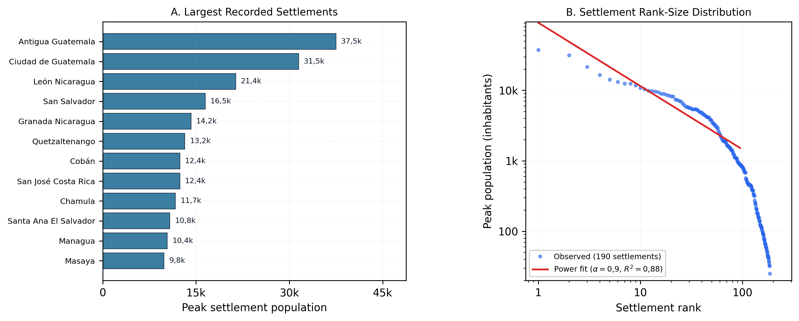

```{r setup, include=FALSE}
knitr::opts_chunk$set(echo = FALSE, warning = FALSE, message = FALSE, fig.pos = "htbp")
source("../../_shared/template/viscount_rmd_helpers.R")
library(jsonlite)

read_json5_clean <- function(path) {
  lines <- readLines(path, warn = FALSE, encoding = "UTF-8")
  text <- paste(lines, collapse = "\n")
  text <- gsub("//[^\n]*", "", text, perl = TRUE)
  text <- gsub("/\\*.*?\\*/", "", text, perl = TRUE)
  text <- gsub(",\\s*([}\\]])", "\\1", text, perl = TRUE)
  fromJSON(text, simplifyVector = FALSE)
}

summary_data <- fromJSON("captaincy_general_guatemala_summary_cache.json", simplifyVector = FALSE)
cfg_data <- read_json5_clean("captaincy_general_guatemala.json5")
sett_data <- fromJSON("captaincy_general_guatemala_settlements.json", simplifyVector = FALSE)
ledger_data <- read_json5_clean("captaincy_general_guatemala_source_ledger.json5")

clean_label <- function(x) {
  s <- as.character(x)
  s <- gsub("&", "and", s, fixed = TRUE)
  s <- gsub("Intendencia de Leon \\(Nicaragua\\)", "Intendencia de León (Nicaragua)", s)
  s <- gsub("Audiencia de Panama, Veraguas", "Audiencia de Panamá, Veraguas", s)
  s <- gsub("Darien", "Darién", s, fixed = TRUE)
  s <- gsub("Pérez Brign,", "Pérez Brignoli,", s, fixed = TRUE)
  s <- gsub("\\\\", "", s)
  trimws(s)
}

fmt_coord <- function(x) {
  viscount_fmt_number(round(as.numeric(x), 2L), 2L)
}

subregions <- summary_data$subregions
cfg_by_id <- setNames(cfg_data$regions, vapply(cfg_data$regions, function(r) r$id, character(1)))
reg_lookup <- setNames(
  vapply(subregions, function(r) clean_label(r$name), character(1)),
  vapply(subregions, function(r) r$id, character(1))
)

n_sites <- as.integer(summary_data$settlement_stats$total_settlements)
n_excluded <- as.integer(ledger_data$total_excluded)
n_total_eval <- n_sites + n_excluded
```

```{r hero-md-fallback, results='asis'}
if (!knitr::is_latex_output()) {
  cat("\n\n")
}
```

# Abstract

This companion gazetteer documents `r viscount_fmt_number(n_sites, 0L)` geocoded colonial settlements spanning eight isthmian jurisdictions and eight modern territories across the Captaincy General of Guatemala, Ciudad Real de Chiapas, British Honduras, the Mosquitia Coast and the Audiencia of Panamá between 1524 and 1821 (with recorded town-level series extending from 1574 to 1820). Audited across four sequential ingestion waves against 196 candidate records, the register consolidates `r viscount_fmt_number(n_excluded, 0L)` duplicate alias entries within 25 km spatial buffers and maintains a 0% crowd-sourced fallback share, drawing exclusively on Bourbon-era parish censuses, archival *visitas*, British colonial musters and peer-reviewed historical demography [@Juarros1808; @HallPerezBrignoli2003; @JaenSuarez1978; @SIBBelize2024]. Across the 190-settlement urban hierarchy, the top 95 ranked towns obey a steep colonial Zipf power law ($\alpha = 0,90$, $R^2 = 0,88$ on the 1774 cross-section), crowned by Antigua Guatemala (37,5k in 1768) and its post-earthquake successor Ciudad de Guatemala (31,5k in 1820), followed by provincial capitals at León (21,4k), San Salvador (16,5k) and Granada (14,2k), highland Maya market hubs at Quetzaltenango (13,2k), Cobán (12,4k) and Chamula (11,7k), late-colonial Central Valley risers led by San José (12,4k), and maritime enclaves at Panamá (9,6k), Belize Town (4.163) and Bluefields (1.850) [@Lutz1994; @Newson1987; @PerezBrignoli2010; @Wortman1982].

# Background

Colonial settlement geography across Central America reflected a sharp division between Spanish urban *repúblicas de españoles*, nucleated indigenous *pueblos de indios* and unreduced maritime or rainforest frontiers [@MacLeod1973; @Lovell1992; @HallPerezBrignoli2003]. Following the conquests of the 1520s, Spanish municipalities—Santiago de Guatemala, Ciudad Real de Chiapas, Gracias a Dios, Comayagua, San Salvador, León, Granada, Cartago and Panamá—were positioned along volcanic basins, silver districts and portage termini to control indigenous tribute and Pacific trade [@Lutz1994; @Vinals2020Outstanding; @JaenSuarez1978]. Surrounding those Spanish grids lay hundreds of congregated Maya, Pipil, Lenca, Chorotega and Nicarao villages governed by local *cabildos* and *principales*, whose demographic survival depended heavily on elevation and distance from coastal malaria belts [@Cruz1999Lite; @Newson1986; @Newson2021Supervivencia; @Medenou2025Mundo].

Over the seventeenth and eighteenth centuries, three spatial transformations reshaped this urban network. First, recurring volcanic eruptions and earthquakes forced dramatic capital relocations—most notably the transfer from Antigua Guatemala to Nueva Guatemala de la Asunción after the 1773 Santa Marta earthquake, alongside the earlier rebuilding of Panamá after 1671 and León after 1610 [@Lutz1994; @JaenSuarez1978]. Second, commercial indigo production in San Salvador and smallholder expansion in Costa Rica's western Central Valley elevated new *ladino* and creole centres such as San Salvador, Santa Ana, San Miguel, San Vicente, San José, Heredia and Alajuela into the upper urban tier [@Wortman1982; @PerezBrignoli2010; @Osegueda2024Migrar]. Third, British timber camps around Belize Town, Corozal and Orange Walk, Garifuna settlements at Dangriga (Stann Creek) and autonomous Miskitu lagoon towns at Sandy Bay, Bluefields and Cabo Gracias a Dios anchored a distinct Atlantic littoral settlement system outside Spanish census jurisdiction [@SIBBelize2024; @Wainwright2020Colonial; @Clavel2026King].

# Methodology

The settlement register was assembled in four documented ingestion waves tracked in the chapter source ledger. Wave 1 ingested 173 primary official and archival records drawn from the Historical GIS of the Indies (integrating the 1774–1796 Chiapas ecclesiastical reports, 1778 Panamanian and Veraguas censuses, Archbishop Cortés y Larraz's 1770 *visita* and Domingo Juarros's 1808 *Compendio*), accounting for 91,05% of the final register [@Juarros1808; @JaenSuarez1978]. Wave 2 added 12 monograph-derived colonial town series covering Honduras, Nicaragua, Panamá and British Honduras (6,94% marginal gain) [@Newson1986; @Newson1987; @SIBBelize2024]. Wave 3 backfilled 3 longitudinal colonial series (1,62% marginal gain), and Wave 4 executed a sub-regional gap-verification sweep adding 2 Atlantic frontier settlements (1,06% marginal gain), closing the ledger at 0% crowd-sourced share.

All 196 candidate records underwent WGS84 coordinate harmonisation, polygon assignment across the eight colonial jurisdictions and 25 km spatial deduplication. Six duplicate alias records—redundant entries for Antigua Guatemala, Panamá, Tuxtla, Tapachula, Ciudad Real de Chiapas and David—were merged into canonical records, yielding exactly `r viscount_fmt_number(n_sites, 0L)` unique *city-proper* entries (zero metropolitan suburb double-counts). Every entry carries explicit chronological population observations between 1574 and 1820, geographic coordinates and primary source attribution.

# Testing and Validation

Source-ledger accounting reconciles all 196 audited candidates exactly: 190 included colonial settlements plus 6 excluded duplicate aliases. Every one of the eight colonial sub-regions contains documented town records—from 95 in Ciudad Real de Chiapas and 43 in Panamá, Veraguas and Darién down to 14 in core Guatemala and Verapaz, 13 in León and Costa Rica, 10 in Comayagua, 6 along the Mosquitia Coast, 5 in San Salvador and Sonsonate and 4 inside the British Honduras mask polygon (with Dangriga/Stann Creek falling immediately across the southern Belize borderlands into the adjacent Guatemala-Verapaz mask edge, accounting for the 5 total Belizean settlements) [@Wainwright2020Colonial]. Figure \ref{fig:sett-regional-map} displays the spatial footprint of all 190 catalogued settlements across the eight colonial jurisdictions.

```{r fig-sett-map, results='asis'}
viscount_figure(
  "figures/captaincy_general_guatemala_regional_map.png",
  "Spatial distribution of 190 catalogued colonial settlements across eight jurisdictions of the Captaincy General of Guatemala, British Honduras and Panama, 1524 to 1821.",
  "fig:sett-regional-map"
)
```

Cross-checking town totals against provincial Bourbon returns confirms consistent urban shares: in 1778, newly founded Ciudad de Guatemala (23.434) represented 5,9% of Guatemala province's 398.575 inhabitants, San Salvador (12.059) represented 10,3% of San Salvador's 117.436, León (11.200) and Granada (9.800) together represented 17,9% of Nicaragua's 117.396, and Belize Town (3.824 in 1816) matched the official 1816 British Honduras settlement census directly [@Juarros1808; @HallPerezBrignoli2003; @SIBBelize2024].

# Results

## Leading Colonial Towns of Central America, Chiapas and Panamá

Table \ref{tab:top30-colonial} compiles the 30 largest catalogued colonial settlements ordered by peak recorded population between 1574 and 1820. Descending from Antigua Guatemala (37,5k in 1768) and Ciudad de Guatemala (31,5k in 1820) down to Matagalpa (5,6k in 1808), the top 30 tier spans every major Spanish province of the isthmus: six towns in Guatemala, six in Nicaragua, five in El Salvador, five in Chiapas, three in Costa Rica, two in Honduras and one in Panamá (Panamá City at rank 14 with 9,6k, joined immediately outside the top 30 by Los Santos at 5,6k).

```{r tab-top30-colonial, results='asis'}
all_entries <- lapply(sett_data, function(e) {
  yrs <- as.integer(names(e$population))
  pops <- as.numeric(unlist(e$population))
  idx_pk <- which.max(pops)
  list(
    name = clean_label(e$name),
    country = as.character(e$country),
    region_id = as.character(e$region_id),
    lat = as.numeric(e$coords[[1]]),
    lon = as.numeric(e$coords[[2]]),
    first_year = min(yrs),
    last_year = max(yrs),
    peak_pop = pops[idx_pk],
    peak_year = yrs[idx_pk]
  )
})
ord_idx <- order(vapply(all_entries, function(x) x$peak_pop, numeric(1)), decreasing = TRUE)
top30 <- all_entries[ord_idx[seq_len(min(30L, length(ord_idx)))]]

top30_rows <- lapply(top30, function(e) {
  span_str <- if (e$first_year == e$last_year) as.character(e$first_year) else paste0(e$first_year, " to ", e$last_year)
  reg_lbl <- if (e$region_id %in% names(reg_lookup)) reg_lookup[[e$region_id]] else clean_label(e$region_id)
  data.frame(
    Site = e$name,
    Country = e$country,
    Jurisdiction = reg_lbl,
    Coords = paste0(fmt_coord(e$lat), ", ", fmt_coord(e$lon)),
    Span = span_str,
    Peak = paste0(viscount_fmt_pop(e$peak_pop), " (", e$peak_year, ")"),
    stringsAsFactors = FALSE
  )
})
df_top30 <- do.call(rbind, top30_rows)
rownames(df_top30) <- NULL

viscount_table(
  df_top30,
  "Leading 30 colonial settlements across the Captaincy General of Guatemala, Chiapas and Panama ordered by peak recorded population, 1524 to 1821.",
  c("Settlement", "Territory", "Colonial Jurisdiction", "Lat, Lon", "Span", "Peak Pop. (Year)"),
  list(label = "tab:top30-colonial", font_size = "scriptsize", max_rows_per_page = 32L)
)
```

## Sub-Regional Gazetteer Coverage and Leading Centres

Table \ref{tab:subregion-gazetteer} contrasts catalogued settlement counts and sampling density per 10.000 km² against the leading town and 1821 archival population across all eight colonial sub-regions. Ciudad Real de Chiapas (12,73 catalogued locales per 10.000 km²) and Panamá, Veraguas and Darién (4,94 per 10.000 km²) exhibit the highest archival village density because parish-by-parish 1774–1796 and 1778 censuses survive down to hamlets and rural *haciendas* [@Cruz1999Lite; @JaenSuarez1978]. Across Guatemala, El Salvador, Honduras and Nicaragua, town catalogues capture the principal urban *cabeceras* (0,80 to 2,40 towns per 10.000 km²), while British Honduras (2,86 per 10.000 km²) and Mosquitia (0,49 per 10.000 km²) document every major timber camp and coastal lagoon hub [@SIBBelize2024; @Clavel2026King].

```{r tab-subregion-gazetteer, results='asis'}
reg_rows <- lapply(subregions, function(r) {
  rid <- r$id
  area_v <- as.numeric(r$area_km2)
  p1821 <- as.numeric(cfg_by_id[[rid]]$population[["1821"]])
  sub_entries <- Filter(function(e) identical(e$region_id, rid), sett_data)
  cnt <- length(sub_entries)
  sdens <- if (area_v > 0) (cnt / area_v) * 10000 else 0
  lead_str <- "-"
  if (cnt > 0L) {
    pks <- vapply(sub_entries, function(e) max(as.numeric(unlist(e$population))), numeric(1))
    idx_m <- which.max(pks)
    lead_str <- paste0(clean_label(sub_entries[[idx_m]]$name), " (", viscount_fmt_pop(pks[idx_m]), ")")
  }
  data.frame(
    Subregion = clean_label(r$name),
    Area = viscount_fmt_number(round(area_v), 0L),
    Sites = viscount_fmt_number(cnt, 0L),
    SiteDens = viscount_fmt_number(sdens, 2L),
    Lead = lead_str,
    Pop1821 = viscount_fmt_pop(p1821),
    stringsAsFactors = FALSE
  )
})
df_reg_gaz <- do.call(rbind, reg_rows)
rownames(df_reg_gaz) <- NULL

viscount_table(
  df_reg_gaz,
  "Catalogued colonial settlement counts, areal site density (per 10.000 km²), leading town and 1821 archival population across eight colonial jurisdictions.",
  c("Colonial Jurisdiction", "Area (km²)", "Sites", "Sites per 10k km²", "Leading Town (Peak)", "1821 Arch. Pop."),
  list(label = "tab:subregion-gazetteer", font_size = "scriptsize")
)
```

## Provenance Ledger and Ingestion Corpus Breakdown

Table \ref{tab:provenance-ledger} classifies all 190 settlements by their primary archival or monograph source corpus. Two historical-GIS and Bourbon-compendium corpora supply 90,53% of the entire register: the Historical GIS of the Indies archival tables (129 entries, 67,89%, spanning Chiapas 1774–1796 reports, Panamá and Veraguas 1778 rolls and Juarros's Guatemala tables) and the core Central American colonial urban synthesis drawn from Juarros (1808), Cortés y Larraz (1770), Hall and Pérez Brignoli (2003) and Newson (1986, 1987) (43 entries, 22,63%). The remaining 18 entries anchor the Atlantic and trans-isthmian frontiers: 8 Mosquitia lagoon and littoral hubs, 5 Panamanian historical series from Castillero Calvo and 5 British Honduras logging and Garifuna coastal settlements [@Juarros1808; @HallPerezBrignoli2003; @JaenSuarez1978; @SIBBelize2024; @Wainwright2020Colonial].

```{r tab-provenance-ledger, results='asis'}
classify_src <- function(e) {
  s0 <- if (length(e$sources) > 0) as.character(e$sources[[1]]) else "Other"
  if (grepl("lujan-informes", s0, fixed = TRUE)) return("HGIS de las Indias: Chiapas Parish Reports (1774-1796)")
  if (grepl("Juarros \\(1808\\)", s0)) return("Juarros (1808), Cortes y Larraz (1770) and Hall-Perez Brignoli")
  if (grepl("amn-panama", s0, fixed = TRUE)) return("HGIS de las Indias: Panama Census Rolls (1778)")
  if (grepl("censo-veragua", s0, fixed = TRUE)) return("HGIS de las Indias: Veraguas Census Rolls (1778)")
  if (grepl("Offen \\(2002\\)", s0)) return("Mosquitia Ethnohistorical Corpus (Offen, Helms, Dawson)")
  if (grepl("Burdon \\(1931\\)", s0)) return("British Honduras Archives (Burdon, Bolland, SIB)")
  if (grepl("Castillero Calvo", s0, fixed = TRUE)) return("Panamanian Colonial Urban Series (Castillero Calvo)")
  if (grepl("primary source: juarros", s0, fixed = TRUE)) return("HGIS de las Indias: Juarros Compendio Extract")
  "Other Regional Colonial Archives"
}

src_vec <- vapply(sett_data, classify_src, character(1))
src_tab <- sort(table(src_vec), decreasing = TRUE)
df_prov <- data.frame(
  Corpus = names(src_tab),
  Entries = vapply(as.integer(src_tab), function(v) viscount_fmt_number(v, 0L), character(1)),
  Share = vapply(100 * as.integer(src_tab) / n_sites, function(v) paste0(viscount_fmt_number(v, 2L), "%"), character(1)),
  stringsAsFactors = FALSE
)
df_prov <- rbind(df_prov, data.frame(
  Corpus = "Total Gazetteer (0% Crowd-Sourced Share)",
  Entries = viscount_fmt_number(n_sites, 0L),
  Share = "100%",
  stringsAsFactors = FALSE
))
rownames(df_prov) <- NULL

viscount_table(
  df_prov,
  "Primary archival provenance corpora across 190 catalogued colonial Central American, Chiapan and Panamanian settlements.",
  c("Primary Archival Corpus", "Entries", "Share"),
  list(label = "tab:provenance-ledger", font_size = "scriptsize")
)
```

## Urban Size Structure and Rank-Size Scaling

Across the 190 catalogued settlements, peak recorded populations span nearly four orders of magnitude, from small Chiapan *haciendas* of 4 to 41 residents enumerated in the 1774 parish census up to Antigua Guatemala's 37,5k pre-earthquake peak and Ciudad de Guatemala's 31,5k independence-eve total [@Lutz1994; @Juarros1808]. Fitting a rank-size curve to the upper 95 urban ranks on the 1774 benchmark yields $\alpha = 0,90$ ($R^2 = 0,88$), sitting close to the canonical Zipf unity line yet exhibiting slight concavity above rank 10 where provincial capitals (León, San Salvador, Granada, Quetzaltenango, Cobán, San José and Panamá) cluster tightly between 9,6k and 21,4k behind the dual Guatemalan capital complex. That profile reflects the polycentric fiscal architecture of the late Bourbon Kingdom of Guatemala, in which newly erected *intendencias* nurtured distinct regional trade capitals without eroding Guatemala City's commercial monopoly [@Wortman1982; @Osegueda2024Migrar].

# Limitations

Three archival constraints shape interpretation of this gazetteer. First, settlement-level source resolution is uneven across modern borders: Chiapas (95 sites) and Panamá (43 sites) preserve granular village and rural *hacienda* counts from 1774 and 1778, whereas Guatemala, El Salvador, Honduras, Nicaragua and Costa Rica are represented chiefly by principal *cabeceras* and provincial capitals above 2k inhabitants [@Juarros1808; @JaenSuarez1978]. Second, boundary nuances near southern Belize place the newly settled Garifuna port of Dangriga (Stann Creek) along the Guatemala-Verapaz mask edge rather than inside the historical northern logwood polygon, illustrating how colonial Anglo-Spanish territorial ambiguity persisted across the Sibun-Sarstoon frontier well past 1821 [@Wainwright2020Colonial]. Third, non-Spanish settlements in Mosquitia and Darién lack regular census schedules, so their town figures represent ethnohistorical point estimates anchored to eighteenth-century British military surveys and Spanish missionary expeditions [@Newson1986; @Newson1987; @Aram2021Rice].

# Conclusion

Cataloguing 190 geocoded colonial settlements across eight jurisdictions confirms the dual spatial imprint of Spanish and British rule on the Central American isthmus. Along the Pacific highlands and volcanic corridor, an integrated network of administrative capitals, indigo market towns and resilient Maya *pueblos* scaled along a steep urban hierarchy ($\alpha = 0,90$, $R^2 = 0,88$) anchored by Antigua and Nueva Guatemala, León, San Salvador, Granada and rising San José [@Lutz1994; @Wortman1982; @PerezBrignoli2010]. Along the Caribbean shore, small maritime enclaves from Belize Town and Dangriga to Bluefields and Portobelo linked timber extraction, Garifuna and Afro-Caribbean mobility and Miskitu diplomacy to wider Atlantic currents, establishing the enduring bicoastal settlement map inherited by Central America at independence [@SIBBelize2024; @Wainwright2020Colonial; @Clavel2026King].

# Appendix

## Provincial Census Anchors Linked to the Urban Gazetteer

Table \ref{tab:hgis-census-anchors} summarises the provincial and British colonial census totals (1778 to 1816) that anchor the upper tier of the settlement gazetteer across the Audiencia of Guatemala, Panamá and Belize.

```{r tab-hgis-census-anchors, results='asis'}
hgis_prov <- Filter(function(h) h$level %in% c("colonial_province", "colonial_governorship", "colony"), summary_data$hgis_subadmin_table)
hp_rows <- lapply(hgis_prov, function(h) {
  data.frame(
    Unit = clean_label(h$unit_name),
    Territory = as.character(h$country),
    Year = as.character(as.integer(h$year)),
    Pop = viscount_fmt_number(as.integer(h$population), 0L),
    Source = clean_label(h$source),
    stringsAsFactors = FALSE
  )
})
df_hp <- do.call(rbind, hp_rows)
rownames(df_hp) <- NULL

viscount_table(
  df_hp,
  "Provincial, governorship and British settlement census anchors across Central America, Panama and Belize, 1778 to 1816.",
  c("Administrative Unit", "Modern Territory", "Year", "Enumerated Pop.", "Primary Source"),
  list(label = "tab:hgis-census-anchors", font_size = "scriptsize")
)
```

# Sources

::: {#refs}
:::

# Footnotes

**Note 1 (City-Proper Scope).** Every one of the 190 catalogued records represents a distinct *city-proper* or rural parish/village unit (zero metropolitan suburb entries), preventing overlapping double-counts when aggregating urban populations against the provincial totals reported in Table \ref{tab:hgis-census-anchors}.

**Note 2 (Deduplication Protocol).** Six duplicate alias records within 25 km spatial buffers (Antigua Guatemala, Panamá, Tuxtla, Tapachula, Ciudad Real de Chiapas and David) were merged into single canonical series during Wave 1–4 reconciliation, preserving longitudinal observations from both Juarros (1808) and Historical GIS of the Indies archival rolls inside each retained town record.
