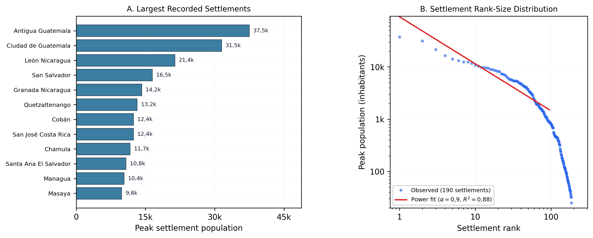
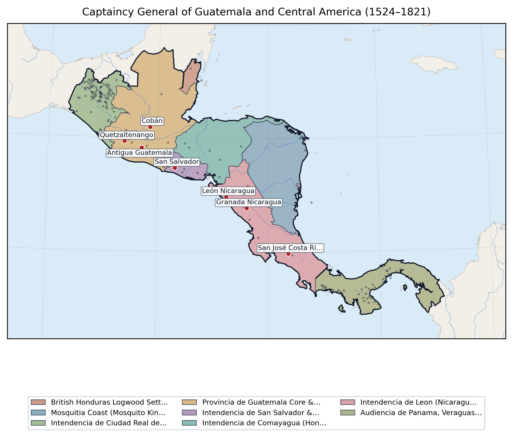

Captaincy General of Guatemala and Central America
================
Aust Kätzchen
23 November 2026

- [Abstract](#abstract)
- [Background](#background)
- [Methodology](#methodology)
- [Testing and Validation](#testing-and-validation)
- [Results](#results)
  - [Leading Colonial Towns of Central America, Chiapas and
    Panamá](#leading-colonial-towns-of-central-america-chiapas-and-panamá)
  - [Sub-Regional Gazetteer Coverage and Leading
    Centres](#sub-regional-gazetteer-coverage-and-leading-centres)
  - [Provenance Ledger and Ingestion Corpus
    Breakdown](#provenance-ledger-and-ingestion-corpus-breakdown)
  - [Urban Size Structure and Rank-Size
    Scaling](#urban-size-structure-and-rank-size-scaling)
- [Limitations](#limitations)
- [Conclusion](#conclusion)
- [Appendix](#appendix)
  - [Provincial Census Anchors Linked to the Urban
    Gazetteer](#provincial-census-anchors-linked-to-the-urban-gazetteer)
- [Sources](#sources)
- [Footnotes](#footnotes)

<figure>

<figcaption aria-hidden="true">Leading colonial towns and rank-size
distribution across 190 catalogued Central American, Chiapan and
Panamanian settlements from 1524 to 1821.</figcaption>
</figure>

# Abstract

This companion gazetteer documents 190 geocoded colonial settlements
spanning eight isthmian jurisdictions and eight modern territories
across the Captaincy General of Guatemala, Ciudad Real de Chiapas,
British Honduras, the Mosquitia Coast and the Audiencia of Panamá
between 1524 and 1821 (with recorded town-level series extending from
1574 to 1820). Audited across four sequential ingestion waves against
196 candidate records, the register consolidates 6 duplicate alias
entries within 25 km spatial buffers and maintains a 0% crowd-sourced
fallback share, drawing exclusively on Bourbon-era parish censuses,
archival *visitas*, British colonial musters and peer-reviewed
historical demography
[\[1\]](#ref-Juarros1808)[\[2\]](#ref-HallPerezBrignoli2003)[\[3\]](#ref-JaenSuarez1978)[\[4\]](#ref-SIBBelize2024).
Across the 190-settlement urban hierarchy, the top 95 ranked towns obey
a steep colonial Zipf power law ($\alpha = 0,90$, $R^2 = 0,88$ on the
1774 cross-section), crowned by Antigua Guatemala (37,5k in 1768) and
its post-earthquake successor Ciudad de Guatemala (31,5k in 1820),
followed by provincial capitals at León (21,4k), San Salvador (16,5k)
and Granada (14,2k), highland Maya market hubs at Quetzaltenango
(13,2k), Cobán (12,4k) and Chamula (11,7k), late-colonial Central Valley
risers led by San José (12,4k), and maritime enclaves at Panamá (9,6k),
Belize Town (4.163) and Bluefields (1.850)
[\[5\]](#ref-Lutz1994)[\[6\]](#ref-Newson1987)[\[7\]](#ref-PerezBrignoli2010)[\[8\]](#ref-Wortman1982).

# Background

Colonial settlement geography across Central America reflected a sharp
division between Spanish urban *repúblicas de españoles*, nucleated
indigenous *pueblos de indios* and unreduced maritime or rainforest
frontiers
[\[2\]](#ref-HallPerezBrignoli2003)[\[9\]](#ref-MacLeod1973)[\[10\]](#ref-Lovell1992).
Following the conquests of the 1520s, Spanish municipalities—Santiago de
Guatemala, Ciudad Real de Chiapas, Gracias a Dios, Comayagua, San
Salvador, León, Granada, Cartago and Panamá—were positioned along
volcanic basins, silver districts and portage termini to control
indigenous tribute and Pacific trade
[\[3\]](#ref-JaenSuarez1978)[\[5\]](#ref-Lutz1994)[\[11\]](#ref-Vinals2020Outstanding).
Surrounding those Spanish grids lay hundreds of congregated Maya, Pipil,
Lenca, Chorotega and Nicarao villages governed by local *cabildos* and
*principales*, whose demographic survival depended heavily on elevation
and distance from coastal malaria belts
[\[12\]](#ref-Cruz1999Lite)[\[13\]](#ref-Newson1986)[\[14\]](#ref-Newson2021Supervivencia)[\[15\]](#ref-Medenou2025Mundo).

Over the seventeenth and eighteenth centuries, three spatial
transformations reshaped this urban network. First, recurring volcanic
eruptions and earthquakes forced dramatic capital relocations—most
notably the transfer from Antigua Guatemala to Nueva Guatemala de la
Asunción after the 1773 Santa Marta earthquake, alongside the earlier
rebuilding of Panamá after 1671 and León after 1610
[\[3\]](#ref-JaenSuarez1978)[\[5\]](#ref-Lutz1994). Second, commercial
indigo production in San Salvador and smallholder expansion in Costa
Rica’s western Central Valley elevated new *ladino* and creole centres
such as San Salvador, Santa Ana, San Miguel, San Vicente, San José,
Heredia and Alajuela into the upper urban tier
[\[7\]](#ref-PerezBrignoli2010)[\[8\]](#ref-Wortman1982)[\[16\]](#ref-Osegueda2024Migrar).
Third, British timber camps around Belize Town, Corozal and Orange Walk,
Garifuna settlements at Dangriga (Stann Creek) and autonomous Miskitu
lagoon towns at Sandy Bay, Bluefields and Cabo Gracias a Dios anchored a
distinct Atlantic littoral settlement system outside Spanish census
jurisdiction
[\[4\]](#ref-SIBBelize2024)[\[17\]](#ref-Wainwright2020Colonial)[\[18\]](#ref-Clavel2026King).

# Methodology

The settlement register was assembled in four documented ingestion waves
tracked in the chapter source ledger. Wave 1 ingested 173 primary
official and archival records drawn from the Historical GIS of the
Indies (integrating the 1774–1796 Chiapas ecclesiastical reports, 1778
Panamanian and Veraguas censuses, Archbishop Cortés y Larraz’s 1770
*visita* and Domingo Juarros’s 1808 *Compendio*), accounting for 91,05%
of the final register
[\[1\]](#ref-Juarros1808)[\[3\]](#ref-JaenSuarez1978). Wave 2 added 12
monograph-derived colonial town series covering Honduras, Nicaragua,
Panamá and British Honduras (6,94% marginal gain)
[\[4\]](#ref-SIBBelize2024)[\[6\]](#ref-Newson1987)[\[13\]](#ref-Newson1986).
Wave 3 backfilled 3 longitudinal colonial series (1,62% marginal gain),
and Wave 4 executed a sub-regional gap-verification sweep adding 2
Atlantic frontier settlements (1,06% marginal gain), closing the ledger
at 0% crowd-sourced share.

All 196 candidate records underwent WGS84 coordinate harmonisation,
polygon assignment across the eight colonial jurisdictions and 25 km
spatial deduplication. Six duplicate alias records—redundant entries for
Antigua Guatemala, Panamá, Tuxtla, Tapachula, Ciudad Real de Chiapas and
David—were merged into canonical records, yielding exactly 190 unique
*city-proper* entries (zero metropolitan suburb double-counts). Every
entry carries explicit chronological population observations between
1574 and 1820, geographic coordinates and primary source attribution.

# Testing and Validation

Source-ledger accounting reconciles all 196 audited candidates exactly:
190 included colonial settlements plus 6 excluded duplicate aliases.
Every one of the eight colonial sub-regions contains documented town
records—from 95 in Ciudad Real de Chiapas and 43 in Panamá, Veraguas and
Darién down to 14 in core Guatemala and Verapaz, 13 in León and Costa
Rica, 10 in Comayagua, 6 along the Mosquitia Coast, 5 in San Salvador
and Sonsonate and 4 inside the British Honduras mask polygon (with
Dangriga/Stann Creek falling immediately across the southern Belize
borderlands into the adjacent Guatemala-Verapaz mask edge, accounting
for the 5 total Belizean settlements)
[\[17\]](#ref-Wainwright2020Colonial). Figure displays the spatial
footprint of all 190 catalogued settlements across the eight colonial
jurisdictions.

<!-- -->

Cross-checking town totals against provincial Bourbon returns confirms
consistent urban shares: in 1778, newly founded Ciudad de Guatemala
(23.434) represented 5,9% of Guatemala province’s 398.575 inhabitants,
San Salvador (12.059) represented 10,3% of San Salvador’s 117.436, León
(11.200) and Granada (9.800) together represented 17,9% of Nicaragua’s
117.396, and Belize Town (3.824 in 1816) matched the official 1816
British Honduras settlement census directly
[\[1\]](#ref-Juarros1808)[\[2\]](#ref-HallPerezBrignoli2003)[\[4\]](#ref-SIBBelize2024).

# Results

## Leading Colonial Towns of Central America, Chiapas and Panamá

Table compiles the 30 largest catalogued colonial settlements ordered by
peak recorded population between 1574 and 1820. Descending from Antigua
Guatemala (37,5k in 1768) and Ciudad de Guatemala (31,5k in 1820) down
to Matagalpa (5,6k in 1808), the top 30 tier spans every major Spanish
province of the isthmus: six towns in Guatemala, six in Nicaragua, five
in El Salvador, five in Chiapas, three in Costa Rica, two in Honduras
and one in Panamá (Panamá City at rank 14 with 9,6k, joined immediately
outside the top 30 by Los Santos at 5,6k).

| Settlement | Territory | Colonial Jurisdiction | Lat, Lon | Span | Peak Pop. (Year) |
|:---|:---|:---|:---|:---|:---|
| **Antigua Guatemala** | Guatemala | Provincia de Guatemala Core and Verapaz | 14,56, -90,73 | 1574 to 1808 | 37,5k (1768) |
| **Ciudad de Guatemala** | Guatemala | Provincia de Guatemala Core and Verapaz | 14,63, -90,51 | 1778 to 1820 | 31,5k (1820) |
| **León Nicaragua** | Nicaragua | Intendencia de León (Nicaragua) and Costa Rica | 12,44, -86,88 | 1646 to 1820 | 21,4k (1820) |
| **San Salvador** | El Salvador | Intendencia de San Salvador and Sonsonate | 13,69, -89,22 | 1574 to 1820 | 16,5k (1820) |
| **Granada Nicaragua** | Nicaragua | Intendencia de León (Nicaragua) and Costa Rica | 11,93, -85,96 | 1646 to 1820 | 14,2k (1820) |
| **Quetzaltenango** | Guatemala | Provincia de Guatemala Core and Verapaz | 14,84, -91,52 | 1580 to 1820 | 13,2k (1820) |
| **Cobán** | Guatemala | Provincia de Guatemala Core and Verapaz | 15,47, -90,37 | 1574 to 1808 | 12,4k (1808) |
| **San José Costa Rica** | Costa Rica | Intendencia de León (Nicaragua) and Costa Rica | 9,93, -84,09 | 1751 to 1820 | 12,4k (1820) |
| **Chamula** | Mexico | Intendencia de Ciudad Real de Chiapas (Guatemala until 1824) | 16,79, -92,69 | 1774 to 1796 | 11,7k (1796) |
| **Santa Ana El Salvador** | El Salvador | Intendencia de San Salvador and Sonsonate | 13,99, -89,56 | 1680 to 1820 | 10,8k (1820) |
| **Managua** | Nicaragua | Intendencia de León (Nicaragua) and Costa Rica | 12,14, -86,25 | 1680 to 1820 | 10,4k (1820) |
| **Masaya** | Nicaragua | Intendencia de León (Nicaragua) and Costa Rica | 11,97, -86,09 | 1680 to 1808 | 9,8k (1808) |
| **Cartago Costa Rica** | Costa Rica | Intendencia de León (Nicaragua) and Costa Rica | 9,86, -83,92 | 1646 to 1820 | 9,8k (1820) |
| **Panamá** | Panama | Audiencia de Panamá, Veraguas and Darién | 8,95, -79,53 | 1675 to 1820 | 9,6k (1820) |
| **Totonicapán** | Guatemala | Provincia de Guatemala Core and Verapaz | 14,91, -91,36 | 1680 to 1808 | 9,4k (1808) |
| **Comayagua** | Honduras | Intendencia de Comayagua (Honduras) | 14,46, -87,64 | 1574 to 1820 | 8,9k (1820) |
| **San Miguel** | El Salvador | Intendencia de San Salvador and Sonsonate | 13,48, -88,18 | 1680 to 1820 | 8,9k (1820) |
| **Tegucigalpa** | Honduras | Intendencia de Comayagua (Honduras) | 14,07, -87,19 | 1680 to 1820 | 8,6k (1820) |
| **Heredia** | Costa Rica | Intendencia de León (Nicaragua) and Costa Rica | 10, -84,12 | 1751 to 1820 | 8,4k (1820) |
| **Rivas Nicaragua** | Nicaragua | Intendencia de León (Nicaragua) and Costa Rica | 11,44, -85,83 | 1725 to 1808 | 8,2k (1808) |
| **Comitan** | Mexico | Intendencia de Ciudad Real de Chiapas (Guatemala until 1824) | 16,25, -92,13 | 1774 to 1796 | 8,2k (1796) |
| **San Bartolomé** | Mexico | Intendencia de Ciudad Real de Chiapas (Guatemala until 1824) | 16,34, -92,56 | 1774 to 1796 | 7,4k (1796) |
| **Santo Domingo Oxchuc** | Mexico | Intendencia de Ciudad Real de Chiapas (Guatemala until 1824) | 16,79, -92,34 | 1774 to 1796 | 7,3k (1796) |
| **San Vicente** | El Salvador | Intendencia de San Salvador and Sonsonate | 13,64, -88,78 | 1680 to 1820 | 7,1k (1820) |
| **Sonsonate** | El Salvador | Provincia de Guatemala Core and Verapaz | 13,72, -89,72 | 1680 to 1820 | 6,9k (1820) |
| **Chinandega** | Nicaragua | Intendencia de León (Nicaragua) and Costa Rica | 12,63, -87,13 | 1680 to 1808 | 6,4k (1808) |
| **Chiquimula** | Guatemala | Provincia de Guatemala Core and Verapaz | 14,8, -89,55 | 1680 to 1808 | 6,2k (1808) |
| **Ciudad Real de Chiapas** | Mexico | Intendencia de Ciudad Real de Chiapas (Guatemala until 1824) | 16,74, -92,64 | 1574 to 1814 | 5,8k (1814) |
| **Huehuetenango** | Guatemala | Provincia de Guatemala Core and Verapaz | 15,32, -91,47 | 1680 to 1808 | 5,8k (1808) |
| **Matagalpa** | Nicaragua | Intendencia de León (Nicaragua) and Costa Rica | 12,93, -85,92 | 1680 to 1808 | 5,6k (1808) |

Leading 30 colonial settlements across the Captaincy General of
Guatemala, Chiapas and Panama ordered by peak recorded population, 1524
to 1821.

## Sub-Regional Gazetteer Coverage and Leading Centres

Table contrasts catalogued settlement counts and sampling density per
10.000 km² against the leading town and 1821 archival population across
all eight colonial sub-regions. Ciudad Real de Chiapas (12,73 catalogued
locales per 10.000 km²) and Panamá, Veraguas and Darién (4,94 per 10.000
km²) exhibit the highest archival village density because
parish-by-parish 1774–1796 and 1778 censuses survive down to hamlets and
rural *haciendas*
[\[3\]](#ref-JaenSuarez1978)[\[12\]](#ref-Cruz1999Lite). Across
Guatemala, El Salvador, Honduras and Nicaragua, town catalogues capture
the principal urban *cabeceras* (0,80 to 2,40 towns per 10.000 km²),
while British Honduras (2,86 per 10.000 km²) and Mosquitia (0,49 per
10.000 km²) document every major timber camp and coastal lagoon hub
[\[4\]](#ref-SIBBelize2024)[\[18\]](#ref-Clavel2026King).

| Colonial Jurisdiction | Area (km²) | Sites | Sites per 10k km² | Leading Town (Peak) | 1821 Arch. Pop. |
|:---|:---|:---|:---|:---|:---|
| **British Honduras Logwood Settlement** | 13.975 | 4 | 2,86 | Belize Town (4,2k) | 5,2k |
| **Mosquitia Coast (Mosquito Kingdom)** | 122.699 | 6 | 0,49 | Bluefields (1,8k) | 52k |
| **Intendencia de Ciudad Real de Chiapas (Guatemala until 1824)** | 74.626 | 95 | 12,73 | Chamula (11,7k) | 118k |
| **Provincia de Guatemala Core and Verapaz** | 175.682 | 14 | 0,8 | Antigua Guatemala (37,5k) | 535k |
| **Intendencia de San Salvador and Sonsonate** | 20.857 | 5 | 2,4 | San Salvador (16,5k) | 248k |
| **Intendencia de Comayagua (Honduras)** | 77.148 | 10 | 1,3 | Comayagua (8,9k) | 135k |
| **Intendencia de León (Nicaragua) and Costa Rica** | 110.817 | 13 | 1,17 | León Nicaragua (21,4k) | 235k |
| **Audiencia de Panamá, Veraguas and Darién** | 87.056 | 43 | 4,94 | Panamá (9,6k) | 92k |

Catalogued colonial settlement counts, areal site density (per 10.000
km²), leading town and 1821 archival population across eight colonial
jurisdictions.

## Provenance Ledger and Ingestion Corpus Breakdown

Table classifies all 190 settlements by their primary archival or
monograph source corpus. Two historical-GIS and Bourbon-compendium
corpora supply 90,53% of the entire register: the Historical GIS of the
Indies archival tables (129 entries, 67,89%, spanning Chiapas 1774–1796
reports, Panamá and Veraguas 1778 rolls and Juarros’s Guatemala tables)
and the core Central American colonial urban synthesis drawn from
Juarros (1808), Cortés y Larraz (1770), Hall and Pérez Brignoli (2003)
and Newson (1986, 1987) (43 entries, 22,63%). The remaining 18 entries
anchor the Atlantic and trans-isthmian frontiers: 8 Mosquitia lagoon and
littoral hubs, 5 Panamanian historical series from Castillero Calvo and
5 British Honduras logging and Garifuna coastal settlements
[\[1\]](#ref-Juarros1808)[\[2\]](#ref-HallPerezBrignoli2003)[\[3\]](#ref-JaenSuarez1978)[\[4\]](#ref-SIBBelize2024)[\[17\]](#ref-Wainwright2020Colonial).

| Primary Archival Corpus | Entries | Share |
|:---|:---|:---|
| **HGIS de las Indias: Chiapas Parish Reports (1774-1796)** | 87 | 45,79% |
| **Juarros (1808), Cortes y Larraz (1770) and Hall-Perez Brignoli** | 43 | 22,63% |
| **HGIS de las Indias: Panama Census Rolls (1778)** | 29 | 15,26% |
| **HGIS de las Indias: Veraguas Census Rolls (1778)** | 9 | 4,74% |
| **Mosquitia Ethnohistorical Corpus (Offen, Helms, Dawson)** | 8 | 4,21% |
| **British Honduras Archives (Burdon, Bolland, SIB)** | 5 | 2,63% |
| **Panamanian Colonial Urban Series (Castillero Calvo)** | 5 | 2,63% |
| **HGIS de las Indias: Juarros Compendio Extract** | 4 | 2,11% |
| **Total Gazetteer (0% Crowd-Sourced Share)** | 190 | 100% |

Primary archival provenance corpora across 190 catalogued colonial
Central American, Chiapan and Panamanian settlements.

## Urban Size Structure and Rank-Size Scaling

Across the 190 catalogued settlements, peak recorded populations span
nearly four orders of magnitude, from small Chiapan *haciendas* of 4 to
41 residents enumerated in the 1774 parish census up to Antigua
Guatemala’s 37,5k pre-earthquake peak and Ciudad de Guatemala’s 31,5k
independence-eve total [\[1\]](#ref-Juarros1808)[\[5\]](#ref-Lutz1994).
Fitting a rank-size curve to the upper 95 urban ranks on the 1774
benchmark yields $\alpha = 0,90$ ($R^2 = 0,88$), sitting close to the
canonical Zipf unity line yet exhibiting slight concavity above rank 10
where provincial capitals (León, San Salvador, Granada, Quetzaltenango,
Cobán, San José and Panamá) cluster tightly between 9,6k and 21,4k
behind the dual Guatemalan capital complex. That profile reflects the
polycentric fiscal architecture of the late Bourbon Kingdom of
Guatemala, in which newly erected *intendencias* nurtured distinct
regional trade capitals without eroding Guatemala City’s commercial
monopoly [\[8\]](#ref-Wortman1982)[\[16\]](#ref-Osegueda2024Migrar).

# Limitations

Three archival constraints shape interpretation of this gazetteer.
First, settlement-level source resolution is uneven across modern
borders: Chiapas (95 sites) and Panamá (43 sites) preserve granular
village and rural *hacienda* counts from 1774 and 1778, whereas
Guatemala, El Salvador, Honduras, Nicaragua and Costa Rica are
represented chiefly by principal *cabeceras* and provincial capitals
above 2k inhabitants
[\[1\]](#ref-Juarros1808)[\[3\]](#ref-JaenSuarez1978). Second, boundary
nuances near southern Belize place the newly settled Garifuna port of
Dangriga (Stann Creek) along the Guatemala-Verapaz mask edge rather than
inside the historical northern logwood polygon, illustrating how
colonial Anglo-Spanish territorial ambiguity persisted across the
Sibun-Sarstoon frontier well past 1821
[\[17\]](#ref-Wainwright2020Colonial). Third, non-Spanish settlements in
Mosquitia and Darién lack regular census schedules, so their town
figures represent ethnohistorical point estimates anchored to
eighteenth-century British military surveys and Spanish missionary
expeditions
[\[6\]](#ref-Newson1987)[\[13\]](#ref-Newson1986)[\[19\]](#ref-Aram2021Rice).

# Conclusion

Cataloguing 190 geocoded colonial settlements across eight jurisdictions
confirms the dual spatial imprint of Spanish and British rule on the
Central American isthmus. Along the Pacific highlands and volcanic
corridor, an integrated network of administrative capitals, indigo
market towns and resilient Maya *pueblos* scaled along a steep urban
hierarchy ($\alpha = 0,90$, $R^2 = 0,88$) anchored by Antigua and Nueva
Guatemala, León, San Salvador, Granada and rising San José
[\[5\]](#ref-Lutz1994)[\[7\]](#ref-PerezBrignoli2010)[\[8\]](#ref-Wortman1982).
Along the Caribbean shore, small maritime enclaves from Belize Town and
Dangriga to Bluefields and Portobelo linked timber extraction, Garifuna
and Afro-Caribbean mobility and Miskitu diplomacy to wider Atlantic
currents, establishing the enduring bicoastal settlement map inherited
by Central America at independence
[\[4\]](#ref-SIBBelize2024)[\[17\]](#ref-Wainwright2020Colonial)[\[18\]](#ref-Clavel2026King).

# Appendix

## Provincial Census Anchors Linked to the Urban Gazetteer

Table summarises the provincial and British colonial census totals (1778
to 1816) that anchor the upper tier of the settlement gazetteer across
the Audiencia of Guatemala, Panamá and Belize.

| Administrative Unit | Modern Territory | Year | Enumerated Pop. | Primary Source |
|:---|:---|:---|:---|:---|
| **Province of Guatemala (Captaincy General core)** | Guatemala | 1778 | 398.575 | Hall, Carolyn and Héctor Pérez Brignoli, Juarros, Domingo |
| **Intendancy of San Salvador and Sonsonate** | El Salvador | 1778 | 117.436 | Hall, Carolyn and Héctor Pérez Brignoli, Juarros, Domingo |
| **Intendancy of León (Nicaragua and Nicoya)** | Nicaragua | 1778 | 117.396 | Hall, Carolyn and Héctor Pérez Brignoli, Juarros, Domingo |
| **Intendancy of Comayagua (Honduras)** | Honduras | 1778 | 88.143 | Hall, Carolyn and Héctor Pérez Brignoli, Juarros, Domingo |
| **Gobernación de Panamá (incl. Natá and Los Santos)** | Panama | 1778 | 35.955 | Jaén Suárez, Omar |
| **Governorship of Costa Rica** | Costa Rica | 1778 | 24.536 | Hall, Carolyn and Héctor Pérez Brignoli, Juarros, Domingo |
| **Gobernación de Veraguas (incl. Alanje/Chiriquí)** | Panama | 1778 | 20.061 | Jaén Suárez, Omar |
| **Gobernación de Portobelo** | Panama | 1778 | 1.762 | Jaén Suárez, Omar |
| **Gobernación del Darién (colonial settled population)** | Panama | 1778 | 1.266 | Jaén Suárez, Omar |
| **British Honduras (Belize Settlement)** | Belize | 1816 | 3.824 | Statistical Institute of Belize |

Provincial, governorship and British settlement census anchors across
Central America, Panama and Belize, 1778 to 1816.

# Sources

1.
Juarros, Domingo.
*Compendio de la historia de la Ciudad de Guatemala
(Vols. I–II)*. Imprenta de Ignacio Beteta, Guatemala, 1808,
<https://catalog.hathitrust.org/Record/001249987>.

2.
Hall, Carolyn, and Héctor Pérez
Brignoli (cartography by John V. Cotter).
*Historical Atlas of Central America*.
University of Oklahoma Press, Norman, 2003,
<https://www.oupress.com/9780806130385/historical-atlas-of-central-america/>.

3.
Jaén Suárez, Omar.
*La población del Istmo de Panamá del siglo XVI al
siglo XX: Estudio sobre la población y los modos de organización de las
economías, las sociedades y los espacios geográficos*. Impresora
de la Nación, Panamá, 1978, <https://binal.ac.pa/>.

4.
Statistical Institute of Belize
(SIB) / Colonial Office British Honduras.
“Population and Housing Censuses of British
Honduras / Belize (1790–2022).” Statistical Institute of Belize,
Belmopan, 2024, <https://sib.org.bz/>.

5.
Lutz, Christopher H.
*Santiago de Guatemala, 1541-1773: City, Caste, and
the Colonial Experience*. University of Oklahoma Press, 1994,
<https://www.oupress.com/>.

6.
Newson, Linda A.
*Indian Survival in Colonial Nicaragua*.
University of Oklahoma Press, 1987, <https://www.oupress.com/>.

7.
Pérez Brignoli, Héctor.
*La población de Costa Rica, 1750-2000: Una
historia experimental*. Editorial Universidad de Costa Rica,
2010, <https://editorial.ucr.ac.cr/>.

8.
Wortman, Miles L.
*Government and Society in Central America,
1680-1840*. Columbia University Press, 1982,
<https://cup.columbia.edu/>.

9.
MacLeod, Murdo J. *Spanish Central
America: A Socioeconomic History, 1520-1720*. University of California
Press, 1973, <https://www.ucpress.edu/>.

10.
Lovell, W. George.
*Conquest and Survival in Colonial Guatemala: A
Historical Geography of the Cuchumatán Highlands, 1500-1821*.
McGill-Queen’s University Press, 1992, <https://www.mqup.ca/>.

11.
Viñals, M. J., et al. “THE
OUTSTANDING UNIVERSAL VALUE OF THE HISTORIC COLONIAL CENTRE OF THE CITY
OF GRACIAS (HONDURAS).” *The International Archives of the
Photogrammetry, Remote Sensing and Spatial Information
Sciences/International Archives of the Photogrammetry, Remote Sensing
and Spatial Information Sciences*, 2020,
<https://doi.org/10.5194/isprs-archives-xliv-m-1-2020-565-2020>.

12.
Cruz, Manuel J. Díaz.
“La élite indígena colonial de la alcaldía mayor de
Chiapas (México).” *Boletín Americanista*, 1999,
<http://revistes.ub.edu/index.php/BoletinAmericanista/article/view/13014>.

13.
Newson, Linda A.
*The Cost of Conquest: Indian Decline in Honduras
under Spanish Rule*. Westview Press, 1986,
<https://doi.org/10.4324/9780429309823>.

14.
Newson, Linda A., and Adolfo
Bonilla. “Supervivencia indígena en la Nicaragua
colonial.” *University of London Press eBooks*, 2021,
<https://doi.org/10.14296/321.9781908857880>.

15.
Medenou, Cossi Basile, et al. “EL
MUNDO INDÍGENA Y LAS ENFERMEDADES INFECCIOSAS EN LA MESOAMÉRICA DURANTE
LA COLONIZACIÓN ESPAÑOLA: CASO DE MÉJICO, GUATEMALA Y NICARAGUA.”
*European Journal of Social Sciences Studies*, 2025,
<https://doi.org/10.46827/ejsss.v11i1.1943>.

16.
Osegueda, José Ricardo Castellón.
“Migrar en la Centroamérica del pasado. Reino de
Guatemala, fin de la era colonial.” *Cuadernos Inter c a Mbio
Sobre Centroamérica y El Caribe*, 2024,
<https://doi.org/10.15517/ca.v21i1.61777>.

17.
Wainwright, Joel D.
“The Colonial Origins of the State in Southern
Belize.” *Anuario de Estudios Centroamericanos*, 2020,
<https://doi.org/10.15517/aeca.v46i0.45072>.

18.
Clavel, Damian.
“The king’s word: Colonial contracting and
financial capitalism in Moskitia during the scramble for Central
America, 1824–42.” *Journal of Global History*, 2026,
<https://doi.org/10.1017/s174002282510034x>.

19.
Aram, Bethany, and Manuel Enrique
García-Falcón. “Rice Revisited From Colonial Panama.” *Routledge
eBooks*, 2021, <https://doi.org/10.4324/9781003168058-10>.

# Footnotes

**Note 1 (City-Proper Scope).** Every one of the 190 catalogued records
represents a distinct *city-proper* or rural parish/village unit (zero
metropolitan suburb entries), preventing overlapping double-counts when
aggregating urban populations against the provincial totals reported in
Table .

**Note 2 (Deduplication Protocol).** Six duplicate alias records within
25 km spatial buffers (Antigua Guatemala, Panamá, Tuxtla, Tapachula,
Ciudad Real de Chiapas and David) were merged into single canonical
series during Wave 1–4 reconciliation, preserving longitudinal
observations from both Juarros (1808) and Historical GIS of the Indies
archival rolls inside each retained town record.
