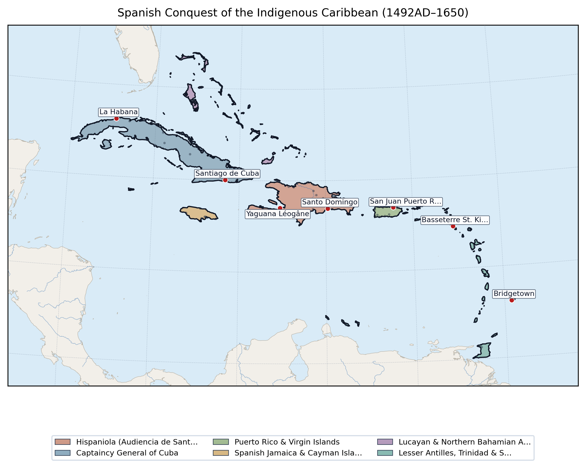

```{r setup, include=FALSE}
knitr::opts_chunk$set(echo = FALSE, warning = FALSE, message = FALSE, fig.pos = "htbp")
source("../../_shared/template/viscount_rmd_helpers.R")
library(jsonlite)

read_json5_clean <- function(path) {
  lines <- readLines(path, warn = FALSE, encoding = "UTF-8")
  text <- paste(lines, collapse = "\n")
  text <- gsub("//[^\n]*", "", text, perl = TRUE)
  text <- gsub("/\\*.*?\\*/", "", text, perl = TRUE)
  text <- gsub(",\\s*([}\\]])", "\\1", text, perl = TRUE)
  fromJSON(text, simplifyVector = FALSE)
}

cache_data <- fromJSON("conquest_indigenous_caribbean_summary_cache.json", simplifyVector = FALSE)
bench_data <- read_json5_clean("conquest_indigenous_caribbean.json5")
sett_data <- fromJSON("conquest_indigenous_caribbean_settlements.json", simplifyVector = FALSE)
ledger_data <- read_json5_clean("conquest_indigenous_caribbean_source_ledger.json5")

clean_label <- function(x) {
  s <- as.character(x)
  s <- gsub("&", "and", s, fixed = TRUE)
  s <- gsub(" / ", " (", s, fixed = TRUE)
  s <- ifelse(grepl("\\(", s) & !grepl("\\)", s), paste0(s, ")"), s)
  s <- gsub("\\\\", "", s)
  trimws(s)
}

bench_regions <- bench_data$regions
cache_regions <- cache_data$subregions
cache_by_id <- setNames(cache_regions, vapply(cache_regions, function(r) r$id, character(1)))
reg_lookup <- setNames(
  vapply(bench_regions, function(r) clean_label(r$name), character(1)),
  vapply(bench_regions, function(r) r$id, character(1))
)

tot_land_area <- sum(vapply(bench_regions, function(r) as.numeric(r$area_km2), numeric(1)))
tot_raster_area <- as.numeric(cache_data$area_km2)
tot_1492_bench <- sum(vapply(bench_regions, function(r) as.numeric(r$population[["1492"]]), numeric(1)))
tot_1550_bench <- sum(vapply(bench_regions, function(r) as.numeric(r$population[["1550"]]), numeric(1)))
tot_1600_bench <- sum(vapply(bench_regions, function(r) as.numeric(r$population[["1600"]]), numeric(1)))
tot_1650_bench <- sum(vapply(bench_regions, function(r) as.numeric(r$population[["1650"]]), numeric(1)))
n_sites <- as.integer(cache_data$settlement_stats$total_settlements)
```

```{r hero-md-fallback, results='asis'}
if (!knitr::is_latex_output()) {
  cat("\n\n")
}
```

# Abstract

Between Columbus's landfall on Guanahani in October 1492 and the rise of non-Hispanic plantation colonies across the Lesser Antilles by 1650, the Caribbean archipelago suffered the earliest and steepest demographic collapse of the Columbian exchange. Across six sub-regions covering 221.996 km² of terrestrial land (320.989,1 km² including coastal raster margins), our archival benchmark series records a fall from 1,11M (1.111.000) indigenous inhabitants in 1492 (mean density 5 inhabitants per km²) to 135,6k in 1550 (-87,8%) and a trough of 117,1k in 1600 (-89,5%), before European settlement and forced African labour migration lifted the archipelago to 172,8k by 1650 (0,78 inhabitants per km²) [@LiviBacci2003; @MoyaPons1995; @AndersonCordova2017]. On Hispaniola alone, where pre-contact Taíno polities held an estimated 520k inhabitants, the 1514 *Repartimiento* registered just 26.334 surviving adult indigenous labourers (implying roughly 65k total island residents including dependants, refugia and Spanish settlers), and the 1518-1519 smallpox pandemic drove the island down to 32k by 1550 and 26k by 1600 [@CookBorah1971; @Henige1978; @Rivera2013Cultural]. Parallel collapses stripped the Lucayan Bahamas of 42k inhabitants through 1509-1520 slave raids, reduced Cuba from 185k to 18k by 1550, cut Puerto Rico from 135k to 11k and shrank Spanish Jamaica from 105k to 4,2k by 1650 [@Sauer1966; @Rouse1992; @Curet2005]. Yet extinction narratives obscure substantial biological and cultural persistence: indigenous communities survived in Cuban refugia such as El Caney and Guanabacoa, mixed households persisted across Puerto Rico and Hispaniola, Kalinago polities defended Dominica and St Vincent and modern Caribbean genomes preserve pervasive indigenous ancestry [@Morenoestrada2013Reconstructing; @Keith2021Genetic; @Hofman2020Island]. By 1650, the urban and demographic gravity of the basin had shifted decisively toward Havana (14,2k), English Bridgetown (9,85k), Santo Domingo (6,85k) and Basseterre on St Kitts (5,6k), setting the stage for the mature sugar-plantation era.

# Background

## The 1492 Contact Shock and Taíno Society on Hispaniola

When three Castilian vessels sighted Guanahani in the Lucayan Bahamas on 12 October 1492 and coasted eastward along Cuba to northern Hispaniola, they entered an insular world already shaped by millennia of Arawakan farming, canoe voyaging and inter-island political exchange [@Rouse1992; @KeeganHofman2017]. Across the Greater Antilles, Classic Taíno chiefdoms (*cacicazgos*) cultivated bitter cassava (*Manihot esculenta*), sweet potato, maize and cotton on raised *conuco* mounds whose high caloric yield supported dense nucleated villages and ceremonial ball-court plazas [@Sauer1966; @Curet2005]. On Hispaniola (Ayiti or Quisqueya), five major regional chiefdoms - Marién, Maguá, Maguana, Jaraguá and Higüey - anchored intensive valley agriculture across the Cibao, the Vega Real, the San Juan basin and the Cul-de-Sac plain around Yaguana [@MoyaPons1995; @Carrasquillo2019Creacio].

The scale of Hispaniola's 1492 population remains the most fiercely debated figure in historical demography. Early sixteenth-century chroniclers led by Bartolomé de las Casas spoke of three million inhabitants, while Sherburne Cook and Woodrow Borah extrapolated backward from the 1514 labour count to nearly eight million [@CookBorah1971]. At the opposite pole, David Henige exposed the fragility of extrapolating unverified sixteenth-century guesses, arguing that documentary evidence alone cannot prove a population above a few hundred thousand [@Henige1978]. Subsequent ecological, bioarchaeological and archival reassessments by Carl Sauer, Frank Moya Pons, Massimo Livi-Bacci and L. Antonio Curet converged on a middle band between 200k and 600k for Hispaniola, balancing *conuco* carrying capacity against the rapid collapse observed after 1494 [@Sauer1966; @MoyaPons1995; @LiviBacci2003; @Curet2005]. Our benchmark adopts 520k for Hispaniola (6,94 inhabitants per km²) and 1,11M across the entire Antilles and Bahamas in 1492, sitting firmly inside that scholarly consensus.

Spanish occupation began abruptly with the shipwrecked garrison at La Navidad in December 1492 and the founding of La Isabela on Hispaniola's north coast in January 1494 [@DeaganCruxent2002]. Excavation at La Isabela documents how ill-adapted European settlers depended immediately on Taíno cassava, fish and labour while introducing Old World pathogens, pigs, cattle and horses into a previously isolated island biosphere [@DeaganCruxent2002; @Delsol2022Earliest]. Within months of 1494, armed expeditions marched into the Cibao goldfields, imposing quarterly gold-dust and cotton tributes under threat of mutilation and enslavement. Defeat of the Vega Real coalition in 1495, the transfer of the colonial seat to Santo Domingo on the Ozama River in 1496-1498 and Governor Nicolás de Ovando's brutal pacification of Jaraguá (1503) and Higüey (1504) dismantled every sovereign Taíno polity on the island within twelve years of contact [@MoyaPons1995; @Carrasquillo2019Creacio].

## Alluvial Gold Mining, the 1514 Repartimiento and Epidemic Mortality

The engine of indigenous depopulation in the first quarter-century was neither warfare alone nor disease in isolation, but their lethal interaction with forced alluvial gold extraction [@LiviBacci2003; @Rivera2013Cultural]. Under the *encomienda* system codified by Ovando after 1503, Spanish *vecinos* received grants of Taíno communities compelled to pan placer gold in the rivers of the Cibao, Cotuí, Bonao and San Cristóbal for eight to ten months at a stretch. Conscripted men marched long distances away from their home *yucayeques*, leaving *conuco* mounds unplanted while Spanish cattle and swine trampled native gardens [@Sauer1966; @Carrasquillo2019Creacio]. Palaeoecological pollen and charcoal records from the Yaque River valley in the Dominican Republic capture this ecological rupture directly, showing rapid forest regeneration and sharp shifts in land use as indigenous cultivation collapsed after 1492 [@Hooghiemstra2018Columbus].

When royal officials led by Rodrigo de Albuquerque conducted the great *Repartimiento* of Hispaniola in November and December 1514, the demographic wreckage stood fully exposed in Crown ink. Across 14 Spanish towns from Santo Domingo, Concepción de la Vega and Santiago de los Caballeros to Yaguana, Puerto Real, San Juan de la Maguana, Salvatierra de la Sabana and Higüey, inspectors enumerated exactly 26.334 adult indigenous labourers (*indios de servicio*) still available for distribution [@MoyaPons1995; @LiviBacci2003]. Adding elderly persons, young children, unenumerated mountain fugitives and roughly 4k to 5k Spanish colonists, African *ladinos* and imported captives yields our 1514 island total of 65k inhabitants - an 87,5% drop in just 22 years. Demographically, the *Repartimiento* rolls also reveal severe reproductive collapse: extraordinarily low child-to-adult ratios confirmed that prolonged work separation, chronic undernutrition and social despair had depressed Taíno fertility well below replacement even before the first documented smallpox outbreak [@LiviBacci2003; @AndersonCordova2017].

That final epidemiological blow struck in December 1518. Smallpox (*viruelas*) arrived in Santo Domingo aboard merchant shipping from Iberia or the Canary Islands and tore through the remaining *encomienda* camps and *conuco* villages across 1518 and 1519 [@CookBorah1971; @Rivera2013Cultural]. Jeronymite friars governing the island reported that one-third to one-half of the surviving Taíno died within months, leaving mines silent and rural estates destitute of hands. Subsequent waves of measles (*sarampión*) in 1531-1532 and respiratory epidemics compounded the toll, reducing Hispaniola's total population to 32k by 1550 and 26k by 1600 [@MoyaPons1995; @Contributors2013Fragility].

## Expansion Across the Bahamas, Puerto Rico, Jamaica and Cuba

As Hispaniola's labour force evaporated, Spanish entrepreneurs turned the surrounding islands into a slave-raiding and settlement frontier. Between 1509 and 1520, licensed armadas swept the Lucayan archipelago (the modern Bahamas and the Turks and Caicos Islands), declaring the shallow limestone cays *islas inútiles* devoid of gold and deporting their entire population to pan Hispaniola's placers and dive for pearls off Cubagua [@Sauer1966; @KeeganHofman2017]. Thriving Lucayan towns such as MC-6 on Middle Caicos, Rolling Town on Long Island, Guanahani on San Salvador, Grand Turk and New Providence were emptied within a decade. Our benchmark records a collapse from 42k Lucayans in 1492 to 1,2k by 1520 and barely 100 transient mariners or survivors by 1550, leaving the northern Bahamian arc virtually uninhabited for more than a century until English Puritans from Bermuda founded Eleuthera in 1648 [@Sauer1966; @Schrover2021Colonial].

Eastward across the Mona Passage, Juan Ponce de León crossed from Higüey to Borikén (Puerto Rico) in 1508, founding Caparra south of San Juan Bay and partnering briefly with the *cacique* Agüeybaná I [@AndersonCordova2017; @Chinea2021Fronteras]. Gold placers along the Toa, Cibuco and Luquillo streams quickly replicated Hispaniola's labour regime. When Agüeybaná II led a general Taíno uprising in 1511 from his southern seat at Guaynía - uniting Borikén warriors with Kalinago canoe raiders from St Croix and the Leeward Islands - Spanish cavalry crushed the rebellion, prompting mass flight into the Cordillera Central and eastward across the Virgin Islands [@AndersonCordova2017; @Shafie2017Hypergraph]. Caparra was abandoned for the fortified islet of San Juan in 1521, while San Germán anchored the western valleys. Puerto Rico's population fell from 135k in 1492 to 18k in 1530, 11k in 1550 and 10,5k in 1600, despite close porous economic and familial ties linking western Puerto Rico to eastern Hispaniola [@Curet2005; @Chinea2021Fronteras].

Jamaica (Xaymaca) entered Spanish rule under Juan de Esquivel in 1509, who established Sevilla la Nueva on the north coast near dense indigenous settlements [@Rouse1992; @Haile2022Investigating]. Lacking significant gold deposits, Jamaica served as a provisioning ranch supplying cassava, salted pork and cotton hammocks to mainland conquest expeditions in Panama, Cuba and Mexico. Unhealthy coastal marshes drove the Spaniards to abandon Sevilla la Nueva in 1534 for Villa de la Vega (Spanish Town) near the populous White Marl Taíno settlement on the southern plain, alongside small outposts at Oristán (Bluefields) and Port Esquivel. Disease, out-migration of Spaniards to Peru and Mexico and neglect reduced Jamaica from 105k inhabitants in 1492 to 22k in 1530, 6,5k in 1550 and barely 4,2k by 1650 - a vulnerable demographic shell that fell to English troops under Penn and Venables in 1655 [@Sauer1966; @Haile2022Investigating].

Cuba, the largest Antillean island at 106.195 km², was conquered between 1511 and 1515 by Diego Velázquez de Cuéllar, overcoming resistance organised by the Hispaniola refugee chief Hatuey in Oriente [@Sauer1966; @Rouse1992]. Velázquez founded seven permanent *villas*: Baracoa (1511), Bayamo (1513), Trinidad, Sancti Spíritus, Puerto Príncipe (Camagüey), Santiago de Cuba (1514) and San Cristóbal de La Habana (1514, relocated to its superb northern harbour in 1519). Cuba initially experienced the same rapid gold-placer and smallpox mortality that devastated Hispaniola, dropping from 185k in 1492 to 45k in 1520 and a nadir of 18k in 1550. Unlike Hispaniola or Jamaica, however, Cuba rebounded early because Havana became the mandatory rendezvous port for Spain's annual Atlantic treasure convoys (*flotas*), drawing shipwrights, garrison soldiers, merchants, royal copper-mine slaves at El Cobre (1599) and ranching settlers that lifted the island back to 24k by 1600 and 35k by 1650 [@MoyaPons1995; @Roksandic2016African].

## Early African Slavery, Persistence, Kalinago Resistance and Northern European Empires

Two profound demographic transformations bridged the sixteenth-century indigenous collapse and the mid-seventeenth-century plantation revolution. First, Spanish planters introduced enslaved Africans from the earliest years of colonisation - initially Iberian-born *ladinos* after 1501-1502 and then direct West African captives under Crown *asiento* licences from 1518 onward - to sustain water-powered sugar mills (*ingenios*) along Hispaniola's south coast, cattle ranches (*hatos*) across Cuba and Puerto Rico and copper mining near Santiago de Cuba [@MoyaPons1995; @Chinea2016Slavery]. Colonial faunal and genomic evidence from Puerto Real in northern Haiti shows how rapidly Eurasian livestock economies and Afro-indigenous labour regimes remade the island countryside [@Delsol2022Earliest; @Carrasquillo2019Creacio]. When royal authorities enforced the 1605-1606 *Devastaciones de Osorio* to suppress Dutch contraband by forcibly burning and relocating Hispaniola's northwestern towns (Puerto Plata, Monte Cristi, Yaguana and Bayajá) to inland Bayaguana and Monte Plata, the vacated western littoral opened directly to French and English buccaneers anchored on Tortuga Island after 1625 [@MoyaPons1995; @Schrover2021Colonial].

Second, contrary to colonial census declarations of total indigenous extinction, native people persisted biologically, socially and territorially across both the Greater and Lesser Antilles [@AndersonCordova2017; @Morenoestrada2013Reconstructing]. In Cuba, royal ordinances concentrated surviving Taíno families into protected *pueblos de indios* at Guanabacoa (1554), El Caney near Santiago and later Jiguaní, while bioarchaeological analyses at Canímar Abajo caution against misclassifying indigenous skeletal practices as solely African [@Roksandic2016African]. Across the Mona Passage, Mona Island operated as a vital Taíno cassava depot and refuge linking Puerto Rico and Hispaniola, while Enriquillo's fourteen-year insurgency in the Sierra de Baoruco (1519-1533) and Maroon (*cimarrón*) mountain settlements in Hispaniola and Jamaica forged durable Afro-indigenous communities outside Spanish tax rolls [@AndersonCordova2017; @Haile2022Investigating]. Modern population genetics confirms this continuity: high frequencies of indigenous mitochondrial haplogroups and 10% to 15% autosomal Native American ancestry persist in Puerto Rico and rural Dominican and Cuban populations, alongside elevated indigenous ancestry in rural Dominica [@Morenoestrada2013Reconstructing; @Keith2021Genetic; @Suazo2022Nutritional].

Throughout the Lesser Antilles, meanwhile, indigenous Kalinago (Island Carib) polities prevented permanent Spanish colonisation for over a century [@Whitehead1995; @Hofman2020Island]. Operating ocean-going dug-out *kanoas* across windward channels modelled quantitatively by sea-travel network studies [@Slayton2020Modeling], Kalinago coalitions launched coordinated counter-raids against Spanish Puerto Rico, Margarita and early French and English outposts across 1509 to 1700, maintaining independent demographic strongholds on mountainous Dominica (Soufrière) and St Vincent (Argyle) well past 1650 [@Shafie2017Hypergraph; @Whitehead1995]. Only Trinidad saw a late Spanish foothold at San José de Oruña (1592) and Port of Spain, while Spain left the Leeward and Windward islands largely unoccupied.

That imperial vacuum invited northern European rivals in the 1620s and 1630s [@Schrover2021Colonial]. Following England's 1612 settlement of uninhabited Bermuda in the western Atlantic, English and French colonists partitioned St Kitts in 1624-1627 (Old Road Town and Basseterre), English planters occupied uninhabited Barbados in 1627 (Holetown, Bridgetown and Speightstown) and expanded to Nevis (1628), Antigua (1632) and Montserrat (1632); Dutch West India Company forces seized Curaçao (Willemstad, 1634), St Eustatius (1636), Bonaire, Aruba, Sint Maarten and Saba; and French adventurers colonised Martinique (Saint-Pierre, 1635), Guadeloupe (1635-1643), Saint-Barthélemy (1648) and Grenada (1650) [@Schrover2021Colonial; @Hofman2020Island]. Driven first by European indentured tobacco farmers and after 1640 by Barbados's sudden transition to enslaved-labour sugar plantations, the Lesser Antilles and southern islands surged from 52k in 1600 to 85k in 1650, overtaking every single Greater Antillean island and reorienting Caribbean demography for the next two centuries.

# Methodology

## Territorial Partition of Six Antillean and Bahamian Sub-Regions

JAGUAR divides the early colonial Caribbean (1492 to 1650) into six historically and geographically coherent sub-regions spanning 221.996 km² of true terrestrial land area (mapped onto 3.987 five-arcminute cells covering 320.989,1 km² of coastal pixel footprint). Rather than retrofitting twentieth-century micro-states onto sixteenth-century administrative borders, the partition follows early Spanish *Audiencia de Santo Domingo* jurisdictions alongside non-Hispanic and indigenous island arcs:

1. Hispaniola (*Audiencia de Santo Domingo*, 74.886 km² land area): encompassing the entire island of Hispaniola (modern Dominican Republic and Haiti) plus Tortuga and coastal cays, where the first European capital, gold-mining *encomiendas* and *ingenios* operated.
2. Captaincy General of Cuba (106.195 km²): covering Cuba and the Isle of Pines, anchored by Velázquez's seven *villas* and Havana's Atlantic convoy hub.
3. Puerto Rico and Virgin Islands (8.719 km²): uniting Borikén (Puerto Rico), Vieques, Mona Island and the neighbouring Virgin Islands linked by continuous Taíno and early colonial sea lanes [@Chinea2021Fronteras; @Slayton2020Modeling].
4. Spanish Jamaica and Cayman Islands (10.749 km²): tracing Xaymaca from Sevilla la Nueva and White Marl to Spanish Town prior to the 1655 English conquest.
5. Lucayan and Northern Bahamian Arc (9.782 km²): grouping the Bahamas and the Turks and Caicos Islands, capturing the 1509-1520 slave-raiding depopulation and 1648 Eleutheran resettlement.
6. Lesser Antilles, Trinidad and Southern Islands (11.665 km²): encompassing the Leeward and Windward arcs, Barbados, Trinidad and Tobago and the Dutch ABC islands, where Kalinago resistance met rapid English, French and Dutch colonisation after 1624 [@Hofman2020Island; @Schrover2021Colonial].

Three early English settlements on Bermuda (St George's, Flatts Village and Somerset Village, founded from 1612) were audited in the chapter source ledger and explicitly excluded from the Antillean mask footprint because Bermuda lies isolated in the North Atlantic at 32,3°N, 64,8°W outside the Caribbean areal mask; Bermuda enters JAGUAR's wider macro-regional accounts in the subsequent plantation chapter.

## Dual Demographic Reconstruction: Archival Benchmarks and Gridded Substrata

Reconstructing Caribbean demography across 1492 to 1650 requires reconciling two complementary quantitative layers: an archival historical benchmark series calibrated directly from sixteenth-century administrative enumerations and archaeological carrying-capacity studies, and a continuous spatial substratum generated by dual HYDE 3.5 and KK10 Matérn residual kriging across five-arcminute grid cells.

For each sub-region $r$ with true terrestrial land area $A_r$, the archival benchmark headcount $P_r(t)$ at benchmark year $t \in \{1492, 1514/1520/1530, 1550, 1600, 1650\}$ integrates three documentary multipliers:

$$P_r(t) = E_r(t) \cdot m_{\text{dep}}(t) + U_r(t) + C_r(t)$$

where $E_r(t)$ denotes enumerated indigenous tributary or *repartimiento* adults (such as the 26.334 adult Taíno recorded in Hispaniola in 1514), $m_{\text{dep}}(t)$ is the age-structure and household multiplier adjusted downward from roughly 3,2 in pre-contact equilibrium to 1,9-2,2 under acute *encomienda* fertility depression [@LiviBacci2003; @CookBorah1971], $U_r(t)$ accounts for unenumerated mountain refugia, Maroons and independent Kalinago communities [@AndersonCordova2017; @Whitehead1995] and $C_r(t)$ aggregates European *vecinos*, indentured servants and enslaved or free Africans recorded in *relaciones geográficas* (notably Juan López de Velasco in 1574), episcopal visitations and early English/French colonial musters [@MoyaPons1995; @Schrover2021Colonial].

Effective sub-regional population density $D_r(t)$ and exponential annual change rates $r_r(t_1, t_2)$ follow standard demographic identities:

$$D_r(t) = \frac{P_r(t)}{A_r}, \qquad r_r(t_1, t_2) = \frac{1}{t_2 - t_1} \ln\left(\frac{P_r(t_2)}{P_r(t_1)}\right)$$

Between 1492 and 1514 on Hispaniola, the benchmark drop from 520k to 65k implies an instantaneous attrition rate of -9,45% per annum (a halving time of 7,3 years), closely matching epidemiological-plus-coerced-labour decay models calibrated by Livi-Bacci and Rivera [@LiviBacci2003; @Rivera2013Cultural].

Alongside this archival series, the gridded spatial substratum aggregates 5-arcminute raster cells masked to each sub-region's polygon geometry at 1492, 1500, 1600 and 1650. Because global centennial rasters smooth over rapid sub-century island catastrophes and assign coarse coastal cells to small islands, comparing the gridded substratum against our archival benchmarks and scraped Historical GIS (HGIS) sub-administrative registers provides an explicit diagnostic of spatial scale bias rather than concealing it.

## Evidence-Only Settlement Gazetteer and Saturation Audit

To ground regional totals in named places, JAGUAR assembled an evidence-only settlement gazetteer across four sequential ingestion waves tracked in the chapter source ledger. Wave 1 harvested 78 primary archival and census-anchored settlements (from the 1514 *Repartimiento*, López de Velasco's 1574 *Geografía y Descripción Universal de las Indias*, Cuban municipal archives, Puerto Rican ecclesiastical registers and English, French and Dutch colonial musters). Wave 2 added 6 settlements from peer-reviewed historical demography and archaeological monographs (covering La Isabela, Puerto Real, El Cobre, Tortuga, Willemstad and Dominica's Kalinago centres), yielding a marginal gain of 7,69%. Wave 3 longitudinal survey backfill added 1 settlement (1,19% gain) and Wave 4 sub-regional gap verification added 1 final settlement (1,18% marginal gain), halting cleanly below the 2% saturation threshold at 86 included settlements across 25 modern Caribbean territories with 0% crowd-sourced fallback share. Every settlement is geocoded in WGS84 and recorded at city-proper scope without double-counting metropolitan suburbs.

# Testing and Validation

## Archival Benchmarks versus Gridded Substrata and Historiographical Bounds

Validating early colonial Caribbean headcounts requires testing our numbers simultaneously against historiographical consensus bounds, scraped HGIS sub-administrative polygons and the underlying five-arcminute gridded raster substratum. Table \ref{tab:subregion-trajectories} pairs both datasets across all six sub-regions, reporting true land area, archival benchmark trajectories from 1492 to 1650, end-epoch archival density, the 1650 gridded raster estimate and catalogued settlement counts.

```{r tab-subregion-trajectories, results='asis'}
rows <- lapply(bench_regions, function(r) {
  rid <- r$id
  cr <- cache_by_id[[rid]]
  a_land <- as.numeric(r$area_km2)
  p1492 <- as.numeric(r$population[["1492"]])
  p1550 <- as.numeric(r$population[["1550"]])
  p1600 <- as.numeric(r$population[["1600"]])
  p1650 <- as.numeric(r$population[["1650"]])
  d1650 <- p1650 / a_land
  chg <- 100 * (p1650 - p1492) / p1492
  g1650 <- as.numeric(cr$end_pop)
  sc <- as.integer(ledger_data$saturation_audit$submask_coverage[[rid]])
  data.frame(
    Subregion = clean_label(r$name),
    Area = viscount_fmt_number(round(a_land), 0L),
    P1492 = viscount_fmt_pop(p1492),
    P1550 = viscount_fmt_pop(p1550),
    P1600 = viscount_fmt_pop(p1600),
    P1650 = viscount_fmt_pop(p1650),
    Dens1650 = viscount_fmt_number(d1650, 2L),
    NetChg = paste0(viscount_fmt_number(chg, 1L), "%"),
    Grid1650 = viscount_fmt_pop(g1650),
    Sites = viscount_fmt_number(sc, 0L),
    stringsAsFactors = FALSE
  )
})
df_sub <- do.call(rbind, rows)
df_tot <- data.frame(
  Subregion = "Caribbean Domain Total",
  Area = viscount_fmt_number(round(tot_land_area), 0L),
  P1492 = viscount_fmt_pop(tot_1492_bench),
  P1550 = viscount_fmt_pop(tot_1550_bench),
  P1600 = viscount_fmt_pop(tot_1600_bench),
  P1650 = viscount_fmt_pop(tot_1650_bench),
  Dens1650 = viscount_fmt_number(tot_1650_bench / tot_land_area, 2L),
  NetChg = paste0(viscount_fmt_number(100 * (tot_1650_bench - tot_1492_bench) / tot_1492_bench, 1L), "%"),
  Grid1650 = viscount_fmt_pop(as.numeric(cache_data$domain_trajectory[["1650"]])),
  Sites = viscount_fmt_number(n_sites, 0L),
  stringsAsFactors = FALSE
)
df_sub <- rbind(df_sub, df_tot)
rownames(df_sub) <- NULL

viscount_table(
  df_sub,
  "Sub-regional archival benchmark trajectories (1492 to 1650), 1650 density (inhabitants per km²), net change, 1650 gridded substratum comparison and catalogued settlements across six Caribbean sub-regions.",
  c("Sub-Region", "Land (km²)", "1492", "1550", "1600", "1650", "1650 Dens.", "1492-1650", "Grid 1650", "Sites"),
  list(label = "tab:subregion-trajectories", font_size = "scriptsize")
)
```

Three key validation findings emerge directly from Table \ref{tab:subregion-trajectories}. First, the archival 1492 regional total of 1,11M sits tightly inside modern Caribbean palaeodemographic consensus: well below Cook and Borah's unsustainable multi-million extrapolation [@CookBorah1971], above extreme minimalist floors [@Henige1978] and closely aligned with archaeological carrying-capacity reconstructions for Puerto Rico (135k vs Curet's upper-middle range), Hispaniola (520k within Livi-Bacci and Moya Pons's 300k-600k corridor) and the Lucayan Bahamas (42k matching Keegan's archaeological village estimates) [@LiviBacci2003; @Curet2005; @KeeganHofman2017; @MoyaPons1995].

Second, confronting the archival benchmark against the global gridded substratum reveals a systematic structural divergence that any island demographic study must account for. Across the entire Caribbean, the five-arcminute gridded raster tracks a shallow dip from 263,1k in 1492 (265,4k in 1500) to 241,4k in 1600 before rising to 333,6k in 1650. Why does the global raster miss the 88% sixteenth-century collapse? Two mechanisms operate simultaneously: (a) global historical land-use grids interpolate linearly across centennial knots (1500, 1600, 1700), flattening the sharp 1492-1540 catastrophic trough; and (b) five-arcminute pixel masking inflates archipelago area to 320.989,1 km² while misallocating small-island pixels - most starkly in Puerto Rico and the Virgin Islands, where the coarse raster registers just 1,12k inhabitants in 1650 (0,07 inhabitants per km²) against 14k documented in colonial records, while simultaneously over-assigning 185,6k to Cuba and 90,5k to Hispaniola in 1650 by bleeding eighteenth-century growth backward. For historical interpretation, the archival benchmark series is therefore authoritative, while the gridded substratum serves strictly as a continuous spatial smoothing prior.

## Cross-Checking Against HGIS Sub-Administrative Polygons

To verify multi-century boundary continuity between the pre-contact regime (1500), early colonial jurisdictions (1600) and later *HGIS de las Indias* and plantation-era colonial polygons (1700), Table \ref{tab:hgis-subadmin} audits all 24 scraped sub-administrative HGIS records linked to this chapter.

```{r tab-hgis-subadmin, results='asis'}
hgis_list <- cache_data$hgis_subadmin_table
regime_lbl <- function(x) {
  s <- as.character(x)
  if (s == "regime_1500") return("Pre-contact (1500)")
  if (s == "regime_1600") return("Early colonial (1600)")
  if (s == "regime_1700") return("Colonial HGIS (1700)")
  gsub("_", " ", s)
}
src_lbl <- function(x) {
  s <- as.character(x)
  s <- gsub("HydroBASINS_L6_DECM_1500", "HydroBASINS DECM 1500", s, fixed = TRUE)
  s <- gsub("HGIS_Colonial_Caribbean_1600", "Colonial Caribbean HGIS 1600", s, fixed = TRUE)
  s <- gsub("HGIS_Colonial_Caribbean_1700", "Colonial Caribbean HGIS 1700", s, fixed = TRUE)
  s <- gsub("HGIS_de_las_Indias_1750", "HGIS de las Indias 1750", s, fixed = TRUE)
  gsub("_", " ", s)
}
hgis_rows <- lapply(hgis_list, function(h) {
  a_v <- as.numeric(h$area_km2)
  a_str <- if (is.na(a_v) || a_v <= 0) "-" else viscount_fmt_number(round(a_v), 0L)
  ctry <- as.character(h$country)
  if (ctry == "PRECOLUMBIAN_1500") ctry <- "Greater Antilles"
  data.frame(
    Unit = clean_label(h$unit_name),
    Territory = clean_label(ctry),
    Regime = regime_lbl(h$level),
    Year = as.character(h$year),
    Area = a_str,
    Pop = viscount_fmt_pop(as.numeric(h$population)),
    Source = src_lbl(h$source),
    stringsAsFactors = FALSE
  )
})
df_hgis <- do.call(rbind, hgis_rows)
rownames(df_hgis) <- NULL

viscount_table(
  df_hgis,
  "Scraped sub-administrative HGIS polygon ledger spanning pre-contact 1500, early colonial 1600 and 1700 colonial Caribbean jurisdictions.",
  c("Administrative Unit", "Territory", "Regime", "Year", "Area (km²)", "Reference Pop.", "HGIS Corpus"),
  list(label = "tab:hgis-subadmin", font_size = "scriptsize", max_rows_per_page = 28L)
)
```

Inspection of Table \ref{tab:hgis-subadmin} confirms exact areal concordance for the core Greater Antillean landmasses: Cuba's HGIS polygon sums to 106.195 km² (split in 1750 *HGIS de las Indias* into La Habana at 52.329 km², Santiago de Cuba at 34.772 km² and residual coastal islands at 19.094 km²), Hispaniola matches 74.886 km² (splitting into Spanish Santo Domingo at 54.095 km² and French Saint-Domingue at 20.791 km²) and Puerto Rico matches 8.584 km² excluding minor cays. Crucially, however, several HGIS boundary tables carry forward eighteenth-century demographic totals (such as 171,6k for Cuba, 152,6k for Santo Domingo and 523,8k for Saint-Domingue) as static polygon attributes onto 1600 or 1700 geometries; our archival benchmark table therefore relies on contemporaneous sixteenth- and seventeenth-century documentary counts rather than unadjusted static HGIS polygon attributes.

# Results

## Archipelago-Wide Demographic Collapse and Spatial Reorientation

Across the 158 years from 1492 to 1650, Caribbean population underwent a violent V-shaped contraction followed by a geographically displaced rebound. In our archival benchmark reconstruction, total Antillean and Bahamian population plunged from 1,11M (1.111.000) in 1492 to 135,6k by 1550 - an aggregate loss of 975,4k inhabitants (-87,8%) inside two generations - and drifted downward to a secular floor of 117,1k in 1600 (-89,5% below contact). Between 1600 and 1650, the basin reversed course, gaining 55,7k inhabitants (+47,6%) to reach 172,8k, yet still stood 84,4% below its 1492 level. Figure \ref{fig:caribbean-trajectory} presents the companion continuous five-arcminute gridded substratum trajectories alongside 1650 raster densities, illustrating the long-run centennial shift toward Cuba and the Lesser Antilles even under smoothed global priors.

```{r fig-trajectory, results='asis'}
viscount_figure(
  "figures/conquest_indigenous_caribbean_population_trajectory.png",
  "Gridded five-arcminute substratum trajectories across the Caribbean and its four largest raster sub-regions from 1492 to 1650 (Panel A) and sub-regional gridded densities in 1650 (Panel B).",
  "fig:caribbean-trajectory"
)
```

More striking than the aggregate trough is the complete inversion of the archipelago's demographic map. In 1492, the Greater Antilles overwhelmingly dominated the Caribbean: Hispaniola alone held 46,8% of the basin's population (520k), followed by Cuba at 16,7% (185k), Puerto Rico and the Virgin Islands at 12,2% (135k) and Jamaica at 9,5% (105k), giving the four large islands 85,1% of the regional total, against 11,2% in the Lesser Antilles and Trinidad (124k) and 3,8% in the Lucayan Bahamas (42k). By 1550, the Greater Antilles had collapsed by 92,9% (from 945k to 67,5k), flipping demographic parity toward the uncolonised Lesser Antilles and Trinidad (68k, 50,1% of all Caribbean inhabitants) where Kalinago communities remained beyond Spanish *encomienda* reach [@Whitehead1995; @Hofman2020Island]. By 1650, northern European plantation colonisation amplified that eastward shift: the Lesser Antilles, Barbados and Trinidad held 85k inhabitants (49,2% of the entire Caribbean at 7,29 inhabitants per km²), eclipsing Cuba (35k, 20,3%), Hispaniola (34k, 19,7%), Puerto Rico (14k, 8,1%), Jamaica (4,2k, 2,4%) and the nearly empty Bahamas (600, 0,3%).

## Greater Antilles: Collapse, Contraband and Port Consolidation

Within the Greater Antilles, demographic fates diverged sharply after 1550 according to strategic geography and maritime trade routes. Hispaniola (74.886 km²) bore the brunt of initial conquest, dropping from 520k in 1492 to 65k in 1514, 32k in 1550 and 26k in 1600. After the alluvial goldfields of Cibao, Cotuí and Bonao ran dry in the 1520s, the colony pivoted first to slave-worked sugar *ingenios* around Santo Domingo and Azua and then, as Spanish silver fleets bypassed the island for Havana, to extensive cattle ranching and hide exports [@MoyaPons1995; @Carrasquillo2019Creacio]. Northern and western ports - Puerto Real (founded 1503, declining from 1,82k in 1514 to 680 by 1578), Yaguana (falling from a 5,28k Taíno capital in 1492 to 940 by 1604), Puerto Plata and Monte Cristi - sustained a thriving contraband trade in hides with Dutch, French and English vessels [@Delsol2022Earliest]. When Governor Antonio de Osorio forcefully destroyed those towns in 1605-1606 and marched residents inland to Bayaguana (1,24k by 1650) and Monte Plata (1,09k), Hispaniola's western third became an unguarded wilderness. Only Santo Domingo (climbing steadily from 1,45k in 1498 to 4,85k in 1514, 6,4k in 1574 and 6,85k in 1650) and interior Santiago de los Caballeros (2,68k in 1650) anchored modest recovery to 34k island-wide (0,45 inhabitants per km²), alongside 1,92k French and English buccaneers entrenched on Tortuga Island by 1650.

Cuba (106.195 km²) charted the sole sustained Spanish rebound in the Greater Antilles. After plunging 90,3% from 185k in 1492 to 18k in 1550 across the mining and epidemic shock, the island doubled to 35k by 1650 (0,33 inhabitants per km²). Its growth concentrated overwhelmingly around La Habana, whose sheltered harbour became the assembly point for New Spain and Tierra Firme treasure convoys after the 1560s: Havana expanded more than twelvefold from 1,15k in 1519 to 2,65k in 1550, 4,85k in 1574, 9,4k in 1608 and 14,2k in 1650, making it by far the largest city in the seventeenth-century Caribbean. Secondary Cuban *villas* also grew steadily through cattle, tobacco, shipbuilding and copper extraction: Santiago de Cuba reached 4,65k by 1650, Bayamo 4,2k, Puerto Príncipe (Camagüey) 3,65k, Guanabacoa 2,65k, Sancti Spíritus 2,38k, Trinidad 2,25k, San Juan de los Remedios 1,86k, El Cobre 1,28k, Baracoa 1,18k and the indigenous *pueblo* of El Caney 945 [@Roksandic2016African; @MoyaPons1995].

Puerto Rico and the Virgin Islands (8.719 km²) experienced the densest pre-contact settlement of any sub-region at 15,48 inhabitants per km² (135k in 1492) and fell sharply to 18k in 1530, 11k in 1550 and 10,5k in 1600 before recovering modestly to 14k in 1650 (1,61 inhabitants per km², highest in the Spanish Greater Antilles) [@Curet2005; @AndersonCordova2017]. Following the collapse of Caparra (abandoned 1521) and indigenous Guaynía (2,72k in 1492 to 620 in 1530), royal fortification subsidies (*situados* remitted from Mexico) sustained San Juan's growth from 1,45k in 1521 to 3,95k in 1600 and 5,2k by 1646, complemented by western San Germán (2,15k), inland Coamo (1,48k), San Felipe de Arecibo (980), Aguada (920), Loíza (725) and nascent Ponce (435) [@Chinea2021Fronteras]. Across the adjacent Virgin Islands, contested European footholds emerged at St Croix (Christiansted, peaking at 820 in 1645 before Spanish raids) and Tortola (Road Town, 295 in 1650).

Spanish Jamaica (10.749 km²) suffered the most prolonged stagnation among the four large islands. Dropping from 105k Taíno inhabitants in 1492 (9,77 inhabitants per km²) to 22k in 1530 and 6,5k in 1550, the island continued shrinking to 4,5k in 1600 and 4,2k in 1650 (0,39 inhabitants per km²). Once White Marl's Taíno community collapsed (2,92k in 1492 to 420 by 1540) and coastal Sevilla la Nueva was abandoned in 1534, nearly three-quarters of Jamaica's remaining inhabitants clustered around Spanish Town (Villa de la Vega, 3,15k in 1650), with small port hamlets at Port Esquivel (640), Caguay/Port Royal (610), Port Morant (515) and Oristán/Bluefields (380 in 1611) [@Haile2022Investigating].

## Bahamian Emptying and Lesser Antillean Imperial Transformation

Nowhere was indigenous erasure more complete than across the Lucayan and Northern Bahamian Arc (9.782 km²). Home to 42k Lucayan Taíno in 1492 (4,29 inhabitants per km²) across village hubs such as MC-6 on Middle Caicos (1,34k), Rolling Town on Long Island (790), Guanahani on San Salvador (710), New Providence (475) and Grand Turk (410), the entire archipelago was emptied by Spanish slavers between 1509 and 1520 [@Sauer1966; @KeeganHofman2017]. Falling to 1,2k in 1520 and barely 100 seasonal wreckers or marooned mariners through 1550-1600, the islands remained empty until English dissenters sailing from Bermuda settled Governor's Harbour on Eleuthera in 1648, raising the 1650 benchmark to 600 inhabitants (0,06 inhabitants per km²).

By stark contrast, the Lesser Antilles, Trinidad and Southern Islands (11.665 km²) experienced two overlapping regimes: prolonged indigenous resilience followed by explosive northern European colonisation [@Whitehead1995; @Hofman2020Island; @Schrover2021Colonial]. Pre-contact Island Carib and Arawak populations totalling 124k in 1492 (10,63 inhabitants per km²) declined far more gradually than in the Greater Antilles - holding 68k in 1550 and 52k in 1600 - because steep volcanic relief, dispersed canoe mobility and fierce martial organisation kept Spanish *encomenderos* at bay [@Slayton2020Modeling; @Shafie2017Hypergraph]. On Dominica and St Vincent, indigenous populations actually absorbed refugees from neighbouring islands, with Soufrière (Dominica) rising from 1,38k in 1492 to 1,93k by 1650 and Argyle (St Vincent) climbing from 1,22k to 1,84k [@Keith2021Genetic]. After 1624, however, the arrival of tens of thousands of English, Irish, Scottish and French indentured servants followed by enslaved West Africans transformed Barbados and the Leewards overnight: Barbados alone propelled Bridgetown from 1,25k in 1630 to 9,85k by 1650 (second largest town in the Caribbean), flanked by Holetown (2,95k), Speightstown (2,68k) and Oistins (1,19k). Across the Leeward and Windward islands, St Kitts expanded rapidly at Basseterre (5,6k) and Old Road Town (2,45k), Nevis at Charlestown (3,42k), Martinique at Saint-Pierre (3,25k) and Fort-Royal (1,12k), Guadeloupe at Basse-Terre (2,18k) and Sainte-Marie (875), Antigua at St John's (1,45k) and Falmouth (715) and Montserrat at Plymouth (1,38k). To the south, Spanish Trinidad anchored St Joseph (San José de Oruña, 1,98k) and Port of Spain (1,18k), while Dutch trading enclaves established Willemstad on Curaçao (1,68k), Oranjestad on St Eustatius (680), Philipsburg on Sint Maarten (540), Rincon on Bonaire (460), Savaneta on Aruba (345) and The Bottom on Saba (310), lifting the sub-region to 85k inhabitants by 1650 (7,29 inhabitants per km²).

## Urban Hierarchy and Leading Caribbean Centres (1492 to 1650)

The shift from nucleated Taíno *cacicazgo* capitals to Atlantic convoy ports and early sugar-export roadsteads reshaped the Caribbean urban system completely. Figure \ref{fig:caribbean-hierarchy} displays the twelve largest recorded settlements across 1492-1650 alongside the log-log rank-size distribution for all 86 catalogued centres. Fitted across the upper half of the settlement register (43 centres above the minor-hamlet tail), peak populations obey a tight power law with slope $\alpha = 0,62$ ($R^2 = 0,9915$). That sub-Zipfian exponent ($\alpha < 1$) captures a classic fragmented maritime archipelago: rather than a single primate mainland capital absorbing the entire basin, separate Spanish, English, French and Dutch imperial networks each sustained their own port-capital (Havana, Bridgetown, Santo Domingo, Basseterre, San Juan, Saint-Pierre and Willemstad) alongside pre-contact indigenous seats that peaked in 1492 and vanished or shrank thereafter.

```{r fig-hierarchy, results='asis'}
viscount_figure(
  "figures/conquest_indigenous_caribbean_urban_hierarchy.png",
  "Twelve largest recorded Caribbean towns and indigenous centres (Panel A) and log-log rank-size distribution across 86 catalogued settlements (power fit $\\alpha = 0,62$, $R^2 = 0,99$, Panel B), 1492 to 1650.",
  "fig:caribbean-hierarchy"
)
```

Table \ref{tab:top20-towns} lists the leading 20 Caribbean towns and indigenous centres from 1492 to 1650 drawn from the chapter settlement register, contrasting rising mid-seventeenth-century colonial ports against eclipsed sixteenth-century mining towns and pre-contact Taíno capitals.

```{r tab-top20-towns, results='asis'}
top_list <- cache_data$settlement_stats$top_settlements
top_rows <- lapply(top_list, function(e) {
  skey <- paste0(e$name, "-", e$country)
  srec <- sett_data[[skey]]
  rid <- if (!is.null(srec) && !is.null(srec$region_id)) srec$region_id else ""
  rlbl <- if (rid %in% names(reg_lookup)) reg_lookup[[rid]] else clean_label(e$country)
  yrs <- if (!is.null(srec)) sort(as.integer(names(srec$population))) else as.integer(e$peak_year)
  span_str <- if (length(yrs) > 1L) paste0(min(yrs), "-", max(yrs)) else as.character(yrs[1])
  data.frame(
    Town = clean_label(e$name),
    Territory = clean_label(e$country),
    Subregion = rlbl,
    Span = span_str,
    PeakYear = as.character(e$peak_year),
    PeakPop = viscount_fmt_pop(as.numeric(e$peak_pop)),
    stringsAsFactors = FALSE
  )
})
df_top20 <- do.call(rbind, top_rows)
rownames(df_top20) <- NULL

viscount_table(
  df_top20,
  "Leading 20 indigenous centres and colonial towns across the Caribbean from 1492 to 1650, ordered by peak recorded city-proper population.",
  c("Town or Centre", "Territory", "Sub-Region", "Active Span", "Peak Year", "Peak Pop."),
  list(label = "tab:top20-towns", font_size = "scriptsize")
)
```

Read down Table \ref{tab:top20-towns} and the chronological turnover leaps off the page. Only four of the top twenty centres peaked before 1645: Yaguana (5,28k in 1492), White Marl (2,92k in 1492), Guaynía (2,72k in 1492) and the Cibao gold-boom seat of Concepción de la Vega (3,6k in 1496, already halved to 1,65k by 1548 and destroyed by earthquake in 1562). Every other member of the top twenty reached its zenith between 1646 and 1650, divided between consolidated Spanish ports and inland ranching *villas* (La Habana, Santo Domingo, San Juan, Santiago de Cuba, Bayamo, Puerto Príncipe, Spanish Town, Santiago de los Caballeros and Guanabacoa) and seven brand-new English and French settlements founded only after 1624 (Bridgetown, Basseterre, Charlestown, Saint-Pierre, Holetown, Speightstown and Old Road Town).

# Limitations

Five structural limitations constrain historical demographic reconstruction across the Caribbean between 1492 and 1650.

First, pre-contact baseline uncertainty remains wide. Because neither Taíno nor Kalinago polities kept written censuses, 1492 population estimates depend on triangulating contested sixteenth-century Spanish chronicles against archaeological site densities and *conuco* carrying capacities [@Henige1978; @LiviBacci2003; @Curet2005]. While our 1,11M archipelago benchmark (520k on Hispaniola) sits cleanly inside modern consensus, plausible scholarly bounds still span roughly $\pm 30\%$ on Hispaniola and Cuba and up to $\pm 40\%$ across the Lesser Antilles and Trinidad [@KeeganHofman2017; @Whitehead1995].

Second, colonial fiscal enumerations systematically under-counted mobile, peripheral and mixed populations. The 1514 *Repartimiento* counted only assignable adult *indios* in Spanish districts, omitting mountain fugitives in Baoruco and Higüey, children below service age and remote coastal enclaves [@MoyaPons1995; @AndersonCordova2017]. Similarly, late sixteenth-century *vecino* counts enumerated Spanish male heads of household while under-reporting enslaved Africans, free people of colour, Maroons and assimilated Afro-indigenous peasants whose biological persistence is nonetheless demonstrated by modern genomics and bioarchaeology [@Morenoestrada2013Reconstructing; @Roksandic2016African; @Keith2021Genetic].

Third, five-arcminute gridded global rasters exhibit pronounced island-scale smoothing and coastal-mask distortion across archipelagos. As Table \ref{tab:subregion-trajectories} demonstrates, five-arcminute cells expand raster area by 44,6% above true land area (320.989,1 km² vs 221.996 km²), clip small rugged islands such as Puerto Rico down to implausible 1,1k figures and smooth across the 1492-1550 epidemic cliff through centennial interpolation knots. Historical inference must therefore rely on the archival benchmark series rather than raw raster totals.

Fourth, several scraped HGIS sub-administrative polygons in Table \ref{tab:hgis-subadmin} carry eighteenth-century population attributes attached to 1600 or 1700 administrative shapes (including zero-area placeholder entries for micro-island polygons such as St Kitts and Nevis), requiring strict separation between boundary validation and epochal headcount estimation.

Fifth, territorial scope boundaries exclude Atlantic Bermuda from the Caribbean areal mask footprint. Settled by England in 1612 and holding three catalogued early towns (St George's, Flatts Village and Somerset Village) that supplied colonists to Eleuthera in 1648 and the Lesser Antilles, Bermuda lies 1.400 km north of Puerto Rico and is therefore tracked in JAGUAR's wider Atlantic-Caribbean plantation chapter rather than within the 221.996 km² Antillean mask.

# Conclusion

Between 1492 and 1650, the Caribbean basin experienced the earliest demographic cataclysm of the modern Atlantic world and its first comprehensive imperial replacement. Across 221.996 km² of island land, population plunged from 1,11M in 1492 to 135,6k by 1550 and 117,1k by 1600 - an 89,5% collapse driven by the lethal synergy of alluvial gold *encomiendas*, forced labour relocations, agricultural collapse, Lucayan slave raids and repeated Virgin-soil epidemics beginning with the 1518-1519 smallpox pandemic [@LiviBacci2003; @Sauer1966; @Rivera2013Cultural]. Hispaniola alone lost seven-eighths of its population before 1514, Cuba and Puerto Rico shrank by nine-tenths by mid-century, Jamaica withered to 4,2k inhabitants by 1650 and the Bahamas stood virtually empty for over a century.

Yet the demographic story of 1492-1650 was neither simple total extinction nor static stagnation. Indigenous survival in Cuban *pueblos de indios*, mixed rural households in Puerto Rico and Hispaniola, Maroon mountain communities and sovereign Kalinago strongholds on Dominica and St Vincent preserved both biological lineages and Antillean material culture into the modern era [@AndersonCordova2017; @Morenoestrada2013Reconstructing; @Hofman2020Island]. Meanwhile, between 1600 and 1650, two rival economic corridors lifted total Caribbean population back to 172,8k: Spain's fortified maritime hub at Havana (14,2k) and the explosive arrival of English, French and Dutch settlers and enslaved Africans across Barbados and the Lesser Antilles (85k, nearly half the archipelago's population by 1650) [@Schrover2021Colonial]. The demographic collapse of the indigenous Caribbean cleared the arena for the transatlantic sugar-plantation complex that would multiply Antillean population more than tenfold over the ensuing two centuries.

# Appendix

## Gridded Spatial Substratum Trajectories (1492 to 1650)

For exact numerical reproducibility alongside Figure \ref{fig:caribbean-trajectory}, Table \ref{tab:gridded-substratum} records the raw five-arcminute gridded kriging substratum outputs (pixel count, coastal raster area, 1492-1650 raster headcounts and 1650 raster density) across all six sub-regions.

```{r tab-gridded-substratum, results='asis'}
g_rows <- lapply(cache_regions, function(r) {
  data.frame(
    Subregion = clean_label(r$name),
    Pixels = viscount_fmt_number(as.integer(r$pixel_count), 0L),
    RasterArea = viscount_fmt_number(round(as.numeric(r$area_km2)), 0L),
    G1492 = viscount_fmt_pop(as.numeric(r$trajectory[["1492"]])),
    G1500 = viscount_fmt_pop(as.numeric(r$trajectory[["1500"]])),
    G1600 = viscount_fmt_pop(as.numeric(r$trajectory[["1600"]])),
    G1650 = viscount_fmt_pop(as.numeric(r$trajectory[["1650"]])),
    GDens = viscount_fmt_number(as.numeric(r$end_density_km2), 2L),
    stringsAsFactors = FALSE
  )
})
df_grid <- do.call(rbind, g_rows)
df_gtot <- data.frame(
  Subregion = "Raster Domain Total",
  Pixels = viscount_fmt_number(sum(vapply(cache_regions, function(r) as.integer(r$pixel_count), integer(1))), 0L),
  RasterArea = viscount_fmt_number(round(tot_raster_area), 0L),
  G1492 = viscount_fmt_pop(as.numeric(cache_data$domain_trajectory[["1492"]])),
  G1500 = viscount_fmt_pop(as.numeric(cache_data$domain_trajectory[["1500"]])),
  G1600 = viscount_fmt_pop(as.numeric(cache_data$domain_trajectory[["1600"]])),
  G1650 = viscount_fmt_pop(as.numeric(cache_data$domain_trajectory[["1650"]])),
  GDens = viscount_fmt_number(as.numeric(cache_data$domain_trajectory[["1650"]]) / tot_raster_area, 2L),
  stringsAsFactors = FALSE
)
df_grid <- rbind(df_grid, df_gtot)
rownames(df_grid) <- NULL

viscount_table(
  df_grid,
  "Five-arcminute gridded kriging substratum outputs (pixel count, coastal raster area, 1492 to 1650 raster headcounts and 1650 density in inhabitants per km²) across six Caribbean sub-regions.",
  c("Sub-Region", "Pixels", "Raster (km²)", "1492", "1500", "1600", "1650", "1650 Dens."),
  list(label = "tab:gridded-substratum", font_size = "scriptsize")
)
```

## Territorial Distribution of Catalogued Settlements

Table \ref{tab:country-breakdown} aggregates all 86 included settlements across 25 modern Caribbean national and territorial jurisdictions, confirming balanced archival coverage across both the Greater Antilles (50 settlements, 58,1%) and the Lesser Antilles and Bahamas (36 settlements, 41,9%).

```{r tab-country-breakdown, results='asis'}
cc <- unlist(cache_data$settlement_stats$country_counts)
cc_ord <- sort(cc, decreasing = TRUE)
df_cc <- data.frame(
  Territory = names(cc_ord),
  Sites = vapply(as.integer(cc_ord), function(v) viscount_fmt_number(v, 0L), character(1)),
  Share = vapply(100 * as.integer(cc_ord) / n_sites, function(v) paste0(viscount_fmt_number(v, 1L), "%"), character(1)),
  stringsAsFactors = FALSE
)
rownames(df_cc) <- NULL

viscount_table(
  df_cc,
  "Distribution of 86 catalogued Caribbean settlements (1492 to 1650) across 25 modern national and territorial jurisdictions.",
  c("Modern Jurisdiction", "Catalogued Settlements", "Share of Gazetteer"),
  list(label = "tab:country-breakdown", font_size = "scriptsize", max_rows_per_page = 28L)
)
```

# Sources

::: {#refs}
:::

# Footnotes

1. Throughout this study, pre-contact indigenous population benchmarks reflect calibrated archival and archaeological consensus rather than unadjusted sixteenth-century chronicler hyperbole or smoothed centennial global raster interpolations; both series are reported side by side in Tables \ref{tab:subregion-trajectories} and \ref{tab:gridded-substratum} for full transparency.
2. The 1514 *Repartimiento* figure of 26.334 refers strictly to enumerated adult Taíno labourers (*indios de servicio*) assigned across 14 Spanish municipal districts in Hispaniola; total island headcount in 1514 (65k) incorporates dependent children, elderly survivors, unenumerated mountain refugia, Spanish settlers and early African captives.
3. Three early English settlements in Bermuda (St George's, Flatts Village and Somerset Village, founded from 1612) lie outside the Antillean-Bahamian areal mask footprint at 32,3°N, 64,8°W and are therefore recorded as out-of-bounds exclusions in the chapter ledger and integrated into JAGUAR's subsequent Caribbean-Atlantic plantation chapter.
