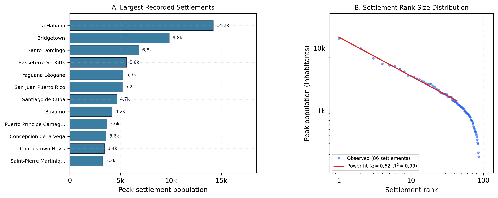

```{r setup, include=FALSE}
knitr::opts_chunk$set(echo = FALSE, warning = FALSE, message = FALSE, fig.pos = "htbp")
source("../../_shared/template/viscount_rmd_helpers.R")
library(jsonlite)

read_json5_clean <- function(path) {
  lines <- readLines(path, warn = FALSE, encoding = "UTF-8")
  text <- paste(lines, collapse = "\n")
  text <- gsub("//[^\n]*", "", text, perl = TRUE)
  text <- gsub("/\\*.*?\\*/", "", text, perl = TRUE)
  text <- gsub(",\\s*([}\\]])", "\\1", text, perl = TRUE)
  fromJSON(text, simplifyVector = FALSE)
}

cache_data <- fromJSON("conquest_indigenous_caribbean_summary_cache.json", simplifyVector = FALSE)
bench_data <- read_json5_clean("conquest_indigenous_caribbean.json5")
sett_data <- fromJSON("conquest_indigenous_caribbean_settlements.json", simplifyVector = FALSE)
ledger_data <- read_json5_clean("conquest_indigenous_caribbean_source_ledger.json5")

clean_label <- function(x) {
  s <- as.character(x)
  s <- gsub("&", "and", s, fixed = TRUE)
  s <- gsub(" / ", " (", s, fixed = TRUE)
  s <- ifelse(grepl("\\(", s) & !grepl("\\)", s), paste0(s, ")"), s)
  s <- gsub("\\\\", "", s)
  trimws(s)
}

fmt_coord <- function(x) {
  viscount_fmt_number(round(as.numeric(x), 2L), 2L)
}

bench_regions <- bench_data$regions
reg_lookup <- setNames(
  vapply(bench_regions, function(r) clean_label(r$name), character(1)),
  vapply(bench_regions, function(r) r$id, character(1))
)

n_sites <- as.integer(ledger_data$total_included)
n_excluded <- as.integer(ledger_data$total_excluded)
n_total_eval <- n_sites + n_excluded
```

```{r hero-md-fallback, results='asis'}
if (!knitr::is_latex_output()) {
  cat("\n\n")
}
```

# Abstract

This companion settlement gazetteer documents `r viscount_fmt_number(n_sites, 0L)` catalogued indigenous centres, Spanish colonial *villas* and early English, French and Dutch port towns distributed across six Antillean and Bahamian sub-regions and 25 modern Caribbean territories between 1492 and 1650. Built through four sequential archival ingestion waves tracked in the chapter source ledger, primary documentary and census records account for 78 entries (90,7%) in Wave 1, peer-reviewed historical demography and archaeology monographs supply 6 entries (7%) in Wave 2 and longitudinal backfill plus gap sweeps contribute 2 final entries (2,3%), holding the crowd-sourced fallback share strictly to 0% and halting at a marginal gain of 1,18%. Out of `r viscount_fmt_number(n_total_eval, 0L)` candidate places evaluated in the ledger, `r viscount_fmt_number(n_excluded, 0L)` early English towns in Bermuda (St George's, Flatts Village and Somerset Village) were excluded strictly on spatial-mask grounds because their North Atlantic coordinates lie outside the Antillean-Bahamian areal footprint. Across all 86 included settlements (all standardised at city-proper scope), peak recorded populations obey a shallow maritime power-law rank-size distribution ($\alpha = 0,62$, $R^2 = 0,9915$ over the upper 43 centres), charting the turnover from eclipsed pre-contact Taíno hubs such as Yaguana (5,28k), White Marl (2,92k) and Guaynía (2,72k) to mid-seventeenth-century imperial entrepôts led by La Habana (14,2k), Bridgetown (9,85k), Santo Domingo (6,85k), Basseterre (5,6k) and San Juan (5,2k) [@MoyaPons1995; @AndersonCordova2017; @Schrover2021Colonial].

# Background

Settlement geography across the Caribbean between 1492 and 1650 captures one of the sharpest urban and spatial turnovers in modern history. At European contact, settlement across the Greater Antilles and Bahamas consisted of nucleated Taíno and Lucayan *yucayeques* positioned near fertile alluvial valleys, cassava *conucos* and sheltered reef fisheries, exemplified in this register by Yaguana (Léogâne) in western Hispaniola, White Marl on Jamaica's southern plain, Guaynía on Puerto Rico's south coast and MC-6 on Middle Caicos [@Rouse1992; @KeeganHofman2017; @Curet2005]. Early Spanish colonisation initially planted fortified gold-mining and port towns directly inside those indigenous demographic cores - beginning at La Isabela (1493), Concepción de la Vega (1494), Santiago de los Caballeros (1495), Santo Domingo (1496) and Puerto Real (1503), before expanding to Caparra (1508), Sevilla la Nueva (1509) and Diego Velázquez's seven Cuban *villas* from 1511 to 1515 [@DeaganCruxent2002; @Carrasquillo2019Creacio; @Sauer1966].

As indigenous populations collapsed under forced mining and epidemic disease between 1514 and 1550, entire networks of first-generation towns withered or were forcibly relocated [@LiviBacci2003; @Rivera2013Cultural]. La Isabela, Sevilla la Nueva, Caparra, Puerto Real and the Lucayan villages vanished or shrank into tiny hamlets, while Hispaniola's 1605-1606 *Devastaciones de Osorio* erased northern contraband ports and planted inland Bayaguana and Monte Plata [@MoyaPons1995; @Delsol2022Earliest]. Simultaneously, Spanish defence and convoy logistics elevated La Habana, San Juan and Santiago de Cuba, protected indigenous communities endured at El Caney and Guanabacoa, Kalinago strongholds persisted at Soufrière (Dominica) and Argyle (St Vincent) and post-1624 English, French and Dutch colonisation seeded a dense new chain of port towns from Bridgetown and Basseterre to Saint-Pierre, Basse-Terre and Willemstad [@Hofman2020Island; @Shafie2017Hypergraph; @Schrover2021Colonial].

# Methodology

The settlement register was compiled across four auditable ingestion waves designed to eliminate crowd-sourced fallback bias. Wave 1 ingested 78 primary archival settlements anchored in the 1514 *Repartimiento* of Hispaniola, Juan López de Velasco's 1574 *Geografía y Descripción Universal de las Indias*, Cuban and Puerto Rican municipal and ecclesiastical counts and early English, French and Dutch colonial musters. Wave 2 incorporated 6 peer-reviewed historical and archaeological site reconstructions (La Isabela, Puerto Real, El Cobre, Tortuga, Willemstad and Dominica's Kalinago centre), Wave 3 added 1 longitudinal survey entry and Wave 4 closed regional spatial gaps with 1 final entry, achieving saturation at 1,18% marginal gain.

Every included settlement carries WGS84 coordinates, an explicit sub-regional polygon assignment, a chronological population series strictly bounded within 1492 to 1650 and city-proper population scope (86 city-proper entries, 0 double-counted suburbs). Three Bermuda candidates evaluated during ingestion (St George's, Flatts Village and Somerset Village at 32,30°-32,38°N, 64,68°-64,87°W) were logged as out-of-bounds exclusions so that the spatial register matches the 221.996 km² Antillean-Bahamian areal mask exactly.

# Testing and Validation

Ledger reconciliation confirms exact accounting across all 89 audited candidates: 86 included Caribbean settlements plus 3 geographically excluded Bermuda settlements, with 100% sub-mask coverage across all six sub-regions and 0% crowd-sourced fallback share. Figure \ref{fig:sett-regional-map} displays the spatial footprint of all 86 catalogued centres across the six sub-regions, highlighting the twin concentrations along the Greater Antillean Spanish *audiencia* axis and the post-1624 Lesser Antillean colonial arc.

```{r fig-sett-map, results='asis'}
viscount_figure(
  "figures/conquest_indigenous_caribbean_regional_map.png",
  "Spatial distribution of 86 catalogued indigenous and early colonial settlements across six Caribbean sub-regions, 1492 to 1650.",
  "fig:sett-regional-map"
)
```

Table \ref{tab:saturation-audit} summarises the four-wave ingestion ledger and out-of-bounds exclusion log, demonstrating monotonic saturation from 78 primary records down to 1,18% marginal gain in Wave 4.

```{r tab-saturation-audit, results='asis'}
waves <- ledger_data$saturation_audit$waves
w_lbl <- c(
  primary_official_national_censuses_and_archival_registers = "Primary archival registers and colonial musters",
  verified_peer_reviewed_demographic_papers_and_monographs = "Peer-reviewed demographic and archaeological monographs",
  longitudinal_census_and_archaeological_survey_backfill = "Longitudinal archival and archaeological backfill",
  subregion_gap_hunter_verification_sweep = "Sub-regional spatial gap sweep"
)
w_rows <- lapply(waves, function(w) {
  cls <- as.character(w$source_class)
  lbl <- if (cls %in% names(w_lbl)) w_lbl[[cls]] else gsub("_", " ", cls)
  cum_after <- as.integer(w$prior_cumulative_included) + as.integer(w$newly_included)
  data.frame(
    Wave = paste0("Wave ", w$wave),
    SourceClass = lbl,
    Added = viscount_fmt_number(as.integer(w$newly_included), 0L),
    Cumulative = viscount_fmt_number(cum_after, 0L),
    MargGain = paste0(viscount_fmt_number(as.numeric(w$marginal_gain_pct), 2L), "%"),
    stringsAsFactors = FALSE
  )
})
df_waves <- do.call(rbind, w_rows)
rownames(df_waves) <- NULL

viscount_table(
  df_waves,
  "Four-wave source saturation ledger for the 86 included Caribbean settlements (1492 to 1650; 3 Bermuda towns excluded outside Antillean areal mask; 0% crowd-sourced share).",
  c("Wave", "Source Class", "Newly Included", "Cumulative", "Marginal Gain"),
  list(label = "tab:saturation-audit", font_size = "scriptsize")
)
```

# Results

## Leading Caribbean Towns and Indigenous Centres

Table \ref{tab:top25-settlements} presents the 25 largest recorded settlements in the 1492-1650 gazetteer, pairing WGS84 coordinates, sub-regional assignment, observed active span and peak city-proper population. Spanning 14,2k at La Habana down to 1,98k at St Joseph (San José de Oruña) on Trinidad, the upper tier illustrates the dual nature of the era: surviving Greater Antillean capitals and Cuban *villas* alongside rapidly expanding English and French port towns and three major pre-contact Taíno centres (Yaguana, White Marl and Guaynía) that peaked in 1492.

```{r tab-top25-settlements, results='asis'}
all_rows <- lapply(sett_data, function(s) {
  pops <- as.numeric(unlist(s$population))
  yrs <- as.integer(names(s$population))
  idx_pk <- which.max(pops)
  rid <- as.character(s$region_id)
  rlbl <- if (rid %in% names(reg_lookup)) reg_lookup[[rid]] else clean_label(s$country)
  span_s <- if (length(yrs) > 1L) paste0(min(yrs), "-", max(yrs)) else as.character(yrs[1])
  data.frame(
    Site = clean_label(s$name),
    Territory = clean_label(s$country),
    Subregion = rlbl,
    Coords = paste0(fmt_coord(s$coords[[1]]), ", ", fmt_coord(s$coords[[2]])),
    Span = span_s,
    PeakVal = pops[idx_pk],
    PeakStr = paste0(viscount_fmt_pop(pops[idx_pk]), " (", yrs[idx_pk], ")"),
    stringsAsFactors = FALSE
  )
})
df_all <- do.call(rbind, all_rows)
df_all <- df_all[order(-df_all$PeakVal), ]
df_top25 <- df_all[seq_len(min(25L, nrow(df_all))), c("Site", "Territory", "Subregion", "Coords", "Span", "PeakStr")]
rownames(df_top25) <- NULL

viscount_table(
  df_top25,
  "Leading 25 indigenous centres and colonial towns in the Caribbean gazetteer (1492 to 1650), ordered by peak city-proper population.",
  c("Settlement", "Territory", "Sub-Region", "Lat, Lon", "Span", "Peak Pop. (Year)"),
  list(label = "tab:top25-settlements", font_size = "scriptsize", max_rows_per_page = 27L)
)
```

## Sub-Regional Gazetteer Coverage and Urban Density

Table \ref{tab:subregion-gazetteer} contrasts catalogued settlement counts, areal settlement density per 10.000 km², leading centre and regional archival population across all six sub-regions. The Lesser Antilles, Trinidad and Southern Islands lead both in absolute count (28 settlements, 32,6% of the register) and in spatial density (24 settlements per 10.000 km²), reflecting the fragmented island-by-island colonisation of English, French, Dutch and Spanish micro-polities alongside Kalinago strongholds on Dominica and St Vincent [@Hofman2020Island; @Schrover2021Colonial]. Puerto Rico and the Virgin Islands rank second in spatial intensity (13,76 settlements per 10.000 km² across 12 centres), whereas expansive Cuba records 1,22 settlements per 10.000 km² across its 13 concentrated *villas* and port hubs, led decisively by La Habana at 14,2k.

```{r tab-subregion-gazetteer, results='asis'}
reg_rows <- lapply(bench_regions, function(r) {
  rid <- r$id
  a_land <- as.numeric(r$area_km2)
  p1492 <- as.numeric(r$population[["1492"]])
  p1650 <- as.numeric(r$population[["1650"]])
  sub_entries <- Filter(function(e) identical(e$region_id, rid), sett_data)
  cnt <- length(sub_entries)
  sdens <- (cnt / a_land) * 10000
  pks <- vapply(sub_entries, function(e) max(as.numeric(unlist(e$population))), numeric(1))
  idx_m <- which.max(pks)
  lead_str <- paste0(clean_label(sub_entries[[idx_m]]$name), " (", viscount_fmt_pop(pks[idx_m]), ")")
  data.frame(
    Subregion = clean_label(r$name),
    Area = viscount_fmt_number(round(a_land), 0L),
    Sites = viscount_fmt_number(cnt, 0L),
    SiteDens = viscount_fmt_number(sdens, 2L),
    Lead = lead_str,
    Pop1492 = viscount_fmt_pop(p1492),
    Pop1650 = viscount_fmt_pop(p1650),
    stringsAsFactors = FALSE
  )
})
df_reg_gaz <- do.call(rbind, reg_rows)
rownames(df_reg_gaz) <- NULL

viscount_table(
  df_reg_gaz,
  "Catalogued settlement counts, settlement density per 10.000 km², leading centre and 1492 versus 1650 archival population across six Caribbean sub-regions.",
  c("Sub-Region", "Land (km²)", "Sites", "Sites per 10k km²", "Leading Centre (Peak)", "1492 Pop.", "1650 Pop."),
  list(label = "tab:subregion-gazetteer", font_size = "scriptsize")
)
```

## Rank-Size Scaling and Polycentric Maritime Structure

Across all 86 catalogued Caribbean settlements, the upper-half log-log rank-size curve (43 centres above the minor hamlet threshold) fits a smooth power law with slope $\alpha = 0,62$ and $R^2 = 0,9915$. Unlike unified continental viceroyalties where one administrative capital dominates by an order of magnitude, the 1492-1650 Caribbean exhibited a shallow polycentric hierarchy dictated by maritime choke points and imperial fragmentation [@Slayton2020Modeling; @Chinea2021Fronteras]. At the apex sit Havana (14,2k) and Bridgetown (9,85k), followed closely by a broad second tier between 2,5k and 7k spanning Santo Domingo (6,85k), Basseterre (5,6k), Yaguana (5,28k), San Juan (5,2k), Santiago de Cuba (4,65k), Bayamo (4,2k), Puerto Príncipe (3,65k), Concepción de la Vega (3,6k), Charlestown (3,42k), Saint-Pierre (3,25k), Spanish Town (3,15k), Holetown (2,95k), White Marl (2,92k), Guaynía (2,72k), Santiago de los Caballeros (2,68k), Speightstown (2,68k) and Guanabacoa (2,65k), tapering smoothly down to frontier hamlets of 185 to 465 inhabitants across Eleuthera, Saint-Barthélemy, Tortola, Saba, Aruba and Grenada.

# Limitations

Three evidentiary boundaries qualify this settlement register. First, documentary survival strongly favours fortified Spanish *villas* and post-1624 English, French and Dutch port musters over ephemeral or dispersed indigenous villages [@Curet2005; @KeeganHofman2017]. Consequently, major pre-contact Taíno and Lucayan towns (Yaguana, White Marl, Guaynía, MC-6, Rolling Town, Guanahani, New Providence and Grand Turk) represent archaeologically and historically anchored apex settlements rather than an exhaustive inventory of every 1492 *yucayeque*. Second, indigenous refuge communities and Maroon (*cimarrón*) mountain palenques in Hispaniola, Jamaica and Puerto Rico operated outside colonial tax rolls and therefore appear in regional totals more fully than as geocoded municipal towns [@AndersonCordova2017; @Haile2022Investigating]. Third, three early English Bermuda towns settled from 1612 (St George's, Flatts Village and Somerset Village) lie outside the Antillean-Bahamian areal mask footprint and are logged as spatial exclusions rather than omitted from JAGUAR's wider Atlantic accounts.

# Conclusion

Cataloguing 86 settlements across 25 modern jurisdictions documents in granular geographical detail how the Spanish conquest and subsequent northern European rivalry remade the urban map of the Caribbean between 1492 and 1650. First-wave mining towns and pre-contact Taíno seats collapsed or vanished across Hispaniola, Jamaica, Puerto Rico and the Bahamas, while strategic convoy ports (Havana, San Juan, Santo Domingo), Cuban ranching *villas*, Kalinago mountain strongholds on Dominica and St Vincent and rapidly expanding English, French and Dutch plantation roadsteads (Bridgetown, Basseterre, Charlestown, Saint-Pierre, Basse-Terre and Willemstad) established the polycentric maritime urban hierarchy ($\alpha = 0,62$, $R^2 = 0,99$) inherited by the mature colonial Caribbean.

# Appendix

## Territorial Distribution of Included Settlements

Table \ref{tab:gazetteer-territories} lists the exact settlement count and peak centre for all 25 modern Caribbean territories represented in the 1492-1650 gazetteer.

```{r tab-gazetteer-territories, results='asis'}
cc <- unlist(cache_data$settlement_stats$country_counts)
cc_ord <- sort(cc, decreasing = TRUE)
t_rows <- lapply(names(cc_ord), function(ctry) {
  sub_c <- Filter(function(e) identical(e$country, ctry), sett_data)
  pks <- vapply(sub_c, function(e) max(as.numeric(unlist(e$population))), numeric(1))
  idx_m <- which.max(pks)
  lead_s <- paste0(clean_label(sub_c[[idx_m]]$name), " (", viscount_fmt_pop(pks[idx_m]), ")")
  cnt <- as.integer(cc_ord[[ctry]])
  data.frame(
    Territory = clean_label(ctry),
    Sites = viscount_fmt_number(cnt, 0L),
    Share = paste0(viscount_fmt_number(100 * cnt / n_sites, 1L), "%"),
    Leading = lead_s,
    stringsAsFactors = FALSE
  )
})
df_terr <- do.call(rbind, t_rows)
rownames(df_terr) <- NULL

viscount_table(
  df_terr,
  "Territorial breakdown and leading recorded centre across 25 modern Caribbean jurisdictions in the 1492 to 1650 settlement gazetteer.",
  c("Modern Jurisdiction", "Settlements", "Share", "Leading Centre (Peak)"),
  list(label = "tab:gazetteer-territories", font_size = "scriptsize", max_rows_per_page = 28L)
)
```

# Sources

::: {#refs}
:::

# Footnotes

1. All 86 included settlements are standardised at city-proper scope; three early Bermuda towns (St George's, Flatts Village and Somerset Village) lie outside the chapter areal mask at 32,3°N, 64,8°W and are recorded as spatial exclusions in the source ledger.
2. Rank-size power-law parameters ($\alpha = 0,62$, $R^2 = 0,9915$) are estimated across the upper 43 settlements (top half of the 86-centre register) to exclude truncation effects among frontier hamlets below 500 inhabitants.
